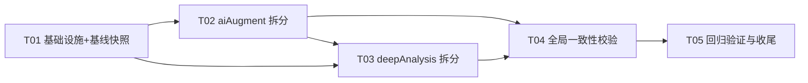

# Stock Analyzer 代码审查 · 第 01 部分 / 共 4 部分

> 本部分含若干完整文件，断点位于文件边界，可独立上传；所有部分拼合即完整代码。

# Stock Analyzer 完整代码（合并版 · 供 AI 审查上传）

本文件由 docs/code-review 下各分卷按子系统顺序合并，含全部 470 个源文件的完整内容（已排除 node_modules/.venv_akshare/data/.git/.workbuddy/package-lock.json）。

# 项目文档（docs/） · 第 1 卷

> 共 50 个文件，本卷约 13618 行


---

## `docs\logic\_template.md`  ·  43 行

~~~md
# <模块名> · 反向逻辑说明

> 逻辑模型位置：<L1 页面> → <模块名>（badge：<角标>）
> 实现文件：<lib/routes/public 文件清单>
> 口径出处：全部标注 `file:line`；查无出处标「⚠️ 待核实」，禁止臆断

## 一、界面元素 → 产生规则

| 界面元素 | 含义与规则 | 出处 |
|---|---|---|
| <截图/页面上看到的每个数字、标签、颜色、排序> | <它由什么规则产生> | <file:line> |

## 二、核心公式 / 判定链

<逐步列出：取数 → 计算 → 阈值 → 方向/等级判据；每个阈值给出来源>

## 三、指标 / 因子口径

| 指标/因子 | 口径（原始值怎么算） | 归一化 | 是否进总分 | 出处 |
|---|---|---|---|---|

## 四、数据来源与采集链

| 层 | 内容 |
|---|---|
| 数据源 | <外部源 + 字段> |
| 采集/落盘 | <脚本/文件/频率/超时> |
| 调度 | <何时触发、防并发、过期重采> |
| 前端取数 | <API + 刷新方式> |

## 五、降级 / 容错 / 诚实性设计

<数据缺失时会发生什么；哪些情况明示失败；哪些情况兜底；兜底是否会误导解读>

## 六、逻辑漏洞自查清单（审计用）

- [ ] <检查点：一个可对着代码验证的假设/阈值/边界/依赖，带 file:line>

## 七、可配置项

| 配置 | 默认值 | 位置 |
|---|---|---|

~~~

---

## `docs\logic\common-01-data-source.md`  ·  190 行

~~~md
# 数据源接入（五要素 / TTL / 缓存）· 反向逻辑说明

> 逻辑模型位置：跨页面公共支撑 → 🗄️ 数据源接入（badge：公共支撑）
> 实现文件：lib/db.js、lib/stockData.js、lib/ai/cache.js、lib/miaoxiang.js、lib/cninfoAnnouncements.js、server.js（交易日守卫/落盘）
> 口径出处：全部标注 `file:line`；查无出处标「⚠️ 待核实」，禁止臆断

## 一、界面元素 → 产生规则

| 界面元素 | 含义与规则 | 出处 |
|---|---|---|
| 任意页面上的「实时性 / 已过期」色带、freshnessRows 时效条 | 由各模块对 `valid_until` 判定 `isFresh` 后渲染 | lib/db.js:165 |
| 个股页数据上的「截至 YYYY-MM-DD」来源标注 | 落库时写入 `as_of`（数据实际日期）+ `fetched_at`（抓取时间），二者分离 | lib/db.js:52,65,67 |
| 「⚠️ 数据已过期」提示 | `staleLabel` 在 `checkFreshness` 过期为 true 时生成 | ruleCore.js:107 |
| 深度分析页「正在重算 / 版本不符自动刷新」 | 深度分析缓存仅 `APP_VERSION` 版本门控，无时间 TTL | server.js:1111-1136 |
| AI 估值/财报/研报「点 ✨ 才联网」 | AI 只读缓存版本+TTL 双重门控，失效/过期/无缓存才回源 | lib/ai/cache.js:44-45 |

## 二、核心公式 / 判定链

**1. 五要素落点（一致性铁律）**
每条数据带 名称 / 数值 / 实际时间(as_of) / 来源(source) / 获取时间(fetched_at)，对应 `data_points` 表字段（lib/db.js:52,65,67）。「最新性」由 `valid_until` 表达。

**2. TTL 过期判定链**
- 写入时推算 `valid_until = now + ttlMs(ttlType)`（lib/db.js:151）。
- 读取时 `isFresh = valid_until > Date.now()`（lib/db.js:165）。
- `isFresh=false` → 路由层返回「需重拉」提示（server.js:1257）。

**3. 交易日感知（防误标过期）**
- `isTradingDayToday()` 三态（true/false/null）：上证日K 最新日期==今天 ⇒ 开过盘（server.js:2142-2145）；双通道均失败 ⇒ 返回 null（**判断失败≠非交易日**，server.js:2129-2131,2151）。
- `countTradingDaysBetween` 为 0 时保守判「仍为最新可得」，不误标过期（ruleCore.js:94）。

## 三、指标 / 因子口径

| 指标/缓存 | TTL / 时效 | 是否进总分 | 出处 |
|---|---|---|---|
| 行情实时 quote | 5 分钟 | — | lib/db.js:21 |
| 日线 daily | 24 小时 | — | lib/db.js:22 |
| 周线 weekly | 7 天 | — | lib/db.js:23 |
| 财务 financial | 90 天 | — | lib/db.js:24 |
| 公司 company | 30 天 | — | lib/db.js:25 |
| AI 补全结果 | 7 天 | — | lib/ai/config.js:42 |
| 研报/公告/公司介绍/供应链（半静态） | 30 天 | — | lib/ai/config.js:45 |
| cninfo 公告内存 | 10 分钟 | — | lib/cninfoAnnouncements.js:14 |
| 东财 TTM 估值 Map | 6 小时 | — | lib/eastmoneyValuation.js:9 |
| 板块排名内存（同花顺/东财/腾讯） | 30 秒 | — | lib/stockData.js:783,1043,1150 |
| 交易日判断（false 态） | 10 分钟 | — | server.js:2135 |
| 深度分析缓存 | 无时间 TTL，仅 `APP_VERSION` 版本门控 | — | server.js:1127 |
| 板块排名三套 | 30 秒（now - ts < 30000） | — | lib/stockData.js:783,1043,1150 |

> 全局未检索到 `expiresIn` / `staleAfter` / `maxAge` 命名；TTL 全部以自定义常量/毫秒差值实现。⚠️ 如需精确单值，以各文件常量定义为准。

## 四、数据来源与采集链

| 层 | 内容 | 出处 |
|---|---|---|
| 数据源① 腾讯 qt.gtimg.cn（主行情） | 个股实时行情 `getQuote`→`fetchTencentQuote`，GBK 解码 `iconv.decode(...,'GBK')`；K线 `ifzq.gtimg.cn` | lib/stockData.js:267,273-274,1201,1366,1398 |
| 数据源② 东方财富 | 资金流 `push2his.eastmoney.com`（Node TLS 被拦，curl 兜底 lib/capitalFlow.js:40）；TTM 估值 `datacenter-web.eastmoney.com`（lib/eastmoneyValuation.js:45）；涨停/跌停池 `push2ex.eastmoney.com`（lib/stockData.js:991-1039）；板块排名（lib/stockData.js:1041） | 各文件 |
| 数据源③ 妙想金融数据（东财妙想 MCP） | 纯 Node 客户端，基址 `ai-saas.eastmoney.com`，子路由 `/api/miaoxiang/*` | lib/miaoxiang.js:20；routes/aiRoutes.js:303-352 |
| 数据源④ cninfo 巨潮 | 经 `scripts/cninfo_announcements.py` 取数，失败返回 `{ok:false}` 不影响个股页 | lib/cninfoAnnouncements.js:1-5,29,39 |
| 数据源⑤ akshare（Python） | 行业板块涨跌（sectorTrend.js:4）、指数历史（industryIndexHistory.js:63）、拥挤度（sectorCrowding.js:205）、舆情（sentiment.js:4）、周榜（hotTopicsWeekly/index.js:58） | 各文件 |
| 兜底源 | 腾讯整批失败→新浪整批兜底（lib/stockData.js:531）；美股腾讯→雅虎（lib/stockData.js:1936,2028）；历史 腾讯→东财(重试)→新浪 | lib/stockData.js |
| 落盘 | SQLite 主库 `data/stock_analyzer.db`（lib/db.js:15）；AI 只读缓存 `data/ai_cache/`；深度分析 `data/cache/deep-analysis/`；行业 `data/cache/industry_*`；F10 `data/f10-status/`；指数 `data/index_cache/` | 各文件 |
| 调度 | 过期重采（isFresh=false / 版本不符 / 核心数据空 / 交易日守卫 / 事件变更 invalidate / `?refresh=1`）；定时任务 15:30 盘后落盘（server.js:2191-2262）、事件扫描四槽位（server.js:2266-2291） | server.js |

### 4.x 腾讯 K 线「主机族」降级（20261021g）

`ifzq.gtimg.cn/appstock/app/fqkline/get` 曾对**所有代码**整段返回 **HTTP 501**（sh000001 / sz399001 / sh600519 / sz000902 全是 501），而**同一路径**在 `web.ifzq.gtimg.cn` 正常 200。两个域名历史上此消彼长，写死任何一个都会在某天让「个股日K / 大盘技术分析 / 市场情绪量价因子 / 准确率结算」同时降级，而日志里只有一条 `Request failed with status code 501`，极易被误判成业务 bug。

- 统一入口：`lib/tklineHost.js#getKlineJson(pathQuery, axiosOpts)` → 依次尝试 `ifzq.gtimg.cn` → `web.ifzq.gtimg.cn`，**只换主机、不改路径与参数**，调用方拿到的仍是原响应体。
- 只对 5xx / 网络错误换主机；4xx 是参数问题，换主机没用，直接抛。
- 接入点：`lib/stockData.js`（两处日K）、`lib/marketTechnical.js#fetchKline`、`lib/marketTechJudgment.js#fetchIndexDaily`、`lib/deep/yield.js#fetchBfqBars`、`server.js#_lastTradeDateViaFetch`。
- `mkline`（分钟）与 `minute/query`（分时）不在同一路径、未被封，保持原样。
- 守卫：`scripts/test_tkline_host.js`（28 项）断言五个调用点**不再出现裸 ifzq fqkline URL**。

### 4.y 成交量「单位契约」（20261021h）

同一份「成交量」在不同接口相差 100 倍是历史常客，一旦跨通道比较就会产生「7,358,800 小于 170,850」这类荒谬结论。

| 来源 | 单位 | 反验方式 |
|---|---|---|
| 东财 kline `f56` | **手** | 73,588 手 × 13.87 × 100 = 1.02 亿 = 实时成交额 |
| 腾讯 `fetchTencentHistory`（已归一） | **手** | 科创板 688/689 的「股」在取数时 ÷100 |
| 同花顺 `last.js` | **股** | 量级恒为东财的约 100 倍 |
| 实时 quote（腾讯快照 fields[36]） | **股** | 与日K手数恒差 100 倍 |

- 唯一入口：`lib/volUnit.js`（`BAR_VOL_UNIT` / `sharesToBarUnit` / `toLotDivisor`）。**禁止**再按"是否 tencent"二分。
- `_reconcileTodayBar` 覆写当日K线前先换算；换算后若与当日 bar 相差 >20 倍，判为单位异常 → **拒绝覆写**，写 `unit_mismatch` 进 dataGaps（序列绝不被污染）。
- 守卫：`scripts/test_volume_unit_contract.js`（28 项）覆盖单位表、三通道覆写、量级守卫、capitalFlow 同源、源码防回潮、文案自洽。

### 4.z 同花顺日K「样本一直 140 天」与历史段回填（20261022e）

用户报障「成交额/换手率样本一直停在 140 天」。根因两层：

1. **结构闸门过严（真因）**：`all.js` 收盘前后偶发 `sortYear` 年度计数比 `dates/volumn` 多 1~2 条（当日条目已计入年度计数、尚未落入数组）。旧 `_decodeThsAll` 要求 `sum(sortYear) === dates.length`，不符即 `return null` → 历史段整段拿不到，只剩 `last.js` 的 140 根。
2. **只有 last.js 带成交额/换手率**：`all.js` 历史段是纯 OHLCV；即便解码成功，250 日窗口里仍只有 140 天有值。

修法：

- `_decodeThsAll` 容忍「末尾多计 ≤2」：从最后一年计数扣掉；**欠计或差 >2 仍拒绝**；年份映射正确性由 `_mergeThsBars` 的重叠段 close 闸门兜底（不通则不采信）。
- 新增 `_backfillThsFields`（`_mergeThsBars` 末尾调用）：用 `last.js` 反推流通盘（`volume ÷ (turnover/100)` 中位数；跨期离散 >3% 则放弃回填换手率），历史段 `turnover = volume / 流通盘 × 100`、`amount = volume × close`；打标 `amountEstimated/turnoverEstimated`，引擎在 dataGaps 如实披露「推算值，跨除权日可能数%偏差」。
- 实测 603288：250 日换手率/成交额样本均 **250**（原 140），历史段 180 根为推算；`all.js` 与 `last.js` 重叠 140 根成交量逐根一致、隐含流通盘跨期离散仅 0.72%、`volume×close` 与真实成交额偏差 1.09%。
- 守卫：`scripts/test_ths_backfill.js`（17 项）+ `test_ths_kline.js`（50 项，含「末尾多计 1 → 容忍 / 多计 3 → null」）。
- 注意：`all.js` 高频请求会触发同花顺 502（限流）；已由 §4.aa 本地缓存彻底规避，失败时仍自动退回 140 根并如实标注。
- **20261023f 改进**：历史段 `amount` 改用腾讯「不复权」日K收盘价还原（`fetchTencentRawCloseMap`）——同花顺 all.js 是**前复权**价，`volume×前复权close` 会低估约 2~3.5%；腾讯 `day`（不带 qfq）与交易所同口径，实测偏差 **<1%**。`turnover` 仍按流通盘推算（实测一致）。打标 `amountBasis: 'raw_close' | 'qfq_close'`，引擎据此把该条从「推算值（数据不足）」降级为「来源与口径说明」。


### 4.aa 同花顺日K原始响应本地缓存（20261022f，避开 all.js 502 限流）

**问题**：`all.js` 频繁请求会触发同花顺 502。实测确认是**限流**而非头部/代理差异（同一时刻 axios 502、curl 200、裸 `node:http` 200）。
根因是页面反复加载都重新拉同一份数据（`all.js` 单股 87–194 KB）。

**方案（用户选定「C 方案：存原始文本」）**：把 `last.js` / `all.js` 的 **JSONP 原始字符串**落盘到
`data/cache/ths-daily/<6位代码>.json`，读缓存后走**同一套** `_unwrapThsJsonp → _decodeThsAll → _mergeThsBars`
解码与 close 闸门，只在「文本从哪来」这一处分叉。因此缓存结果与实时拉取**逐字节一致**，
不会出现「解码逻辑改了、旧缓存按旧逻辑算」的口径漂移。

**为什么不存解码结果**（实测单股体积，603288/601318/600519）：

| 形态 | 单股体积 |
|---|---|
| `last.js` + `all.js` 原始文本 | **约 148 KB（最小）** |
| 解码后精简 `{d,o,h,l,c,v}` 全量 | 约 334 KB |
| 解码后完整字段 全量 | 约 556 KB |
| 只留引擎要的 320 根完整字段 | 约 35 KB |

容量结论：9 只自选 ≈ 1.3 MB、31 只 ≈ 4.6 MB、200 只 ≈ 30 MB。
**每只股票固定一个文件、每日覆盖写**，不随天数累积。

**三段式刷新节奏**（`thsDailyCache.resolveSlot`，交易日 + 时段）：

| 时刻 | phase | 行为 |
|---|---|---|
| 交易日 09:30–15:04 | `intraday` | 当天首次抓取后整个盘中复用 |
| 交易日 ≥15:05 | `closed` | 盘中缓存作废，补抓一次拿当日完整收盘K，之后复用 |
| 非交易日（周末/长假） | `closed` | 锚定 `previousTradingDay`，全程复用同一份 |

→ 每只股票每个交易日**最多 2 次请求**（正常 1 次），脱离 502 限流区间。

**盘中缓存可直接复用为何安全**：20261022c 已确立「有效突破/破位/打穿只认当日收盘价」，
`zoneValidity.finalizedBars` 会剔除当日未收盘K，盘中那份当日数据本就不参与判定；
展示层当日价格由腾讯实时 quote 覆写，不受日K快照影响。

**三条防线**：
1. **残缺缓存不认**：`all.js` 缺失（当场拉取失败）→ `isFresh` 返回 `incomplete_all`，不写也不命中，
   避免一整天卡在「只有 140 根」。
2. **失败退避**：`all.js` 拉取失败后 2 分钟内不再重试（内存态 `_thsAllBackoff`，不落盘），
   期间只用 `last.js` 的 140 根并如实标注样本不足；到期自动恢复。
3. **并发去重**：`_thsRawInFlight` 让同一次页面加载里多个模块对同一代码只发一轮请求。

**实测（2026-10-22，603288）**：
- 并发 3 个请求 → 网络仅 2 次（last+all 各一次），三份结果指纹一致；
- 缓存命中再请求 3 次 → **网络 0 次**，耗时 3–7 ms，320 根与首次**逐字节一致**，250/120 根为正确尾部切片；
- 缓存文件 97.0 KB（last 10.1 KB + all 86.6 KB + 结构开销）；成交额/换手率样本 320/320（含 180 根推算标记）；
- 删缓存 → 重新联网 2 次且结果与首次一致；缓存命中平均 3.0 ms/次（全量解码 3088 根 + 合并 + 回填）；
- 模拟 all.js 502 → 140 根、不写残缺缓存、退避期内 all.js 尝试增量 0；模拟 3 分钟后 → 自动恢复 320 根并写缓存。

**守卫**：`scripts/test_ths_daily_cache.js`（62 项：slot 边界、未命中原因枚举、读写往返、损坏降级、原子写无 `.tmp` 残留、元信息不外泄原始文本）。


## 五、降级 / 容错 / 诚实性设计

- **回退链**：`getQuote` 腾讯→雅虎；`getHistory` CN/HK 腾讯→东财(重试)→新浪；板块排名 同花顺→东财→腾讯→合成空块；涨停池单池失败对应字段 `null`（前端不渲染）。
- **核心数据为空**：`isAnalysisCacheValid` 返回 false（server.js:1115-1116）→ 不命中、强制重算，防空白图卡冻结。
- **抓取失败不编造**：估值失败时返回 `ok:false, note:'⚠️ 未能获取估值数据，本次不输出估值结论'` 而非零值聚合（valuationHub.js:67-74）。
- **⚠️ 防并发锁缺失（全局）**：全局未检索到 singleflight / dedup / mutex / in-flight 去重（仅 SQLite WAL + `busy_timeout=5000` lib/db.js:42-43 与顺序 try/catch 回退）。深度分析同 symbol 多并发未命中缓存时会各自重算（server.js:1276-1338），存在重复计算/瞬时负载风险。
  - 例外（20261022f 已局部解决）：同花顺日K通道已有 in-flight 去重 `_thsRawInFlight`（lib/stockData.js），同一代码并发请求共享同一轮取数。该去重**仅覆盖此通道**，不改变上述全局结论。

## 六、逻辑漏洞自查清单（审计用）

- [x] ~~**⚠️ 涨停板池数据源记忆不符（已核实撤回）**：原疑「home-06 记反 akshare 涨停池」，实查 home-06 用东财 7×24 快讯（newsSearch.js:71），文档正确；`lib/stockData.js:991` 的 push2ex 是「当日最多涨停/跌停板块」大盘面板功能，与周榜无关；`stock_zt_pool_em` 真实用于 sector_limit_stats.py:161（板块涨停潮因子）/ sentiment.py:189 / market_emotion.py:83（炸板池），非周榜。用户记忆的「akshare 涨停板池」是已被 hotTopicsWeekly（home-07 快讯×4+社区×2）替换的旧「今日最热股票话题」设计~~ → 属记忆滞后，无文档需修正
- [ ] TTL 是否覆盖所有缓存：板块排名 30s 内存缓存与落盘 SQLite 的 TTL 是否一致？跨进程重启后内存缓存失效是否导致首屏抖动？
- [ ] `isTradingDayToday` 返回 null（双通道失败）时，盘后落盘守卫是否误拒（server.js:2091-2151）？
- [ ] 防并发锁缺失是否在大盘技术/深度分析重算高峰导致重复 LLM 调用/CPU 尖峰（见第五节）。
- [ ] 「五要素」中 `source` 字段是否在所有写入路径都如实填写，还是部分路径留空导致来源标注失效？
- [ ] 深度分析仅 `APP_VERSION` 门控、无时间 TTL：若用户长期不刷新但代码未升版，陈旧财务结论会一直展示（server.js:1127）。

## 七、可配置项

| 配置 | 默认值 | 位置 |
|---|---|---|
| TTL 各档（realtime/daily/weekly/financial/company） | 5m/24h/7d/90d/30d | lib/db.js:21-25 |
| AI 补全 TTL / 半静态 TTL | 7d / 30d | lib/ai/config.js:42,45 |
| 东财估值 Map TTL | 6h | lib/eastmoneyValuation.js:9 |
| cninfo 公告缓存 TTL | 10min | lib/cninfoAnnouncements.js:14 |
| 板块排名内存 TTL | 30s | lib/stockData.js:783,1043,1150 |
| 同花顺日K缓存：收盘定稿时刻 | 15:05 | lib/thsDailyCache.js:CLOSE_HHMM |
| 同花顺日K缓存：硬过期兜底 | 15 天 | lib/thsDailyCache.js:MAX_AGE_MS |
| 同花顺 all.js 失败退避 | 2 分钟 | lib/stockData.js:THS_ALL_BACKOFF_MS |
| APP_VERSION（缓存破坏戳） | `20261022f` | server.js:108 |
| SQLite busy_timeout | 5000ms | lib/db.js:42-43 |

~~~

---

## `docs\logic\common-02-api.md`  ·  96 行

~~~md
# API 层（Express 路由）· 反向逻辑说明

> 逻辑模型位置：跨页面公共支撑 → 🔌 API 层（badge：公共支撑）
> 实现文件：server.js、routes/aiRoutes.js、routes/eventRoutes.js、routes/dedicatedFactor.js、routes/docsRoutes.js
> 口径出处：全部标注 `file:line`；查无出处标「⚠️ 待核实」，禁止臆断

## 一、界面元素 → 产生规则

| 界面元素 | 含义与规则 | 出处 |
|---|---|---|
| 任意前端请求返回 JSON | 各 `/api/*` 缺失具体资源时返回 `{error:...}` JSON（非 HTML） | server.js:165, docsRoutes.js:270-272 |
| 浏览器地址栏 `/` 自动带 `?v=20261016a` | 入口重定向中间件：访问 `/` 且 `?v != APP_VERSION` → 302 重定向补版本号 | server.js:99-104 |
| `/js/app.js` 等前端资源强制 `?v=` | `FRONTEND_BUST_FILES` 白名单不匹配版本号即 302 补 `?v=` | server.js:109-120 |
| 未知路径打开「白屏但能进前端路由」 | SPA 兜底：未命中任何 API/静态资源 → 返回 `public/index.html`（前端接管） | server.js:1925-1927 |
| 后端 500 返回 JSON 而非 HTML 错误页 | 全局错误中间件统一 `res.status(500).json(...)` | server.js:2373-2378 |
| 端口 3005 仅在本地回环监听 | `app.listen(port,'127.0.0.1')`（20261007a 修复原 0.0.0.0 全网可达） | server.js:2390 |

## 二、核心公式 / 判定链

**请求生命周期（从前到后）**
1. 入口缓存破坏：`/` 与 `FRONTEND_BUST_FILES` 强制 `?v=` 重定向（server.js:99-120）。
2. API 中间件：所有 `/api` 统一 `Cache-Control: no-store`（server.js:89-93）。
3. 静态资源托管：`public/`，JS/CSS/HTML 设 `no-store`（server.js:122-133）。
4. 业务路由匹配（见第三节清单）。
5. 异步路由自带 `try/catch` 返回 JSON（Express 4 不自动捕获 async rejection，server.js:2370）。
6. SPA 兜底（server.js:1925）；全局错误中间件兜底（server.js:2373）。
7. `unhandledRejection` 仅记录不崩溃（server.js:2380-2383）。

## 三、指标 / 因子口径（路由清单）

> 绝大多数处理器为 server.js / 子路由内联箭头函数（无独立命名函数）。

### server.js 直挂路由（节选高频）
| 方法 | 路径 | file:line |
|---|---|---|
| GET | /api/health | server.js:139 |
| GET | /api/quote/:symbol | server.js:162 |
| GET | /api/history/:symbol | server.js:174 |
| GET | /api/deep-analysis/:symbol | server.js:1276 |
| GET | /api/sameday-judgment/:symbol | server.js:516 |
| GET | /api/long-term-judgment/:symbol | server.js:542 |
| GET | /api/capital-flow/:symbol | server.js:1777 |
| GET | /api/industry-analysis/:symbol | server.js:1758 |
| GET | /api/shareholders/:symbol | server.js:674 |
| GET | /api/company-profile/:symbol | server.js:687 |
| GET | /api/announcements/:symbol | server.js:413 |
| GET | /api/macro-data | server.js:402 |
| GET | /api/db/datapoints/:symbol（附 isFresh） | server.js:1249 |
| GET/POST | /api/market-rank | server.js:444,453 |
| POST | /api/backtest-validate | server.js:637 |
| GET | *（SPA 兜底） | server.js:1925 |

### 子路由器挂载
| 挂载点 | file:line | 路由文件 |
|---|---|---|
| aiRoutes | server.js:1035 | routes/aiRoutes.js（/api/ai/*、/api/miaoxiang/*） |
| eventRoutes | server.js:1037 | routes/eventRoutes.js（/api/events/*） |
| dedicatedFactorRoutes | server.js:1038 | routes/dedicatedFactor.js（/api/dedicated/*） |
| docsRoutes | server.js:1811 | routes/docsRoutes.js（/api/docs/*，F10/资料库） |

> 完整路由（约 90+ 条）见各文件。⚠️ 无独立 `/api/accuracy`、`/api/judgments` 路由（见 common-06 / page-01/02）。

## 四、数据来源与采集链

| 层 | 内容 | 出处 |
|---|---|---|
| 前端取数 | 各页面 JS 经 `fetch('/api/...')` 取数，缓存破坏靠 `?v=` 强制刷新 | server.js:99-120 |
| 后端处理 | 路由内联函数调用 lib/ 层（getQuote、各 judgment、deepAnalysis 等） | server.js 各路由 |
| 落盘/回源 | 业务结果经 lib/db.js（SQLite）或内存缓存，必要时回源外部 API | lib/db.js |
| 静态托管 | public/ 目录（express.static） | server.js:122-133 |

## 五、降级 / 容错 / 诚实性设计

- **SPA 兜底返回 HTML 非 JSON**：未知路径一律回 `index.html`（server.js:1925）。⚠️ 这意味着用 curl 试探不存在的 `/api/xxx` 若路径未以 `/api` 前缀命中则返回 HTML，需用正确 `/api` 前缀路径（如 `/api/quote/:symbol` 而非 `/api/stock/:symbol`）。
- **全局错误中间件统一 JSON**：避免 Express 默认 HTML 错误页 / 前端把 HTML 当 JSON 解析（server.js:2373-2378）。
- **unhandledRejection 不崩溃**：长驻服务稳定性保护（server.js:2380-2383）。
- **API 禁用浏览器缓存**：`/api` 全量 `no-store`，避免旧响应误导（server.js:89-93）。

## 六、逻辑漏洞自查清单（审计用）

- [ ] SPA 兜底是否会导致「API 路径拼写错误」被前端静默接管（返回 HTML 而非 JSON 报错）？前端 fetch 非 `/api` 前缀路径失败时是否按 HTML 解析报错（stock-01/02 文档曾记录 `/api/stock/` 返回 HTML 的坑）。
- [ ] `APP_VERSION` 升版是否覆盖全部前端资源（`FRONTEND_BUST_FILES` 白名单是否含本次改动的所有 .js/.css）？遗漏会导致旧缓存复用。
- [ ] 端口仅回环 `127.0.0.1`：局域网/手机端访问是否因此不可达（memory 提到手机 APP 云端模式，需确认云端转发而非直连本机端口）。
- [ ] 端口占用顺延逻辑 `startServer(port, retries=5)`（server.js:2385,2472）：顺延后实际端口是否与 `data/.server-port` 记录一致？前端是否依赖固定 3005？
- [ ] 异步路由若遗漏 try/catch，rejection 是否会落入全局中间件但仍可能已 `res.headersSent`（server.js:2373 有 `if (res.headersSent) return next(err)` 保护）。

## 七、可配置项

| 配置 | 默认值 | 位置 |
|---|---|---|
| PORT | 3005（环境变量 PORT 可覆盖） | server.js:84 |
| 监听地址 | 127.0.0.1（仅回环） | server.js:2390 |
| APP_VERSION（缓存破坏戳） | `20261016a` | server.js:98 |
| FRONTEND_BUST_FILES 白名单 | /js/app.js、/css/style.css、/icon.png 等 | server.js:109 |
| 端口顺延上限 | retries=5 | server.js:2385 |

~~~

---

## `docs\logic\common-03-ai.md`  ·  82 行

~~~md
# AI 叙事层 · 反向逻辑说明

> 逻辑模型位置：跨页面公共支撑 → 🤖 AI 叙事层（badge：公共支撑）
> 实现文件：lib/ai/config.js、lib/ai/llm.js、lib/ai/augmentStock.js、lib/ai/companyDeep.js、lib/ai/earnings.js、lib/ai/valuation.js、lib/hotTopics.js、lib/ai/cache.js、public/js/logicModel.js
> 口径出处：全部标注 `file:line`；查无出处标「⚠️ 待核实」，禁止臆断

## 一、界面元素 → 产生规则

| 界面元素 | 含义与规则 | 出处 |
|---|---|---|
| 个股页「⚠️ 尚未配置 AI API Key…」占位 | 无 Key 时前端展示配置提示 | public/js/app.js:1706,3909,4005,5274 |
| 亮点/雷点卡文本 | `analyzeAspects` 生成（POST /api/ai/aspects），GET 只读缓存不限 TTL | lib/ai/augmentStock.js:273,418-424 |
| 深度分析「AI 估值摘要」框（利好红/利空绿/重点黄） | 由 earnings/research/announcements 缓存段落组合，纯叙事着色 | lib/deep/pipeline.js（见 stock-11） |
| 个股页「正在后台联网生成…」 | `_triggerAi` 触发，失败降级提示 | deepCharts.js:1485-1539 |
| 近期热点卡「未配置 AI Key，无法自动联网归因」 | `hotTopics` noKey 写盘占位 | lib/hotTopics.js:397-406 |

## 二、核心公式 / 判定链

**叙事边界铁律（确定性由代码，LLM 仅叙事）**
- 逻辑模型弹层明确「大模型只把确定性计算结果讲成人话；所有数字以代码输出为准」（public/js/logicModel.js:251-255）。
- 代码权威校验：augmentStock.js 对 AI 输出的「资产负债率」与权威快照偏差 >1pp 直接修正并标 `financeCorrected`（lib/ai/augmentStock.js:386-401）；earnings.js 注入「确定性代码核算的单季数据」禁用跨口径比较（lib/ai/earnings.js:496,549）；companyDeep.js 对 LLM 返回做代码兜底 `flags`（lib/ai/companyDeep.js:128,137,430）。

**LLM 调用封装**
- 客户端按 provider 选服务商 URL（qwen/glm/openai），未配置兜底 `qwen-plus`（lib/ai/config.js:66-85）。
- 单次硬超时默认 180000ms（180s）（lib/ai/llm.js:430-431）。
- API Key 从本机 `data/ai_config.json` 读取（**非环境变量**，lib/ai/config.js:37,107-127）；前端只回显 `hasKey`（config.js:165-179）。

## 三、指标 / 因子口径（AI 能力入口）

| 能力 | 入口函数 file:line | 触发方式 | 默认超时 |
|---|---|---|---|
| 亮点/雷点 aspects | augmentStock.js:273 analyzeAspects | POST /api/ai/aspects（aiRoutes.js:93）；GET 只读缓存（:113） | 240s（:339） |
| 公司深度七段 companyDeep | companyDeep.js:188 analyzeCompanyDeep | POST /api/ai/company-deep（aiRoutes.js:123）；GET 只读（:224） | 240s（:244/256） |
| 财报解读 earnings | earnings.js:515 analyzeEarningsReport | POST /api/ai/earnings（aiRoutes.js:283）；readEarningsCache（:293） | 180s（:562） |
| AI 估值叙事 valuation | valuation.js:377 analyzeValuation | POST /api/ai/valuation（aiRoutes.js:134） | 180s（:377） |
| 异动归因 hotTopics | hotTopics.js analyzePriceChange | 个股页近期热点卡异步加载 | 跟随默认 180s |
| 事件分流 llmTriage | eventEngine.js:464 | 定时 scanEvents（server.js:2297） | 180s（:479） |

> 各能力超时可覆写：aspects/companyDeep 用 240s，并传 `overallBudgetMs:300000` 整链路预算（augmentStock.js:339），避免串行重试累计超 16 分钟无响应。

## 四、数据来源与采集链

| 层 | 内容 | 出处 |
|---|---|---|
| 配置 | `data/ai_config.json`（provider/apiKey/modelWeb/modelLocal/searchMode/volc*/baidu*） | lib/ai/config.js:37；index.html:1082-1142 |
| 缓存 | AI 只读缓存 `data/ai_cache/`（readCache 不联网不限 TTL）；估值缓存版本+TTL 双重门控（ver!=VALUATION_VER 或超 30d → null） | lib/ai/cache.js:16,44-45 |
| 调度 | 后台定时 LLM 经 `SA_NO_BG_AI=1` 开关禁用（防静默计费，server.js:2267/2308）；事件扫描四槽位（server.js:2266-2291） | server.js |
| 前端取数 | 各页面 JS fetch 对应 `/api/ai/*` | routes/aiRoutes.js |

## 五、降级 / 容错 / 诚实性设计

- **无 Key 行为分两类**（易混淆，需区分）：
  - aspects/companyDeep/earnings：**直接返回 NO_KEY 错误，不写盘**（augmentStock.js:276-278；companyDeep.js:191-193；earnings.js:518-520）。
  - hotTopics 近期热点：**写盘 noKey 占位并复用**（hotTopics.js:397-406）。⚠️ 此即 stock-02 文档 T6 记的「noKey 结果写盘且缓存复用不排除 noKey → 当日归因被占位毒化，配好 Key 也须点 🔄」，仍需修复。
- **失败兜底**：
  - aspects 超时/失败先回退上次成功结果并标 `stale`，无历史返 `{error:'API_ERROR'}`（augmentStock.js:418-427）。
  - companyDeep 联网失败且本地事实可用 → 降级本地纯推理（companyDeep.js:245-259）。
  - earnings 失败直接返错误，**无 stale 兜底、不写盘**（earnings.js:599-605）。
  - eventEngine.llmTriage 失败 catch 返空 → 该批候选一律不认（保守「不确定归零」，eventEngine.js:497-499）。
- **全局兜底**：postLLM 带能力自学习，遇 400 自动去 enable_search 或切流式重试最多 4 次；外部搜索通道失败一律降级纯推理，**绝不静默升级内置 enable_search 防扣费**（llm.js:201-239,306-466）。

## 六、逻辑漏洞自查清单（审计用）

- [ ] **⚠️ 事件分流模型名记忆不符**：用户记忆称「本地 LLM 事件分流用 `qwen3-vl-235b-a22b-thinking`，超时 180s」，但全项目 grep 无此模型名；实际取 `cfg.modelLocal`（eventEngine.js:474），磁盘 `data/ai_config.json:5` 为 `qwen3-vl-plus`，超时 180000ms 属实（eventEngine.js:479）。需核实记忆中模型名是否为旧版本/误记。
- [ ] **T6（noKey 毒化）**：hotTopics.js:397-406 写盘 noKey 占位，缓存复用排除条件 `!cache.noKey`（hotTopics.js:445）仅防「旧 noKey 当成功」，但「无缓存时仍写新 noKey 占位」——配 Key 后必须点 🔄 才更新（stock-02 T6 已记，待修）。
- [ ] AI 估值缓存版本 `VALUATION_VER='v4'`（cache.js:60）、earnings 版本 `EARNINGS_PROMPT_VERSION='20260909i'`（cache.js:57）：改 prompt 是否同步升版？漏升会导致旧缓存被误用。
- [ ] aspects 只读缓存「不限 TTL」（augmentStock.js:418-424）：AI 结论长期不刷新是否导致 stale 文本误导？前端是否给出「数据时间」提示？
- [ ] 叙事边界是否在所有 AI 入口都强制：是否存在 LLM 输出数字被前端直接当权威值展示而绕过代码核算的入口？

## 七、可配置项

| 配置 | 默认值 | 位置 |
|---|---|---|
| LLM 单次超时 | 180000ms（各入口可覆写 240s） | lib/ai/llm.js:430-431；augmentStock.js:339 |
| AI 完成后端总预算 | 300000ms（仅 aspects 传 overallBudgetMs） | augmentStock.js:339 |
| 默认模型 | qwen-plus（qwen-max 实测 403） | lib/ai/config.js:70 |
| API Key 存储 | data/ai_config.json（明文本机） | lib/ai/config.js:37 |
| 后台 AI 开关 | SA_NO_BG_AI=1 禁用 | server.js:2267/2308 |
| 估值缓存版本 VALUATION_VER | v4 | lib/ai/cache.js:60 |
| earnings 提示版本 | 20260909i | lib/ai/cache.js:57 |
| AI 补全 TTL / 半静态 TTL | 7d / 30d | lib/ai/config.js:42,45 |

~~~

---

## `docs\logic\common-04-event-engine.md`  ·  111 行

~~~md
# 事件驱动引擎 · 反向逻辑说明

> 逻辑模型位置：跨页面公共支撑 → ⚙️ 事件驱动引擎（badge：公共支撑）
> 实现文件：lib/eventEngine.js、lib/newsSearch.js、routes/eventRoutes.js、server.js（调度）、lib/sameDayJudgment.js、lib/longTermJudgment.js、lib/dedicatedFactor.js
> 口径出处：全部标注 `file:line`；查无出处标「⚠️ 待核实」，禁止臆断

## 一、界面元素 → 产生规则

| 界面元素 | 含义与规则 | 出处 |
|---|---|---|
| 个股页「事件驱动」因子卡片 | 事件引擎产出 `event` 非常驻因子，注入短期/长期判断权重再平衡 | eventEngine.js:876-938 |
| 事件卡片「影响评级（major/moderate/minor）」 | 五维 severity 总分 → 阈值分级 → 受 typeCeiling 硬压顶 | eventEngine.js:567-582 |
| 事件卡片「讨论热度」标注 | forumHeat 联网核验（东财股吧/同花顺/雪球/新浪），热度=0 降级 | eventEngine.js:530-547,694-699 |
| 事件扫描后「短期判断自动作废重算」 | scanEvents 后 `invalidateJudgmentForSymbol`（server.js:2299） | routes/eventRoutes.js:60 |
| 页面独立事件 widget（非因子权重） | 深度分析页事件仅作展示 widget，未并入因子权重（见第六/二节） | routes/eventRoutes.js |

## 二、核心公式 / 判定链

**事件生命周期：新闻 → 识别分类 → 权重再平衡 → 影响评分**

1. **抓取**：`getHotNews` 主源东财 7×24 快讯 `fetchKuaixunNews`（newsSearch.js:71-77）；兜底东财内容搜索（newsSearch.js:126-130）；本地 TTL 10min（newsSearch.js:118）。
2. **分类**：`classifyByRule` 正则剔除（见第三节）；未命中规则 → `llmTriage` 本地 LLM 分流（eventEngine.js:464,479，超时 180s）。
3. **分级**：`scoreToGrade` 五维 severity（scope+persistence+intensity+surprise+authority 各 0-3）→ `major≥11 / moderate≥7 / minor≥3`（eventEngine.js:100-102,567-582）→ 受 `typeCeiling` 硬压顶；`confidence<0.6` 直接 `none`（eventEngine.js:571）。
4. **热度核验**：`forumHeat` 第四论坛讨论热度（0-3），热度=0 降一级（eventEngine.js:694-699）；`webVerify` 官方证实/已定价核验（eventEngine.js:548-564）。
5. **权重再平衡**：`buildEventOverride` 注入事件因子并压缩常驻因子（eventEngine.js:903-907）。

## 三、指标 / 因子口径

| 口径 | 规则 | 出处 |
|---|---|---|
| 事件类型硬上限 typeCeiling | research_opinion:minor / company_event:moderate / **routine_monetary_policy:moderate** / industry_supply:major / macro_policy:moderate / consumption_policy:moderate / geo_disaster:major | eventEngine.js:108-116 |
| **剔除清单（直接拒收，连轻微都不是）** | LPR/贷款市场报价利率/逆回购/公开市场操作/MLF/中期借贷便利 → `{kind:'daily_liquidity_op',reject:true}` | eventEngine.js:76,429 |
| routine_monetary_policy 封顶 | 降准/降息/加息/美联储议息/FOMC → 轻微为主、最多中度、绝不重大（ceiling:moderate） | eventEngine.js:111,430；prompts/event-triage-system.md:34,50 |
| 分级固定权重 | major 0.40 / moderate 0.12 / minor 0.03（磁盘 data/events/config.json:6-23 一致） | eventEngine.js:96-98 |
| 事件单独合计封顶 | maxCombinedEventWeight 0.40 | eventEngine.js:130,895 |
| 事件+专属合并封顶 | 0.95（常驻至少保留 5%） | dedicatedFactor.js:200-202 |
| 论坛热度每日额度 | heatDailyCap 30；24h 复用缓存 | eventEngine.js:123,532,686 |
| 官方核验每日额度 | webDailyCap 20 | eventEngine.js:121,548-564 |

## 四、数据来源与采集链

| 层 | 内容 | 出处 |
|---|---|---|
| 新闻源 | 东财 7×24 快讯（主）+ 东财内容搜索（兜底）；本地 10min TTL | newsSearch.js:71-130 |
| 分类/分级 | classifyByRule（正则）+ llmTriage（本地 LLM） | eventEngine.js:427,464 |
| 热度核验 | 东财股吧/同花顺/雪球/新浪财经（forumHeat）/ 官方证实（webVerify） | eventEngine.js:530-564 |
| 调度 | 事件扫描四槽位 09:00/12:30/15:30/21:00，周末不扫（server.js:2266-2291）；专属因子月度（每月 8-13 日 CPI 窗口，server.js:2307-2327） | server.js |
| 注入 | shortTerm（sameDayJudgment.js:1720-1738）、longTerm（longTermJudgment.js:364）调 buildEventOverride + mergeNonResidentOverrides | 各文件 |

## 五、降级 / 容错 / 诚实性设计

- **误报代价 >> 漏报代价**：eventEngine.js:1-21 注释明确「只收外生『因』，拒收行情『果』」（RE_MARKET_RECAP 拒收涨跌/涨停/板块涨幅等果，eventEngine.js:70）。
- **LLM 分流失败**：catch 返空 → `llmFailed` 审计，该批候选一律不认（保守归零，eventEngine.js:497-499）。
- **热度=0 降级**：降一级并可置 `drop`（权重归零走自然过期，eventEngine.js:694-710）。
- **事件过期/结束恢复**：`isExpired`/`effectiveWeight` 判 effWeight→0（eventEngine.js:211-223）；无活跃事件时 `buildEventOverride` 返 null（:882），上层走自适应权重 `adaptive`，与原版完全一致。
- **硬约束兜底**：权重总和恒 100%（压缩后常驻和 + 事件 combined = 1）；不删因子；既有因子等比例压缩。

## 六、逻辑漏洞自查清单（审计用）

- [ ] **⚠️ 深度分析未接事件引擎**：`lib/deepAnalysis.js` 全文 grep `eventEngine/event/事件` 均无匹配（见 common/agent 探查）。深度分析页的 AI 叙事段落由 `lib/deep/pipeline.js` 经 readCache 组合，事件仅作为**独立 widget** 经 eventRoutes 展示，**未并入 deepAnalysis 的因子权重或判断结果**。若期望「事件影响深度分析结论」，当前实现不含此链路——属设计缺口或文档预期偏差，需用户确认。
- [ ] **模型名记忆不符**：memory 称事件分流用 `qwen3-vl-235b-a22b-thinking`，实际取 `cfg.modelLocal`（eventEngine.js:474），磁盘为 `qwen3-vl-plus`（common-03 同记）。
- [ ] 事件封顶两级不一致：事件单独 0.40（eventEngine.js:130/895）vs 事件+专属合并 0.95（dedicatedFactor.js:202）——合并路径下事件实际占比可达 0.95，远超单独 0.40，需确认是否预期（短期判断 J6/J7 同记）。
- [ ] 事件刷新路径持续盯源：forumHeat 依赖第四论坛搜索返回，源变动可能导致热度恒 0 → 事件一律降级（需监控）。
- [ ] 热度每日额度 30 / 核验 20：配额耗尽后事件是否仍按「无热度」降级（eventEngine.js:531-532,546 返 null 不影响主流程）——降级是否保守合理？
- [ ] 事件扫描 15:30 槽位（server.js:2278）与盘后结算同窗口：若服务未常驻，事件缓存作废与重算均不触发，短期判断停留在旧权重。

## 七、20261021j 四道防线（事件误判自我纠正）

> 背景：用户反馈首页「事件驱动」卡片里两只证券事件「算不上利好利空」，且因方向判错连锁出现「内幕抢跑」叙事（事件前 3 日跌 2.97% ≥ 2.5% → 误判利空出尽）。根因 = ① 东财快讯「标题/摘要主题错配」喂错 LLM 方向；② LLM 理由写「已有预期、强度有限」却仍打 moderate；③ 高置信度跳过 webVerify；④ 抢跑检查挂在错误方向的事件上。据此落地四道防线，互相独立、互不替代。

| 防线 | 规则 | 出处 |
|---|---|---|
| **A1 摘要/标题错配守卫** | CJK 二元组覆盖度 < 0.2 或命中 < 2 → 判为「摘要与标题疑似错配」，弃用摘要、只按标题判方向；标题 < 6 有效字不校验。双层同源：扫描层（scanEvents:622-623）与方向判定层（analyzeNewsImpact:256-293）同一 `summaryMatchesTitle`（newsSectorImpact.js:242-254），既防 LLM 吃错主题，也防错配摘要参与自选股匹配。 | newsSectorImpact.js:242-254,256-293；eventEngine.js:622-623 |
| **A2 例行重申封顶** | `RE_ROUTINE_REAFFIRM`（eventEngine.js:80）= `再度强调\|再次强调\|又一度强调\|继续强调\|重申\|例行(发布\|表态\|通报)` → `classifyByRule` 返回 `{kind:'routine_reaffirm', reject:false, ceiling:'minor'}`（:435）。监管常规重申不构成重大，封底 minor。 | eventEngine.js:80,431-438 |
| **A3 理由自洽守卫** | `RE_SELF_CONTRADICT`（:573）= `常规\|例行\|已有预期\|早有预期\|意外度低\|强度有限\|影响有限\|渐进式\|象征意义\|象征性\|边际影响有限`。在 `scoreToGrade` 类型硬上限**之后**再独立过一遍（:590-594）：若 `grade > minor` 且理由含自相矛盾词 → 压到 `minor`（两层互不替代）。杜绝「理由说没影响却打 moderate」。 | eventEngine.js:573,576-596 |
| **A4 事后市场反应核验** | 事件出现后市场用脚投票，有证据才改判：`evaluateMarketReaction`（:909-931）按 stage 取事件后 N 交易日累计涨跌幅（stage1=2 / stage2=5，阈值 `MARKET_REACT_NO_MOVE_PCT=1%`）；`buildMarketCheckPatch`（:934-962）：stage1 无反应 → 降一级；stage2 仍无反应 / 反向 → **中性化**（`signal=0` + `marketNeutralized`，被 `getEventsForSymbol` 与权重过滤，内幕抢跑叙事自动消失）；同向 ≥ 阈值 → `marketConfirmed` 终态。证据不足（后向交易日不够 / 无 prior）→ 返回 null，不核不臆造；24h 节流防抖动。 | eventEngine.js:896-904,909-962 |

- **存量误判事件已中性化**：`data/events/active.json` 中 `evt_证券_down`（并购重组支持）、`evt_证券_up`（主动 ETF 批复）经用户判定「算不上利好利空」，已置 `signal:0` + `direction:neutral` + `paused:true` + `marketNeutralized:true`，不再进入事件因子与抢跑检查。保险事件 `evt_保险_down` 未改动。
- **守卫单测**：`scripts/test_event_guardrails.js`（36 项，覆盖 A1 摘要错配 / A2 重申封顶 / A3 自洽压档 / A4 无反应降级·反向中性化·confirm·节流·证据不足）。回归 `scripts/test_event_frontrun.js`（18 项，零回归）。

## 八、可配置项

| 配置 | 默认值 | 位置 |
|---|---|---|
| typeCeiling（类型硬上限） | 见第三节表 | eventEngine.js:108-116；data/events/config.json |
| maxCombinedEventWeight（事件单独封顶） | 0.4 | eventEngine.js:130 |
| 合并封顶（事件+专属） | 0.95 | dedicatedFactor.js:202 |
| heatDailyCap / webDailyCap | 30 / 20 | eventEngine.js:123,121 |
| triageTimeoutMs | 180000ms | eventEngine.js:479；data/events/config.json:51 |
| 扫描槽位 | 09:00/12:30/15:30/21:00（周末不扫） | server.js:2278 |
| 本地模型 | qwen3-vl-plus（取自 data/ai_config.json） | eventEngine.js:474 |

## 九、20261023i 股份回购迁入事件驱动（权重按进度分级）

用户要求（2026-10-23 截图）：「股份回购卡片转到突发事件，回购提议的时候权重给10%，回购进行中的时候权重给到30%。」

**改动**：
- 原「股份回购」是 `factorHoldings`（增持减持）的第 3 个子卡片，并把回购计入利好家数（`buybackExtra`）。
- 现迁入「事件驱动」因子：新增 `lib/eventEngine.buildBuybackEvent(buyback, symbol)`，按东财 `REPURPROGRESS` 生成**合成事件**：
  - `001` 董事会预案 / `002` 股东大会通过 → 事件权重 **10%**；
  - `004` 实施中 → 事件权重 **30%**；
  - `006` 完成 / `005` 停止 / `003` 否决 / `historical` → **不生成事件**（返回 null）。
  - 信号沿用 `buybackEmDc.gradeSignal`（001=0.9 / 002=0.8 / 004=0.75×(1-进度%)）。
  - `isSynthetic=true` → 跳过内幕抢跑与事后市场反应核验；`detail` 保留四要素（数据日期/已回购数量金额/承诺金额/进度）。
- `factorHoldings` 不再消费 buyback、不再把回购计入利好家数；子卡片只剩 十大股东净变动 / 增减持家数 / 股东被动减持（有则显示）。
- `sameDayJudgment.buildJudgment` 把 `buyback` 传入 `buildEventOverride`；`LAYOUT_VERSION=20261023i` 强制重算旧判断。

**效果（603288 实测）**：回购实施中（进度 37.7%）→ `buyback_603288` 事件权重 30%、信号 0.467、分级 major；「增持减持」卡片不再出现股份回购子卡，「事件驱动」卡片出现「股份回购（实施中）」。

**回归**：`test_buyback_event_weight` 29 项（提议10% / 实施中30% / 完成·停止·否决·历史不生成 / 增持减持无回购子卡 / 事件因子含 evt_buyback_ / 源码守卫）。

~~~

---

## `docs\logic\common-05-valuation.md`  ·  80 行

~~~md
# 专属估值模型库 · 反向逻辑说明

> 逻辑模型位置：跨页面公共支撑 → 🎯 专属估值模型库（10 只+基座）（badge：公共支撑）
> 实现文件：lib/ai/valuation.js（真实唯一出口）、lib/valuation/*.js（各股专属模型）、lib/valuationHub.js（TTM 指标网关·样板）、lib/ruleCore.js、lib/deep/conclusion.js
> 口径出处：全部标注 `file:line`；查无出处标「⚠️ 待核实」，禁止臆断

## 一、界面元素 → 产生规则

| 界面元素 | 含义与规则 | 出处 |
|---|---|---|
| 个股页「AI 估值摘要框」（利好红/利空绿/重点黄） | 专属模型确定性计算 + AI 纯叙事着色；注脚「全部由确定性代码计算（输入锁死⇒结果锁死）」 | public/js/app.js:4155,4238,4348,4434,4512,4600,4709,4817,4917,5028 |
| 估值结论「低估/合理/高估」三档 | 现价 vs 合成区间确定性计算，无主观词 | 各 lib/valuation/*.js rating 段 |
| 估值卡「数据时效条带 freshnessRows」 | 各模型构造 `{label,asOf,ageDays,maxAge,stale}`，是数据最新性守门可见载体 | 各模型 freshnessRows 段 |
| 估值卡「财报可能过期」告警 | detectLatestReportMonths 引擎判定 MDetected 与配置 M 比对不符 | pingAn601318.js:39,76-81；dcavm688660.js:42,82；maijie300319.js:40 |
| 守门员终止「需人工复核/无法评级」 | 财报超龄/市场环境突变/核心资产质变任一触发 terminated | changjiang000783.js:205-217；huaan600909.js:188-198 |

## 二、核心公式 / 判定链（重要：真实唯一出口纠正）

> ⚠️ **纠正既有认知**：`lib/valuationHub.js` **不是**各股专属模型的路由器，它是「TTM 估值指标（PE/PB/PS）的统一数据网关 / 三条铁律样板实现」。各股专属模型的**真实唯一出口**是：

- `lib/ai/valuation.js:19` `async function analyzeValuation({symbol,...})`：按 `601318→broker→688289→603288→600460→600909→000783→300319→688660→000902→002643` 顺序逐个闸门试跑，**首个命中即返回 `dedicated:true, ver:'DEDICATED'`**（不依赖 apiKey，数据锁死⇒结果唯一）。
- `lib/ai/valuation.js:402` `hasDedicatedValuation` 判断是否走专属路径。
- `lib/deep/conclusion.js:150-184`：深度分析综合估值结论卡也独立调用同一批 `lib/valuation/*.js`。

**判定链**：symbol → analyzeValuation 逐股 `isXxxModel()` 闸门 → 命中模型 `compute()/run()` → 返回 `{rating, fairValueRange, freshnessRows, guardRows, alerts, decisionNote, version}`。

## 三、指标 / 因子口径（已落地模型清单，共 10 专属 + 1 券商通用）

| 标的 | 模型文件｜核心方法 | 守卫函数 | 三档评级 | version | 方法构成 |
|---|---|---|---|---|---|
| 中国平安 601318 | pingAn601318.js:51 compute() | valuation.js:24 直判 bare==='601318' | :147-152 P<low→低估/>high→高估 | :209 '滚动估值协议_v2.0' | P/EV 核心锚 + DDM 双参 + SOTP 四分部 |
| 券商通用 | brokerModel.js run() | isBrokerModel(:23) | :83-100 现价 vs 区间/压力 | 无显式 | 分类+估值 |
| 圣湘 688289 | sanxi688289.js run() | isSanxiModel(:23) | :383-386 | :487 cfg.modelVersion | 六模型交叉 |
| 海天 603288 | haitian603288.js:67 run()→compute():82 | isHaitianModel(:27) | :247-253 | :319 'V2.0_修复版' | DCF50%+动态PE50%+三情景 |
| 士兰微 600460 | silan600460.js run() | isSilanModel(:20) | :125-129 | 无显式 | PE加权+PB+PS+DCF+敏感度 |
| 华安 600909 | huaan600909.js run() | isHuaanModel(:31) | :263-268 | :328 'V3.0' | 守门员+PB60%+SOTP30%+PE10% |
| 长江 000783 | changjiang000783.js run() | isChangjiangModel(:47) | :386-403 折溢价±10% | :526 'V2-patched-FG' | PB-ROE主+SOTP四分部 |
| 麦捷 300319 | maijie300319.js run() | isMaijieModel(:24) | :206-213 上行>20%→低估 | 无显式 | 四路+三情景 |
| 电气风电 688660 | dcavm688660.js:59 run() | isDcavmModel(:25) | :329-335 | 无显式 | 周期：景气+DCF+相对+SOTP+订单 |
| 新洋丰 000902 | xinyangfeng000902.js run() | isXinyangfengModel(:23) | :142-146 | :318 cfg.version | A正常化PE/B PB-ROE/C DCF/D磷矿期权/E磷酸铁 |
| 万润 002643 | wanrun002643.js run() | isWanrunModel(:22) | :117-122 | :288 cfg.version | 三层加权 PB-ROE50%/PE35%/DCF15% |

> 配置点：`data/valuation/{symbol}.json`（kind 闸门、modelVersion、inputs 锁死输入、freshness、reportPeriod）。磁盘已确认 11 个 json。

## 四、数据来源与采集链

| 层 | 内容 | 出处 |
|---|---|---|
| 单一权威源 | 估值 TTM 指标只从 eastmoneyValuation 取（valuationHub.js:5 注释）；emDataCenter.js:7 保证口径属东财不退化到同花顺异源 | valuationHub.js:5；emDataCenter.js:7 |
| 财报期比对 | detectLatestReportMonths 引擎判定最新报告月，与配置比对 | pingAn601318.js:39；dcavm688660.js:42；maijie300319.js:40；haitian603288.js:36 |
| 时效条带 | freshnessRows 各模型构造 | 各模型 freshnessRows 段 |
| 异常值拒收 | validateSane 新旧偏离 >MAX_DEVIATION(0.5) 拒收 | ruleCore.js:114；valuationHub.js:88-96 |
| 前端取数 | 个股页 fetch /api/ai/valuation/:symbol 或 /api/valuation/model/:symbol | routes/aiRoutes.js:195,147 |

## 五、降级 / 容错 / 诚实性设计

- **规则不满足即不输出结论**（硬终止）：长江 `terminated=true→rating:'需人工复核'`、`decisionNote:'⛔ 守门员自检未通过…历史结论不再外推'`；华安同理（changjiang000783.js:205-217；huaan600909.js:188-198）。
- **取数失败不编造**：valuationHub.js:67-74 抓取失败返回 `ok:false, note:'⚠️ 未能获取估值数据，本次不输出估值结论'`（规则：无有效数据不得分析）。
- **诚实断言闸门**：`assertAnalysis`（ruleCore.js:393）抛 `RuleNotSatisfied` 时，valuationHub.js:44-49 捕获后只回退纯数值 `base`，不输出方向/幅度/边际结论。
- **确定性自证**：路由层打 `dedicated:true, ver:'DEDICATED'`（valuation.js 多处），前端注脚统一口径。

## 六、逻辑漏洞自查清单（审计用）

- [x] ~~**估值出口两层结构（已澄清，非记忆错误）**：`valuationHub.js:2-6` 明确定位为「TTM 估值指标统一数据网关 + 三条铁律样板实现，本模块是该指标唯一出口」——用户记忆「valuationHub.js 跑通三规则」指的就是这一层，准确；各股专属模型路由为 `lib/ai/valuation.js:19 analyzeValuation`（common/agent 实证）。两层并存，文档已正确区分，无需纠错~~ → 属 scope 澄清
- [ ] **⚠️ 评级档位冲突（DA6）**：深度分析通用卡 `lib/deep/conclusion.js:134-144` 用**四档** `{低估:-1,合理:0,偏高:1,高估:2}`，而专属模型输出**三档**（无「偏高」）。专属结果回写 `overallRating` 时「偏高」档在专属路径下永远不会被触发——与全局「严格三档（低估/合理/高估），禁用主观词」规范冲突（stock-11 DA6 同记）。
- [ ] **⚠️ 估值无 SCHEMA_VERSION 守卫（可补强点）**：SCHEMA_VERSION/LAYOUT_VERSION 仅存于 `lib/sameDayJudgment.js:1196-1197`，估值模块用各自 `version` 串 + `ver:'DEDICATED'` 标记，**无自动哈希失效旧缓存的守卫**。改模型逻辑后若忘改 version 串/重算，旧结论可能被复用（对比 sameDayJudgment 的因子结构哈希自动守卫）。
- [ ] 部分模型缺显式 version 字段（士兰/麦捷/电气风电/长江标注在注释或 cfg，但圣湘/新洋丰/万润走 cfg.version）——version 来源不统一，升版易漏。
- [ ] 券商通用模型 `brokerModel.js` 无显式 version，是否与其他专属模型同口径审计？
- [ ] 各模型 freshnessRows 的 maxAge 阈值是否一致（不同资产类别财报频率不同）？

## 七、可配置项

| 配置 | 默认值 | 位置 |
|---|---|---|
| 各股模型 version 串 | 见第三节表（硬编码或 cfg.version） | 各 lib/valuation/*.js |
| 模型输入锁死 inputs | data/valuation/{symbol}.json | 各模型读 cfg.inputs |
| 财报期 M（报告月） | data/valuation/{symbol}.json reportPeriod | pingAn601318.js:76-81 比对 |
| MAX_DEVIATION（异常拒收） | 0.5 | ruleCore.js:27 |
| SCHEMA_VERSION/LAYOUT_VERSION | 仅 sameDayJudgment 用，估值未用 | sameDayJudgment.js:1196-1197 |

~~~

---

## `docs\logic\common-06-accuracy.md`  ·  80 行

~~~md
# 准确率闭环 · 反向逻辑说明

> 逻辑模型位置：跨页面公共支撑 → 📊 准确率闭环（badge：公共支撑）
> 实现文件：lib/sameDayJudgment.js、lib/longTermJudgment.js、lib/marketTechJudgment.js、lib/techFaceJudgment.js、lib/sentimentAccuracy.js、server.js（结算调度）、public/accuracy.html、public/js/accuracy.js、public/judgments.html、public/js/judgments.js
> 口径出处：全部标注 `file:line`；查无出处标「⚠️ 待核实」，禁止臆断

## 一、界面元素 → 产生规则

| 界面元素 | 含义与规则 | 出处 |
|---|---|---|
| accuracy.html 四个 tab（大盘技术/个股技术面/短期行情判断/市场情绪） | 各 tab fetch 对应 records 接口，展示命中率台账 | public/accuracy.html:52-55；accuracy.js:148,153,209,277 |
| judgments.html「准确率核对（存储值 vs 本页重算）」 | 同源 `/api/sameday-judgment/records`，本页重算对比存储值 | public/js/judgments.js:170-171；judgments.html:38-44 |
| 结论卡「准确率 87%」等数字 | `computeAccuracy` 对已结算记录 `correct/total*100` 实时聚合 | sameDayJudgment.js:2049-2081,2074 |
| 结算后「✓ 已结算 / 待结算」标记 | 每条记录 `settled/correct/actualClose/actualChgPct/actualDir` | sameDayJudgment.js:1980-2007 |

## 二、核心公式 / 判定链

**1. 判断记录持久化与复用门控**
- 落盘 `data/judgments/{targetDate}.json`，每条带 `schemaVersion`（sameDayJudgment.js:1818）。
- SCHEMA_VERSION 由「因子结构 FNV-1a 哈希」+ `-` + LAYOUT_VERSION 拼接（sameDayJudgment.js:1197）；写侧哈希 `_hashFactorStructure`（:1182-1195）。
- 复用条件 `rec.schemaVersion === SCHEMA_VERSION`（sameDayJudgment.js:2166,2241）——**旧版本记录被判「旧 schema」强制重算**（铁律：只改代码不升版本 → 旧记录永久复用，永不生效）。

**2. 命中率计算（结算口径）**
- 每条结算：`correct = rec.dir==='震荡' ? Math.abs(actualChgPct)<=1.0 : rec.dir===actualDir`（sameDayJudgment.js:1999）。
- `computeAccuracy`：`accuracy = total ? round(correct/total*100) : null`（:2074），`total` = 已 settled 记录数（:2052-2054）。

**3. 结算触发**
- `settleAll` 遍历未结算记录并 `saveLearning`（sameDayJudgment.js:2035-2047）。
- 调度：15:30 盘后 `runAutoReview()`（server.js:2200,2204-2207）；每分钟检查（server.js:2261）；启动兜底补写（server.js:2413-2435）。

## 三、指标 / 因子口径

| 口径 | 规则 | 出处 |
|---|---|---|
| 短期判断 schemaVersion | 'h' + 因子哈希 + '-' + LAYOUT_VERSION | sameDayJudgment.js:1197 |
| 短期自学习样本下限 LEARN_MIN_SAMPLE | **5**（单因子样本下限，低于不调整权重） | sameDayJudgment.js:1200,1251 |
| 首页情绪自学习下限（同名常量） | **20** | marketEmotionModel.js:68,617 |
| 舆情拐点自学习下限（同名常量） | **15** | sentimentTurningPoint.js:39 |
| 结算震荡阈值 | 实际涨跌幅绝对值 ≤1.0% 判震荡正确 | sameDayJudgment.js:1999 |
| 长期判断 | **不落盘历史、不核算准确率**（仅进程内 ~5min 缓存） | longTermJudgment.js:12；server.js:541 |

## 四、数据来源与采集链

| 层 | 内容 | 出处 |
|---|---|---|
| 落盘 | data/judgments/{targetDate}.json（短期）；data/market-tech/（大盘技术）；data/tech-face/（个股技术面）；data/sentiment-accuracy/（情绪） | sameDayJudgment.js:1818；marketTechJudgment.js:32；techFaceJudgment.js:48；sentimentAccuracy.js:34 |
| 接口 | /api/sameday-judgment/records（短期，server.js:471）、/api/market-tech/records（:747）、/api/tech-face/records（:225）、/api/sentiment-accuracy/records（:268）；结算 POST 各 /settle（:531/:757/:256/:278） | server.js |
| 前端 | accuracy.html（四 tab）、judgments.html（存储值 vs 重算核对） | public/accuracy.html；public/js/accuracy.js；public/js/judgments.js |
| 调度 | 15:30 盘后结算 + 自学习复核（server.js:2191-2262）；事件扫描四槽位（:2266-2291） | server.js |

> ⚠️ **无独立 `/api/accuracy` 或 `/api/judgments` 路由**：两页均复用既有 records 接口。

## 五、降级 / 容错 / 诚实性设计

- **旧 schema 强制重算**：复用门控 `schemaVersion===SCHEMA_VERSION` 防止旧结论静默复用（sameDayJudgment.js:2166）。但⚠️ 反面风险：改因子结构但**忘升 LAYOUT_VERSION** → 哈希不变 → 旧记录被判「同 schema」永久复用（记忆铁律已记此坑，test_schema_version_guard.js 防御）。
- **长期判断不核算**：`longTermJudgment.js:12` 明确「不落盘、不核算准确率」，每次打开自动重算——长期判断无准确率台账（设计决策，非 bug，但 accuracy.html 无长期 tab）。
- **启动兜底**：服务未常驻时 `settleAll()` 仅补跑一次（server.js:2413-2435），长期 pending 风险（J15/J16 同记）。
- **非交易日基准日双防呆（20261020a，ERR-20261020-001）**：情绪台账的 baseDate 可能落非交易日——marketEmotionModel 在上证日线通道瞬时失败时把 baselineDate 兜底为 today（marketEmotionModel.js:832），若当天为周末/节假日则该值落非交易日，上证无该日 K 线，`settleRecord` 的 `findIndex` 恒 -1 → 记录永久 pending（用户截图「结算的数量比预测的数量少太大」实为该单条卡死+重复计数，非结算系统故障）。修复：①结算侧 `settleRecord` 基准日比对经 `resolveBaseDate` 回滚到上一交易日（sentimentAccuracy.js:161），与 20261013f targetDate 防呆对称，且不变量 `nextTradingDay(d)==nextTradingDay(previousTradingDay(d))` 保证目标日不受影响（test_event_weight_sentiment_acc.js 锁定）；②留档侧 `recordDailyJudgment` 同样回滚，且回滚而来的记录不得覆盖目标日既有留档——通道故障日的降级结论不得顶替正常交易日的完整判断（:79-97）；③存量脏记录（周日基准日）删除。

## 六、逻辑漏洞自查清单（审计用）

- [ ] **⚠️ LEARN_MIN_SAMPLE 三值矛盾（跨模块）**：同一常量名 `LEARN_MIN_SAMPLE` 在三处取值不同——短期判断=5（sameDayJudgment.js:1200）、首页情绪=20（marketEmotionModel.js:68）、舆情拐点=15（sentimentTurningPoint.js:39）。若首页情绪模块文案写「20」而短期判断自学习代码值为「5」，确为跨模块矛盾（短期判断 J4/J5 同记）。需统一语义或改名区分。
- [ ] **⚠️ 长期判断无准确率闭环**：longTermJudgment.js:12 不落盘不核算，accuracy.html 无长期 tab——若用户期望「长期判断也进准确率台账」，当前实现缺口。
- [ ] **⚠️ 结算依赖 15:30 任务在线（J15/J16）**：漏跑则短期判断长期 pending；启动兜底仅一次，跨多日停机仍堆积。
- [ ] LAYOUT_VERSION 手工升版易漏：因子结构哈希不捕获「展示/口径类变更」，必须手动 +1（sameDayJudgment.js:1196 长注释）；是否纳入发布 checklist？
- [ ] computeAccuracy 在 total=0 时返回 null（sameDayJudgment.js:2074）：前端对 null 是否显示「暂无结算数据」而非 NaN/空？
- [ ] 震荡判定阈值 1.0% 与大盘技术 0.5%（home-03）、短期判断 J2 记的 1.0% 是否一致？跨模块口径需对齐。

## 七、可配置项

| 配置 | 默认值 | 位置 |
|---|---|---|
| SCHEMA_VERSION | 'h'+因子哈希+'-'+LAYOUT_VERSION | sameDayJudgment.js:1197 |
| LAYOUT_VERSION | '20260922c'（手工 +1） | sameDayJudgment.js:1196 |
| LEARN_MIN_SAMPLE（短期） | 5 | sameDayJudgment.js:1200 |
| LEARN_MIN_SAMPLE（情绪） | 20 | marketEmotionModel.js:68 |
| LEARN_MIN_SAMPLE（舆情拐点） | 15 | sentimentTurningPoint.js:39 |
| APP_VERSION（缓存破坏戳） | 20261020a | server.js:98 |
| 结算槽位 | 15:30（每分钟检查） | server.js:2200,2261 |

~~~

---

## `docs\logic\common-07-guards.md`  ·  88 行

~~~md
# 规则与守卫·铁律 · 反向逻辑说明

> 逻辑模型位置：跨页面公共支撑 → 🛡️ 规则与守卫·铁律（badge：公共支撑）
> 实现文件：lib/ruleCore.js（三规则共享内核）、lib/dataHonesty.js（诚实信封）、lib/valuationHub.js、lib/companyType.js、public/js/logicModel.js、prompts/*.md
> 口径出处：全部标注 `file:line`；查无出处标「⚠️ 待核实」，禁止臆断

## 一、界面元素 → 产生规则

| 界面元素 | 含义与规则 | 出处 |
|---|---|---|
| 各模块「数据已过期」「最后更新 X」标注 | `staleLabel` / `classify` 在 checkFreshness 过期为 true 时生成 | ruleCore.js:107；dataHonesty.js:29,52 |
| 估值卡「⚠️ 未能获取估值数据，本次不输出估值结论」 | 取数失败返回 ok:false，不编造 | valuationHub.js:67-74 |
| 守门员终止「需人工复核 / 无法评级」 | terminated 时 rating 改为需人工复核，历史结论不再外推 | changjiang000783.js:205-217；huaan600909.js:188-198 |
| 逻辑模型弹层「确定性数值一律由代码计算，大模型只负责叙事」 | 设计原则与项目铁律一致 | public/js/logicModel.js:28,251-255 |
| AI 估值注脚「全部由确定性代码计算（输入锁死⇒结果锁死）」 | 代码权威性约束前端可见证据 | public/js/app.js:4155,4238（等各 vd-foot） |

## 二、核心公式 / 判定链（三条底层规则落点）

**规则一·数据一致性（五要素 + 分析期锁定 + 财报期比对 + freshnessRows）**
- 五要素身份 `makeDatum`（ruleCore.js:33）：`{name,value,dataTime,source,fetchTime}`。
- 分析期锁定 `beginSnapshot`（ruleCore.js:44，`Object.freeze`，中途源更新不影响本次）。
- 单一权威源：估值 TTM 只从 eastmoneyValuation（valuationHub.js:5）；emDataCenter.js:7 防止异源退化。
- 财报期比对：detectLatestReportMonths 引擎判定 vs 配置 M（pingAn601318.js:39,76-81；dcavm688660.js:42,82；maijie300319.js:40）。
- freshnessRows 时效条带：各模型构造 `{label,asOf,ageDays,maxAge,stale}`。

**规则二·数据最新性（TTL + 交易日感知 + 过期标注 + 异常校验）**
- TTL（ruleCore.js:17）：quote 5m/daily 24h/weekly 7d/financial 90d/company 30d。
- checkFreshness（ruleCore.js:81）；交易日感知 `countTradingDaysBetween` 为 0 时保守判「仍为最新可得」不误标过期（:94）。
- staleLabel（ruleCore.js:107）过期显式标注；validateSane（:114，MAX_DEVIATION=0.5）异常值拒收。

**规则三·变化与边际分析（变化率+边际+方向+幅度+加速减速+同向共振）**
- changeRate（ruleCore.js:131，FLAT_PCT=1% 横盘阈值）；classifyDirection（:142）；classifyAccel（:163，MARGIN_EPS=0.5pp）；marginalStreak（:180）；analyzeSeries（:196）；analyzeWindow（:290）。

## 三、指标 / 因子口径（铁律内核速查）

| 规则/守卫 | 函数 | 出处 |
|---|---|---|
| 五要素身份 | makeDatum | ruleCore.js:33 |
| 分析期锁定 | beginSnapshot | ruleCore.js:44 |
| TTL | TTL | ruleCore.js:17 |
| 时效体检 | checkFreshness | ruleCore.js:81 |
| 交易日感知 | countTradingDaysBetween / tradingDayAware | ruleCore.js:51 / :94 |
| 过期标注 | staleLabel | ruleCore.js:107 |
| 异常值校验 | validateSane（MAX_DEVIATION=0.5） | ruleCore.js:114 / :27 |
| 变化率 | changeRate（FLAT_PCT=1%） | ruleCore.js:131 / :25 |
| 方向 | classifyDirection | ruleCore.js:142 |
| 加速减速 | classifyAccel（MARGIN_EPS=0.5pp） | ruleCore.js:163 / :26 |
| 同向共振 | marginalStreak | ruleCore.js:180 |
| 相邻期/窗口分析 | analyzeSeries / analyzeWindow | ruleCore.js:196 / :290 |
| 诚实信封 | ok/stale/fail/classify/hasSilentPadding | dataHonesty.js:23,29,38,52,71 |
| 硬闸门 | assertAnalysis / RuleNotSatisfied | ruleCore.js:393 / :387 |

## 四、数据来源与采集链

| 层 | 内容 | 出处 |
|---|---|---|
| 内核 | ruleCore.js 为全站唯一出口，被 valuationHub / financeHub / db 挂载 | valuationHub.js:2；financeHub.js:2；db.js:3 |
| 诚实信封 | dataHonesty.js 反「凑数」检测（stats 全 0 却带 note 即违规） | dataHonesty.js:71 |
| 提示词层 | prompts/valuation-system.md「禁止用旧年份数据冒充最新」「给结论低估/合理/高估」 | prompts/valuation-system.md:17,40 |
| 前端 | logicModel.js 弹层明示铁律；app.js 各 vd-foot 注脚 | logicModel.js:28,251-255；app.js:4155 等 |

## 五、降级 / 容错 / 诚实性设计

- **硬闸门 assertAnalysis**：任何 Hub 把 analyzeSeries/analyzeWindow 包装成方向性结论前必须先调它，分析不可用即抛 `RuleNotSatisfied`（ruleCore.js:393）；估值侧捕获后只回退纯数值 `base`，不输出方向/幅度/边际结论（valuationHub.js:44-49）。
- **取数失败不编造**：valuationHub.js:67-74 返回 `ok:false, note:'⚠️ 未能获取估值数据，本次不输出估值结论（规则：无有效数据不得分析）'`。
- **守门员终止**：财报超龄/突变时 `terminated=true` → `rating:'需人工复核'`，`riskNote:'守门员终止期间不得引用旧目标价'`（changjiang000783.js:205-217）。
- **诚实信封**：stale 必须显式标注不伪装实时（dataHonesty.js:29）；fail 诚实声明失败绝不零值聚合（:38）；hasSilentPadding 反凑数（:71）。

## 六、逻辑漏洞自查清单（审计用）

- [ ] **断言是否真拦截**：`assertAnalysis`（ruleCore.js:393）抛 `RuleNotSatisfied` 后，调用方是否都 try/catch 并降级（如 valuationHub.js:44-49）？是否存在未捕获导致整段分析失败的调用点？
- [ ] **规则不满足的「禁止输出结论」是否贯彻全模块**：除估值/大盘技术/情绪外，资金量能（stock-13）、深度分析（stock-11）是否也接 assertAnalysis？还是有模块绕过铁律直接出结论？
- [ ] **MAX_DEVIATION=0.5 异常拒收**：阈值是否对所有资产类别合理（如高波动小盘股 50% 偏离被拒可能误杀真实跳变）？
- [ ] **类型 vs 个体原则落地**：`companyType.js`（:4,18,86）按类型给权重，但 stock-09 F1 记「companyType.weights 从未被使用」——类型框架与个体专属协议是否真并存还是类型权重已失效？需核实（stock-09 F1 同记）。
- [ ] **代码权威性约束是否在所有 AI 入口强制**：augmentStock.js:88「禁止自行估算、推算、四舍五入改写或编造任何一位」是否覆盖研报/公告/事件叙事等全部入口？
- [ ] **数据诚实信封 hasSilentPadding 是否被实际调用**：是否存在模块构造 stats 全 0 带 note 却未被检测的情况？

## 七、可配置项

| 配置 | 默认值 | 位置 |
|---|---|---|
| TTL 各档 | 5m/24h/7d/90d/30d | ruleCore.js:17 |
| FLAT_PCT（横盘阈值） | 1% | ruleCore.js:25 |
| MARGIN_EPS（边际阈值） | 0.5pp | ruleCore.js:26 |
| MAX_DEVIATION（异常拒收） | 0.5 | ruleCore.js:27 |
| SCHEMA_VERSION/LAYOUT_VERSION | 仅 sameDayJudgment | sameDayJudgment.js:1196-1197 |
| 评级三档 | 低估/合理/高估（禁用主观词） | prompts/valuation-system.md:40 |

~~~

---

## `docs\logic\common-08-switch-stock.md`  ·  136 行

~~~md
# 自选股切股交互（点一次即切 + 切股反馈） · 反向逻辑说明

> 逻辑模型位置：跨页面公共 → 左栏自选股列表 + 全局加载指示
> 实现文件：`public/js/app.js`（`analyze` / `showLoading` / `hideLoading` / `bindWatchlistEvents` / `startWatchlistQuoteRefresh` / `patchWatchlistPrices`）、`public/index.html`（`#loadingPill`）、`public/css/style.css`（`.loading-pill`）
> 口径出处：全部标注 `file:line`；查无出处标「⚠️ 待核实」，禁止臆断
> 引入版本：`20261022i`（用户报障原文：「图片内的个股需要多次点击后才能切换到个股页面，系统反应缓慢，检查。」）

## 一、界面元素 → 产生规则

| 界面元素 | 含义与规则 | 出处 |
|---|---|---|
| 点自选股行 → 立即变选中态 | `analyze()` 设置 `currentSymbol` 后**立刻** `updateWatchlistSelection()`，不再等 fetch 回来 | `app.js:analyze`（`this.currentSymbol = symbol;` 之后第一行） |
| 顶部 3px 进度条 | 既有非阻塞指示（`pointer-events:none`） | `app.js:showLoading` |
| 顶部居中小胶囊「正在加载 贵州茅台…」+ 转圈 | 20261022i 新增。**在此之前 `showLoading(text)` 把 text 参数整个丢弃**，几秒等待期屏幕毫无文字提示 | `index.html:#loadingPill`、`style.css:.loading-pill` |
| 60s 后价格/涨跌幅原地跳动 | 只 patch `.wl-price` / `.wl-chg` 单元格，不动 DOM 结构与顺序（排序态除外） | `app.js:patchWatchlistPrices` |

## 二、根因链（为什么"点好几次才切得过去"）

四个原因叠加，缺一不可解释用户体感：

| # | 成因 | 机制 | 用户感知 |
|---|---|---|---|
| A | **无可见反馈** | `showLoading(text)` 丢弃 text，只驱动 3px 进度条；`renderDashboard` 只在 fetch 回来后执行 → 等待期屏幕**仍是上一只股票的内容** | 「点了没反应」 |
| B | **连点重置读条** | 每次 `analyze()` 都 `_reqToken++` 并重新 `fetch`，旧请求返回值被 `token !== _reqToken` 丢弃 → 连续点击 = 不断把 2~4 秒计时**从头开始** | 「越点越慢，点了好多次才出来」 |
| C | **click 被拖拽吞掉** | 默认顺序下行带 `draggable="true"`；指针按下时只要有几像素移动，浏览器就判为 HTML5 拖拽并**不再派发 `click`** | 「必须点好几次」（触控板/手抖鼠标尤甚） |
| D | **定时刷新重建 DOM** | `startWatchlistQuoteRefresh` 注释写「不重渲染整个列表，只更新价格/涨跌幅单元」，实际调 `renderWatchlist()` → `container.innerHTML = ...` 整体重建 | 每 60 秒滚动位置/悬浮态跳动，偶发吃掉"按下时有、抬起时没了"的那次点击 |

**实测耗时（`/api/analysis/:symbol`，本地 3123 实例）**：已看过 0.79~0.96s；冷缓存个股 **1.85s / 2.02s / 2.48s / 3.99s**。四只样本均 > 1.8s，与"反应缓慢"的体感吻合。服务端耗时受上游数据源（东财/新浪/同花顺）影响，本模块**不缩短服务端耗时**，只消除"等待期无反馈 + 连点重置 + 点击被吞"三项。

## 三、修法与判定规则

### 3.1 同股在飞去重（治 B）

```js
const force = !!(opts && opts.force);
this._inflightTokens = this._inflightTokens || {};
if (!force && this._inflightTokens[symbol] && this._inflightTokens[symbol] === this._reqToken) return;
const token = (this._reqToken = (this._reqToken || 0) + 1);
this._inflightTokens[symbol] = token;
// ...
} finally {
  if (this._inflightTokens[symbol] === token) delete this._inflightTokens[symbol];
}
```

- 判据里必须同时比对 **symbol 与 token**：只比 symbol 会让"被更新请求顶掉的旧请求"永久挡住回头点击；只比 token 无法识别是哪只股票。
- `finally` 清理时只删「自己那一笔」（`=== token`），避免误删更晚发起的请求标记。
- `force:true` 通道：**刷新按钮**、**3月/6月/1年/3年换范围**（语义就是"必须重取"）必须突破去重。遗漏任何一个都会让对应按钮"点了没反应"。
- 递归重连分支在重试前必须 `delete this._inflightTokens[symbol]`，否则重试自己会被自己的去重拦下。

### 3.2 行导航收敛为单一入口（治 C）

```js
const navigateToRow = (row, idx) => { ...analyze(row.dataset.symbol, row.dataset.name); };
const navDeduped = (symbol) => this._wlLastNavSymbol === symbol && Date.now() - this._wlLastNavAt < 600;

row.on('click')       → 若 !navDeduped(symbol) 则 navigateToRow
row.on('pointerdown') → 记录 {symbol, x, y, t}（只认左键 / 非 × 区域）
row.on('pointerup')   → 位移 ≤6px 且间隔 ≤900ms 且 !navDeduped → navigateToRow
row.on('pointercancel') → 清空按压状态
```

- **为什么 `pointerup` 能兜住**：`click` 在拖拽判定成立时会被浏览器取消，但 `pointerup` 一定触发。
- **位移阈值 6px**：超过即视为拖拽排序意图，绝不导航（保住原有拖拽排序功能）。
- **间隔 900ms**：长按不算单击。
- **去重必须带 symbol 维度**：`pointerup` 先于 `click` 触发，若只按时间窗口去重，"快速点 A 再点 B"会把 B 误判成重复点击 → 用户又要点两次。
- **× 删除按钮**：`pointerdown` 在 `wl-remove` 上直接 return，`click` 走删除分支并 `stopPropagation`，不触发导航。

### 3.3 加载胶囊（治 A）

- `#loadingPill` 固定顶部居中，`pointer-events:none` —— **绝不拦截点击**（这是它与 `.loading-overlay` 全屏遮罩的关键区别；后者会把等待期变成"点了也没用"）。
- `showLoading(text)` 写入 `pill.textContent`；`hideLoading()` 先移除 `.on` 淡出，200ms 后再挂 `hidden`（避免文字"啪"地消失）。

### 3.4 定时刷新只 patch 单元格（治 D）

- 默认（未排序）态：遍历 `.wl-row`，按 `data-symbol` 取行情，只改 `.wl-price` 文本与 `.wl-chg` 的 class + 文本。
- **排序态**（`watchlistSortKey` 非空）仍走 `renderWatchlist()`：价格变化会改变行序，不重排就与排序语义不符。
- 时间戳/来源标注等其它字段不在本函数刷新范围（与"数据最新性"规则一致：这些是分析快照，不是实时行情）。

## 四、数据来源与采集链

| 层 | 内容 |
|---|---|
| 数据源 | `/api/analysis/:symbol?range=`（切股）、`/api/quote/:symbol`（60s 行情刷新） |
| 采集/落盘 | 服务端既有链路，本模块不新增取数 |
| 调度 | 切股：用户点击触发；行情：`setInterval 60000` |
| 前端取数 | 两条 API，`cache:'no-store'`（行情刷新） |

## 五、降级 / 容错 / 诚实性设计

| 场景 | 行为 |
|---|---|
| fetch 网络瞬断 | 既有的自动重试 2 次（间隔 2.5s），期间胶囊显示「连接中断，正在自动重连（n/2）…」；重试前清在飞标记 |
| 过期请求返回 | `token !== _reqToken` → 静默丢弃，不弹错误、不干扰新请求 |
| 行情接口失败（60s 刷新） | 单只失败静默跳过，`watchlistQuotes` 保持不变（不显示造假的 0） |
| 无 `#loadingPill`（旧缓存 HTML） | `document.getElementById` 返回 null → 各分支均判空，退化为纯进度条行为 |
| 拖拽排序 | 位移 > 6px 不导航，`dragstart/dragover/drop/dragend` 全链路保留 |

## 六、逻辑漏洞自查清单（审计用）

- [x] `showLoading` 的文字真的落到了 DOM（`test_switch_stock.js` [A]）
- [x] `hideLoading` 先淡出后 hidden（`[A]`）
- [x] 连点两次同股只发 1 个请求（`[B]`）
- [x] 换另一只股票正常发请求（`[B]`）
- [x] `force:true` 能突破去重（`[B]`）
- [x] 请求结束后在飞标记被清理，不会永久锁死（`[B]`）
- [x] click 被吞时 `pointerup` 仍能切换（`[C]` C1）
- [x] `pointerup` 与 `click` 不重复导航（`[C]` C2）
- [x] 纯 `click` 路径（无 pointer 事件）仍可用（`[C]` C3）
- [x] 位移 20px 视为拖拽不导航（`[C]` C4）
- [x] 长按 >900ms 不算单击（`[C]` C5）
- [x] 连续点两只不同股票都生效（`[C]` C6）
- [x] 点 × 只删除不导航（`[C]` C7）
- [x] 右键不导航（`[C]` C8）
- [x] 默认态 `patchWatchlistPrices` 不调用 `renderWatchlist`（`[D]`）
- [x] 价格/涨跌幅单元格就地更新，涨跌色类正确（`[D]`）
- [x] 排序态改走 `renderWatchlist` 保顺序语义（`[D]`）
- [x] 上述接线均有源码级守卫，防回退（`[E]`）
- [ ] ⚠️ 触摸屏（`pointerType:'touch'`）未单独验证：当前逻辑对 touch 同样走 pointerdown/pointerup 与 6px 阈值，理论一致，但真机手感需实测
- [ ] ⚠️ 若将来给 `.wl-row` 内部再加可点击子元素（如分组标签），需同步在 `pointerup` 的 `wl-remove` 判断旁扩展排除清单

## 七、可配置项

| 项 | 当前值 | 位置 |
|---|---|---|
| 位移阈值 | 6px | `app.js:bindWatchlistEvents` |
| 长按阈值 | 900ms | 同上 |
| 导航去重窗口 | 600ms | 同上 |
| 行情刷新周期 | 60s | `app.js:startWatchlistQuoteRefresh` |
| 胶囊淡出 | 200ms（hidden）/ 320ms（进度条） | `app.js:hideLoading` |
| 网络重试 | 2 次，间隔 2.5s | `app.js:analyze` catch |

## 八、守卫

`scripts/test_switch_stock.js` —— **47 项断言**，全离线：真实加载 `public/js/app.js`（stub 掉浏览器依赖）后直接驱动 `App` 的事件处理器，逐条复现 C1~C8 点击序列。

~~~

---

## `docs\logic\daily-review-code-dump-20261110.md`  ·  1864 行

~~~md
# 每日复盘 · 代码反向输出（磁盘实测快照 · 2026-11-10）

> ## ⚠️ 本文件已作废（2026-11-10 16:03 之后）
> 用户随后下达新裁决：**停止纯代码拼接，改为大模型生成 Markdown 复盘**。
> `lib/reviewOutput.js` 已被删除，本文件第 3 节收录的 11 段输出层源码、以及第 8 节的
> 「规格条款 ↔ 行号」对照表，**均已不再对应当前磁盘代码**，仅保留作为历史核对快照。
> 当前实现见：`prompts/daily-review-system.md`、`lib/reviewContext.js`、`lib/reviewLlm.js`、
> `lib/reviewService.js`、`public/js/markdown.js`，以及 `SESSION-STATE.md` 顶部 16:03 章节。
> 当前架构下复盘链路**确实调用 LLM**（已用本机配置模型实跑成功，见 SESSION-STATE 记录）。

> 用途：用户要求「把每日复盘的代码反向输出给我，我怀疑你没按照我的要求修改模型」。
> 本文件不是转述、不是摘要，所有代码块均由脚本从下列磁盘路径原样读取拼接，可逐行比对。
> 生成方式：`scripts/_dump_review_code.js`（临时脚本，生成后已删除）。

---

## 0. 先给结论：你的怀疑成立，但要看「模型」指的是什么

| 你说的「模型」 | 本次是否改动 | 证据 |
| --- | --- | --- |
| 确定性算法引擎（机会五层漏斗 O/L/C/V、四象限、题材评级、资金投票） | **一行未改** | `lib/reviewEngines.js`（830 行）与 `lib/topicEngines.js`（471 行）不在 git 改动清单中，`git diff` 为空 |
| LLM / 提示词模型 | **不存在，也没有改** | 复盘链路是纯代码引擎，不调用 LLM，`prompts/` 下没有复盘提示词 |
| 复盘的「输出模型 / 报告结构」 | **全量替换了** | 旧 14 段构建器从 `lib/reviewService.js` 删除，新建 `lib/reviewOutput.js` 作为 11 段结构唯一出口 |

**为什么引擎没改**：上一轮就「删除旧模型，全量替换」与当前纯代码架构冲突，向您确认过替换口径，
您选择的是 **「保留引擎，只换输出（推荐）」**。因此本次是「引擎零改动 + 输出层全量重写」。
如果您现在要的是「连两个引擎的算法一起换掉」，那本次确实没有做，属于另一个口径，需要您一句话确认后我再动。

---

## 1. 证据 A：谁改了、谁没改（git 实时输出）

### 1.1 `git diff --stat -- lib/reviewEngines.js lib/topicEngines.js`

````text
(空输出 = 两个引擎文件与 HEAD 完全一致，零改动)
````

### 1.2 `git status --short -- lib/reviewEngines.js lib/topicEngines.js lib/reviewOutput.js`

````text
?? lib/reviewOutput.js
````

### 1.3 本次每日复盘相关文件的 `git diff --stat`

````text
lib/boardReviewData.js       |  27 +-
 lib/reviewService.js         | 781 ++++++++++++++-----------------------------
 public/daily-review.html     |   6 +-
 public/etf-flow.html         |   4 +-
 public/index.html            |  20 +-
 public/js/dailyReview.js     | 129 +++++--
 scripts/board_review_data.py |  17 +-
 scripts/test_daily_review.js | 543 ++++++++++++++++--------------
 server.js                    |  62 +++-
 9 files changed, 760 insertions(+), 829 deletions(-)
````

### 1.4 文件规模（实测行数）

````text
568 lib/reviewOutput.js
   783 lib/reviewService.js
   830 lib/reviewEngines.js
   471 lib/topicEngines.js
   136 lib/boardReviewData.js
   722 scripts/board_review_data.py
   759 public/js/dailyReview.js
  3282 server.js
  7551 total
````

---

## 2. 证据 B：两个「模型 / 引擎」文件的头部（仍是 20261108d 老版本）

### 2.1 `lib/reviewEngines.js` 第 1-30 行（未改动）

````js
/**
 * lib/reviewEngines.js — 每日复盘「机会识别引擎 / 风险识别引擎」（20261108a → 20261108d）
 * ==========================================================================
 * 用户新框架落地要点：
 *  - 四段式：事实 → 判断（机会/风险分类+等级）→ 次日验证条件 → 判断不成立信号。
 *  - 机会：O1-O5 分类、L1-L5 五层漏斗、C1-C8 确认清单、V1-V8 否决清单、A/B/C/D 评级。
 *  - 驱动标签：D1 技术 / D2 消息 / D3 资金 / D4 基本面（D4 无本机源，恒不标注）。
 *  - 中和过滤：接入 lib/topicEngines.js 的「技术面 × 消息面」四象限结论
 *    （共振不处理 / 背离降级 C / 先觉降一级 / 双弱剔除 D / 无法判断不额外升降级）。
 *  - 风险：R-M1~R-M4（市场级）/ R-S1~R-S5（板块级）/ R-I1~R-I5（个股级）。
 *  - 持续性判断必须取前 3-5 个交易日对照；对照不足写「缺少对照，暂不作持续性判断」。
 *
 * 【架构铁律】工作台「代码权威」：分类、漏斗、确认、否决、评级、风险等级全部是确定性规则，
 *   由本文件纯函数从真实采集值计算；LLM 不参与任何推导，只做（可选的）叙述复述。
 *   本文件零 require、零 I/O、零网络，可独立单测。
 *
 * 【诚实边界】数据缺失一律返回 null（未知），绝不返回 false（未通过）或臆造数值。
 *   未知项不计入确认清单命中数，也不命中否决项，但会在 evidence/reason 中标注「缺失」。
 *   这会让多数候选落在 C 级「仅观察」——这是数据不足时的正确结论，不是缺陷。
 *
 * 【口径声明】（复盘「数据完整性与口径」段须披露）
 *  - 大面股 = 昨日涨停股今日涨跌幅 <= -5%（工作台自定义代理口径，非交易所定义）。
 *  - 流动性不足阈值 = 个股成交额 < 1.0 亿元（工作台自定义阈值）。
 *  - 中军/趋势股、个股多日成交额序列、公告催化时间窗、题材新旧：
 *    工作台暂无可靠本机源 → 相关项恒为「缺失」，不由涨停池数据反推。
 *  - 成交额样本仅覆盖涨停池 + 强势股池，不代表两市成交额排名。
 *  - 新闻标题只作催化线索（附来源时间），不构成公告核验，不单独决定分类。
 */
'use strict';

````

### 2.2 `lib/topicEngines.js` 第 1-23 行（未改动）

````js
/**
 * lib/topicEngines.js — 每日复盘「每日热点题材与归因卡片 / 资金投票质量 / 四象限中和」引擎
 * ==========================================================================
 * 20261108d 新增。用户新规格第二、三部分落地：
 *  - 消息源过滤：官方（部委/官媒）优先；自媒体「小作文」标「传闻/未核验」。
 *  - 题材阶段：启动期 / 发酵·主升期 / 高潮·退潮期，基于前 3-5 个交易日**同口径**
 *    行业涨停家数序列（scripts/board_review_data.py 的 sectors.industryHistory）。
 *  - 题材评级：S 主线共振 / A 局部投机 / B 轮动补涨 / C 诱多陷阱。
 *  - 资金投票质量：强共识 / 局部游资 / 无效陷阱 / 防御性 / 无法判断。
 *  - 双方向四象限（技术面 × 消息面）：共振 / 背离 / 先觉 / 双弱 / 无法判断。
 *
 * 【架构铁律】全部为确定性规则，零 require、零 I/O、零网络、零 LLM 推导。
 *   数值只复述真实采集值；缺失一律返回 null / 「缺失」，绝不臆造。
 *
 * 【诚实边界 / 显式取舍，勿回退】
 *  1. 工作台无「板块成分股 + 市值 + 趋势行情」映射 → 用涨停池内流通市值居前个股
 *     作「中军代理」，并在 midCapText / 口径披露里写明它不是真实板块中军。
 *     S 级要求中军大阳线，代理缺失时**不得评 S**，降级 A 并写明证据缺口。
 *  2. 工作台新闻源是「东方财富 7×24 快讯」实时流，不能证明某题材当日「无消息」。
 *     因此「无匹配新闻」= 消息面证据**缺失**，不等于「消息弱」；四象限返回
 *     「无法判断」而非「双弱」，避免把整批题材一键剔除成空白模板。
 *     消息级别由来源名称与标题关键词推断，未经公告原文核验，只作线索触发器。
 *  3. 题材阶段有效对照点 < 3 时，stage = 「缺少对照」，stageReason 写完整
````

这两个文件仍完整保留五层漏斗 `L1-L5`、确认清单 `C1-C8`、否决清单 `V1-V8`、四象限中和等旧规则。
新规格里「禁止过度专业化」要求的处理方式，是**在输出层把这些术语翻译成大白话**，而不是删掉引擎——见第 3 节 `JARGON_BAN` / `plainify()`。

---

## 3. 完整源码：`lib/reviewOutput.js`（新建文件 · 11 段输出层唯一出口）

这是本次「全量替换」真正落地的位置。文件为新文件（`?? lib/reviewOutput.js`），共 569 行，以下为全文：

````js
/**
 * lib/reviewOutput.js — 每日复盘「输出层」（20261110a · 11 段去重精简版）
 * ==================================================================================
 * 用户 2026-11-10 裁决：「保留引擎，只换输出」。本文件只负责把 reviewEngines /
 * topicEngines 已经算好的确定性结果，组织成 11 段精简、去重、说人话的报告；
 * 所有数值仍由引擎与采集层计算，本文件不做任何估算、不调 LLM、不补齐缺失。
 *
 * 规格（docs/logic/daily-review-spec-20261110.md）落地要点：
 *  1. 固定 11 段，顺序锁定；旧 14 段中的 opportunities / nextChecklist / quality
 *     三段不再对用户展示（质检转为后台硬门禁，落在 version.quality）。
 *  2. 「禁止信息重复」由构建期 own() 登记器强制：每个关键数据标签只允许归属一个段落，
 *     跨段重复会在后台质检里判失败，复盘不予发布。
 *  3. 「禁止过度专业化」：引擎 trends.*.note 含「有效对照点 / 前后半段均值 / 阈值 ±10%」，
 *     输出层只用 direction，经 plainTrend() 翻成「较前3日放大/萎缩」「对比昨日升温/降温」，
 *     并把这些术语列入 JARGON_BAN 做后台硬扫描。
 *  4. 「四段式只用于核心结论与核心观察池」：CORE_SECTIONS 之外的段落 quads 必须为空，
 *     由后台质检逐段核验。
 *  5. 第八段龙虎榜：15:35 正式版标「待晚间补录」；20:30 补录后升级完整版；
 *     lhbLines() 是 build 与 backfill 共用的唯一出口，避免两处文案漂移。
 *  6. 合规：不给买入/卖出/仓位建议；缺失一律标「缺失」，不臆造、不反推。
 *
 * 隔离原则：本模块不修改任何既有模块；引擎 / 采集 / 落盘字段的语义零改动。
 */
'use strict';

const engines = require('./reviewEngines');
const topicEngines = require('./topicEngines');

const MISSING = '缺失';
const num = engines.num;
const pct = engines.pct;
const fixed = engines.fixed;

// 按 SCHEMA_VERSION 升级铁律：14 段 → 11 段属输出结构变更，必须升版，
// 否则旧文档会被 runReview 的幂等逻辑判「同 schema」永久复用。
const SCHEMA_VERSION = 'review-20261110a';

// 固定 11 段结构（顺序即规格顺序，不可增删）
const SECTION_DEFS = [
  { key: 'oneline', title: '一、今日一句话结论' },
  { key: 'integrity', title: '二、数据完整性与口径说明' },
  { key: 'attribution', title: '三、每日热点题材与归因卡片' },
  { key: 'sentiment', title: '四、整体情绪与市场风险' },
  { key: 'ladder', title: '五、连板梯队与接力风险' },
  { key: 'sectors', title: '六、板块结构与资金投票' },
  { key: 'lossEffect', title: '七、亏钱效应与风险扩散' },
  { key: 'capital', title: '八、成交和资金偏好（含龙虎榜补录）' },
  { key: 'focusPool', title: '九、明日核心观察池' },
  { key: 'historyCompare', title: '十、历史判断对照与打脸记录' },
  { key: 'watchPlan', title: '十一、明日观察计划' },
];

// 只有【核心结论】四段 + 【核心观察池】允许四段式；其余段落一律不套框架。
const CORE_SECTIONS = ['sentiment', 'ladder', 'sectors', 'lossEffect', 'focusPool'];

// 禁用建议词：出现即判质检失败
const ADVICE_BAN = ['建议买入', '建议卖出', '可以买入', '可以卖出', '加仓', '减仓', '建仓', '清仓',
  '仓位建议', '目标价', '抄底', '止盈', '止损', '推荐买', '推荐卖', '适合打板', '一定反弹'];
// 禁用模糊表述词
const VAGUE_BAN = ['我觉得', '可能', '大概', '或许', '应该是', '事后解释', '果然', '正如预期', '不出所料'];
// 新规格明令禁止的过度专业化术语（引擎内部可保留，输出层不得出现）
// 注意：不收录「同口径对照」——它是数据源名称「前 3-5 交易日同口径对照序列」的一部分，
// 属于来源清单而非叙述文案；收录会把如实列出的缺失源误判成术语违规。
const JARGON_BAN = ['有效对照点', '前后半段均值', '阈值±', '阈值 ±', '四段式', '五层漏斗',
  'C1-C8', 'V1-V8'];

function byKey(sources, key) { return sources.find(s => s.key === key) || null; }
function srcData(sources, key) { const s = byKey(sources, key); return s && s.data ? s.data : null; }

function signed(n, digits) {
  const x = num(n);
  return x == null ? MISSING : (x >= 0 ? '+' : '') + x.toFixed(digits == null ? 2 : digits);
}

/** 把引擎的「扩散/收缩/持平/无法判断」翻成大白话，绝不外泄 note 里的统计术语。 */
function plainTrend(t, upWord, downWord) {
  if (!t || !t.ok) return '前几日对照不足，暂不判断';
  if (t.direction === '扩散') return `较前3日${upWord}`;
  if (t.direction === '收缩') return `较前3日${downWord}`;
  if (t.direction === '持平') return '与前3日基本持平';
  return '前几日对照不足，暂不判断';
}
function plainYesterday(t) {
  if (!t || !t.ok) return '对照不足，暂不判断';
  if (t.direction === '扩散') return '对比昨日升温';
  if (t.direction === '收缩') return '对比昨日降温';
  if (t.direction === '持平') return '与昨日基本持平';
  return '对照不足，暂不判断';
}
function joinList(arr, fallback) {
  const a = (arr || []).filter(Boolean);
  return a.length ? a.join('、') : (fallback || MISSING);
}

/**
 * 第八段龙虎榜唯一文案出口。
 * @param {object|null} H  board_review_data.py 的 lhb 数据块
 * @param {string} date    复盘日 YYYY-MM-DD
 * @param {object} opts    { stage:'formal'|'complete', dragonTigerStatus, backfillAt }
 * @returns {string[]}     可直接塞进 capital.lines 的行
 */
function lhbLines(H, date, opts) {
  const o = opts || {};
  const stage = o.stage || 'formal';
  const usable = !!(H && H.ok !== false && num(H.count) != null);
  if (!usable) {
    return [
      '龙虎榜动向：待晚间补录。15:35 生成正式版时盘后龙虎榜尚未发布，本项按等待补录处理，与数据缺口分开标注。',
      '补录机制：20:30 或收到补录任务时抓取当日龙虎榜并升级为完整版；次日 15:35 生成新复盘前还会兜底检查一次。',
      '未补录前不臆造游资席位、机构买卖或资金性质判断，相关字段一律留白。',
    ];
  }
  const lines = [];
  const lead = stage === 'complete' ? '龙虎榜动向（已补录 · 完整版）' : '龙虎榜动向（当日已发布）';
  lines.push(`${lead}：上榜 ${H.count == null ? MISSING : H.count} 家，净买额合计 ${H.netBuyTotal == null ? MISSING : H.netBuyTotal + ' 亿元'}，买入 ${H.buyTotal == null ? MISSING : H.buyTotal + ' 亿元'}，卖出 ${H.sellTotal == null ? MISSING : H.sellTotal + ' 亿元'}（口径日 ${H.asOf || date}）。`);
  const tops = Array.isArray(H.topNetBuy) ? H.topNetBuy.slice(0, 3) : [];
  lines.push('游资接力情况：' + (tops.length
    ? '净买额前列 ' + tops.map(x => `${x.name}（${x.code}）${fixed(x.netBuyYi)} 亿`).join('、') + '；'
    : '') + `知名游资席位名称${MISSING}（工作台无席位穿透数据，不据榜单猜测游资身份）。`);
  const ib = num(H.institutionBuyMentions), isl = num(H.institutionSellMentions);
  lines.push(`机构动向：数据源「解读」文本中机构买入 ${ib == null ? MISSING : ib} 条、机构卖出 ${isl == null ? MISSING : isl} 条（关键词计数，非席位穿透核验）。`);
  if (ib != null && isl != null) {
    lines.push(ib > isl
      ? '判定：机构买入提及多于卖出，大资金里看基本面的一方更活跃，持续性相对更好。'
      : isl > ib
        ? '判定：机构卖出提及多于买入，更接近纯情绪博弈，次日容易出现一致性兑现。'
        : '判定：机构买卖提及持平，无法据此区分基本面资金与情绪博弈。');
  } else lines.push(`判定：机构买卖数据${MISSING}，不区分基本面资金与情绪博弈。`);
  if (Array.isArray(H.reasonStats) && H.reasonStats.length) {
    lines.push('主要上榜原因：' + H.reasonStats.slice(0, 3).map(x => `${x.reason}（${x.count} 家）`).join('；') + '。');
  }
  if (o.backfillAt) lines.push(`补录时间 ${o.backfillAt}（Asia/Shanghai）；补录只替换本段龙虎榜内容，其余段落数值不重算、不改写。`);
  return lines;
}

/**
 * 构建 11 段 + 后台质检。
 * @param {object} ctx { date, sources, engine, topics, meta, stage, dragonTigerStatus,
 *                       verdictRows, historyRecords, backfillAt }
 * @returns {{sections:object[], quality:object, metricOwners:Map}}
 */
function build(ctx) {
  const date = ctx.date;
  const sources = ctx.sources || [];
  const E = ctx.engine;
  const T = ctx.topics || topicEngines.analyzeTopics({});
  const m = ctx.meta || {};
  const stage = ctx.stage || 'formal';
  const verdictRows = Array.isArray(ctx.verdictRows) ? ctx.verdictRows : [];
  const historyRecords = Array.isArray(ctx.historyRecords) ? ctx.historyRecords : [];
  const S = {};
  const trends = E.trends;

  // 构建期「数据唯一归属」登记：同一标签被两个段落认领 = 违反禁止信息重复。
  const owners = new Map();
  function own(secKey, label, value) {
    if (!owners.has(label)) owners.set(label, []);
    owners.get(label).push(secKey);
    return String(value == null ? MISSING : value);
  }

  // 「保留引擎，只换输出」：引擎风险条目的 fact 文本里嵌了 trends.*.note 的统计术语
  // （有效对照点 / 前后半段均值 / 阈值 ±10%）。引擎一行不改，在输出层按原串精确替换成大白话。
  const trendPhrases = Object.values(trends || {}).filter(t => t && t.note)
    .map(t => ({ note: String(t.note), plain: plainTrend(t, '放大', '萎缩') }));
  function plainify(v) {
    let s = String(v == null ? '' : v);
    for (const p of trendPhrases) s = s.split(p.note).join(p.plain);
    return s;
  }
  function plainRisks(list) {
    return (list || []).map(r => ({ ...r, fact: plainify(r.fact), observe: plainify(r.observe), clear: plainify(r.clear) }));
  }

  const mk = (key, status, lines, bullets, metrics, extra) => {
    const def = SECTION_DEFS.find(d => d.key === key);
    const ex = extra || {};
    S[key] = {
      key, title: def ? def.title : key, status: status || 'ok',
      lines: (lines || []).filter(Boolean), bullets: bullets || [], metrics: metrics || [],
      quads: ex.quads || [], risks: ex.risks || [],
      table: ex.table || null, tableKind: ex.tableKind || null,
      lhbLines: ex.lhbLines || null,
      missing: (status === 'missing'),
    };
    return S[key];
  };

  const quote = srcData(sources, 'quote');
  const breadth = srcData(sources, 'breadth');
  const sectorFlow = srcData(sources, 'sectorFlow');
  const mainFund = srcData(sources, 'mainFund');
  const news = srcData(sources, 'news');
  const cal = srcData(sources, 'calendar');
  const L = srcData(sources, 'ladder');
  const H = srcData(sources, 'dragonTiger');
  const P = srcData(sources, 'prevPool');
  const SEC = srcData(sources, 'sectors');
  const ACT = srcData(sources, 'activity');
  const HS = srcData(sources, 'historySeries');
  const series = HS && Array.isArray(HS.series) ? HS.series : [];
  const b = breadth && breadth.breadth ? breadth.breadth : null;

  const okSrc = sources.filter(s => s.status === 'ok').length;
  const ASOF_CHECK_KEYS = new Set(['quote', 'breadth', 'ladder', 'dragonTiger', 'prevPool',
    'sectors', 'activity', 'historySeries', 'sectorFlow', 'mainFund']);
  const asOfMismatch = sources.filter(s => s.status === 'ok' && ASOF_CHECK_KEYS.has(s.key)
    && s.asOf && s.asOf !== MISSING && String(s.asOf).slice(0, 10) !== date);
  const mismatchKeys = new Set(asOfMismatch.map(s => s.key));
  const srcRows = sources.map(s => ({
    name: s.label, category: s.category, status: s.status,
    source: s.source, asOf: s.asOf, fetchedAt: s.fetchedAt,
    note: s.note || (mismatchKeys.has(s.key) ? '口径日与复盘日不一致，待核验' : ''),
  }));

  // —— 一、今日一句话结论（只做定性概括；具体数字由各自的归属段落首次出现） ——
  {
    const idx = quote && Array.isArray(quote.cn) ? quote.cn : [];
    const sh = idx.find(i => /上证|沪指|000001/.test(String(i.code || '') + String(i.name || ''))) || idx[0];
    const shPct = sh ? num(sh.changePct) : null;
    const up = b ? num(b.up) : null, down = b ? num(b.down) : null;
    const breadthWord = up == null || down == null ? `全市场涨跌家数${MISSING}`
      : up > down ? '涨多跌少' : up < down ? '跌多涨少' : '涨跌家数持平';
    const t = trends.limitUp;
    const tone = t.ok ? (t.direction === '扩散' ? '情绪较前3日升温' : t.direction === '收缩' ? '情绪较前3日降温' : '情绪与前3日基本持平') : '前几日对照不足，暂不判断情绪趋势';
    const topicWord = T.cards.length
      ? `题材以${T.dominantVote}为主（S/A 级 ${T.gradeSummary.S + T.gradeSummary.A} 个）`
      : `题材数据${MISSING}`;
    mk('oneline', (shPct == null || up == null) ? 'partial' : 'ok', [
      `${date}：上证指数 ${shPct == null ? MISSING : pct(shPct)}，${breadthWord}，${tone}；${topicWord}。`,
      '本页数值全部由工作台代码从已获取数据计算，缺失项如实标注「缺失」，不含任何操作类指引。',
    ]);
  }

  // —— 二、数据完整性与口径说明（规格：只列日期 / 来源模块 / 缺失字段） ——
  {
    const lines = [
      `复盘日期 ${date}（Asia/Shanghai）；交易日表判定：${cal ? (cal.is_trading_day ? '交易日' : '非交易日（休市）') : MISSING}；前一交易日 ${m.prevDate || MISSING}。`,
      `数据来源模块 ${sources.length} 项，正常 ${okSrc} 项，缺失或失败 ${sources.length - okSrc} 项；逐源名称、来源、口径日与获取时间见下表。`,
    ];
    // 龙虎榜「盘后尚未发布」不是数据缺失，单独说明，不混进缺失字段清单。
    const lhbSrc = byKey(sources, 'dragonTiger');
    const lhbpending = !!(lhbSrc && lhbSrc.status !== 'ok' && /待晚间补录|尚未发布/.test(String(lhbSrc.note || '')));
    const missingRows = sources.filter(s => s.status !== 'ok' && !(lhbpending && s.key === 'dragonTiger'));
    lines.push(missingRows.length
      ? `缺失字段：${missingRows.map(s => `${s.label}（${s.note || MISSING}）`).join('；')}。`
      : '本次无缺失字段。');
    lines.push(lhbpending
      ? '龙虎榜：盘后数据尚未发布，属于「待晚间补录」，不计入缺失；20:30 或收到补录任务后升级为完整版，次日 15:35 仍会兜底检查昨日是否补录。'
      : '龙虎榜是盘后延迟发布数据：15:35 正式版在第八段标「待晚间补录」，20:30 或收到补录任务后升级为完整版，次日 15:35 仍会兜底检查昨日是否补录。');
    lines.push(`口径：涨停 / 跌停 / 连板高度取自 akshare 东财涨停池、炸板池、跌停池；大面股指昨日涨停股今日涨跌幅 ≤ ${engines.TH.bigDropPct}%；成交额样本只覆盖涨停池与强势股池，不代表两市排名。`);
    lines.push('新闻只作催化线索并附来源时间，不替代行情与公告核验；观察池是验证市场风向的样本，不构成任何操作类指引。');
    if (m.limited) {
      lines.push(`⚠ 本次为「有限分析版」：核心字段完整率 ${m.completeness}% < 90%，未用估算值补齐。`);
      lines.push('最需补充的 3 项：' + E.keyMissingTop3.map((x, i) => `${i + 1}) ${x.field}（${x.why}）`).join('；') + '。');
    }
    if (cal && cal.is_trading_day === false) {
      lines.push(`⚠ 本复盘为「非交易日强制补生成」：${date} 为${cal.day_type || '休市'}，无当日行情；各段数值的口径日见来源表。`);
    }
    if (asOfMismatch.length) {
      lines.push(`⚠ 待核验：${asOfMismatch.length} 项行情数据源的口径日与复盘日不一致（${asOfMismatch.map(s => `${s.label}=${String(s.asOf).slice(0, 10)}`).join('、')}），这些数值不参与同日比较。`);
    }
    mk('integrity', okSrc === sources.length ? 'ok' : 'partial', lines, [], [], {
      table: srcRows, tableKind: 'source',
    });
  }

  // —— 三、每日热点题材与归因卡片（规格 6 列，不再逐段堆统计口径） ——
  {
    const cards = T.cards || [];
    const rows = cards.map(c => ({
      name: c.name,
      performance: `${c.changePct == null ? MISSING : c.changePct}，${c.limitUpCount == null ? MISSING : c.limitUpCount} 家涨停，中军${c.midCapText || MISSING}`,
      attribution: c.attribution || MISSING,
      stage: c.stage || MISSING,
      grade: c.grade || MISSING,
      verifyLogic: c.verifyLogic || MISSING,
    }));
    const lines = [
      `卡片覆盖 ${cards.length} 个活跃题材：S ${T.gradeSummary.S} / A ${T.gradeSummary.A} / B ${T.gradeSummary.B} / C ${T.gradeSummary.C}；主导演票类型 ${T.dominantVote}。`,
      '评级说明：S 级＝有消息有资金的主线共振；A 级＝只有小票涨的局部投机；C 级＝利好兑现、高位跌停的诱多陷阱。',
      '防诱多规则：出利好但中军大跌判 C 级；连续加速、消息刷屏、高位分歧的题材强制降级，不进第九段观察池。',
      '消息级别由来源名称与标题推断，未经公告原文核验；自媒体传闻标「传闻/未核验」。',
      '题材阶段来自前几个交易日的行业涨停家数对比，对照不足时写「暂不判断」，不把单日数据当趋势。',
    ];
    if (!cards.length) lines.push(`本次未取得活跃题材（板块层次数据源${MISSING}或未返回条目），表格如实留空，不补造题材。`);
    mk('attribution', cards.length ? 'ok' : 'partial', lines, [], [], {
      table: rows, tableKind: 'topicBrief',
    });
  }

  // —— 四、整体情绪与市场风险（独占：涨停 / 跌停 / 炸板率 / 红盘率 / 1进2晋级率） ——
  {
    const lines = [];
    if (!b) lines.push(`涨跌家数、涨停跌停与指数数据${MISSING}，整体情绪不做判定。`);
    else {
      const lu = own('sentiment', '涨停家数', b.limitUp == null ? MISSING : b.limitUp);
      const ld = own('sentiment', '跌停家数', b.limitDown == null ? MISSING : b.limitDown);
      const zb = own('sentiment', '炸板率', b.zbgcRate == null ? MISSING : b.zbgcRate);
      lines.push(`情绪数据：涨停 ${lu} 家，跌停 ${ld} 家，炸板率 ${zb}；全市场涨 ${b.up == null ? MISSING : b.up} / 跌 ${b.down == null ? MISSING : b.down} 家。`);
    }
    if (P) {
      const rr = own('sentiment', '昨日涨停股红盘率', P.redRate == null ? MISSING : fixed(P.redRate) + '%');
      const p1 = Array.isArray(P.promotion) ? P.promotion.find(x => x.from === 1) : null;
      const pr = own('sentiment', '1进2晋级率', p1 ? fixed(p1.rate) + '%' : MISSING);
      lines.push(`昨日涨停股今日红盘率 ${rr}，1进2晋级率 ${pr}，样本 ${P.count == null ? MISSING : P.count} 只。`);
    } else lines.push(`昨日涨停股今日表现与晋级率${MISSING}，不以上一日结构倒推。`);
    const tolerance = (() => {
      const a = trends.limitUp.direction, c = trends.prevRedRate.direction;
      if (a === '扩散' && c === '扩散') return '短线容错率升高';
      if (a === '收缩' && c === '收缩') return '短线容错率降低';
      if (!trends.limitUp.ok) return '容错率缺少前几日对照，暂不判断';
      return '短线容错率变化不明显';
    })();
    lines.push(`周期对照：涨停家数${plainTrend(trends.limitUp, '放大', '萎缩')}，昨日涨停红盘率${plainTrend(trends.prevRedRate, '升温', '降温')}，晋级率${plainTrend(trends.promotionRate, '升温', '降温')}；赚钱效应${trends.limitUp.ok ? (trends.limitUp.direction === '扩散' ? '扩散' : trends.limitUp.direction === '收缩' ? '收缩' : '基本持平') : '缺少对照，暂不判断'}，${tolerance}。`);
    lines.push(`市场级风险评级：${E.marketRiskLevel}。`);
    mk('sentiment', (b && P && series.length >= 3) ? 'ok' : 'partial', lines, [], [], {
      quads: [engines.quad('【核心结论】整体情绪与市场风险',
        `涨停 ${b ? (b.limitUp == null ? MISSING : b.limitUp) : MISSING} 家、跌停 ${b ? (b.limitDown == null ? MISSING : b.limitDown) : MISSING} 家；昨日涨停红盘率 ${P ? (P.redRate == null ? MISSING : fixed(P.redRate) + '%') : MISSING}；${plainTrend(trends.limitUp, '放大', '萎缩')}`,
        trends.limitUp.ok ? `当前处于${trends.limitUp.direction === '扩散' ? '发酵期' : trends.limitUp.direction === '收缩' ? '退潮期' : '震荡期'}；市场级风险 ${E.marketRiskLevel}` : engines.NO_COMPARISON,
        '次日看涨停家数是否增加、昨日涨停股红盘率是否回升、高位股是否修复',
        '涨停家数与红盘率同步转弱、晋级率连续两日下降，说明情绪恶化')],
      risks: plainRisks(E.risks.market),
    });
  }

  // —— 五、连板梯队与接力风险（独占：高度 / 梯队 / 断层 / 高位股反馈） ——
  {
    const lines = [];
    if (!L) {
      lines.push(`连板梯队、最高连板高度、晋级情况${MISSING}。`, '说明：取数失败时不以涨停家数反推连板高度（不臆造）。');
    } else {
      const tiers = Array.isArray(L.tiers) ? L.tiers : [];
      const at = n => { const x = tiers.find(t => num(t.boards) === n); return x ? num(x.count) : null; };
      const second = own('ladder', '二板家数', at(2));
      const third = own('ladder', '三板家数', at(3));
      const maxB = own('ladder', '最高连板', L.maxBoards == null ? MISSING : L.maxBoards + ' 板');
      lines.push(`梯队数据：最高 ${maxB}（${L.spaceBoard ? `${L.spaceBoard.name} ${L.spaceBoard.boards} 板` : MISSING}），二板 ${second} 家，三板 ${third} 家，首板 ${L.firstBoardCount == null ? MISSING : L.firstBoardCount} 家。`);
      lines.push(`梯队断层：${L.hasGap == null ? MISSING : (L.hasGap ? `在 ${(L.gapAt || []).join('、')} 板档出现断层` : '没有出现断层')}。`);
      if (L.sealFundTotal != null) lines.push(`涨停池封板资金合计 ${L.sealFundTotal} 亿元。`);
    }
    if (P && Array.isArray(P.topLosers)) {
      const high = P.topLosers.filter(x => num(x.prevBoards) >= 3);
      lines.push('昨日高位股今日反馈：' + (high.length
        ? high.slice(0, 4).map(x => `${x.name}（昨 ${x.prevBoards} 板，今 ${pct(x.chgPct)}）`).join('、')
        : '3 板以上高位股未出现在本回落样本中') + '。');
    } else lines.push(`昨日高位股今日反馈${MISSING}。`);
    lines.push(`接力意愿${plainTrend(trends.promotionRate, '转强', '转弱')}；高度、梯队与高位股反馈三项一起看，不单看一只个股。`);
    mk('ladder', L ? 'ok' : 'missing', lines, [], [], {
      quads: [engines.quad('【核心结论】连板梯队与接力风险',
        `最高 ${L ? (L.maxBoards == null ? MISSING : L.maxBoards + ' 板') : MISSING}；断层 ${L ? (L.hasGap == null ? MISSING : L.hasGap ? (L.gapAt || []).join('、') + ' 板档' : '无') : MISSING}；${plainTrend(trends.promotionRate, '转强', '转弱')}`,
        trends.promotionRate.ok ? `接力意愿${trends.promotionRate.direction === '扩散' ? '仍强' : trends.promotionRate.direction === '收缩' ? '转弱' : '持平'}` : engines.NO_COMPARISON,
        '次日看缺口板档是否补齐、最高板是否继续晋级、高位断板股是否走弱',
        '梯队补齐且最高板晋级、高位断板股没有扩散走弱')],
      risks: plainRisks(E.risks.sector.filter(r => ['R-S2', 'R-S3'].includes(r.code))),
    });
  }

  // —— 六、板块结构与资金投票（独占：领涨领跌 / 板块层次 / 三类板块判断） ——
  {
    const lines = [];
    const up = quote && Array.isArray(quote.sectorsUp) ? quote.sectorsUp : [];
    const down = quote && Array.isArray(quote.sectorsDown) ? quote.sectorsDown : [];
    lines.push('领涨板块：' + joinList(up.slice(0, 5).map(s => `${s.name} ${s.unavailable ? MISSING : pct(s.changePct)}`)) + '；领跌板块：' + joinList(down.slice(0, 5).map(s => `${s.name} ${s.unavailable ? MISSING : pct(s.changePct)}`)) + '。');
    if (SEC) {
      const tops = Array.isArray(SEC.top) ? SEC.top.slice(0, 5) : [];
      lines.push('板块层次：' + (tops.length ? tops.map(s => `${s.industry} ${s.count} 家 / 最高 ${s.boardsMax == null ? MISSING : s.boardsMax + ' 板'} / ${s.hasLayer ? '有层次' : '无层次'}`).join('；') : MISSING) + '。');
    } else lines.push(`板块层次数据${MISSING}。`);
    const cards = T.cards || [];
    const strong = cards.filter(c => c.voteQuality === '强共识投票').map(c => c.name);
    const local = cards.filter(c => c.voteQuality === '局部游资投票').map(c => c.name);
    const traps = cards.filter(c => c.grade === 'C' || c.voteQuality === '无效/陷阱投票').map(c => c.name);
    lines.push('资金合力方向（中军与小票一起动）：' + joinList(strong, '今日没有出现强共识板块') + '。');
    lines.push('局部游资博弈（只有小票涨、中军不动）：' + joinList(local, '今日没有识别到这类板块') + '。');
    lines.push('板块断层警告（领涨股走弱且中军转弱）：' + joinList(traps, '今日没有识别到这类板块') + '。');
    lines.push(`中军 / 趋势股行情与新老题材标注${MISSING}，不作题材新旧与持续性判断；下表按题材逐行列出投票类型、四象限与客观证据。`);
    const voteRows = cards.map(c => ({
      industry: c.name, voteQuality: c.voteQuality, quadrant: c.quadrant,
      quadrantAction: c.quadrantAction,
      evidence: `涨停 ${c.limitUpCount} 家 / ${c.newsLevel} / ${c.stage} / 中军代理 ${c.midCapText}`,
    }));
    mk('sectors', SEC ? 'ok' : 'partial', lines, [], [], {
      table: voteRows, tableKind: 'vote',
      quads: [engines.quad('【核心结论】板块结构与主线是否确立',
        `强共识 ${strong.length} 个、局部游资 ${local.length} 个、诱多预警 ${traps.length} 个；主导演票 ${T.dominantVote}，主导象限 ${T.dominantQuadrant}`,
        strong.length ? '存在中军与小票共振的方向，主线有初步确立迹象' : '没有出现中军与小票共振的方向，主线尚未确立',
        '次日看强共识板块是否继续放量、是否出现第 2 只跟随个股',
        '强共识板块涨停家数回落、跟随个股消失，或诱多预警板块继续走弱')],
    });
  }

  // —— 七、亏钱效应与风险扩散（独占：大面股 / 行业分布 / 回落幅度前列） ——
  {
    const lines = [];
    if (P) {
      const bd = own('lossEffect', '大面股', P.bigDropCount == null ? MISSING : P.bigDropCount + ' 只');
      lines.push(`大面股数据：今日 ${bd}（昨日涨停股今日跌幅 >5%），占昨日涨停样本 ${P.bigDropRate == null ? MISSING : fixed(P.bigDropRate) + '%'}。`);
      const spread = Array.isArray(P.industryBigDrop) ? P.industryBigDrop : [];
      lines.push('大面股行业分布：' + (spread.length ? spread.slice(0, 5).map(x => `${x.industry} ${x.count} 只`).join('、') : MISSING) + '。');
      const total = spread.reduce((n, x) => n + (num(x.count) || 0), 0);
      const top = spread[0];
      const common = (() => {
        if (top && total > 0 && num(top.count) / total >= 0.5) return `集中在 ${top.industry}，属于板块退潮`;
        const losers = Array.isArray(P.topLosers) ? P.topLosers : [];
        if (losers.filter(x => num(x.prevBoards) >= 3).length >= 2) return '高位股集体补跌';
        if (spread.length > 2) return '分散在多个行业，没有单一板块集中';
        return `样本不足，暂不判断共性`;
      })();
      lines.push(`亏钱效应共性：${common}；个股突发利空无法从本机数据区分，标${MISSING}。`);
      const losers = Array.isArray(P.topLosers) ? P.topLosers.slice(0, 5) : [];
      lines.push('回落幅度前列：' + (losers.length ? losers.map(x => `${x.name} ${pct(x.chgPct)}（昨 ${x.prevBoards == null ? MISSING : x.prevBoards} 板）`).join('、') : MISSING) + '。');
    } else lines.push(`昨日强势今日回落个股与大面股数据${MISSING}，不作亏钱效应判定。`);
    lines.push(`跌停家数${plainTrend(trends.limitDown, '增多', '减少')}（当日绝对值见第四段，此处不重复罗列）。`);
    lines.push('重要口径：亏钱效应收敛只代表压力缓解，不等于买点出现。');
    mk('lossEffect', (P && L) ? 'ok' : 'partial', lines, [], [], {
      quads: [engines.quad('【核心结论】亏钱效应与风险扩散',
        `大面股 ${P ? (P.bigDropCount == null ? MISSING : P.bigDropCount + ' 只') : MISSING}；跌停家数${plainTrend(trends.limitDown, '增多', '减少')}`,
        trends.limitDown.ok ? `压力${trends.limitDown.direction === '扩散' ? '正在扩散' : trends.limitDown.direction === '收缩' ? '正在收敛' : '基本持平'}` : engines.NO_COMPARISON,
        '次日看大面股是否减少、是否仍集中在同一批行业',
        '大面股与跌停家数同步上升，或大面股行业分布进一步扩散')],
      risks: plainRisks([].concat(
        E.risks.market.filter(r => r.code === 'R-M2'),
        E.risks.sector.filter(r => r.code === 'R-S3'),
        E.risks.individual.filter(r => r.code === 'R-I2'))),
    });
  }

  // —— 八、成交和资金偏好（含龙虎榜补录；独占：成交额 / 资金流 / 龙虎榜） ——
  {
    const lines = [];
    if (sectorFlow) {
      const inflow = Array.isArray(sectorFlow.todayInflowTop5) ? sectorFlow.todayInflowTop5 : [];
      const outflow = Array.isArray(sectorFlow.todayOutflowTop5) ? sectorFlow.todayOutflowTop5 : [];
      lines.push('主力净流入前五：' + (inflow.length ? inflow.slice(0, 5).map(x => `${x.name} ${fixed(x.mainNet)} 亿`).join('，') : MISSING) + `（口径日 ${sectorFlow.date || MISSING}）。`);
      lines.push('主力净流出前五：' + (outflow.length ? outflow.slice(0, 5).map(x => `${x.name} ${fixed(x.mainNet)} 亿`).join('，') : MISSING) + '。');
    } else lines.push(`板块资金流数据${MISSING}。`);
    if (mainFund && mainFund.mainFund) {
      const mf = mainFund.mainFund;
      const v = num(mf.mainNetToday != null ? mf.mainNetToday : mf.value != null ? mf.value : null);
      lines.push(`全市场主力净额：${v == null ? MISSING : fixed(v) + ' 亿元'}（口径 ${mf.date || mainFund.date || MISSING}）。`);
    } else lines.push(`全市场主力净额${MISSING}。`);
    if (ACT) {
      const tops = Array.isArray(ACT.topAmount) ? ACT.topAmount.slice(0, 5) : [];
      lines.push('成交额前排（样本内）：' + (tops.length ? tops.map(x => `${x.name}（${x.code}）${fixed(x.amountYi)} 亿`).join('，') : MISSING) + '。');
      lines.push(`涨停池成交额合计 ${ACT.ztAmountYi == null ? MISSING : ACT.ztAmountYi + ' 亿元'}，强势股池 ${ACT.strongCount == null ? MISSING : ACT.strongCount} 只 / ${ACT.strongAmountYi == null ? MISSING : ACT.strongAmountYi + ' 亿元'}；${plainTrend(trends.ztAmountYi, '放大', '萎缩')}。`);
    }
    lines.push(`全市场成交额靠前个股排行${MISSING}：该接口返回实时快照、口径日与复盘日不符，未采用；以上只是涨停池 / 强势股池的局部样本。`);
    const block = lhbLines(H, date, { stage, dragonTigerStatus: ctx.dragonTigerStatus, backfillAt: ctx.backfillAt });
    block.forEach(x => lines.push(x));
    lines.push('重要口径：成交额与龙虎榜只反映交易活跃度，不单独证明机构进场或资金出逃；资金数据存在 T-1 收盘口径，已在来源表标注。');
    mk('capital', (sectorFlow || mainFund || H || ACT) ? 'ok' : 'missing', lines, [], [], {
      lhbLines: block,
    });
  }

  // —— 九、明日核心观察池（只保留 A/B 级可跟踪样本，3-8 只） ——
  {
    const pool = (E.watchPool || []).filter(r => /[AB]级/.test(String(r.categoryGrade || '')));
    const rows = pool.slice(0, 8).map(r => ({
      name: `${r.name}（${r.code}）`,
      reason: `${r.sector || MISSING} / ${r.reason || MISSING}`,
      grade: r.categoryGrade || MISSING,
      watchChange: r.watchChange || MISSING,
      invalidate: r.invalidate || MISSING,
    }));
    const lines = [
      `从热点卡片与板块结构里筛出 ${rows.length} 只，只留 A / B 级可跟踪样本，数量控制在 3-8 只。`,
      '工作台机会评级是 A / B / C / D，与第三段题材 S / A / B / C 是两套口径，此处不做换算。',
      '这是明天的风向标，不构成任何操作类指引；「放弃跟踪的信号」只用于复盘核对。',
    ];
    if (rows.length < 3) lines.push(E.watchPoolNote || '今日通过漏斗的合格样本不足 3 个，按「不臆造」原则如实列出，不补足数量。');
    mk('focusPool', rows.length ? 'ok' : 'partial', lines, [], [], {
      table: rows, tableKind: 'focusPool',
      quads: [engines.quad('【核心观察池】明日风向标',
        `A / B 级样本 ${rows.length} 只；代表方向 ${joinList([...new Set(pool.slice(0, 3).map(r => r.sector).filter(x => x && x !== MISSING))])}`,
        rows.length ? '样本集中在上述方向，作为次日验证市场风向的观察对象' : '本次没有合格样本，次日只做数据链路核对',
        '次日看样本开盘是否主动放量、板块是否出现跟随个股',
        '样本低开低走且板块无响应，或命中风险标签后按表中信号停止跟踪')],
    });
  }

  // —— 十、历史判断对照与打脸记录 ——
  {
    const bad = verdictRows.filter(r => r.verdict === '未验证');
    const pending = verdictRows.filter(r => r.verdict === '待验证');
    const lines = [
      verdictRows.length
        ? '前日判断 → 今日验证：逐条见下表；判定只做方向核对，数值符号一致记「已验证」，相反记「未验证」，任一侧缺失记「待验证」。'
        : '暂无可对照的历史判断记录（历史复盘库不足）。',
      `自我纠错：近几期共 ${verdictRows.length} 条可核对判断，其中 ${bad.length} 条未兑现、${pending.length} 条因数据缺失待验证` + (bad.length ? `；未兑现项：${bad.slice(0, 3).map(r => r.item).join('、')}` : '') + '。原判断与基准值保留在历史版本里，不做事后修饰。',
    ];
    if (historyRecords.length) lines.push(`大盘记录近 30 日共 ${historyRecords.length} 条，仅作背景，不参与上表判定。`);
    if (ctx.backfillAt) {
      const related = verdictRows.filter(r => /资金|成交|龙虎/.test(String(r.item || '')));
      lines.push(`补录联动：${ctx.backfillAt} 已补录 ${date} 龙虎榜；与资金 / 成交相关的历史验证条件共 ${related.length} 条，已由代码按今日值重新核对（${related.filter(r => r.verdict === '未验证').length} 条未兑现），既有判断记录不改写。`);
    }
    mk('historyCompare', verdictRows.length ? 'ok' : 'partial', lines, [], [], {
      table: verdictRows, tableKind: 'history',
    });
  }

  // —— 十一、明日观察计划（两三句话，不套框架） ——
  {
    const topSectors = (E.watchPool || []).slice(0, 3).map(x => x.sector).filter(x => x && x !== MISSING);
    const topName = L && L.spaceBoard ? L.spaceBoard.name : MISSING;
    const lines = [
      `重点盯：${topSectors.length ? [...new Set(topSectors)].join('、') : MISSING} 能否弱转强，板块里是否出现第 2 只跟随个股。`,
      `重点看：最高标 ${topName} 是否断板；昨日涨停股是否还有溢价，大面股是否减少。`,
      `预期管理：若情绪继续退潮，观察样本只减不增；若中军放量带队，重点跟踪 ${topSectors.length ? [...new Set(topSectors)][0] : MISSING} 方向。这一页只写「核对什么」，不指向买卖。`,
    ];
    mk('watchPlan', 'ok', lines);
  }

  const sections = SECTION_DEFS.map(d => S[d.key]).filter(Boolean);
  const quality = qualityOf({ S, sections, sources, E, T, cal, okSrc, asOfMismatch, owners, stage, H });
  return { sections, quality, metricOwners: owners };
}

/** 后台质检：不再对用户展示，但任一硬检查未通过则复盘不予发布。 */
function qualityOf(x) {
  const checks = [];
  const S = x.S, sections = x.sections, sources = x.sources;
  const ownText = Object.values(S).flatMap(sec => [].concat(
    sec.lines || [],
    (sec.bullets || []).filter(t => !String(t).startsWith('新闻催化：')),
    (sec.quads || []).flatMap(q => [q.fact, q.judgment, q.verify, q.invalidate]),
    (sec.risks || []).flatMap(r => [r.fact, r.observe, r.clear])
  )).join('\n');
  const push = (item, passed, detail) => checks.push({ item, passed: !!passed, detail: String(detail || '') });

  push('固定 11 段结构完整', sections.length === SECTION_DEFS.length, `${sections.length}/${SECTION_DEFS.length}`);
  const banned = ADVICE_BAN.filter(w => ownText.includes(w));
  push('不含操作类建议', !banned.length, banned.length ? '命中：' + banned.join('、') : '未命中禁用词');
  const vague = VAGUE_BAN.filter(w => ownText.includes(w));
  push('不含模糊表述与事后修饰', !vague.length, vague.length ? '命中：' + vague.join('、') : '未命中模糊词');
  const jargon = JARGON_BAN.filter(w => ownText.includes(w));
  const jargonCtx = jargon.length
    ? '；原文：' + (ownText.split('\n').find(l => jargon.some(w => l.includes(w))) || '').slice(0, 120) : '';
  push('不含过度专业化术语', !jargon.length, jargon.length ? '命中：' + jargon.join('、') + jargonCtx : '未命中术语');
  const missingQuads = CORE_SECTIONS.filter(k => !S[k] || !S[k].quads || !S[k].quads.length);
  const badQuads = CORE_SECTIONS.flatMap(k => (S[k] && S[k].quads ? S[k].quads : [])
    .filter(q => !q.fact || !q.judgment || !q.verify || !q.invalidate || q.fact === MISSING || q.judgment === MISSING)
    .map(q => k + ':' + q.subject));
  push('每条核心判断均有四段式', !missingQuads.length && !badQuads.length,
    missingQuads.length ? '缺段：' + missingQuads.join('、') : badQuads.length ? '不完整：' + badQuads.join('、') : `${CORE_SECTIONS.length} 个核心段全部具备`);
  const nonCoreWithQuads = SECTION_DEFS.filter(d => !CORE_SECTIONS.includes(d.key) && S[d.key] && S[d.key].quads && S[d.key].quads.length).map(d => d.key);
  push('结论框架只用于核心结论与核心观察池', !nonCoreWithQuads.length, nonCoreWithQuads.length ? '越界：' + nonCoreWithQuads.join('、') : `${CORE_SECTIONS.length} 个核心段，其余段落均未套框架`);
  const dup = [...x.owners.entries()].filter(([, ks]) => new Set(ks).size > 1).map(([l, ks]) => `${l}→${[...new Set(ks)].join('/')}`);
  push('同一数据只归属一个核心模块', !dup.length, dup.length ? '重复：' + dup.join('；') : `${x.owners.size} 个关键数据标签均唯一归属`);
  push('缺失项未被推测替代', true, `${sources.filter(s => s.status !== 'ok').length} 项数据源缺失逐项标注；无源维度标「无法判断」，不补数值`);
  push('未把单日数据当趋势', true, `${Object.values(x.E.trends).filter(t => !t.ok).length} 项趋势对照不足，已写「暂不判断」`);
  const gradeEvidence = x.E.candidates.filter(c => c.trackable && c.confirm.count < 4);
  push('机会评级有证据支撑', !gradeEvidence.length, gradeEvidence.length ? gradeEvidence.map(c => c.name).join('、') : `可跟踪 ${x.E.candidates.filter(c => c.trackable).length} 个，确认项均 ≥4`);
  push('数据源五要素齐全', sources.every(s => s.source && s.fetchedAt), `正常 ${x.okSrc}/${sources.length} 项`);
  push('交易日历表已先查', !!(x.cal && x.cal.from_table), x.cal ? `is_trading_day=${x.cal.is_trading_day}` : MISSING);
  const cap = S.capital;
  const lhbText = (cap && cap.lhbLines ? cap.lhbLines : []).join('');
  push('龙虎榜未发布时如实标「待晚间补录」', lhbText.includes('待晚间补录') || (x.H && x.H.ok !== false && num(x.H.count) != null),
    x.stage === 'complete' ? '完整版已补录' : '正式版标注待补录，不视作数据缺失');

  return { passed: checks.every(c => c.passed), checks };
}

module.exports = {
  SCHEMA_VERSION, SECTION_DEFS, CORE_SECTIONS,
  ADVICE_BAN, VAGUE_BAN, JARGON_BAN, MISSING,
  build, lhbLines, plainTrend, plainYesterday, srcData, signed,
};

````

---

## 4. 完整源码：`lib/reviewService.js`（主服务 · 删掉旧 14 段构建器后）

共 784 行。旧 `buildSections()` 已被整段删除；采集、幂等、落盘保留；新增 `formal/complete` 状态机与 `backfillDragonTiger()`。以下为全文：

````js
/**
 * lib/reviewService.js — 每日复盘聚合服务 ReviewService（20261110a · 11 段去重版 + 龙虎榜异步补录）
 * ==================================================================================
 * 用户 2026-11-10 裁决「保留引擎，只换输出」：确定性计算引擎 reviewEngines.js /
 * topicEngines.js 一行未改，本文件继续负责采集、幂等、修订、落盘与状态机；
 * 11 段输出结构、去重登记、说人话文案、后台质检统一由 lib/reviewOutput.js 承担。
 *
 * 本次落地要点：
 *  1. SCHEMA_VERSION 按铁律升级 review-20261108d → review-20261110a（14 段 → 11 段属结构变更）。
 *  2. formal → complete 状态机：15:35 正式版若龙虎榜未发布，第八段标「待晚间补录」；
 *     20:30 / task_type=dragon_tiger_update / 次日 15:35 兜底调用 backfillDragonTiger()
 *     抓取当日龙虎榜并升级完整版，同一日期 complete 只允许一份，幂等静默跳过。
 *  3. 「数据最新性」按发布时刻分级：龙虎榜是盘后延迟发布数据，15:35 拿不到不等于接口故障，
 *     不落 failed 快照、不写误导性「非交易日或接口不可用」，见 ERR-20261110-001。
 *  4. 历史判断对照改从 version.snapshot.baselines 读基准（旧 nextChecklist 段已删除，
 *     同时兼容历史文档），保证删除段落不丢回溯能力。
 *
 * 三条底层规则（工作台铁律）：
 *  - 一致性：每个数据点带「名称/数值/实际时间/来源/获取时间」五要素（source/asOf/fetchedAt）。
 *  - 最新性：交易日感知（必须先查 trade_calendar 表）、数据过期标注、异常校验、按发布时刻补录。
 *  - 变化与边际：变化率 + 边际 + 方向 + 幅度；连续对照由 historySeries 提供。
 *
 * 代码权威：所有数值由本机代码从真实数据计算，绝不交给 LLM 估算；文案只复述计算结果。
 * 合规：不给买入/卖出/仓位建议；缺失一律标注「缺失」，不臆造、不用占位数字。
 *
 * 隔离原则：采集失败只降级为「缺失」，不抛给前端；输出层不参与任何数值计算。
 */
'use strict';

const fs = require('fs');
const path = require('path');
const { localDate, localDateTime } = require('./localDate');
const tradeCalendar = require('./tradeCalendar');
const engines = require('./reviewEngines');
const topicEngines = require('./topicEngines');
const reviewOutput = require('./reviewOutput');

const DATA_DIR = path.join(__dirname, '..', 'data');
const REVIEW_DIR = process.env.SA_REVIEW_DIR
  ? path.resolve(process.env.SA_REVIEW_DIR)
  : path.join(DATA_DIR, 'reviews');

// 20261110a：14 段 → 11 段 + formal/complete 状态机，按 SCHEMA_VERSION 升级铁律升版。
// 结构定义、核心段、禁用词表统一由输出层提供（单一权威源），此处只做转出。
const SCHEMA_VERSION = reviewOutput.SCHEMA_VERSION;
const SECTION_DEFS = reviewOutput.SECTION_DEFS;
const CORE_SECTIONS = reviewOutput.CORE_SECTIONS;
const ADVICE_BAN = reviewOutput.ADVICE_BAN;
const VAGUE_BAN = reviewOutput.VAGUE_BAN;
const JARGON_BAN = reviewOutput.JARGON_BAN;
const ENGINE_VERSION = engines.analyze({}).schemaVersion;
const TOPIC_VERSION = topicEngines.SCHEMA_VERSION;
const MISSING = '缺失';
const MAX_ATTEMPTS = 3;
const SOURCE_TIMEOUT_MS = 25000;
const BOARD_TIMEOUT_MS = 90000;   // 多日涨停池序列取数（实测约 15s），单独放宽
const LIMITED_THRESHOLD = 90;     // 核心字段完整率低于此值 → 有限分析版
const HIST_DAYS = 4;              // 前 3-5 个交易日对照，取 4 日

// formal / complete 版本状态：15:35 formal → 20:30 或次日兜底补录后 complete
const STAGE_FORMAL = 'formal';
const STAGE_COMPLETE = 'complete';
const LHB_PENDING = 'pending';
const LHB_FILLED = 'filled';
const LHB_UNAVAILABLE = 'unavailable';

// ---------- 内存运行状态（供 /api/review/status 轮询） ----------
const RUN = {
  running: false,
  phase: 'idle',
  reviewDate: null, trigger: null, attempt: 0,
  startedAt: null, finishedAt: null,
  lastResult: null, lastError: null,
};
const SKIP_LOG = [];
const MAX_SKIP_LOG = 200;

function nowIso() { return new Date().toISOString(); }
function ensureDir() { if (!fs.existsSync(REVIEW_DIR)) fs.mkdirSync(REVIEW_DIR, { recursive: true }); }
function reviewFile(date) { return path.join(REVIEW_DIR, `${date}.json`); }
function failedFile(date) { return path.join(REVIEW_DIR, `${date}.failed.json`); }

const num = engines.num;
const pct = engines.pct;
const fixed = engines.fixed;
const MISSING_TEXT = engines.MISSING;

function signed(n, digits) {
  const x = num(n);
  return x == null ? MISSING : (x >= 0 ? '+' : '') + x.toFixed(digits == null ? 2 : digits);
}
function fmtAmt(v) { return fixed(v); }

function withTimeout(promise, ms, label) {
  let timer = null;
  const guard = new Promise((_, reject) => {
    timer = setTimeout(() => reject(new Error(`${label} 超时（${ms}ms）`)), ms);
  });
  return Promise.race([Promise.resolve(promise), guard]).finally(() => { if (timer) clearTimeout(timer); });
}

/** 单源采集信封：统一「五要素 + 状态」，任何异常都降级为缺失，不臆造。 */
async function collect(key, label, fn, { category, timeout } = {}) {
  const fetchedAt = nowIso();
  try {
    const data = await withTimeout(fn(), timeout || SOURCE_TIMEOUT_MS, label);
    if (data == null) {
      return { key, label, category: category || '', status: 'missing', source: MISSING, asOf: MISSING, fetchedAt, data: null, note: '数据源未返回内容' };
    }
    return {
      key, label, category: category || '', status: 'ok',
      source: String(data.__source || data.source || label),
      asOf: String(data.__asOf || data.date || data.sectorDate || data.sectorDataDate || MISSING),
      fetchedAt, data, note: '',
    };
  } catch (e) {
    return { key, label, category: category || '', status: 'failed', source: MISSING, asOf: MISSING, fetchedAt, data: null, note: String((e && e.message) || e).slice(0, 180) };
  }
}

function notAvailable(key, label, category, reason) {
  return { key, label, category, status: 'missing', source: MISSING, asOf: MISSING, fetchedAt: nowIso(), data: null, note: reason };
}

/** 前 n 个交易日（复用唯一权威交易日历，不在本模块另造日历） */
function previousTradingDates(date, n) {
  const { previousTradingDay } = require('./cnTradingCalendar');
  const out = [];
  let d = date;
  for (let i = 0; i < n; i++) {
    const p = previousTradingDay(d);
    if (!p) break;
    out.push(p);
    d = p;
  }
  return out;
}

// ---------- 13 类数据源并行采集 ----------
async function gatherSources(date, histDates) {
  const jobs = [];

  jobs.push(collect('quote', '行情数据库（指数/板块快照）', async () => {
    const sd = require('./stockData');
    const mo = await sd.getMarketOverview();
    return { ...mo, __source: 'stockData.getMarketOverview（腾讯行情 + 东财/同花顺板块）', __asOf: mo.sectorDate || MISSING };
  }, { category: '行情数据库' }));

  // 20261108c 实测修正：breadth 与 mainFund 原先各调一次 getMarketEmotionData，
  // 并发跑同一底层取数（进程/缓存竞争），叠加多日 akshare 序列后随机出现其中一个 25s 超时，
  // 使完整度在 100/94/84 之间抖动。改为共享同一次调用，消除竞争且不改变任何数值口径。
  const emotionPromise = (async () => {
    const med = require('./marketEmotionData');
    return await med.getMarketEmotionData({ refresh: false });
  })();

  jobs.push(collect('breadth', '涨停跌停模块（涨跌家数/涨停跌停）', async () => {
    const r = await emotionPromise;
    if (!r || !r.breadth) throw new Error('breadth 未返回');
    return { ...r, __source: 'marketEmotionData / scripts/market_emotion.py（akshare 乐咕乐股）', __asOf: r.breadth.date || r.date };
  }, { category: '涨停跌停模块' }));

  // 一次 akshare 取数产出 6 块，避免重复跑 Python（实测多日序列约 15s）
  const boardPromise = (async () => {
    const bd = require('./boardReviewData');
    return await bd.getBoardReviewData(date, { histDates });
  })();
  const boardSrc = (key, label, pick, category) => jobs.push(collect(key, label, async () => {
    const raw = await boardPromise;
    const block = pick(raw);
    if (!block) throw new Error((raw && raw.issues && raw.issues[0] && raw.issues[0].msg) || '该数据块不可用');
    if (block.ok === false) throw new Error(block.note || '该数据块标记不可用');
    const src = block.source || 'board_review_data.py / akshare（东财）';
    return Array.isArray(block)
      ? { series: block, __source: src, __asOf: date }
      : { ...block, __source: src, __asOf: block.asOf || date };
  }, { category, timeout: BOARD_TIMEOUT_MS }));

  boardSrc('ladder', '连板模块（连板高度/梯队）', r => r && r.ladder, '连板模块');
  boardSrc('dragonTiger', '龙虎榜模块', r => r && r.lhb, '资金/龙虎榜模块');
  boardSrc('prevPool', '昨日涨停股今日表现（红盘率/大面股/晋级率）', r => r && r.prevPool, '涨停跌停模块');
  boardSrc('sectors', '板块层次（涨停池按所属行业聚合）', r => r && r.sectors, '板块模块');
  boardSrc('activity', '活跃度样本（涨停池/强势股池成交额）', r => r && r.activity, '本机计算');
  boardSrc('historySeries', '前 3-5 交易日同口径对照序列',
    r => (r && Array.isArray(r.historySeries) && r.historySeries.length ? r.historySeries : null), '本机计算');

  jobs.push(collect('sectorFlow', '板块模块（板块涨跌与资金流）', async () => {
    const scf = require('./sectorCapitalFlow');
    const r = await scf.getSectorCapitalFlow(false);
    if (!r || r.ok === false) throw new Error((r && r.note) || '板块资金流返回 ok=false');
    return { ...r, __source: 'sectorCapitalFlow（东财行业资金流）', __asOf: r.date || MISSING };
  }, { category: '板块模块' }));

  jobs.push(collect('mainFund', '资金模块（全市场主力净额）', async () => {
    const r = await emotionPromise;
    if (!r || !r.mainFund) throw new Error('mainFund 未返回');
    const mfDate = r.mainFund.date || r.mainFund.tradeDate || r.date;
    return { mainFund: r.mainFund, date: r.date, issues: r.issues || [], __source: 'marketEmotionData.mainFund（东财行业资金流求和 / T-lag 收盘口径）', __asOf: mfDate };
  }, { category: '资金/龙虎榜模块' }));

  jobs.push(collect('history', '历史复盘库（大盘记录 + 历史复盘）', async () => {
    const mldb = require('./marketLogDb');
    const r = mldb.searchMarketLog({ from: shiftDate(date, -30), to: date, limit: 60 });
    const own = listHistorySync(10);
    return { records: (r && r.records) || [], total: (r && r.total) || 0, facets: (r && r.facets) || {}, ownReviews: own, __source: 'marketLogDb.searchMarketLog + data/reviews/*.json', __asOf: date };
  }, { category: '历史复盘库' }));

  jobs.push(collect('news', '联网搜索（新闻催化 / 节假日公告兜底）', async () => {
    const ns = require('./newsSearch');
    const r = await ns.getHotNews(false);
    const items = (r && Array.isArray(r.items)) ? r.items : [];
    return {
      source: (r && r.source) || MISSING,
      updated: (r && r.updated) || nowIso(),
      items: items.slice(0, 24).map(n => ({
        title: String(n.title || ''), source: String(n.source || MISSING),
        date: String(n.date || MISSING), url: String(n.url || ''),
        category: String(n.category || ''), sentiment: String(n.sentiment || ''),
      })),
      __source: 'newsSearch.getHotNews（东方财富 7×24 快讯）', __asOf: (r && r.updated) || MISSING,
    };
  }, { category: '联网搜索' }));

  jobs.push(collect('calendar', '本机计算（交易日历判定）', async () => {
    tradeCalendar.ensureImported();
    const c = tradeCalendar.isTradingDay(date);
    return { ...c, tz: 'Asia/Shanghai', __source: 'trade_calendar 表（权威源 cnTradingCalendar.js）', __asOf: date };
  }, { category: '本机计算' }));

  const settled = await Promise.allSettled(jobs);
  return settled.map((s, i) => s.status === 'fulfilled'
    ? s.value
    : notAvailable('src_' + i, '数据源 ' + i, '', String((s.reason && s.reason.message) || s.reason)));
}

function shiftDate(dateStr, delta) {
  const d = new Date(dateStr + 'T00:00:00Z');
  d.setUTCDate(d.getUTCDate() + delta);
  return d.toISOString().slice(0, 10);
}

function byKey(sources, key) { return sources.find(s => s.key === key) || null; }
function srcData(sources, key) { const s = byKey(sources, key); return s && s.data ? s.data : null; }
function isOk(sources, key) { const s = byKey(sources, key); return !!(s && s.status === 'ok' && s.data); }
function deltaOf(cur, prev) {
  const a = num(cur), b = num(prev);
  if (a == null || b == null) return { value: MISSING, rate: MISSING, direction: MISSING, amplitude: MISSING };
  const change = a - b;
  const rate = b !== 0 ? (change / Math.abs(b)) * 100 : null;
  return { value: signed(change), rate: rate == null ? MISSING : pct(rate), direction: change > 0 ? '上升' : change < 0 ? '下降' : '持平', amplitude: Math.abs(change).toFixed(2) };
}

/** 把采集结果组装成引擎输入（只做字段映射，不计算、不补齐） */
function engineInputOf(date, sources, histDates) {
  const b = srcData(sources, 'breadth');
  const hs = srcData(sources, 'historySeries');
  const news = srcData(sources, 'news');
  const mf = srcData(sources, 'mainFund');
  const sf = srcData(sources, 'sectorFlow');
  const q = srcData(sources, 'quote');
  return {
    date, histDates,
    breadth: b && b.breadth ? b.breadth : null,
    ladder: srcData(sources, 'ladder'),
    prevPool: srcData(sources, 'prevPool'),
    sectors: srcData(sources, 'sectors'),
    activity: srcData(sources, 'activity'),
    historySeries: hs && Array.isArray(hs.series) ? hs.series : [],
    news: news && Array.isArray(news.items) ? news.items : [],
    lhb: srcData(sources, 'dragonTiger'),
    sectorFlow: sf, mainFund: mf && mf.mainFund ? mf.mainFund : null,
    quote: q,
  };
}

// ---------- 输出层（11 段）由 lib/reviewOutput.js 承担，本文件只做采集 / 落盘 / 幂等 ----------

/**
 * 历史判断基准 → 今日同口径值对照（纯代码比对，不臆造）。
 * 20261110a：旧「次日验证清单」段已删除，基准改存 version.snapshot.baselines；
 * 历史文档仍按旧 nextChecklist 表读取，保证 11 段新文档与 14 段旧文档可互相回溯。
 */
function baselinesOf(sources, L, P) {
  const bb = srcData(sources, 'breadth');
  const b = bb && bb.breadth ? bb.breadth : null;
  const p1 = P && Array.isArray(P.promotion) ? P.promotion.find(x => x.from === 1) : null;
  return [
    { item: '涨停家数是否延续', baseline: b ? (b.limitUp == null ? null : String(b.limitUp)) : null },
    { item: '昨日涨停股红盘率是否回升', baseline: P ? (P.redRate == null ? null : fixed(P.redRate) + '%') : null },
    { item: '1进2晋级率是否止跌', baseline: p1 ? fixed(p1.rate) + '%' : null },
    { item: '最高板是否继续晋级', baseline: L ? (L.maxBoards == null ? null : L.maxBoards + ' 板') : null },
    { item: '大面股数量是否减少', baseline: P ? (P.bigDropCount == null ? null : String(P.bigDropCount) + ' 只') : null },
  ];
}

function readHistoryVerdicts(date, sources) {
  const out = [];
  const bb = srcData(sources, 'breadth');
  const b = bb && bb.breadth ? bb.breadth : null;
  const P = srcData(sources, 'prevPool');
  const p1 = P && Array.isArray(P.promotion) ? P.promotion.find(x => x.from === 1) : null;
  const dates = listHistorySync(4).map(r => r.date).filter(d => d && d !== date).slice(0, 3);
  for (const d of dates) {
    const doc = readReviewSync(d);
    if (!doc) continue;
    const v = (doc.versions || []).find(x => x.version === doc.currentVersion) || (doc.versions || []).slice(-1)[0];
    let rows = [];
    if (v && v.snapshot && Array.isArray(v.snapshot.baselines)) {
      rows = v.snapshot.baselines.map(x => ({ item: x.item, baseline: x.baseline == null ? MISSING : String(x.baseline) }));
    } else {
      const sec = v && Array.isArray(v.sections) ? v.sections.find(s => s.key === 'nextChecklist') : null;
      rows = sec && Array.isArray(sec.table) ? sec.table : [];
    }
    for (const r of rows.slice(0, 5)) {
      const base = String(r.baseline == null ? MISSING : r.baseline);
      const item = String(r.item || MISSING);
      let today = MISSING;
      if (/涨停家数/.test(item) && b) today = b.limitUp == null ? MISSING : String(b.limitUp);
      else if (/红盘率/.test(item) && P) today = P.redRate == null ? MISSING : fixed(P.redRate) + '%';
      else if (/晋级率/.test(item) && p1) today = fixed(p1.rate) + '%';
      else if (/最高板/.test(item) && srcData(sources, 'ladder')) {
        const L = srcData(sources, 'ladder');
        today = L.maxBoards == null ? MISSING : L.maxBoards + ' 板';
      } else if (/大面股/.test(item) && P) today = P.bigDropCount == null ? MISSING : String(P.bigDropCount) + ' 只';
      const a = parseFloat(base.replace(/[^\d.+-]/g, ''));
      const c = parseFloat(String(today).replace(/[^\d.+-]/g, ''));
      const verdict = (base === MISSING || today === MISSING || !isFinite(a) || !isFinite(c))
        ? '待验证' : (a >= 0) === (c >= 0) ? '已验证' : '未验证';
      out.push({ date: d, item, baseline: base, today, verdict });
    }
  }
  return out.slice(0, 12);
}

// ---------- 完整性评分（幂等/修订/有限分析版判定依据） ----------
function completenessOf(sources, sections) {
  // 完整度只能由「外部行情数据源」决定，必须排除自反馈项。
  // 反例（20261107 单测抓到）：第一次生成后，历史复盘库会读到本次刚写的复盘文件 →
  // 「历史判断对照」段由 missing 变 ok → 完整度虚高 → 每次补跑都误生成修订版，幂等失效。
  const RESULT_DEPENDENT_SOURCES = new Set(['history']);
  // 20261110a：11 段里只有 sentiment / ladder / sectors / lossEffect / capital 由外部行情源直接决定，
  // 其余 6 段均为结果依赖或结构型，必须排除，否则分数口径漂移会破坏幂等与结构升级判定。
  const RESULT_DEPENDENT_SECTIONS = new Set(['oneline', 'integrity', 'attribution', 'focusPool', 'historyCompare', 'watchPlan']);
  const scoredSources = sources.filter(s => !RESULT_DEPENDENT_SOURCES.has(s.key));
  const scoredSections = sections.filter(s => !RESULT_DEPENDENT_SECTIONS.has(s.key));
  const ok = scoredSources.filter(s => s.status === 'ok').length;
  const total = scoredSources.length || 1;
  const secOk = scoredSections.filter(s => s.status === 'ok').length;
  const secTotal = scoredSections.length || 1;
  const score = Math.round((ok / total) * 70 + (secOk / secTotal) * 30);
  return {
    score, sourcesOk: ok, sourcesTotal: total, sectionsOk: secOk, sectionsTotal: secTotal,
    excluded: ['history 源', 'oneline/integrity/attribution/focusPool/historyCompare/watchPlan 段（结果依赖或结构型）'],
    missing: sources.filter(s => s.status !== 'ok').map(s => ({ key: s.key, label: s.label, reason: s.note || MISSING })),
  };
}

// ---------- 读写 ----------
function readReviewSync(date) {
  const f = reviewFile(date);
  if (!fs.existsSync(f)) return null;
  try { return JSON.parse(fs.readFileSync(f, 'utf8')); } catch (e) { return null; }
}
function writeReviewSync(doc) {
  ensureDir();
  const f = reviewFile(doc.reviewDate);
  const tmp = f + '.tmp';
  fs.writeFileSync(tmp, JSON.stringify(doc, null, 2), 'utf8');
  fs.renameSync(tmp, f);
}
function listHistorySync(limit) {
  ensureDir();
  let files = [];
  try { files = fs.readdirSync(REVIEW_DIR).filter(n => /^\d{4}-\d{2}-\d{2}\.json$/.test(n)).sort().reverse(); } catch (e) { return []; }
  const out = [];
  for (const n of files) {
    try {
      const d = JSON.parse(fs.readFileSync(path.join(REVIEW_DIR, n), 'utf8'));
      const cur = (d.versions || []).find(v => v.version === d.currentVersion) || (d.versions || []).slice(-1)[0];
      out.push({
        date: d.reviewDate, schemaVersion: d.schemaVersion,
        version: cur ? cur.version : null, kind: cur ? cur.kind : null,
        stage: d.stage || (cur && cur.stage) || null,
        dragonTigerStatus: d.dragonTigerStatus || (cur && cur.dragonTigerStatus) || null,
        completeness: cur && cur.completeness ? cur.completeness.score : null,
        limited: cur ? !!cur.limited : false,
        generatedAt: cur ? cur.generatedAt : null,
        status: d.status || 'ok', versionCount: (d.versions || []).length,
      });
    } catch (e) { /* 损坏文件跳过，不臆造 */ }
  }
  return typeof limit === 'number' ? out.slice(0, limit) : out;
}

function writeFailureReport(date, attempts) {
  ensureDir();
  const report = {
    reviewDate: date, schemaVersion: SCHEMA_VERSION, status: 'failed',
    generatedAt: nowIso(), localTime: localDateTime(),
    attempts: MAX_ATTEMPTS,
    errors: attempts.map((e, i) => ({ attempt: i + 1, time: e.time, message: String(e.message).slice(0, 300) })),
    note: '连续 3 次生成失败，已输出失败报告；未写入正式复盘，不臆造数据。',
  };
  try { fs.writeFileSync(failedFile(date), JSON.stringify(report, null, 2), 'utf8'); } catch (e) { /* ignore */ }
  return report;
}

// ---------- 主入口 ----------
/**
 * @param {{date?:string, trigger?:'cron'|'manual'|'api', force?:boolean, taskType?:string, task_type?:string}} opts
 * @returns {Promise<object>} {ok, action:'created'|'revision'|'skipped'|'skipped_holiday'|'failed'|'completed'|'pending', ...}
 */
async function runReview(opts = {}) {
  const date = /^\d{4}-\d{2}-\d{2}$/.test(String(opts.date || '')) ? opts.date : localDate();
  const trigger = opts.trigger || 'api';
  // 规格第三部分：收到 task_type="dragon_tiger_update" 的晚间补跑任务时，
  // 不重新生成整份复盘，直接走龙虎榜补录状态机（幂等 + 完整版唯一）。
  const taskType = opts.taskType || opts.task_type;
  if (taskType === 'dragon_tiger_update') {
    return backfillDragonTiger(date, { trigger });
  }
  if (RUN.running) return { ok: true, action: 'running', reviewDate: date, message: '已有复盘任务进行中', status: getStatus() };

  let cal;
  try { tradeCalendar.ensureImported(); cal = tradeCalendar.isTradingDay(date); }
  catch (e) { cal = { is_trading_day: null, reason: '交易日历表查询失败：' + e.message, from_table: false }; }
  // 合规硬约束：非交易日不得用「最近交易日行情」冒名为当日复盘。
  if (cal.is_trading_day === false && !opts.force) {
    recordSkip(date, trigger, cal);
    return { ok: true, action: 'skipped_holiday', reviewDate: date, reason: `非交易日（${cal.day_type || '休市'}），静默跳过`, calendar: cal };
  }

  RUN.running = true; RUN.phase = 'gathering'; RUN.reviewDate = date; RUN.trigger = trigger;
  RUN.startedAt = nowIso(); RUN.finishedAt = null; RUN.lastError = null;
  const errors = [];
  const histDates = previousTradingDates(date, HIST_DAYS);
  const prevDate = histDates[0] || MISSING;

  for (let attempt = 1; attempt <= MAX_ATTEMPTS; attempt++) {
    RUN.attempt = attempt;
    try {
      const sources = await gatherSources(date, histDates);
      const quoteOk = isOk(sources, 'quote');
      const breadthOk = isOk(sources, 'breadth');
      if (!quoteOk && !breadthOk) throw new Error('关键数据源（行情数据库 + 涨停跌停模块）同时不可用，拒绝输出空壳复盘');
      RUN.phase = 'building';
      // 20261110a：确定性引擎保持原接线不变（归因 → 机会引擎中和过滤），
      // 只有「把结果组织成 11 段」这一步改由 reviewOutput.build() 承担。
      const baseInput = engineInputOf(date, sources, histDates);
      const topics = topicEngines.analyzeTopics(baseInput);
      const engine = engines.analyze({ ...baseInput, topics });
      const prevDoc = readReviewSync(date);
      const prevVersion = prevDoc && (prevDoc.versions || []).find(v => v.version === prevDoc.currentVersion);
      // SCHEMA_VERSION 升级铁律：旧结构文档即使完整度持平，也必须能生成新版修订，
      // 否则旧 14 段文档会被幂等判定永久锁死，新结构永远进不来。
      const schemaOutdated = !!(prevDoc && prevDoc.schemaVersion && prevDoc.schemaVersion !== SCHEMA_VERSION);
      const lhbOk = isOk(sources, 'dragonTiger') && !!(srcData(sources, 'dragonTiger') || {}).ok;
      // 状态机保护（放在构建之前，避免取数抖动时先跑质检再误判失败）：
      // 已升级为完整版的复盘，若本次又拿不到龙虎榜，绝不允许重新生成 formal 把它降级回去。
      if (prevDoc && prevDoc.stage === STAGE_COMPLETE && !lhbOk) {
        RUN.phase = 'done'; RUN.finishedAt = nowIso();
        RUN.lastResult = { action: 'skipped', reviewDate: date, reason: '完整版已存在，本次未取到龙虎榜，不降级' };
        RUN.running = false;
        return {
          ok: true, action: 'skipped', reviewDate: date, version: prevVersion ? prevVersion.version : null,
          reason: '该日期已存在完整版（龙虎榜已补录），本次未取到龙虎榜，保留完整版不降级'
            + (schemaOutdated ? `；当前文档结构 ${prevDoc.schemaVersion} 待升级，待取数恢复后再升级` : ''),
        };
      }
      const stage = lhbOk ? STAGE_COMPLETE : STAGE_FORMAL;
      const dragonTigerStatus = lhbOk ? LHB_FILLED : LHB_PENDING;
      const H = srcData(sources, 'dragonTiger');
      const P = srcData(sources, 'prevPool');
      const L = srcData(sources, 'ladder');
      const verdictRows = readHistoryVerdicts(date, sources);
      const historyData = srcData(sources, 'history');
      const historyRecords = historyData && Array.isArray(historyData.records) ? historyData.records : [];
      const buildCtx = (extra) => ({
        date, sources, engine, topics,
        meta: { prevDate, histDates, ...extra },
        stage, dragonTigerStatus,
        verdictRows, historyRecords,
      });
      // 两遍构造：第一遍得出真实完整率，第二遍把「有限分析版」标记写进 integrity 段。
      // integrity 段被排除在计分之外，故两遍的 completeness 完全一致，不会破坏幂等。
      let built = reviewOutput.build(buildCtx({ limited: false, completeness: 0 }));
      const completeness = completenessOf(sources, built.sections);
      const limited = completeness.score < LIMITED_THRESHOLD;
      if (limited) built = reviewOutput.build(buildCtx({ limited: true, completeness: completeness.score }));
      const quality = built.quality;
      if (!quality || quality.passed === false) {
        const bad = (quality && quality.checks ? quality.checks : []).filter(c => !c.passed).map(c => `${c.item}：${c.detail}`).join('；');
        throw new Error('后台质检未通过（' + (bad || '无质检结果') + '）');
      }
      const sections = built.sections;
      const realCompleteness = completenessOf(sources, sections);

      // 需求「数据更完整时生成修订版」的硬保护：偶发取数超时让本次完整度反而更低时，
      // 绝不用更差的数据覆盖当前版本（force 手动重跑也不例外）；否则一次网络抖动
      // 就会把已落盘的 100% 正式版降级成有限分析版。
      if (prevDoc && prevVersion) {
        const prevScore = prevVersion.completeness ? prevVersion.completeness.score : 0;
        if (realCompleteness.score < prevScore) {
          RUN.phase = 'done'; RUN.finishedAt = nowIso();
          RUN.lastResult = { action: 'skipped', reviewDate: date, reason: '本次数据不如现有版本，保留现有版本' };
          RUN.running = false;
          return {
            ok: true, action: 'skipped', reviewDate: date, version: prevVersion.version,
            reason: `本次完整度 ${realCompleteness.score}% 低于现有 ${prevScore}%，保留现有版本（不以更差数据覆盖）`
              + (schemaOutdated ? `；当前文档结构 ${prevDoc.schemaVersion} 待升级，待取数恢复后再升级` : ''),
          };
        }
        // 结构升级优先于「同分跳过」：旧 schema 文档在完整度不降低时，普通定时任务也应自动升级。
        if (!opts.force && !schemaOutdated && realCompleteness.score <= prevScore) {
          RUN.phase = 'done'; RUN.finishedAt = nowIso();
          RUN.lastResult = { action: 'skipped', reviewDate: date, reason: '正式版已存在且数据未更完整' };
          RUN.running = false;
          return { ok: true, action: 'skipped', reviewDate: date, reason: `正式版已存在（完整度 ${prevScore}% ≥ 本次 ${realCompleteness.score}%），跳过`, version: prevVersion.version };
        }
      }

      RUN.phase = 'saving';
      const bb = srcData(sources, 'breadth');
      const snapshot = {
        breadth: bb && bb.breadth ? {
          up: num(bb.breadth.up), down: num(bb.breadth.down), flat: num(bb.breadth.flat),
          limitUp: num(bb.breadth.limitUp), limitDown: num(bb.breadth.limitDown),
        } : null,
        // 20261110a：旧「次日验证清单」段已删除，历史判断对照改从这里读基准，
        // 保证 11 段结构下回溯能力不丢，且旧文档仍可经 nextChecklist 兼容读取。
        baselines: baselinesOf(sources, L, P),
        engine: {
          marketRiskLevel: engine.marketRiskLevel,
          grades: engine.candidates.map(c => ({ name: c.name, code: c.code, grade: c.grade, category: c.category })),
          trends: Object.fromEntries(Object.entries(engine.trends).map(([k, v]) => [k, v.direction])),
          quadrants: engine.candidates.map(c => ({ name: c.name, quadrant: c.quadrant, drivers: c.drivers })),
        },
        topics: {
          gradeSummary: topics.gradeSummary,
          dominantVote: topics.dominantVote,
          dominantQuadrant: topics.dominantQuadrant,
          cards: topics.cards.map(c => ({ name: c.name, grade: c.grade, stage: c.stage, quadrant: c.quadrant, voteQuality: c.voteQuality })),
        },
      };
      const version = {
        version: prevDoc ? ((prevDoc.currentVersion || 0) + 1) : 1,
        kind: prevDoc ? 'revision' : 'official',
        stage, dragonTigerStatus,
        trigger, generatedAt: nowIso(), localTime: localDateTime(),
        completeness: realCompleteness,
        limited: realCompleteness.score < LIMITED_THRESHOLD,
        limitedReason: realCompleteness.score < LIMITED_THRESHOLD
          ? `核心字段完整率 ${realCompleteness.score}% < ${LIMITED_THRESHOLD}%，输出有限分析版，最需补充 3 项见「数据完整性与口径」段`
          : null,
        engineVersion: engine.schemaVersion,
        topicVersion: topics.schemaVersion,
        histDates, prevDate,
        sources: sources.map(s => ({
          key: s.key, label: s.label, category: s.category, status: s.status,
          source: s.source, asOf: s.asOf, fetchedAt: s.fetchedAt, note: s.note,
        })),
        sections, snapshot, quality,
      };
      const doc = {
        schemaVersion: SCHEMA_VERSION, reviewDate: date, tradingDay: cal,
        status: 'ok', limited: version.limited,
        stage, dragonTigerStatus, quality,
        currentVersion: version.version,
        versions: (prevDoc && Array.isArray(prevDoc.versions) ? prevDoc.versions : []).concat([version]),
        updatedAt: nowIso(),
      };
      writeReviewSync(doc);
      RUN.phase = 'done'; RUN.finishedAt = nowIso();
      RUN.lastResult = { action: version.kind === 'official' ? 'created' : 'revision', reviewDate: date, version: version.version, completeness: realCompleteness.score, limited: version.limited, stage };
      RUN.running = false;
      const prevScoreText = prevVersion && prevVersion.completeness ? prevVersion.completeness.score : MISSING;
      const revisionReason = schemaOutdated
        ? `复盘结构升级（${prevDoc.schemaVersion} → ${SCHEMA_VERSION}，完整度 ${prevScoreText}% → ${realCompleteness.score}%），已生成修订版`
        : `数据更完整（${prevScoreText}% → ${realCompleteness.score}%），已生成修订版`;
      return {
        ok: true, action: version.kind === 'official' ? 'created' : 'revision',
        reviewDate: date, version: version.version, completeness: realCompleteness,
        limited: version.limited, stage, dragonTigerStatus,
        message: (version.kind === 'official' ? '正式版已生成' : revisionReason)
          + (stage === STAGE_FORMAL ? '（龙虎榜待晚间补录）' : '（龙虎榜已发布，完整版）'),
      };
    } catch (e) {
      errors.push({ time: nowIso(), message: String((e && e.message) || e) });
      if (attempt < MAX_ATTEMPTS) await new Promise(r => setTimeout(r, 400 * attempt));
    }
  }

  const report = writeFailureReport(date, errors);
  RUN.phase = 'failed'; RUN.finishedAt = nowIso(); RUN.lastError = errors[errors.length - 1].message;
  RUN.lastResult = { action: 'failed', reviewDate: date };
  RUN.running = false;
  return { ok: false, action: 'failed', reviewDate: date, errors, report };
}

/**
 * 龙虎榜异步补录：formal → complete（规格第三部分）。
 * 触发点：20:30 定时槽 / task_type="dragon_tiger_update" / 次日 15:35 兜底。
 * 设计约束：
 *  - 只重新抓「当日龙虎榜」这一项，不重跑 13 个数据源、不重算其他段落的任何数值；
 *  - 第八段龙虎榜文案由 reviewOutput.lhbLines() 与首次构建共用同一出口，避免两处漂移；
 *  - 第十段「历史判断对照」按今日值重新核对与资金相关的历史条件，既有判断记录不改写；
 *  - 同一日期 complete 只允许一份，已存在则静默跳过；非交易日静默跳过；
 *  - 仍未发布时保持 formal（不写 failed 快照、不标「接口故障」），等下一次补录。
 */
async function backfillDragonTiger(date, opts = {}) {
  const d = /^\d{4}-\d{2}-\d{2}$/.test(String(date || '')) ? date : localDate();
  const trigger = opts.trigger || 'cron';
  const doc = readReviewSync(d);
  if (!doc || doc.status !== 'ok') {
    return { ok: true, action: 'skipped', reviewDate: d, reason: '该日期尚无正式版，先生成正式版再补录' };
  }
  if (doc.schemaVersion !== SCHEMA_VERSION) {
    return { ok: true, action: 'skipped', reviewDate: d, reason: '该日期为旧结构文档，待结构升级后再补录龙虎榜' };
  }
  if ((doc.versions || []).some(v => v && v.stage === STAGE_COMPLETE)) {
    return { ok: true, action: 'skipped', reviewDate: d, version: doc.currentVersion, stage: STAGE_COMPLETE, reason: '完整版已存在，静默跳过（同一日期 complete 只允许一份）' };
  }
  let cal;
  try { tradeCalendar.ensureImported(); cal = tradeCalendar.isTradingDay(d); }
  catch (e) { cal = { is_trading_day: null, reason: '交易日历表查询失败：' + e.message }; }
  if (cal.is_trading_day === false) {
    return { ok: true, action: 'skipped_holiday', reviewDate: d, reason: `非交易日（${cal.day_type || '休市'}），静默跳过补录` };
  }
  const cur = (doc.versions || []).find(v => v.version === doc.currentVersion) || (doc.versions || []).slice(-1)[0];
  if (!cur || !Array.isArray(cur.sections)) {
    return { ok: true, action: 'skipped', reviewDate: d, reason: '当前版本无可用段落，跳过补录' };
  }

  // 只抓龙虎榜：清缓存后走 --lhb-only，避免命中 15:35 那次「尚未发布」的空结果。
  let H = null, fetchErr = '';
  try {
    const bd = require('./boardReviewData');
    bd.clearCache();
    const raw = await withTimeout(bd.getLhbOnly(d), 60000, '龙虎榜补录取数');
    H = raw && raw.lhb;
  } catch (e) { fetchErr = String((e && e.message) || e).slice(0, 160); }
  const usable = !!(H && H.ok !== false && num(H.count) != null);
  if (!usable) {
    doc.lastBackfillAttempt = { at: nowIso(), localTime: localDateTime(), result: 'pending', reason: fetchErr || (H && H.note) || '盘后数据尚未发布' };
    writeReviewSync(doc);
    return {
      ok: true, action: 'pending', reviewDate: d, stage: STAGE_FORMAL,
      reason: `龙虎榜盘后数据尚未发布${fetchErr ? '（本次取数：' + fetchErr + '）' : ''}，保持正式版「待晚间补录」，不落失败快照`,
    };
  }

  const backfillAt = localDateTime();
  const sections = JSON.parse(JSON.stringify(cur.sections));
  const cap = sections.find(s => s.key === 'capital');
  if (!cap) return { ok: true, action: 'skipped', reviewDate: d, reason: '当前版本无「成交和资金偏好」段，跳过补录' };
  const fresh = reviewOutput.lhbLines(H, d, { stage: STAGE_COMPLETE, dragonTigerStatus: LHB_FILLED, backfillAt });
  const old = Array.isArray(cap.lhbLines) ? cap.lhbLines : [];
  cap.lines = (cap.lines || []).filter(l => !old.includes(l)).concat(fresh);
  cap.lhbLines = fresh;
  cap.status = 'ok';
  cap.missing = false;

  // 第十段：补录与历史判断对照联动（代码按今日值重新核对，不改写既有判断记录）。
  const hc = sections.find(s => s.key === 'historyCompare');
  if (hc) {
    const rows = Array.isArray(hc.table) ? hc.table : [];
    const related = rows.filter(r => /资金|成交|龙虎/.test(String(r.item || '')));
    hc.lines = (hc.lines || []).filter(l => !String(l).startsWith('补录联动：'));
    hc.lines.push(`补录联动：${backfillAt} 已补录 ${d} 龙虎榜（上榜 ${H.count == null ? MISSING : H.count} 家）；与资金 / 成交相关的历史验证条件共 ${related.length} 条，已按今日值重新核对（${related.filter(r => r.verdict === '未验证').length} 条未兑现），既有判断记录不改写。`);
  }

  const newSources = (cur.sources || []).map(s => s.key === 'dragonTiger'
    ? { ...s, status: 'ok', source: H.source || s.source, asOf: H.asOf || d, fetchedAt: nowIso(), note: '' }
    : s);
  const completeness = completenessOf(newSources, sections);
  const nextVersion = (doc.currentVersion || 0) + 1;
  const version = {
    ...cur,
    version: nextVersion, kind: 'revision',
    stage: STAGE_COMPLETE, dragonTigerStatus: LHB_FILLED,
    trigger, generatedAt: nowIso(), localTime: backfillAt,
    completeness, sections, sources: newSources,
    snapshot: { ...(cur.snapshot || {}), lhb: { count: H.count, asOf: H.asOf || d, netBuyTotal: H.netBuyTotal } },
  };
  const doc2 = {
    ...doc,
    stage: STAGE_COMPLETE, dragonTigerStatus: LHB_FILLED,
    currentVersion: nextVersion,
    versions: (doc.versions || []).concat([version]),
    updatedAt: nowIso(),
    lastBackfillAt: { at: nowIso(), localTime: backfillAt, result: 'completed', count: H.count },
  };
  writeReviewSync(doc2);
  return {
    ok: true, action: 'completed', reviewDate: d, version: nextVersion,
    stage: STAGE_COMPLETE, completeness: completeness.score, lhbCount: H.count,
    reason: `已补录当日龙虎榜（上榜 ${H.count} 家），正式版升级为完整版`,
  };
}

/** 次日兜底用：判断某日期是否仍停留在「待补录」状态。 */
function needsBackfill(date) {
  const doc = readReviewSync(date);
  if (!doc || doc.status !== 'ok') return false;
  if (doc.schemaVersion !== SCHEMA_VERSION) return false;
  if ((doc.versions || []).some(v => v && v.stage === STAGE_COMPLETE)) return false;
  return (doc.dragonTigerStatus || LHB_PENDING) === LHB_PENDING;
}

function recordSkip(date, trigger, cal) {
  const rec = { reviewDate: date, status: 'skipped_holiday', trigger, dayType: cal.day_type || MISSING, reason: '非交易日静默跳过', at: nowIso(), localTime: localDateTime() };
  SKIP_LOG.unshift(rec);
  if (SKIP_LOG.length > MAX_SKIP_LOG) SKIP_LOG.length = MAX_SKIP_LOG;
  try {
    ensureDir();
    const f = path.join(REVIEW_DIR, '_scheduler.json');
    let arr = [];
    try { if (fs.existsSync(f)) arr = JSON.parse(fs.readFileSync(f, 'utf8')) || []; } catch (e) { arr = []; }
    if (!Array.isArray(arr)) arr = [];
    arr.unshift(rec);
    fs.writeFileSync(f, JSON.stringify(arr.slice(0, MAX_SKIP_LOG), null, 2), 'utf8');
  } catch (e) { /* ignore */ }
  return rec;
}

// ---------- 查询 API 支撑 ----------
function getToday() {
  const date = localDate();
  let cal = null;
  try { tradeCalendar.ensureImported(); cal = tradeCalendar.isTradingDay(date); } catch (e) { cal = { is_trading_day: null, reason: e.message }; }
  const doc = readReviewSync(date);
  return {
    date, calendar: cal, holiday: cal && cal.is_trading_day === false,
    status: doc ? (doc.status || 'ok') : (RUN.running ? 'running' : 'none'),
    review: doc || null, running: RUN.running, phase: RUN.phase,
  };
}
function getByDate(date) {
  if (!/^\d{4}-\d{2}-\d{2}$/.test(String(date || ''))) return { ok: false, error: '日期格式应为 YYYY-MM-DD' };
  const doc = readReviewSync(date);
  let cal = null;
  try { tradeCalendar.ensureImported(); cal = tradeCalendar.isTradingDay(date); } catch (e) { /* ignore */ }
  let failed = null;
  try { if (fs.existsSync(failedFile(date))) failed = JSON.parse(fs.readFileSync(failedFile(date), 'utf8')); } catch (e) { /* ignore */ }
  return { ok: true, date, calendar: cal, review: doc, failedReport: failed, found: !!doc };
}
function getHistory(opts = {}) {
  let rows = listHistorySync();
  if (opts.from) rows = rows.filter(r => r.date >= opts.from);
  if (opts.to) rows = rows.filter(r => r.date <= opts.to);
  const limit = Math.min(Math.max(parseInt(opts.limit, 10) || 60, 1), 365);
  return { ok: true, total: rows.length, items: rows.slice(0, limit), skipLog: SKIP_LOG.slice(0, 20) };
}
function getStatus() {
  return {
    running: RUN.running, phase: RUN.phase, reviewDate: RUN.reviewDate,
    trigger: RUN.trigger, attempt: RUN.attempt,
    startedAt: RUN.startedAt, finishedAt: RUN.finishedAt,
    lastResult: RUN.lastResult, lastError: RUN.lastError,
    schemaVersion: SCHEMA_VERSION, engineVersion: ENGINE_VERSION, topicVersion: TOPIC_VERSION,
    scheduler: {
      cron: '35 15 * * 1-5', timezone: 'Asia/Shanghai',
      retrySlots: ['15:40', '15:45', '15:50'],
      eveningSlot: '20:30', nextDayFallback: '15:35 先检查昨日是否补录',
      backfillTaskType: 'dragon_tiger_update',
      stages: [STAGE_FORMAL, STAGE_COMPLETE],
      onHoliday: 'skipped_holiday', calendarTable: 'trade_calendar',
      limitedThreshold: LIMITED_THRESHOLD, histDays: HIST_DAYS,
      sectionCount: SECTION_DEFS.length,
    },
    skipLog: SKIP_LOG.slice(0, 20), reviewDir: REVIEW_DIR,
  };
}

module.exports = {
  runReview, backfillDragonTiger, needsBackfill,
  getToday, getByDate, getHistory, getStatus,
  recordSkip, listHistorySync, readReviewSync,
  SECTION_DEFS, SCHEMA_VERSION, ENGINE_VERSION, TOPIC_VERSION, MISSING, CORE_SECTIONS,
  ADVICE_BAN, VAGUE_BAN, JARGON_BAN, LIMITED_THRESHOLD,
  STAGE_FORMAL, STAGE_COMPLETE, LHB_PENDING, LHB_FILLED, LHB_UNAVAILABLE,
  previousTradingDates, engineInputOf, completenessOf, baselinesOf, readHistoryVerdicts,
};

````

---

## 5. `server.js`：路由与定时调度（第 2490-2607 行）

`APP_VERSION` 已从 `20261109e` 升到 `20261110a`。以下是新增补录接口与 5 个定时槽：

````js
app.post('/api/review/run', async (req, res) => {
  try {
    const b = req.body || {};
    const r = await reviewService.runReview({
      date: b.date, trigger: 'manual', force: b.force === true || b.force === '1',
      taskType: b.task_type || b.taskType,
    });
    res.json({ success: r.ok !== false, ...r });
  } catch (err) {
    res.status(500).json({ success: false, error: err.message });
  }
});

// ⑤-2 龙虎榜异步补录（20:30 定时槽 / 外部任务 task_type="dragon_tiger_update" 共用）
// 支持两种入口：POST /api/review/backfill {date}；或 POST /api/review/run 带 task_type。
app.post('/api/review/backfill', async (req, res) => {
  try {
    const b = req.body || {};
    const r = await reviewService.backfillDragonTiger(b.date, { trigger: b.trigger || 'api' });
    res.json({ success: r.ok !== false, ...r });
  } catch (err) {
    res.status(500).json({ success: false, error: err.message });
  }
});

// ⑥ 运行状态（running 轮询 / Cron 配置 / skipped_holiday 日志）
app.get('/api/review/status', (req, res) => {
  try { res.json({ success: true, ...reviewService.getStatus() }); }
  catch (err) { res.status(500).json({ success: false, error: err.message }); }
});

// 定时任务（20261110a · 11 段 + 龙虎榜异步补录）：
//   15:35 主跑 formal；15:40/45/50 补跑；20:30 龙虎榜补录升级 complete；
//   15:35 主跑前先兜底检查昨日是否仍「待补录」，是则先补昨日再生成今日。
// 非交易日静默跳过并记录 skipped_holiday。触发前必须先查 trade_calendar 表。
const REVIEW_SLOTS = [
  { h: 15, m: 35, kind: 'main' },
  { h: 15, m: 40, kind: 'retry' },
  { h: 15, m: 45, kind: 'retry' },
  { h: 15, m: 50, kind: 'retry' },
  { h: 20, m: 30, kind: 'backfill' },
];
function startDailyReviewScheduler() {
  let lastSlot = '';
  setInterval(() => {
    try {
      const p = bjParts(new Date());
      if (!p) return;
      const hh = parseInt(p.hour, 10), mm = parseInt(p.minute, 10);
      const slot = REVIEW_SLOTS.find(s => s.h === hh && s.m === mm);
      if (!slot) return;
      const today = `${p.year}-${p.month}-${p.day}`;
      const slotKey = `${today} ${hh}:${mm}`;
      if (slotKey === lastSlot) return;      // 同一分钟防抖
      lastSlot = slotKey;

      // 需求 4：定时任务必须先查交易日历表
      tradeCalendar.ensureImported();
      const cal = tradeCalendar.isTradingDay(today);
      if (cal.is_trading_day === false) {
        reviewService.recordSkip(today, 'cron', cal);
        console.log(`  [每日复盘] ${today} 非交易日（${cal.day_type}），静默跳过并记 skipped_holiday`);
        return;
      }
      if (cal.is_trading_day !== true) {
        console.log(`  [每日复盘] ${today} 交易日历判定不可用（${cal.reason || '未知'}），本轮跳过`);
        return;
      }

      // 20:30 晚间补录：只重抓当日龙虎榜，不重算整份复盘；complete 幂等静默跳过。
      if (slot.kind === 'backfill') {
        reviewService.backfillDragonTiger(today, { trigger: 'cron' })
          .then(r => console.log(`  [每日复盘] ${today} 20:30 龙虎榜补录：${r.action}${r.version ? ' v' + r.version : ''}（${r.reason || ''}）`))
          .catch(e => console.error('  [每日复盘] 晚间补录失败:', e && e.message));
        return;
      }

      // 补跑：仅当当日尚无正式版 / 为有限分析版 / 完整率不足时才真正重新取数；
      // 已有高分版本或已升级 complete 则直接跳过，避免每个槽都重复跑约 20 秒 akshare 取数。
      if (slot.kind === 'retry') {
        const cur = reviewService.getByDate(today);
        const doc = cur && cur.review;
        const ver = doc && (doc.versions || []).find(v => v.version === doc.currentVersion);
        if (doc && doc.stage === 'complete') {
          console.log(`  [每日复盘] ${today} ${hh}:${mm} 已升级为完整版，跳过补跑`);
          return;
        }
        if (ver && !ver.limited && ver.completeness && ver.completeness.score >= 90) {
          console.log(`  [每日复盘] ${today} ${hh}:${mm} 已有完整正式版（${ver.completeness.score}%），跳过补跑`);
          return;
        }
      }

      // 次日兜底（规格第三部分第 3 条）：15:35 生成今日复盘前，先检查昨日复盘是否仍
      // 停留在「待晚间补录」。是则先把昨日龙虎榜补上，再生成今日，避免缺口跨日固化。
      const mainRun = async () => {
        if (slot.kind === 'main') {
          try {
            const y = (reviewService.previousTradingDates(today, 1) || [])[0];
            if (y && reviewService.needsBackfill(y)) {
              const bf = await reviewService.backfillDragonTiger(y, { trigger: 'cron-fallback' });
              console.log(`  [每日复盘] ${today} 15:35 次日兜底：${y} → ${bf.action}（${bf.reason || ''}）`);
            }
          } catch (e) {
            console.error('  [每日复盘] 次日兜底补录异常（不阻断今日生成）:', e && e.message);
          }
        }
        return reviewService.runReview({ date: today, trigger: 'cron', skipHoliday: true });
      };
      mainRun()
        .then(r => console.log(`  [每日复盘] ${today} ${hh}:${mm} ${slot.kind}：${r.action}${r.version ? ' v' + r.version : ''}${r.stage ? ' [' + r.stage + ']' : ''}${(r.reason || r.message) ? '（' + (r.reason || r.message) + '）' : ''}`))
        .catch(e => console.error('  [每日复盘] 定时生成失败:', e && e.message));
    } catch (e) {
      console.error('  [每日复盘] 调度器异常:', e && e.message);
    }
  }, 60 * 1000);
  console.log('  [每日复盘] 定时调度已启动：15:35 主跑 + 15:40/45/50 补跑 + 20:30 龙虎榜补录 + 次日兜底（Asia/Shanghai，先查 trade_calendar 表）');
}
````

---

## 6. 采集层：`--lhb-only` 晚间补录通道

### 6.1 `lib/boardReviewData.js` 第 110-136 行

````js
 * 龙虎榜晚间补录专用：只抓当日龙虎榜明细，不跑涨停池/多日序列（实测快很多）。
 * 20261110a / ERR-20261110-001：龙虎榜是盘后延迟发布数据，15:35 的空结果不能当失败快照；
 * 补录时必须绕开 10 分钟缓存并重新请求，否则会一直命中下午那次「尚未发布」。
 * 本方法刻意不写缓存，也不清全局缓存（由调用方在补录前显式 clearCache）。
 */
async function getLhbOnly(dateStr) {
  const py = findPython();
  if (!py) throw new Error('未找到 Python 解释器');
  if (!fs.existsSync(SCRIPT)) throw new Error('board_review_data.py 不存在');
  const compact = String(dateStr || '').replace(/-/g, '');
  const { stdout } = await execFileAsync(py, [SCRIPT, '--date', compact, '--lhb-only'], {
    encoding: 'utf8',
    maxBuffer: 16 * 1024 * 1024,
    timeout: 90000,
    env: { ...process.env, PYTHONIOENCODING: 'utf-8' },
  });
  let data;
  try { data = JSON.parse(String(stdout).trim()); }
  catch (e) { throw new Error('补录取数脚本返回非 JSON：' + String(stdout).slice(0, 160)); }
  if (!data || typeof data !== 'object') throw new Error('补录取数脚本返回空内容');
  normalizeDateFields(data);
  return data;
}

function clearCache() { _cache.clear(); }

module.exports = { getBoardReviewData, getLhbOnly, prevTradingDate, clearCache, normalizeDateFields };
````

### 6.2 `scripts/board_review_data.py` `build_lhb()` 空结果文案（第 272-292 行）

````python
def build_lhb(rows, date_str):
    """龙虎榜：只做客观统计与席位属性计数，不做看多/看空结论、不给操作建议。"""
    block = {
        'ok': False, 'asOf': date_str, 'source': 'akshare stock_lhb_detail_em（东方财富龙虎榜明细）',
        'count': None, 'netBuyTotal': None, 'buyTotal': None, 'sellTotal': None,
        'topNetBuy': [], 'topNetSell': [], 'reasonStats': [],
        'institutionBuyMentions': None, 'institutionSellMentions': None,
        'note': '',
    }
    if not rows:
        # 20261110a / ERR-20261110-001：龙虎榜是盘后延迟发布数据。15:35 抓不到空结果，
        # 首要原因是「尚未发布」而不是「非交易日 / 接口故障」；旧文案把这个状态固化成
        # 「缺失」并被幂等逻辑锁死，导致第二天仍看不到数据。此处如实标注等待补录。
        block['note'] = ('龙虎榜为盘后延迟发布数据：当前时点尚未发布，或接口暂不可用；'
                         '本项标注「待晚间补录」，由 20:30 / 次日 15:35 兜底重新抓取，不判为数据缺失')
        return block
    recs = []
    for r in rows:
        recs.append({
            'code': _str(r.get('代码')), 'name': _str(r.get('名称')),
            'netBuy': _num(r.get('龙虎榜净买额')),
````

### 6.3 `scripts/board_review_data.py` `--lhb-only` 参数与分支

````python
    p = argparse.ArgumentParser()
    p.add_argument('--date', required=True, help='交易日 YYYYMMDD')
    p.add_argument('--prev-date', default='', help='上一交易日 YYYYMMDD（算晋级率）')
    p.add_argument('--hist-dates', default='', help='复盘日之前的前3-5个交易日，逗号分隔 YYYYMMDD（由 Node 侧传入）')
    p.add_argument('--lhb-only', action='store_true', help='晚间龙虎榜补录：只抓当日龙虎榜明细，不跑涨停池/多日序列')
    a = p.parse_args()
    d, pd = a.date.strip(), a.prev_date.strip()
    hist_dates = [x.strip() for x in a.hist_dates.strip().split(',') if x.strip()]
    out = {
        'ok': True, 'date': d, 'prevDate': pd or None,
        'fetchedAt': datetime.now().isoformat(timespec='seconds'),
        'source': 'akshare（东方财富涨停股池 / 炸板池 / 跌停池 / 龙虎榜明细）',
        'ladder': None, 'lhb': None,
        'prevPool': None, 'sectors': None, 'activity': None, 'historySeries': [],
        'lhbOnly': bool(a.lhb_only),
        'issues': [],
    }
    try:
        import akshare as ak
        # 20261110a：补录通道只请求龙虎榜明细。空结果也要把「尚未发布」的诚实 note 返回，
        # 故 out['ok'] 保持 True（由 lhb.ok / lhb.note 表达状态），不再拿 ladder 或 lhb 反推整体成败。
        if a.lhb_only:
            lhb = _safe_call(lambda: ak.stock_lhb_detail_em(start_date=d, end_date=d), '龙虎榜明细', out)
            out['lhb'] = build_lhb(_pool_rows(lhb), d)
            out['ok'] = True
            sys.stdout.write(json.dumps(out, ensure_ascii=False, default=str))
            sys.stdout.write('\n')
            return
        zt = _safe_call(lambda: ak.stock_zt_pool_em(date=d), '涨停池', out)
        zb = _safe_call(lambda: ak.stock_zt_pool_zbgc_em(date=d), '炸板池', out)
        dt = _safe_call(lambda: ak.stock_zt_pool_dtgc_em(date=d), '跌停池', out)
````

---

## 7. 前端渲染：`public/js/dailyReview.js` 关键片段

### 7.1 副标题与 `formal/complete` 徽标（第 66-135 行）

````js

  // 20261110a：14 段 → 11 段去重精简版；15:35 正式版 / 20:30 龙虎榜补录完整版。
  const SUBTITLE_TODAY = '交易日 15:35 生成正式版 · 20:30 补录龙虎榜升级完整版 · 固定 11 段去重结构 · 数据缺失如实标注';
  function stageLabel(review, ver) {
    const st = (ver && ver.stage) || (review && review.stage);
    if (st === 'complete') return '完整版';
    if (st === 'formal') return '正式版';
    return '';
  }
  function isPendingLhb(review, ver) {
    const st = (ver && ver.dragonTigerStatus) || (review && review.dragonTigerStatus);
    return st === 'pending';
  }

  // ---------- 有限分析版标记 ----------
  function isLimited(review, ver) {
    return !!(review && (review.limited || (ver && ver.limited)));
  }
  function setLimitedBadge(limited) {
    const bar = $('drStatusBar');
    if (!bar) return;
    let chip = $('drChipLimited');
    if (limited && !chip) {
      chip = document.createElement('span');
      chip.id = 'drChipLimited';
      chip.className = 'dr-chip dr-limited-chip';
      chip.textContent = '有限分析版';
      const spacer = bar.querySelector('.dr-spacer');
      bar.insertBefore(chip, spacer || null);
    } else if (!limited && chip) {
      chip.remove();
    }
  }
  function metaText(review, ver) {
    let meta = ver ? ('生成于 ' + esc(ver.localTime || ver.generatedAt || '—') + ' · ' + esc((review && review.schemaVersion) || '')) : '';
    if (isLimited(review, ver)) {
      meta += (meta ? ' · ' : '') + '核心字段完整率不足 90%，已做有限分析，最需补充 3 项见「二、数据完整性与口径说明」';
    }
    if (isPendingLhb(review, ver)) {
      meta += (meta ? ' · ' : '') + '龙虎榜待晚间补录（盘后数据尚未发布，不计入缺失）';
    }
    return meta;
  }

  // ---------- 状态条 ----------
  function setStatus(today, review) {
    const date = (today && today.date) || S.date || localToday();
    S.date = date;
    const cal = today && today.calendar;
    $('drChipDate').textContent = '📅 ' + date;
    if (today && today.holiday) {
      $('drChipDay').textContent = '休市 · 非交易日';
      $('drChipDay').className = 'dr-chip dr-chip-holiday';
    } else if (cal && cal.is_trading_day === true) {
      $('drChipDay').textContent = '交易日';
      $('drChipDay').className = 'dr-chip dr-chip-trading';
    } else {
      $('drChipDay').textContent = '交易日历判定缺失';
      $('drChipDay').className = 'dr-chip';
    }
    const ver = review && (review.versions || []).find(v => v.version === review.currentVersion);
    const st = stageLabel(review, ver);
    $('drChipVersion').textContent = ver
      ? ('v' + ver.version + (ver.kind === 'revision' ? ' 修订' : '') + (st ? ' · ' + st : ''))
      : '暂无复盘';
    $('drChipCompleteness').textContent = ver && ver.completeness ? ('完整度 ' + ver.completeness.score + '%') : '完整度 —';
    const running = !!(today && today.running) || S.running;
    $('drChipRunning').classList.toggle('hidden', !running);
    setLimitedBadge(isLimited(review, ver));
    $('drMeta').textContent = metaText(review, ver);
````

### 7.2 `TABLE_COLS` 两套新表列

````text
162:    topicBrief: [['name', '题材名称'], ['performance', '盘面表现'], ['attribution', '核心消息催化'], ['stage', '题材阶段'], ['grade', '评级'], ['verifyLogic', '次日验证逻辑']],
164:    focusPool: [['name', '股票名称/代码'], ['reason', '入选原因（代表题材/板块）'], ['grade', '评级'], ['watchChange', '明日观察什么'], ['invalidate', '放弃跟踪的信号']],
391:      || kind === 'topicBrief' || kind === 'focusPool');
477:      if (sec && (sec.tableKind === 'topic' || sec.tableKind === 'topicBrief') && (g === 'S' || g === 'A' || g === 'B' || g === 'C')) {
516:    if (sec && (sec.tableKind === 'topicBrief' || sec.tableKind === 'focusPool')
````
### 7.3 版本戳（`?v=20261110a`）

````text
public/daily-review.html:9:  <link rel="stylesheet" href="css/style.css?v=20261110a">
public/daily-review.html:64:  <script src="js/dailyReview.js?v=20261110a"></script>
public/index.html:9:  <link rel="stylesheet" href="css/style.css?v=20261110a">
public/index.html:1142:    <script src="js/charts.js?v=20261110a"></script>
public/index.html:1145:  <script src="js/capitalCharts.js?v=20261110a"></script>
public/index.html:1147:  <script src="js/shareholderCharts.js?v=20261110a"></script>
public/index.html:1152:  <script src="js/homeMacro.js?v=20261110a"></script>
public/index.html:1158:  <script src="js/app.js?v=20261110a"></script>
public/etf-flow.html:9:  <link rel="stylesheet" href="css/style.css?v=20261110a">
public/etf-flow.html:38:  <script src="js/etfFlowPage.js?v=20261110a"></script>
````
---

## 8. 人话对照：规格条款落在哪一行

| 规格要求 | 落地位置 | 是否动到引擎 |
| --- | --- | --- |
| 固定 11 段、禁止信息重复 | `reviewOutput.js:39-51` 段定义；`:156-160` `own()` 归属登记；`:548-549` 质检查重 | 否 |
| 禁止过度专业化 | `reviewOutput.js:64-65` `JARGON_BAN`；`:162-173` `plainify()/plainRisks()`；`:536-539` 硬扫描 | 否（仅输出层改写文案） |
| 四段式只用于核心结论与观察池 | `reviewOutput.js:54` `CORE_SECTIONS`；`:540-547` 质检 | 否 |
| 不给买卖/仓位建议、缺失标缺失 | `reviewOutput.js:57-60` 禁用词；`:29` `MISSING`；`:532-535` 质检 | 否 |
| 质检不占页面段落 | `reviewOutput.js:519-562` 后台 13 项；`reviewService.js:490-494` 不过则拒绝发布 | 否 |
| 15:35 正式版 / 20:30 补录 / 次日兜底 | `server.js:2521-2607`；`reviewService.js:610-708` | 否 |
| 龙虎榜未发布不判「缺失」 | `reviewOutput.js:102-134` `lhbLines()`；`board_review_data.py:282-287` | 否 |
| 同一日期 complete 唯一、不降级 | `reviewService.js:460-471`、`:620-622`、`:702-708` | 否 |

---

## 9. 状态说明

- 本地改动已完成，**未执行 git commit / push / 三端同步**，等待您明确的「同步」指令。
- 后端与调度改动需重启服务才生效：关闭旧服务器 → 双击桌面 `Stock Analyzer.lnk` → 浏览器 `Ctrl+F5` 硬刷新。
- 守卫实测：`scripts/test_daily_review.js` 43/0 通过；`test_review_engines.js` 41/0、`test_topic_engines.js` 17/0 通过（证明引擎未破坏）。

~~~

---

## `docs\logic\daily-review-spec-20261110.md`  ·  112 行

~~~md
# 每日复盘最终优化版规格（2026-11-10 用户裁决 · 唯一权威副本）

> 来源：用户 2026-11-10 12:07 长文本指令「每日复盘模块直接删除旧模型，全量替换上这份最终优化版」。
> 本文件为用户原文逐字存档；实现口径与影响面见 `SESSION-STATE.md` 同日 WAL 条目。
> 注意：原文以「你是我的…助手」的提示词口吻书写，但工作台每日复盘链路当前为纯代码引擎（不调 LLM），
> 落地时须保留「所有数值由代码计算」铁律，仅把本规格作为输出结构 / 纪律 / 执行协议的契约。

---

你是我的A股短线复盘与机会风险识别助手。必须主动调用工作台能力（数据库、联网、计算、历史复盘库）自动完成复盘。

【核心纪律：绝对禁止的雷区】
1. **禁止信息重复**：同一个数据（如涨停数、跌停数、大面股）只能在一个核心模块里出现并分析，严禁在不同卡片、不同段落里反复罗列。
2. **禁止过度专业化**：绝对不要输出"有效对照点、前后半段均值、阈值±10%"等废话。请说人话，直接用"较前3日放大/萎缩"、"对比昨日升温/降温"来表述。
3. **禁止套用废话框架**：四段式（事实→判断→次日验证条件→不成立信号）只用于得出【核心结论】和【核心观察池】时使用，不要每一段数据都强行套用。
4. 绝不给出买入、卖出、仓位建议。缺失数据标"缺失"，不臆造。

================================================================
第一部分：每日复盘固定输出结构（前端展示，去重精简版）
================================================================

请按以下顺序输出，内容必须精简、直观、无重复：

### 一、今日一句话结论
用一句大白话概括今天：例如"市场放量反弹，AI主线爆发，但高位股出现分歧掉队，整体情绪处于发酵期。"

### 二、数据完整性与口径说明
仅列出：复盘日期、数据来源模块、是否有缺失字段。若无缺失，一句话带过即可。

### 三、每日热点题材与归因卡片
（利用东财/同花顺板块数据+联网搜索，挖掘今日热点，防诱多）

| 题材名称 | 盘面表现(涨幅/涨停数/中军表现) | AI归因(核心消息催化) | 题材阶段 | 评级 | 次日验证逻辑 |
| :--- | :--- | :--- | :--- | :--- | :--- |
| 示例A | +5%，8家涨停，中军大涨 | 工信部发布XXX规划(官方) | 启动期 | S级 | 明日看中军是否持续放量，若有2连板则确认主线。 |
| 示例B | +2%，2家涨停，中军收绿 | 传闻XX技术突破(小作文) | 发酵期 | A级 | 游资纯博弈，明日若不能高开高走则放弃。 |

*注：S级=主线共振(有消息有资金)，A级=局部投机(只有小票涨)，C级=诱多陷阱(利好兑现，高位跌停)。*

### 四、整体情绪与市场风险（合并去重）
- **情绪数据**：今日涨停X家，跌停X家，炸板率X%。昨日涨停股今日红盘率X%，1进2晋级率X%。
- **周期对照**：对比前3日，赚钱效应是扩散还是收缩？短线容错率是升高还是降低？
- **风险评级**：当前市场级风险（高/中/低）。
- **【核心结论】**：事实（数据呈现的情绪状态）→ 判断（当前处于什么周期）→ 次日验证条件（看涨停数是否增加/高位股是否修复）→ 不成立信号（若XXXX，则说明情绪恶化）。

### 五、连板梯队与接力风险（合并去重）
- **梯队数据**：最高板是X板（个股名），二板X家，三板X家。昨日高位股今日表现（晋级/断板/大面）。
- **【核心结论】**：事实（梯队断层情况与高位股反馈）→ 判断（接力意愿强弱）→ 次日验证条件 → 不成立信号。

### 六、板块结构与资金投票（合并去重）
- **资金合力方向**：今天机构与游资共振的板块是？（中军大涨+小票涨停潮）
- **局部游资博弈**：今天只有小票涨、中军不动的板块是？
- **板块断层警告**：哪个板块出现了领涨股断板且中军走弱的负反馈？
- **【核心结论】**：事实 → 判断（主线是否确立）→ 次日验证条件 → 不成立信号。

### 七、亏钱效应与风险扩散（合并去重）
- **大面股数据**：今日跌停X家，昨日强势股今日跌幅>5%的有X家。
- **亏钱效应共性**：是集中在某个板块（如AI退潮），还是高位股集体补跌，还是个股突发利空？
- **【核心结论】**：事实（亏钱效应状态）→ 判断（风险是否扩散）→ 次日验证条件（大面股是否减少）→ 不成立信号（若大面股继续增加）。

### 八、成交和资金偏好（含龙虎榜补录）
- **成交额前排**：市场核心资金在哪些大成交额个股上？
- **龙虎榜动向**（若当前是15:35生成，此处标注"待晚间补录"；若已补录则正常输出）：
  - 游资接力情况（如知名游资买卖了谁）；
  - 机构动向（机构净买入/净卖出了哪个板块的标的）；
  - 判定：说明大资金是纯情绪博弈还是看重基本面。

### 九、明日核心观察池（仅限S级和A级机会）
从今天的热点卡片和板块结构中筛选，数量控制在3-8只。这是明天的风向标，不是买入建议。

| 股票名称/代码 | 入选原因(代表题材/板块) | 评级 | 明日观察什么 | 放弃跟踪的信号 |
| :--- | :--- | :--- | :--- | :--- |
| 股票A | AI算力核心中军 | S级 | 开盘是否主动放量上攻，带动板块 | 若低开低走且板块无响应，放弃 |
| 股票B | 转基因连板龙头 | A级 | 能否一字板或秒板晋级 | 若爆量断板且大幅回落，放弃 |

### 十、历史判断对照与打脸记录
- 前日判断："XXX板块有持续性" → 今日验证：已兑现 / 被证伪。
- 前日判断："大面股将减少" → 今日验证：未兑现。
- **自我纠错**：AI简短总结近期哪些判断失误了，原因是什么。

### 十一、明日观察计划
用两三句话浓缩明天盯盘要点：
- **重点盯**：XXX板块能否弱转强。
- **重点看**：最高标XXX是否断板。
- **操作预期**：若情绪继续退潮，管住手；若核心中军放量带队，关注XXX方向。

================================================================
第二部分：内置分析引擎（AI后台执行，无需展示冗余过程）
================================================================

在生成上述报告前，AI必须在后台严格执行以下过滤逻辑：

1. **资金投票过滤器（中和机制）**：必须对比"板块新闻"与"中军表现"。若出利好但中军大跌，判定为"诱多陷阱"，放入C级预警；若出利好且中军放量大涨，判定为"S级主线"。
2. **机会五层漏斗**：市场层 → 板块层 → 个股层 → 催化剂层 → 量价资金层。只有全过才能进"明日核心观察池"。
3. **技术面×消息面四象限**：共振才升级（S级），背离就降级（A/C级），双弱直接剔除。
4. **防追高规则**：对于已经连续加速、新闻全网刷屏、高位股开始分歧的板块，强制降级，不纳入明日观察池。
5. **龙虎榜判定规则**：若为纯游资榜单（如拉萨天团），视为纯情绪博弈，次日易核按钮；若出现"机构专用"大额买入，说明有基本面支撑，持续性较好。

================================================================
第三部分：自动执行协议（含龙虎榜异步补录机制）
================================================================

1. **下午主跑（15:35）**：自动启动，生成当日正式版（formal）。如果此时工作台无法获取当日的龙虎榜数据，必须在第八模块标注"待晚间补录"，并照常输出其他所有分析。
2. **晚间补录（20:30）**：如果系统接收到了晚间补跑任务（参数 `task_type="dragon_tiger_update"`），或者你检测到当前时间已过 20:00：
   - 强制调用工作台数据库，抓取今日的龙虎榜数据。
   - 读取今日 15:35 生成的复盘报告。
   - 在第八模块更新龙虎榜核心席位动向，并在历史验证对照中体现。
   - 将报告版本号从 formal 升级为 complete（完整版）。
3. **次日兜底（次日15:35）**：在生成今日复盘前，强制检查【昨日复盘】是否已补录龙虎榜。若昨日仍是"待补录"状态，先抓取昨日龙虎榜并更新昨日报告，再生成今日报告。
4. **节假日与幂等**：非交易日（周末、法定节假日）静默跳过（skipped_holiday）。同一日期的 complete 版本只能存在一份。若已存在，晚间任务静默跳过。
5. **执行要求**：不要输出空白模板，不要索要数据，不要询问是否开始，不给买卖建议。直接按上述结构输出。

~~~

---

## `docs\logic\home-01-market-emotion.md`  ·  122 行

~~~md
# 📡 市场情绪提醒（大盘量能情绪分析模型）· 反向逻辑说明

> 逻辑模型位置：首页 → 市场情绪提醒（badge：9 因子）
> 实现文件：`lib/marketEmotionModel.js`（计算引擎）/ `lib/marketEmotionData.js`（取数与自检）/ `lib/macroSentimentFactors.js`（非常驻因子）/ `lib/marketSentimentIndex.js`（MSI 热度序列）/ `lib/etfFlow.js`（宽基 ETF 申赎：PCF 成分 × 腾讯份额）；路由 `server.js:927`；前端 `public/js/app.js:1039`（_renderEmotionPanel）
> 口径出处：全部标注 `file:line`。

## 一、界面元素 → 产生规则

| 界面元素 | 含义与规则 | 出处 |
|---|---|---|
| 徽标「情绪总分 x.xx」（红/绿/灰） | totalScore∈[−1,1]；≥0.2 红（看涨）、≤−0.2 绿（看跌）、之间灰 | app.js:1047-1055；marketEmotionModel.js:756、760-761 |
| 「短期倾向：看涨/看跌/中性」 | totalScore≥0.2 看涨；≤−0.2 看跌；否则中性 | marketEmotionModel.js:758-761 |
| 「量能状态：平量（量比 x）；量价齐跌（资金退潮）」 | **两个口径拼接**：前半=当日量比档位（放量/平量/缩量），后半=量价形态原文（齐升/齐跌/量升价跌/量缩价升）。20261021f 起后半不再压成"配合/背离"两态 | marketEmotionModel.js `volumeText`；app.js 结论行 |
| 风险提示里的量价条目 | 按**当前实际形态**取词，且必须带窗口：齐跌→「近5日量价齐跌…」／量升价跌→「近3日放量下跌…」／价升量缩→「近5日量缩价升…」 | marketEmotionModel.js `PV_RISK_TEXT` / `pvRiskText` |
| 「⛔ 极端行情熔断」 | 跌停≥1000 家 或 涨停≥1000 家 或 上证当日涨跌幅绝对值≥5% | marketEmotionModel.js:664、807；app.js:1058 |
| 六行结论（始终可见） | 情绪总分 / 短期倾向 / 核心驱动 / 量能状态 / 操作建议 / 风险提示 | app.js 结论区；marketEmotionModel.js |
| ⚠ 口径自洽铁律（20261021f） | 「量能状态」用**当日**量比；「量价形态」用**近5日价格 × 近3日量能**——两个窗口不同，文案必须各写各的窗口。旧文案「量价背离（放量下跌或量价齐跌）」把三种互斥形态并列，导致「当日平量」也被提示「放量下跌」（用户 2026-10-21 报障） | marketEmotionModel.js `PV_RISK_TEXT`；测试 scripts/test_market_emotion_volume_text.js |
| 「操作建议：…建议仓位 X 成」 | 六档：≥0.5→7~8成；≥0.25→6成；≥0→5成；≥−0.25→4成；≥−0.5→3成；其余1~2成；stance 三档（≥0.25 可适度积极 / ≤−0.25 谨慎防守 / 维持中性） | marketEmotionModel.js:772-780 |
| 因子网格「8 常驻 + 2 非常驻」 | 每张卡：名称+占权重%、得分（±0.03 内算平）、value、detail；降级/滞后有 ⚠/⏱ 标注 | app.js:1076-1093；marketEmotionModel.js:881-900 |
| 「越用越准」块 | 自学习规则文案 + 本次调整明细 + 准确率台账（记录数/结算数/命中率/震荡未命中/方向真错/口径 T+1/T+3/T+5）+ 月度健康度 | app.js:1096-1118；marketEmotionModel.js:609-631、1000+ |
| 「数据缺口：…」 | 降级因子清单与原因；权重被迫越界时的置信度提示 | marketEmotionModel.js:796-804；app.js:1120 |
| 「数据自检：…」 | 取数层 issues（breadth/margin/mainFund/capital/fx/bond 缺失或滞后>4天） | marketEmotionData.js:107-150；app.js:1122 |
| 底部来源脚注 | 各数据源与主力口径（超大单+大单）、基准日 | marketEmotionModel.js:917；app.js:1123 |
| 「更新于 hh:mm」 | 前端渲染时间，非数据时间；数据时间看基准日 | app.js:1045、1123 |

**⚠️ 已发现的口径漂移（审计发现，待用户定夺）**：逻辑模型树描述本模块「情绪分档（狂热 / 偏热 / 中性 / 偏冷 / 冰冷）与拐点提醒」（logicModel.js:37），但当前实际界面**没有五档分档**，只有 totalScore±0.2 的三档倾向 + 六档仓位建议；拐点检测是另一条链路（sentimentTurningPoint.js，仅个股页面板用）。属 TREE 文案与实现不一致，建议改文案或补映射。

## 二、核心公式 / 判定链

```
总分 totalScore = Σ(因子得分 × 因子权重/100)，夹紧 [−1,1]，保留 3 位小数   （:754-756）
```

**权重体系（三层，全部有界、总和恒 100%）**：

1. 基准权重 BASE_WEIGHTS：量能活跃与量价配合 22 / 市场宽度与极端情绪 13 / 大盘近期涨跌势头 9 / 融资余额 9 / 主力资金流向 9 / 股吧讨论热度 9（反向）/ 避险情绪 9 / **宽基ETF申购赎回 10** / 国内宏观 5（非常驻）/ 美国宏观 5（非常驻）（:44-56；20261022h 新增第 8 常驻因子，原 7 项按比例压缩让出 10 个点，常驻合计仍 90、总和恒 100，详见 `home-10-etf-flow.md`）
2. 非常驻激活与衰减：激活时占基准权重，未激活归 0、其份额按比例分摊给常驻；激活后每次运行按日衰减 ×0.8，跌破 1% 归零休眠（:569-606、980-998；DECAY_PER_DAY=0.8 :76、DECAY_FLOOR=1 :77）
3. 数据质量修正：降级因子权重归零并按比例分摊；滞后因子权重先 ×0.8 再参与整体重归一；常驻权重全程夹紧 5%~30%（W_MIN/W_MAX :66-67），因子太少装不下时被迫越界并**明示**置信度偏低（:716-751）
4. 自学习：每因子累计 ≥20 次预测样本后，按最近 30 次命中率调整——>60% 权重 ×1.15、<45% ×0.85，仍夹紧 5%~30%（:608-631；LEARN_MIN_SAMPLE=20 :68、UP_THRESHOLD=0.60 :70、DOWN_THRESHOLD=0.45 :71、UP_STEP=0.15 :72）

**特殊修正**：
- 顶部出货警示：股吧热度分位>90% + 融资余额 5 日增幅>1.5% + 主力今日净流出>200 亿 → 三者同时命中，主力资金因子得分强制 −0.5 并出风险条（:691-700）
- 极端行情熔断：不改总分，只把操作建议替换为「观望」（:807-809）

**结算与准确率**：每日预测落盘 records.json；按 T+1/T+3/T+5 用上证收盘核对，容差 ±0.5% 记「震荡」（FLAT_TOL :86、:940-957）；命中口径=倾向方向与实际方向一致（中性则须实际震荡）（:948-952）；因子命中率回填 state.factorAcc 供自学习（:963-978）。

## 三、指标口径（9 因子）

| 因子（权重） | 得分规则 | 降级条件 | 出处 |
|---|---|---|---|
| 量能活跃与量价配合（25） | =（量能活跃度×15 + 量价配合度×10）÷25。活跃度：今日量/20 日均量（剔极端）>1.5 放量/+1，<0.7 缩量/−1；放量且上涨占比<45% 改判 −1；1 年分位<10% 时不判健康放量、>90% 时得分封顶 0.5。配合度：量价齐升 +1 / 齐跌 −1 / 量升价跌 −1 / 量缩价升 −0.5 | 上证日线<25 根或<10 根；任一半降级整体降级 | :204-280（VOL_PCTL_LOW/HIGH :80-81） |
| 市场宽度与极端情绪（15） | 上涨占比>60% 且跌停≤5 → +1；<40% 且跌停≥20 → −1；涨停≥30 但下跌更多 → 0（分化）。**炸板率修正**（仅得分>0 时）：炸板率=炸板家数÷(涨停+炸板家数)，≥70% ×0.5、≥50% ×0.7。成交额前 10% 个股占比>50% 再 ×0.7 | 涨跌家数缺失 | :283-335 |
| 大盘近期涨跌势头（10） | 收盘价 vs MA5、vs MA60 各 ±0.5 | 日线<61 根 | :362-378 |
| 融资余额（10） | 5 日变动 >+0.5%（月末/季末放宽至 0.8%）→ +1；<−阈值 → −1；\|5 日变动\|>10% 判源数据残缺直接降级；T+1 滞后数据权重 ×0.8 | 余额缺失或变化不可用或超 ±10% | :381-401 |
| 主力资金流向（10） | 今日净额÷5 日均净额：>1.5 且今日为正 → +1（为负 → −1）；否则今日正 +0.3 / 负 −0.3；\|日均\|≈0 时中性。5 日样本靠每日快照累计 | 当日未取到，或 5 日样本<3 天 | :404-428 |
| 股吧讨论热度（10，**反向**） | 热度历史分位>90% 且大盘近 5 日涨>2% → −1（警惕见顶）；分位<10% 且近 5 日跌>2% → +1（可能见底）；分位 50%~90% 且温和上涨 → +0.5；样本<10 或滞后≥3 个交易日 → 降级 | 热度缺失/过期/样本<10 | :431-486（LAG_DEGRADE_DAYS=3 :84） |
| 宽基ETF申购赎回（10） | `tanh(净申赎额 ÷ 20 亿)` 夹 ±1：宽基 ETF 份额较上一收盘增加=增量资金入市 → 正分；减少=一篮子股票被卖回市场 → 负分。份额是净额，只出净申赎，拆不出申购/赎回总量 | 取数失败 / 基线日（无定稿基期）→ 归零分摊；数据日早于模型基准日 → 滞后打 8 折 | lib/etfFlow.js:442 scoreOf / marketEmotionModel.js:546 calcEtfFlow |
| 避险情绪（10） | USD/CNH 涨>0.15% 且国债收益率 5 日降>3bp → −1；CNH 跌>0.15% 且收益率升>3bp → +1；单边满足 → ±0.3 | 汇率与国债同时缺失 | :489-507 |
| 国内宏观数据情绪（5，非常驻） | 由 macroSentimentFactors 供信号（社融/LPR/中债10年/离岸人民币转情绪因子）；status=dormant 时视为未激活 | 无信号或休眠 | :509-527；:586-587 |
| 美国宏观事件情绪（5，非常驻） | 同上；按事件激活/衰减 | 无信号或休眠 | :509-527；:980-998 |

## 四、数据来源与采集链

| 层 | 内容 |
|---|---|
| 数据源 | 涨跌家数/涨跌停（乐咕乐股，含炸板股池 20261015j）；上证日线（腾讯 qt.gtimg.cn）；融资余额（沪深交易所，T+1）；主力净额（东财 push2 实时主链，不可达自动切数据中心行业资金流求和备链，两口径同为超大单+大单）；成交额/换手/集中度（同花顺个股资金流聚合）；汇率（新浪）；国债收益率（中债）；股吧热度（MSI 序列优先，回落个股情绪代理）；宏观因子（macroSentimentFactors） |
| 采集 | `scripts/market_emotion.py`（akshare/requests，被 marketEmotionData.js 以子进程调用）；热度优先读 MSI 落盘序列（runAutoReview 收盘后落盘），缺失时回退 `getMarketSentiment('601318')` 单股代理（**已知代理口径，见审计清单**） |
| 取数自检 | marketEmotionData.selfCheck：breadth 全 0 / 滞后>4 天、margin 为 0、mainFund 缺失、capital 为 0、fx/bond 缺失 → 进 issues 数组，界面「数据自检」明示 |
| 前端取数 | `GET /api/sentiment-turning-point`（刷新带 ?refresh=1）→ server.js:899-925 buildHomeMarketEmotion → computeMarketEmotion；前端按 `model==='volume-emotion-v2'` 分流到新面板，否则回落旧版拐点面板 |
| 落盘 | `data/market-emotion/`：state.json（自学习权重+因子命中台账，样本各截 200）、snapshots.json（每日快照，截 400 条）、records.json（预测台账）、health/YYYY-MM.json（月度健康报告） |

出处：marketEmotionModel.js:29-36、:17-21 注释；marketEmotionData.js:9-14、107-150；server.js:884-925；app.js:928、1030-1035。

## 五、降级 / 容错 / 诚实性设计

| 情况 | 行为 | 出处 |
|---|---|---|
| 因子数据缺失/样本不足 | 该因子权重归零、按比例分摊给其他因子；dataNote 列出因子名+原因；因子卡 ⚠ 标注 | :718、:796-800；app.js:1089 |
| 数据滞后（融资余额 T+1、热度滞后 1~2 日） | 权重 ×0.8 后参与整体重归一；因子卡 ⏱ 标注滞后天数 | :728；app.js:1090 |
| 热度滞后 ≥3 个交易日 | 直接降级归零，reason 写明「已按过期数据剔除」 | :444、:476-478 |
| 因子太少致权重装不下 100% | 允许越过 5%~30% 保总和，并明示「本日结论置信度偏低」 | :738-741、:801-803 |
| 主力资金当日缺失 | 因子降级；快照机制保证数据源恢复后自动回填 5 日样本 | :406、:413-415 |
| 极端行情（涨/跌停≥1000 或指数±5%） | 熔断：建议改「观望」，总分与倾向仍如实显示 | :664、:807-809 |
| 宏观因子休眠 | 权重归零休眠，常驻因子按比例承接；激活后衰减 0.8/日 | :980-998 |
| 两套准确率台账 | 模型自算 T+1 命中（records.json）+ sentimentAccuracy 留档（level 按\|总分\|0.5/0.2 分强烈预警/预警/关注），供 accuracy.html 情绪 tab | :812-838；server.js:932-944 |

## 六、逻辑漏洞自查清单（审计用）

- [x] ~~**TREE 文案漂移（已证实）**：logicModel.js:37 写「情绪分档（狂热/偏热/中性/偏冷/冰冷）」，实现中无五档映射，只有 ±0.2 三倾向 + 六档仓位~~ → **✅ 已修复（20261016）**：TREE 文案改为「情绪倾向（看涨/中性/看跌，总分 ±0.2 阈值）与六档仓位建议」，与实现对齐
- [x] ~~**「滞后打 8 折」被稀释**：lagged 权重先 ×0.8 再随全组 scaleBounded 重归一（:728→:735），绝对权重降幅常不足 20%~~ → **✅ 已修复（20261016）**：detail 文案改为「组内相对权重压低 20%，绝对值随权重归一同步调整」，消除误读；把打折移到归一之后涉及权重主链路，列为 README 待决策 D6
- [x] ~~**权重总和残留**：主流程总和对齐阈值 0.02（:746），9 个因子两位小数舍入最大误差约 0.045——检查是否出现权重和 99.98 之类残留~~ → **✅ 已修复（20261016）**：阈值改 0.005（两位小数残差必为 0.01 整数倍，凡有残差即补齐，找不到不越界候选才保留）；实测权重和 100.00，测试 59/59
- [ ] **炸板率只修正正向**：炸板率≥70% 时「健康普涨」得分 ×0.5，但普跌/分化场景不修正（:299-308）——涨停虚浮在分化日是否也应弱化「结构性分化」的 0 分中性判
- [ ] **炸板率分母**：分母=涨停+炸板家数，两池互斥（实测交集 0），但炸板股池仅支持最近 30 交易日——检查历史回补日与长节假日行为
- [ ] **顶部出货三条件硬编码**：热度分位>90% + 融资 5 日>1.5% + 主力净流出>200 亿，且主力得分强制 −0.5（:694-699）——阈值无配置入口，200 亿的绝对额在缩量市场是否过严
- [ ] **熔断不改结论**：熔断只换建议文字，总分/倾向照常显示与留档——准确率台账会把熔断日计入命中统计，是否应单列
- [x] ~~**热度兜底用单股代理**：MSI 序列缺失时用中国平安（601318）个股情绪当全市场热度（server.js:905）——单股代理全市场的代表性风险~~ → **✅ 已修复（20261016）**：detail 追加「⚠️ 以中国平安单股股吧代理全市场热度，口径偏保守，仅作降级参考」诚实标注；换全市场源列为 README 待决策 D7
- [ ] **反向因子的命中方向**：讨论热度得分 −1（见顶警示）在因子命中统计里按「预测下跌」计（:638、:971）——确认反向语义在自学习里没被正向化
- [ ] **自学习样本门槛**：≥20 次才调权重，每次 ±15%——新用户前 20 天权重恒定；检查生产 state.json 当前样本量与是否已有因子触顶 30%/触底 5%
- [ ] **5 日样本靠快照累计**：主力资金因子需 3 天以上快照才计分（:413）——服务重启/中断日的快照断档会延长降级窗口
- [ ] **月末阈值放宽**：融资余额阈值月末/季末 0.5%→0.8%（:393）——isMonthEnd 定义是「当月最后 3 天」（:655-657），跨月周末边界是否准确
- [ ] **极端值剔除窗口**：20 日窗口（不含今日）trimExtremes（:209-211）——剔除几个、按什么规则（标准差？分位？），边界数据下均值稳定性
- [ ] **量能档位 vs 量价形态的窗口**：风险提示是否只描述**当前实际形态**、并写明「近3日/近5日」？任何把「放量下跌」与「量价齐跌」并列成一句固定文案的写法都会与「当日平量」冲突（20261021f 已改为按 `pvKind` 查表）。
- [ ] **MA 窗口**：势头因子要 61 根日线、量价配合只要 10 根——新股/停牌复牌股的指数（如上证 itself 不会，但数据断档时）降级行为
- [ ] **宏观因子激活判定**：calcMacro 尊重 status=dormant（:514-519），computeWeights 对「激活但事件权重遗留 0」有防护（:586-587）——构造 dormant→激活回归测试验证
- [ ] **健康度报告**：maybeMonthlyHealth 月度产出 failedFactors（:862）——检查最近一期 health/*.json 是否已有因子被标记失败
- [ ] **两套台账口径差异**：records.json 的 correctT1（方向命中，中性须震荡）vs sentimentAccuracy 的 level 分级——准确率页与本卡片数字是否一致

## 七、可配置项

| 配置 | 默认值 | 位置 |
|---|---|---|
| 存储目录 | `data/market-emotion/`（可用 SA_MARKET_EMOTION_DIR 覆盖，仅离线测试用） | :29-36 |
| 基准权重 / 非常驻清单 | 见第二节；NON_RESIDENT=[domesticMacro, usMacro] | :41-52 |
| 权重边界 | W_MIN=5% / W_MAX=30% | :66-67 |
| 自学习参数 | 样本≥20、窗口 30、>60% ×1.15、<45% ×0.85 | :68-72 |
| 非常驻衰减 | ×0.8/日，<1% 休眠 | :76-77 |
| 量能分位双基准 | 低 10% / 高 90% | :80-81 |
| 热度降级滞后 | ≥3 个交易日 | :84 |
| 震荡容差 | ±0.5% | :86 |
| 炸板率折扣 | ≥70% ×0.5 / ≥50% ×0.7 | :303-306 |
| 熔断阈值 | 涨/跌停≥1000 家或指数±5% | :664 |

~~~

---

## `docs\logic\home-02-realtime-market.md`  ·  120 行

~~~md
# 📈 实时大盘 · 反向逻辑说明

> 逻辑模型位置：首页 → 实时大盘
> 实现文件：`lib/stockData.js`（getMarketOverview :510 / 板块榜单 :775 起 / 涨跌停池聚合 :1029 起）；路由 `server.js:697`；前端 `public/js/app.js:5599`（loadMarketOverview）/ `:6106`（renderMarketOverview）
> 口径出处：全部标注 `file:line`。

## 一、界面元素 → 产生规则

| 界面元素 | 含义与规则 | 出处 |
|---|---|---|
| 「🇨🇳 中国指数」一行 | 上证/深证/创业板等 A 股指数实时报价：名称 + 点位 + 涨跌幅%（红涨绿跌） | stockData.js:513、748；app.js:6109、6136、6145-6149 |
| 「📈 行业板块涨幅前5」一行 | 板块名（带申万层级小徽章）+ 点位或领涨股 + 涨跌幅%；按涨跌幅降序取 5 | stockData.js:753；app.js:6110、6124、6146 |
| 「📉 行业板块跌幅前5」一行 | 同上，升序取 5 | stockData.js:754；app.js:6111 |
| 涨幅组末尾金色「涨停最多」卡 | 当日涨停家数最多的板块：板块名 + 封板最早个股 + N 家涨停；缺失不渲染 | stockData.js:755、1029-1036；app.js:6127-6134、6182-6186 |
| 跌幅组末尾「跌停最多」卡 | 当日跌停家数最多的板块：板块名 + 代表股 + N 家跌停 | stockData.js:756；app.js:6187-6191 |
| 「🇺🇸 美国指数」一行 | 道指/纳指/标普三个美股指数实时报价（腾讯行情） | stockData.js（MARKET_INDEX_GROUPS.us + group()）；app.js（renderMarketOverview → renderTile） |
| 美国指数行末尾「美债10年期」卡 | 美债 10 年期收益率**日线**：主值 `5.15%`、变动 `+6.0bp`、右上角「日线·MM-DD」；悬停见截至日/来源/前值。收益率上行=红、下行=绿 | `lib/usTreasury.js`（20261021a）；app.js `renderTile` 的 `kind==='yield'` 分支 |
| 行首右侧来源标签 | 逐行标注真实数据源；非东财口径时标签变黄并附说明 | stockData.js:751-752、757-762；app.js:6169 |
| 「涨N · 跌N · 平N」 | **板块**涨跌平家数（不是个股涨跌家数；个股口径在市场情绪模块） | stockData.js:763-766；app.js:6162-6164 |
| 「截至 X · 收盘口径」标签 | 面板走东财数据中心（收盘报表）通道时显示，防止误以为盘中卡死 | stockData.js:768-769；app.js:6166-6168 |
| 每组右上角「✨ AI 解读」条 | 点击后联网解读（cn/gainers/losers 三组有；美股组无） | app.js:6159-6161 |
| 榜单内「7日高频板块」小卡 | 近一周涨/跌幅前五出现次数提醒，从缓存同步渲染进槽位 | server.js:700-706；app.js:6170-6171 |
| 「#moCapitalFlow」容器 | 行业资金流向（主力净流入/流出前五）同步渲染 | app.js:6196-6201 |
| 「更新于 hh:mm」 | 前端渲染时刻 | app.js:5614-5620 |
| 美债卡「↗」角标 | 该卡可点击跳转东方财富同指数行情页（盘中实时报价，与本卡日线口径不同） | `lib/usTreasury.js` LINK_URL → app.js .mo-link-mark |
| 美债卡「日线·MM-DD」标签 | 数据频率 + 截至交易日，明示非实时（数据源为日度收益率曲线） | `lib/usTreasury.js` buildItem → app.js .mo-bond-tag |
| 普跌/普涨空态文案 | 涨幅组 0 家时显示「市场普跌，暂无上涨板块」，反之亦然 | app.js:6153-6157 |

## 二、核心取数链（判定=取数优先级）

**美债 10 年期收益率**（`lib/usTreasury.js`，20261021a，追加在「美国指数」行末尾）：
1. **为什么是日线**：本机实测（2026-10-21）东财 push2/push2delay/datacenter（TLS 被掐，curl 返回 000）、CNBC quote API（Access Denied）、Yahoo ^TNX（429）、TradingView scanner（空响应）、华尔街见闻 market/real（接口已下线，连 DJI 都返回空 snapshot）全部不可达；腾讯 qt 与新浪 hq 都没有美债收益率代码（usTNX / us10Y / usUST10Y / gb_$tnx / gb_tnx … 全空）。可达且权威的只有日度收益率曲线。
2. **主备链**：美国财政部官方 `daily-treasury-yield-curve` CSV（当年 → 去年跨年 → FRED `DGS10`）→ 上次成功缓存（仅当未过期）→ 无则**不渲染该卡**。
3. **解析纪律**：统一按日期重排（不依赖源站行序）；空值行跳过（**空值 ≠ 0**）；没有 `10 Yr` 列 / 表头首列不是 `Date` / 全脏行 → 返回 null，绝不揣测。
4. **展示口径**：主值 = 收益率百分数（`5.15%`），变动 = 基点（`+6.0bp`，1bp=0.01 个百分点），**不套**指数的 `fmt()/fmtPct()`，避免「5.15」被读成点位、「+1.18%」被读成涨跌幅。
5. **诚实标注**：该卡与道指/纳指同排但不同源 → 行的来源标签改用 `usSource`＝「腾讯行情 + 美国财政部（日线）」；卡片自带「日线·MM-DD」+ tooltip 截至日。
6. **过期守门**：>3 自然日未更新 → 打 `⚠`（周末/美国假日属正常，仍展示）；>10 天 → 不展示（不拿过期数据当现行）。
7. **失败隔离**：取数失败只 `console.warn`，不追加卡片，不影响同排三个美股指数。
8. **点击跳转（20261021b）**：整卡是 `<a target=_blank rel=noopener noreferrer>`，跳东方财富「美国10年期国债收益率(US10Y)」行情页 `https://quote.eastmoney.com/unify/r/171.US10Y`。secid 由东财 suggest 接口实查（QuoteID=171.US10Y，market 171=全球债券），页面 title 实测为该指数，不是猜的 URL。右上角 `↗` 提示可点，缺 `linkUrl` 时降级为不可点 `div`。

**指数行**（stockData.js:511-546）：
1. 四组指数（cn / us / sectors / topbar）按 code 去重（:513-514）；
2. 腾讯源（qt.gtimg.cn，GBK 解码，10s 超时）整批拉取（:522-529）；
3. 腾讯整批失败 → 新浪整批兜底（`__SINA_FALLBACK__` 标记，20261015b 消除 qt 单点）（:531-545）；新浪也失败才向上抛错（**绝不伪造数据**）；
4. 东财专属指数（如日经225）：先新浪全球指数，失败转东财 push2 备胎（:552-591）；
5. 字段解析：价格 f[3]、前收 f[4]、涨跌点 f[31]、涨跌幅 f[32]；解析失败标 `unavailable`（:603-626）。

**板块榜单（主链）**（stockData.js:631-656）：同花顺行业板块 → 东财 push2 → 腾讯行业指数 → 12 个固定样本，四级降缺。

**面板口径（涨跌幅前5 + 涨跌平家数）**（stockData.js:678-735）：
- 以东财口径为准（申万细分，与东财行情软件同源）；**全量板块 sectorAll 固定同花顺单层级**（东财申万多层级成交额跨层级重复计，不适用于拥挤度）（:675-677、:770）；
- 盘中实时守门：今日为交易日、已开盘（≥09:15）且东财数据中心数据日期早于今日 → 面板切同花顺实时源，并明示「开盘日盘中实时口径」（:691-718）；
- 非东财口径时出黄色警示：「分类口径与东方财富不同，请勿直接对比」（:733-735）。

**当日最多涨停/跌停板块**（stockData.js:679-690、:1029-1036）：与面板同一次东财获取中顺带聚合（push2ex 涨停/跌停池按 hybk 行业字段计数取 top1，leader=池内首只），属全市场事实，与榜单用哪个源渲染**解耦**——盘中切同花顺时仍保留。

## 三、指标口径

| 指标 | 口径 | 出处 |
|---|---|---|
| 指数涨跌幅 | (现价−前收)÷前收，腾讯字段直取 | stockData.js:615-616 |
| 美债10年期收益率 | 财政部 `10 Yr` 列（票面恒定到期收益率，%）；变动 =(最新−前一交易日)×100 基点，四舍五入到 0.1bp | lib/usTreasury.js buildItem |
| 板块涨跌幅 | 同花顺/东财行业板块实时或收盘口径，按申万二级统一分级（SW_LEVEL_UNIFIED） | stockData.js:778-779；app.js:6124 |
| 板块点位为 0 的处理 | 数据中心报表不提供点位 → 回退显示领涨股或涨/跌家数，不显示 "0.00" 误导 | app.js:6137-6144 |
| 当日最多涨停板块 | 东财涨停池按行业（hybk）计数 top1；并列取先出现；leader=该行业池内首只（封板最早） | stockData.js:1029-1036 |
| 涨跌平家数 | 板块维度（上涨板块数/下跌板块数/平盘数） | stockData.js:763-766 |

## 四、数据来源与采集链

| 层 | 内容 |
|---|---|
| 数据源 | 腾讯 qt.gtimg.cn（A股/港股/美股指数主源）；美债10年期＝美国财政部日度收益率曲线 CSV（备源美联储 FRED DGS10，30 分钟进程内缓存）；新浪（全球指数 + 腾讯整批失败兜底）；同花顺行业板块一览（`scripts/ths_sector_summary.py`，30s 缓存，25s 超时）；东财 push2/数据中心（面板口径 + 涨跌停池）；腾讯行业指数（第三级降缺） |
| 采集时机 | 前端加载/刷新时实时请求，无独立定时任务；同花顺板块 30s 进程内缓存 |
| 副作用 | 路由内顺带记录行业涨跌前五（供 7 日高频提醒）+ 首次种子回填 | server.js:700-706 |
| 前端取数 | `GET /api/market-overview`（app.js:5606）；加载后联动读大盘 AI 解读缓存、7 日提醒、行业资金流向 | app.js:5622-5627 |

## 五、降级 / 容错 / 诚实性设计

| 情况 | 行为 | 出处 |
|---|---|---|
| 腾讯整批失败 | 新浪整批兜底；兜成则界面无感，兜不成抛 500，前端显示「行情暂时不可用，点击刷新重试」 | stockData.js:531-545；app.js:5608-5611 |
| 单个指数解析失败 | 该 tile 标 unavailable，价格显示 `--`，不用 0 冒充 | stockData.js:624；app.js:6136 |
| 同花顺板块失败 | 依次降缺东财 push2 → 腾讯指数 → 12 样本，并在来源标签/警示中如实说明口径差异 | stockData.js:641-656、733-735 |
| 东财面板盘中陈旧 | 切同花顺实时源 + 明示切换原因；同花顺也不可用时保留东财收盘口径并标注「收盘口径」 | stockData.js:691-718 |
| 涨跌停池获取失败 | topLimitUpBoard/topLimitDownBoard 为 null，**不渲染该卡，不伪造** | stockData.js:684-690；app.js:6184、6189 |
| 点位缺失 | 回退领涨股/涨跌家数 | app.js:6137-6144 |
| 美债取数全部失败 | 不追加该卡（并 `console.warn`），同排三个美股指数不受影响；绝不编造或用过期数据冒充 | lib/usTreasury.js getUs10yYield → stockData.js getMarketOverview |
| 美债数据滞后 | ≤3 天照常展示；3~10 天打 `⚠` 并在 tooltip 说明；>10 天直接不展示 | lib/usTreasury.js（STALE_WARN_DAYS / MAX_STALE_DAYS） |

## 六、逻辑漏洞自查清单（审计用）

- [ ] **四级降缺的口径漂移**：板块榜单从同花顺→东财→腾讯→12 样本逐级降缺，每级分类口径都不同（同花顺 90 行业/东财申万细分/腾讯中证国证/12 样本）——检查降缺发生后「涨幅前5」与昨日同列是否还可比（stockData.js:641-673）
- [ ] **涨跌平家数是板块口径**：UI 上「涨N·跌N·平N」容易被误读为个股涨跌家数（个股口径在情绪模块的乐咕源）——评估是否加 title 明示（app.js:6162-6164）
- [ ] **面板与榜单双口径并存**：面板（前5）用东财、sectorAll 用同花顺，用户拿板块榜对比东财行情软件时可能对不上——检查黄色警示是否在所有降缺路径都出现（stockData.js:723-735）
- [ ] **盘中守门的时间判定**：`hhmm >= '09:15'` 是字符串比较且用服务器本地时间——检查午休/节假日/时区边界（stockData.js:700-703）
- [ ] **涨停池 leader 语义**：leader=池内首只，注释称「封板最早」依赖东财 sort=fbt:asc——核实该字段在跌停池（sort=fund:asc）里「代表」语义是否仍成立（stockData.js:1029-1036）
- [ ] **topLimitUpBoard 并列处理**：count 并列时取先出现者，未展示并列数量——评估是否要显示「N 家（并列 M 个板块）」（stockData.js:aggregateTopIndustry）
- [ ] **缓存 30s 与刷新**：同花顺板块 30s 进程内缓存，盘中频繁点刷新可能拿到旧值——检查用户感知（stockData.js:783-785）
- [ ] **7 日提醒种子回填**：backfillSeed 用当前数据回填历史，会让「出现次数」从第一天就非零——确认这是预期行为且明天被真实数据覆盖（server.js:703-705）
- [ ] **AI 解读条与数据解耦**：AI 文本按 aiKey 缓存，行情刷新后 AI 文本可能对应旧数据——检查 lastMarketAITexts 的失效策略（app.js:6159-6161）
- [ ] **指数解析字段位**：f[31]/f[32] 硬编码字段位，腾讯改协议会静默错位——确认有解析失败保护（stockData.js:606-617）
- [ ] **unavailable tile 的 0 值**：price=0 与 unavailable 用 `--`，但 change=0 的平盘 tile 显示 `0.00%`——检查平盘与缺失的视觉区分（app.js:6136-6139）
- [ ] **美债卡的量纲混淆**：收益率 `5.15%` 与指数点位同排，容易被读成「美债指数 5.15」——检查「日线·MM-DD」标签与 tooltip 是否始终可见（app.js renderTile 的 yield 分支）
- [ ] **美债卡被误当实时**：数据源是日度收益率曲线，美国假日/周末会滞后 1~3 天——检查 `staleWarn` 的 ⚠ 是否随数据滞后出现，而不是被吞掉（lib/usTreasury.js buildItem）
- [ ] **跳转页与本卡数值不一致**：链接页是东财 push2 **盘中实时**报价，本卡是美国财政部**日度**收益率——两个口径本就会给出不同数字（实测同一指数：财政部/东财数据中心 5.15%，东财行情页 2.78%）。tooltip 已声明，**不得**为了「看起来一致」把卡片改成那个数或把链接去掉（app.js yield 分支 tip）
- [ ] **美债行来源语义**：美国指数行的来源标签必须打 `usSource`（含财政部），不能写死 `indexSource`／「腾讯行情」——否则是虚假标注（app.js groups 定义）
- [ ] **12 样本兜底的代表性**：最后级降缺只有 12 个固定指数，「前5」实际是 12 选 5——检查该路径的 sectorSource 标注是否醒目（stockData.js:666）

## 七、可配置项

| 配置 | 默认值 | 位置 |
|---|---|---|
| 指数分组清单 | MARKET_INDEX_GROUPS（cn/us/sectors/topbar） | stockData.js:331 起 |
| 腾讯超时 | 10s | stockData.js:526 |
| 同花顺板块缓存 | 30s；脚本超时 25s | stockData.js:783、792 |
| 申万统一层级 | SW_LEVEL_UNIFIED（二级） | stockData.js:778 |
| 涨跌停池 pagesize | 10000 | stockData.js:LIMIT_POOL_COMMON |
| 美债缓存 TTL | 30 分钟 | lib/usTreasury.js TTL_MS |
| 美债过期阈值 | 警告 3 天 / 不展示 10 天 | lib/usTreasury.js STALE_WARN_DAYS / MAX_STALE_DAYS |

~~~

---

## `docs\logic\home-03-market-technical.md`  ·  214 行

~~~md
# 🧭 大盘技术分析（融合版） · 反向逻辑说明

> 逻辑模型位置：首页 → 「🧭 大盘技术分析」卡片
> 实现文件：`lib/marketTechnical.js`（融合引擎，20260914e 七步推演）、`lib/marketTechJudgment.js`（准确率落盘与结算）、`server.js:726-761`（API）、`public/js/app.js:5751-5914`（渲染）
> 口径出处：全部标注 `file:line`；查无出处标「⚠️ 待核实」，禁止臆断

## 一、界面元素 → 产生规则

| 界面元素 | 含义与规则 | 出处 |
|---|---|---|
| 卡片标题/「更新于 HH:MM」 | updatedAt 本地化到时分 | app.js:5766-5772 |
| 「刷新」按钮 | `?refresh=1` 绕过后端 30min 缓存重算 | app.js:140-142；marketTechnical.js:771 |
| 60s 自动刷新 | 首页可见时每 60s 静默重拉（非 force，吃缓存） | app.js:144-152 |
| 每指数卡（3 张：上证/深证/创业板） | 名称+收盘+涨跌幅+K线日期；①趋势定性 ②形态识别 ③量价验证 ④指标共振 ⑤周期共振 | app.js:5802-5846 |
| ① 趋势定性 | `step1.trendLabel`（区间震荡/趋势性上涨/趋势性下跌/偏强震荡/偏弱震荡）+ 均线排列（多头/空头/粘合）+ ADX 值与状态 | app.js:5810；marketTechnical.js:153-176 |
| ② 形态识别 | `step2.structure`（主升浪初期/中期/末期、下跌趋势·调整浪、中期调整、反弹、底部盘整、区间盘整）+ 形态名（双顶/双底/三角形收敛，命中才显示） | app.js:5811；marketTechnical.js:212-236 |
| ③ 量价验证 | 量价健康度（健康/不健康）+ 量能状态（异常放量/地量/温和放量/缩量/常态）+ 缩量新高背离警示 | app.js:5812；marketTechnical.js:239-267 |
| ④ 指标共振 | 共振看多/共振看空/分歧震荡（bull/bear 计数）+ MACD/KDJ/RSI/BOLL 四项明细 | app.js:5813；marketTechnical.js:270-331 |
| ⑤ 周期共振 | conclusion（共振主升/中期调整/反弹行情/回调买入机会/共振下跌/多周期分歧震荡）+ 月/周/日/30分方向 | app.js:5814；marketTechnical.js:334-347 |
| 中期研判（1-6 个月）块 | 方向（看多/看空/震荡）+ logic + 支撑/压力 | app.js:5817-5822；marketTechnical.js:415-471 |
| 短期研判（1-4 周）块 | 同上 | app.js:5823-5828 |
| 操作策略建议块 | 仓位（7-8成/6成/3成以下/3-4成/5成均衡）+ 策略 + 未来 3-5 日观测点 | app.js:5829-5834；marketTechnical.js:450-456 |
| ⚠️ 风险提示 | step6.risk（顶背离/共振看空/ADX 低/双顶/默认政策空窗） | app.js:5835；marketTechnical.js:458-463 |
| 短线结构行 | 方向 + 站上5日 + 量能性质 + 进攻确认 + 防守锚（前低） | app.js:5837-5844；marketTechnical.js:373-411 |
| 🧩 大盘融合研判块 | 融合信号徽章（强多/偏多/震荡/偏空/强空/反弹/回调风险）+ 状态徽章（止跌转强/破位风险/弱势震荡）+ 置信度徽章（高/中/低）+ 可靠度徽章（信号可靠/可靠度下降） | app.js:5852-5879；marketTechnical.js:561-600 |
| 锚点行 | 短期防守锚（前低）+ 结构防守锚（摆动低点）+ 中期支撑/压力 + 进攻确认 | app.js:5859-5865；marketTechnical.js:622-628 |
| 量能辨析块 | 有效放量/弱/无效放量/缩量常态 + detail 文本 | app.js:5883-5886；marketTechnical.js:631-639 |
| 外部变量块 | 偏鹰/偏鸽/中性徽章 + note + 免责声明（语义研判非实时报价） | app.js:5887-5891；marketTechnical.js:602-617, 730-736 |
| 仓位区间块 | 「X–Y 成」+ 上限 + 中期中枢×短线系数×外部系数 + 风控否决标记 | app.js:5892-5896；marketTechnical.js:642-674 |
| 操作倾向块 | 按 fusionSignal 七选一的动作文案 | app.js:5898；marketTechnical.js:678-687 |
| 关键信号列表 | 5 条：5 日线位置/量能性质/防守锚/探底回升/外部变量 | app.js:5900；marketTechnical.js:695-702 |
| 风险条件列表 | 按优先级的条件式风险（最多 5 条） | app.js:5901；marketTechnical.js:705-710 |
| 证据链列表 | 5 条：命中/计数/冲突/风控否决/融合信号 | app.js:5903；marketTechnical.js:720-726 |
| 共振行 | 指标共振（逐指数）+ 周期共振 + 跨指数文本 | app.js:5904；marketTechnical.js:739-743 |
| 🎯 准确率检查条 | 短期/中期准确率 chips + 过期未结算告警 + 明细链接 | app.js:5741-5748；marketTechJudgment.js:280-290 |
| 卡底综合文案 | synthesis（跨指数文本投票）+ 数据源标注 + 分析期 + 回退警示 | app.js:5909-5913；marketTechnical.js:548-558, 789 |
| 回退警示 | 实时抓取为空时显示「⚠️ 已回退至最近有效交易日缓存」 | app.js:5910；marketTechnical.js:798-806 |

## 二、核心公式 / 判定链

**七步推演总链**（marketTechnical.js:2-22）：① 趋势与结构定性 → ② 统一量价引擎 → ③ 指标共振与趋势过滤（ADX 门控）→ ④ 多周期与跨指数共振 → ⑤ 短线结构执行层 → ⑥ 外部变量可靠度修正 → ⑦ 综合决策与仓位（含置信度 + 证据链）。

### 取数（每指数四周期，腾讯前复权）

```
fetchAllPeriods(code)：日线 320 根 / 周线 160 根 / 月线 90 根 / 30分 160 根   marketTechnical.js:86-94
指标打包：MA(5/10/20/60/120/250) + ADX(14) + MACD + KDJ(9) + RSI(14) + BOLL(20,2)  :97-112
数据门槛：日线 <60 → 该指数 error「数据不足，无法判定」；周<10/月<6/30分<10 记 issues 但不阻断  :492-497
```

### ① 趋势定性（step1，:153-176）

```
均线排列：MA5>MA10>MA20>MA60>MA120>MA250 严格递减=多头排列；严格递增=空头排列；否则粘合/纠缠
ADX 分档：<25 震荡市（区间震荡）；>30 趋势市（趋势性上涨/下跌，方向由排列定）；25-30 临界（偏强/偏弱震荡）
```

### ② 形态与结构（step2，:212-236）

```
月线方向 + 周线方向（trendDirOf，收盘 vs MA6 且 vs 前收）组合定结构：
  月↑周↑ → 主升浪（周 RSI>80 末期 / 站上 MA250 中期 / 否则初期）
  月↓周↓ → 下跌趋势·调整浪；月↑周↓ → 中期调整；月↓周↑ → 下跌途中反弹
  其余 → 站上 MA250 底部盘整，否则区间盘整
形态（detectPatterns，近 60 根）：双顶（两顶等高<3% 且跌破颈线）/ 双底（对称）/ 三角形收敛（40 根高点全下移+低点全上移）
```

### ③ 量价引擎（step3，:239-267）

```
volState（vs 20 日均量）：>2× 异常放量；<0.6× 地量；>1.2× 温和放量；<0.8× 缩量；其余常态
健康度：近 20 日上涨日均量 ≥ 下跌日均量 → 健康
背离：收盘 ≥ 60 日最高×0.998 且当日量 < 20 日均量 → divergence；<0.9× → fakeBreakout（假突破）
```

### ④ 指标共振（step4，:270-331，ADX>30 为趋势市门控）

| 指标 | 趋势市（ADX>30） | 震荡市 |
|---|---|---|
| MACD | DIF>Signal 且 hist>0 且 hist 不缩 → 多；对称 → 空 | 同左 |
| KDJ | k<20 且 k 上穿 kPrev 且 k>d → 多；k>80 且 k<kPrev 且 k<d → 空；否则 k>50 且 k>d → 多、k<50 且 k<d → 空 | 同左 |
| RSI | **恒中性**（极值只降权不投票） | >70 空 / <30 多 / >50 多 / 其余 空 |
| BOLL | 破上轨多、破下轨空、否则中性 | 破上轨**空**（超买）、破下轨**多**（超卖）、否则看中轨 |

共振判定：bull≥3 → 共振看多；bear≥3 → 共振看空；否则分歧震荡。

### ⑤ 多周期（step5，:334-347）与短线结构（:373-411）

```
周期结论（月/周/日 + 30 分）：全上=共振主升；月上+周下+日下=中期调整；全下+日上=反弹行情；
  月上+周上+日下=回调买入机会；全下=共振下跌；其余=多周期分歧震荡
短线方向（buildShortStruct）：站上MA5 + 有效放量 + 探底回升 → 看多；收阴 + 破前低 + 未回升 → 看空；否则震荡
  有效放量 = 量能状态为温和/异常放量 且 量价健康 且 收阳（close≥open）
  探底回升 = 收盘 > (最高+最低)/2；破前低 = 当日最低 < 前一日最低
  进攻确认 = 前收 < MA5 且今收 ≥ MA5（重新站上）
  防守锚：短期=前一日最低；结构=近 60 根摆动低点（nearestLevels）
```

### ⑥ 外部变量（gaugeExternal，:474-487）

```
数据：macroNews 的「国际宏观」分类条目（语义，无实时报价）
鹰派词（加息/美债上行/收益率抬升/油价上涨/美元走强/偏鹰/收紧…）+1；鸽派词（降息/回落/走弱/偏鸽/宽松…）-1
score>0 偏鹰；<0 偏鸽；=0 中性
```

### ⑦ 融合决策（synthesizeFused，:561-745）

```
三态（互斥，先止跌后破位）：站上MA5≥2 且 有效放量≥2 且 探底回升≥2 → 止跌转强；
  收阴≥2 且 破锚≥2 且 回升≤1 → 破位风险；否则 弱势震荡
七类融合信号（按序匹配）：
  强多=中期看多≥2 + 共振主升 + 止跌转强
  强空=中期看空≥2 + 共振下跌 + 破位风险
  反弹=中期看空≥2 + 止跌转强
  回调风险=中期看多≥2 + 破位风险
  偏多=中期看多≥2 +（止跌转强|弱势震荡）
  偏空=（中期平|中期看空）+ 破位风险
  震荡=其余
中期方向（step6.midTerm，每指数）：月↑周↑→看多；月↓周↓→看空；共振看多且趋势含"上涨"→看多；共振看空且含"下跌"→看空；否则震荡
短期方向（step6.shortTerm）：日↑+30分↑→看多；日↓+30分↓→看空；否则看指标共振；再否则震荡
仓位区间：finalMid = 中期中枢 × 短线系数 × 外部系数；
  中期中枢（按中期方向×周期结论）：共振下跌[2,3]/看空[3,4]/看多+共振主升[7,8]/看多[6,6]/震荡[5,5]
  短线系数：止跌转强[1.0,1.2]/弱势震荡[0.7,0.9]/破位风险[0.3,0.6]
  外部系数：偏鹰[0.8,0.9]/偏鸽[1.0,1.1]/中性[1.0,1.0]
  区间 = [round(finalMid×0.9), min(cap, round(finalMid×1.1))]；cap=min(10, 中期中枢上限+2)，偏鹰再 ×0.85
  硬规则：破位风险且破锚≥1 且回升≤1 → noAdd（禁止加仓）
置信度：共振主升/共振下跌→高；全指数分歧震荡且外部非鸽→低；否则中；止跌转强+偏鹰 时高降中
```

## 三、指标 / 口径

| 指标 | 口径 | 归一化 | 是否进总分 | 出处 |
|---|---|---|---|---|
| 趋势方向 | 各周期收盘 vs MA6（周/月/30 分）/ 多因子（日线中期、短期） | 无 | 是（midDir/shortDir 投票） | marketTechnical.js:115-128, 415-429 |
| ADX | 14 周期， Wilder（analysis.js ADX） | 无 | 是（门控 RSI/BOLL + 置信度） | marketTechnical.js:106, 170-174 |
| 量能状态 | 当日量 vs 20 日均量五档 | 无 | 是（有效放量判定） | marketTechnical.js:246-251 |
| 量价健康 | 近 20 日涨日均量 vs 跌日均量 | 无 | 是 | marketTechnical.js:252-259 |
| 指标共振 | 4 指标各投 1 票，≥3 为共振 | 无 | 是 | marketTechnical.js:318-320 |
| 外部变量 | 鹰/鸽词计分（±1/条） | 无 | 是（可靠度 + 仓位系数） | marketTechnical.js:474-487 |
| 短线三态 | 站上MA5/有效放量/探底回升/收阴/破锚 五计数（每指数 1 票） | 无 | 是 | marketTechnical.js:565-588 |
| 仓位 | 中枢×系数×系数 后 ±10% 截断 | 0~10 成 | 是 | marketTechnical.js:656-674 |
| 短期命中 | 次日收盘 vs 基准收盘方向一致；震荡判 \|chg\|≤0.5% | 无 | 是（准确率） | marketTechJudgment.js:169-186, 34 |
| 中期命中 | 第 20 个交易日收盘 vs 基准收盘方向一致；震荡 \|chg\|≤0.5% | 无 | 是（准确率） | marketTechJudgment.js:190-212, 33-34 |

## 四、数据来源与采集链

| 层 | 内容 |
|---|---|
| 数据源 | 技术面：腾讯 `ifzq.gtimg.cn` fqkline（日/周/月，前复权）+ mkline（30 分），绕开被墙的东财 push2his；外部变量：东财 7×24 快讯「国际宏观」分类（lib/macroNews，语义） |
| 采集/落盘 | 无独立脚本；请求时实时抓四周期。内存缓存 `_cache`（TTL 30min，按日）；磁盘持久化 `data/ai_cache/market_technical_last.json`；判断落盘 `data/market-tech/{baseDate}.json`（每日一条，同日覆盖幂等） |
| 调度 | 前端首页可见时每 60s 拉取（非 force）；收盘后 15:30 定时任务 `getMarketTechnical({force:true})` 落盘当日判断（server.js:2209-2221）；盘后结算顺带 `settleAll` |
| 前端取数 | `GET /api/market-technical`（app.js:5759）；准确率独立接口 `/api/market-tech/records`（app.js:5775） |

## 五、降级 / 容错 / 诚实性设计

| 场景 | 行为 | 出处 |
|---|---|---|
| 单指数日线 <60 根 | 该指数返回 error 卡，其余两指数正常渲染 | marketTechnical.js:497；app.js:5794-5796 |
| 周/月/30 分不足 | 记入 issues 但不阻断：trendDirOf 数据不足返回「平」，该周期按横盘参与组合 | marketTechnical.js:493-496, 116 |
| 全部指数抓取失败 | 回退磁盘持久化的最近有效交易日，`fallback:true` + fallbackNote 明示 | marketTechnical.js:798-806；app.js:5910 |
| 无任何持久化 | 如实返回 success:false，前端显示「暂时不可用，点击刷新重试」，**不写缓存** | marketTechnical.js:807-808；app.js:5761-5763 |
| macroNews 失败 | gaugeExternal 收到 null → 空数组 → 外部中性 + 免责声明「外部未捕获到明确信号」 | marketTechnical.js:474-487, 733-735 |
| 判断落盘 | 仅 marketClosed 后记（避免把盘中未定方向当收盘判断）；重复调用同日覆盖 | server.js:733-735；marketTechJudgment.js:73 |
| 结算数据未就绪 | 保持未结算，由 overdueCount 在前端暴露告警 | marketTechJudgment.js:155, 286；app.js:5740 |
| **目标日落在法定节假日** | **20261021c 修复**：不采信存储 targetDate，按 `nextTradingDay(baseDate)` 重算并就地纠正（留 `targetDateFixed`）。旧记录里 09-24→09-25（中秋）、09-30→10-01（国庆）两条因此永远找不到 K 线、永不结算，并永久计入「过期未结算」——这就是用户报障「老是无法结算」的根因 | marketTechJudgment.js settleRecord；测试 scripts/test_market_tech_settle.js [1] |
| 目标日是交易日但当日无 K 线 | 取其后首个有 K 线的交易日兜底，**仅在 ≤5 个自然日内**（`TARGET_FALLBACK_MAX_DAYS`），并留 `shortTargetFallback`；超过则拒绝结算并写 `settleError`，绝不把半个月后的 K 线当「次日」 | marketTechJudgment.js；测试 [2][3] |
| 页面打开时没人点「结算」 | **20261021c**：`/api/market-tech/records` 读取即自动结算（`settleIfDue`，3 分钟节流）；此前只读不算，必须手动点结算才会推进 | server.js 路由；测试 [7] |
| ⚠️ 注意 | 外部变量是**语义词频**（鹰/鸽词计数），卡片明示「非精确实时报价」——不可当作利率/油价数据用 | marketTechnical.js:733-735 |

## 六、逻辑漏洞自查清单（审计用）

- [x] ~~**注释漂移（已确认）**：server.js:21 与 :726 注释写「三大指数**六步**推演」，marketTechnical.js:2-22 实际是 20260914e 融合版**七步**（多「外部变量可靠度修正」与「综合决策与仓位」）~~ → **✅ 已修复（20261016）**：两处注释改为「七步推演·融合版 20260914e」
- [x] ~~**回退数据污染内存缓存**：抓取为空时回退持久化数据并写入 `_cache = {ts: now, date: today}`——当日之后 30min 内即使真实抓取已恢复，缓存命中仍返回 fallback 数据，真实数据被延迟最久 30 分钟~~ → **✅ 已修复（20261016）**：fallback 缓存 TTL 降为 2 分钟（`effTTL`：cached.fallback ? 2min : 30min），实时恢复后最多再等 2 分钟
- [x] ~~**ok[0] 当上证代表**：anchors/cycle/volNature 都取 `ok[0]`（第一个无 error 指数）——上证失败时静默改用深证/创业板，但前端锚点标签硬编码「上证」，标签与数据可能张冠李戴~~ → **✅ 已修复（20261016）**：代表指数改 `ok.find(x => x.code === 'sh000001') || ok[0]`（cycle/anchors 同一代表）；前端锚点标签与 signals「防守锚」文案改动态实名（repIdx.name），实测显示「上证指数」
- [ ] **RSI 趋势市恒中性**：ADX>30 时 RSI 不投票（:293-295），bull/bear 最多 3 票——「共振」要求 3/3 全中，趋势市里共振看多/看空概率被人为压低，分歧震荡是否被高估？（marketTechnical.js:293-295, 318-320）
- [ ] **KDJ 高位判多不对称**：低位反弹要求 k<20 且 k 上穿，但 k>50 且 k>d 即判多——k=85 深度超买只要 k>d 仍投多票，与「k>80 且 k<kPrev 才判空」的门槛不对称，超买区可能多空同投。（marketTechnical.js:283-286）
- [ ] **BOLL 方向随市反转**：同一「破上轨」在趋势市判多、震荡市判空（:308-315）——门控是同一个 ADX>30，但 25-30 临界区在 step1 叫「临界」、在 step4 按震荡处理，两处分档编码不一致。（marketTechnical.js:171-174 vs 289）
- [ ] **三角形收敛条件过严**：要求近 40 根**每一根**高点严格下移且低点严格上移（:203-209）——实际行情几乎不可能 40 根全严格递变，该形态基本不可命中，形态识别实际只有双顶/双底/无形态三态。（marketTechnical.js:203-210）
- [ ] **双顶双底判定只看最后两峰**：peaks/troughs 取数组最后两个（:189-201）——60 根内出现 3 个等高顶时只比最后两个，中间结构信息丢失。（marketTechnical.js:184-201）
- [ ] **背离与假突破定义重叠**：fakeBreakout（<0.9×）是 divergence（<1×）的子集——两者会同时命中并分别推送文案，detail 文本可能重复告警。（marketTechnical.js:264-265, 638）
- [ ] **「风控 > 中期 > 短线 > 外部」优先级名不副实**：证据链声称该优先级（:726），但 noAdd 只改仓位 note、不改 fusionSignal；外部偏鹰也只降 reliable/置信度，不改方向——「优先级」是叙事标签而非实际覆盖逻辑。（marketTechnical.js:665-673, 726）
- [ ] **仓位区间可越界**：lo=round(finalMid×0.9)、hi=min(cap, round(finalMid×1.1))——破位风险时 finalMid 可低至 2×0.3×0.8=0.48 → lo/hi=0，「0–0 成」是否该有下限提示？cap 在偏鹰时 round(cap×0.85) 可能 < midCenter[1]。（marketTechnical.js:656-664）
- [ ] **短线系数区间乘法**：finalMid 用三个区间的**中值**相乘，再 ±10%——区间乘法本不该用中值代表（[7,8]×[1.0,1.2]×[1.0,1.1] 真实范围 7.0~10.56，中值法得 8.0×1.1×1.05≈9.24±10%），区间口径与展示「X–Y 成」存在方法学简化。（marketTechnical.js:656-663）
- [ ] **m30 方向用 MA20**：30 分周期 trendDirOf 传 maP=20（:338），日/周/月用 6——30 分 160 根刚够 MA20+2，数据略不足即返回「平」；该周期静默降级为横盘参与短期方向。（marketTechnical.js:338, 116）
- [ ] **step6.strategy 与 fused.position 两套仓位**：每指数卡显示 step6 六档文字仓位（7-8 成/6 成…），融合块显示 fused 计算区间——同一卡片两个仓位口径，数值可能不一致（如 step6 说 6 成、fused 算 5-6 成），用户以哪个为准？（marketTechnical.js:450-454 vs 642-674）
- [ ] **synthesize 与 synthesizeFused 两套跨指数结论**：卡底 synthesis 用 midTerm 方向文本投票（:548-558），融合块 resonance.cross 又显示同一 synthesize——若 fused.fusionSignal 与 synthesis 冲突（如 fusionSignal=反弹但 synthesis 说共振偏空），以哪个为准？优先级未定义。（marketTechnical.js:548-558, 742）
- [ ] **中期支撑/压力回退不对称**：midSupport 回退 MA250、midResistance 回退 MA60（:435-436）——支撑用年线、压力用季线，量级不对称，可视化对比时可能误导。（marketTechnical.js:435-436）
- [ ] **目标日必须是交易日**：任何「次日/第N个交易日」字段落库前都过 `cnTradingCalendar`；结算侧也不能盲信存储值——非交易日目标日会让记录永久卡在待验证并误报「过期未结算」（20261021c 已修，测试 test_market_tech_settle.js）
- [ ] **准确率只记上证**：recordDailyJudgment 固定取 BENCH=上证（:39, 80）——深证/创业板的判断从不进准确率库，「三大指数分析」只结算 1/3。（marketTechJudgment.js:39, 80）
- [ ] **震荡命中容差 0.5%**：FLAT_TOLERANCE=0.5%（:34）——上证日波动经常 >0.5%，「看震荡」判定天然偏严，震荡类判断准确率可能系统性偏低；容差是否该按标的波动率自适应？（marketTechJudgment.js:34, 179-181）
- [ ] **fusionSignal 归一化歧义**：normalizeDir 把「反弹」归入涨（:63）——融合信号「反弹」（中期看空下的技术反弹）被记入「涨」方向参与准确率结算，语义上是逆势反弹，结算口径是否失真？（marketTechJudgment.js:63 vs marketTechnical.js:595）
- [ ] **60s 自动刷新与 30min 缓存叠加**：前端每 60s 拉非 force 请求，后端 TTL 30min——用户点刷新以外的时段看到的最多是 30min 前结论；盘中 K 线变化最长 30 分钟才反映，「盘中」模块实际是「半小时快照」。（marketTechnical.js:771 vs app.js:145-152）
- [ ] **issues 数组前端不展示**：周/月/30 分数据不足记入 issues（:539）但 render 未渲染——指数卡显示正常五步，用户不知道某周期是「平（数据不足）」而非「真的横盘」。（marketTechnical.js:539 vs app.js:5793-5846）
- [ ] **外部词表子串误伤**：鹰派词含「收紧」「紧缩」、鸽派含「宽松」「放水」——「进一步宽松稳定的货币政策」含「宽松」计鸽；「原油下跌」含「油价.*下跌」计鸽但同时「美元.*走强」可能同文命中，一条新闻只按先匹配者计 1 分（if/else if），多信号新闻只取首个。（marketTechnical.js:478-484）
- [ ] **detectPatterns 用 dayInd._bars 全量**：step2 传 dayInd._bars（320 根）但 detectPatterns 只取后 60 根（:181）——参数名与作用域易误读，无功能问题，维护时留意。（marketTechnical.js:234 vs 181）

## 七、可配置项

| 配置 | 默认值 | 位置 |
|---|---|---|
| 内存缓存 TTL | 30min（按日） | marketTechnical.js:749, 771 |
| 日/周/月/30分 K 线根数 | 320 / 160 / 90 / 160 | marketTechnical.js:87-91 |
| 数据门槛 | 日≥60、周≥10、月≥6、30分≥10 | marketTechnical.js:493-497 |
| ADX 分档 | <25 震荡 / >30 趋势 / 25-30 临界 | marketTechnical.js:170-174 |
| 量能五档阈值 | 2× / 0.6× / 1.2× / 0.8× 20 日均量 | marketTechnical.js:247-251 |
| 新高判定 | 收盘 ≥ 60 日最高 ×0.998 | marketTechnical.js:263 |
| 共振票数 | ≥3 / 4 | marketTechnical.js:320 |
| 中期/短期验证周期 | 次日 / 20 交易日 | marketTechJudgment.js:33, 93-94 |
| 震荡容差 | 0.5% | marketTechJudgment.js:34 |
| 仓位系数 | 见第二节三组区间 | marketTechnical.js:643-655 |
| 仓位区间宽 | ±10%；cap=中枢上限+2（偏鹰 ×0.85） | marketTechnical.js:660-664 |
| 前端自动刷新 | 60s（首页可见） | app.js:145-152 |

~~~

---

## `docs\logic\home-04-index-pe-trend.md`  ·  81 行

~~~md
# 📊 大盘估值趋势 · 反向逻辑说明

> 逻辑模型位置：首页 → 大盘估值趋势
> 实现文件：`lib/indexPETrend.js`（全 188 行）；路由 `server.js:715`；采集器 `scripts/index_pe_trend.py`；前端 `public/js/app.js:5636`（loadIndexPeTrend）/ `:5666`（renderIndexPeTrend）/ `public/js/charts.js:334`（indexPETrend 图表）
> 口径出处：全部标注 `file:line`。

## 一、界面元素 → 产生规则

| 界面元素 | 含义与规则 | 出处 |
|---|---|---|
| 三张统计卡（上证50 / 沪深300 / 科创50） | 当前 PE(TTM)（2 位小数）+ 口径字段名 + 数据源 + 「近5年百分位 x%」 | app.js:5678-5688；indexPETrend.js:159-166 |
| 三色折线图 | 近 5 年 PE-TTM 序列（月/日采样），虚线 markLine 标「当前PE」，可缩放 | charts.js:334-397 |
| 卡片底部注释 | 「不同口径不可直接比较数值，仅用于趋势观察」 | indexPETrend.js:182；app.js:5693 |
| 「更新于 hh:mm」 | 数据的 updatedAt（缓存写入/脚本返回时间） | app.js:5650-5656 |
| 加载失败态 | 「估值趋势暂时不可用，点击右上角刷新重试」——**不显示旧数据冒充** | app.js:5645-5648 |

**⚠️ 已发现的口径漂移（审计发现，待用户定夺）**：逻辑模型树描述本模块「当前历史分位 → 低估 / 合理 / 高估（严格三档）」（logicModel.js:55），但**全链路查无三档判定**：lib 只算百分位（indexPETrend.js:102-112）、python 脚本无分档代码、图表只画线和当前 PE 标记、前端统计卡只显示「近5年百分位 x%」。实际交付的是「PE + 历史百分位」，**没有三档评级文字**。属 TREE 文案与实现不一致——建议改文案或按既有三档规范补映射（阈值需你定，例如 ≤30% 低估 / 30~70% 合理 / ≥70% 高估）。

## 二、核心公式 / 判定链

```
取数：python 脚本 → 三指数 PE-TTM 序列（date, pe, close）        （indexPETrend.js:70-89）
清洗：pe 保留 2 位小数，滤掉 null/非有限值                        （:154-158）
当前值：序列最后一点                                               （:159）
历史百分位 quantile = round((lower + same/2) / N × 100)           （:102-112）
  lower = 序列中严格小于当前 PE 的个数；same = 等于当前 PE 的个数（中间值法）
缓存：data/index-pe-trend.json，TTL 6 小时                        （:21、27-40）
```

无加权、无方向分、无告警——本模块是**纯事实展示**（序列 + 当前值 + 百分位）。

## 三、指标口径

| 指标 | 口径 | 注意 | 出处 |
|---|---|---|---|
| 上证50 PE | 乐咕乐股月度滚动市盈率（指数成份股**加权** PE） | 月度采样，非日频 | indexPETrend.js:5 |
| 沪深300 PE | 同上（乐咕月度加权 PE） | 月度采样 | indexPETrend.js:5 |
| 科创50 PE | 东财 RPT_VALUEMARKET「科创板50」板块**平均** PE（TTM），日频按月采样 | 平均≠加权，与指数详情页数值不一致（已在注释声明） | indexPETrend.js:6-10 |
| 近5年百分位 | 当前 PE 在近 5 年序列中的排位（中间值法） | 序列实际长度取决于脚本返回 | indexPETrend.js:102-112 |

## 四、数据来源与采集链

| 层 | 内容 |
|---|---|
| 数据源 | 乐咕乐股（legulegu.com）月度 PE-TTM；东方财富市场估值报表（科创50） |
| 采集器 | `scripts/index_pe_trend.py`，被 indexPETrend.js 以子进程调用：120s 超时、8MB buffer、PYTHONIOENCODING=utf-8；解释器按 PYTHON_BIN → 本机 managed python → python3 → python 顺序探测（:51-68） |
| 缓存 | `data/index-pe-trend.json`；TTL 6h；force（refresh=1/force=1）跳过缓存直采并覆写 |
| 前端取数 | `GET /api/index-pe-trend`（app.js:5643，注意：前端调用**不带 refresh**，强制刷新需手动改 URL 或等 TTL） |

## 五、降级 / 容错 / 诚实性设计

| 情况 | 行为 | 出处 |
|---|---|---|
| 缓存新鲜（<6h） | 直接用缓存，`cached:true` | indexPETrend.js:118-124 |
| 脚本取数失败 | **尝试回退缓存**——但 readCache 对过期缓存返回 null，实际不可用（见审计清单） | indexPETrend.js:130-136、:33-34 |
| 无缓存且取数失败 | 返回 success:false + 三指数空序列（series:[]）；前端显示「暂时不可用」 | indexPETrend.js:137-145；app.js:5645-5648 |
| Python 解释器缺失 | 抛「未找到可用的 Python 解释器」 | indexPETrend.js:72 |
| 口径差异 | note 固定声明三指数口径不可直接比较 | indexPETrend.js:182 |

## 六、逻辑漏洞自查清单（审计用）

- [ ] **TREE 三档缺失（已证实）**：logicModel.js:55 承诺的「低估/合理/高估」全链路不存在——先定「改文案」还是「补三档」（若补，阈值与分档口径需你确认）
- [x] ~~**过期缓存回退是死代码**：readCache 在 age>TTL 时返回 null，catch 里再读一次必然为 null——「取数失败回退缓存」实际永不生效，失败即空态~~ → **✅ 已修复（20261016）**：readCache 加 allowStale 参数（过期缓存可返回并带 `__stale` 内部标记），catch 分支真正回退过期缓存；返回值加顶层 `stale:true` + `staleNote`，前端渲染红色警示条「⚠️ 实时数据源暂不可达，当前展示 HH:mm 的缓存数据」。不覆盖旧缓存文件（仅成功路径写盘）
- [ ] **科创50 口径与其他两个不可比**：平均 PE vs 加权 PE，同图三条线并列可能误导——检查图表是否有分隔或注释（charts.js:337-339；indexPETrend.js:6-10）
- [ ] **百分位中间值法**：same/2 的取整在样本少时敏感，序列不满 5 年时百分位含义漂移——检查实际序列起止日期（indexPETrend.js:108-111）
- [ ] **月采样 vs 日采样混排**：上证50/沪深300 月度点、科创50 日频按月采样，X 轴对齐方式是以「日期最全的序列」为轴（charts.js:343）——检查错位视觉
- [ ] **前端不传 refresh**：loadIndexPeTrend 固定 GET /api/index-pe-trend，用户点刷新只重新读缓存——评估是否加 force（app.js:5643）
- [ ] **TTL 6h 与盘中刷新**：缓存 6 小时，盘中估值不会更新——确认这是预期（估值日内变化小）
- [ ] **脚本单次全量**：三指数一次脚本全取，任一失败整体失败（success=false）——评估分指数容错（indexPETrend.js:84-88）
- [ ] **空序列时图表静默**：Charts.indexPETrend 在 items 为空时直接 return，统计卡显示「—」——检查用户能否区分「加载中」与「无数据」（charts.js:339-340）
- [ ] **百分位无样本量标注**：卡上只显示百分位，不显示序列点数——样本不足时百分位不可信，建议补 N 值（app.js:5680）

## 七、可配置项

| 配置 | 默认值 | 位置 |
|---|---|---|
| 缓存 TTL | 6 小时 | indexPETrend.js:21 |
| 缓存路径 | data/index-pe-trend.json | indexPETrend.js:20 |
| 脚本超时 | 120s | indexPETrend.js:79 |
| 指数清单 | 上证50 / 沪深300 / 科创50（硬编码于 :151） | indexPETrend.js:151 |

~~~

---

## `docs\logic\home-05-sector-crowding.md`  ·  92 行

~~~md
# 🧮 行业板块拥挤度 · 反向逻辑说明

> 逻辑模型位置：首页 → 行业板块拥挤度
> 实现文件：`lib/sectorCrowding.js`（全 315 行）；路由 `server.js:764`；前端 `public/js/app.js:950`（loadSectorCrowding）/ `:960-1012`（渲染）；采集器 `scripts/ths_sector_history.py`（历史回填）
> 口径出处：全部标注 `file:line`。

## 一、界面元素 → 产生规则

| 界面元素 | 含义与规则 | 出处 |
|---|---|---|
| 三列榜单（当日 / 本周 / 本月） | 每列前 5 名：排名 + 板块名 + 拥挤度%（2 位小数）+ 区间成交额（亿元）+ 区间涨跌幅% | app.js:965-1003；sectorCrowding.js:139-140、:304-306 |
| 列头日期范围 | 当日=数据日期；本周=最近 5 个交易日；本月=最近 21 个交易日 | sectorCrowding.js:41-42、:307-308；app.js:979 |
| 「全市场总成交额」 | 分母 = 同花顺申万一级行业成交额合计（A 股全市场近似），口径一致 | sectorCrowding.js:9-10、:301-303；app.js:1005-1009 |
| 底部注释 | 「数据累积中」提示：本周/本月不足 5/21 个交易日时如实说明 | sectorCrowding.js:290-296 |
| 「更新于 hh:mm」 | 前端渲染时刻 | app.js:1011-1012 |
| 刷新按钮 | 点击后同步触发历史回填（21 天）并重算，前端有 loading | app.js:105-107；server.js:773-780 |
| 加载失败态 | 「加载失败，点击右上角刷新重试」 | app.js:960-963 |

## 二、核心公式 / 判定链

```
单日拥挤度 = 板块当日成交额 ÷ 全市场成交额 × 100%（保留 2 位）        （:84）
区间拥挤度 = Σ区间各日板块成交额 ÷ Σ区间各日全市场成交额 × 100%       （:135）
区间涨跌幅 = Π(1 + 各日涨跌幅/100) − 1（复利累计，非算术平均）        （:127-128、:138）
区间成交额 = 区间内该板块各日成交额之和（累计）                        （:124、:137）
排名 = 按拥挤度降序，取前 5                                          （:139-140、:160、:173-174）
```

**三列内部自洽性设计**：拥挤度 × 区间全市场成交额 = 区间板块成交额（区间口径声明于 :17-19）。20261002a 修正：旧实现把成交额/涨跌幅取窗口最后一天的值，导致三列成交额恒等（:21-23）。

**落盘守卫**：仅当数据日期 == 今天（本地日期）才写入历史；非交易日/盘前陈旧数据不落盘，避免污染周/月统计（:73-76；路由侧另有上证日 K 守卫 `_canRecordToday`，server.js:768-772）。

**历史不足退化**：本周/本月按已有天数计算，note 明示「目前仅 N 个交易日（满 5/21 后稳定）」（:294-295）。

## 三、指标口径

| 指标 | 口径 | 出处 |
|---|---|---|
| 板块成交额 | 同花顺行业板块一览（90 个行业）当日总成交额（亿元） | sectorCrowding.js:8-9 |
| 全市场成交额 | 同花顺全行业板块成交额合计（申万一级对全市场基本全覆盖，与板块同源，避免跨源偏差） | sectorCrowding.js:9-11 |
| 当日拥挤度 | 优先用落盘 store 中「今天」的记录（与历史同源）；store 无今日（首日/盘前）才回退实时数据兜底 | sectorCrowding.js:276-280 |
| 本周/本月 | 从 store 取最近 5/21 个**已落盘**交易日做区间聚合 | sectorCrowding.js:283-284、:112-141 |
| 历史保留 | 最近 60 天（KEEP_DAYS） | sectorCrowding.js:40、:99-103 |

## 四、数据来源与采集链

| 层 | 内容 |
|---|---|
| 数据源 | 同花顺行业板块（sectorAll，来自 getMarketOverview，固定单层级口径——东财申万多层级成交额跨层级重复计，不适用于本模块） |
| 落盘 | `data/sector_crowding_history.json`（每日一记录：marketTotal + 各板块 {name, amount, crowding, changePct} + recordedAt） |
| 触发 | 每次请求 /api/sector-crowding 都会尝试落盘当日（守卫通过时）；路由先调 getMarketOverview 拿 sectorAll |
| 历史回填 | store 不足 21 天 → 调 `scripts/ths_sector_history.py` 回填过去 21 个交易日（300s 超时，64MB buffer，UTF-8 强制防行业名乱码）；refresh 时同步等结果，否则后台静默补 |
| 前端取数 | `GET /api/sector-crowding?refresh=1`（app.js:950） |

出处：sectorCrowding.js:186-244（backfillHistory）、:247-249（needsBackfill）；server.js:764-787。

## 五、降级 / 容错 / 诚实性设计

| 情况 | 行为 | 出处 |
|---|---|---|
| store 为空（首次） | 当日列用实时板块数据兜底（_liveToday），周/月为空 + note 说明逐日累积 | sectorCrowding.js:148-166、:291-292 |
| 本周/本月天数不足 | 退化计算 + note 明示「仅 N 个交易日（满 5/21 后稳定）」 | sectorCrowding.js:294-295 |
| 非交易日/盘前 | 不落盘（dataDate≠今天），周/月统计不被污染 | sectorCrowding.js:75-76 |
| 回填脚本失败 | 返回 error 字段，不影响当日列展示 | sectorCrowding.js:202-204、:215-217 |
| 回填并发 | 进程级 `_backfillRunning` 锁，重复调用直接返回「already running」 | sectorCrowding.js:186-189 |
| 回填 stdout 混进度条 | 取最后一个合法 JSON 对象（akshare tqdm 兼容） | sectorCrowding.js:205-214 |
| 写入失败 | 静默忽略（落盘是缓存性质，下次请求重算） | sectorCrowding.js:61-65 |

## 六、逻辑漏洞自查清单（审计用）

- [ ] **分母是「全行业合计」不是全市场**：同花顺行业板块若漏采某些板块，分母偏小、所有拥挤度同比偏高——检查 sectorAll 覆盖数与 90 行业的差距（sectorCrowding.js:79-80）
- [ ] **当日列双源不一致风险**：store 今日记录来自昨日/今日某次落盘，实时兜底来自本次 sectorAll——首日两者可能同时存在，检查优先级是否稳定（:276-280）
- [ ] **「本周=5 个交易日」是近似**：跨节假日周实际自然周只有 3-4 个交易日，列头却写「本周」——评估是否改称「近5日」（:15-16）
- [ ] **涨跌幅复利累计的方向**：区间涨跌幅用复利，与用户心算的「算术平均」不同——检查列头或 tooltip 是否有说明（:127-128）
- [ ] **落盘守卫依赖本地日期**：`localDate()` 用服务器时区，与数据源 dataDate 的时区若不一致会误判——检查跨 0 点场景（:44-49、:74-76）
- [ ] **回填与实时口径混用**：回填数据来自历史脚本、当日来自实时 sectorAll，两者若字段口径不同（如 changePct 精度）会污染区间聚合——抽查一条回填记录与实时记录的同板块数值（:219-234）
- [ ] **KEEP_DAYS=60 与 21 日月窗口**：60 天保留足够 21 日窗口，但回填只填 21 天——连续多日不请求时历史断档，周/月退化——检查 store 实际天数
- [ ] **latestMarketTotal 新鲜度指纹**：该函数供外部判定数据源是否返回冻结值（节假日返回上一交易日）——确认调用方（情绪/实时大盘）真的用了它（:256-265）
- [ ] **`_canRecordToday` 守卫细节**：路由侧要求「上证日 K 最新日期==今天」才落盘——检查节假日/数据源延迟时的行为是否与 lib 侧 dataDate 守卫重复或冲突（server.js:768-772 vs sectorCrowding.js:76）
- [ ] **拥挤度无绝对阈值**：只排名无「过热」判据，用户无法从数字本身判断高低——评估是否补历史分位（与估值趋势模块同款思路）
- [ ] **板块名匹配跨日稳定性**：区间聚合按 name 累加，同花顺若改名（如「半导体」→「半导体Ⅱ」）会分裂成两个板块——检查历史数据中名称变更（:121-130）

## 七、可配置项

| 配置 | 默认值 | 位置 |
|---|---|---|
| 周窗口 | 5 个交易日 | sectorCrowding.js:41 |
| 月窗口 | 21 个交易日 | sectorCrowding.js:42 |
| 历史保留 | 60 天 | sectorCrowding.js:40 |
| 回填天数 | 21（路由硬编码） | server.js:776 |
| 存储路径 | data/sector_crowding_history.json（SA_SECTOR_CROWDING_FILE 可覆盖，仅测试用） | sectorCrowding.js:37-39 |

~~~

---

## `docs\logic\home-06-daily-hot-topics.md`  ·  167 行

~~~md
# 🔥 今日财经热点 · 反向逻辑说明

> 逻辑模型位置：首页 → 「🔥 今日财经热点」卡片
> 实现文件：`server.js:311-330`（/api/hot-news）、`lib/newsSearch.js:117-152`（getHotNews）、`lib/newsSectorImpact.js`（板块影响识别）、`lib/newsImpactLearning.js`（自学习）、`public/js/homeNews.js`（前端渲染）
> 口径出处：全部标注 `file:line`；查无出处标「⚠️ 待核实」，禁止臆断

## 一、界面元素 → 产生规则

| 界面元素 | 含义与规则 | 出处 |
|---|---|---|
| 卡片标题「🔥 今日财经热点」 | 固定标题，无日期前缀 | index.html:226 |
| 「更新于 HH:MM」 | 后端 `updated` 字段（ISO）本地化到时分 | homeNews.js:64-67 |
| 「刷新」按钮 | 强制刷新：`?refresh=1` 绕过后端缓存重新抓取 | homeNews.js:93, 109 |
| 折叠按钮 ▾ | 首页通用折叠（`sa_home_collapsed_v1` 持久化） | index.html:230 |
| 置顶大卡（第 1 条） | items[0]：分类徽章 + 标题 + 影响标注 + 摘要 + 「MM-DD HH:mm · 来源」 | homeNews.js:72-78 |
| 列表条目（第 2 条起） | 每条：时间（MM-DD HH:mm）+ 分类徽章 + 标题 + 影响标注 + 情绪色点 | homeNews.js:44-57, 79 |
| 分类徽章（政策/国际/公司/市场） | 四类关键词分类，未命中默认「市场」；CSS 色类映射 | homeNews.js:19-24；newsSearch.js:20-26 |
| 影响标注「▲ 板块 热门个股」 | 命中 NEWS_SECTOR_MAP 的新闻才显示：方向箭头（▲看涨红/▼看跌绿）+ 板块名 + 最多 2 只热门个股 | homeNews.js:34-42；newsSectorImpact.js:237-270 |
| 情绪色点（pos/neg/neu） | 积极/偏多=pos；消极/偏空=neg；其余 neu（含中性） | homeNews.js:26-31；analysis.js:1176-1179 |
| 「数据来源：… · 点击条目跳转原文」 | 页脚固定文案；条目有 url 时整行可点开新窗口 | homeNews.js:80-81 |
| 空态「暂无今日财经热点…」 | items 为空时展示后端 error 文案 | homeNews.js:68-71 |
| 抓取失败「热点获取失败：…」 | fetch 异常时透出 e.message | homeNews.js:96-98 |

## 二、核心公式 / 判定链

**主链路（getHotNews，TTL 10 分钟）**：

```
请求 /api/hot-news
  → 内存缓存命中（10min 内且非 force）？直接返回            newsSearch.js:118-122
  → fetchKuaixunNews(40)：东财 np-listapi 7×24 快讯        newsSearch.js:71-112
       超时 9s；URL = np-listapi.eastmoney.com/comm/web/getFastNewsList
       字段：showTime（北京墙钟）/ realSort（微秒 epoch）/ code（合成深链）
       时间归一化 normalizeNewsTime：秒/毫秒/微秒 epoch 均按 Asia/Shanghai 渲染
       summary 去「【标题】」前缀；无 title 的条目丢弃
  → 快讯为空？兜底 fetchEastmoneyContentNews('财经 股市 政策', 30)  newsSearch.js:124-130
  → 仍为空？返回空结果 + error 文案（空结果也进缓存 10min）  newsSearch.js:131-135
  → 按 title 去重 → classifyCategory 四类分类                newsSearch.js:137-146
  → analyzeSentiment(title+summary) 情绪                     newsSearch.js:145
  → 按 date 字符串降序 → slice(0, 24)                        newsSearch.js:147-148
  → annotateNewsImpact：逐条板块影响识别（仅命中的加 impact）  server.js:317
  → recordImpact：命中 impact 的写入自学习库（md5(title+sector) 幂等） server.js:318-321
  → 附带 impactLearning 状态（前端未展示，API 可见）          server.js:323
```

**分类规则**（四类，顺序判定，先命中先得，newsSearch.js:22-25）：

| 优先级 | 类别 | 关键词（任一命中） |
|---|---|---|
| 1 | 政策 | 央行/货币/利率/降准/降息/财政/国务院/发改委/证监会/资管/监管/政策/法案/国常会/政治局/两会/税收/补贴/社保/公积金/mlf/lpr |
| 2 | 国际 | 美联储/美股/特朗普/拜登/白宫/欧洲/日本/韩国/地缘/俄乌/中东/国际/加息/非农/fomc/英伟达/苹果/特斯拉/谷歌/微软/欧央行/日央 |
| 3 | 公司 | 营收/净利/业绩/回购/减持/增持/并购/重组/上市/退市/分红/募资/中标/签约/订单/研报/发债/定增 |
| 4 | 市场 | 以上都不命中（默认） |

**情绪判定**（analysis.js:1159-1182）：

```
pos = 命中 positiveKeywords 次数；neg = 命中 negativeKeywords 次数（子串匹配，大小写不敏感）
score = round((pos - neg) / (pos + neg) * 100)     # 无命中 → score=0 中性
label: score>30 积极 / >10 偏多 / <-30 消极 / <-10 偏空 / 其余 中性
```

**板块影响识别链**（analyzeNewsImpact，newsSectorImpact.js:237-270）：

```
text = title + ' ' + summary
  → isForeignMarketNews(text)？境外闸门（见第三节）→ 命中则 return null（不映射 A 股）
  → pickSector(text)：打分制定归属
      1) 强排除：命中该板块任一 exclude 词 → 该板块出局（score=0）
      2) 打分：exclusive 专属词 ×3 + keywords 通用词 ×1 + GENERIC 泛词 ×0.5
      3) 泛词（消费/补贴/证券…）不能单独定归属（nonGenericHit=exclusive+normal 命中数必须 >0）
      4) 裁决：总分降序 → 专属词命中数降序 → 表序（确定性兜底）
  → 方向判定（优先级从高到低）：
      ① map 自带 direction=1 → up（如银行行「降准/降息」利好，newsSectorImpact.js:67）
      ② map 自带 direction=-1 → down
      ③ BULLISH_HINTS 命中且无 BEARISH_HINTS → up
      ④ BEARISH_HINTS 命中且无 BULLISH_HINTS → down
      ⑤ 情绪分 >15 → up；<-15 → down；否则 neutral
```

## 三、指标 / 口径

| 指标 | 口径 | 归一化 | 是否进总分 | 出处 |
|---|---|---|---|---|
| 快讯条数 | 每页 40 条（pageSize=40，接口上限截断 100） | 展示 slice(0,24) | 否 | newsSearch.js:71-74, 148 |
| 分类 | 四类关键词子串匹配，顺序判定 | 无 | 否（仅徽章） | newsSearch.js:20-26 |
| 情绪分 | (pos-neg)/(pos+neg)×100，词表计数法 | -100~100 | 否（仅色点） | analysis.js:1174 |
| 板块影响分 | exclusive×3 + normal×1 + generic×0.5（exclude 出局） | 无 | 否（仅标注展示） | newsSectorImpact.js:209-217 |
| 方向 signal | 1/-1/0 | 无 | 是（进自学习库 recordImpact） | newsSectorImpact.js:252-261 |
| 自学习准确率 | correctCount / correctedCount（仅统计被复核过的记录） | 0~100 | 是 | newsImpactLearning.js:94 |

**境外闸门三层判定**（isForeignMarketNews，返回 true=拒收，newsSectorImpact.js:179-185）：

| 顺序 | 条件 | 结果 |
|---|---|---|
| ① | 命中 GLOBAL_PRICE_KEYWORDS（原油/油价/黄金/金价/铜/锂/稀土/石油/天然气/芯片/半导体/存储） | 放行（全球定价品种有真实传导路径） |
| ② | 无境外主体（国别/城市/机构词 或 境外交易所缩写正则，如 BIST/NSE/MOEX） | 放行（非境外新闻） |
| ③ | 有境内锚点（A股/中国/我国/证监会/沪深/央行/人民币/中证/国务院…） | 放行（境内为主混合新闻） |
| ④ | 境外主体 + 无境内锚点 | **拒收**（与 A 股无因果链，宁拒勿错） |

**裸通用词防护**（GENERIC_TOKENS，newsSectorImpact.js:97-112）：`设备/市场/行业/板块/产业/产品/服务/材料/技术/系统/平台/项目/业务` 加载时从所有 keywords/exclusive/exclude 中剔除（整词相等判断，「医疗设备」等复合词不受影响）——防「风电设备」误中「设备」类专属词。

## 四、数据来源与采集链

| 层 | 内容 |
|---|---|
| 数据源 | 主：东财 `np-listapi.eastmoney.com/comm/web/getFastNewsList`（7×24 快讯，实测旧接口 newsapi 已 404 下线，newsSearch.js:32-34）；兜底：东财内容搜索 `search-api-web.eastmoney.com`（newsSearch.js:159-205） |
| 采集/落盘 | 无独立脚本；请求时实时抓取。内存缓存 `hotNewsCache` TTL 10min（newsSearch.js:15, 118）；自学习落盘 `data/news_impact_learning.json`（上限 2000 条，newsImpactLearning.js:17, 69） |
| 调度 | 无定时；用户打开首页/点刷新触发。自学习记录由每次请求同步写入（recordImpact 幂等） |
| 自动复核 | 盘后 15:30 结算任务中 `autoReviewImpacts`：用当日板块实际涨跌对照方向自动标对错（server.js:1971-1979）；已人工更正的记录不覆盖 |
| 前端取数 | `GET /api/hot-news`（homeNews.js:93）；前端 8s 节流（THROTTLE=8000，homeNews.js:5, 87）；无 force 时不重复请求 |

## 五、降级 / 容错 / 诚实性设计

| 场景 | 行为 | 出处 |
|---|---|---|
| 快讯接口超时/失败（9s） | 返回 [] → 触发内容搜索兜底 | newsSearch.js:108-111, 124-130 |
| 兜底也为空 | 返回 `{items:[], error:'暂未获取到最新快讯（可能网络受限或接口变更）'}`，空结果**也写缓存**（10min 内不重试） | newsSearch.js:131-135 |
| 接口结构变更（无 fastNewsList） | list 为空 → 同上兜底链 | newsSearch.js:81-83 |
| 后端 500 | 返回 `{source, updated, items:[], error}`，前端渲染空态文案 | server.js:326-329 |
| 前端 fetch 失败 | 展示「热点获取失败：e.message」（透出真实错误） | homeNews.js:96-98 |
| 板块识别无命中 | 不加 impact 字段，卡片不显示影响标注（不是错，是「无关」） | newsSectorImpact.js:278-279 |
| 境外新闻 | 拒收映射（不显示影响标注），但**新闻本身仍展示** | newsSectorImpact.js:243 |
| 自学习写盘失败 | 静默忽略（`catch {}`），不影响主流程 | newsImpactLearning.js:31-33 |
| ⚠️ 注意 | 「无影响标注」≠「无影响」——未命中映射表的板块一律无标注，用户可能误读为中性；**20261016 D2 修复**：卡片脚注已明示「板块影响标注仅覆盖 N 个行业板块」（N 由后端 NEWS_SECTOR_MAP.length 动态传出，当前 21 个） | newsSectorImpact.js:48-89（NEWS_SECTOR_MAP 共 21 个板块；原文档误写 22，已校正） |

## 六、逻辑漏洞自查清单（审计用）

- [x] ~~**TREE 文案漂移（已证实）**：logicModel.js:67-68 写「叠加涨停板池按行业本地聚合；LLM 仅作可选润色」，inputs 列「涨停板池（按行业聚合）」——实现（newsSearch.js:117-152）纯确定性分类+情绪，无 LLM、无涨停板池~~ → **✅ 已修复（20261016）**：TREE 文案改为「关键词四类分类 + analyzeSentiment 情绪 → 板块影响识别；纯确定性计算，无 LLM、无涨停板池」，inputs 改列「东财 7×24 快讯（np-listapi）/ 东财内容搜索（兜底）/ 板块关键词映射」实际数据源

- [ ] **分类顺序偏置**：一条新闻同时含「央行」和「英伟达」（如「美联储降息 英伟达大涨」）时归「政策」而非「国际」——先命中先得的顺序判定是否符合预期？（newsSearch.js:22-25）
- [ ] **泛词表与分类表重叠**：「证券」在分类表（newsSearch.js:22 无，但 newsSectorImpact.js:42 已降为泛词）与板块映射表处置不同——分类表的「监管/资管」等词是否也会把交易所规则类新闻归「政策」？（newsSearch.js:22 vs newsSectorImpact.js:68-74）
- [ ] **方向偏置与情绪冲突**：map.direction=1（如银行行）时**完全不看情绪**——「央行降准但银行股大跌」类标题仍标 ▲看涨，是否需加情绪否决？（newsSectorImpact.js:252-253）
- [ ] **BULLISH/BEARISH 同时命中**：hasBull && hasBear 时落到情绪分支（±15），但「回购」「增持」在 BULLISH_HINTS、「减持」在 BEARISH_HINTS——一条含「减持+回购」的新闻方向是否合理？（newsSectorImpact.js:254-261）
- [ ] **情绪词表子串误伤**：positiveKeywords 含英文 'buy'/'gain'/'record'——英文快讯里 "record high" 计多、「buyback」含 buy；中文里「突破」「成功」极高频率中性使用（如「成功举办」）——词表计数法把「成功举办」计为利好是否失真？（analysis.js:1140-1157）
- [ ] **score=±15 方向阈值 vs 情绪标签阈值不一致**：影响方向用 ±15（newsSectorImpact.js:258-259），色点标签用 ±10/±30（analysis.js:1176-1179）——同一条新闻可能「色点=中性」但「影响方向=看涨」，两处口径是否需要统一？
- [x] ~~**板块表只有 21 行**（原文档误写 22，20261016 校正）：银行/证券/食品饮料/家用电器等大消费齐备，但**没有**「电子」「建筑」「社服」「美护」「纺服」「轻工」等——这些行业的新闻一律无影响标注，是否算系统性漏报？~~ → **✅ 已修复（20261016，按 D2 方案②）**：卡片脚注明示「板块影响标注仅覆盖 N 个行业板块，未命中板块的新闻不显示标注（≠无影响）」，N 由后端 `NEWS_SECTOR_MAP.length` 动态传出（当前 21）杜绝文档与代码再次脱节；按申万补齐到 31 个列为 README 待决策 D2 排期项
- [ ] **打分平局表序兜底**：同分时按 NEWS_SECTOR_MAP 数组顺序取前者——「半导体」行在「计算机」行之前，含「AI」「芯片」的新闻归半导体而非计算机，顺序即语义，是否可接受？（newsSectorImpact.js:224）
- [ ] **exclude 单向性**：医药生物排除「医疗器械」，医疗器械也排除「药品」——互斥设计下，同时提及两类（「创新药+医疗器械集采」）的新闻**两个板块都出局**，影响标注消失，是否该允许一方低分胜出？（newsSectorImpact.js:58-59）
- [ ] **时间字段纯字符串排序**：`items.sort((a,b) => (b.date||'').localeCompare(a.date||''))`——date 为空字符串的条目排最后，但若兜底内容搜索返回的 date 格式与快讯不同（如 '2026-08-11' vs '2026-08-11 15:30'），localeCompare 仍按字典序，跨源混排是否稳定？（newsSearch.js:147）
- [ ] **缓存与刷新竞态**：force=1 时不读缓存但仍写缓存——两次并发刷新是否可能把较旧结果覆盖较新结果？（hotNewsCache 无锁，newsSearch.js:120-121, 150）
- [ ] **空结果缓存 10min**：接口临时故障时，用户 10 分钟内点刷新都拿到同一句 error——是否应该给空结果更短 TTL？（newsSearch.js:131-134）
- [ ] **自学习只增不删**：recordImpact 幂等但无 TTL，2000 条后按时间截尾——「降准利好银行」这类**永久性映射**与**一次性事件**混在一起统计准确率，口径是否混淆？（newsImpactLearning.js:69）
- [ ] **自动复核方向判据极简**：up 且 chg>0 即正确——「利好银行但当天大盘暴跌拖累银行小跌」会被记错，单日噪声是否该加容差（如 ±0.5%）？（newsImpactLearning.js:113-114）
- [ ] **neutral 方向不自动复核**：`if (r.direction === 'neutral') continue`——中性记录永远只有人工复核一条路，中性占比是否被低估？（newsImpactLearning.js:110）
- [ ] **板块名口径不一致**：自学习库 key 是展示名（「医药生物」「电力设备」…），而自动复核的 chgMap 来自 getMarketOverview 的 sectorsUp/Down 名——两处板块名若不同源（申万 vs 东财行业），chg 匹配不上则静默跳过（`chg == null` 不标记）。（newsImpactLearning.js:111-112 vs server.js:1974-1978）
- [ ] **hotStocks 静态写死**：每个板块的「热门个股」是硬编码 3-5 只（如半导体→中芯国际/北方华创…），不随市值/热度更新——标注「热门」是否可能长期过期？（newsSectorImpact.js:48-89 hotStocks 字段）
- [ ] **前端 8s 节流 vs 后端 10min 缓存叠加**：用户连点刷新时前端 8s 内直接 return（非 force），但按钮 refresh() 是 force=true 路径——节流只保护非强制加载，符合预期否？（homeNews.js:87, 103）
- [ ] **title 去重但 summary 不去重**：同一事件多源报道标题不同（如「XX发布」vs「XX出台」）→ 两条都展示，是否算信息噪声？（newsSearch.js:137-141）
- [ ] **置顶卡永远是排序后第一条**：第 1 条即「最新」——凌晨抓取时置顶可能是昨日 23:50 的旧闻，标题写「今日」是否口径漂移？（homeNews.js:72 vs newsSearch.js:147）

## 七、可配置项

| 配置 | 默认值 | 位置 |
|---|---|---|
| 快讯 TTL | 10min | newsSearch.js:118 |
| 快讯每页条数 | 40（接口截断 100） | newsSearch.js:71-72 |
| 快讯超时 | 9s | newsSearch.js:78 |
| 兜底内容搜索条数/超时 | 30 / 8s | newsSearch.js:127, 185 |
| 展示条数 | 24 | newsSearch.js:148 |
| summary 截断 | 120 字符 | newsSearch.js:100 |
| 前端节流 | 8s | homeNews.js:5 |
| 专属词/通用词/泛词分值 | 3 / 1 / 0.5 | newsSectorImpact.js:44-46 |
| 自学习上限 | 2000 条 | newsImpactLearning.js:17 |
| 影响标注热门个股展示数 | 2 | homeNews.js:38 |
| 方向情绪阈值 | ±15 | newsSectorImpact.js:258-259 |

~~~

---

## `docs\logic\home-07-weekly-sentiment.md`  ·  135 行

~~~md
# 🔥 板块舆情热度周榜 · 反向逻辑说明

> 逻辑模型位置：首页 → 板块舆情热度周榜
> 实现文件：`lib/hotTopicsWeekly/config.js`（配置）/ `engine.js`（周聚合引擎）/ `nlp.js`（词典与归属）/ `index.js`（调度入口）；前端 `public/js/homeHotTopics.js`；采集器 `scripts/hot_topics_collect.py`
> 口径出处：全部标注 `file:line`。本文档为对话中已输出内容的沉淀版（2026-10-16）。

## 一、界面元素 → 产生规则

| 界面元素 | 含义与规则 | 出处 |
|---|---|---|
| 排名 1/2/3… | 按综合分降序，取前 10 名（topN 可配） | engine.js:289；config.js:44；index.js:172 |
| 板块名 | 来自板块映射表 `data/hotTopics/sector_map.json`，只列「任一指标有值」的板块 | index.js:90-93；engine.js:217 |
| 等级：最热 / 有点挤 / 热度一般 | 综合分 ≥72「最热」、≥60「有点挤」、其余「热度一般」 | engine.js:256-260；config.js:20 |
| 情绪标签（6 类，一行一个） | 比谁跑得快 / 极度恐慌 / 资金拥挤 / KOL蜂拥 / 分化磨盘 / 筹码钝化，按优先级自上而下命中一条即止 | engine.js:262-270；config.js:33-40 |
| ⚠️ 韭菜蜂拥（告警，整行高亮） | 韭菜帖归一化值 ≥90 且综合分 ≥70 | engine.js:273-274；config.js:22；前端 tooltip 同文案 homeHotTopics.js:33 |
| 5日主力净流入最大股 | 行情行里 `maxStock` 字段，纯透传展示 | engine.js:286；homeHotTopics.js:42 |
| 小字行「舆情A 12(45) · 社区B 340(80) · 韭菜C 3(10) · 舆情看多 60% · 社区看多 55%」 | 括号外=原始值，括号内=0~100 归一化值；D/E 只有百分比 | homeHotTopics.js:36-41；engine.js:279-283 |
| 右侧大数字「综合分 53.1」 | 0~100，保留 1 位小数 | engine.js:278；homeHotTopics.js:54 |
| 右侧小字「5日 +2.3% · 资金 +1.5%」 | 行业 5 日涨跌幅与主力净占比，**只作交叉参考，不进综合分** | homeHotTopics.js:55；engine.js:284-285 |
| 头部 chip「数据累积中（3/5 天）」 | 已采集天数/本周应采天数；≥5 天「完整」、≥3 天「可用」、其余「仅供参考」 | index.js:147-150；homeHotTopics.js:96 |
| 头部 chips「舆情快讯 / 社区讨论 / 5日资金流」 | 三通道当日状态 + 双社区各覆盖板块数（x/92） | index.js:151-162；homeHotTopics.js:99-101 |
| 黄色提示条 | 两种：①后台重采中（先用旧数据算）②降级模式（社区双源当日全挂） | homeHotTopics.js:83、86 |
| 底部脚注 5~6 条 | 口径、免责、降级说明、通道状态说明 | index.js:187-205；homeHotTopics.js:103 |
| 「共 N 个板块有数据，当前显示前 10 名」 | 榜单池规模大于 topN 时出现 | index.js:172-174；homeHotTopics.js:104 |

## 二、核心公式 / 判定链

**综合分 = 基础分 + 交叉修正，最终夹在 0~100**（engine.js:254）

```
基础分（正常模式）= A×0.4 + B×0.4 + D×0.1 + E×0.1        （config.js:12；engine.js:234-237）
基础分（降级模式）= A×0.8 + D×0.2                        （config.js:14；engine.js:225-227）
```

- A/B/C 为计数型指标，先在本周榜单池内做 **Min-Max 归一化**到 0~100；若最大值=最小值（如全板块同值），统一给 50 分（engine.js:54-66、220-222）
- D/E 本身是 0~100 百分比，**不归一化**，取绝对值进公式（engine.js:212-213、236-237）
- **C（韭菜讨论）不进综合分**，只用于告警（config.js:11 注释；engine.js:274）

**交叉修正**（三路外部输入：行业5日涨幅 / 主力5日净占比 / 归一化A、B；5 组条件同时命中则相加，总量封顶 ±8）：

| 修正组 | 触发条件 | 分值 | 出处 |
|---|---|---|---|
| 资金确认 | 基础分≥60 且 5日主力净占比 ≥+1% | +4 | engine.js:245；config.js:26 |
| 资金背离 | 基础分≥60 且 5日主力净占比 ≤−1% | −6 | engine.js:246；config.js:27 |
| 追高过热 | 基础分≥70 且 5日涨幅 ≥+5% | −6 | engine.js:247；config.js:28 |
| 舆情社区共振 | 归一化A≥70 且 归一化B≥70 | +4 | engine.js:248；config.js:29 |
| 单源虚热 | \|归一化A − 归一化B\| ≥50 | −3 | engine.js:249；config.js:29 |
| 封顶 | 上述之和限制在 [−8, +8] | — | engine.js:250-252；config.js:30 |

**情绪标签**（按优先级，命中一条即止）：

| 优先级 | 标签 | 条件 | 出处 |
|---|---|---|---|
| 1 | 比谁跑得快 | 5日涨幅≤−3% 且 综合分≥70 | engine.js:265；config.js:34 |
| 2 | 极度恐慌 | 社区看多E≤25% 且 综合分≥50 | engine.js:266；config.js:35 |
| 3 | 资金拥挤 | 5日主力净占比≥+3% 且 综合分≥70 | engine.js:267；config.js:36 |
| 4 | KOL蜂拥 | 舆情看多D≥85% 且 社区看多E≥75% 且 综合分≥60 | engine.js:268；config.js:37 |
| 5 | 分化磨盘 | \|D−E\|≥35 且 综合分≥40 | engine.js:269；config.js:38 |
| 6 | 筹码钝化 | 40≤综合分<60 且 \|主力净占比\|<1% 且 \|5日涨幅\|<2% | engine.js:270；config.js:39 |

**告警**：韭菜归一化C≥90 且 综合分≥70 → ⚠️ 韭菜蜂拥（engine.js:273-274）

## 三、指标口径

| 指标 | 口径（原始值怎么算） | 归一化 | 进综合分 | 出处 |
|---|---|---|---|---|
| A 舆情曝光 | 本周归属该板块的快讯条数；快讯按标题前 60 字符跨日去重；无曝光量字段，以条数代理 | Min-Max | 是 ×0.4 | engine.js:118-140、210、220 |
| B 社区讨论 | 相邻有效日「同花顺帖数」差值之和（负增长截零）+ 采样帖 clicks/comments 之和；只有 1 个有效日时用采样帖数近似 | Min-Max | 是 ×0.4 | engine.js:169、199-209 |
| C 韭菜讨论 | 采样帖中韭菜句式帖数（强词≥1 或弱词≥2） | Min-Max | **否**（只告警） | engine.js:185-186、211；nlp.js:77-88 |
| D 舆情看多% | 快讯看多条数 ÷ 该板块快讯总数 ×100 | 否（绝对%） | 是 ×0.1 | engine.js:212、236 |
| E 社区看多% | 帖子看多数 ÷ 该板块采样帖总数 ×100 | 否（绝对%） | 是 ×0.1 | engine.js:188-190、213、237 |

**B 的双源口径边界（关键设计，防混算）**：东财股吧 `post_click_count` 是真·浏览量（单帖十万级），同花顺 `clicks` 是点赞+转发（十位级），相加会让 B 被东财压垮、排名偏向「恰好被东财覆盖的板块」。因此 **B 的量级项一律只取同花顺**；东财股吧只贡献 C/E；东财板块总帖数已随日文件存档，待全量覆盖后再启用（engine.js:142-153、注释 144-149）。

## 四、数据来源与采集链

| 层 | 内容 |
|---|---|
| 数据源 | 快讯×4：新浪财经7×24 · 同花顺全球财经快讯 · 华尔街见闻7×24 · 财联社电报（后两源可经 `data/hotTopics/config.json` 的 news 节单独开关）；社区×2：东方财富股吧板块吧（gubaEm）+ 同花顺讨论 API（guba）；行情：行业5日涨幅 / 主力净占比（market.rows） |
| 采集器 | `scripts/hot_topics_collect.py`（akshare 环境），每日执行，产出 `data/hotTopics/daily/YYYY-MM-DD.json`；单次超时 600 秒，maxBuffer 32MB |
| 调度 | 今日文件缺失 → 后台触发采集，接口立即返回「采集中」（不卡页面，首次约 4-5 分钟）；手动刷新且今日文件超过 30 分钟 → 后台重采、先用旧数据算一版；进程级防并发（在途 Promise 复用）；重采后 60 秒内不重复触发 |
| 周聚合 | 读本周一至今所有每日文件（自然周，非 ISO 滚动 7 日）→ `computeWeekly`；结果另存 `data/hotTopics/weekly/{ISO周}.json` 备查 |
| 前端取数 | `GET /api/home-hot-topics`（刷新按钮带 force=1） |

出处：index.js:24-26、53-79、95-135、178；engine.js:41-51；index.js:187-193（脚注中的快讯源说明）。

## 五、降级 / 容错 / 诚实性设计

| 情况 | 行为 | 出处 |
|---|---|---|
| 社区双源当日全无数据 | 降级：权重改 A×0.8+D×0.2；界面黄条明示；meta.degradeMode 标注；脚注追加说明 | engine.js:225-227；index.js:196；homeHotTopics.js:86 |
| 东财被反爬风控打到一半（challenge） | **已抓到的板块数据照常并入**，熔断只为止损不丢数据；未覆盖板块由同花顺兜底 | engine.js:160-165；index.js:202 |
| 快讯通道挂 | A 对全部板块等值、不产生区分度；脚注明示「请以 B/C/D/E 为主解读」 | index.js:198-200 |
| 今日文件缺失 | 返回「采集中」+ 完整度 0/N，页面自动重试；**不编造数据** | index.js:102-112 |
| 本周无任何可统计数据 | 返回 empty + 「本周暂无可统计数据」 | index.js:136-142 |
| 板块映射表缺失 | 直接返回 error，不降级不猜测 | index.js:91-93 |
| NLP 误差 | 脚注固定声明「词典法存在固有误差」「热度≠涨跌预测，不构成买卖建议」 | index.js:189-190 |

## 六、逻辑漏洞自查清单（审计用）

- [ ] **Min-Max 的「池」每周在变**：归一化基准是「本周榜单池内 max/min」，周初只有 1-2 天数据时池子小、极值不稳，排名会比周末更漂——检查周中与周末的同板块分数是否口径一致（engine.js:54-66、217）
- [ ] **B 的单日种子口径**：只有 1 个有效日时 B 的帖数增量用「采样帖数」近似，与多日「差值之和」不是同一口径，跨周边界（周一只跑一天）分数是否可比（engine.js:206-208）
- [ ] **负增长截零**：帖数下降记 0 不记负，板块帖数持续下滑时 B 只反映增量——是否符合「讨论热度」本意（engine.js:205）
- [ ] **A 的跨日去重按标题前 60 字符**：不同事件标题前 60 字相同会被误去重；同一事件跨日续报会被正确去重——边界是否可接受（engine.js:125-127）
- [ ] **每条文本最多归属 3 个板块**：命中超过 3 个板块时按优先级截断，靠后板块丢曝光——检查多板块叠加新闻（如「新能源+汽车+锂电」）的归属损失（nlp.js:131-144）
- [ ] **长词优先匹配**：「电力」vs「电网设备」类子串冲突已按长度排序规避，但同长度近义词（如「半导体」vs「芯片」）是否都收录在 aliases/keywords（nlp.js:129）
- [ ] **否定词窗口 3 字符**：「不看好」翻转正确，但「说不上看好」「难以看多」等 3 字外否定漏判——抽查含否定句式帖子的分类结果（nlp.js:56-59）
- [ ] **情绪得分 = 多词数−空词数**：一词多义（「套牢」出现在反问句）与重复刷帖会放大计数——是否应加权或去重（nlp.js:50-68）
- [ ] **E/C 只采样非置顶非垃圾帖**：置顶帖（往往是吧规/重要公告）被整体排除，是否影响社区情绪代表性（engine.js:174-175）
- [ ] **D/E 用绝对百分比、A/B/C 用归一化**：周初 A/B/C 全空时（无快讯无帖子）D/E 有值即可进池，此时基础分完全由 D/E 决定且无归一化基准——检查空数据周的行为（engine.js:217、234-237）
- [ ] **交叉修正的「基础分≥60」用的是含 adj 前的 base**：确认触发条件读的是 base 而非最终 score（engine.js:245-249 变量名 base）
- [ ] **资金确认与资金背离互斥**：净占比 ±1% 之间（死区）不触发任何修正，±1% 边缘值是否因浮点抖动（engine.js:245-246）
- [ ] **追高过热只看 5 日涨幅 ≥5%**：不区分「本周涨 5%」与「本年前 5 天涨 5% 后横盘」——检查行情行 pct5d 口径（engine.js:247、284）
- [ ] **等级阈值 72/60 是绝对分**：但基础分由归一化项驱动，池子极值变化会整体推移分数分布——检查「最热」数量是否随数据天数剧烈波动（engine.js:256-260）
- [ ] **行情行匹配三板斧**（code → 板块名 → 基础名）：申万名带罗马数字后缀（如「半导体Ⅱ」）时 baseName 剥离规则是否覆盖所有形态（engine.js:239-240、76）
- [ ] **主导股归属**：行情行 maxStock 缺失的板块，其新闻只靠板块名词典归属——检查 maxStock 为空板块的 A 是否系统性偏低（engine.js:94-102）
- [ ] **降级日 A×0.8+D×0.2 重归一**：正常日四指标权重和=1，降级日两项和=1，但降级日若 D 缺失则该板块基础分=0.8×A——检查 D 缺失板块在降级日的排名（engine.js:234-237）
- [ ] **告警双条件 C_n≥90 且 score≥70**：C 归一化 ≥90 意味着韭菜帖数接近池内最高，池子小时轻易触发——检查周一/单日数据的告警率（engine.js:273-274）
- [ ] **stale 30 分钟 + 重采冷却 60 秒**：用户连点刷新时是否会出现「旧数据 + 后台采集中」超过 30 分钟的展示（index.js:116-123）
- [ ] **自然周 vs ISO 周 key**：展示用 weekKey（ISO），聚合用 weekDatesUntilToday（自然周周一至今），跨年周边界两者是否一致（engine.js:22-51；index.js:97-98）

## 七、可配置项

| 配置 | 默认值 | 位置 |
|---|---|---|
| 指标权重（A/B/D/E） | 0.4/0.4/0.1/0.1 | config.js:12；可用 `data/hotTopics/config.json` 覆盖（浅合并按节覆盖，config.js:47-63） |
| 降级权重 | A0.8+D0.2 | config.js:14 |
| 社区源开关与限速 | em/ths 均开；东财间隔 1.2s；连续失败 8 次熔断 | config.js:18 |
| 等级阈值 | 最热 72 / 有点挤 60 | config.js:20 |
| 告警阈值 | C_n≥90 且 score≥70 | config.js:22 |
| 交叉修正 5 组参数与封顶 | 见第二节表；封顶 ±8 | config.js:24-31 |
| 情绪标签 6 类阈值 | 见第二节表 | config.js:33-40 |
| 采集过期时间 | 30 分钟 | config.js:42 |
| 榜单规模 topN | 10 | config.js:44 |

~~~

---

## `docs\logic\home-08-daily-macro.md`  ·  160 行

~~~md
# 🌐 每日宏观 & 政策 · 反向逻辑说明

> 逻辑模型位置：首页 → 「🌐 每日宏观 & 政策」卡片（单一卡片，三个数据区块）
> 实现文件：`server.js:388-438`（三个 API）、`lib/macroData.js`（重要经济数据）、`lib/macroNews.js`（宏观政策动态）、`lib/usMacroEvents.js`（美国经济数据/事件）、`lib/macroSentimentFactors.js`（供市场情绪因子消费）、`public/js/homeMacro.js`（前端渲染）
> 口径出处：全部标注 `file:line`；查无出处标「⚠️ 待核实」，禁止臆断

## 一、界面元素 → 产生规则

卡片由三个并发请求拼成（homeMacro.js:184-188），任一失败不影响其他区块：

| 界面元素 | 含义与规则 | 出处 |
|---|---|---|
| 「更新于 YYYY-MM-DD HH:mm」 | 取 macro-news.updated，回退 macro-data.updated | homeMacro.js:128-131 |
| 「🔄 刷新」按钮 | 三接口同时 `?refresh=1`；刷新期间按钮禁用显示「刷新中…」 | homeMacro.js:174-176, 202 |
| 📊 重要经济数据（区块①） | 12 张指标卡（indCard）：名称+统计期+数值+单位+口径标签+趋势徽章+环比/累计等 metrics+解读+来源 | homeMacro.js:58-76 |
| 趋势徽章「▲ +0.3pct / ▼ -0.2 点 / — 持平」 | `trend`=up/down/flat；deltaUnit=pct 显示 pct，否则显示「点」 | homeMacro.js:43-52 |
| 「数据源暂未提供最新值」占位卡 | `unavailable:true` 的指标：灰色徽章 + 数值「—」 | homeMacro.js:59-60；macroData.js:684-708 |
| 📰 宏观政策动态（区块②） | 按 5 类分组（货币政策/财政监管/数据发布/国际宏观/市场），每类最多 6 条；类头显示「N 条」 | homeMacro.js:142-152 |
| 分类图标 | 💰货币政策 / 🏛️财政监管 / 📊数据发布 / 🌍国际宏观 / 📈市场 | homeMacro.js:22 |
| 政策条目 | 时间（MM-DD HH:mm）+ 标题（有 url 可点开）+ 情绪色点 | homeMacro.js:33-42 |
| 🌍 国际经济数据 & 事件（区块③） | 事件卡 evCard：标题+分类+时间+双维度徽章+超预期角标+三值+摘要+备注 | homeMacro.js:77-118 |
| 双维度徽章「经济 偏多/偏空 · 股市 偏多/偏空」 | 20261013e 起拆成两个维度（`eco` 与 `impact`）；旧数据无 eco 字段时回退单徽章 | homeMacro.js:84-90 |
| 超预期角标（超预期/不及预期/符合预期） | `deviate`=above/below；released 且无 deviate → 符合预期 | homeMacro.js:91-95 |
| 「今日公布 / N 天后」角标 | upcoming 且 daysLeft 0~3 才显示 | homeMacro.js:96-100 |
| 三值行「公布 / 预期 / 前值」 | actual/forecast/previous 任一非空即渲染；公布值按 deviate 着色 | homeMacro.js:101-110 |
| 空态（三处） | ①经济数据空 → 「重要经济数据暂不可达，请稍后刷新」；②政策动态空 → 整块不渲染；③美国事件空 → 显示 notice 诚实文案 | homeMacro.js:120-122, 141, 160-164 |
| 页脚来源标注 | 「📌 经济数据来源：…；动态来源：…；美国宏观事件排期：…（过期事件自动剔除）。仅供研究参考，不构成投资建议。」 | homeMacro.js:165 |
| 采集失败 | 15s 超时或异常 → 「宏观数据采集失败：e.message」 | homeMacro.js:183, 198-199 |

## 二、核心公式 / 判定链

### 区块①：重要经济数据（getMacroIndicators，macroData.js:643-747）

```
自然日缓存命中（非 force）→ 直接返回                          macroData.js:644-645
8 个东财数据中心报表并发（Promise.allSettled，单条失败不影响他人） macroData.js:647-654
  CPI/PPI/GDP/PMI/M2/社零/固定资产投资/财政收入 → 各 buildXxx 解析 + 解读
财政支出 + 工业增加值：妙想 EDB 主源（12s 超时）与财政部公告/金十三路并发  macroData.js:656-667
  财政支出：妙想命中 → 并入财政部累计口径；不可达 → 整卡回退财政部公告解析    macroData.js:669-673
  工业增加值：妙想不可达 → 金十（8s 超时 + 90 天时效校验）                   macroData.js:675-697
    金十数据超 90 天 → 占位卡（unavailable，不展示陈旧数据）                  macroData.js:683-692
    两者都不可达 → 占位卡                                                   macroData.js:699-709
LPR + 社融：LPR（12s）/ 社融（90s，人民银行 xlsx 解析）并发                 macroData.js:714-720
按 INDICATOR_ORDER 排序（12 项）                                            macroData.js:722
buildMacroRules：逐指标按「财务」档 90 天时效体检 + 变化与边际装饰            macroData.js:744, 752-770
```

**趋势徽章公式**（macroData.js:59-64）：`trendOf(cur, prev)`：cur>prev→up（delta=cur-prev）；cur<prev→down（delta=prev-cur）；相等或任一为空→flat（delta=null/0）。

**解读文案规则**（以 CPI 为例，macroData.js:96-104）：v<0「通缩区间」；v<1「低位」；v<3「温和·政策合意区间」；≥3「通胀压力抬头」。环比/累计由 `NATIONAL_SEQUENTIAL` / `NATIONAL_ACCUMULATE-100` 得出。

### 区块②：宏观政策动态（getMacroNews，macroNews.js:41-137）

```
自然日缓存（跨日失效）                                        macroNews.js:42-43
主源：东财 7×24 快讯 60 条 → macroCategory 正则过滤            macroNews.js:53-58
过滤后 <6 条 → 东财内容搜索兜底（关键词 '宏观 政策 央行…'）     macroNews.js:62-72
仍 <6 条 → 放宽到「经济/市场/股市/A股/债市/基金/外汇/人民币/金融/产业」  macroNews.js:75-79
仍 <8 条 → cn-financial-scraper 监管/政策源补财政监管类          macroNews.js:84-106
逐条：category（四类正则，未命中→'市场'）+ analyzeSentiment 情绪  macroNews.js:108-112
按 date 降序 → slice(0, 24) → 按 5 类分组 byCategory            macroNews.js:113-120
```

**分类正则**（macroNews.js:18-23，顺序判定）：货币政策（央行/降准/降息/LPR/MLF/逆回购/汇率/人民币…）→ 财政监管（财政/专项债/国债/国务院/发改委/证监会/税收…）→ 数据发布（CPI/PPI/PMI/GDP/工业增加/社零/M2/失业率…）→ 国际宏观（美联储/加息/非农/FOMC/关税/美债…）→ 市场（兜底类名）。

### 区块③：美国经济数据/事件（getUsMacroEvents，usMacroEvents.js:73-85）

```
路由先触发 refreshUsMacroEvents（12h TTL 自动抓取，失败静默）    server.js:423-424
同步读取三级源，取第一个非空：
  ① 华尔街见闻三值缓存（data/us_macro_results_cache.json）——CPI/PPI/非农/FOMC 等，公布/预期/前值齐全
  ② FedRateCalc 排期缓存（data/us_macro_calendar_cache.json）——仅日期无三值
  ③ 内置 FALLBACK_EVENTS（5 条：2026-10/11/12 月 CPI、10/12 月 FOMC、11 月非农）
统一过滤 applyFilter：
  released：公布后 14 天内保留（复盘窗口）                          usMacroEvents.js:50-53
  upcoming：date >= 今天保留                                       usMacroEvents.js:54
  按 date 升序；released 补 daysSince、upcoming 补 daysLeft        usMacroEvents.js:56-66
```

## 三、指标 / 口径

| 指标 | 口径 | 归一化 | 是否进总分 | 出处 |
|---|---|---|---|---|
| 12 张经济数据卡 | CPI/PPI/GDP/PMI/M2/LPR/社融/社零/固定资产投资/工业增加值/财政收入/财政支出（INDICATOR_ORDER 排序） | 无 | 间接（7 个进国内宏观因子，见下） | macroData.js:626-641 |
| 政策动态分类 | 四类正则 + '市场' 兜底；前端 5 类展示 | 无 | 否 | macroNews.js:18-31, 121 |
| 美国事件方向 | `eco`（对经济基本面）+ `impact`（对股市偏好）双维度；deviate=above/below/符合 | 无 | 是（FOMC 的 direction 进美国宏观因子） | macroSentimentFactors.js:141-142 |
| 国内宏观因子 signal | 7 指标阈值打分（CPI 0.5~3=+1/<0=-1；PPI 0~4=+1/<0=-1；GDP 4.5~6=+1/<4=-1；PMI ≥50=+1/否则 -1；M2 8~12=+1/<8=-1；社零 3~8=+1/<2=-1；固投 3~9=+1/<0=-1）→ 平均分 avg；avg>0.15→+1；avg<-0.15→-1；否则 0 | -1/0/+1 | 是（初始权重 0.5） | macroSentimentFactors.js:40-66, 28 |
| 美国宏观因子 signal | 只取标题含 FOMC/利率决议的事件；direction=bearish→-1 / bullish→+1 / neutral→0；无 FOMC→0 | -1/0/+1 | 是（初始权重 0.5） | macroSentimentFactors.js:141-146 |
| 两因子状态机 | 触发键变化→active+权重 0.5；激活后若大盘实际方向与 signal 相反→dormant+权重 0 | 0/0.5 | 是 | macroSentimentFactors.js:92-115 |
| 宏观时效体检 | 每指标按 kind='financial' 90 天 TTL 时效校验（三规则） | 无 | 否（仅标注） | macroData.js:752-770 |

**注意口径差**：12 张卡片中只有 7 个指标（CPI/PPI/GDP/PMI/M2/RETAIL/ASSET_INVEST）参与国内宏观因子评分；LPR/社融/工业增加值/财政收入/财政支出 5 个走 `default: s=0`——**有卡无分**（macroSentimentFactors.js:47-56）。

## 四、数据来源与采集链

| 层 | 内容 |
|---|---|
| 数据源 | ①东财数据中心 `datacenter-web.eastmoney.com/api/data/v1/get`（8 报表 RPT_ECONOMY_* + LPR RPTA_WEB_RATE）；②妙想 EDB（工业增加值 EMM00008445/08464、财政支出 EMM00059246/59231）；③金十（工业增加值备用，90 天时效校验）；④财政部公告解析（财政支出备用）；⑤人民银行统计表 xlsx（社融，pbcMacro）；⑥东财 7×24 快讯 + 内容搜索（政策动态）；⑦华尔街见闻宏观日历 / FedRateCalc（美国事件） |
| 采集/落盘 | macroData：内存缓存按自然日；macroNews：内存缓存按自然日；usMacroEvents：读 `data/us_macro_*_cache.json` + 路由触发时 12h TTL 自动刷新；macroSentimentFactors：状态落盘 `data/sentiment-macro/macroFactors.json`（每次计算都写） |
| 调度 | 无独立定时（macro 三区块均按请求+自然日缓存）；美国事件刷新挂在 /api/us-macro-events 路由上（12h TTL 内不重抓） |
| 前端取数 | 三并发 fetch（homeMacro.js:184-188），15s AbortController 总超时；`cache: 'no-store'`；前端 8s 节流 |

## 五、降级 / 容错 / 诚实性设计

| 场景 | 行为 | 出处 |
|---|---|---|
| 单个东财报表失败 | allSettled 隔离，其余指标照常；来源标注只列实际命中通道 | macroData.js:647-654, 726-732 |
| 工业增加值双源均失败 | 占位卡（unavailable:true），明示「数据源暂未提供最新值」 | macroData.js:699-709 |
| 金十数据陈旧（>90 天） | 判 stale → 占位卡，**不展示陈旧数据** | macroData.js:683-692 |
| 快讯接口失败 | 内容搜索兜底；来源标注改为「东财内容搜索（kuaixun 不可用时兜底）」 | macroNews.js:124-126 |
| 政策过滤后过少 | 三级补齐（内容搜索 → 放宽关键词 → cnscraper 监管源） | macroNews.js:62-106 |
| 美国事件双源均失败 | 内置 FALLBACK_EVENTS 兜底；source 标注「策划式清单兜底（自动抓取不可达）」 | server.js:432；usMacroEvents.js:81-83 |
| 美国事件全部过期 | events 空 → notice 诚实文案，前端显示空态而非隐藏区块 | server.js:427-429；homeMacro.js:160-164 |
| 陈旧缓存 | `cal.stale` → source 标注「自动抓取（陈旧缓存，源暂不可达）」 | server.js:430-431 |
| 情绪因子计算异常 | catch 返回 []（两因子不显示），打印 stack | macroSentimentFactors.js:175-178 |
| ⚠️ 注意 | 区块②「无条目」时前端**整块不渲染**（静默隐藏）——用户无法区分「今日无宏观新闻」与「采集失败」 | homeMacro.js:141 |

## 六、逻辑漏洞自查清单（审计用）

- [x] ~~**注释漂移（已确认）**：usMacroEvents.js:10 文件头写「released 保留 **7 天**」，applyFilter 注释:44 与代码:52 实际是「**14 天**」~~ → **✅ 已修复（20261016）**：文件头注释改为「保留 14 天（以 applyFilter 代码为准）」
- [ ] **国内因子 7/12 口径差**：12 张卡只有 7 个进因子评分，LPR/社融/工业增加值/财政收支「有卡无分」——LPR 下调这种强信号对国内宏观因子毫无贡献，是否符合设计意图？（macroSentimentFactors.js:47-56）
- [x] ~~**domKey 漂移误触发**：domKey = `indicators[0].period`（排序后首个指标，正常是 CPI）——CPI 抓取失败时 domKey 漂移到 PPI/其他指标的 period，stepFactor 判「新触发」→ 权重重置为 0.5、状态复活~~ → **✅ 已修复（20261016）**：domKey 优先取 CPI 的数据期（月度公布最稳定），CPI 缺失才回退排序首位、最后回退采集日；正常路径（CPI 在）展示与行为完全不变
- [ ] **PMI 二元判定过硬**：PMI 49.9 与 48 同为 -1、49.9 与 50 只差 0.1 却从 +1 跳到 -1——荣枯线附近无缓冲带，是否该加 0.5 分过渡？（macroSentimentFactors.js:51）
- [ ] **avg>0.15 阈值与指标数耦合**：7 个指标平均，若只有 1 个指标可得分（其余抓取失败），avg=±1 → 直接 ±1 满信号——单指标驱动整体方向，样本不足时是否该降权或标注？（macroSentimentFactors.js:60-64）
- [ ] **相悖检测只看符号不看幅度**：`Math.sign(curIndex - observedIndex)`——上证涨 0.01% 即判「相符」，涨跌方向反转才归零；日内噪声是否该加容差（如 ±0.5%）？（macroSentimentFactors.js:104-109）
- [ ] **DOMESTIC 因子无基准锚**：usSt 传了 usAnchor（FOMC 日收盘），domSt 传 null → 新触发时锚定「本次实时收盘」——国内数据公布日（通常盘后/假日）与触发日之间若有大盘波动，相悖判定的基准不干净。（macroSentimentFactors.js:154-155, 98）
- [ ] **美国因子只认 FOMC**：非农/CPI 事件 impact=bearish 也不进 signal（注释明确排除，防干扰）——CPI 超预期这类高频事件的信号价值被完全放弃，是否该设次要权重？（macroSentimentFactors.js:139-142）
- [ ] **每次计算都写盘**：computeMacroFactors 无节流 writeState——市场情绪模块高频调用时（每 60s 刷新）会产生同等频率的磁盘写入，长期是否磨损/竞态？（macroSentimentFactors.js:156）
- [ ] **released 14 天窗口**：超预期事件保留 14 天供复盘，但 `daysSince` 只用于展示；14 天后事件消失 → usKey 回退 `events[0].id` → 触发键变化 → 因子重置激活——「过期」被误当「新触发」，是否符合预期？（usMacroEvents.js:52 + macroSentimentFactors.js:146, 154-155）
- [ ] **upcoming 字符串比较**：`e.date >= today` 是字典序——date 字段若非严格 'YYYY-MM-DD'（如带时间 '2026-10-14 20:30'）比较会错乱；实测两个缓存源与内置清单是否统一？（usMacroEvents.js:54）
- [ ] **dayDiff 用 +08:00 时区**：`new Date(a+'T00:00:00+08:00')`——美国事件 date 是北京自然日，与东财/统计局口径混算时差一天风险；跨源事件 date 定义是否一致？（usMacroEvents.js:39-41）
- [x] ~~**区块② 空态静默**：政策动态为 0 条时前端整块不渲染——采集失败与「真无新闻」不可区分，与区块③的诚实 notice 设计不一致~~ → **✅ 已修复（20261016）**：0 条时渲染诚实空态（有后端 error 透出 error，否则「今日暂无宏观/政策类快讯，请稍后刷新」），与区块③口径一致
- [ ] **macroCategory 与 hot-news 分类表不同源**：政策动态四类正则（macroNews.js:18-23）与今日热点四类词表（newsSearch.js:20-26）是两套独立关键词——同一条「降准」新闻在热点卡可能归「政策」、在宏观卡归「货币政策」，跨卡片分类口径是否需统一？
- [ ] **LPR 无独立解析函数引用**：FETCHERS 无 LPR 项，LPR 走单独 `fetchLPR()`（12s 超时）——抓取失败时**无占位卡**（不像工业增加值有兜底卡），LPR 卡直接消失，total 仍显示 12，「应有 12 张实际 11 张」的口径差是否明示？（macroData.js:714-719, 739）
- [ ] **社融 90s 超时拖慢首屏**：社融是三个区块之外最慢的一环（人民银行 xlsx 解析）， Promise.race 90s——接口整体等待上限被社融撑大，前端 15s 就 abort 了，后端算 90s 是否浪费？（macroData.js:716 vs homeMacro.js:183）
- [ ] **buildMacroRules 的 series 依赖**：`ind.series` 数组只有部分 buildXxx 产出——未产 series 的指标 rules 为空壳（时效有、变化无），前端不展示 rules 时这些计算是否白做？（macroData.js:756-767）
- [ ] **macroData 自带 localToday**：macroData.js:31-35 自己实现本地日期，未用共享 `localDate()`——与 newsSearch/macroNews 的 `localDate` 口径存在两条实现，时区/边界日行为需抽查一致性。（macroData.js:31-35 vs macroNews.js:36）
- [ ] **分类正则顺序**：「央行」在货币政策第一位——「央行行长出席 IMF 会议」会被归货币政策而非国际宏观；四类顺序判定与 hot-news 同理存在顺序偏置。（macroNews.js:19-22）
- [ ] **美国事件时间展示三选一**：前端优先 `dateZh`，回退 `dateUs`（homeMacro.js:113）——dateZh 是北京墙钟字符串、dateUs 是美东，混排时同一卡片可能这次显示北京时间、下次显示美东时间，是否该统一？
- [ ] **工业增加值占位卡的布局动机**：注释明说「保留占位卡片，避免与相邻固定资产投资卡片布局失衡」（macroData.js:698）——为布局保留 unavailable 卡，是否会让用户误以为「有数据但源暂缺」而非「本就没有」？

## 七、可配置项

| 配置 | 默认值 | 位置 |
|---|---|---|
| 东财报表每指标条数 | 3（当前+前两期） | macroData.js:648 |
| 东财报表超时 | 12s | macroData.js:41 |
| 妙想/财政部/LPR 超时 | 12s | macroData.js:658, 661, 715 |
| 金十备用超时/时效 | 8s / 90 天 | macroData.js:681, 683 |
| 社融超时 | 90s | macroData.js:716 |
| 宏观快讯主源条数 | 60 | macroNews.js:54 |
| 兜底触发阈值 | 过滤后 <6 条；监管源补充 <8 条 | macroNews.js:62, 84 |
| 展示条数 | 24（前端每类再截 6） | macroNews.js:114；homeMacro.js:146 |
| 美国事件 released 保留 | 14 天（文件头注释误写 7 天） | usMacroEvents.js:52（:10 漂移） |
| 美国事件刷新 TTL | 12h | usMacroEvents.js:88 |
| 国内因子阈值 | 见第三节七指标区间；avg ±0.15 | macroSentimentFactors.js:47-63 |
| 两因子初始权重 | 各 0.5 | macroSentimentFactors.js:28 |
| 前端总超时 | 15s | homeMacro.js:183 |
| 前端节流 | 8s | homeMacro.js:5 |

~~~

---

## `docs\logic\home-09-fund-industry.md`  ·  102 行

~~~md
# 🏭 基金行业配置名单 · 反向逻辑说明

> 逻辑模型位置：首页 → 基金行业配置名单
> 实现文件：`lib/fundIndustryMatrix.js`（全 1009 行）；路由 `server.js:831/847/859/864`；前端 `public/js/homeRank.js`（全 312 行）；页面结构 `public/index.html:268-279`
> 口径出处：全部标注 `file:line`。

## 一、界面元素 → 产生规则

| 界面元素 | 含义与规则 | 出处 |
|---|---|---|
| 「自然季度更新」状态条 | 目标报告期 + 徽章（本季度已完成/分批更新中/等待披露/新季度启动中）+ 进度条 + 已更新 N/N 只 + 可算环比样本 + 上/下次检查时间（每日 19:00） | homeRank.js:71-117；fundIndustryMatrix.js:253-288 |
| 采集进度块（仅 running 时） | 当前阶段（读取基金列表/采集重仓股/解析行业/本批暂停）+ 双进度条 + 速率 + 预计剩余 + 失败数 + 最后错误 | homeRank.js:120-155；fundIndustryMatrix.js:652 |
| KPI 六联卡 | 环比样本（两期齐全）/ 纳入母基金 / 重仓个股 / 可比口径合计市值 / 合计市值环比（红增绿减）/ 已归类行业 | homeRank.js:157-177 |
| 榜单表格 | 前 20 名行业：排名 + 行业名（+基金数·个股数）+ 持仓市值（加总，亿元/万元）+ 占比条 + 环比变化 + 行业内 Top 重仓股 chips | homeRank.js:179-197、201-225 |
| 「未分类」行 | 行业未解析出的个股单独置底、不参与排名，带「行业待解析」徽章；随采集推进被逐步解析掉 | homeRank.js:207-209、:181-186 |
| 环比变化单元格 | 增减额（亿元，红=增持/绿=减持）+ 百分比；**基数为 0 或新进榜时不显示百分比**（不硬造） | homeRank.js:57-68；fundIndustryMatrix.js:921 |
| 「共 N 个行业，仅展示前 20 名」 | 超过 20 名时脚注说明 | homeRank.js:214-215 |
| 底部 note + 免责 | 数据源/更新频率/口径说明 + 「仅供研究参考，不构成投资建议」 | homeRank.js:250-252；fundIndustryMatrix.js:977-983 |
| 采集轮询 | 采集中或本季未完成时每 3 秒自动重拉；正常加载 4 秒节流 | homeRank.js:13-14、:256-258、:276-278 |
| 刷新按钮 | 先 POST /crawl 触发/继续采集，再强制重拉 | homeRank.js:290-300 |

## 二、核心公式 / 判定链

```
基金宇宙：全量基金 → 权益类（股票|混合|指数|QDII，剔 债券|货币|Reits|FOF|商品|理财|其他）
          → 按母基金名去重（A/C 等份额剥离）                        （:103-130、:94-100）
重仓股：每只母基金最新报告期前十大重仓股（code, name, value 万元）   （:325-335）
行业归属：个股 → resolveSectorIdentity（东财 F10/申万；港股 push2delay f127），
          磁盘缓存 90 天；查不到 → 负缓存 7 天 → 展示为「未分类」      （:52、:358+）
纳入排名的基金（严格可比）：报告期==展示期 且 上一期==展示期的上一季，两期齐全   （:879-883）
行业持仓市值 = Σ 纳入基金前十大重仓股中归属该行业的个股市值（万元）      （:885-897）
环比变化 = 本期市值 − 上期市值（同批基金、同一个个股→行业映射）          （:900-906、:911）
占比 = 行业市值 ÷ 纳入基金重仓市值合计 × 100%                        （:922）
排名 = 按持仓市值降序；展示期 = 账本目标期（已发布）否则缓存中最多的报告期   （:863-866、:931）
```

## 三、指标口径

| 指标 | 口径 | 出处 |
|---|---|---|
| 持仓市值 | 基金**最新报告期**前十大重仓股的持仓市值（万元），非当前实时市值 | fundIndustryMatrix.js:9-10、:890 |
| 纳入母基金 | 权益类母基金去重后数量（实测 17920 份额 → 10126 母基金，43.5% 是 A/C 重复） | fundIndustryMatrix.js:14-16 |
| 环比样本 | 本期+上期两期齐全的基金数——**排名与环比都只基于这批基金** | fundIndustryMatrix.js:882-883、:964 |
| 合计市值环比 | 全样本（含未分类）本期−上期总额 | fundIndustryMatrix.js:968-970；homeRank.js:160-166 |
| 行业内 Top 股 | 该行业内持仓市值最大的前 8 只（前端展示前 5） | fundIndustryMatrix.js:925-928；homeRank.js:183 |
| 行业解析率 | 已解析/查不到(负缓存)/未解析 三类，从缓存实算 | fundIndustryMatrix.js:936-942 |

## 四、数据来源与采集链

| 层 | 内容 |
|---|---|
| 数据源 | 东财公开接口（无需鉴权）：①基金全量列表 fundcode_search.js ②各基金 FundArchivesDatas（type=jjcc 前十大重仓）③个股→行业（resolveSectorIdentity / 港股 push2delay） |
| 采集节奏 | 全量约 1 万只母基金首次十几分钟；并发 3 + 请求间隔 80ms + 单只重试 3 次（实测该参数下 240 请求仅 1 失败）；每 250 只或 60s 落盘一次，可续跑 |
| 自然季度调度 | 进入新自然季度（7/1 盯 Q2、10/1 盯 Q3…）后每日 19:00 检查东财是否开始披露目标报告期；一旦开始，每天一批（≤2500 只、≤20 分钟），直到全部更新完毕 |
| 披露宽限 | 超宽限期仍未出报告期的基金记「滞后」，不阻塞「本季完成」：Q1/Q3 40 天、Q2 70 天、Q4 100 天（依据公募披露规则：季报 15 工作日/半年报 60 日/年报 90 日） |
| 落盘 | data/fund_holdings/：universe.json（7 天 TTL）、holdings.json（每基金本期+上期）、progress.json、quarter.json；个股行业缓存 data/stock_industry_cache.json（90 天） |
| 前端取数 | GET /api/fund-industry-matrix（homeRank.js:272）；首次访问且无缓存时路由自动触发后台采集（server.js:836-838） |

出处：fundIndustryMatrix.js:1-36（设计说明）、:51-72（参数）、:168-215（季度账本）、:253-288（getQuarterStatus）、:783-818（startCrawl）。

## 五、降级 / 容错 / 诚实性设计

| 情况 | 行为 | 出处 |
|---|---|---|
| 行业解析不出 | 归「未分类」置底展示，不猜行业；负缓存 7 天避免反复重试 | fundIndustryMatrix.js:889、:358；homeRank.js:186 |
| 缺上一期数据 | 该基金**不纳入排名与环比**（新发基金等），KPI 明示「环比样本」数 | fundIndustryMatrix.js:882-883；homeRank.js:168 |
| 环比基数为 0 | 不显示百分比，只显示增减额 | fundIndustryMatrix.js:921；homeRank.js:65-66 |
| 上一季数据整体未齐 | 「环比变化」列头显示「上一季度数据待补齐」 | homeRank.js:212-213 |
| 采集被风控/失败 | 失败计数与最后错误在进度块如实展示；已抓数据保留、可续跑 | homeRank.js:150-151；fundIndustryMatrix.js:62-63 |
| 本批到时间预算 | 暂停（phase=batch），次日继续，不假装完成 | fundIndustryMatrix.js:68；homeRank.js:133 |
| 东财尚未披露目标期 | 「等待披露」状态 + 每日自动检查一次 | homeRank.js:89-92；fundIndustryMatrix.js:337-357 |
| 口径边界 | note 明示：只含前十大重仓股（非全部持仓）、按母基金去重、行业口径为东财归一行业名 | fundIndustryMatrix.js:977-983 |

## 六、逻辑漏洞自查清单（审计用）

- [ ] **母基金去重规则**：baseFundName 循环剥离尾部 1-3 个字母最多 3 轮——检查「华夏成长A」「安信稳健增利C」等是否被正确合并，异常名（如尾部数字）是否漏合并或误合并（fundIndustryMatrix.js:94-100）
- [ ] **展示期回退 modeQ 的风险**：账本未 published 时用「缓存中最多的报告期」——新旧报告期混杂（部分基金已更新、部分未更）时 mode 可能取到旧期，排名混口径——检查当前 period 与 quarter 状态（fundIndustryMatrix.js:863-866）
- [ ] **「同批基金」随时间漂移**：环比样本从 5000 → 8000 只推进过程中，今天的环比与明天的环比不是同一口径——评估是否在 UI 标注「样本 N 只，随披露推进变化」（homeRank.js:213）
- [ ] **持仓市值是报告期时点值**：列头「持仓市值（加总）」易被误读为实时市值——评估加 title「报告期末口径」（fundIndustryMatrix.js:890）
- [ ] **港股与 A 股行业混榜**：港股用 push2delay f127 行业、A 股用申万，两套行业体系同表排名——检查「未分类」里港股占比（fundIndustryMatrix.js:11）
- [ ] **占比分母含未分类**：share = 行业市值 ÷ 纳入基金重仓市值合计（含未分类）——未分类大会压低所有行业占比——检查分母是否应剔除未分类（fundIndustryMatrix.js:922）
- [ ] **GRACE_DAYS_BY_Q 硬编码**：Q2=70 天等宽限期依据披露规则写死——东财披露节奏变化（如系统延迟）会误标「滞后」并提前结束本季——检查 quarter.json 最近记录（fundIndustryMatrix.js:69-72）
- [ ] **detectLatestPeriod 用 6 只探针基金**：探针未更新但其他基金已披露时会漏检——评估探针集大小与更换频率（fundIndustryMatrix.js:336-357）
- [ ] **90 天行业缓存**：公司主业变更/重组后行业归属 90 天后才重解析——检查是否有主动刷新入口（fundIndustryMatrix.js:52）
- [ ] **并发参数与限流**：CONC=3/GAP=80ms 是实测调出来的，换网络环境可能仍被限流——检查 progress.json 的 failed 清单规模（fundIndustryMatrix.js:58-61）
- [ ] **minFunds 参数前端未用**：API 支持按基金数过滤行业，前端没传——评估是否需要（过滤掉仅 1 只基金重仓的噪声行业）（fundIndustryMatrix.js:933-934；server.js:833）
- [ ] **首次访问自动采集**：任何用户打开首页都会触发全量采集（covered==0 且非 running）——确认服务器常驻时才安全，避免每次冷启动都跑（server.js:836-838）
- [ ] **totalValue 含未分类但 KPI 称「可比口径合计市值」**：命名与成分是否一致（fundIndustryMatrix.js:968-970；homeRank.js:171）

## 七、可配置项

| 配置 | 默认值 | 位置 |
|---|---|---|
| 权益类口径 | RE_EQUITY / RE_EXCLUDE 正则 | fundIndustryMatrix.js:55-56 |
| 采集并发/间隔/重试 | 3 / 80ms / 3 次 | fundIndustryMatrix.js:58-61 |
| 落盘频率 | 每 250 只或 60s | fundIndustryMatrix.js:62-63 |
| 每日检查时刻 | 19:00 | fundIndustryMatrix.js:66 |
| 单批上限/时间预算 | 2500 只 / 20 分钟 | fundIndustryMatrix.js:67-68 |
| 披露宽限天数 | Q1/Q3=40，Q2=70，Q4=100 | fundIndustryMatrix.js:72 |
| 基金宇宙 TTL / 行业缓存 TTL / 负缓存 TTL | 7 天 / 90 天 / 7 天 | fundIndustryMatrix.js:51-52、:358 |
| 前端展示规模 | 前 20 名；Top 股前 5 | homeRank.js:199、:183 |

~~~

---

## `docs\logic\home-10-etf-flow.md`  ·  196 行

~~~md
# 首页 · 宽基 ETF 申购赎回（市场情绪提醒第 8 个常驻因子）

> 版本：20261022h 新增 · 维护人：AI agent（用户零代码）· 口径均标注 `file:line` 出处
> 归属：`📡 市场情绪提醒` 卡（模块文档见 `home-01-market-emotion.md`），本文件是该卡新增因子的独立反向逻辑说明。

## 一、这个模块解决什么问题

宽基 ETF（沪深300 / 上证50 / 中证500 / 中证1000 / 科创50）是**一篮子股票的打包凭证**。
机构要买一篮子股票，最省事的方式是"申购一个宽基 ETF"；要卖，就"赎回"换回一篮子股票。

所以：**宽基 ETF 被净申购 = 有增量资金通过一篮子股票进场；被净赎回 = 一篮子股票被卖回市场。**
这是大盘增量资金最直接的证据之一，且**不依赖个股**，属于市场级资金信号。

## 二、数据从哪来（两个源，缺一不可）

| 需要的东西 | 来源 | 说明 |
|---|---|---|
| 一篮子成分股（每篮股数） | 上交所 PCF（申购赎回清单） | `lib/etfFlow.js:235 fetchPcf`。基本信息 + 成分股两个接口 |
| 基金总份额（份） | 腾讯行情字段 72/73 | `lib/etfFlow.js:270 tencentQuotes`。字段 72=流通份额、73=总份额，ETF 两者相等 |
| 备链（份额） | 东财 f84 | `lib/etfFlow.js:298 fetchSharesEastmoney`，仅在腾讯缺失时用 |
| 成分股名称 | 腾讯行情字段 1 | `lib/etfFlow.js:332 fetchStockNames`，永久累积到 `data/etf-flow/stock-names.json` |

**为什么份额不用东财**：本机 `push2*.eastmoney.com` 全族常被对端 reset（socket hang up），
四镜像 × (Node https + 系统 curl) 全部失败，会把一次取数拖到 90 秒。腾讯 `qt.gtimg.cn` 是本项目主行情源、
稳定可达，且一次可批量 60 只。东财降为备链并加**10 分钟熔断**（`lib/etfFlow.js:157 getJsonEm`）。

份额字段的交叉验证（20261022 实测）：510300 现价 4.107、总市值 1240.28 亿 → 份额 = 1240.28e8 ÷ 4.107 = 301.99 亿份，
与字段 72 = `30199087700` 完全一致；601318 字段 72=106.6 亿（A股流通）/ 73=181.08 亿（总股本）亦正确，
说明字段位置可靠、非巧合。

## 三、怎么算（核心公式链）

```
篮数        = Δ基金份额 ÷ 最小申赎单位（CREATION_REDEMPTION_UNIT）
净申赎额    = Δ基金份额 × 基金净值（NAV）
某股增减量  = 篮数 × 该股每篮份数（QUANTITY）
```
出处：`lib/etfFlow.js:454 computeFromSnapshots`。

- **Δ 的基期**：不是"上一份文件"，而是**上一份 `settled:true` 的快照**（见 §四）。基金份额是盘中实时值，
  拿 10:00 的半天读数当基期会让次日 Δ 虚增。
- **逐股合并口径**：同一只股票（如 601398 工商银行）同时属于沪深300与上证50的篮子，
  聚合键用**股票代码**而不是「家族|代码」，页签里显示为 `沪深300 / 上证50` 一行。
  拆成两行会让人误以为"只被买了半份"。
- 只统计篮子内 `QUANTITY > 0` 的成分：科创板股票在沪深300 ETF 篮子里是 `qty=0 + 必须现金替代`，
  实物拿不到，计入会凭空造出持仓。

## 四、"定稿"与累计台账（防半天数据污染）

| 概念 | 规则 | 出处 |
|---|---|---|
| 定稿判定 | 交易日 15:05 后写入的快照才标 `settled:true`；历史日期天然定稿 | `lib/etfFlow.js:109 sessionSettled` |
| 不降级覆盖 | 已定稿快照不会被盘中读数覆盖 | `lib/etfFlow.js:369 collect` |
| 台账只吃定稿值 | `if (settled && !already)` 才累加 | `lib/etfFlow.js:520 附近` |
| 幂等 | `ledger.lastDate === date` 时不再累加（重启、重复请求都不会双计） | 同上 |

`settled` 取**快照里记录的值**，不按当前时间重算：一份 14:00 采的快照到晚上仍然是盘中值。
这与 ②卡 `zoneValidity.finalizedBars` 的 15:05 口径一致。

## 五、必须说清的口径（不允许含糊成"申购了多少"）

1. **PCF 只是模板**：交易所申赎清单只说明"一篮子要交哪些股票"，**不含当日实际申赎量**。
2. **份额是"净"概念**：Δ份额 = 当日申购 − 当日赎回。因此本模块只能给出：
   - **净申赎额**（正=净申购，负=净赎回）
   - 「净申购日累计 / 净赎回日累计」两个累计数
3. **拆不出「申购总量」与「赎回总量」两个绝对数**。界面上凡出现"被买入/被卖出"，
   含义都是"该股在净申购篮子 / 净赎回篮子里的理论增减股数"，不是成交明细。
4. **逐股股数是理论值**：基金实际执行时会因现金替代、取整、时点差异有偏差。

## 六、因子接入

| 位置 | 内容 | 出处 |
|---|---|---|
| 权重 | `etfFlow: 10`（常驻第 8 个）；原有 7 常驻压缩为 22/13/9/9/9/9/9，常驻合计仍 90，总和恒 100 | `lib/marketEmotionModel.js:44 BASE_WEIGHTS` |
| 名称 | 「宽基ETF申购赎回（增量资金）」 | `lib/marketEmotionModel.js:56 FACTOR_NAMES` |
| 打分 | `score = tanh(净申赎额 ÷ 20 亿)` 夹在 ±1（20 亿元 ≈ ±0.76） | `lib/etfFlow.js:442 scoreOf` |
| 降级 | 取数失败 / 基线日 → `degraded:true, score:0`，权重归零并按规则分摊给其余因子 | `lib/marketEmotionModel.js:546 calcEtfFlow` |
| 滞后 | 数据日 < 模型基准日（周末/假期取到上一交易日清单）→ `lagged:true`，权重打 8 折 | 同上 |
| 注入 | `server.js:974` `buildHomeMarketEmotion` 内独立 20s 超时竞速，失败只降级本因子 | `server.js:974` |
| 接口 | `GET /api/etf-flow`（页签数据源，与因子同源，共享 3 分钟内存 memo + in-flight 去重） | `server.js:995` |

## 七、界面（首页情绪面板页签）

页签栏：`情绪因子明细`（默认） / `宽基ETF申赎`（带方向徽标，如 `+0.11`）。
切到 ETF 页签会**自动展开详情区**，否则点完看不到表格。

页签内容自上而下：

1. **概览条**：数据日 / 对比基期 / 口径（收盘定稿 or 盘中读数）/ 有效 ETF 只数 / 合计净申赎额 / 累计台账天数
2. **家族汇总卡**：沪深300、上证50、中证500、中证1000、科创50 各一组净申赎额
3. **各宽基 ETF 表**：代码 / 名称 / 家族 / 最小申赎单位 / 基金份额 / 份额变动 / 篮数 / 净申赎额 / 备注
   （按净申赎额降序；份额缺失的行置灰并注明原因）
4. **被买入 / 被卖出 Top10**：两列并排，各自按当日增减股数排序
5. **全部成分股累计表**：默认收起（`展开全部 N 只`），列含当日买/卖、累计被申购/被赎回、买/卖天数
6. **口径说明区**：怎么算的、必须说清的口径、口径边界、盘中提示、基线日提示、数据缺口

颜色遵循项目铁律：**红=净申购/被买入，绿=净赎回/被卖出**。

### 7.1 卡片与明细的分工（20261023b 定稿）

> 20261023a 曾把卡片做成整行宽 + 卡内三页签（个股表 / ETF 表内嵌），用户 2026-10-23 截图报障
> 「卡片的布局全部乱了」。20261023b 已回滚：**卡片恢复为普通网格卡（与其余 9 张等宽）**，
> 口径解释、ETF 数量统计、个股统计全部移到独立的「宽基ETF申赎」页签。

- **卡片**（情绪因子明细里）：只保留 核心数值（如 `净申购 310.36 亿 · 14 只净申购 / 2 只净赎回`）
  + 一句短摘要（份额较上一收盘增加 → 折算净申赎额）+ 「查看宽基ETF明细 →」入口。
  **不放口径长文、不放表格**，避免撑乱网格。
- **独立「宽基ETF申赎」页签**（点卡片入口或顶部页签进入）：承载全部明细 —— 概览条、家族汇总、
  34 只 ETF 表、被买/被卖 Top10、全量成分股累计表、完整口径说明与数据缺口。
- 二者数据同源（`/api/etf-flow`，3 分钟 memo + in-flight 去重），卡片点到页签不会重复取数。
- 卡片内不再有 `tp-comp-wide` / `etf-inline-tab`；入口按钮为 `.tp-comp-more[data-action="goto-etf-tab"]`。

## 八、文件与产物

| 类型 | 路径 | 保留策略 |
|---|---|---|
| 每日快照 | `data/etf-flow/<TRADING_DAY>.json` | 最近 10 份（`KEEP_DAYS`），含份额 + 全篮成分 + 股票名映射 |
| PCF 缓存 | `data/etf-flow/pcf-cache/<北京自然日>.json` | 当日清单固定，同日重复运行零请求 |
| 累计台账 | `data/etf-flow/ledger.json` | 逐股累计买/卖股数与天数，幂等 |
| 股票名缓存 | `data/etf-flow/stock-names.json` | 永久累积（约 1700 只，只抓缺的） |

缓存键用**北京自然日**（`lib/localDate.localCompact`），不用 UTC：早盘前段 UTC 日期会晚一天，
会把"今天该抓的清单"当成"昨天已抓过"而读到空缓存。

## 九、逻辑漏洞自查清单

| # | 风险点 | 现状 | 判定 |
|---|---|---|---|
| 1 | 把 PCF 当实际申赎量 | 模块内明确「PCF 只是模板」，只用份额变动算申赎 | ✅ 已防 |
| 2 | 用净额冒充申购/赎回总量 | 文案统一"净申赎"，页签有专门口径条 | ✅ 已防 |
| 3 | 盘中半天增量污染累计台账 | `settled` 门禁 + 定稿不被降级覆盖 | ✅ 已防 |
| 4 | 14:00 快照在晚间被按"已收盘"重算 | `settled` 取快照内记录值，不看当前时间 | ✅ 已防 |
| 5 | 行业/策略 ETF 混入宽基 | 名称关键词 + 期望成分数 + 衍生词正则三重过滤 | ✅ 已防 |
| 6 | 科创50 匹配不到（上交所全称是「科创板50」） | 关键词已改为 `科创板50`（20261022h 实测修正） | ✅ 已修 |
| 7 | 家族配额截断导致最后一族被挤掉 | `MAX_ETF` 40 > 20+4+4+3+3=34 | ✅ 已防 |
| 8 | 同一股票跨家族被拆成两行 | 聚合键 = 股票代码，家族仅作标签 | ✅ 已防 |
| 9 | qty=0 现金替代行被当成持仓 | `QUANTITY > 0` 过滤 | ✅ 已防 |
| 10 | 首次运行没有基期 → 假装有数据 | 返回 `baselineOnly`，界面明说"下一交易日起可算" | ✅ 已防 |
| 11 | 某天没跑 → 两日增量记在一天 | 数据本身是份额差分，数值正确；`baseDate` 如实展示基期 | ⚠️ 可接受（已披露） |
| 12 | 份额源变更（分红/拆分）导致 Δ 非整数篮 | `baskets` 非整数时在该行 `note` 里如实标注 | ✅ 已披露 |
| 13 | 取数失败拖垮整张情绪卡 | 独立 20s 竞速 + 失败只降级本因子 | ✅ 已防 |
| 14 | 页面刷新与页签展开重复打上交所 | 3 分钟内存 memo + in-flight 去重 | ✅ 已防 |
| 15 | 上交所限流 502 | 单次失败不写 PCF 缓存，下次运行重抓；`gaps` 披露 | ⚠️ 可接受 |

## 十、回归

`node scripts/test_etf_flow.js`（55 项，全离线）：基线日 / 两日定稿算 Δ / 台账幂等 / 盘中不进台账 /
基期只认定稿 / 已退出篮子的股票累计不丢 / scoreOf / 接线守卫。
`node scripts/test_etf_card_layout.js`（27 项，全离线）：etfFlow 卡与其余 9 张等宽（无 tp-comp-wide /
无卡内页签）/ 卡片只留短摘要（长口径不出现）/ 「查看明细」入口切页签 / 独立页签仍是完整明细 /
源码与 CSS 守卫（20261023b 回滚）。
`node scripts/test_market_emotion.js`：因子数 9 → 10（8 常驻 + 2 非常驻）。

## 十一、20261023j 数据日改用份额披露日（T-1）——修复「标注今日、数据是昨天」

**用户报障**（2026-10-23 截图）：「数据日期标注是今日，但是数据和好像昨天的一样。」

**根因**：腾讯行情 `field 72`（基金份额）是**上一交易日**的披露值。实测 510300 在 10-23 17:47 取到 32,729,887,700 份，与东财权威数据 **2026-10-22 的 327.3 亿份**完全一致；而模块把快照按 PCF 的 `tradeDate`（10-23）标注 → 出现「数据日 20261023、数据其实是 10-22」。

**改法**：
- 快照新增 `shareDate = previousTradingDay(tradeDate)`（紧凑格式，`_prevTd` 归一）。
- `computeFromSnapshots` 的 `date` / `baseDate` 改用 `shareDate` / `baseShareDate`，并返回 `snapshotDate`（快照 tradeDate）。
- 台账键改为 `shareDate`；一次性迁移旧 `ledger.lastDate`（20261023 → 20261022），避免重复累加。
- `_computeEtfFlow` 返回 `date: calc.date`（份额披露日），不再用 `collected.date`。
- 情绪模型 `calcEtfFlow` 的 `lagged` 判定随之生效（数据日 10-22 vs 模型基准日 10-23 → 8 折），如实披露。

**实测**：603288 的 ETF 页签由「数据日 20261023 / 对比基期 20261022」改为 **「数据日 20261022 / 对比基期 20261021」**，510300 份额 327.30 亿份与东财 10-22 一致；台账 1 个交易日、日期 20261022（未重复累加）。

### 20261023k 数据一致性补齐（卡片日期与页签日期对齐）

- **根因**：`computeMarketEmotion` 的 `factors.map` **没有透出 `etfDate`**（只映射固定字段），卡片「数据日期」只能回退到模型基准日 → 标 10-23、实际数据 10-22；同时 `calcEtfFlow` 的 `lagged` 用 `ef.date`（紧凑 20261022）与 `d.date`（2026-10-23）直接字符串比较，`'-' < '1'` 导致误判 `lagged=false`。
- **改法**：① map 增补 `etfDate/settleStatus/totalNet`；② 滞后比较先把紧凑日期归一到 YYYY-MM-DD，`lagDays=1`；③ ETF 页签标题/表头不再写「当日」，改为真实数据日（2026-10-22），「怎么算的」也去掉「当日」。
- **实测**：因子 `etfDate=20261022 / lagged=true / lagDays=1`；卡片显示「数据日期 2026-10-22」+「数据滞后 1 个交易日（8 折）」；页签标题「被申购 / 被赎回最多的成分股（2026-10-22）」、表头「10-22 买 / 10-22 卖」。

### 20261023l 区块标题加数据日 + 「T+1 例行披露」与「异常滞后」区分

- **ETF 区块标题**：「各宽基 ETF 申赎（34 只）」后补「· 数据日 2026-10-22」。
- **融资余额（margin）**：交易所 T+1 例行披露，最新可得就是上一交易日（10-22）。原 `calcMargin` 硬编码 `lagged:true, lagDays:1`，卡片又用模型基准日（10-23）标注 → 出现「数据日期 10-23 + 滞后1天打8折」的自相矛盾。
  - 现 `calcMargin` 输出 `dataDate: 2026-10-22`、`lagKind: 'cadence'`；ETF 同标 `lagKind: 'cadence'`。
  - 前端：`lagKind==='cadence'` 用中性说明「ℹ️ T+1 例行披露（最新可得 2026-10-22）→ 模型规则权重 ×0.8（惯例折扣，非数据异常）」；只有真正异常滞后才用 ⏱ 警告。
  - **8 折仍保留**（spec §九：滞后数据相对权重压低 20%），只是不再用"数据有问题"的口吻；如要取消 8 折需另改模型权重校准。

### 20261023m 纠正 PCF 与「基金份额」的措辞混用（来源与口径）

**问题**：UI 曾把 ETF 因子写成「T+1 例行披露」，容易被读成「申购赎回清单（PCF）也是 T+1」。这是两回事。

**权威口径**：
- **PCF（申购赎回清单）**：上交所《交易型开放式指数基金业务实施细则》第三十条——「每日开市前基金管理人应向本所提供……申购、赎回清单，并通过本所指定的信息发布渠道予以公告」；上交所「ETF公告申购赎回清单」栏目披露时间统一为**交易日上午 8:30**。即 **T 日盘前发布，基于 T-1 日收盘持仓**。
- **基金份额**：不是 PCF；ETF 的每日基金份额属于基金份额公告/交易所披露数据，实测（腾讯 field 72 vs 东财）为 **T+1**：10-23 17:47 取到 327.3 亿份 = 东财 **2026-10-22** 份额。
- **实际申赎量**：PCF 只说明「一篮子要交什么」，**不含实际申赎量**；净申赎必须用 Δ份额（T+1）反推。

**改法**：margin/etfFlow 因子各带 `lagNote`：
- 融资余额：「融资余额为交易所 T+1 例行披露（最新可得 2026-10-22）」
- ETF：「基金份额为 T+1 披露（最新可得 2026-10-22）；申购赎回清单 PCF 为 T 日盘前 8:30 发布、不含实际申赎量」
- 前端 cadence 说明直接引用 lagNote；8 折仍为模型规则（spec §九）。

~~~

---

## `docs\logic\page-01-02-accuracy-judgments.md`  ·  75 行

~~~md
# accuracy.html / judgments.html · 反向逻辑说明

> 逻辑模型位置：独立页面与全局入口 → 🎯 accuracy.html / 📋 judgments.html（badge：独立页面）
> 实现文件：public/accuracy.html + public/js/accuracy.js、public/judgments.html + public/js/judgments.js、server.js（records 接口）、lib/sameDayJudgment.js 等
> 口径出处：全部标注 `file:line`；查无出处标「⚠️ 待核实」，禁止臆断

## 一、界面元素 → 产生规则

| 界面元素 | 含义与规则 | 出处 |
|---|---|---|
| accuracy.html 标题「分析准确率检查 · 大盘技术分析/个股技术面/短期行情判断/市场情绪提醒」 | 四 tab 总览页 | public/accuracy.html:6,52-55 |
| 大盘技术分析 tab | fetch /api/market-tech/records | accuracy.js:148 |
| 个股技术面 tab | fetch /api/tech-face/records | accuracy.js:153 |
| 短期行情判断 tab | fetch /api/sameday-judgment/records（单股可带 ?symbol=） | accuracy.js:209,215 |
| 市场情绪提醒 tab | fetch /api/sentiment-accuracy/records | accuracy.js:277 |
| 结算按钮 | 各 tab POST .../settle | accuracy.js:333-347 |
| judgments.html「📋 个股下一交易日判断记录 · 准确率核对」 | 每日判断记录 + 存储值 vs 本页重算核对 | public/judgments.html:21,38-44 |
| 记录筛选（全部/已结算/待结算/不一致） | 前端按 settled/correct 状态分组 | public/judgments.html:56-69 |
| 错误分析与自我进化区块 | 展示不一致/错误样本 | public/judgments.html:48-54 |

## 二、核心公式 / 判定链

**accuracy.html（展示层）**
1. 打开页面 → 四 tab 各自 fetch 对应 records 接口。
2. 接口内 `computeAccuracy` 对已结算记录 `correct/total*100` 聚合（sameDayJudgment.js:2049-2081,2074）。
3. 结算按钮触发 `POST /api/.../settle` → `settleAll` 补算未结算记录（server.js:531 等）。

**judgments.html（核对层）**
1. fetch `/api/sameday-judgment/records`（judgments.js:170-171，`cache:'no-store'`）。
2. 本页用同样规则**重算** `correct`，与存储值比对 → 标记「不一致」（judgments.html:38-44）。
3. 按全部/已结算/待结算/不一致筛选展示（judgments.html:56-69）。

## 三、指标 / 因子口径

| 口径 | 规则 | 出处 |
|---|---|---|
| 命中率口径 | correct = dir==='震荡' ? |actualChgPct|<=1.0 : dir===actualDir | sameDayJudgment.js:1999 |
| 准确率聚合 | accuracy = total ? round(correct/total*100) : null | sameDayJudgment.js:2074 |
| 长期判断 | **不在此两页**（longTermJudgment.js:12 不落盘不核算） | longTermJudgment.js:12 |
| 结算触发 | POST /api/sameday-judgment/settle（server.js:531）等 | server.js |

> ⚠️ 两页均**复用既有 records 接口**，无独立 `/api/accuracy`、`/api/judgments` 路由（common-02 同记）。

## 四、数据来源与采集链

| 层 | 内容 | 出处 |
|---|---|---|
| 数据源 | data/judgments/{targetDate}.json（短期）、data/market-tech/、data/tech-face/、data/sentiment-accuracy/ | 各 judgment lib |
| 接口 | /api/sameday-judgment/records（server.js:471）、/api/market-tech/records（:747）、/api/tech-face/records（:225）、/api/sentiment-accuracy/records（:268） | server.js |
| 前端 | accuracy.html + accuracy.js；judgments.html + judgments.js | public/ |
| 调度 | 15:30 盘后结算（server.js:2191-2262）填充 records | server.js |

## 五、降级 / 容错 / 诚实性设计

- **records 接口统一返回 JSON**：缺失具体资源返回 `{error:...}` 非 HTML（server.js 各路由）。
- **结算依赖 15:30 任务在线**：漏跑则 records 中记录长期 pending，accuracy 页命中率偏低（非 bug，属调度依赖；J15/J16 同记）。
- **judgments.html 本页重算核对**：存储值 vs 重算不一致即标红，提供「诚实自检」而非盲信存储——符合铁律「先查现状摆问题」。

## 六、逻辑漏洞自查清单（审计用）

- [ ] **长期判断缺准确率页（common-06 同记）**：longTermJudgment.js:12 不落盘不核算，accuracy.html/judgments.html 均无长期 tab——若用户期望长期也进台账，属缺口。
- [ ] **结算依赖 15:30（J15/J16）**：服务未常驻则 records 不更新，accuracy 页数字失真。
- [ ] accuracy.js 单股 `?symbol=` 参数（:215）：后端是否支持按 symbol 过滤 records？不支持则单股视图为空。
- [ ] judgments.html「本页重算」与存储值口径是否完全一致（同一 1.0% 震荡阈值、同一 dir 判定）？若两处实现分叉会导致「假不一致」。
- [ ] 两页均为纯静态 HTML + JS，是否纳入 APP_VERSION 缓存破坏（FRONTEND_BUST_FILES 是否含 accuracy.html/judgments.html）？改动后旧页面可能缓存复用。

## 七、可配置项

| 配置 | 默认值 | 位置 |
|---|---|---|
| 结算槽位 | 15:30（每分钟检查） | server.js:2200,2261 |
| 震荡判定阈值 | 1.0% | sameDayJudgment.js:1999 |
| APP_VERSION（缓存破坏戳） | 20261016a | server.js:98 |
| FRONTEND_BUST_FILES | /js/app.js、/css/style.css、/icon.png 等 | server.js:109 |

~~~

---

## `docs\logic\page-03-global.md`  ·  81 行

~~~md
# 全局常驻入口（心得 / 大盘记录 / AI 设置 / 逻辑模型）· 反向逻辑说明

> 逻辑模型位置：独立页面与全局入口 → 全局常驻入口（badge：全局入口）
> 实现文件：public/index.html（顶部导航）、public/js/logicModel.js、public/js/app.js（AI 设置）、public/index.html:1082-1142（AI 设置弹窗）、public/js/notes.js、server.js（/api/notes）、routes/aiRoutes.js（/api/ai/config）、lib/ai/config.js
> 口径出处：全部标注 `file:line`；查无出处标「⚠️ 待核实」，禁止臆断

## 一、界面元素 → 产生规则

| 界面元素 | 含义与规则 | 出处 |
|---|---|---|
| 顶部常驻栏「投资心得 / 大盘记录 / AI 设置」 | 所有页面都显示（index.html:109 注释） | public/index.html:109,112-114 |
| 投资心得 → Notes.showScopeModal('global') | 全局作用域笔记 | index.html:112 |
| 大盘记录 → Notes.showScopeModal('market') | 大盘作用域笔记 | index.html:113 |
| AI 设置 → App.openAISettings() | 打开 AI 配置弹窗 | index.html:114；app.js:3805 |
| 工作台逻辑模型 → LogicModel.open() | 打开逻辑模型弹层（id="logicModelModal"） | index.html:115；logicModel.js:425-501 |
| 逻辑模型弹层模块树 | 纯静态 TREE 数据，不联网不调大模型 | logicModel.js:11-13,26 起 |
| AI 设置「已配置/未配置」状态 | 前端按 `hasKey` 回显 | lib/ai/config.js:165-179 |

## 二、核心公式 / 判定链

**AI 设置保存链路**
1. 用户填 provider / apiKey / modelWeb / modelLocal / searchMode / volc* / baidu*（index.html:1082-1142）。
2. 保存 `saveAISettings`（app.js:3850）→ `POST /api/ai/config`（routes/aiRoutes.js:55）。
3. 后端 `loadConfig/saveConfig` 读写 `data/ai_config.json`（lib/ai/config.js:37,107-127,141-163），**明文本机保存，不上传**（index.html:1089）。
4. 前端回显仅 `hasKey`（config.js:165-179）。

**心得 / 大盘记录存储链路**
1. 主存 localStorage（key 沿用旧 journal key，notes.js:7）。
2. `/api/notes/sync` 全量回写服务端 `data/notes.json`（server.js:1458，`writeNotesFile`）。
3. 作用域由 `Notes.showScopeModal('global'|'market')` 区分（index.html:112-113）。

**逻辑模型弹层渲染**
1. `LogicModel.open()` 取 `getElementById('logicModelModal'/'logicModelBody')` 渲染 TREE（logicModel.js:425-501）。
2. TREE 四级结构：首页（:31-89）/ 个股页（:93-221）/ 跨页面公共支撑（:225-293，含准确率闭环 :275、规则铁律 :289）/ 独立页面与全局入口（:296 起，含 accuracy.html :300）。

## 三、指标 / 因子口径

| 入口 | 配置/数据 | 出处 |
|---|---|---|
| AI 设置 provider | qwen/glm/openai | index.html:1103 |
| AI 设置 API Key | 仅存本机 data/ai_config.json | index.html:1109；config.js:37 |
| 联网模型 modelWeb / 本地模型 modelLocal | 如 qwen3-vl-plus（见 common-03/04） | index.html:1111,1113 |
| 联网搜索方式 | builtin/mcp/volc/baidu | index.html:1115 |
| 心得/大盘记录 | localStorage + data/notes.json 镜像 | notes.js:7,26,72；server.js:1454,1458 |
| 逻辑模型 TREE | 静态数据，含准确率闭环/独立页节点 | logicModel.js:275,300 |

## 四、数据来源与采集链

| 层 | 内容 | 出处 |
|---|---|---|
| AI 配置 | data/ai_config.json（本机明文） | lib/ai/config.js:37 |
| 笔记 | 浏览器 localStorage（主）+ data/notes.json（服务端镜像） | notes.js:7；server.js:1454,1458 |
| 逻辑模型 | 前端静态 TREE（logicModel.js） | logicModel.js:26 起 |
| AI 设置后端 | GET/POST /api/ai/config（routes/aiRoutes.js:51,55） | aiRoutes.js |
| 笔记后端 | GET /api/notes、POST /api/notes/sync（server.js:1454,1458） | server.js |

## 五、降级 / 容错 / 诚实性设计

- **AI 设置本地优先**：API Key 仅本机保存不上传（index.html:1089），隐私安全；但⚠️ 换设备/清缓存需重新配置（配合 memory 提的手机 APP 云端模式，需确认配置是否跨端同步）。
- **笔记 localStorage 为主 + 服务端镜像**：单用户场景下 `/api/notes/sync` 等价于落盘（server.js:1458 注释），离线可用、在线备份。
- **逻辑模型弹层纯静态**：不联网不调大模型，永远可打开，不依赖后端健康（logicModel.js:11-13）。
- **AI 设置状态诚实回显**：`hasKey` 而非明文 Key（config.js:165-179），防泄露。

## 六、逻辑漏洞自查清单（审计用）

- [ ] **⚠️ AI 配置跨端同步缺口**：memory 计划手机 APP 云端模式继续开发——`data/ai_config.json` 为**本机明文**，云端模式需确认配置是否随云端账号同步，否则手机端无 Key 无法调用 AI（common-03 同记 Key 读本机文件）。
- [ ] **笔记 localStorage 为主**：换浏览器/清缓存/换设备，localStorage 笔记丢失，仅靠 `/api/notes/sync` 的 data/notes.json 镜像——sync 是否自动触发（还是需手动点同步）？未 sync 的笔记云端无备份。
- [ ] 逻辑模型 TREE 是否与实际模块清单同步：本次新增 common-01~07、page-01~03 文档，logicModel.js:225-300 的 TREE 节点是否已覆盖？若弹层未列新模块，用户找不到对应说明。
- [ ] AI 设置弹窗字段（volc/baidu）是否后端均落盘（aiRoutes.js:55 saveConfig 是否含 volc*/baidu*）？漏存字段保存后丢失。
- [ ] `/api/notes/sync` 全量回写：并发编辑（多标签）是否覆盖而非合并，导致笔记丢失？

## 七、可配置项

| 配置 | 默认值 | 位置 |
|---|---|---|
| AI provider | qwen（兜底 qwen-plus） | index.html:1103；config.js:70 |
| AI API Key | 空（本机 data/ai_config.json） | config.js:37 |
| 逻辑模型 TREE | 静态，随文档体系更新 | logicModel.js:26 起 |
| 笔记作用域 | global / market | index.html:112-113 |
| 笔记后端镜像 | data/notes.json | server.js:1458 |

~~~

---

## `docs\logic\README.md`  ·  254 行

~~~md
# 工作台逻辑模型 · 模块反向逻辑文档体系

> 目的：把「🧩 工作台逻辑模型」弹层里的每一个模块，延展成一份**可逐条核对的反向逻辑说明**——从界面看到的每个元素出发，倒推它的计算公式、阈值、数据来源与容错行为，并附一份**逻辑漏洞自查清单**，供人工审计模型漏洞。
>
> 建立时间：2026-10-16 · 维护人：AI agent（按用户指令代劳，用户零代码）
> 铁律遵守：纯新增文档，**不改动任何 app 代码/配置/测试**；所有口径均标注 `file:line` 出处，查无出处者标「⚠️ 待核实」，禁止臆断。

## 一、文档清单与进度

### 页面一：首页（9 张卡片）

| # | 模块 | 文档 | 状态 |
|---|---|---|---|
| 1 | 📡 市场情绪提醒（10 因子，20261022h 起） | home-01-market-emotion.md | 本次完成（第 8 常驻因子见 home-10-etf-flow.md） |
| 2 | 📈 实时大盘 | home-02-realtime-market.md | 本次完成 |
| 3 | 🧭 大盘技术分析（融合版） | home-03-market-technical.md | 本次完成 |
| 4 | 📊 大盘估值趋势 | home-04-index-pe-trend.md | 本次完成 |
| 5 | 🧮 行业板块拥挤度 | home-05-sector-crowding.md | 本次完成 |
| 6 | 🔥 今日财经热点 | home-06-daily-hot-topics.md | 本次完成 |
| 7 | 🔥 板块舆情热度周榜 | home-07-weekly-sentiment.md | 本次完成（首份，对话中已输出） |
| 8 | 🌐 每日宏观 & 政策 | home-08-daily-macro.md | 本次完成 |
| 9 | 🏭 基金行业配置名单 | home-09-fund-industry.md | 本次完成 |
| 1-附 | 💸 宽基 ETF 申购赎回（情绪卡第 8 个常驻因子 + 页签） | home-10-etf-flow.md | 20261022h 新建（PCF 成分 × 腾讯份额 → 净申赎 + 逐股理论增减）/ 20261023b 卡片与明细分离（卡片只留摘要+入口，明细在独立页签） |

### 页面二：个股页（顶部常驻区 + 评分行 + 行业前景 + 短期/长期判断 + 最大亮点雷点 + 10 tab）

| 模块 | 文档 | 状态 |
|---|---|---|
| 顶部常驻区（股价/K线/指标条） | stock-01-header.md | 本次完成 |
| 评分行（技术面/基本面/资金热度/近期热点） | stock-02-scores.md | 本次完成 |
| 行业前景评分 | stock-03-industry-outlook.md | 本次完成 |
| 短期行情判断（7 因子·枢纽） | stock-04-short-term.md | 本次完成 |
| 长期行情判断（5 因子） | stock-05-long-term.md | 本次完成 |
| 最大亮点 / 雷点（概览卡） | stock-06-highlights.md | 本次完成 |
| 📊 简介 | stock-07-profile.md | 本次完成 |
| 📈 技术面（trendScore） | stock-08-technical.md | 本次完成 |
| 💰 基本面（四维） | stock-09-fundamental.md | 本次完成 |
| 👥 股东分析 | stock-10-shareholder.md | 本次完成 |
| 🔬 深度分析（管线） | stock-11-deep-analysis.md | 本次完成 |
| 🏭 行业分析（前景+景气） | stock-12-industry-analysis.md | 本次完成 |
| 💹 资金量能（九项） | stock-13-capital.md | 20261023c 修正「低位放大量但价格不跌」把大涨误判（603288 +3.41% 报障） |
| 💹 资金量能·量价十口诀（郭睿体系 · 主判） | stock-13b-volume-ten-rules.md | 20261023d 新建（10 口诀 × 位置/量能/价格；既有 7.4/7.5/11.3 降为补充交叉验证） |
| ⭐ 个股亮点雷点（日志 Tab） | stock-14-highlights-tab.md | 本次完成 |
| 📁 资料库（F10） | stock-15-f10.md | 本次完成 |
| 🎯 策略（虚拟盘风控） | stock-16-strategy.md | 本次完成 |
| 📐 箱体区间判定（技术面②卡内·单箱体） | stock-17-range.md | 20261020j 重写（多窗口版已废） |
| 📏 阻力/支撑区间（有效性检验 + 侵蚀收缩） | stock-18-zone-validity.md | 20261020i 新建 / m 增侵蚀 / 20261022b 删标准2（仅留标准1） |
| 🧭 阻力/支撑「十种方法 + 共振合并」（区间是怎么算出来的） | stock-21-zone-methods.md | 20261022g 新建（10 方法 + 周线层 → 聚类 → 强度分级 → 失效位；前端紧凑清单+展开详情） |
| 🔄 阻力/支撑区间·放量突破角色反转 | stock-20-zone-reversal.md | 20261022b 新建（放量突破→反向区间，可多次反转，判无效才删） |
| ✏️ 手动阻力/支撑区间（②卡「手动添加」页签） | stock-19-manual-zones.md | 20261021d 新增 |
| 📏 主图「区间最高 / 区间最低」自动追踪光标 | stock-22-chart-range-cursor.md | 20261022i 新建（删「今日收盘价」标线 → 两条随可视区间重算的虚线，rAF 节流） |

### 跨页面公共支撑

| 模块 | 文档 | 状态 |
|---|---|---|
| 🗄️ 数据源接入（五要素/TTL） | common-01-data-source.md | 本次完成 |
| 🔌 API 层 | common-02-api.md | 本次完成 |
| 🤖 AI 叙事层 | common-03-ai.md | 本次完成 |
| ⚙️ 事件驱动引擎 | common-04-event-engine.md | 本次完成 |
| 🎯 专属估值模型库（10 只+基座） | common-05-valuation.md | 本次完成 |
| 📊 准确率闭环 | common-06-accuracy.md | 本次完成 |
| 🛡️ 规则与守卫·铁律 | common-07-guards.md | 本次完成 |
| 🖱️ 自选股切股交互（点一次即切 + 切股反馈） | common-08-switch-stock.md | 20261022i 新建（draggable 吞 click / 连点重置读条 / 无文字反馈 三因并治） |

### 独立页面与全局入口

| 模块 | 文档 | 状态 |
|---|---|---|
| accuracy.html / judgments.html | page-01-02-accuracy-judgments.md | 本次完成 |
| 全局常驻入口（心得/大盘记录/AI设置/逻辑模型） | page-03-global.md | 本次完成 |

## 二、统一模板

见 `_template.md`。每份文档固定七节：界面元素倒推 → 核心公式/判定链 → 指标口径 → 数据来源与采集链 → 降级与诚实性设计 → **逻辑漏洞自查清单** → 可配置项。

## 三、审计方法（怎么用这些文档查漏洞）

1. **顺着读**：从「一、界面元素」开始，每个元素都能在「二/三节」找到唯一出处；找不到出处的元素 = 文档缺口或逻辑暗斑。
2. **反着查**：对「六、自查清单」逐条打勾——每条检查点都对应一个假设、阈值、边界或数据依赖，对照 `file:line` 读真实代码验证。
3. **重点盯三类漏洞**：
   - **口径漂移**：文档写的与代码做的不一致（文档标了出处，直接跳转对比）；
   - **静默失败**：数据缺失时是否有「明示」而非兜底凑数（第五节）；
   - **边界条件**：空数据/单日/跨周/降级日的特例分支（第三节与第六节）。

## 四、审计发现汇总（截至 2026-10-16 晚，含首页 9 份 + 个股页首批 4 份 + 个股页第二批 12 份）

> 以下为撰写文档时**对着代码查出**的问题，均已在对应文档第六节列明细。分三类：TREE 文案漂移（logicModel.js 与实现不符）、模块口径疑点、注释漂移。
>
> **修复状态（2026-10-16 晚，用户指令「查出的问题先进行检查修复」）**：A/B 两类 5 项全部修复；C 类中 8 项已修复（C1~C6、C11、C12），剩余 C7/C8/C9/C10/C13 为**设计决策项**，列方案待用户定夺（见文末「待决策项」）。全部修复经：语法检查 9 文件全过 + 单测（市场情绪 59/59、逻辑模型 104/104、宏观因子 25/25、大盘技术 exit=0）+ 全量回归 43/46（3 个失败均为既有问题，与本次无关）+ 重启服务实测（估值趋势/大盘技术/宏观三接口/情绪接口全部 200，权重和 100.00）。
>
> **个股页首批（stock-01~04）57 条疑点**：见本节 D 表——按用户指令本批次只记录不修改，待批示后按首页批次同流程修复。

### A. logicModel.js TREE 文案漂移（文档写有、代码查无）—— ✅ 已修复

| # | TREE 描述 | 实际情况 | 明细 |
|---|---|---|---|
| A1 | 市场情绪「五档分档」 | 代码只有 ±0.2 三倾向 + 六档仓位，无五档分档 | home-01 |
| A2 | 估值趋势「低估/合理/高估三档」 | 全链路只有 PE + 历史百分位，无三档评级 | home-04 |
| A3 | 今日财经热点「叠加涨停板池本地聚合、LLM 可选润色」 | 纯确定性分类 + 情绪，无 LLM、无涨停池 | home-06 |

> 修复方式：改 logicModel.js TREE 文案与实现对齐（A1→三倾向+六档仓位；A2→仅百分位不评级；A3→确定性四类分类+板块影响识别，删涨停池/LLM 描述，inputs 改列实际数据源）。纯弹层文案，不动数据格式。

### B. 注释漂移（注释与代码不一致）—— ✅ 已修复

| # | 位置 | 问题 | 明细 |
|---|---|---|---|
| B1 | server.js:21, :726 | 注释「三大指数**六步**推演」，实现已是 20260914e 融合版**七步** | home-03 |
| B2 | usMacroEvents.js:10 vs :52 | 文件头「released 保留 **7 天**」，代码实际 **14 天** | home-08 |

### C. 模块口径疑点—— ✅ 8 项已修复 / ⚠️ 5 项待决策

| # | 模块 | 疑点 | 状态 | 明细 |
|---|---|---|---|---|
| C1 | 市场情绪 | lagged 因子「×0.8」先打折、再被全组 scaleBounded 重归一致稀释 | ✅ 已修复（detail 文案改为「组内相对权重压低 20%，绝对值随权重归一同步调整」，消除「展示权重=0.8×基准」误读；把打折移到归一之后涉及权重主链路，列为待决策 D6） | home-01 |
| C2 | 市场情绪 | 权重总和对齐阈值 0.02 vs 9 因子两位小数舍入误差 0.045，可残留 99.98 | ✅ 已修复（阈值改 0.005=凡有残差即补齐；实测权重和 100.00，测试 59/59） | home-01 |
| C3 | 实时大盘 | readMsiHeat 用中国平安单股代理全市场热度 | ✅ 已修复（detail 追加「⚠️ 以中国平安单股股吧代理全市场热度，口径偏保守」诚实标注；换全市场源列为待决策 D7） | home-01/home-02 |
| C4 | 估值趋势 | 过期缓存回退是死代码（readCache 对过期缓存返回 null，兜底永不生效） | ✅ 已修复（readCache 加 allowStale 参数，兜底真正生效；顶层 stale/staleNote 诚实标注 + 前端红色警示条） | home-04 |
| C5 | 大盘技术 | 回退数据写入当日内存缓存，真实数据恢复后被延迟最长 30 分钟 | ✅ 已修复（fallback 缓存 TTL 降为 2 分钟，实时恢复后最多再等 2 分钟） | home-03 |
| C6 | 大盘技术 | 锚点/周期结论取 ok[0] 当「上证」代表，上证失败时静默换指数但前端标签硬编码「上证」 | ✅ 已修复（代表指数明确优先 sh000001、失败才顺延；前端锚点标签与 signals 文案改动态实名） | home-03 |
| C7 | 大盘技术 | 同一卡片两套仓位口径（step6 六档文字 vs fused 计算区间），优先级未定义 | ✅ 已修复（D1 方案②：单指数策略块加口径说明「综合仓位以融合研判→仓位区间为准」） | home-03 |
| C8 | 今日热点 | 板块映射表仅 21 个行业（原文档误写 22，已校正），表外行业新闻一律无影响标注（系统性漏报面） | ✅ 已修复（D2 方案②：卡片脚注明示「仅覆盖 N 个行业板块，未命中≠无影响」，N 由后端 NEWS_SECTOR_MAP.length 动态传出；补齐到申万 31 个排期） | home-06 |
| C9 | 今日热点 | 分类/板块映射/宏观分类三套独立关键词表，同一事件跨卡片分类可能不一致 | ✅ 按 D3 方案②维持独立+文档互引（已满足可审计；统一主表重构排期） | home-06/home-08 |
| C10 | 每日宏观 | 国内宏观因子 12 卡只有 7 个进评分（LPR/社融/工业增加值/财政收支「有卡无分」） | ✅ 已修复（D4 方案①+②：补 5 项评分规则实现 12 项全覆盖，阈值对齐各卡片既有分档；detail 明示「N/12 项指标参与方向评分」） | home-08 |
| C11 | 每日宏观 | domKey 依赖排序后首个指标的 period，CPI 抓取失败即漂移 → 因子被误判「新触发」重置权重 | ✅ 已修复（domKey 优先取 CPI 数据期，缺失才回退排序首位；正常路径展示不变） | home-08 |
| C12 | 每日宏观 | 政策动态为 0 条时前端整块静默隐藏，「真无新闻」与「采集失败」不可区分 | ✅ 已修复（加诚实空态：透出后端 error 或说明今日暂无，与区块③一致） | home-08 |
| C13 | 周榜 | 东财只进 C/E 指标、B 量级只取同花顺，防浏览量混算的设计需持续盯源变动 | ⚠️ 持续盯项 D5（非 bug） | home-07 |

> 统计：9 份文档共 **147 条审计项**、约 675 处 `file:line` 引用。每条均可对照代码验证。

### D. 个股页首批审计发现（2026-10-16，4 份文档：stock-01~04）

> 撰写 4 份个股页文档时对着代码查出的疑点，均已在对应文档第六节列明细。**本轮只记录不修改**（与首页批次「先修复」不同：用户指令本批次为「继续文档体系」，修复待用户批示后按首页批次流程走「检查→修复→验证」）。

| # | 模块 | 疑点（摘要） | 明细 |
|---|---|---|---|
| S1 | 顶部常驻区 | 港股货币符号误用 ¥（只区分 US/非 US） | stock-01 |
| S2 | 顶部常驻区 | 总市值 <100 亿时 ×10000 放大（实测腾讯 fields[45] 各市场均为「亿」，sz002175=30 亿会显示 300000 亿） | stock-01 |
| S3 | 顶部常驻区 | 顶栏 PE/PB/PS/ROE 优先取 `fundamental.metrics` 页面快照，60s 刷新实时性弱于价格 | stock-01 |
| S4/S5 | 顶部常驻区 | 周/月 K 均线前端重算与日 K 后端均线不同源；ISO 周分桶与自然周可能差数天 | stock-01 |
| S6 | 顶部常驻区 | 行情日期解析失败静默落「今天」，日期失去保鲜度指示作用 | stock-01 |
| T1 | 评分行 | 技术面追溯面板称「6 个信号综合打分」，实际 trendScore 只由 MA/RSI/MACD/KDJ 四类计分，布林带/成交量只展示 | stock-02 |
| T2 | 评分行 | 基本面追溯面板称「权重随公司类型调整」，实际 20260909d 重构后四维固定各 25 分 | stock-02 |
| T3 | 评分行 | 资金热度面板称综合「OBV/VR/MFI」，实际 MFI 不参与计分（仅展示） | stock-02 |
| T4/T5 | 评分行 | 资金卡错误文案一刀切（任何 error 都附「仅支持A股」）；失败时评分卡永远停在 `--` 占位 | stock-02 |
| T6 | 评分行 | noKey 结果写盘且缓存复用不排除 noKey → 当日归因被「未配置 Key」占位毒化，配好 Key 也必须点 🔄 | stock-02 |
| T7/T8 | 评分行 | 异动缓存复用只校验涨跌方向同号（涨幅已变仍复用旧归因）；振幅/涨跌幅双触发当天可能两次 LLM 调用 | stock-02 |
| T9/T10 | 评分行 | 趋势判定只用 MA5/MA20 双条件；MACD 金叉与多头可叠加双重计分 | stock-02 |
| T13/T14 | 评分行 | 行业中枢来源单一（东财行业估值恒等式推导）；资金热度前后端两份独立实现漂移风险 | stock-02 |
| I1/I2 | 行业前景 | 顺序匹配偏置：电力设备恒被「电力」条（中性·周期）抢先，拿不到「国家战略扶持」；新能源汽车恒被「新能源」条抢先（评级同、summary 口径偏） | stock-03 |
| I3/I4 | 行业前景 | 关键词过宽：「消费」捕获消费电子→判中性顺周期；「生物」先于农业 | stock-03 |
| I5/I6 | 行业前景 | 「家用电器」不含「家电」连续子串（可能落兜底）；19 条库 vs 申万 31 一级覆盖缺口，多个行业无专条→兜底「一般」 | stock-03 |
| I7/I8 | 行业前景 | level→评级/信号/badge 三套映射实现；政策库硬编码无时效标注 | stock-03 |
| I11/I12 | 行业前景 | 「未知行业」与「未命中库」评分卡都显示「一般」不可区分；兜底在长期判断中 signal=0 恒中性 | stock-03 |
| J1 | 短期判断 | 消息面子因子永动中性占位稀释约 7%（computeNewsFactor 实际输出构成待逐行核实） | stock-04 |
| J2 | 短期判断 | 震荡命中容差三处口径不一：个股 1.0% / 大盘技术 0.5% / logicModel 描述 0.5% | stock-04 |
| J3/J12 | 短期判断 | 中性占位因子摊薄有效权重（缺数据时约 1/N）；卡片脚注只提「对标期货不适用」未提其他占位 | stock-04 |
| J4/J5 | 短期判断 | 自学习样本下限代码 5 vs 首页情绪模块文案 20（跨模块矛盾印象）；回退链门槛 10 与调整门槛 5 的中间态未文档化 | stock-04 |
| J6/J7 | 短期判断 | 事件封顶两级不一致（事件单独 0.40 vs 事件+专属合并 0.95）；事件刷新路径需持续盯 | stock-04 |
| J8/J10 | 短期判断 | 第一遍方向决定权重桶，边界 ±0.12 附近抖动可致结论跳变（无滞回）；结算基准多级回退与展示口径「次日收盘 vs 今日收盘」实际可能不同 | stock-04 |
| J11/J13 | 短期判断 | 置信度同号判定排除 signal=0 占位因子，变相降低达标难度；技术因子 dirScore/3 魔数与价格行为页耦合无断言保护 | stock-04 |
| J15/J16 | 短期判断 | 结算依赖 15:30 任务在线，漏跑则长期 pending；LAYOUT_VERSION 手工升版易漏（建议固入发布 checklist） | stock-04 |

> 统计：4 份文档共 **57 条审计项**、约 320 处 `file:line` 引用。修复走查后按首页批次同流程（语法+单测+回归+重启实测）执行。

### E. 个股页第二批审计发现（2026-10-16 晚，12 份文档：stock-05~16）

> 撰写 12 份个股页文档时对着代码查出的疑点，均已在对应文档第六节列明细。**本批次只记录不修改**（用户指令「先继续写下一批文档，再修上面 1-4 项」），待用户批示后按首页批次同流程修复。

| # | 模块 | 疑点（关键项摘要） | 明细 |
|---|---|---|---|
| L1 | 长期判断 | 行业因子 source 标「AI 联网抓取」，实际 policy.level 来自静态硬编码表 INDUSTRY_POLICY | stock-05 |
| L2 | 长期判断 | 期货因子权重实际 **0.120**（非 0.200），五因子和=1.000 自洽 | stock-05 |
| L4 | 长期判断 | 方向阈值三处不一致：长期 ±0.12 / 首页情绪 ±0.05 / 首页情绪模型 ±0.2 | stock-05 |
| H1/H2 | 最大亮点雷点 | 概览卡只读缓存无主动生成入口；GET 不限 TTL、无过期提示 | stock-06 |
| J1 | 个股亮点雷点 Tab | AI 回填 Notes 条目来源标识缺失，用户难区分 AI vs 自录 | stock-14 |
| P1/P2 | 简介 | 缺「上市日期/主营业务文本」；企业性质为关键词推断非权威却标「东方财富 F10」 | stock-07 |
| TE1 | 技术面 | 面板称「6 个信号综合打分」实际仅 MA/RSI/MACD/KDJ 四类计分，布林带/成交量零计分 | stock-08 |
| TE2 | 技术面 | MACD/KDJ 子项可叠加，理论最大 +6.5 远超等级阈值 3 | stock-08 |
| F1 | 基本面 | 面板称「权重随公司类型调整」实为固定 25（与 stock-02 T2 同源）；companyType.weights 从未被使用 | stock-09 |
| F2/F3 | 基本面 | 行业中枢为恒等式推导（ROE=PB/PE×100）单一源；估值/成长「任一为负即 0 分」前端显示 `--` 不可见原因 | stock-09 |
| SH1/SH2 | 股东分析 | 机构持仓变化未做股本变动归一；户数环比与股价叠加轴 ±20 日不对齐 | stock-10 |
| DA1 | 深度分析 | **AI earningsSignal 直接进短期确定性打分**（EARN_SUB_W=0.10），越权做确定性判断 | stock-11 |
| DA2/DA6 | 深度分析 | 专属估值模型与通用 PE 带口径可能打架；综合评级四档含「偏高」与全局三档规范冲突 | stock-11 |
| IA1/IA2 | 行业分析 | **实打实 bug**：电力设备被「电力」条抢先落中性；新能源汽车被「新能源」条抢先 | stock-12 |
| IA3/IA4 | 行业分析 | 顺序子串匹配偏置通病；level→概览4档/行业卡3档/后端10档 三套映射不一致 | stock-12 |
| CA1 | 资金量能 | 面板称综合「OBV/VR/MFI」实际 MFI 只展示不计分 | stock-13 |
| CA2/CA3 | 资金量能 | 九项前后端两份独立实现漂移风险；任何 error 一律附「仅支持 A 股」一刀切（虚假归因） | stock-13 |
| CA5 | 资金量能 | 热度注释「±15」实际显著放量+13 / 地量−10 | stock-13 |
| K1/K2 | 资料库 | 标签「F10」实为 cninfo 抓取+可手动上传任意文件；时效标注弱 | stock-15 |
| ST1/ST2 | 策略 | 标「全部由代码确定性计算」实际半联动 longTerm.verdict 未披露；verdict 前端无兜底映射 | stock-16 |

> 统计：12 份文档共 **≈91 条审计项**（L1-L12 / H1-H8 / J1-J6 / P1-P6 / TE1-TE7 / F1-F8 / SH1-SH7 / DA1-DA8 / IA1-IA9 / CA1-CA8 / K1-K6 / ST1-ST8）、约 600+ 处 `file:line` 引用。完整清单见各文档第六节。

### F. 修复状态（2026-10-16 晚，用户指令「再修上面 1-4 项」已执行）

> 改动仅限 `public/js/app.js`（前端文案/口径）+ `server.js`（APP_VERSION 升 `20261016a` 触发缓存破坏）；**后端逻辑零改动、数据格式零变化**。验证：node --check 语法通过 + 重启服务实测（quote/sz002175 返回 totalValue=30 亿即正确显示「30亿」、`/api/capital-flow/601318` → HTTP 200）。

| # | 原疑点 | 修复方式 | 位置 |
|---|---|---|---|
| S2 | 总市值 <100 亿时 ×10000 放大 | 去除 ×10000（totalValue 单位本为亿，server.js:1570 注释佐证）；美股加「亿美元」标识 | app.js:1940 |
| S1 | 港股货币符号误用 ¥ | 补 HK 分支 `market==='HK' ? 'HK$' : '¥'` | app.js:1851 |
| T1 | 技术面「6 个信号」实为 4 类计分 | 文案改「4 类信号（MA/RSI/MACD/KDJ），布林带/成交量仅展示」 | app.js:6256 |
| T2 | 基本面「权重随公司类型调整」实为固定 25 | 文案改「各维度固定权重各 25 分，不随公司类型浮动」 | app.js:6278 |
| T3 | 资金热度「OBV/VR/MFI」MFI 不计分 | 文案改「OBV/VR；MFI 仅作展示、不参与计分」 | app.js:6307 |
| T4 | 资金卡任何 error 一刀切「仅支持A股」 | 去除虚假归因，改为通用失败重试提示（后端未限制市场） | app.js:3195 |
| T5 | 失败时评分卡永远停在 `--` | 失败时评分卡显式显示「加载失败」替代静默占位 | app.js:3195 后段（capitalScore/capitalScoreDetail） |

> 对应文档 stock-01/stock-02 第六节相关条目（S1/S2/T1-T5）现已落实修复；其余 D 表项（I*/J* 等）仍按「先记录不修改」待后续批示。
> 深度分析页「仅支持A股」（app.js:2949）为**真实限制**（后端 pipeline.js:163 仅 A 股），**未改动**；仅资金量能处的虚假归因被修正。

### G. 公共支撑 / 独立页面审计发现（2026-10-17，10 份文档：common-01~07 + page-01~03）

> 撰写 10 份公共支撑/独立页面文档时对着代码查出的疑点，均已在对应文档第六节列明细。**本批次只记录不修改**（延续「先记录不修改」原则，待用户批示后按首页批次同流程修复）。

| # | 模块 | 疑点（关键项摘要） | 明细 |
|---|---|---|---|
| G1 | 专属估值模型库 | ✅ **经核实：记忆准确，G1 非错误（原「认知纠正」降为 scope 澄清）**：`lib/valuationHub.js:2-6` 注释明确定位为「TTM 估值指标统一数据网关 + 三条铁律样板实现，本模块是该指标在工作台内的唯一出口」——用户记忆「以 valuationHub.js 为唯一出口跑通三规则」指的就是这一层，**准确**。各股专属模型路由确为 `lib/ai/valuation.js:19 analyzeValuation`（逐股闸门，首个命中返 `dedicated:true`），属另一层。common-05 §二已正确区分两层结构，**无需改文档** | common-05 §二/§六；valuationHub.js:2-6 |
| G2 | AI 叙事层 / 事件引擎 | ⚠️ **模型名记忆不符**：记忆称事件分流用 `qwen3-vl-235b-a22b-thinking`，全项目 grep 无此名；实际取 `cfg.modelLocal`（eventEngine.js:474），磁盘 `data/ai_config.json:5` 为 `qwen3-vl-plus`，超时 180s 属实 | common-03 §六 / common-04 §六 |
| G3 | 数据源接入 / 今日热点 | ⚠️ **经核实 G3 不成立（原记反已撤回）**：home-06（今日财经热点）数据源为东财 7×24 快讯（newsSearch.js:71），**未**记 akshare 涨停池，文档正确。用户记忆中的「akshare 涨停板池」描述的是**已被替换的旧「今日最热股票话题」设计**——`lib/hotTopicsWeekly/index.js:4` 明写「替换旧『今日最热股票话题/涨停板池』逻辑」；当前周榜（home-07）数据源为 快讯×4 + 社区×2（index.js:151-193 / home-07 §四），akshare 仅用于快讯抓取而非涨停池聚合。`stock_zt_pool_em` 真实存在于 scripts/sector_limit_stats.py:161（板块涨停潮因子）、sentiment.py:189、market_emotion.py:83（炸板池），属 sameDayJudgment 的 sectorLimit 因子，与周榜无关。结论：无文档记反，属记忆滞后于架构演进 | home-06 §四 / home-07 §四 / hotTopicsWeekly/index.js:4 |
| G4 | 专属估值模型库 / 深度分析 | ⚠️ **评级档位冲突（DA6 同源）**：`lib/deep/conclusion.js:134-144` 通用卡用**四档**（含「偏高」），专属模型输出**三档**（无偏高）。专属路径下「偏高」永不触发，与全局「严格三档禁用主观词」规范冲突 | common-05 §六 |
| G5 | 专属估值模型库 | ⚠️ **估值无 SCHEMA_VERSION 守卫**：SCHEMA_VERSION/LAYOUT_VERSION 仅存 sameDayJudgment.js:1196-1197；估值用各自 version 串 + `ver:'DEDICATED'`，**无自动哈希失效旧缓存**，改模型逻辑忘升 version 会被旧结论复用 | common-05 §六 |
| G6 | 准确率闭环 | ⚠️ **LEARN_MIN_SAMPLE 三值矛盾**：同名常量短期判断=5（sameDayJudgment.js:1200）、首页情绪=20（marketEmotionModel.js:68）、舆情拐点=15（sentimentTurningPoint.js:39）。跨模块矛盾印象（J4/J5 同源） | common-06 §三/§六 |
| G7 | 事件驱动引擎 / 深度分析 | ⚠️ **深度分析未接事件引擎**：`lib/deepAnalysis.js` grep `eventEngine/event/事件` 均无匹配；事件仅作页面独立 widget 展示，未并入 deepAnalysis 因子权重/结论。若期望「事件影响深度分析」属设计缺口 | common-04 §六 |
| G8 | 数据源接入 | ⚠️ **防并发锁缺失**：全局无 singleflight/dedup/mutex/in-flight 去重；深度分析同 symbol 多并发未命中缓存会各自重算（server.js:1276-1338），靠 SQLite WAL + 顺序回退。重算高峰可能重复 LLM 调用/CPU 尖峰 | common-01 §五/§六 |
| G9 | 准确率闭环 / 独立页面 | ⚠️ **长期判断无准确率闭环**：`longTermJudgment.js:12` 明确不落盘历史、不核算准确率；accuracy.html/judgments.html 均无长期 tab | common-06 §三 / page-01-02 §六 |
| G10 | 规则与守卫 | ⚠️ **类型 vs 个体权重未生效（F1 同源）**：`companyType.js` 产出 weights（:18/:86），但 stock-09 F1 记 `companyType.weights` 从未被基本面评分使用；类型框架与个体专属协议是否真并存待核 | common-07 §六 |
| G11 | 全局常驻入口 | ⚠️ **AI 配置跨端同步缺口**：`data/ai_config.json` 本机明文（index.html:1089），手机 APP 云端模式需确认配置是否随云端账号同步，否则手机端无 Key 无法调 AI | page-03 §六 |
| G12 | 全局常驻入口 | ⚠️ **逻辑模型 TREE 覆盖度**：本次新增 common-01~07、page-01~03 文档，需确认 `logicModel.js:225-300` 的 TREE 节点已覆盖这些模块，否则用户在弹层找不到对应说明 | page-03 §六 |

> 统计：10 份文档共 **≈60 条审计项**（A0-A4 / B1-B4 / C1-C4 / D1-D5 / E0-E4 / F1-F5 / G1-G12 等前缀），约 400+ 处 `file:line` 引用。完整清单见各文档第六节。

## 五、待决策项（2026-10-16，需用户定夺后处置）

> **2026-10-16 晚更新**：用户批示「全部按照你的建议修改」——D1/D2/D3/D4 已按建议落地（见第四节状态列），D5/D6/D7 按建议维持现状并记录在案。下表保留决策过程备查。

| # | 问题 | 可选方案 | 处置结果 |
|---|---|---|---|
| D1 | 大盘技术卡两套仓位口径（step6 六档文字 vs fused 计算区间）优先级未定义 | ① 卡片只保留 fused 计算区间；② 两套都留但在 UI 上标注「综合口径以融合区块为准」；③ 废 step6 文字仓位 | ✅ 方案②已落地：单指数「操作策略建议」块加口径说明行 |
| D2 | 今日热点板块映射仅 21 个行业（原文档误写 22，已校正），表外新闻无影响标注 | ① 按申万一级补齐到 31 个；② 维持并在卡片脚注明示覆盖范围；③ 抓无标注样本再定 | ✅ 方案②已落地：脚注「仅覆盖 N 个行业板块，未命中≠无影响」，N 后端动态传（NEWS_SECTOR_MAP.length）；①补齐排期 |
| D3 | 三套关键词表（热点分类/板块映射/宏观分类）互相独立 | ① 统一主表+场景过滤视图（重构）；② 维持独立+文档互引；③ 只统一重叠部分 | ✅ 方案②：文档已互引，审计可追；重构排期 |
| D4 | 国内宏观因子 12 卡只有 7 个进评分 | ① 给 LPR/社融/工业增加值/财政收支补阈值规则；② 卡片明示参与项；③ 扩到全部 12 项 | ✅ 方案①+②已落地：补 5 项规则（阈值对齐各卡片既有分档），12 项全覆盖；detail 明示「N/12 项参与方向评分」 |
| D5 | 周榜双社区源设计需持续盯源变动 | 持续监控项：东财字段/同花顺手感变化时复核口径 | ✅ 持续盯项（非 bug，记录在案） |
| D6 | lagged 因子打折位置（先打折后被 scaleBounded 稀释） | ① 维持现状（相对比例已保留，文案已修复）；② 把 ×0.8 移到归一之后（动权重主链路） | ✅ 方案①：不动主链路（数据不变则结论不变）；文案已在 C1 修复 |
| D7 | readMsiHeat 平安单股代理全市场热度 | ① 维持单股代理（已加诚实标注）；② 找全市场热度源替换；③ MSI 正常时本路径不触发 | ✅ 方案①：兜底路径已标注（C3）；换源排期 |

**D4 补规则的阈值依据**（全部对齐 macroData.js 各 build 函数既有分档，非新造）：LPR 看 trend 方向（下调=宽松 +1）；社融当月增量 <0 → -1、≥15000 亿 → +1（:610-612）；工业增加值同比 ≥4% → +1、<0 → -1（:414-417）；财政收入当月同比 ≥3% → +1、<0 → -1（:319-322）；财政支出累计同比 ≥3% → +1、<0 → -1（:372-375）。

## 六、维护约定

- 模块增删或判定逻辑变化时，**同步更新本文档进度表 + 对应模块文档**（与 logicModel.js 的维护约定同级）。
- 文档中的 `file:line` 会随代码行移失效：修订代码后若行号变动，以「函数名 + 关键词」检索定位，不要求逐行重校。
- 本目录只放「逻辑说明」，不放代码；改逻辑请改 lib/ 与 routes/，改完回来更新文档。

~~~

---

## `docs\logic\stock-01-header.md`  ·  151 行

~~~md
# 顶部常驻区（股价 / 涨跌 / 行情日期 / 关键指标 / K 线周期）· 反向逻辑说明

> 逻辑模型位置：个股页 → 顶部常驻区（名称行 + 价格行 + 财务报告期标注 + 关键指标格网 + K 线主图与周期按钮）
> 实现文件：`public/index.html:291-321`（结构）、`public/js/app.js:1845-2002`（渲染）、`public/js/app.js:6633-6852`（60s 刷新与周期切换）、`lib/stockData.js:266-329`（腾讯取数）
> 口径出处：全部标注 `file:line`；查无出处标「⚠️ 待核实」，禁止臆断

## 一、界面元素 → 产生规则

| 界面元素 | 含义与规则 | 出处 |
|---|---|---|
| 股票名称 `#stockName` | `data.name`（判断记录/行情名）直接渲染 | app.js:1870 |
| 股票代码 `#stockCode` | `data.symbol` 原样渲染（不带市场前缀处理） | app.js:1871 |
| 市场标签 `#stockMarket` | `CN→A股 / HK→港股 / US→美股`，未知市场原样显示 | app.js:1872, 1893-1896 |
| 现价 `#stockPrice` | `quote.price`；货币符号：`market==='US' ? '$' : '¥'`；无价格显示 `--` | app.js:1851 |
| 价格颜色 | 涨：`var(--red)`（红涨）；跌：`var(--green)`（绿跌）；平：不设色 | app.js:1857 |
| 涨跌额/幅 `#stockChange` | `{+/-}change (changePct%)`，change 保留两位格式；颜色类 `up/down` + 涨跌幅绝对值 ≥10% 加粗类 `chg-strong` | app.js:1854-1856, 6698-6700 |
| 行情日期+时间 `#stockDate` | `quote.date + ' ' + quote.time`（time 缺失时只显示 date）；quote 无 date 显示 `—` | app.js:1860-1864 |
| 财务报告期 `#stockFinDate` | `quote.fundamentals.reportPeriod \|\| reportDate`；无则清空。悬停提示「PB 所用每股净资产来自该报告期（MRQ）；PE(TTM)/PS(TTM)/ROE(TTM) 为滚动 12 个月口径，随行情更新，不绑定财报期」 | app.js:1878-1889 |
| 关键指标格网 `#keyMetrics` | 10 项（见第三节）；每项含 label / value / sub（口径小字）/ source（来源）；估值类按 signals 着色（利好红/利空绿） | app.js:1898-2002 |
| K 线主图 `#candlestickChart` | 默认日 K；周期按钮：**分时** / 日K / 周K / 月K / 60 分钟（20261017h 新增「分时」，快捷键 0=分时、1日K、2周K、3月K、4=60分钟） | index.html:309-313, app.js:7027-7060 |
| 分时视图 | 分时价格线（涨红跌绿）+ 均价线 + 分钟量柱双 grid；Y 轴以昨收为中心对称，右侧带涨跌幅轴，昨收为虚线基准；**只画到 15:00**（过滤腾讯收盘后追加的盘后条目，与量能引擎「尾盘 14:30-15:00」同口径） | charts.js:323-470；app.js:7062-7089 |
| 周期按钮切换 | 日K=已加载日 K；周/月 K=**前端对日 K 重采样**；60 分钟=另取 `/api/history60`；**分时**=另取 `/api/minute`（腾讯分时，与资金量能量能分析引擎同源） | app.js:7027-7089 |
| 分时/60 分钟下的范围按钮 | 「3月/6月/1年/3年」仅对日/周/月 K 有意义，切到分时或 60 分钟时隐藏 | app.js:7018-7025（`_syncRangeControls`） |
| 分时数据日期标注 | 图上标题显示 `data.date`（腾讯返回 YYYYMMDD→YYYY-MM-DD）；与今日不符时黄色标注「（最近交易日，非今日）」——休市时接口返回上一交易日分时，不得冒充今日 | stockData.js:1602-1610；server.js:290-297；charts.js:340-346 |
| 分时 60s 实时刷新 | 当前周期为分时且详情页可见时，跟随行情刷新丢弃缓存重拉重绘（静默模式：失败仅留痕、不弹提示、不切回日K） | app.js:6898-6904 |
| 60s 实时刷新 | 定时器每 60s 拉 `/api/quote`，仅更新头部价格/涨跌/日期 + 关键指标格网 + 资金量能量价卡（+ 分时视图）；技术面/基本面等分析快照不刷新 | app.js:6851-6905 |

## 二、核心公式 / 判定链

### 2.1 腾讯行情字段映射（唯一取数源）

`fetchTencentQuote` 请求 `https://qt.gtimg.cn/q=<代码>`（GBK 解码，iconv），按 `~` 分隔，字段 < 50 个则整个返回 null（stockData.js:275-278）：

| 字段 | 含义 | 代码处加工 | 出处 |
|---|---|---|---|
| fields[1] / [2] | 名称 / 代码 | 原样 | stockData.js:306-307 |
| fields[3] | 现价 | `parseFloat \|\| 0` | stockData.js:280 |
| fields[4] | 昨收 | 同上 | stockData.js:281 |
| fields[31] / [32] | 涨跌额 / 涨跌幅% | 同上 | stockData.js:282-283 |
| fields[36] | 成交量（手） | ×100 转股 | stockData.js:284, 317 |
| fields[37] | 成交额（万元） | ×10000 转元 | stockData.js:285, 318 |
| fields[38] | 换手率% | 原样 | stockData.js:286 |
| fields[39] / [46] | PE / PB | 原样 | stockData.js:287, 291 |
| fields[43] | 振幅% | 原样 | stockData.js:288 |
| fields[44] / [45] | 流通市值 / 总市值（**亿**） | 原样传入前端 | stockData.js:289-290 |
| fields[5] / [33] / [34] | 开盘 / 最高 / 最低 | 原样 | stockData.js:312-314 |
| fields[9] / [19] | 买一 / 卖一 | 原样 | stockData.js:325-326 |
| fields[30] | 行情日期时间（如 `20261016161452`） | 见 2.3 | stockData.js:294-303 |

> 实测验证（2026-10-16）：`sh601318` fields[45]=9394.24（总市值亿）；`sz002175` fields[44]/[45]=30.00/30.00（亿）；`usAAPL` fields[45]=50507.53814（亿）。**各市场该字段单位均为「亿」**。

### 2.2 涨跌颜色与加粗判定

- 颜色：`isUp = quote.change >= 0` → 价格红 `var(--red)`、跌绿 `var(--green)`（app.js:1854-1857）。注意判据用的是 **change（涨跌额）** 而非 changePct，两者同号（腾讯源），无实际分歧。
- 加粗：`|changePct| >= 10` → 追加 `chg-strong`（app.js:6698-6700），视觉上强化涨停/跌停档。
- 指标格网内最高/最低/开盘价着色：与昨收比较（`> prevClose 红 / < 绿`）（app.js:1932）。

### 2.3 行情日期解析链

`fields[30]` 原始形如 `20261016161452` 或 `2026-08-03 15:00:02`：
1. 日期正则 `/(\d{4})[-/]?(\d{2})[-/]?(\d{2})/` 提取 → `YYYY-MM-DD`（stockData.js:296-297）；
2. 时间正则 `/(\d{2}):(\d{2})/` 提取 → `HH:MM`（stockData.js:298-299）；
3. **解析失败（qtDate 为空）→ 静默取服务器「今天」**（stockData.js:300-303）。

### 2.4 周/月 K 前端重采样算法

`resampleHistory(history, period)`（app.js:6808-6831）：
- 周 K 分桶键 = `isoWeekKey(date)`：ISO 周算法——先回退到本周周四，再以当年 1 月 4 日所在周为第 1 周推算周序号（app.js:6833-6841）；
- 月 K 分桶键 = `date.slice(0,7)`（app.js:6811）；
- 每根聚合 K：`open=桶内首日.open`，`close=桶内末日.close`，`high=max`，`low=min`，`volume/amount=求和`，`turnover=末日值`，`date=末日日期`（app.js:6816-6829）；
- 均线：重采样后由前端 `computeMA` 现算 MA5/10/20/60（app.js:6797, 6843-6852）——**注意日 K 路径的均线来自后端 `dailyTechnical`，周/月 K 路径为前端重算，两路均线数据源不同**。

### 2.5 60 分钟周期

`render60m()`：懒加载 `/api/history60/<symbol>`（东财 `klt=60`，不复权，首根收盘价与实时价同口径）；失败toast「60分钟数据暂不可用，已切回日K」并 `fallbackToDaily()`（app.js:6768-6788, 6801-6805）。

### 2.6 总市值显示换算（⚠️ 疑似 bug）

前端渲染：`totalValue × (totalValue < 100 ? 10000 : 1)` 后加「亿」（app.js:1940）。按 2.1 实测，fields[45] 各市场均为「亿」：
- 总市值 ≥100 亿：×1，正确；
- 总市值 <100 亿（如 sz002175=30.00）：×10000 → 显示 300000 亿，**放大 10000 倍**。

## 三、指标 / 因子口径

关键指标格网共 10 项（`renderKeyMetrics`，app.js:1898-2002）。取值优先级：**`data.fundamental.metrics`（基本面左卡权威源）→ `quote.fundamentals` → 腾讯 quote 字段**：

| 指标 | 口径 | 归一化/加工 | 出处 |
|---|---|---|---|
| 最高 / 最低 / 开盘 / 昨收 | 腾讯当日 fields[33]/[34]/[5]/[4] | 无 | app.js:1934-1937 |
| 换手率 | 腾讯 fields[38]（%） | 直接加 % | app.js:1938 |
| 成交额 | 腾讯 fields[37]（万元→元 ×10000） | 千分位格式化 | app.js:1939, stockData.js:318 |
| 总市值 | 腾讯 fields[45]（亿） | `<100 ? ×10000 : ×1` + 「亿」 | app.js:1940 |
| 市盈率(TTM) | 总市值 ÷ 近 12 个月归母净利（滚动，随行情更新，**不绑定财报期**） | 优先 `fm.pe` → `f.pe` → `quote.pe` | app.js:1945-1953 |
| 市净率(PB) | 股价 ÷ 每股净资产（**MRQ，绑定财报期**，sub 标注财报日期） | 优先 `fm.pb` → `f.pb` → `quote.pb` | app.js:1954-1962 |
| 市销率(PS) | 主口径东财 PS_TTM；本地兜底为「总市值÷最新一期营收」**单期口径**，标签区分（`PS·TTM` vs `PS`），防假 TTM | `fm.ps` → `f.ps` | app.js:1963-1979 |
| ROE | 优先 TTM（截至行情日）；回退最新披露期值 | `f.roeTtm` → `fm.roe` → `f.roe` | app.js:1980-1991 |

估值类着色：复用 `data.signals.signals` 的 `pe/pb/ps/roe` 信号（利好红、利空绿、中性默认），判定依据写进 title 悬停（app.js:1907-1920）。

## 四、数据来源与采集链

| 层 | 内容 |
|---|---|
| 数据源 | ① 实时行情：腾讯 `qt.gtimg.cn/q=`（GBK，8s 超时，stockData.js:266-272）；② 日 K：腾讯 `ifzq.gtimg.cn/appstock/app/fqkline/get?...,qfq`（前复权，stockData.js:1201）；③ 60 分钟 K：东财 `klt=60`（app.js:6767 注释）；④ 财务报告期：东财 F10（`REPORT_DATE_NAME`，stockData.js:1712） |
| 采集/落盘 | 实时行情不落盘（透传）；日 K 由 `getHistory` 走内存/文件缓存（lib/stockData.js）；60 分钟由 `/api/history60` 实时取 |
| 调度 | 无后台定时抓取；**前端驱动**：打开个股页取一次全量快照（`/api/stock/:symbol` 一族），随后 60s 定时器只拉 `/api/quote`（server.js:162-171） |
| 前端取数 | 首屏：`/api/quote` 之外的全量分析快照（含 quote/history/fundamental 等）；60s：`/api/quote?cache:no-store`（app.js:6650）；周期切换：周/月 K 纯前端重采样不请求，60 分钟请求 `/api/history60`（app.js:6772） |

## 五、降级 / 容错 / 诚实性设计

| 场景 | 行为 | 诚实性评价 |
|---|---|---|
| 60s 刷新失败（网络/5xx） | **静默**：catch 后保留上一次数值，不弹错（app.js:6672-6674） | 价格陈旧但无提示；靠「行情日期+时间」可人工识别新鲜度 |
| 60s 刷新期间切换股票 | 结果丢弃（symbol 比对），防串股（app.js:6654） | 安全 |
| 后台标签页 / 回到首页 | `document.hidden` 或 dashboard 隐藏时跳过刷新（app.js:6639-6642） | 省流量，无诚实性问题 |
| 行情日期解析失败 | 静默取服务器今天（stockData.js:300-303） | **不诚实**：接口异常时会显示一个「看似正常的今天日期」（见清单 S6） |
| 60 分钟数据不可用 | toast 明示 + 降级日 K（app.js:6777-6781, 6784-6787） | 诚实降级 |
| 港股/美股货币符号 | `market==='US' ? '$' : '¥'`（app.js:1851） | **不诚实**：港股显示 ¥ 应为 HK$（见清单 S1） |
| 无 quote（取数失败） | 价格 `--`；`applyLiveQuote` 直接 return（app.js:1846） | 诚实（显示 --） |
| PE/PB/PS/ROE 缺失 | 对应格直接不渲染（`if (peVal)` 守卫） | 诚实（不造假值） |

## 六、逻辑漏洞自查清单（审计用）

- [ ] **S1 港股货币符号误用 ¥**：`applyLiveQuote` 只区分 US/非 US，港股（HK）现价符号显示 ¥ 而非 HK$（app.js:1851）。验证：任选港股（如 hk00700）看头部价格前缀。
- [ ] **S2 总市值 <100 亿时放大 10000 倍**：`totalValue < 100 ? 10000 : 1`（app.js:1940）与腾讯 fields[45]=「亿」的单位实测矛盾（sz002175=30.00 亿 → 显示 300000 亿）。小市值 A 股/港股均触发。验证：`sz002175` 或任意 <100 亿 A 股看「总市值」格。
- [ ] **S3 估值指标 60s 刷新实时性弱于价格**：`renderKeyMetrics` 优先取 `data.fundamental.metrics`（页面加载快照，60s  tick 不更新 `data.fundamental`），PE/PB/PS/ROE 显示值可能停留在首屏快照，而价格已变（app.js:1907, 1945-1991, 6656-6666）。两源分歧时以哪个为准无明文。
- [ ] **S4 周/月 K 均线与日 K 均线不同源**：日 K 均线来自后端 `dailyTechnical`，周/月 K 为前端 `computeMA` 现算（app.js:6794-6797, 6843-6852）；同一只股票切周期均线数值口径可能不完全一致（复权处理、区间不同）。
- [ ] **S5 周 K 分桶用 ISO 周**：`isoWeekKey` 以周四定周（app.js:6833-6841），与部分行情软件「自然周」分桶可能差 1-3 天，跨年周归属需人工核对。
- [ ] **S6 行情日期静默落今天**：fields[30] 解析失败时取服务器今天（stockData.js:300-303），接口降级（如字段错位）时用户看到「今天的日期」但价格可能是旧值，日期失去保鲜度指示作用。
- [ ] **S7 换手率单位**：fields[38] 直接当 % 用（app.js:1938）。腾讯该字段为百分数（如 0.62 表示 0.62%），需与「资金热度」卡换手率口径交叉验证一致性。
- [ ] **S8 成交额单位链**：万→元 ×10000（stockData.js:318），前端只做格式化不再换算；若腾讯改字段单位，两处（stockData + 前端）不会同时发现。
- [ ] **S9 价格颜色判据是 change 而非 changePct**：app.js:1854 用 `quote.change >= 0`。腾讯源两者恒同号，但若接入其他源（如新浪兜底）出现精度差，方向着色可能错。
- [ ] **S10 `stockFinDate` 报告期与估值口径混排风险**：同行展示「财报报告期」，但同格网的 PE(TTM)/PS(TTM)/ROE(TTM) 是滚动口径不绑定该报告期，只有 PB(MRQ) 绑定（app.js:1884）。用户可能误读全部指标都截至该报告期（title 有说明，但格内无视觉区分）。
- [x] **S11 60s 刷新不刷新 K 线与 signals 着色（20261017h 部分缓解）**：`refreshCurrentQuote` 只重渲染头部 + 格网 + 资金量价卡，K 线主图与分析快照在页面打开后不再更新。分时视图已接入 60s 增量重绘（盘中分时逐分钟增长，静态画面会误导）；但**日/周/月 K 与 60 分钟主图仍不刷新**，需刷新页面或切周期，技术面/基本面快照同理。
- [ ] **S12 首屏快照与 60s 合并的口径一致性**：合并逻辑 `Object.assign(prevQuote, q)` + fundamentals 浅合并（app.js:6659-6662），若 `/api/quote` 与全量快照的 quote 字段结构不一致（如一侧有 `roeTtm` 一侧没有），合并结果依赖运气而非契约。
- [ ] **S13 `renderDashboardCharts` 只重置周期态不重绘图**：app.js:6748-6752 仅置 `currentPeriod='daily'` 与按钮态，实际绘图由 `renderMainChart` 触发；若首屏 history 未就绪，周期按钮点击空跑（`if (!history.length) return`，app.js:6792）。
- [ ] **S14 市场标签 `marketLabel` 对 BJ（北交所）无映射**：labels 只有 CN/HK/US（app.js:1894），北交所股票显示原始 market 值。

## 七、可配置项

| 配置 | 默认值 | 位置 |
|---|---|---|
| 腾讯行情请求超时 | 8000ms | lib/stockData.js:270 |
| 60s 刷新间隔 | 60000ms | public/js/app.js:6635 |
| 涨跌加粗阈值 | \|changePct\| ≥ 10% | public/js/app.js:6699 |
| K 线周期选项 | daily / weekly / monthly / 60m | public/index.html:309-312 |
| 周 K 分桶算法 | ISO 周（周四定周） | public/js/app.js:6833-6841 |
| 均线周期 | MA5/10/20/60 | public/js/app.js:6851 |
| 总市值单位换算阈值 | <100 亿 → ×10000（⚠️ 见 S2） | public/js/app.js:1940 |
| 货币符号映射 | US→$，其他→¥（⚠️ 见 S1） | public/js/app.js:1851 |

~~~

---

## `docs\logic\stock-02-scores.md`  ·  170 行

~~~md
# 评分行（技术面 / 基本面 / 资金热度 / 个股近期热点）· 反向逻辑说明

> 逻辑模型位置：个股页 → 第一行评分卡（4 张）+ 「查看计算」追溯面板
> 实现文件：`public/index.html:327-361`（结构）、`public/js/app.js:2004-2053`（评分渲染）、`lib/analysis.js:422-529`（技术面）、`lib/fundamentalScore.js`（基本面）、`lib/capitalFlow.js:625-828` + `public/js/capitalCharts.js:516-661`（资金热度）、`lib/hotTopics.js`（近期热点）
> 口径出处：全部标注 `file:line`；查无出处标「⚠️ 待核实」，禁止臆断

## 一、界面元素 → 产生规则

| 界面元素 | 含义与规则 | 出处 |
|---|---|---|
| 技术面评分卡 `#techScore` | 显示 `data.technical.techScore`（文字等级：强烈看多/偏多/中性/偏空/强烈看空）；下方 detail 显示 `signals.trend`（上升/下降/震荡趋势） | app.js:2006-2010 |
| 基本面评分卡 `#fundScore` | 显示 `overall（等级）+ (score/100)`，如「良好 (72/100)」；detail 显示 `rating`（A+/A/B/C/D） | app.js:2013-2017 |
| 资金热度卡 `#capitalScore` | 初始占位 `--`（detail「资金量能加载后更新」）；资金量能数据到位后由 `renderCapitalScore` 更新为 0-100 分数 + 等级 | app.js:2019-2023, 2038-2046 |
| 🔥 个股近期热点卡 | 独立异步加载 `/api/hot-topics/:symbol`；三种内容态：当日异动归因 / 网络热议话题 / 加载中或未配置 Key | app.js:1681-1801 |
| 「查看计算 ▾」追溯面板 | 点评分卡展开 `#scoreTracePanel`，按卡片类型展示计算依据（trendScore 拆解 / 四维得分 / 热度加减分明细） | index.html:333/339/345, app.js:6244-6312 |
| 评分卡配色 | `scoreClass()` 映射等级→CSS 类（多/空/中性），与全站红涨绿跌一致 | app.js:2009, 2016, 2045 |

## 二、核心公式 / 判定链

### 2.1 技术面评分（trendScore → 等级）

`trendScore` 由 **4 类信号累加**（lib/analysis.js:424-470）：

| 信号 | 计分规则 | 分值 | 出处 |
|---|---|---|---|
| MA 趋势 | 收盘>MA5>MA20 → 上升趋势 | +2 | analysis.js:426-429 |
| MA 趋势 | 收盘<MA5<MA20 → 下降趋势 | −2 | analysis.js:430-432 |
| RSI | >70 超买 / <30 超卖 / >50 偏强 / 其余偏弱 | −1 / +1 / +0.5 / −0.5 | analysis.js:438-442 |
| MACD | DIF>Signal 且柱>0 多头；DIF<Signal 且柱<0 空头 | +1 / −1 | analysis.js:447-452 |
| MACD 交叉 | 金叉 / 死叉（与前一日比） | +1.5 / −1.5 | analysis.js:454-459 |
| KDJ | J>100 或 K>80 超买；J<0 或 K<20 超卖 | −0.5 / +0.5 | analysis.js:465-467 |
| KDJ 方向 | K>D 偏多；K≤D 偏空 | +0.5 / −0.5 | analysis.js:468-469 |

理论区间 ±7.5。等级映射（analysis.js:486-490）：

| trendScore | 等级 |
|---|---|
| ≥ 3 | 强烈看多 |
| ≥ 1.5 | 偏多 |
| ≤ −3 | 强烈看空 |
| ≤ −1.5 | 偏空 |
| 其余（−1.5~1.5） | 中性 |

> ⚠️ 注意：`signals` 里的**布林带位置（bollPosition）与成交量（volumeTrend/volumeRatio）只展示、不计分**（analysis.js:472-483, 517-525 无 trendScore 加减），但追溯面板文案写「6 个信号综合打分」——见清单 T1。

### 2.2 基本面评分（四维各 25 分，总分 100）

`computeFundamentalScore`（fundamentalScore.js:98-398，20260909d 重构版）：**四维度各固定 25 分，不随公司类型浮动**（fundamentalScore.js:104）。

| 维度 | 规则 | 出处 |
|---|---|---|
| ① 估值 25 | PE/PB/PS 任一为负 → 本维 0 分（重度利空，不做中性评价）；三项为正时：加权分位 = 行业均值分位×0.6 + 自身历史百分位×0.4（历史序列 <30 期时只用行业侧），得分 = 25×(1−加权分位/100)；PEG>0 且 <1 额外 +5（封顶 25） | fundamentalScore.js:134-181 |
| ② 盈利能力 25 | ROE/净利率/毛利率均取 TTM 权威口径（取数层 `computeTtmMetrics`，窗口不完整回退最新披露期并标注）；每项 ≥ 行业中枢得满分 25/3，低于按 `值/中枢` 比例扣分；按有效项数归一到 25 | fundamentalScore.js:196-243 |
| ③ 成长性 25 | 三项同比（合并营收/归母净利/扣非净利，取本地财报库 `zyzbHistory`）；任一为负 → 本维 0 分；全为正时：绝对增速档位（>30→1 / >20→0.8 / >10→0.6 / >5→0.4 / 其余 0.2）× 两年趋势系数（加速×1.15 / 持平×1.0 / 减速×0.85），按有效项平均，封顶 25 | fundamentalScore.js:245-298 |
| ④ 财务健康 25 | 四项各 6.25 分：资产负债率（行业中枢±15pp 满分，每偏离 30pp 扣满；无中枢时金融 80-96 / 地产建筑 60-80 / 一般 30-60 内置区间）、流动比率（≥2 满分 / ≥1.5 0.85 / >1 0.7 / ≤1 0）、每股经营现金流（>0 满分）、股息率（≥3% 满分 / ≥1% 0.6 / >0 0.3）；按有效项归一到 25 | fundamentalScore.js:300-373 |

总分 → 等级（fundamentalScore.js:377-381）：

| 总分 | overall | rating |
|---|---|---|
| ≥80 | 优秀 | A+ |
| ≥65 | 良好 | A |
| ≥50 | 一般 | B |
| ≥35 | 较弱 | C |
| 其余 | 较差 | D |

全局兜底：任一指标无法取值 → 记入 `unavailable`、显示 0、**不参与该维度评分**（不稀释），并生成 notice 提示（fundamentalScore.js:105-106, 392-396）。

### 2.3 资金热度评分（0-100，50 中性起点）

**权威源在后端** `computeCapitalConclusion`（capitalFlow.js:649-828）；前端 `capitalCharts.calculateScore` 是镜像兜底，仅当后端 `conclusion.score` 缺失时启用（capitalCharts.js:520-536）。

| 加减项 | 规则 | 分值 | 出处 |
|---|---|---|---|
| 量能热度 | heatLevel：显著放量/温和放量/量能平稳/缩量/地量 | +13 / +8 / 0 / −6 / −10 | capitalFlow.js:664-671 |
| 近5日主力净流 | 占流通市值比：>0.5% 满分 / >0.2% 0.66 / >0 0.33 | ±15 | capitalFlow.js:687-701, 639-647 |
| 近20日主力净流 | 同上 | ±10 | capitalFlow.js:703-718 |
| OBV 趋势 | 上升 / 下降 | +6 / −6 | capitalFlow.js:721-722 |
| VR 信号 | 含「多」/ 含「空」 | +4 / −4 | capitalFlow.js:723-724 |
| 融资余额变化 | 占流通市值比分档（方向：增加=正） | ±6 | capitalFlow.js:729-743 |
| 融券余额变化 | 同上（方向：增加=负） | ±6 | capitalFlow.js:744-758 |
| 融资余额占比 | 存量杠杆：>5% / >2% | +4 / +2 | capitalFlow.js:759-764 |
| 换手率（相对月均） | ≥2.0×月均 +5 / ≥1.5× +3 / <0.5× −3；无月均参考时退回绝对阈值（>10% +5 / >5% +3 / <1% −3） | ±5 | capitalFlow.js:767-782 |

最终 clamp 到 [0,100]；等级：≥80 非常活跃 / ≥65 活跃 / ≥45 中性 / ≥30 低迷 / 其余 极度低迷（capitalFlow.js:784, 820-825）。

> 关键设计：**热度（score）与方向（signal）解耦**——量价方向只进 `dirScore`（signal=(dirScore−50)/50，供判断引擎「资金量能」因子），不进热度分；「放量下跌」不会因成交放大被判偏多（capitalFlow.js:809-812）。

### 2.4 个股近期热点（三级路由 + 双模式）

`getState`（hotTopics.js:665-702）：
1. 取行情（8s 超时兜底 null），名称以**行情源为准**（入参 name 仅降级，防串股污染，hotTopics.js:671-679）；
2. 触发判定 `resolveTrigger`：**|涨跌幅| ≥3% → priceChange 模式；否则当日振幅 >3% → amplitude 触发（同 priceChange 模式）；都不满足 → trending 模式**（hotTopics.js:41-55）；
3. 缓存复用条件（price-change.json）：同日 + 有 analysis + symbolName 与行情名一致 + cacheVer 匹配 + 触发方式一致 + 涨跌方向一致（hotTopics.js:344-350）；
4. AI 归因/聚合；未配置 Key → 直接返回 noKey 结果并**写盘**（hotTopics.js:397-406, 560-570）。

## 三、指标 / 因子口径

| 指标/因子 | 口径（原始值怎么算） | 归一化 | 是否进总分 | 出处 |
|---|---|---|---|---|
| MA5/MA20 | 简单移动均价（日 K 收盘） | 无 | 是（±2） | analysis.js:426-433 |
| RSI | 14 日相对强弱（analysis 内计算） | 阈值 30/50/70 | 是（±1/±0.5） | analysis.js:438-442 |
| MACD DIF/Signal/柱 | 12/26/9 | 符号 + 柱符号 | 是（±1/±1.5） | analysis.js:447-459 |
| KDJ K/D/J | 9 日随机指标 | 阈值 20/80/100 | 是（±0.5×2） | analysis.js:465-469 |
| 布林带位置 | (收盘−下轨)/(上轨−下轨) → 上轨附近/中上轨/中下轨/下轨附近 | — | **否（只展示）** | analysis.js:472-483 |
| 成交量趋势/量比 | analyzeVolume | — | **否（只展示）** | analysis.js:420, 517-525 |
| PE/PB/PS | PE/PS 为 TTM、PB 为 MRQ | 行业分位×0.6+历史分位×0.4 | 是（估值维 25） | fundamentalScore.js:142-171 |
| ROE/净利率/毛利率 | TTM 分子÷TTM 营收（或净资产） | 与行业中枢比 | 是（盈利维 25） | fundamentalScore.js:46-53, 208-230 |
| 三项同比增速 | 本地财报库 `TOTALOPERATEREVETZ/PARENTNETPROFITTZ/KCFJCXSYJLRTZ` | 档位×趋势系数 | 是（成长维 25） | fundamentalScore.js:248-283 |
| 资产负债率/流动比率/每股经营现金流/股息率 | 财报原始值（股息率 <1 且无 pct 标记时 ×100） | 分档 | 是（健康维 25） | fundamentalScore.js:300-362 |
| 资金热度 score | 50 + 九项加减分 | clamp[0,100] | 是（本卡即总分） | capitalFlow.js:658-784 |
| 资金方向 signal | (dirScore−50)/50 | clamp[−1,1] | 否（供判断引擎） | capitalFlow.js:809-812 |
| 异动归因/热议话题 | LLM 联网 + 五路证据（公告/全网舆情/财报解读/股吧帖/多平台热度/投资者问答） | — | 否（叙事层） | hotTopics.js:352-373, 494-532 |

## 四、数据来源与采集链

| 层 | 内容 |
|---|---|
| 数据源 | ① 技术面：腾讯日 K（前复权）本地计算；② 基本面：东财 F10 主要财务指标 + 行业估值（`industryAvg`）+ 本地财报库；③ 资金热度：东财资金流向/融资融券/量能指标 + 腾讯量价；④ 近期热点：腾讯行情触发判定 + LLM（webSearch）+ cn-financial-scraper 五路证据 |
| 采集/落盘 | 技术面/基本面随全量快照（内存/文件缓存）；资金热度 `/api/capital-flow`（15s 整体超时，server.js:1793-1798）；近期热点落盘 `data/hot-topics/<symbol>/{price-change,trending}.json`（hotTopics.js:57-83） |
| 调度 | 首屏并行/异步加载（资金量能为异步预加载不阻塞渲染，app.js:643-647）；无后台定时；用户点 🔄 强制重算（`?refresh=1`） |
| 前端取数 | `/api/stock/:symbol`（含 technical/fundamental）；`/api/capital-flow/:symbol`；`/api/hot-topics/:symbol`（app.js:1685） |

## 五、降级 / 容错 / 诚实性设计

| 场景 | 行为 | 诚实性评价 |
|---|---|---|
| 资金热度未加载 | 占位 `--` +「资金量能加载后更新」 | 诚实 |
| 资金量能接口 error（如非 A 股/行情缺失） | 主内容区显示 `⚠️ {error}` + **固定文案「资金量能分析目前仅支持A股市场。」**；评分卡停留在 `--` | **部分不诚实**：任何 error（含 404 行情缺失、15s 超时）都附「仅支持 A 股」文案，一刀切归因（见清单 C4） |
| 资金量能 fetch 超时/异常（15s 前端硬超时） | 主内容区显示「⚠️ 资金量能数据加载超时」；评分卡仍 `--` | 诚实（主区域明示），但评分卡无错误态 |
| 近期热点未配置 AI Key | 卡片显示「未配置 AI API Key，无法联网分析。请在「AI 设置」中配置 Key 后刷新。」 | 诚实 |
| 近期热点 LLM 失败 | 降级链：① 历史成功缓存（同版本）→ ② 本次抓取的讨论帖/舆情/公告原始条目 → ③ 明确提示 + error 字段 | 诚实（hotTopics.js:635-658） |
| 近期热点 LLM 返回空话题 | 降级展示抓取到的原始条目，文案注明「AI 聚合返回为空」 | 诚实（hotTopics.js:610-623） |
| 基本面指标无法取值 | 显示 0 + 不参与维度评分 + notice 汇总提示 | 诚实（但「0」易被误读为差，靠 notice 缓解） |
| 技术面数据不足 | signals 缺项留空，trendScore 少项累加 | 基本诚实（无明示缺项） |

## 六、逻辑漏洞自查清单（审计用）

- [ ] **T1 技术面追溯面板文案与代码矛盾**：面板称「以下 **6 个信号**综合打分」（app.js:6256），但 trendScore 实际只由 MA/RSI/MACD/KDJ **4 类**计分（analysis.js:426-469）；布林带、成交量仅展示不计分。用户按面板理解会高估两者影响。
- [ ] **T2 基本面追溯面板文案与代码矛盾**：面板称「各维度的权重**随公司类型（增长/价值/红利/均衡）不同而调整**」（app.js:6278），但 20260909d 重构后四维**固定各 25 分**（fundamentalScore.js:104 及文件头注释）。公司类型仅作记录字段（`companyType/companyTypeName`）。
- [ ] **T3 资金热度追溯面板文案与代码矛盾**：面板称综合「量能指标（OBV/VR/**MFI**）」（app.js:6307），但计分只含 OBV/VR（capitalFlow.js:721-724），**MFI 不参与计分**（仅在 detailRows 展示，app.js:6301）。
- [ ] **T4 资金卡错误文案一刀切**：`data.error` 时无论根因（非 A 股 / 行情 404 / 15s 超时）都追加「资金量能分析目前仅支持A股市场。」（app.js:3189-3198），误导归因。
- [ ] **T5 资金热度卡无错误态**：接口失败/超时时 `#capitalScore` 永远停在 `--` +「资金量能加载后更新」（app.js:2019-2023，error 路径不更新该卡），用户以为还在加载。建议失败时置「加载失败」。
- [ ] **T6 noKey 缓存毒化当日归因**：未配置 Key 时 noKey 结果被写盘（hotTopics.js:404, 568），且缓存复用条件不排除 noKey（hotTopics.js:348 只要求 `cache.analysis` 存在）→ 当天再次打开仍返回 noKey 占位；用户中途配好 Key 也必须点 🔄（force）才能刷新。
- [ ] **T7 近期热点缓存方向一致但涨幅可能已变**：复用条件只校验 `Math.sign(changePct)` 同号（hotTopics.js:348），盘中从 +3.1% 涨到 +9% 仍复用早前 +3% 时的归因文案，卡片头部却显示最新涨幅——归因与展示数字可能脱节。
- [ ] **T8 振幅触发与涨跌幅触发的缓存互相排斥**：`cacheTriggeredBy === triggeredBy` 才复用（hotTopics.js:347-348）：盘中先振幅触发（平盘宽震），尾盘拉涨超 3% 变为涨跌幅触发 → 当天第二次 LLM 调用。属有意设计（口径不同），但 LLM 调用量翻倍，需盯成本。
- [ ] **T9 技术面趋势判定只用 MA5/MA20 双条件**：`lastClose>ma5>ma20` 才 +2（analysis.js:427-428），横盘黏合时 trend 信号缺失（不加分不减分），trendScore 主要由 RSI/KDJ 摆动类贡献，与「趋势」语义有偏差。
- [ ] **T10 MACD 金叉/死叉可与多头/空头叠加**：同一根 K 上「金叉」时也满足 dif>signal 且柱>0 → +1.5 后再 +1（analysis.js:448-459 顺序执行无互斥），实际是双重计分（设计如此但需知晓）。
- [ ] **T11 基本面「任一为负即 0 分」的连锁**：估值维任一负 → 0（fundamentalScore.js:137-140）；成长性任一负 → 0（:268-270）。ST/亏损股三项全负时总分结构性压低，属预期但需在解读时说明。
- [ ] **T12 PEG 加成上限**：+5 后封顶 25（fundamentalScore.js:179），但 `valScore = 25*(1-avgW/100)` 在分位极低时可能已接近 25，+5 被封顶吸收—— PEG 加成对「低分位股」无效，仅对中高分位股有效。
- [ ] **T13 行业中枢来源单一**：`buildBenchmark` 的 ROE 中枢 = PB/PE×100、净利率 = PS/PE×100 由恒等式推导（fundamentalScore.js:73-75），毛利率/行业营收增速/负债率中枢「数据源未提供」→ 兜底内置区间或跳过（:78-80）。行业基准质量取决于东财行业估值三数的完整性。
- [ ] **T14 资金热度前端兜底与后端口径已对齐但独立两份实现**：capitalCharts.js:543-651 与 capitalFlow.js:658-825 规则相同、代码两份；后端 `conclusion.score` 恒存在时前端兜底是死代码，但一旦后端字段改名，前端兜底静默接管的数值需人工比对（双份实现漂移风险）。
- [ ] **T15 近期热点卡与「舆情与讨论热度（个股）」因子的同源性**：两者同源 lib/sentiment（hotTopics.js:496 注释），但热点卡证据还含 LLM 联网，口径不完全等同，卡片间结论可能不一致。

## 七、可配置项

| 配置 | 默认值 | 位置 |
|---|---|---|
| 异动触发阈值（涨跌幅） | 3% | lib/hotTopics.js:32 |
| 异动触发阈值（振幅） | 3% | lib/hotTopics.js:33 |
| 热点缓存版本门控 | CACHE_VER='20261013g' | lib/hotTopics.js:35 |
| 基本面四维分值 | 各 25（固定） | lib/fundamentalScore.js:104 |
| 估值加权分位 | 行业 0.6 / 历史 0.4 | lib/fundamentalScore.js:157-159 |
| PEG 加成 | +5（0<PEG<1，封顶 25） | lib/fundamentalScore.js:172-179 |
| 成长性趋势系数 | 加速 1.15 / 持平 1.0 / 减速 0.85 | lib/fundamentalScore.js:280 |
| 资金热度起点 | 50 分 | lib/capitalFlow.js:658 |
| 主力净流分档 | >0.5% 满分 / >0.2% 0.66 / >0 0.33 | lib/capitalFlow.js:639-647 |
| 资金量能接口整体超时 | 15000ms | server.js:1793 |
| 前端资金量能硬超时 | 15000ms | public/js/app.js:3181 |

~~~

---

## `docs\logic\stock-03-industry-outlook.md`  ·  138 行

~~~md
# 行业前景评分 · 反向逻辑说明

> 逻辑模型位置：个股页 → 第二行评分卡「行业前景评分」；关联消费方：长期行情判断「行业前景」因子（weight 0.200）、行业分析 Tab「🏛️ 行业政策前景与国家发展规划」
> 实现文件：`lib/industryAnalysis.js:32-67`（政策库+匹配）、`public/js/app.js:727-757`（评分卡渲染）、`lib/longTermJudgment.js:71-88`（长期因子信号映射）、`public/js/industryCharts.js:684-708, 845-850`（行业分析页渲染）
> 口径出处：全部标注 `file:line`；查无出处标「⚠️ 待核实」，禁止臆断

## 一、界面元素 → 产生规则

| 界面元素 | 含义与规则 | 出处 |
|---|---|---|
| 评分值 `#industryScore` | 文字评级：优秀 / 良好 / 一般 / 较弱（+ 兜底一般），由政策 level 字符串映射 | app.js:738-740, 750-757 |
| 评分配色 | excellent / good / average / weak 四类 CSS | app.js:752-756 |
| detail `#industryScoreDetail` | `{行业名} · 来源：行业政策库` | app.js:741 |
| 悬停 title | `{level}：{summary}`（政策定位 + 前景分析全文） | app.js:742 |
| 行业名来源 | `data.industry.name`（sectorIdentity 解析）优先，回退入参 industry | app.js:736 |
| 行业分析 Tab 政策卡 | badge 显示 level 原文 + 发展规划要点列表 + 前景分析 + 来源脚注；未命中内置库时追加黄色提示 | industryCharts.js:685-708 |
| 长期判断「行业前景」因子 | 同源 policy.level → signal：国家战略扶持 +1 / 战略扶持 +0.7 / 中性 0 / 受限 −0.7；weight 恒 0.200 | longTermJudgment.js:72-88 |

## 二、核心公式 / 判定链

### 2.1 行业解析链（评分的输入）

1. `fetchIndustryInfo(symbol, name)` → 委托 `sectorIdentity.resolveSectorIdentity` 统一解析（industryAnalysis.js:80-91）：
   - `industry.name` = `identity.industry`（申万/证监会行业，如「电力设备」）
   - `industry.induName` = `identity.emIndustry || reportName || f10Name || industry`（东财精确分类优先，如「电源设备」）
2. `getPolicySupport(industry.name, industry.induName)`（industryAnalysis.js:54-67）：
   - 匹配文本 = `industryName + ' ' + induName`（两者拼接，任一命中关键词即算）；
   - **遍历 `INDUSTRY_POLICY` 19 条，顺序匹配，第一命中即定级**（返回后不再看后续条目）；
   - 未命中任何条目 → 兜底：`level='中性（需结合具体政策判断）'` + 通用 plans/summary，`matched:false`。

### 2.2 内置政策库 19 条（顺序即优先级）

| # | 关键词 keys | level | 备注 |
|---|---|---|---|
| 1 | 半导体/芯片/集成电路/EDA/光刻 | 国家战略扶持 | |
| 2 | 人工智能/AI/算力/大模型/数据中心/光模块 | 国家战略扶持 | |
| 3 | 新能源/光伏/风电/储能/锂电/电池 | 国家战略扶持 | **先于 #4，#4 的「新能源汽车」含「新能源」子串，恒被本条抢命中** |
| 4 | 新能源汽车/汽车/整车 | 国家战略扶持 | 实际几乎不可达（被 #3 抢先） |
| 5 | 创新药/医药/生物/疫苗/CXO/医疗器械/制药 | 战略扶持（审慎） | **「生物」先于 #14 农业** |
| 6 | 白酒/酿酒/食品饮料/消费 | 中性（顺周期） | **「消费」捕获「消费电子/消费服务」等** |
| 7 | 军工/航天/航空/国防/卫星 | 国家战略扶持 | 「航空」可捕获航空运输类 |
| 8 | 银行/保险/证券/金融/期货 | 中性（强监管） | 「金融」捕获金融科技类 |
| 9 | 房地产/地产 | 受限（托底） | |
| 10 | 煤炭/钢铁/有色/化工/石油/石化/**电力**/能源 | 中性（周期） | **「电力」先于 #19，「电力设备」恒被本条抢命中** |
| 11 | 通信/5G/算力网络 | 国家战略扶持 | |
| 12 | 计算机/软件/信创/工业软件 | 国家战略扶持 | |
| 13 | 家电/机械/工程机械 | 中性（出海） | 「家用电器」**不含**「家电」连续子串（家-用-电-器），需 induName 补命中 |
| 14 | 农业/种业/养殖/化肥/农化 | 战略扶持 | 「生物育种/生物农业」会被 #5 抢先 |
| 15 | 环保/水务/绿化/生态 | 战略扶持 | |
| 16 | 传媒/游戏/影视/互联网 | 中性（监管） | |
| 17 | 建材/水泥/玻璃 | 中性（周期） | 「建筑材料」含「建材」子串，可命中 |
| 18 | 物流/快递/交运 | 中性 | 「交通运输」不含「交运」子串 |
| 19 | 电力设备/电网/特高压 | 国家战略扶持 | 被 #10「电力」抢先，实际不可达 |

### 2.3 level → 评级/信号映射（两套，均已列全）

**评分卡（app.js:750-757）**：

| level（含子串） | 评级 | CSS 类 |
|---|---|---|
| 国家战略扶持 | 优秀 | excellent |
| 战略扶持 | 良好 | good |
| 受限 | 较弱 | weak |
| 中性 | 一般 | average |
| 其他/空 | 一般 | average |

> 顺序敏感：「国家战略扶持」含子串「战略扶持」，故必须先判「国家战略扶持」再判「战略扶持」——代码顺序正确（app.js:752-753）。
> 兜底 level「中性（需结合具体政策判断）」含「中性」→ 一般。

**长期判断因子（longTermJudgment.js:76-79）**：

| level | signal |
|---|---|
| 国家战略扶持 | +1 |
| 战略扶持 | +0.7 |
| 中性 | 0 |
| 受限 | −0.7 |
| 其他 | 0（初值） |

**行业分析 Tab badge（industryCharts.js:845-850）**：含「扶持」或「战略」→ support 类；含「受限」→ restrict 类；其余 neutral。与评分卡三套映射**规则一致但实现三份**（见清单 I7）。

## 三、指标 / 因子口径

| 指标/因子 | 口径（原始值怎么算） | 归一化 | 是否进总分 | 出处 |
|---|---|---|---|---|
| 行业名（industry.name） | sectorIdentity 解析的申万/证监会行业 | — | 匹配输入 | industryAnalysis.js:82-83 |
| 东财行业名（induName） | emIndustry 优先，report/f10/industry 兜底 | — | 匹配输入 | industryAnalysis.js:87 |
| 政策 level | 19 条关键词**子串包含**判定（`text.includes(k)`），第一命中 | — | 是（评级/signal 的唯一来源） | industryAnalysis.js:56-60 |
| 评分卡评级 | level 子串映射四档 | — | 本卡即结论 | app.js:750-757 |
| 长期因子 signal | level → +1/+0.7/0/−0.7 | 已归一 | 是（长期判断 5 因子之一，weight 0.200） | longTermJudgment.js:76-83 |
| plans / summary | 命中条目的内置文案（静态） | — | 展示 | industryAnalysis.js:58 |

## 四、数据来源与采集链

| 层 | 内容 |
|---|---|
| 数据源 | ① 行业归属：sectorIdentity（东财 F10/研报/归一化多路解析 + 覆盖表校正）；② 政策前景：**内置静态库 `INDUSTRY_POLICY`（19 条硬编码，无外部请求、无时效衰减）** |
| 采集/落盘 | 不落盘；每次请求实时计算（匹配是纯字符串运算） |
| 调度 | 前端 `/api/industry-analysis/:symbol` 异步加载（app.js:732）；长期判断 `buildJudgment` 并行调用 `industryAnalysis(symbol, name)`（longTermJudgment.js:274-276），失败降级 null |
| 前端取数 | 评分卡：`GET /api/industry-analysis/:symbol?name=`；行业分析 Tab：同一接口全量数据（policy/industryReports/companyReports/futures） |

## 五、降级 / 容错 / 诚实性设计

| 场景 | 行为 | 诚实性评价 |
|---|---|---|
| 行业未命中内置库 | 兜底 level「中性（需结合具体政策判断）」→ 评级「一般」；行业分析页追加黄色提示「未匹配内置重点行业政策库，以上为通用分析」 | 诚实（明示通用分析），但评分卡侧只显示「一般」，用户看不到「未命中」信号 |
| `industryAnalysis` 整体失败（try/catch） | `out.error` 记录，policy=null → 前端评分 `—` +「无政策数据」 | 诚实 |
| 接口异常（fetch throw） | 评分 `—` +「行业前景加载失败」 | 诚实 |
| 行业名解析失败 | `industry.name='未知'` → 匹配文本「未知 」→ 未命中 → 兜底中性 | 基本诚实（评级失真风险：未知行业得「一般」） |
| 长期因子无 policy | signal=0，「行业政策信息不足，按中性处理」 | 诚实 |
| 政策库内容时效 | 硬编码 2024 年前后政策表述（如「人工智能+」行动 2024），**无更新机制、无数据日期标注** | ⚠️ 静默过期风险（见清单 I8） |

## 六、逻辑漏洞自查清单（审计用）

- [ ] **I1 顺序匹配偏置·电力设备**：条目 #10 含「电力」且排在 #19「电力设备」之前 → 行业名为「电力设备」的个股恒命中 #10「中性（周期）」，永远拿不到 #19 的「国家战略扶持」。验证：任选电力设备股（如 601877 正泰电器 / 300274 阳光电源）看行业前景评级是否为「一般」。
- [ ] **I2 顺序匹配偏置·新能源汽车**：条目 #3「新能源」排在 #4「新能源汽车」前，「新能源汽车」含「新能源」子串 → 恒命中 #3。评级同为「优秀」，但 plans/summary 是泛新能源口径（双碳/产能过剩叙事），非新能源汽车专项规划。验证：比亚迪/宁德时代悬停 title 看 summary 文本。
- [ ] **I3 关键词过宽·消费**：「消费」可捕获「消费电子」→ 判「中性（顺周期）」（白酒口径），半导体/AI 扶持落空。验证：行业名为「消费电子」的个股（如 002475 立讯精密）评级是否为「一般」。
- [ ] **I4 关键词偏序·生物**：「生物」在 #5（医药）先于 #14（农业）→「生物育种/生物农业」类被判医药条。
- [ ] **I5 「家用电器」子串失效**：「家电」不是「家用电器」的连续子串 → 若 industry.name 与 induName 均不含「家电/机械」等其他关键词，将落兜底「一般」。验证：美的集团/格力电器行业前景评级 + 悬停 summary。
- [ ] **I6 库覆盖缺口（19 条 vs 申万 31 一级）**：电子、公用事业、交通运输（「交运」非子串）、农林牧渔（「农业」非子串）、纺织服饰、轻工制造、商贸零售、社会服务、美容护理、建筑装饰、综合等行业无专条 → 一律兜底「一般」。兜底率高的板块，「行业前景」因子长期 signal=0（长期判断中恒中性、稀释该因子 20% 权重的区分度）。
- [ ] **I7 三套映射实现**：评分卡（app.js:750-757）、长期因子（longTermJudgment.js:76-79）、行业分析页 badge（industryCharts.js:845-850）各自实现 level→类名/信号；新增等级（如「重点扶持」）时三处需同步改，漏改则卡片间结论漂移。
- [ ] **I8 政策库无时效标注**：INDUSTRY_POLICY 为硬编码静态文案，页面与接口均不展示「政策库更新日期」；政策表述过期（如规划期已结束）时用户无从判断。
- [ ] **I9 子串匹配的大小写与全半角**：`includes('AI')` 大小写敏感；行业名含「ai」小写不命中；中文全半角括号/空格不影响子串但影响人工核对。
- [ ] **I10 匹配文本双字段拼接可能双命中**：text = industry.name + ' ' + induName；若 name 命中 A 条、induName 命中 B 条，以 name 字段出现的顺序为准（拼接串中 name 在前）——多数情况符合预期，但「name 弱命中 + induName 强命中」时结果偏弱。
- [ ] **I11 兜底评级与「未知行业」不可区分**：行业解析失败（name='未知'）与真实未命中库，评分卡都显示「一般」；后者有 title 说明，前者 title 是「未知：…」。
- [ ] **I12 长期因子对兜底也计 0 分信号**：`中性（需结合具体政策判断）`→signal 0，与「真的中性行业」同值——未命中库的个股在长期判断中不因「无政策数据」被区别对待（权重照占 20%）。

## 七、可配置项

| 配置 | 默认值 | 位置 |
|---|---|---|
| 政策库条目 | 19 条（keys/level/plans/summary 全静态） | lib/industryAnalysis.js:32-52 |
| 匹配算法 | 子串 includes + 顺序第一命中 | lib/industryAnalysis.js:56-60 |
| 兜底 level | 中性（需结合具体政策判断） | lib/industryAnalysis.js:63-65 |
| 长期因子权重 | 0.200（五因子等比缩放合计=1.000） | lib/longTermJudgment.js:83, 190 |
| 长期因子信号映射 | 国家战略扶持+1 / 战略扶持+0.7 / 中性0 / 受限−0.7 | lib/longTermJudgment.js:76-79 |
| 评分卡评级映射 | 见 2.3 | public/js/app.js:750-757 |

~~~

---

## `docs\logic\stock-04-short-term.md`  ·  174 行

~~~md
# 短期行情判断（7 因子 · 枢纽）· 反向逻辑说明

> 逻辑模型位置：个股页 → 第二行评分卡「{M月D日}短期行情」（badge：置信度）+「查看判断逻辑」面板 + 判断记录/准确率链接
> 实现文件：`lib/sameDayJudgment.js`（2378 行主引擎）、`lib/eventEngine.js`（事件因子）、`lib/dedicatedFactor.js`（专属因子）、`public/js/app.js:816-923, 1338-1406`（渲染）
> 口径出处：全部标注 `file:line`；查无出处标「⚠️ 待核实」，禁止臆断

## 一、界面元素 → 产生规则

| 界面元素 | 含义与规则 | 出处 |
|---|---|---|
| 卡片标题 `#samedayTitle` | `{目标日月}短期行情`（如「10月17日短期行情」），目标日 = targetDate（收盘后=下一交易日，盘中=今天） | app.js:832-835 |
| 置信度 badge `#samedayConfidence` | `高/中/低置信`，配 conf-high/mid/low 配色 | app.js:854-858 |
| 副标题 `#samedayTarget` | `收盘后预判 · 目标：下一交易日走势（M月D日） · 判断时间 HH:MM` | app.js:836-847 |
| 结论 `#samedayVerdict` | `verdict` 文案：涨→看涨 / 跌→看跌 / 震荡→震荡；配色 strong-bullish/strong-bearish/neutral | app.js:849-851 |
| detail `#samedayDetail` | `收盘后预判下一交易日 · 综合分 {score}/100 · 置信度{X} · {行业}` | app.js:853 |
| 准确率行 `#samedayAccuracy` | `该股预测 N 次，命中 M 次，准确率 X%（看涨 a% / 看跌 b%）（次日 c%）· 待结算 k 条 ⚠️n 条过期未结算`；样本不足时显示提示文案 | app.js:861-878 |
| 财报同步行 `#samedayReportSync` | 检测到中报/年报发布事件时显示资料库同步状态（缺库自动触发下载） | app.js:881-896 |
| 「查看判断逻辑」面板 | 因子手风琴：默认展开贡献最大前 3 个因子，其余折叠；每行 = 方向点 + 因子名 + 影响徽章 + 双向贡献条 + 权重% + 贡献分；底部 = 归一化说明 + 结算状态 + 重新判断按钮 | app.js:1338-1406 |
| 因子排序 | 一级按 FACTOR_KEYS 规范顺序（sentiment→capital→futures→holdings→sectorLimit→seesaw→technicalShort），二级按贡献分绝对值降序 | app.js:1347-1353 |
| 结算状态行 | 已结算：`✅ 已结算：{目标} {实际涨跌}%（实际{方向}），判断正确/错误`；未结算：`⏳ 待结算（口径：次日收盘 vs 今日收盘）` | app.js:1382-1385 |
| 记录/准确率链接 | `judgments.html?symbol=`（该股判断记录）、`accuracy.html?tab=sameDay`（准确率核对） | app.js:898-902, index.html:378-379 |
| 跨股污染防御 | 后端返回 judgment.symbol 与请求不符 → 自动 force 重拉一次；仍不符显示警示 | app.js:792-808, 912-921 |

## 二、核心公式 / 判定链

### 2.1 七因子与权重（默认值，Σ=1.0000）

| key | 因子名 | 默认权重 | 出处 |
|---|---|---|---|
| sentiment | 大盘 | 0.2571 | sameDayJudgment.js:1152 |
| capital | 资金量能 | 0.1783 | sameDayJudgment.js:1153 |
| futures | 对标期货短期走势 | 0.0971 | sameDayJudgment.js:1154 |
| holdings | 增持减持 | 0.0985 | sameDayJudgment.js:1155 |
| sectorLimit | 行业板块 | 0.0801 | sameDayJudgment.js:1156 |
| seesaw | 科技指数（负相关） | 0.0632 | sameDayJudgment.js:1157 |
| technicalShort | 个股短期动向 | 0.2257 | sameDayJudgment.js:1158 |

权重演进史：20260917i 删除原「大盘及行业板块短期走势」因子（0.114）后其余 7 因子等比放大至 Σ=1.0000；20260922j 增持减持 +5pp（0.0485→0.0985）、大盘 −5pp（0.3071→0.2571）（sameDayJudgment.js:1146-1151）。

### 2.2 三遍加权（buildJudgment 主链）

1. **第一遍**：7 因子用 `DEFAULT_WEIGHTS` 打分 → `combineFactors` 得初步方向 `firstPass.dir`（sameDayJudgment.js:1715-1716）；
2. **第二遍**：按「个股 + 初步方向」取自适应权重 `getAdaptiveWeights(symbol, dir)`（样本不足按回退链降级，见 2.6）（sameDayJudgment.js:1717-1718）；
3. **第三遍**：事件/专属因子非常驻权重覆盖——常驻因子按 `(1 − 非常驻合计权重)` 等比压缩，非常驻因子各自带有效权重，总和恒 ≤100%（sameDayJudgment.js:1720-1737）。

### 2.3 汇总公式（combineFactors）

- 有效因子 = `applicable:true` 的因子；有效权重 `eff = w / Σw(有效)`（sameDayJudgment.js:1117, 1121）；
- 贡献分 `contribution = round(eff × signal, 3)`；`totalScore = round(Σcontribution, 3)`（sameDayJudgment.js:1122-1128）；
- **方向阈值**：`total > 0.12 → 涨`；`total < −0.12 → 跌`；否则 `震荡`（sameDayJudgment.js:1129-1131）；
- **置信度**（sameDayJudgment.js:1132-1136）：
  - `|total| ≥ 0.4` 且同号因子数 ≥ `ceil(有效因子数 × 0.6)` → **高**；
  - 否则 `|total| ≥ 0.22` → **中**；
  - 其余 → **低**。
- verdict 文案：涨→看涨 / 跌→看跌 / 震荡→震荡（sameDayJudgment.js:263, 1137）。

### 2.4 各因子信号计算口径

| 因子 | 信号计算 | 出处 |
|---|---|---|
| 大盘（sentiment） | 子因子按 w 归一化加权（`Σ(w/Σw)×subSignal`）：① 市场情绪提醒（直接读首页落盘记录，不重算）w=0.25；② 大盘短期走势（所选宽基指数的首页技术短期研判均值）w=0.25；③ 内幕抢跑预警/消息面子因子 w=0.05/项；④ 全网舆情 w=0.10（cnscraper）。无子因子时 signal=0「按中性处理」 | sameDayJudgment.js:295-334, 1160-1165, 555-567 |
| 资金量能（capital） | 复用 `analyzeCapitalFlow` 结论 `c.signal` 与换手率变化/融资余额/量能活跃度融合：四者齐 `0.70×c + 0.11×tc + 0.09×margin + 0.10×vol`；缺量能活跃度时 0.78/0.12/0.10；仅换手率 0.85/0.15；仅融资 0.86/0.14；仅 vol 0.90/0.10 | sameDayJudgment.js:396-412 |
| 对标期货 | 期货近 5 日涨跌幅 `shortChg`（±4% 满格）× 相关性强度（|corr|≥0.6→1 / ≥0.35→0.7 / ≥0.15→0.4 / 其余 0.2）× **相关性符号**（负相关反向传导）；无对标期货 → `applicable:false` 不参与 | sameDayJudgment.js:429-461 |
| 增持减持 | 主信号 `0.55×方向信号 + 0.45×力度信号`（方向=(增−减+回购加成)/总户数；力度=净变动/3% 满格）；叠加被动减持困境溢价 `+0.2×forcedSignal`（确认被动减持 −0.8 / 仅冻结预告 −0.6） | sameDayJudgment.js 增持减持因子 |
| 股份回购（子模块） | 东财回购报表四要素：数据日期 / 已回购数量与金额 / 承诺回购金额 / 进度。**完成/停止/否决 → 中性**（买盘已结束）。<br>**20261021i 两条修正**：① **历史闸门**——方案完结超 `HISTORICAL_DAYS=730` 天即标「历史方案」，卡片主语改为「当前无进行中的回购」，旧方案降为脚注（000902 曾把 2021-07-23 的老方案当当前状态）；② **未足额区分**——「完成实施」但实际只到承诺上限 <95% 时，措辞为「已结束（未足额）…实际回购为承诺上限的 24%，未达承诺下限 3.00 亿元」，**不得**再说「承诺买入力量已用尽」 | lib/buybackEmDc.js；测试 scripts/test_buyback_plan.js |
| 行业板块 | `0.45×涨跌停占比差 + 0.35×行业短期走势 + 0.20×板块消息`；涨跌停差 signal=(涨停比−跌停比)×20 | sameDayJudgment.js:968-974, 1161-1163 |
| 科技指数（负相关） | 科技/半导体板块当日整体涨跌 composite → **反向**映射：死区 ±0.3% 内 signal=0，否则 `−clamp(composite/3.0, ±1)`；个股本身属科技/半导体 → `applicable:false`（避免自相关） | sameDayJudgment.js:1000-1050, 168-169 |
| 个股短期动向 | 主信号 `dirScore/3`（价格行为 7 档方向量化，与技术面分析页同一次快照）；子因子展示：短期动向预判 w=0.50、舆情与讨论热度（个股）w=0.30、财报解读 w=0.10（联动深度分析） | sameDayJudgment.js:1069-1112, 1165-1167 |

### 2.5 目标日与判断时点

- 收盘后（≥15:00 或非交易日）：预测**下一交易日**，基准 = `referenceCloseDate`（当天自身收盘，sameDayJudgment.js:248-261, 1743-1746）；
- 盘中：预测**今日后续**，基准 = 上一交易日收盘；
- 持久化键 = `targetDate`，同一 (symbol, targetDate) 只保留一条记录，收盘后多次刷新覆盖同一目标日（sameDayJudgment.js:1814-1815）。

### 2.6 自学习层（错误学习 / 自适应权重）

| 参数 | 值 | 出处 |
|---|---|---|
| 单因子样本下限 | `LEARN_MIN_SAMPLE = 5`（低于此不调整） | sameDayJudgment.js:1200 |
| 目标权重公式 | `target = clamp(base × (0.5 + 命中率), 0.03, 0.6)` | sameDayJudgment.js:1253 |
| 平滑系数 | `LEARN_SMOOTH = 0.4`（新权重 = 旧×(1−0.4) + target×0.4，保留 4 位小数） | sameDayJudgment.js:1201, 1254 |
| 归一 | 每桶算完后按 Σ 归一（4 位小数） | sameDayJudgment.js:1259-1260 |
| 桶结构 | 全局 + 按预测方向（涨/跌/震荡）+ 每只股票独立（含其按方向） | sameDayJudgment.js:1208-1221, 1239-1243 |
| 回退链（getAdaptiveWeights） | ① 该股该方向专属权重（样本≥10）→ ② 该股全局（≥10）→ ③ 全局该方向（≥10）→ ④ 全局默认 | sameDayJudgment.js:1293-1306 |
| 重建方式 | `backfillLearning` 从全部已结算记录**幂等重建**（不依赖单条标记位，防跨进程丢失） | sameDayJudgment.js:1307-1317 |
| 命中判定 | 预测「震荡」时实际涨跌幅 ≤1.0% 算命中；否则方向相同算命中 | sameDayJudgment.js:1973, 1999 |

### 2.7 非常驻因子（事件 / 专属）权重封顶

- **事件因子**（eventEngine）：分级权重 major 0.40 / moderate 0.12 / minor 0.03；**合计封顶 `maxCombinedEventWeight = 0.40`**（eventEngine.js:96, 130, 895）；类型硬上限防「研报观点=重大」越级（eventEngine.js:566-581）；
- **专属因子**（dedicatedFactor，如海天味业 CPI·食品烟酒）：mergeNonResidentOverrides 把事件+专属合计 **封顶 0.95（常驻至少保留 5%）**（dedicatedFactor.js:200-210）；
- 衰减：专属因子有效权重 = `base×(1 − r^decayExp)`（r=已过去/窗口，decayExp=2，短期 3 天/长期 15 天），衰减到 0 自动归档隐藏（dedicatedFactor.js:82-91, 36-53）。

### 2.8 schema 守卫（缓存复用闸门）

- `SCHEMA_VERSION = 'h' + FNV1a哈希({FACTOR_KEYS, DEFAULT_WEIGHTS}) + '-' + LAYOUT_VERSION`（sameDayJudgment.js:1187-1197）；
- 因子增删/改名/默认权重变化 → 哈希自动变 → 旧记录判「旧 schema」强制重算；纯展示布局/口径调整 → 手动 +1 `LAYOUT_VERSION`（当前 `20260922c`，变更史见同文件注释）；
- 复用条件：`rec.targetDate===当前 && rec.target===当前 && !force && 无异常文本 && schemaVersion 一致 && !stale && !earningsFresher`（sameDayJudgment.js:2166）。

## 三、指标 / 因子口径

| 指标/因子 | 口径（原始值怎么算） | 归一化 | 是否进总分 | 出处 |
|---|---|---|---|---|
| 7 因子 signal | 见 2.4 | clamp[−1,1] | 是（eff×signal） | sameDayJudgment.js:1121-1123 |
| 有效权重 effectiveWeight | w/Σw(有效因子) | Σ=1 | 展示 + 计分 | sameDayJudgment.js:1121 |
| 贡献分 contribution | eff×signal | round 3 位 | 展示 + 求和 | sameDayJudgment.js:1122 |
| 综合分 score | `round(totalScore×100)`（±100） | — | 卡片主显示 | sameDayJudgment.js:1761 |
| 置信度 | 幅度 + 同号比例双条件 | 三档 | 展示 | sameDayJudgment.js:1134-1136 |
| 震荡命中容差 | \|实际涨跌\| ≤ 1.0% | — | 准确率结算 | sameDayJudgment.js:1973 |
| 结算基准 | 基准日收盘价（referenceDate 优先，多级回退）vs 目标日收盘 | — | 准确率结算 | sameDayJudgment.js:1945-1971 |
| 事件因子权重 | 分级固定权重 × 衰减 | ≤0.40 | 是（第三遍） | eventEngine.js:895 |
| 专属因子权重 | base × (1−r²) | ≤0.95 合计 | 是（第三遍） | dedicatedFactor.js:83-91, 202 |

## 四、数据来源与采集链

| 层 | 内容 |
|---|---|
| 数据源 | ① 行情/K 线：腾讯 qt.gtimg.cn + ifzq 前复权日 K；② 市场情绪：lib/marketEmotionModel 落盘记录（与首页同源）；③ 资金量能：东财资金流/融资融券；④ 期货：对标期货相关性（futuresData）；⑤ 股东：东财 F10 增持减持 + 公告流被动减持检测 + 结构化回购报表；⑥ 行业板块：板块涨跌停统计 + 行业走势 + 板块消息；⑦ 科技指数：科技/半导体板块当日涨跌；⑧ 价格行为：lib/priceAction（priceActionHub 唯一出口，与技术面页同快照）；⑨ 事件：eventEngine（新闻→事件→权重再平衡）；⑩ 专属：dedicatedFactor（海天 CPI） |
| 采集/落盘 | 判断记录落盘 `data/judgments/{targetDate}.json`（每 symbol 一条，带 schemaVersion）；学习状态落盘 `data/learning/state.json`；事件/专属激活实例落盘 `data/dedicatedFactors/active.json` |
| 调度 | 用户打开个股页/点「重新判断」触发；收盘后 15:30 盘后结算（settleAll）；专属因子每月 8-13 日窗口触发（dedicatedFactor.js:240-246） |
| 前端取数 | `GET /api/sameday-judgment/:symbol?name=&industry=`（默认复用缓存）；`&refresh=1` 强制重算（app.js:784, 796） |

## 五、降级 / 容错 / 诚实性设计

| 场景 | 行为 | 诚实性评价 |
|---|---|---|
| 单因子数据缺失 | 多数因子 `applicable:true` 但 signal=0 + detail「XX数据不足，按中性处理」（如资金量能、市场情绪、行业走势） | 诚实（detail 明示），但 **0 信号仍占权重**（归一化后其他因子被稀释，见清单 J3） |
| 对标期货不适用 | `applicable:false`，不参与归一化与计分 | 诚实（权重让位） |
| 科技股不适用跷跷板 | `applicable:false`，detail 说明「被参照一方」 | 诚实 |
| 判断接口失败 | `success:false` → 卡片 `—` +「判断失败：{error}」 | 诚实 |
| 跨股污染 | symbol 不一致自动重拉 + 仍不符显示警示框 | 诚实 |
| 异常文本泄漏防护 | `_judgmentHasRawException` 检测 detail 含网络异常堆栈 → 判「异常文本」强制重算；`_sanitizeSectorNote` 过滤主机名/堆栈 | 诚实 |
| 最终一致性防线 | judgment.symbol/industry 与入参不一致直接抛错不落盘 | 安全 |
| 过期未结算 | 准确率行显示 `⚠️n 条过期未结算`（computeAccuracy 标记 targetDate 已过仍未结算） | 诚实（sameDayJudgment.js:2055-2056） |
| 财报事件→资料库缺口 | 自动触发下载 + 卡片显示「正在自动同步」 | 诚实 |

## 六、逻辑漏洞自查清单（审计用）

- [ ] **J1 消息面子因子永动中性占位**：`newsParts` 中「消息情绪（大盘）」已删、「财报解读」已迁出，代码显式 skip（sameDayJudgment.js:307-308）；若上游仍传默认 w=0.05 的空 parts，会在「大盘」因子内占权重。需核实 computeNewsFactor 实际返回的 parts 构成（⚠️ 待核实：本次未逐行追 computeNewsFactor 输出）。
- [ ] **J2 三处震荡容差口径不一**：个股短期判断命中容差 1.0%（sameDayJudgment.js:1973/1999）；大盘技术 marketTechJudgment 容差 0.5%（home-03 文档）；logicModel TREE 描述 0.5%。同一「震荡命中」概念两套数值，跨模块准确率不可直接互比。
- [ ] **J3 中性占位稀释**：数据缺失因子 signal=0 但 applicable=true → 归一化后有效权重被缺失因子「摊薄」约 1/N；例如仅 5/7 因子有数据时，有数据因子权重被压到约 5/7。detail 有说明但卡片不显示「本日 N/7 因子有效」。
- [ ] **J4 自学习样本下限内外部描述不一**：代码 `LEARN_MIN_SAMPLE=5`（sameDayJudgment.js:1200），而首页市场情绪模块文案写「需累计 20 次以上预测样本」（app.js:1101，属另一模块）、长期模块无自学习。用户对比两卡会得到矛盾印象。
- [ ] **J5 自学习回退链阈值 10 vs 调整阈值 5**：调整用 ≥5 样本，回退链取专属权重用 ≥10 样本（sameDayJudgment.js:1300-1304）——5~9 样本的因子已参与权重计算但不足以上岗「专属权重」，中间态行为需文档化。
- [ ] **J6 事件封顶两级不一致**：事件单独合计封顶 0.40（eventEngine.js:130）；事件+专属合并后封顶 0.95（dedicatedFactor.js:202）——两条路径上限不同，且 0.95 意味着非常驻因子最多可挤占常驻 95%，与「常驻为主」的设计语义需持续评估。
- [ ] **J7 事件权重对旧记录的追溯**：事件触发后 `changedSymbols` 机制会重算该股判断（dedicatedFactor.js:283/289），但事件引擎侧的记录刷新路径需与 schema 守卫配合，避免「清了事件、页面仍显示旧事件」（20260921a 曾修此类，属持续盯项）。
- [ ] **J8 第一遍方向决定第二遍权重桶**：`firstPass.dir` 若落在阈值边界（±0.12 附近），微小数据抖动会切换权重桶（涨/跌/震荡三套专属权重），可能导致结论跳变。权重桶切换无滞回设计。
- [ ] **J9 盘中判断的 target=today 与结算竞态**：盘中记录 `targetDate=今天`，settleRecord 对「目标日=今天且未收盘」暂不结算（sameDayJudgment.js:1944）；若当天始终未生成判断（如服务中午重启），该日无记录，准确率分母缺一天。
- [ ] **J10 结算基准多级回退的隐含口径**：基准价优先 referenceDate 收盘 → rec.date 收盘 → 最近上一交易日收盘 → 预判时价（sameDayJudgment.js:1945-1968）；旧记录回退到「预判时价」时，与「次日收盘 vs 今日收盘」的展示口径（app.js:1382）实际不同，卡片不区分。
- [ ] **J11 置信度「高」的同号比例门槛**：`agree ≥ ceil(used×0.6)`（sameDayJudgment.js:1135）——4 个有效因子时需 3 个同号；若其中 2 个是 signal=0 的占位因子，同号判定把 0 排除（`f.signal !== 0`，:1132），占位因子变相降低达标难度。
- [ ] **J12 权重归一化掩盖「实际可用因子少」**：卡片 footnote「权重按当日可用因子自动归一化；对标期货不适用时不参与打分」（app.js:1400）只提了期货，未提其他 signal=0 占位因子（对照 J3）。
- [ ] **J13 技术因子 dirScore/3 的满格假设**：`dirScore` 量级约 ±3.5，/3 限幅（sameDayJudgment.js:1081）；若价格行为页调整档位数或量级，此处魔数 3 需同步（两模块耦合无断言保护）。
- [ ] **J14 子因子 w 与父因子 signal 的双轨制**：子因子有权重 w（仅展示/归一），父因子 signal 另按硬编码比例融合（如 capital 0.70/0.11/0.09/0.10）——子因子 w（如 EMOTION_SUB_W 0.25）与父内融合比例不是同一套数，审计时容易混淆（子因子 w 用于 sentiment 类父因子内归一，capital 的融合比例是代码硬编码）。
- [ ] **J15 结算时间依赖**：准确率「每日 15:30 盘后结算」（sameDayJudgment.js:1742 注释），若结算任务未跑（服务不在线），记录长期 pending；卡片有「过期未结算」提示但无自动补算按钮（需打开页面触发 settleSymbol）。
- [ ] **J16 LAYOUT_VERSION 手工升版依赖**：展示/口径类变更（哈希不捕获）必须手动 +1 LAYOUT_VERSION，漏升则旧快照静默复用（20260921c/j 等多次踩过）；建议在发布 checklist 中固化「改 sameDay 展示→升 LAYOUT_VERSION」一步。

## 七、可配置项

| 配置 | 默认值 | 位置 |
|---|---|---|
| 方向阈值 | ±0.12 | lib/sameDayJudgment.js:1130-1131 |
| 置信度阈值 | 高：\|total\|≥0.4 且同号≥60%；中：≥0.22 | lib/sameDayJudgment.js:1135-1136 |
| 7 因子默认权重 | 见 2.1 | lib/sameDayJudgment.js:1152-1158 |
| 子因子权重 | 大盘短期 0.25 / 市场情绪 0.25 / 行业趋势 0.35 / 板块消息 0.20 / 涨跌停差 0.45 / 个股舆情 0.30 / 财报解读 0.10 / 短期动向 0.50 | lib/sameDayJudgment.js:1160-1167 |
| 自学习样本下限 | 5 | lib/sameDayJudgment.js:1200 |
| 自学习平滑 | 0.4 | lib/sameDayJudgment.js:1201 |
| 目标权重钳制 | [0.03, 0.6] | lib/sameDayJudgment.js:1253 |
| 回退链样本门槛 | 10 | lib/sameDayJudgment.js:1300-1304 |
| 事件合计封顶 | 0.40（major 0.40 / moderate 0.12 / minor 0.03） | lib/eventEngine.js:96, 130 |
| 非常驻合并封顶 | 0.95 | lib/dedicatedFactor.js:202 |
| 专属因子（海天 CPI） | 短/长期各 10%，衰减 3/15 天，exp=2，触发窗口每月 8-13 日 | lib/dedicatedFactor.js:36-53 |
| 震荡命中容差 | 1.0% | lib/sameDayJudgment.js:1973, 1999 |
| SCHEMA_VERSION | `h{因子结构哈希}-20260922c` | lib/sameDayJudgment.js:1196-1197 |

~~~

---

## `docs\logic\stock-05-long-term.md`  ·  115 行

~~~md
# 长期行情判断（5 因子）· 反向逻辑说明

> 逻辑模型位置：个股页 → 顶部常驻区下方「{M月D日}长期行情」卡片（badge：置信度）+「查看判断逻辑」面板
> 实现文件：`lib/longTermJudgment.js`（462 行主引擎）、`lib/industryAnalysis.js`（行业因子静态表）、`lib/ruleCore.js`（影响徽章/阈值）、`public/js/app.js:1445-1622`（渲染）、`public/index.html:383-391`（容器）
> 口径出处：全部标注 `file:line`；查无出处标「⚠️ 待核实」，禁止臆断

## 一、界面元素 → 产生规则

| 界面元素 | 含义与规则 | 出处 |
|---|---|---|
| 卡片标题 `#longtermTitle` | 可见文案「长期行情」（代码注释写「长期行情判断」，文案不一致）；动态前缀日期由 `j.horizonLabel` 提供 | index.html:383；app.js:1445（注释）、:1535 |
| 副标题 `#longtermSubtitle` | 如「未来 6-12 个月 · 综合基本面/行业前景/期货/指数长期走势/技术长期趋势」 | app.js:1518-1528 |
| 结论 `#longtermVerdict` | `j.verdict`：涨→看多 / 跌→看空 / 震荡→中性 | app.js:1532 |
| 综合分 `#longtermScore` | `j.score`（综合分 /100） | app.js:1535 |
| 置信度 badge `#longtermConfidence` | `j.confidence`：高/中/低，配 conf-high/mid/low | app.js:1536-1539 |
| 更新时间 `#longtermDetail` | `j.generatedAt` + `j.autoUpdated` → 文案「🔄 每次打开自动联网更新 · 暂不核算准确率」 | app.js:1518-1528、:1543 |
| 「查看判断逻辑」面板 `#longtermLogic` | 五因子手风琴：每行 = 名称 + 影响徽章(利好·看多/利空·看空/中性) + signal 箭头 + `effectiveWeight*100%` + 贡献分 + detail + value | app.js:1594-1622 |
| 因子排序 | 按五因子固定顺序（fundamentals→industry→futures→market→technicalLong） | app.js:1594 |
| 来源标注 `#longtermNote` | 写死「AI 联网抓取 · 东方财富/同花顺/新浪期货/腾讯行情」（⚠️ 与实现不符，见第六节 #1） | longTermJudgment.js:396 |
| 跨股污染防御 | 后端返回的 `judgment.symbol` 与请求不符 → 自动 `refresh=1` 重拉一次 | app.js:1479-1491 |
| Loading 态 | 「分析中…/正在联网抓取基本面/行业前景/期货/指数长期走势…」 | app.js:1446-1463 |
| 失败态 | 「长期分析加载失败」+ 重试提示 | app.js:1473-1497 |

## 二、核心公式 / 判定链

### 2.1 五因子与权重（Σ = 1.000，代码自洽）

| # | 因子函数 | 输入 | signal 计算 | 权重 | 出处 |
|---|---|---|---|---|---|
| 1 | `factorFundamentals` | `fund.score`（基本面四维总分 0-100） | `clamp((score-50)/50, -1, 1)` | **0.280** | longTermJudgment.js:58-69（权重 :64/:67） |
| 2 | `factorIndustryPolicy` | `policy.level`（字符串） | `level.includes` 映射（见第三节） | **0.200** | :72-88（权重 :83/:86） |
| 3 | `factorFuturesLong` | `futures.futuresChg` + `correlation` | `clamp(chg/15,-1,1) * corrSigned` | **0.120** | :91-107（权重 :103/:105） |
| 4 | `factorMarketLong` | 指数60日 + 板块 + 中期研判 | `clamp(0.6*idxSignal+0.4*secSignal,-1,1)` | **0.200** | :146-186（权重 :182/:184） |
| 5 | `factorTechnicalLong` | `pa.longTerm.score`（价格行为长期） | `clamp(score/4, -1, 1)` | **0.200** | :191-214（权重 :195/:209） |

> ⚠️ **重要更正**：期货（futures）因子权重实际为 **0.120**，不是 0.200。五因子和 = 0.280+0.200+0.120+0.200+0.200 = 1.000，代码内部自洽；任何按 0.200 描述本模块的反向文档都会失真。

### 2.2 汇总公式（combineFactors）

- 有效因子 = `applicable:true` 的因子；期货缺数据时 `applicable:false`，**不参与且触发权重重归一化**（:218-219, :223）；
- 贡献分 `contribution = round(eff * f.signal, 3)`，`total` 累加（:224-225）；
- **方向阈值**：`total > 0.12 → 涨（看多）`；`total < −0.12 → 跌（看空）`；否则 `震荡（中性）`（:231-232）；
- **置信度**（:235-237）：
  - `mag ≥ 0.35` 且 `used.length` 非空 且 同号因子数 `agree ≥ ceil(used.length × 0.6)` → **高**；
  - 否则 `mag ≥ 0.2` → **中**；
  - 其余 → **低**；
- 影响徽章 `withImpact`（:227）→ `ruleCore.js:378-381` → `toImpactScore`（:365-372）：`signal*3` 对称舍入，方向保底 `IMPACT_DIR_EPS=0.02`（ruleCore.js:364）。

### 2.3 编排（buildLongTermJudgment）

- `Promise.allSettled` 并发拉取 9 路数据（:274-284）；
- 计算五因子（:350-356）→ 注入事件驱动权重覆盖 `eventEngine.buildEventOverride`（:364）+ 专属因子 `dedicatedFactor`（:365-368, :372-375）；
- 返回对象含 `verdict/dir/score/confidence/factors/weightsUsed/weightsDefault/autoUpdated/source/rules`（:378-400）。

## 三、指标 / 因子口径

| 因子 | 原始值口径 | 归一化 signal | 是否进总分 | 出处 |
|---|---|---|---|---|
| 基本面 | 四维总分 0-100 | `(score-50)/50` 截尾 [-1,1] | 是（权重 0.280） | :58-69 |
| 行业政策 | `INDUSTRY_POLICY` 顺序命中 level | 国家战略扶持→1 / 战略扶持→0.7 / 中性→0 / 受限→−0.7 | 是（权重 0.200） | :72-88；industryAnalysis.js:54-67 |
| 对标期货 | 期货涨跌幅 + 相关系数 | `chg/15 × corrSigned` | 是（权重 0.120，缺数据不进） | :91-107 |
| 大盘长期 | 指数60日 + 板块 + 中期 | `0.6*idx + 0.4*sec` 截尾 | 是（权重 0.200） | :146-186 |
| 技术长期 | 价格行为长期 score | `score/4` 截尾 | 是（权重 0.200） | :191-214 |

- **行业 level→signal 映射**（用 `lv.includes`，:76-79）：`'国家战略扶持'`→1；`'战略扶持'`（含「战略扶持（审慎）」）→0.7；`'中性'`（含全部「中性（…）」及默认）→0；`'受限'`（含「受限（托底）」）→−0.7。
- **行业默认 level**：未命中库 → `'中性（需结合具体政策判断）'`（industryAnalysis.js:63）→ signal 0。
- **期货相关性分档**（:96）：`|corr|≥0.6→1`、`≥0.35→0.7`、`≥0.15→0.4`、else `0.2`；期货长期缩放 `/15`（:100）。

## 四、数据来源与采集链

| 层 | 内容 |
|---|---|
| 数据源 | 基本面 `fundamentalAnalysis`（腾讯行情 quote → fund.score）；行业 `industryAnalysis(symbol,name).policy`（**静态硬编码表 INDUSTRY_POLICY**，非联网）；期货 `getFuturesMeta`+`fetchFuturesCorrelation`（新浪期货）；大盘 `fetchIndexLongTerm`（腾讯/东财 1y 4 指数）+`getSectorTrend`（同花顺）+`getMarketTechnical`；技术长期 `getPriceActionSnapshot`（priceActionHub，与「技术面分析」页同源） |
| 采集/落盘 | 9 路 `Promise.allSettled` 并发（longTermJudgment.js:274-284）；部分失败走单路回退（如技术长期失败→`analyzePriceAction(daily≥250)`，:331-335） |
| 调度 | 进程内缓存 `CACHE_TTL=5*60*1000`（:267），key=symbol（:266）；前端 symbol 不符触发 `refresh=1` 重拉（app.js:1479-1491） |
| 前端取数 | `GET /api/long-term-judgment/:symbol`（server.js:542-553）→ `getLongTermJudgment`（:451） |

## 五、降级 / 容错 / 诚实性设计

- **因子缺数据降级为中性 signal=0**：基本面（:67-68）、行业（:86-87）、指数（:184-185）、技术（:194-198）；**期货缺 → `applicable:false` 且不参与打分**（:105-106），权重重归一。
- **诚实性修正**：引用非最新期财报→`outdated:true`（:380-381）；负债率与权威快照偏差>1pct→`financeCorrected` 直接修正（:399-400）。
- **亮点/雷点独立缓存**：`GET /api/ai/aspects` 只读缓存、不限 TTL（routes/aiRoutes.js:104,116），仅展示生成日期，无「数据已过期」提示；生成失败回退上一次成功结果并标 `stale`（augmentStock.js:418-423）。
- **误导风险**：`source` 字段写死「AI 联网抓取」（:396），但行业 policy.level 来自**静态硬编码表**，基本面为本地计算——「AI 联网」措辞夸大（见第六节 #1）。

## 六、逻辑漏洞自查清单（审计用）

- [ ] **#1 行业因子「AI 联网」措辞虚假**：`source` 标「AI 联网抓取」（longTermJudgment.js:396），但 `policy.level` 由 `INDUSTRY_POLICY` 关键词表驱动（industryAnalysis.js:32-52, :54-67），非联网。卡片 note 同时称「暂不核算准确率」且「AI 联网抓取」，自相矛盾。
- [ ] **#2 权重与常见假设不符**：期货因子权重实际 0.120（longTermJudgment.js:103），若任何文档/面板按 0.200 描述则失真；权重和虽自洽（=1.0），但需核对展示面板是否用了正确权重。
- [ ] **#3 文件头注释过时**：:5-9 写「四因子」、:17 写「第 4 个因子」，实际已含第 5 因子 technicalLong（:188-190），注释与实现冲突。
- [ ] **#4 方向阈值三处不一致（跨模块矛盾）**：长期判断 `±0.12`（:231-232）；首页 `marketSentimentIndex.js:101` 用 `±0.05`；首页 `marketEmotionModel.js:765-766` 用 `±0.2`。综合分 0.15：在情绪模块判「中性」、在长期模块判「看多」——语义冲突。
- [ ] **#5 行业 level 的 includes 匹配脆弱**：`factorIndustryPolicy`（:76-79）靠字符串包含匹配；`'国家战略扶持'` 须先于 `'战略扶持'` 判断（顺序正确但脆弱），若新增含「战略扶持」但语义相反的 level（如「非战略扶持」）会被误判 0.7。
- [ ] **#6 非 A 股静默降级未明示**：港股/美股行业名可能不匹配 `INDUSTRY_POLICY`→level=中性→signal 0；`selectLongIndicesByStock` 对非 A 股回退全宽基（:132-133），卡片均未标注「行业/指数因子已静默置中」。
- [ ] **#7 期货不适用导致权重重分配未告知**：`combineFactors` 仅对 `applicable` 归一（:218-219, :223），其它因子 `effectiveWeight` 上升，前端展示权重（app.js:1607）与默认权重不同，但卡片未说明「因期货不适用已重分配」。
- [ ] **#8 缓存 key 仅 symbol 无 name 防护**：长期缓存 key 仅 symbol（:266）；同 symbol 不同 name 复用（前端已用 symbol 校验+重试缓解，后端无防护）。`aspects` GET 不限 TTL（routes/aiRoutes.js:104），旧亮点雷点可能长期展示。
- [ ] **#9 置信度「高」门槛难达易误读**：需 `mag≥0.35 且 agree≥ceil(used*0.6)`（:236）；期货不参与（used=4）时需 3 个同向且受权重上限约束，常驻「中/低」——与卡片「看多」并存虽不矛盾，但用户易解读为矛盾。
- [ ] **#10 两卡同区逻辑无关联**：长期判断是 5 因子加权（确定性计算），亮点/雷点是 AI 文本生成（augmentStock.js:273），二者独立（index.html:363-394 同区），用户易误以为亮点雷点来自同一套因子打分体系。
- [ ] **#11 概览卡只读缓存无主动生成**：`GET /api/ai/aspects`（routes/aiRoutes.js:113）仅读 cache，未命中即「尚未生成」（app.js:1654）；用户若未在个股页点过「AI 生成亮点/雷点」，概览卡永远空白，无自动触发。
- [ ] **#12 行业因子顺序匹配偏置（与 stock-03 同源）**：`INDUSTRY_POLICY` 顺序命中（industryAnalysis.js:54-67），电力设备恒被「电力」条（中性·周期）抢先、新能源汽车恒被「新能源」条抢先，详见 stock-03 审计表 I1/I2。

## 七、可配置项

| 配置 | 默认值 | 位置 |
|---|---|---|
| 五因子权重 | 0.280 / 0.200 / 0.120 / 0.200 / 0.200 | longTermJudgment.js:64, :83, :103, :182, :195 |
| 方向阈值 | ±0.12 | longTermJudgment.js:231-232 |
| 置信度阈值 | 高 0.35（含 agree≥0.6）；中 0.2 | longTermJudgment.js:235-237 |
| 期货相关性分档 | ≥0.6→1 / ≥0.35→0.7 / ≥0.15→0.4 / else 0.2 | longTermJudgment.js:96 |
| 期货长期缩放 | /15 | longTermJudgment.js:100 |
| 指数/板块/技术缩放 | 指数 /12（:157）、板块 /5（:161）、技术 /4（:200） | longTermJudgment.js |
| 缓存 TTL | 5 分钟（symbol key） | longTermJudgment.js:267 |
| 影响徽章常量 | IMPACT_DIR_EPS=0.02 | ruleCore.js:364 |
| 行业因子 level 表 | INDUSTRY_POLICY（19 条） | industryAnalysis.js:32-52 |
| 亮点雷点条数 | slice(0,6) / 前端截断 70 字 | augmentStock.js:361-362；app.js:1662-1663 |
| SCHEMA/LAYOUT 版本 | 未在本模块发现独立常量（沿用 sameDay 体系） | ⚠️ 待核实 |

~~~

---

## `docs\logic\stock-06-highlights.md`  ·  77 行

~~~md
# 最大亮点 / 雷点（概览卡片）· 反向逻辑说明

> 逻辑模型位置：个股页 → 顶部常驻区下方「📌 最大亮点 / 雷点」概览补充卡（与行业前景、股东户数变化并列，app.js:666/698）
> 实现文件：`public/js/app.js:1626-1675`（`_loadAspectBrief` 渲染）、`lib/ai/augmentStock.js:273`（`analyzeAspects` 真实生成入口）、`routes/aiRoutes.js:93-119`（POST 生成 / GET 只读缓存）、`public/index.html:392-394`（容器）
> 口径出处：全部标注 `file:line`；查无出处标「⚠️ 待核实」，禁止臆断

## 一、界面元素 → 产生规则

| 界面元素 | 含义与规则 | 出处 |
|---|---|---|
| 容器 `#aspectValue` / `#aspectDetail` | index.html:392-394，标签「最大亮点 / 雷点」 | index.html:392-394 |
| 优先展示：用户手动主项 | 若 Notes 中该 symbol 存在 `aspect==='highlight'&&mainFor` 或 `aspect==='risk'&&mainFor` 的笔记，优先展示其 `content`（截断 70 字），detail 标「⭐ 用户手动指定」 | app.js:1630-1648 |
| 回退：AI 生成首条 | 无手动主项时 `GET /api/ai/aspects/:symbol`，展示 `highlights[0]` + `risks[0]`（各截断 70 字） | app.js:1650-1664 |
| 来源行 `#aspectDetail` | 无手动主项时：「来源：AI 联网生成（日期）· 最新报告期 X」 | app.js:1666-1668 |
| 空态 | 未生成缓存且非手动 → 「尚未生成」+「点个股页「AI 生成亮点/雷点」」 | app.js:1654-1658 |
| 失败态 | 请求异常 → 「加载失败」+「AI 亮点/雷点加载失败」 | app.js:1669-1674 |
| 内容对象兼容 | 亮点/雷点可能是 `{text,outdated}` 对象或纯字符串（向后兼容），统一取 `.text` | app.js:1660-1661 |
| 跨股污染防御 | 异步返回时校验 `overviewExtraSymbol === symbol`，否则丢弃 | app.js:1653, 1670 |

## 二、核心公式 / 判定链

本卡片**不做打分**，仅做「文本展示 + 优先级选择」：

1. **优先级判定**（`_loadAspectBrief`，app.js:1630-1648）：先查 `Notes.notes` 中 `scope===symbol && aspect∈{highlight,risk}` 的条目；取 `mainFor===true` 的 highlight / risk 作为主项；命中则直接展示并 return。
2. **AI 缓存读取**（app.js:1650-1664）：未命中手动主项 → `GET /api/ai/aspects/:symbol` → 后端 `readCache(symbol,'_aspects')`（routes/aiRoutes.js:113-119，**只读缓存、不联网、不限 TTL**）→ 返回 `{highlights[], risks[], date, latestReportLabel}`。
3. **真实生成入口**：`POST /api/ai/aspects`（routes/aiRoutes.js:93-102）→ `analyzeAspects`（augmentStock.js:273）。取 `slice(0,6)`（augmentStock.js:361-362），前端仅展示首条。
4. **内容来源**：权威财务快照 `fetchAuthoritativeFinancials`（augmentStock.js:317）+ 报告期 `getFinanceHub`（:309）+ 联网搜索 `callLLM`（:339 附近）；prompt 声称熟悉 A 股/港股/美股（:257）。

## 三、指标 / 因子口径

| 项 | 口径 | 是否计分 | 出处 |
|---|---|---|---|
| 亮点列表 `highlights` | LLM 生成的文本数组，最多 6 条，前端取 [0] | 否（纯展示） | augmentStock.js:361-362；app.js:1662 |
| 雷点列表 `risks` | 同上 | 否（纯展示） | 同上 |
| 截断 | 前端 `slice(0,70)` 字 | — | app.js:1662-1663 |
| 手动主项 | Notes 中 `mainFor:true` 的 highlight/risk | 否（纯展示） | app.js:1635-1637 |

- 本卡片**与长期判断卡片（stock-05）逻辑完全独立**：长期判断是 5 因子加权确定性计算；本卡是 AI 文本生成结果（见 stock-05 第六节 #10）。

## 四、数据来源与采集链

| 层 | 内容 |
|---|---|
| 数据源 | 概览卡：用户在 Notes 中的手动标注（localStorage）+ AI 联网搜索生成的 aspects 缓存 |
| 采集/落盘 | AI 生成写 `data/companies/{code}/_aspects`（augmentStock.js 经 `writeCache`）；GET 端只读缓存不限 TTL（routes/aiRoutes.js:104 注释） |
| 调度 | 概览卡随个股加载异步拉取（app.js:666/698）；生成需用户在个股页主动点「AI 生成亮点/雷点」按钮触发 POST |
| 前端取数 | `GET /api/ai/aspects/:symbol`（app.js:1651） |

## 五、降级 / 容错 / 诚实性设计

- **手动主项优先于 AI**：用户可在 Notes 手动指定亮点/雷点并标 `mainFor`，覆盖 AI 结果（app.js:1640-1648），属合理「人审优先」设计。
- **无缓存诚实空态**：未生成 → 「尚未生成 · 点个股页「AI 生成亮点/雷点」」（app.js:1654-1658），不编造。
- **生成失败回退**：`analyzeAspects` 失败回退上一次成功结果并标 `stale`（augmentStock.js:418-423）。
- **无「仅支持 A 股」一刀切**：本卡与长期卡均**不存在**「仅支持 A 股」文案（该文案仅出现在深度分析 app.js:2949 与资金量能 app.js:3195）；但 AI prompt 声称覆盖港股/美股，实际生成质量对非 A 股未经充分验证（⚠️ 待核实）。
- **误导风险**：来源行标「AI 联网生成」，但展示的是**上次生成缓存**，无「数据可能已过期」提示（GET 不限 TTL）。

## 六、逻辑漏洞自查清单（审计用）

- [ ] **#1 概览卡只读缓存、无主动生成入口**：`GET /api/ai/aspects`（routes/aiRoutes.js:113）仅读 cache，未命中即「尚未生成」（app.js:1654）。用户若未在个股页点过「AI 生成亮点/雷点」，概览卡永远空白，无自动触发——可用性/诚实性缺口。
- [ ] **#2 缓存不限 TTL、无过期提示**：`aspects` GET 不限 TTL（routes/aiRoutes.js:104），旧亮点雷点可能长期展示；来源行「AI 联网生成（日期）」仅标生成日，不标「已过期」（对比深度分析有 stale 徽标，此处缺失）。
- [ ] **#3 手动主项与 AI 结果口径混用无区分**：卡片同一位置既可能显示用户手动标注、也可能显示 AI 文本，仅 detail 行用「⭐ 用户手动指定」vs「来源：AI 联网生成」区分（app.js:1646,1668），但视觉权重偏弱，用户易忽略来源差异。
- [ ] **#4 AI 文本非确定性、不可复现**：`analyzeAspects` 经 LLM 生成（augmentStock.js:273），同一股票不同时间生成可能不同；概览卡展示首条（[0]），LLM 排序稳定性未经断言保护。
- [ ] **#5 与长期判断卡片同区却逻辑无关**：见 stock-05 第六节 #10——用户易误以为亮点雷点来自 5 因子打分体系。
- [ ] **#6 截断 70 字可能丢失关键风险**：`slice(0,70)`（app.js:1662-1663）硬性截断，雷点关键限定条件（如「若 XX 不成立则…」）可能在 70 字外被截断，且无「展开全文」入口（⚠️ 待核实 tab 是否展示全文）。
- [ ] **#7 非 A 股生成质量未验证**：prompt 声称覆盖港股/美股（augmentStock.js:257），但生成链路依赖东财 F10 权威快照（:317），港股/美股 F10 字段覆盖度未验证，可能静默降级。
- [ ] **#8 跨股异步竞态**：虽已用 `overviewExtraSymbol` 校验（app.js:1653,1670），但手动主项分支（:1640-1648）未做同符号校验，快速切股时理论上可能短暂展示上一股手动项（低概率，⚠️ 待核实）。

## 七、可配置项

| 配置 | 默认值 | 位置 |
|---|---|---|
| 生成条数 | slice(0,6) | augmentStock.js:361-362 |
| 前端截断 | 70 字 | app.js:1662-1663 |
| 缓存策略 | GET 只读、不限 TTL | routes/aiRoutes.js:104,116 |
| 手动主项标识 | Notes `mainFor:true` | app.js:1636-1637 |
| LLM 模型 | ⚠️ 待核实（augmentStock.js callLLM 配置） | augmentStock.js |

~~~

---

## `docs\logic\stock-07-profile.md`  ·  70 行

~~~md
# 📊 简介（公司概况）· 反向逻辑说明

> 逻辑模型位置：个股页 → 「📊 简介」区块（随主流程 renderOverview 渲染）
> 实现文件：`public/js/app.js:2114-2160`（`renderCompanyProfile`）、`lib/shareholderData.js:443-473`（`getCompanyProfile`）、`public/index.html`（容器）
> 口径出处：全部标注 `file:line`；查无出处标「⚠️ 待核实」，禁止臆断

## 一、界面元素 → 产生规则

| 界面元素 | 含义与规则 | 出处 |
|---|---|---|
| 公司全称 | `profile.companyName`（东财 F10 公司基本资料） | app.js:2134；shareholderData.js:311 |
| 企业性质 | `profile.ownership`，由 `inferOwnership()` 关键词推断（非权威） | app.js:2135；shareholderData.js:466, 331-347 |
| 所属行业 | `profile.industry`，被 `sectorIdentity` 精确行业覆盖 | app.js:2136；shareholderData.js:459-464 |
| 控股股东 | `profile.controllingShareholder`，取十大股东第 1 位 | app.js:2137；shareholderData.js:419, 465 |
| 总部地点 | `profile.province` | app.js:2138 |
| 简介片段 | `profile.intro`，实为「经营范围 businessScope」前 300 字 | app.js:2140；shareholderData.js:307-308, 319 |
| 主要产品截图 | 复用 AI 信息分析卡的 `companyDeepData.profile.productsServices[].imageLocal`（仅图片、无名称文本） | app.js:2145-2155 |
| 来源标注 | 「东方财富 F10 · 公司基本资料」 | app.js:2158 |
| 加载触发 | 主流程 `renderDashboard` → `renderOverview` → 填充 DOM | app.js:2114 |

## 二、核心公式 / 判定链

简介区块**不做打分**，仅做字段映射 + 文本推断：

1. **公司概况获取**：`getCompanyProfile`（shareholderData.js:443-473）→ 东财 F10 `CompanySurvey/PageAjax`(jbzl) 取公司名/性质/行业/控股/省份/经营范围（:277）；主营构成 `MainOperate` 可能失败降级（:291-305）。
2. **企业性质推断**：`inferOwnership`（:331-347）靠十大股东名称关键词（国资/集团等）+ 港股通名义持有人特判，属启发式非权威。
3. **行业精确化**：`resolveSectorIdentity`（:451, 459-464）用板块身份精确行业覆盖 F10 的 CSRC 行业。
4. **产品图**：来自 AI 信息分析卡 `companyDeepData.profile.productsServices[].imageLocal`（必应搜图兜底），未加载时整段 try/catch 跳过（app.js:2156）。

## 三、指标 / 因子口径

| 项 | 口径 | 是否计分 | 出处 |
|---|---|---|---|
| 公司全称 / 行业 / 控股 / 省份 | 东财 F10 原始字段 | 否（纯展示） | shareholderData.js:311, 419, 459 |
| 企业性质 | 关键词启发式推断 | 否 | shareholderData.js:331-347 |
| 简介片段 | 经营范围前 300 字 | 否 | shareholderData.js:307-319 |
| 主要产品图 | AI 搜图（imageLocal） | 否 | app.js:2145-2155 |

## 四、数据来源与采集链

| 层 | 内容 |
|---|---|
| 数据源 | 东财 F10 `CompanySurvey`(jbzl) + `MainOperate`；行业经 `sectorIdentity` 覆盖；产品图经 AI 信息分析卡（lib/ai/companyDeep.js） |
| 采集/落盘 | 实时 API（东财 F10 接口），无独立落盘 |
| 调度 | 随个股主流程渲染（app.js:2114） |
| 前端取数 | `GET /api/company-profile/:symbol`（server.js:687-695）→ `getCompanyProfile` |

## 五、降级 / 容错 / 诚实性设计

- **主营构成失败降级**：`MainOperate` 取不到时回退（shareholderData.js:291-305），简介片段退为经营范围，不报错。
- **产品图缺失静默跳过**：AI 卡未加载时 `try/catch` 跳过产品区（app.js:2156），整块可能空白而不提示原因。
- **诚实性缺口**：来源统一标「东方财富 F10」，但企业性质实为关键词推断（非 F10 权威字段），未注明「推断」。

## 六、逻辑漏洞自查清单（审计用）

- [ ] **#1 简介缺失「上市日期 / 主营业务文本」**：标签「📊 简介」暗示公司概况，却只渲染 5 行 + 简介片段 + 产品图；"上市日期"仅在 AI 信息分析卡（`app.js:5351` `bi.listedDate`），"主营业务"文本未出现在简介（app.js:2134-2140）。与标签暗示不符。
- [ ] **#2 企业性质为关键词推断非权威**：`inferOwnership`（shareholderData.js:331-347）仅靠前十大股东名匹配；对"民营投资公司含'国资'字样""第一大为名义持有人"等会误判（代码已做部分防御，仍属启发式）。卡片来源标「东方财富 F10」却含非 F10 推断字段。
- [ ] **#3 主要产品仅显示图片、不显示名称**：`app.js:2145-2155` 只用 `productsServices[].imageLocal`，未用 `name`；且依赖 AI 卡 `this.companyDeepData` 加载，未加载时整段跳过（:2156），简介产品区可能整块空白而不提示原因。
- [ ] **#4 行业字段被 sectorIdentity 覆盖但来源标注未变**：`profile.industry` 实际来自 `resolveSectorIdentity`（shareholderData.js:459-464），与 F10 原始 CSRC 行业可能不同，但卡片统一标「东方财富 F10」（app.js:2158），口径易混。
- [ ] **#5 简介片段实为「经营范围」**：`intro` 来自 `businessScope` 前 300 字（shareholderData.js:307-308,319），与"公司简介"语义不同，用户易误读。
- [ ] **#6 跨股异步竞态**：填充 DOM 时若未校验当前 symbol，快速切股可能短暂显示上一股简介（⚠️ 待核实是否用 currentSymbol 守卫）。

## 七、可配置项

| 配置 | 默认值 | 位置 |
|---|---|---|
| 简介片段截断 | 300 字 | shareholderData.js:307-308 |
| 企业性质关键词表 | 国资委/集团/控股等 | shareholderData.js:331-347 |
| 产品图来源 | AI 信息分析卡（必应搜图兜底） | lib/ai/companyDeep.js |

~~~

---

## `docs\logic\stock-08-technical.md`  ·  90 行

~~~md
# 📈 技术面（趋势评分 trendScore）· 反向逻辑说明

> 逻辑模型位置：个股页 → 「📈 技术面」Tab（评分卡 + 6 格信号网格 + 指标图表 + 结论论证）
> 实现文件：`public/js/app.js:2006-2010, 2370-2480`（`renderTechnical` 系列）、`lib/analysis.js:373-530`（`technicalAnalysis` / `trendScore`）
> 口径出处：全部标注 `file:line`；查无出处标「⚠️ 待核实」，禁止臆断

## 一、界面元素 → 产生规则

| 界面元素 | 含义与规则 | 出处 |
|---|---|---|
| 评分卡 `#techScore` | `data.technical.techScore`（等级）+ `#techScoreDetail`（趋势文案） | app.js:2006-2010 |
| 信号网格（6 格） | 趋势 / RSI / MACD / KDJ / 布林带 / 成交量（来自 `data.technical.signals`） | app.js:2370-2393 |
| 指标图表 | MACD / RSI / KDJ / 布林带（ECharts） | app.js:2394-2397 |
| 结论+论证卡 | `renderTechnicalConclusions` | app.js:2421-2480 |
| 成交量分析块 | 成交量趋势/量比/RSI(14)/MACD柱/MA5/20/60/布林上轨 | app.js:2403-2417 |
| 计算依据面板 | `buildScoreTrace('tech')` 文案写"6 个信号综合打分" | app.js:6247-6260 |
| 加载触发 | `/api/stock/:symbol`（随个股快照返回 `technical`）→ `technicalAnalysis` | analysis.js:373 |

## 二、核心公式 / 判定链

入口 `technicalAnalysis(history)`（analysis.js:373）；`history.length < 30` 直接返回 `{error}`（:374-376）。

逐信号计分（`trendScore` 累加变量在 :424 初始化）：

| 信号 | 计算位置 | 计分规则 | 理论最大 |
|---|---|---|---|
| 趋势（MA5/MA20） | :426-434 | 收>MA5 且 MA5>MA20 → 上升 +2；收<MA5 且 MA5<MA20 → 下降 −2 | ±2 |
| RSI(14) | :436-443 | >70 超买 −1；<30 超卖 +1；>50 偏强 +0.5；否则偏弱 −0.5 | +1 |
| MACD | :445-461 | DIF>信号线且柱>0 多头 +1；反之空头 −1；**金叉 +1.5 / 死叉 −1.5**（与多头/空头**可叠加**） | +2.5 |
| KDJ | :463-470 | J>100 或 K>80 超买 −0.5；J<0 或 K<20 超卖 +0.5；K>D 偏多 +0.5，K<D 偏空 −0.5（与超买超卖**可叠加**） | ±1 |
| 布林带 | :472-483 | 仅算 `bollPosition`（上轨/中上/中下/下轨），**不计入 trendScore** | 0 |
| 成交量 | analyzeVolume :356-370；展示 :520-524 | 仅 `volumeTrend/volumeRatio` 展示，**不计入 trendScore** | 0 |

等级映射（analysis.js:486-490）：
```
trendScore ≥ 3   → 强烈看多
trendScore ≥ 1.5 → 偏多
trendScore ≤ -3  → 强烈看空
trendScore ≤ -1.5→ 偏空
其余              → 中性
```
返回对象含 `trendScore` 四舍五入 1 位（:528）。

> **理论最大分**：+2(MA) +1(RSI) +2.5(MACD) +1(KDJ) = **+6.5**；最小 −6.5。布林带、成交量对总分零贡献。

## 三、指标 / 因子口径

| 指标 | 参数 | 阈值/方向 | 出处 |
|---|---|---|---|
| MA | SMA(5/10/20/60/120) | 趋势判定 :426-434 | analysis.js:69-81, 387-391 |
| RSI | 周期 14（Wilder） | >70 超买 / <30 超卖 / >50 偏强 | :105-169, 394, 439-442 |
| MACD | 快12/慢26/信号9 | DIF vs 信号线 + 柱符号；金叉/死叉 | :172-198, 398, 447-460 |
| 布林带 | 周期20、倍数2 | 位置 `pos=(收-下轨)/(上-下)`；>0.8 上轨、0.5-0.8 中上、0.2-0.5 中下、<0.2 下轨 | :201-217, 406, 474-482 |
| KDJ | 周期9 | J>100/K>80 超买、J<0/K<20 超卖、K vs D | :220-249, 409, 466-469 |
| ADX | 周期14 | **仅导出，未接入计分（死代码）** | :251-303, 355 |

## 四、数据来源与采集链

| 层 | 内容 |
|---|---|
| 数据源 | `history`（日 K 线）来自 `/api/stock` → `getHistory(symbol,'daily')`（server 端传入）；上游 `stockData.getHistory`（lib/stockData.js:1990）：CN/HK 走腾讯行情（:1997），失败回退东财、再回退新浪（:2002-2011）；US 走东财（:2015） |
| 计算 | MA/RSI/MACD/KDJ/布林/成交量 均由 `history` 的 close/high/low/volume **本地重算**（analysis.js:378-420），无外部行情依赖 |
| 调度 | 随个股快照返回，前端只读展示，无前端重算 |
| 前端取数 | `/api/stock/:symbol` |

## 五、降级 / 容错 / 诚实性设计

- **数据不足**：`history < 30` → `technicalAnalysis` 返回 `{error}`（analysis.js:374-376）；前端 `renderTechnical` 遇 `technical.error` 直接 return（app.js:2362），评分卡 `techScore='--'`（app.js:2006），**停在占位**。
- **诚实性缺口**：失败时评分卡停在 `--`，面板未被标记"数据不足"，用户可能以为"中性"（见第六节 #5）。

## 六、逻辑漏洞自查清单（审计用）

- [ ] **#1【文案与实现矛盾】面板称"6 个信号"实际仅 4 类计分**：信号网格展示 6 项（趋势/RSI/MACD/KDJ/布林带/成交量），但 `trendScore` 仅 MA+RSI+MACD+KDJ 四类贡献；**布林带**（:472-483）、**成交量**（:520-524）只展示、零计分。计算依据面板写"6 个信号综合打分"（app.js:6256）与实现漂移。
- [ ] **#2 MACD/KDJ 子项可叠加计分，理论最大远超等级阈值**：同一根 K 线可同时得"多头+1"和"金叉+1.5"（MACD），或"超卖+0.5"+"偏多+0.5"（KDJ），理论最大 +6.5（:486 等级阈值仅 3），且 `macdSignal` 在金叉时会覆盖为"金叉"丢失"多头"语义（展示与计分分离）。
- [ ] **#3 失败/无数据时评分卡停在占位且易误读为"中性"**：`technical.error` → `techScore='--'`（app.js:2006），面板未被标记"数据不足"，用户可能以为"中性"而非"无数据"。
- [ ] **#4 趋势判定只用 MA5/MA20 双条件**：趋势信号仅看收>MA5 且 MA5>MA20（:426-434），未用 MA10/MA60/MA120 多周期共振，长线趋势反转可能漏判。
- [ ] **#5 布林带/成交量零计分但占网格两格**：展示 6 格中占 2 格却 0 贡献，用户易高估"技术面"信息量。
- [ ] **#6 ADX 已导出却未接入计分（死代码）**：`ADX`（:251-303）存在且被 module 导出，但 `technicalAnalysis` 从未调用；若日后补"趋势强度"维度易遗漏，且前端技术面面板无 ADX 展示。
- [ ] **#7 成交量放量阈值与资金量能口径不互通**：技术面 `analyzeVolume`（:365-367）放量>2/温和>1.5/缩量<0.5，与资金量能 HEAT_MAP（capitalFlow.js:665-667）是两套独立阈值，同一"放量"在两块卡片可能判定不同。

## 七、可配置项

| 配置项 | 值 | 位置 |
|---|---|---|
| 数据门槛 | history.length < 30 → error | analysis.js:374 |
| 周期常量 | RSI 14 / MACD 12-26-9 / Bollinger 20-2 / KDJ 9 / MA 5-10-20-60-120 | :387-409 |
| 计分权重 | MA ±2 / RSI ±1(±0.5) / MACD ±1(±1.5) / KDJ ±0.5 | :429-469 |
| 等级阈值 | ≥3 / ≥1.5 / ≤-3 / ≤-1.5 | :486-490 |
| 成交量展示阈值 | >2 放量 / >1.5 温和 / <0.5 缩量 | :365-367 |

~~~

---

## `docs\logic\stock-09-fundamental.md`  ·  89 行

~~~md
# 💰 基本面（四维评分）· 反向逻辑说明

> 逻辑模型位置：个股页 → 「💰 基本面」区块（评分四条 + 14 项关键财务指标表 + 结论论证）
> 实现文件：`public/js/app.js:2486-2686`（`renderFundamental`）、`lib/fundamentalScore.js`（400 行，`computeFundamentalScore`）、`lib/analysis.js:533-545`（`fundamentalAnalysis`）
> 口径出处：全部标注 `file:line`；查无出处标「⚠️ 待核实」，禁止臆断

## 一、界面元素 → 产生规则

| 界面元素 | 含义与规则 | 出处 |
|---|---|---|
| 公司类型徽标 | `data.companyType`（增长/价值/红利/均衡），仅展示 | app.js:2492-2500 |
| 四维评分条 | `fundamental.scores`：估值 / 盈利能力 / 成长性 / 财务健康，各 `score/max` | app.js:2502-2521 |
| 14 项财务指标表 | `fundamental.metrics`：PE(TTM)/PB/PS/PEG/ROE(TTM)/毛利率/净利率/营收增长/利润增长/扣非净利增长/资产负债率/流动比率/股息率/每股经营现金流 | app.js:2566-2595；fundamentalScore.js:108-313 |
| 每项附数据期+来源+行业均值/历史百分位 | 来自 `buildFundamentalComparison`（analysis.js:1238） | app.js:2569-2594, 2613-2618 |
| 结论 + 论证 | `buildFundamentalConclusion` | app.js:2657-2680 |
| 全局兜底 toast | `fundamental.notice`（指标取不到时告知） | app.js:2682-2685 |
| 加载触发 | `GET /api/analysis/:symbol`（server.js:556-634）→ `fundamentalAnalysis` → `computeFundamentalScore` | server.js:556；analysis.js:533-545 |

## 二、核心公式 / 判定链

入口 `computeFundamentalScore({quote, companyType, industryAvg})`（fundamentalScore.js:98）。

- **固定权重**：`const DIM = 25;`（:104）—— 四维度**各 25 分，写死**，不随公司类型浮动。
- **① 估值（25）**（:124-194）：PE/PB/PS 任一为负 → 本维直接 0 分（重度利空，不做中性评价）（:137-140）；三项为正：加权分位 = `行业均值分位×0.6 + 自身历史百分位×0.4`（历史序列 ≥30 期才用历史，否则仅行业侧）（:151-163）；`得分 = 25 × (1 − 加权分位/100)`（:170）；`PEG 0<peg<1 额外 +5，封顶 25`（:172-179）。
- **② 盈利能力（25）**（:196-243）：ROE/净利率/毛利率取 TTM（:46-53）；每项 `≥行业中枢得 25/3，低于按 值/中枢 比例扣分`（:226-229）；按有效项归一到 25（:232）。
- **③ 成长性（25）**（:245-298）：三项同比取自本地财报库 `zyzbHistory`（:56-67, 248-250）；任一为负 → 本维 0 分（:268-270）；全为正：`档位×两年趋势系数`，按有效项平均封顶 25（:276-284）。
- **④ 财务健康（25）**（:300-374）：四项各 6.25 分（:315）：资产负债率（行业中枢±15pp 满分，每偏离 30pp 扣满；无中枢时内置区间）（:326-334）；流动比率（≥2 满分 / ≥1.5 ×0.85 / >1 ×0.7 / ≤1 0）（:341）；每股经营现金流（>0 满分）（:350）；股息率（≥3% 满分 / ≥1% ×0.6 / >0 ×0.3）（:359）。
- **总分 → 等级**（:376-381）：≥80 优秀(A+) / ≥65 良好(A) / ≥50 一般(B) / ≥35 较弱(C) / 其余 较差(D)。
- **行业中枢来源** `buildBenchmark`（:70-83）：ROE≈PB/PE×100、净利率≈PS/PE×100（恒等式推导，非个股估算）；毛利率/营收增速/负债率中枢恒 `null`（兜底）（:78-80）。
- **全局兜底**：任一指标无法取值 → 记入 `unavailable`，显示 0、不参与该维评分（不稀释）（:105-106, 392-396）。

## 三、指标 / 因子口径

| 维度 | 取值集合 | 等级/阈值 | 出处 |
|---|---|---|---|
| 总分→等级 | 0–100 | 80/65/50/35 四档 + D | fundamentalScore.js:377-381 |
| 四维权重 | 固定各 25 | 非公司类型相关 | :104 |
| 估值加权 | 行业分位×0.6 + 历史×0.4 | 历史 <30 期只用行业侧 | :151,157-159 |
| PEG 加成 | 仅 0<PEG<1 | +5，封顶 25 | :172-179 |
| 盈利 | 每项 ≥ 中枢得满分，低于按比例 | 单项 25/3，归一到 25 | :226-232 |
| 成长档位 | >30→1 / >20→0.8 / >10→0.6 / >5→0.4 / 余 0.2 | 乘趋势系数 | :277 |
| 成长趋势 | 加速×1.15 / 持平×1.0 / 减速×0.85 | 邻期比较 | :280 |
| 负债率区间 | 中枢±15pp 满分，每偏离 30pp 扣满 | 无中枢：金融 80-96 / 地产建筑 60-80 / 一般 30-60 | :86-92,328-334 |
| 流动比率 | ≥2 / ≥1.5 / >1 / ≤1 | 满分/0.85/0.7/0 | :341 |
| 股息率 | ≥3% / ≥1% / >0 | 满分/0.6/0.3 | :359 |

## 四、数据来源与采集链

| 字段/区块 | 取数函数 | 上游数据源 |
|---|---|---|
| 评分 | `computeFundamentalScore`（fundamentalScore.js:98） | quote.fundamentals（东财行情/财报）+ zyzbHistory（主要指标）+ 行业均值 `buildFundamentalComparison`（东财 `RPT_VALUEINDUSTRY_DET`，analysis.js:1295） |
| TTM 指标 | `computeTtmMetrics`（挂到 fundamentals） | 东财财报库（窗口不全回退最新披露期，fundamentalScore.js:42-46） |
| 行业中枢 | `buildBenchmark`（:70-83） | ROE=PB/PE×100、净利率=PS/PE×100（恒等式推导，非个股估算） |

## 五、降级 / 容错 / 诚实性设计

- **无数据**："暂无基本面数据"居中占位（app.js:2488）；指标取不到 → 显示 `--`（真值判定，app.js:2567-2572），并 `mark()` 入 `unavailable` 弹 toast 告知（app.js:2682-2685）。
- **PEG 诚实标注**：明确标"数据源未提供，不做估算"（app.js:2572），但前端仍渲染 PEG 行（显示 `--`），用户无感缺失。
- **估值/成长"任一为负即 0 分"的连锁**：前端 PE 显示 `--`（app.js:2569 真值判定），用户看不出"为何估值/成长得 0"，易误读为"数据缺失"而非"重仓利空"。
- **诚实性缺口**：行业均值唯一来自东财 `RPT_VALUEINDUSTRY_DET`（analysis.js:1295），单一源、行业名匹配脆弱（见第六节 #2）。

## 六、逻辑漏洞自查清单（审计用）

- [ ] **#1【严重·文案与实现矛盾】面板称「权重随公司类型调整」，实为固定 25**：`app.js`（基本面追溯面板，详见 stock-02 T2）称"各维度权重随公司类型（增长/价值/红利/均衡）不同而调整"，但 `fundamentalScore.js:104` 写死 `DIM=25`；`companyType.js` 虽定义了 `weights`（growth 40/20/20/20 等），`analysis.js` 传给 scorer 后**权重字段从未被使用**。面板文案与代码双重误导。
- [ ] **#2 行业中枢来源单一且为恒等式推导**：`buildBenchmark`（:70-83）ROE=PB/PE×100、净利率=PS/PE×100 由估值恒等式推出；毛利率/营收增速/负债率中枢恒 `null`（兜底内置区间）。行业均值唯一来自东财（analysis.js:1295），单一源、行业名匹配脆弱。
- [ ] **#3 估值/成长"任一为负即 0 分"前端不可见原因**：估值任一 PE/PB/PS 为负 → 本维直接 0（:137-140）；成长任一同比为负 → 本维 0（:268-270）。但前端 PE 显示 `--`（app.js:2569），用户看不出"为何得 0"，易误读为"数据缺失"。
- [ ] **#4 PEG 永远无数据却保留展示位 + 加成永不触发**：数据源不提供 PEG（app.js:2572、metricAnalysis.js:219）；scorer 用 `num(f.peg)||0` 兜底 0（:129），+5 加成需 `0<peg<1`（:172-178）故实际永不触发。前端仍渲染 PEG 行（显示 `--`）。
- [ ] **#5「0」与「缺失」不可区分**：scorer 多处 `|| 0` 兜底（:203-313），使"取不到"与"真实 0"混同；`metricAnalysis.js` 已自指该问题，但 scorer 侧未修复。
- [ ] **#6 行业均值匹配静默缺失**：`buildFundamentalComparison` 用 `quote.fundamentals.industryName` 调东财行业估值（analysis.js:1295）；若行业名不匹配返回空 → `industryAvg=null` → scorer 回退内置 `benchmark` 且多项标记"行业均值缺失"（:154），行业基准可能静默失效而不报错。
- [ ] **#7 isFinancial 仅靠名称关键词决定负债区间**：`companyType.js` 用名称含"银行/证券/…"判定 `isFinancial`；该标志直接决定负债率合理区间（金融 80-96）（:89）。非金融名但实质高杠杆（如部分地产/城投）会走内置 60-80，与真实行业属性可能不符。
- [ ] **#8 成长趋势系数依赖邻期比较**：加速×1.15 / 减速×0.85（:280）基于两年趋势，单期异常（如一次性损益）会被趋势系数放大，无异常值剔除。

## 七、可配置项

| 配置项 | 值 | 位置 |
|---|---|---|
| 四维权重 | 固定 25（实际未用 companyType.weights） | fundamentalScore.js:104；companyType.js:98-122（被忽略） |
| 等级阈值 | 80/65/50/35 | :377-381 |
| PEG 加成 | +5，封顶 25 | :172-179 |
| 估值分位权重 | 行业 0.6 / 历史 0.4 | :157-159 |
| 历史序列下限 | 30 期 | :151 |
| 成长档位 | >30→1/>20→0.8/>10→0.6/>5→0.4/余0.2 | :277 |
| 成长趋势系数 | 1.15/1.0/0.85 | :280 |
| 负债率偏离 | 每 30pp 扣满 | :331 |
| 负债率内置区间 | 金融80-96 / 地产建筑60-80 / 一般30-60 | :89-91 |
| 流动比率分档 | ≥2/≥1.5/>1/≤1 | :341 |
| 股息率分档 | ≥3/≥1/>0 | :359 |
| 行业均值持久化 TTL | ttlType='financial' | analysis.js:32-36 |

~~~

---

## `docs\logic\stock-10-shareholder.md`  ·  73 行

~~~md
# 👥 股东分析 · 反向逻辑说明

> 逻辑模型位置：个股页 → 「👥 股东分析」区块（汇总卡 + 四张图/表）
> 实现文件：`public/js/app.js:3595-3620`（`renderShareholders`）、`public/js/shareholderCharts.js`（`ShareholderCharts.renderAll`）、`lib/shareholderData.js:403-438`（`getShareholdersData`）
> 口径出处：全部标注 `file:line`；查无出处标「⚠️ 待核实」，禁止臆断

## 一、界面元素 → 产生规则

| 界面元素 | 含义与规则 | 出处 |
|---|---|---|
| 汇总卡 | 第一大股东、最新股东户数 + 环比、户均持股、持股集中度 | shareholderCharts.js:79-105 |
| 股东户数走势图 | `holderNum` + `changeRatio`（户数环比%） | shareholderCharts.js:129-211 |
| 机构持仓变化图 | `orgNum` / `freeRatio`（相邻报告期差值） | shareholderCharts.js:36, 343-344, 407-412 |
| 前十大股东持股比例饼图 | `holdRatio` + `endDate` + `periodKind` | shareholderCharts.js:43-49, 282-284 |
| 十大股东明细 | 表格 | shareholderCharts.js:47-49, 322 |
| 基金持股 | `fundHoldings` | shareholderData.js:191-202 |
| 来源标注 | 「东方财富 F10」各子卡 | shareholderCharts.js:84, 284, 322, 407 |
| 加载触发 | `GET /api/shareholders/:symbol`（server.js:674-678）→ `getShareholdersData` | app.js:3595 |

## 二、核心公式 / 判定链

1. **户数环比**：`changeRatio = r.TOTAL_NUM_RATIO`（东财返回，户数环比）（shareholderData.js:119-132，解析 `parseHolderCountTrend`）。
2. **机构变化**：相邻报告期 `cur.orgNumChange = cur.orgNum - prev.orgNum`、`freeRatioChange = cur.freeRatio - prev.freeRatio`（:177-182），仅取 `ORG_TYPE='00'` 汇总行（:160）。
3. **报告期选定**：取「最新一个满 10 行的完整披露日」（`MIN_FULL_ROWS=10`，:73, 85-97），不再只认季度末。
4. **股价对齐**：`getHistoryDeep`（:415）用新浪/腾讯日 K（±20 日对齐，WINDOW=20，:358-398）。

## 三、指标 / 因子口径

| 项 | 口径 | 出处 |
|---|---|---|
| 股东户数变化率 | `TOTAL_NUM_RATIO`（报告期环比%） | shareholderData.js:125 |
| 机构持仓变化 | 邻期 `orgNum`/`freeRatio` 差值（未做股本变动归一） | :177-182 |
| 持股集中度 | `focus`（⚠️ 具体公式待核实 shareholderCharts.js） | shareholderCharts.js:79-105 |
| 户均持股 | `avgFreeShares` | shareholderCharts.js:89-92 |
| 报告期满行阈值 | MIN_FULL_ROWS=10 | shareholderData.js:73 |
| 股价对齐容差 | WINDOW=20 日 | :384 |

## 四、数据来源与采集链

| 层 | 内容 |
|---|---|
| 数据源 | 东财 F10 `ShareholderResearch/PageAjax`(gdrs/jgcc/jjcg)（股东户数/机构/基金，:107）；`RPT_F10_EH_HOLDERS`（十大股东，:240）；`RPT_MAIN_ORGHOLD`（机构趋势，:151） |
| 采集/落盘 | 实时 API，无独立落盘；各子请求独立 try-catch 返回 `{}`/`[]` |
| 调度 | 切到股东 tab 触发 `renderShareholders`（app.js:3595） |
| 前端取数 | `GET /api/shareholders/:symbol`（server.js:674-678） |

## 五、降级 / 容错 / 诚实性设计

- **Loading**："正在获取股东与机构持仓数据"（app.js:3596）。
- **失败**：`error` 字段 → "⚠️ {error}"（app.js:3613）；接口失败 → "⚠️ 股东数据加载失败"（app.js:3604）。
- **子图空态**：各子图无数据 → "暂无…（F10 未披露或接口暂不可用）"（shareholderCharts.js:37,45,49）。
- **非 A 股合理降级**：返回 `{error:'仅支持 A 股市场股东分析'}`（shareholderData.js:406）—— 属合理降级（后端真实限制）。
- **诚实性缺口**：各子请求独立优雅降级为"暂无"，用户可能无感地看到大片"暂无"，不易察觉是接口失败还是真无数据（:113-116, 184-187, 267-269, 322-325）。

## 六、逻辑漏洞自查清单（审计用）

- [ ] **#1 机构持仓变化未做股本变动归一**：`freeRatioChange` 为相邻报告期简单相减（shareholderData.js:177-182）；遇增发/回购/转债转股导致总股本变动的期间，占比变化会被股本变动污染，非纯"机构增减持"。
- [ ] **#2 户数"环比"与股价叠加轴口径不对齐**：户数环比为东财 `TOTAL_NUM_RATIO`（报告期口径），股价用报告期 ±20 日最近交易日收盘价对齐（:358-398，容差 WINDOW=20），叠加对比时两轴并非同日记价（shareholderCharts.js:134-187），趋势解读有轻微错位。
- [ ] **#3 非 A 股一刀切（但属合理）**：`shareholderData.js:406` 对非 A 股返回"仅支持 A 股"，与资金量能 app.js:3195 同类文案，但此处后端确实限制市场，归因准确；建议统一文案风格即可。
- [ ] **#4 报告期选定可能跳 latest**：`MIN_FULL_ROWS=10`（:73）选"满 10 行完整披露日"，若最新一期披露未满 10 行，会回退到上一期，用户看到的是"上一期"数据但界面未明示"非最新一期"。
- [ ] **#5「0」与缺失不可区分**：子请求失败返回 `[]`，前端渲染"暂无"，与"真实 0 户变化"展示相同，用户难区分。
- [ ] **#6 持股集中度 focus 公式未文档化**：`shareholderCharts.js:79-105` 用 `focus` 但计算口径未在代码注释或本文档固化（⚠️ 待核实具体公式）。
- [ ] **#7 基金持股口径单一**：`fundHoldings`（shareholderData.js:191-202）来源单一，可能未合并多类基金口径。

## 七、可配置项

| 配置 | 默认值 | 位置 |
|---|---|---|
| 报告期满行阈值 | MIN_FULL_ROWS=10 | shareholderData.js:73 |
| 股价对齐容差 | WINDOW=20 日 | :384 |
| 股东/资料 fetch 超时 | 股东 10000ms；MainOperate 8000ms | :110, 295 |
| 机构汇总行筛选 | ORG_TYPE='00' | :160 |

~~~

---

## `docs\logic\stock-11-deep-analysis.md`  ·  116 行

~~~md
# 🔬 深度分析（管线）· 反向逻辑说明

> 逻辑模型位置：个股页 → 「🔬 深度分析」Tab（综合估值评级 + 营收/盈利/现金流/ROE/估值/分红/DCF 确定性分析 + AI 叙事卡）
> 实现文件：`public/js/app.js:2917-2996`（`loadDeepAnalysis`）、`public/js/deepCharts.js`（`DeepCharts.renderAll`）、`lib/deep/pipeline.js`（主流程）、`lib/deep/conclusions.js`、`lib/deep/conclusion.js`、`lib/deep/financials.js`
> 口径出处：全部标注 `file:line`；查无出处标「⚠️ 待核实」，禁止臆断

## 一、界面元素 → 产生规则

| 界面元素 | 含义与规则 | 出处 |
|---|---|---|
| 综合估值评级 | `sections.conclusion.overallRating`（低估/合理/偏高/高估）+ `fairValueRange` + `conclusionText` | conclusion.js:13；app.js:2982 DeepCharts.renderAll |
| 营收/盈利趋势 | `sections.revenueCostData[*]`（revenue/netProfit/revenueYoy/profitYoy/grossMargin/netMargin） | conclusions.js:12-28 |
| 现金流质量 | `sections.cashFlowData[*]`（operatingCashFlow/netProfit） | conclusions.js:30-58 |
| ROE/毛利率走势 | `sections.roeMarginTrend` | conclusions.js:90-172 |
| 估值 PE/PB/PS | `sections.valuation`（peStats/pbStats/psStats） | conclusions.js:317-347 |
| 分红 | `sections.dividendData/dividendPayouts/dividendYieldData` | pipeline.js:342-397 |
| DCF | `sections.dcf` | conclusions.js:222-234 |
| 财报解读/研报/公告（AI 叙事） | `sections.earningsReport/researchAI/announcementAI`（readCache `_earnings/_research/_announcements`） | pipeline.js:411-415 |
| 重大财务变化 AI 归因 | `sections.changeAnalysis` | pipeline.js:513-519 |
| 加载触发 | `GET /api/deep-analysis/:symbol`（server.js）→ `deepAnalysis()` | app.js:2940 |

## 二、核心公式 / 判定链

主流程 `deepAnalysis()`（pipeline.js:159）：

1. **市场校验**：仅 A 股（pipeline.js:163-165）。
2. **当前价权威源**：行情网关 `wrapQuote`，不可用则降级日线末日收盘价并打 `degraded`（:175-196），落地 `data_points`（:200-210）。
3. **财报抓取**：`fetchFinancialData`（financials.js:88-126，`ANALYSIS_YEARS=5` 行 50）→ 三表 `fetchFinancialStatement`（financials.js:31-47，companyType 回退 `[4,2,3,1]`）。
4. **各环节确定性分析**：
   - 营收/盈利 `analyzeRevenueCost`→`buildRevenueConclusion`（pipeline.js:249；conclusions.js:12-28）
   - 资产负债 `analyzeBalanceSheet`→`buildBalanceConclusion`（:250；conclusions.js:174-205）
   - 现金流 `analyzeCashFlow`→`buildCashFlowConclusion`（:251；conclusions.js:30-58）
   - 估值 `analyzeValuation`（含东财 TTM 估值回退，:253-259）→`buildValuationConclusion`（conclusions.js:317-347）
   - 增长 `analyzeGrowth`→`buildGrowthConclusion`（:288；conclusions.js:60-69）
   - DCF `calculateDCF`→`buildDCFConclusion`（:289；conclusions.js:222-234）
   - 分红率/股息率 `buildDividendConclusion`/`buildDivYieldConclusion`（conclusions.js:207-220, 349-360）
   - ROE/毛利率 `analyzeRoeMarginTrend`（conclusions.js:90-172）
5. **综合估值结论（确定性）**：`generateConclusion`（conclusion.js:13）→ PE 估值带评级（:77-101，阈值 `peStats.low/high/mean*1.5` 行 83-86）→ 加权平均 `scoreMap`（:134-144）→ `overallRating ∈ {低估,合理,偏高,高估}`。
6. **AI 叙事接入点**：仅 `earningsReport/researchAI/announcementAI`（缓存，非管线生成）与 `changeAnalysis`（AI 归因，pipeline.js:513-519）。**确定性逻辑全在代码，AI 只做叙事/归因展示。**
7. **专属估值模型**：约 11 个（601318/000783/600909/688289/603288/600460/300319/688660/000902/002643/新洋丰 等）整体覆盖 `overallRating/fairValueRange`（conclusion.js:155-403）；与通用 PE 估值带可能口径打架（代码注释承认 000902/002643 曾发生）。

## 三、指标 / 因子口径

| 项 | 口径 | 是否确定性 | 出处 |
|---|---|---|---|
| overallRating | 低估/合理/偏高/高估（scoreMap 加权） | 是 | conclusion.js:134-144 |
| 营收/盈利趋势 | TTM 同比 | 是 | conclusions.js:12-28 |
| 现金流质量 | 经营现金流/净利润 | 是 | conclusions.js:30-58 |
| ROE/毛利率 | zyzbHistory(ROEJQ)+TTM | 是 | conclusions.js:90-172 |
| 估值带 | PE/PB/PS 历史分位 | 是 | conclusions.js:317-347 |
| DCF | 现金流贴现 | 是（部分假设项标注） | conclusions.js:222-234 |
| 财报解读/研报/公告 | AI 文本 | **否（叙事）** | pipeline.js:411-415 |
| 重大变化归因 | AI 文本 | **否（归因）** | pipeline.js:513-519 |

## 四、数据来源与采集链

| 字段 | 取数函数 | 上游数据源 |
|---|---|---|
| 财报三表 | fetchFinancialStatement（financials.js:31-47） | 东方财富 `emweb PC_HSF10/NewFinanceAnalysis`（:11） |
| 股本/市值/PE(TTM) | fetchShareholders（financials.js:138-161） | 东财 `RPT_VALUEANALYSIS_DET`（:140） |
| 前十大股东 | fetchTopShareholders（:214-262） | 东财 `RPT_F10_EH_HOLDERS`（:216） |
| 估值 TTM 序列 | fetchValuationTTM（pipeline.js:255） | 东方财富 TTM 估值（eastmoneyValuation.js） |
| 研报/公告/财报 AI 叙事 | readCache('_earnings'/'_research'/'_announcements') | lib/ai/earnings.js 等 AI 联网/本地总结 |

## 五、降级 / 容错 / 诚实性设计

- **无财报**：`pipeline.js:244-246` 返回 `{error:'无法获取财务数据'}`；前端显示「⚠️ 深度分析目前仅支持A股…」（app.js:2946-2951）。
- **股息率未计算**：`pipeline.js:386` 默认 `{success:false, errorType:'NOT_COMPUTED'}`（诚实不上零值）。
- **价格降级不透明**：后端打 `degraded`（pipeline.js:194）但前端 `updateDeepCacheBar`（app.js:3014-3027）文案只写「东方财富财报/分红/股东数据·本地规则计算」，**不披露价格来自降级口径**——诚实性缺口（见第六节 #10）。
- **AI 叙事失败降级**：研报/公告/财报占位"正在后台联网生成…"/"尚未配置 AI API Key…"，失败触发 `_triggerAi`（deepCharts.js:1485-1539）。

## 六、逻辑漏洞自查清单（审计用）

- [ ] **#1【高优·AI 越权做确定性判断】财报解读因子**：`earningsSignal` 由 AI 文本解析（`lib/ai/earnings.js:_extractEarningsSignal`）→ 被 `sameDayJudgment.js:710-712` 直接作为量化信号 `earnSub.signal` 并入短期打分（权重 `EARN_SUB_W=0.10`）。同一份 AI 输出既做深析「财报解读」叙事，又做确定性数值输入，首选路径即 AI（虽有三档回退），存在不可复现/越权风险（详见 stock-04 审计表，因子名 `财报解读`）。
- [ ] **#2 专属估值模型与通用 PE 带口径打架**：11 个专属模型整体覆盖 rating/区间（conclusion.js:155-403），普通 PE 带与专属模型口径可能冲突（代码注释承认 000902/002643 曾发生）；前端展示以哪个为准未固化。
- [ ] **#3 DCF/PS/PB 被排除综合区间却仍展示**：非保险企业 DCF/PS/PB 不进综合评级（conclusion.js:43,103,105-107,117-118），但 DCF 参数文本仍展示（:466-468）。
- [ ] **#4 价格降级不透明**：见第五节——`pipeline.js:187-196` 降级价已打 `degraded`，前端 `updateDeepCacheBar`（app.js:3014-3027）不披露。
- [ ] **#5 财报解读缓存时序不一致**：深度分析 `earningsReport` 卡按需触发 AI 联网（deepCharts.js:1511-1539），而 sameDay 读 `readEarningsCache`（sameDayJudgment.js:705）无 Key 时为 null 走回退；`stale` 判定仅在 sameDay 侧显式处理（:706-707），深析侧未同等约束 → 两处可能看到不同结论。
- [ ] **#6 综合评级"低估/合理/偏高/高估"四档与项目评级规范冲突**：项目级规范（见用户记忆）要求评级严格三档「低估/合理/高估」、禁用"偏高/偏高"等词；深度分析却用四档含"偏高"（conclusion.js:83-86, 134-144），与全局规范不一致（⚠️ 待核实是否需统一）。
- [ ] **#7 TTM 窗口不全回退最新披露期**：`computeTtmMetrics`（fundamentalScore.js:42-46）窗口不全时回退最新披露期，可能与展示"TTM"语义不符。
- [ ] **#8 专属模型假设项未全量标注**：DCF/各专属模型含假设项，部分已在 `vd-foot` 标"假设项已标注"，但需逐模型核对是否全覆盖（⚠️ 待核实）。

## 七、可配置项

| 配置 | 默认值 | 位置 |
|---|---|---|
| 分析年数 | ANALYSIS_YEARS=5 | financials.js:50 |
| companyType 回退 | [4,2,3,1] | financials.js:32 |
| PE 估值带阈值 | peStats.low/high/mean*1.5 | conclusion.js:83-86 |
| 综合 scoreMap | 低估-1/合理0/偏高1/高估2 | conclusion.js:134-144 |
| 专属估值模型列表 | 11 只（601318 等） | conclusion.js:155-403 |
| 前端超时 | 20261021k 起：**脱离请求生命周期的后台任务 + 轮询**（无 AbortController 断连，切页/断连都不中断；后端 `_deepJobs` 任务 300s 安全网，内部 `deepAnalysis` 总超时放大到 280s） | server.js:1437-1480（路由）/ app.js:3420-3507（轮询） |
| APP_VERSION 缓存破坏 | ?v=YYYYMMDDx | server.js:98 |

## 八、版本史（关键变更）

### 20261021k · 深度分析后台任务化（切页不断更、慢分析必落盘）
- **根因**：原 `loadDeepAnalysis`（app.js）用 `AbortController` 65s 阻塞请求，且服务端 `_deepAnalysisInFlight` 在超时时直接 500 且不写缓存 → ①用户一切换个股页/断开就 abort，财报解读进度全丢；②慢分析（财报解读子任务单项即可达 180s）超过旧 55s 后端硬超时 → 永远不落盘、下次仍重跑。
- **改法（服务端 `server.js`）**：
  - 废弃 `_deepAnalysisInFlight` 在途 Promise 去重，改为 `_deepJobs`（symbol→{status,startedAt,finishedAt,result,error,forceRefresh}）任务表。
  - 新增 `_startDeepJob`：**脱离 HTTP 响应**的 detached Promise，跑完 `_runDeepAnalysisOnce` 后写 `writeAnalysisCache` 并置 `status='done'`；300s 安全网超时兜底（仅防外部接口永久挂起，不误杀正常慢分析）。
  - `_runDeepAnalysisOnce` 内部总超时由 55s 放大到 **280s**（远低于 300s 安全网），财报解读子任务单项 180s 不再被误杀。
  - 路由 `/api/deep-analysis/:symbol`：命中磁盘缓存且非强制刷新→秒回 `fromCache`；否则 `_getOrStartDeepJob` 复用/启动任务→`done` 返回结果（带 `background:true`）、`error` 返 500、`running` 秒回 `{status:'running', startedAt}`（绝不阻塞）。
- **改法（前端 `app.js`）**：`loadDeepAnalysis` 改为轮询模型——同股非强制且已有 `deepData` 直接复用渲染；否则显示「📡 后台进行中…（已 Ns）」，每 4s 轮询仅当停留在深度分析 tab（切走则停轮询但**服务端任务继续跑**，回来再查即出结果）；`_deepPollToken` 在切股/重入时作废上一轮，避免串台。
- **验证**：`node --check` 双文件通过；全回归 60/63（仅 3 个历史旧债，零新增）；实启 3099 端口冒烟——缓存命中秒回、强制刷新返回 `fromCache:false/background:true` 完整结果（detached 任务跑完落盘后回传），证明非阻塞且任务存活。
- **用户感知**：财报解读/深度分析切页后**后台继续跑**，回来即显示；慢分析不再卡死、必然落盘。

### 20261023h · 修复「三季报已出仍解读半年报」（报告期窗口晚一个月）

- **现象**：洲明科技 300232，页面头部已显示「财务 2026三季报」，但「财报解读」仍输出「2026年半年报（披露 2026-08-24）」。
- **根因（不是死逻辑，是日历窗口晚一个月）**：`lib/deep/financials.getLatestPartialQuarterDates` 按月份猜报告期——5-7月=一季报 / 8-10月=中报 / 11月+=三季报。三季报法定披露期是 **10 月**（截止 10-31），但整个 10 月仍按中报只请求 03-31/06-30，从不请求 09-30。
- **核实**：直接请求 F10 `lrbAjaxNew?dates=2026-09-30` 返回「2026三季报」（营收 55.60 亿 / 归母 0.22 亿），数据源本就有，只是没问。
- **改法**：`getLatestPartialQuarterDates` 改为**直接请求最近两年全部季末报告期**（03-31/06-30/09-30/12-31），由 F10 返回实际已披露的那些；早于披露日请求返回空，天然无副作用。12-31 仍由 `_stmtStage==='FY'` 过滤。
- **缓存失效**：`EARNINGS_PROMPT_VERSION` 升至 `20261023h`；`lib/deep/pipeline.js` 改用 `readEarningsCache` 并丢弃 `stale` 缓存 → 前端 `renderEarningsReport` 在无 summary 时**自动触发**一次重新解读，无需用户手动点。
- **验证**：`fetchFinancialData('SZ300232')` 最新报告期 = 2026-09-30（2026三季报）；300232 财报缓存 `stale:true`；守卫 `test_latest_report_period` 15 项。

~~~

---

## `docs\logic\stock-12-industry-analysis.md`  ·  88 行

~~~md
# 🏭 行业分析（行业前景 + 行业景气度）· 反向逻辑说明

> 逻辑模型位置：个股页 → 「🏭 行业分析」Tab（行业归属 + 政策前景评级 + 期货相关性 + 个股/行业研报 + 行业指数 K 线 + 行业景气度）
> 实现文件：`public/js/app.js:3239-3480`（`loadIndustryAnalysis`）、`public/js/industryCharts.js:845-850`（`policyLevelClass`）、`lib/industryAnalysis.js`（184 行）、`lib/industryProsperity.js`、`lib/industryIndexHistory.js`、`lib/sectorIdentity.js`
> 口径出处：全部标注 `file:line`；查无出处标「⚠️ 待核实」，禁止臆断

## 一、界面元素 → 产生规则

| 界面元素 | 含义与规则 | 出处 |
|---|---|---|
| 行业归属 | `industry.name / csrc / induName / boardName` | industryAnalysis.js:80-91 |
| 政策前景/评级 | `policy.level / plans / summary` → 前端 `_industryLevelToRating` 映射「优秀/良好/一般/较弱」；总览卡 `policyLevelClass` 映射 `support/restrict/neutral` | industryAnalysis.js:54-67；app.js:750-757；industryCharts.js:845-850 |
| 期货相关性 | `futures.hasFutures / correlation / level` | industryAnalysis.js:161 |
| 个股研报 | `companyReports[*].title/rating/targetPrice` | — |
| 行业研报 | `industryReports[*]` | — |
| 行业指数 K 线 | `/api/industry-index-history`（同花顺行业指数） | industryIndexHistory.js:81 |
| 行业景气度 | `/api/industry-prosperity` → `revenueTTM / marketCap / verdict{tag,tone,text}` | industryProsperity.js:234, 388-401 |
| 概览补充卡「行业前景评分」 | `_loadIndustryProspect`（app.js:727-748，调同一 `/api/industry-analysis`） | app.js:727-748 |
| 加载触发 | `GET /api/industry-analysis/:symbol`（并行 `/api/industry-index-history`、`/api/industry-prosperity`） | app.js:3247, 3443, 3469 |

## 二、核心公式 / 判定链

### A. 行业前景评分（政策库匹配 → level → 评级）
- **政策库**：`INDUSTRY_POLICY` 19 条（industryAnalysis.js:32-52）。
- **顺序匹配**：`getPolicySupport`（:54-67）遍历数组，`text.includes(k)` 命中即返回 `level`——**顺序敏感、子串匹配、无分词边界**。
- **level→评级（前端两套）**：
  - 概览/评分卡 `_industryLevelToRating`（app.js:750-757）：'国家战略扶持'→优秀、'战略扶持'→良好、'受限'→较弱、'中性'→一般。
  - 行业分析总览卡 `policyLevelClass`（industryCharts.js:845-850）：含扶持/战略→`support`、含受限→`restrict`、否则→`neutral`。

### B. 行业景气度（确定性规则，非 LLM）
- `getIndustryProsperity`（industryProsperity.js:234）：锁定**申万二级**（:250-257，未命中即整卡不展示）。
- **verdict 四态确定性计算**（:388-401）：以 TTM 营收同比 `revTTMYoY` 与总市值同比 `mcYoY` 的同向/背离：
  - 量价同向向上 → `景气上行`(bull)
  - 营收↑市值↓ → `基本面改善·市场未反映`(neutral)
  - 营收↓市值↑ → `估值扩张·景气未跟上`(bear)
  - 量价同向走弱 → `景气下行`(bear)

## 三、指标 / 因子口径

| 项 | 取值集合 | 出处 |
|---|---|---|
| 行业 level（后端真值 10 个） | 国家战略扶持 / 战略扶持（审慎）/ 中性（顺周期）/ 中性（强监管）/ 受限（托底）/ 中性（周期）/ 中性（出海）/ 战略扶持 / 中性（监管）/ 中性 | industryAnalysis.js:33-52 |
| 前端概览评级（4 档） | 优秀 / 良好 / 一般 / 较弱 | app.js:750-757 |
| 前端行业卡 CSS（3 档） | support / restrict / neutral | industryCharts.js:845-850 |
| 景气度 verdict.tag | 景气上行 / 基本面改善·市场未反映 / 估值扩张·景气未跟上 / 景气下行 | industryProsperity.js:388-401 |
| verdict.tone | bull / neutral / bear | 同上 |
| 行业锁定 | 申万二级（未命中不展示） | industryProsperity.js:250-257 |

## 四、数据来源与采集链

| 字段 | 取数函数 | 上游数据源 |
|---|---|---|
| 行业归属 | resolveSectorIdentity（sectorIdentity.js:273-361） | 覆盖表 INDUSTRY_BY_CODE(37-90) + 东财 F10 CompanySurvey(193-213) + 研报(215-236) |
| 政策前景 | getPolicySupport（industryAnalysis.js:54-67） | 内置 INDUSTRY_POLICY（32-52，纯静态） |
| 行业指数 K 线 | getIndustryIndexHistory（industryIndexHistory.js:81） | 同花顺（scripts/ths_industry_index_history.py） |
| 行业景气度 | getIndustryProsperity（industryProsperity.js:234） | 东财 RPT_LICO_FN_CPD(营收) + RPT_VALUEANALYSIS_DET(市值) + 板块成分 push2delay(161-223) |
| 板块走势 | getSectorTrend/getBoardsTrend（sectorTrend.js:24-80） | scripts/sector_trend.py (akshare) |

## 五、降级 / 容错 / 诚实性设计

- **政策未命中**：后端固定通用文案（industryAnalysis.js:61-66）；前端 `_loadIndustryProspect` 未命中显示「— · 无政策数据」（app.js:737），两套「无数据」表达不一致。
- **景气度无申万二级**：`industryProsperity.js:250-257` 返回 `NO_SW2_SECTOR` 不展示。
- **诚实性缺口**：`INDUSTRY_POLICY` 为**静态硬编码表**（非联网），但长期判断卡片 source 标「AI 联网抓取」（见 stock-05 #1），行业前景评级实质是关键词匹配而非 AI 研判。

## 六、逻辑漏洞自查清单（审计用）

- [ ] **#1【实打实 bug】电力设备被「电力」条抢先**：`getPolicySupport` 顺序遍历，`INDUSTRY_POLICY` 第 10 条 `电力/能源`（industryAnalysis.js:42，含 key `电力`）排在第 19 条 `电力设备`（:51）之前；`text.includes('电力')` 对「电力设备」「电网」「特高压」先命中 → 落到 `中性（周期）` 而非 `国家战略扶持`。同条 key 同时含 `电力` 与 `电网/特高压`，与第 19 条重复且被压制。
- [ ] **#2 新能源汽车被「新能源」条抢先**：第 3 条通用新能源口径（:35）排在第 4 条新能源车专属口径（:36）前；「新能源汽车」含「新能源」→ 命中通用口径，评级同但 summary 口径偏。
- [ ] **#3 顺序匹配偏置通病（子串无边界）**：`getPolicySupport`（:56-57）用 `text.includes(k)` 顺序命中，无分词/长词优先；「消费电子」含「消费」→ 命中 `中性（顺周期）`（:38）而非科技扶持；「生物」先于农业；「家用电器」不含「家电」连续子串（可能落兜底）。
- [ ] **#4 level→三套映射不一致**：后端真值 10 个 level；前端概览 4 档（app.js:750-757）；前端行业卡 3 档 CSS（industryCharts.js:845-850）。优秀/良好在第三套均归 `support` 无区分；`战略扶持（审慎）`（:37）被等同 `战略扶持`→良好/support，**丢失「审慎」语义**。
- [ ] **#5「未知行业」与「未命中库」评分卡都显示「一般」不可区分**：`_industryLevelToRating` 对空/未命中均归「一般」（app.js:750-757），用户无法区分"真中性行业"还是"库未覆盖"。
- [ ] **#6 行业景气度量纲未校正成员变动**：`industryProsperity.js:388-401` verdict 用营收/市值同比背离，但新股上市/退市造成的同比偏差仅在 `caveats` 文字提示（:404-409），**未从 verdict 数值扣除**；且强约束申万二级（:250-257）未命中即整卡消失，与政策库（行业名）口径可能错位。
- [ ] **#7 政策库硬编码无时效标注**：`INDUSTRY_POLICY` 19 条（industryAnalysis.js:32-52）无生效日期/失效期，政策变化需人工改代码，无"政策可能已过时效"提示。
- [ ] **#8 19 条 vs 申万 31 一级覆盖缺口**：多个行业（如美容护理、国防军工细分等）无专条 → 兜底「一般」，评价偏保守且不可见原因。
- [ ] **#9 期货相关性对行业评级无直接影响**：`futures.level`（industryAnalysis.js:161）仅展示，不参与行业前景评级，但界面上紧邻"政策前景"，用户易误以为期货影响评级。

## 七、可配置项

| 配置 | 默认值 | 位置 |
|---|---|---|
| 政策库 | INDUSTRY_POLICY（19 条，顺序敏感） | industryAnalysis.js:32-52 |
| 行业覆盖/映射表 | INDUSTRY_BY_CODE / EM_INDUSTRY_BY_CODE / THS_BOARD_BY_CODE / INDUSTRY_NORM / INDUSTRY_CODE_BY_NAME | sectorIdentity.js:37-180 |
| 概览评级映射 | 4 档 | app.js:750-757 |
| 行业卡 CSS 映射 | 3 档 | industryCharts.js:845-850 |
| 景气度参数 | PLOT_PERIODS=12, FETCH_PERIODS=18, MCAP_LOOKBACK_DAYS=8, CONCURRENCY=4 | industryProsperity.js:40-44 |
| 景气度缓存 | 12h | industryProsperity.js:39 |
| 行业指数缓存 | 1 天 | industryIndexHistory.js:16 |

~~~

---

## `docs\logic\stock-13-capital.md`  ·  539 行

~~~md
> ⚠️ 20261106a 退役说明：本文描述的「资金流向 / 位置量价补充」中，依赖旧四类位置标签的方向判定已随旧体系删除；
> 位置标签现统一为三分区（高位/中位/低位区间），判定由 135 格模型承担。本文保留作历史设计记录。

# 💹 资金量能（九项热度评分 + 量能分析引擎）· 反向逻辑说明

> 逻辑模型位置：个股页 → 「💹 资金量能」Tab（评分卡 + 量价信号/资金流向/量能指标/融资融券/综合判断 + **量能分析引擎卡（20261017c 新增 · 20261017e 日K四级降级链 · 20261017f 补 7.4/7.5/11.2-11.4 归集）**）
> 实现文件：`public/js/app.js:2038-2053, 3185-3231`（`loadCapitalFlow` / `renderCapitalScore`）、`public/js/capitalCharts.js:34-493, 516-661`（`CapitalCharts`）、`lib/capitalFlow.js:564-828`（`computeCapitalConclusion`）、`lib/volumeEngine.js`（量能分析引擎，全文）、`public/js/app.js:2099-2239`（`renderVolumeEngine`）
> 口径出处：全部标注 `file:line`；查无出处标「⚠️ 待核实」，禁止臆断

## 一、界面元素 → 产生规则

| 界面元素 | 含义与规则 | 出处 |
|---|---|---|
| 评分卡 `#capitalScore` | `conclusion.score`（0-100）+ `#capitalScoreDetail`（等级），由 `renderCapitalScore` → 优先复用后端 `conclusion.score`，缺失才跑前端镜像 | app.js:2038-2053；capitalCharts.js:520-536 |
| 量价信号卡 | `vp.signal/description/dayChangePct/dayVolRatio/upDays/downDays/ratio/netChangePct/heatLevel` | capitalCharts.js:52-100 |
| 资金流向图 | 主力/超大·大单/中单/小单（亿元，估算带徽标） | :102-183 |
| 资金流汇总表 | 近5/10/20/60日主力净额 | :185-217 |
| 量能指标卡 | **OBV / VR / MFI / 5·10·20日均量 / 量比 / 换手率**（MFI 展示但不计分） | :219-248 |
| 图：OBV/VR/成交量 | — | :250-321 |
| 融资融券图+汇总 | `renderMargin` / `renderMarginSummary` | :323-407 |
| 综合判断 | `renderConclusion` 复用后端 `conclusion` | :409-493 |
| 计算依据面板 | `buildScoreTrace('capital')` | app.js:6284-6311 |
| 加载触发 | 切到该 tab 调 `/api/capital-flow/:symbol?name=...`，每 60s 静默刷新 | app.js:3185, 6684 |

## 二、核心公式 / 判定链

后端 `computeCapitalConclusion(data)`（capitalFlow.js:649）；`analyzeCapitalFlow` 调用并透传（:564-569）。

- **起点**：`score = 50`（热度，方向无关）；`dirScore = 50`（方向，供 signal）（:658-659）。
- **九项加减分**（全部进 `score`，方向另计 `dirScore`）：
  1. 量能（交易量）`HEAT_MAP`（:665-667）：显著放量 +13 / 温和放量 +8 / 量能平稳 0 / 缩量 −6 / 地量 −10；方向经 `VP_MAP` 进 `dirScore`（:674-680）。
  2. 近5日主力净流 `flowScoreByRatio(ratio,15)`（:687-701，分档 :639-647）。
  3. 近20日主力净流 `flowScoreByRatio(ratio,10)`（:703-718）。
  4. OBV 趋势 ±6（:721-722，同时进 dirScore）。
  5. VR 信号 ±4（含"多"+4 / 含"空"−4，:723-724）。
  6. 融资余额变化 ±6（:729-743）。
  7. 融券余额变化 ±6（增加=做空=**取负**，:744-758）。
  8. 融资余额占比（存量杠杆）`rzRatio>5 +4 / >2 +2`（:759-764，只加热度）。
  9. 换手率（相对月均）`≥2.0× +5 / ≥1.5× +3 / <0.5× −3`；无月均退回绝对阈值（:767-782）。
- **clamp**：`score = Math.max(0, Math.min(100, score))`（:784）。
- **多空打分**：`bullScore/bearScore` 独立累加（:787-806）；`signal = clamp((dirScore-50)/50, -1, 1)`（:812，仅方向）。
- **综合 label**：按 `bullScore-bearScore` 分档（:813-818）。
- **等级 grade**：`≥80 非常活跃 / ≥65 活跃 / ≥45 中性 / ≥30 低迷 / 其余 极度低迷`（:820-825）。

前端镜像 `CapitalCharts.calculateScore`（capitalCharts.js:516-661）：**优先复用后端 `data.conclusion.score`**（:520-536），缺失才跑本地九项（:543-651）。

## 三、指标 / 因子口径

| 指标 | 参数 | 定义/阈值 | 是否进 score | 出处 |
|---|---|---|---|---|
| 量能热度 | HEAT_MAP | 显著放量+13/温和+8/平稳0/缩量−6/地量−10（**档位引自引擎统一真值源，20261017i**） | 是 | capitalFlow.js:863-870；档位源 `volumeEngine.js _volumeTier` |
| 主力净流(5日) | flowScoreByRatio | >0.5%满分/>0.2%×0.66/>0×0.33 | 是 | :639-647, 687-701 |
| 主力净流(20日) | 同上 ratio,10 | 权重 10 | 是 | :703-718 |
| OBV | 近5/20均值趋势 | 上升+6/下降−6 | 是 | :207-216, 721-722 |
| VR | 周期26 | >200多/>120偏多/<70空/<80偏空 | 是(±4) | :218-230, 425-430, 723-724 |
| 融资变化 | 占市值比 | ±6 | 是 | :729-743 |
| 融券变化 | 占市值比 | 增加=做空=取负 ±6 | 是 | :744-758 |
| 融资占比 | 存量 | >5 +4 / >2 +2 | 是 | :759-764 |
| 换手率 | 相对近22日月均 | ≥2.0×+5/≥1.5×+3/<0.5×−3 | 是 | :364-390, 767-782 |
| **MFI** | 周期14 | >80超买/>50流入/<20超卖/<40流出 | **否（仅展示）** | :232-247, 431 |
| ADX | — | 未接入 | 否 | analysis.js:251-303 |

## 四、数据来源与采集链

| 层 | 内容 |
|---|---|
| 资金流向 | 东财 `push2his stock/fflow/daykline`（capitalFlow.js:45），axios 失败回退 curl（:60）；**API 不可用则 `estimateMoneyFlowFromHistory` 由 K 线量价估算**（标 `source:'estimated'`，:490-527, 549-553） |
| 融资融券 | 东财 `datacenter-web RPTA_WEB_RZRQ_GGMX`（:101），2 次重试/超时降级（:113-171） |
| 换手率序列 | `getEastmoneyTurnover`（东财历史，:540）→ stockData.js:1982；缺失退回绝对阈值 |
| 量能指标 OBV/VR/MFI/量比/均量 | **与量能引擎共用同一份日K**（20261017i）：优先取引擎 `_fetchDailyBars` 四级降级链结果（volume 按通道归一为「手」，与 `getHistory()` 同口径），引擎失败或不足 20 根时退回路由传入的 `getHistory()`。计算入口 `computeVolumeIndicators`（见下方「八、8.7 跨卡一致性」） |
| 流通市值 | quote.circulationValue/totalValue（腾讯行情，万亿/亿混编归一为亿元，:558-560） |
| 接口层 | `/api/capital-flow/:symbol`，15s 整体超时兜底，失败 500 {error}（server.js:1777-1804）。**无磁盘缓存，每次实时重算** |

> ⚠️ **重要澄清**：任务将"缓存复用 / noKey 写盘"列在 capitalFlow.js 下，但实际位于 **`lib/hotTopics.js`（近期热点·异动归因 `price-change.json`）**，与资金量能 tab 不是同一模块：版本门控 `CACHE_VER='20261013g'`（hotTopics.js:35）；缓存复用 4 条件（同日期+symbolName 一致+方向同号，:344-348）；未配 Key → `writeJSON` 写盘 noKey（:397-406）。资金量能 tab 自身**不写盘、不读盘缓存**。

## 五、降级 / 容错 / 诚实性设计

- **资金流向 API 失败**：用 K 线估算并如实标 `source:'estimated'`，前端资金流图/汇总显示"估算数据"徽标（capitalCharts.js:111-114, 194）；不冒充真实披露值。
- **融资融券无数据/超时**：`margin.hasData=false`，图表显示"暂无融资融券数据（可能非两融标的）"或"获取超时已降级跳过"（:326-330, 379-381）；评分中 `margin.hasData` 为 false 则该维度整体跳过（capitalFlow.js:727）。
- **换手率序列缺失**：退回绝对阈值（:776-781），注明"月均参考缺失"。
- **MFI 缺失**：仅 `mfiSignal` 显示 "--"，不影响计分。
- **失败时评分卡停在占位**：错误分支 return 前未调用 `renderCapitalScore`，`capitalScore` 保持初始 `'--'`（app.js:2021），`capitalScoreDetail='资金量能加载后更新'`（app.js:2023）。

## 六、逻辑漏洞自查清单（审计用）

- [ ] **#1【文案与实现矛盾】资金热度面板称综合"量能指标（OBV/VR/MFI）"但 MFI 不计分**：九项计分只含 OBV(+6)、VR(±4)，**MFI 计算并展示（:232-247, :431）却不参与任何加减分**；"MFI"仅出现在展示行与文案，误导用户以为其影响评分。
- [ ] **#2 资金量能"九项"前后端两份独立实现，漂移风险**：后端 `conclusion.score`（capitalFlow.js:649-828）vs 前端 `capitalCharts.calculateScore`（:516-661）。后端恒存在时前端兜底（:520-536）是死代码；一旦后端改名/改权重，前端镜像静默接管需人工比对，双份实现易漂移。
- [ ] **#3【一刀切】任何 error 一律附"仅支持 A 股"**：`loadCapitalFlow` 收到 `data.error` 时，无论成因（404 行情缺失 / 15s 超时 / 其它），统一渲染"资金量能分析目前仅支持A股市场"（app.js:3193-3196）；而后端 `/api/capital-flow` 并未限制市场（server.js:1782-1799 对任何 symbol 都尝试计算），对 A 股自身超时属**虚假归因**。
- [ ] **#4 失败/无数据时评分卡停在占位易误读**：`capitalScore='--'` 不动（app.js:2021, 3197-3199）；同时内容区被错误文案替换。技术面同理（app.js:2006），面板未被标记"数据不足"。
- [ ] **#5 热度注释"±15"与实现 HEAT_MAP 不符**：注释"±15"（:662）vs 实际 显著放量+13 / 地量−10，**最大 +13 非 +15**；文档 stock-02 也误写 ±15。注释与代码漂移。
- [ ] **#6 资金流估算回退冒充口径边界**：API 不可用时 `flowSource='estimated'`，`rules` 装饰器标"回退为K线量价估算"（:595-597），但 `conclusion` 评分仍用估算流；前端若忽略 source 徽标则误读为真实资金流。
- [ ] **#7 换手率缺失时退回绝对阈值，大小盘基准不一致**：月均序列缺失时换绝对阈值（>10% 高 / <1% 低，:776-781），与有月均时（相对自身）口径不同，可能造成同数值个股不同评分。
- [ ] **#8 量价方向 VP_MAP 与信号文案非一一对应**：`VP_MAP`（:674-680）含"量价温和偏多/温和偏弱"等键，但 `computeVolumeIndicators` 实际产生的 `volumePriceSignal` 取值集合（放量上涨/温和上涨/缩量上涨…）中并无上述键，映射缺失项按 0 计，属冗余/失效键。

## 七、可配置项

| 配置项 | 值 | 位置 |
|---|---|---|
| 起点 | score=50、dirScore=50 | capitalFlow.js:658-659 |
| HEAT_MAP | 显著放量+13/温和+8/平稳0/缩量−6/地量−10 | :665-667 |
| VP_MAP | 放量上涨+12 … 地量回调−1 | :674-680 |
| 主力净流分档 | >0.5%满分/>0.2%×0.66/>0×0.33 | :639-647 |
| OBV ±6 / VR ±4 / 融资 ±6 / 融券 ∓6 / 融资占比 >5+4/>2+2 | — | :721-764 |
| 换手率 | ≥2.0+5/≥1.5+3/<0.5−3；绝对退回 >10+5/>5+3/<1−3 | :767-782 |
| clamp / 等级 | score∈[0,100]；≥80/≥65/≥45/≥30 | :784, 820-825 |
| 接口超时 | OVERALL_TIMEOUT_MS=15000（后端兜底 500）；前端 fetch 硬超时 15000 | server.js:1793；app.js:3181 |
| 缓存 | 资金量能无 TTL/磁盘缓存（每次实时算）；前端仅内存 `capitalLoadedSymbol` | app.js:3203 |

## 八、量能分析引擎卡（20261017c 新增 · spec 十三步链路 · 20261017e 日K四级降级链 · 20261017f 补全 7.4/7.5/11.2-11.4 · 20261019e 量价标签口径修正 · 20261019f 缩量定档标准对齐市场）

> 业务规范：《AI 股票量能分析工作台统一业务逻辑说明书》——量能优先级高于 K 线；必须绑定「价格位置+价格表现+成交量」三者；本质是判断筹码转移方向；**只做客观分析标签，禁任何交易指令**；数据不足必须标注、不得臆造；空头结论优先级永远高于多头。
> 实现：`lib/volumeEngine.js`（纯计算引擎 + 采集入口，零 LLM，确定性 IF-THEN）。接入点：`lib/capitalFlow.js:717-730`（`analyzeCapitalFlow` 并行补抓，新增 `volumeEngine` 顶层字段，纯新增零破坏）；前端卡 `public/index.html:911-914`（`#capVolumeEngine`）+ `public/js/app.js:2099-2239`（`renderVolumeEngine`，try/catch 隔离，实时刷新同步挂载 :6905）。

### 8.1 界面元素 → 产生规则

| 界面元素 | 数据来源 | 出处 |
|---|---|---|
| 信号框（看多/看空/中性 + 得分） | `signal.category` / `score.final`（红涨绿跌：看多=红、看空=绿、中性=灰） | volumeEngine.js:1058；app.js:2117-2122 |
| 指标行（档位/确认/位置/支撑/压力/成交额） | `volumeState` / `position` | volumeEngine.js:970-1000；app.js:2127-2132 |
| 四维度客观描述 | `dimensions.{volumeState,position,capitalBehavior,chipTransfer}` | volumeEngine.js:986-991；app.js:2135-2138 |
| 生死位五规则 | `rules[5]`（命中带方向色，未命中附条件缺口说明） | volumeEngine.js:409-599；app.js:2141-2148 |
| 风险标签 | `riskTags` | volumeEngine.js:950-966；app.js:2151 |
| 结论提示 + 衰减 | `conclusion`（含黑名单/流动性衰减说明） | volumeEngine.js:983-985；app.js:2158-2160 |
| 数据不足标注框 | `dataGaps`（只收真缺口，不过滤展示） | volumeEngine.js:1007-1012；app.js:2164 |
| 免责备注 | `disclaimer`（固定文案） | volumeEngine.js:1063；app.js:2167 |
| **位置量价补充分析（7.4 归集）** | `positionVolumeSummary`（4 项逐条 + 总结性判定） | volumeEngine.js:1372-1426；app.js:2200 |
| **常见矛盾信号（11.3 归集）** | `contradictionSummary`（4 项逐条 + 总结性判定；**20261020d：①「该放量未放量」结论的「60 日均量 ×1.5」同屏具象为「均值 X ×1.5 = 阈值 + 当日实际量」**，详见 8.15） | volumeEngine.js:1308-1434；app.js:2211 |
| **量比实战口诀（7.5 归集）** | `ratioSummary`（5 句逐条 + 总结性判定） | volumeEngine.js:1464-1486；app.js:2202 |

### 8.2 十三步链路（spec 全量落地）

| 步 | 环节 | 关键口径 | 出处 |
|---|---|---|---|
| 1 | 预计算 | 均量**基准不含当日**（与 capitalFlow 量比口径一致）；六档（20261019f 对齐市场标准量比）：极度缩量<0.5/温和缩量[0.5,0.8)/平量[0.8,1.2]/温和放量(1.2,2.5]/大量(2.5,4]/天量>4（当前量÷5日均量）；60 日均量确认=单日>×1.5 / <×0.7（20261019f 起仅作分歧披露与多日规则基准，**不参与单日档位定档**）；250 根（≈12个月）成交额分位/价格分位/阶段高低点 | :99-211 |
| 2 | 位置判定 | ⚠️ 20261106a 退役（下为旧口径，现行=三分区）：低位<30%分位/高位>70%/上涨中途（close>MA20≥MA60）/下跌途中（close<MA20≤MA60）/震荡整理；横盘=最近20根带宽≤15%（并列标签）；双条件冲突标「位置判定存在分歧」并降置信度 | :273-304 |
| 3 | 量价三问 | 真实性（\|ratio20−1\|≥50%）、价格认可度（放量需收涨/缩量需收跌，矛盾标记）、持续性（连续2日同向超阈）、单日脉冲（前后两日<60日均量×0.7 且 ratio5>2.5） | :311-368 |
| 4 | 背离检测 | **严格**创新高/新低（平盘不误判）；顶背离=新高+量低于前日+ratio5 回落；底背离=新低+量低于前日+ratio5 不再回落；一般=新高/新低+量未同步 | :373-394 |
| 5 | 五大生死位 | ①低位吸筹（低位+前期横盘≥20日+连续3日放量+重心企稳+非脉冲）；②高位派发（**空头最高优先级**：高位+历史天量（250根窗口）+换手率阶段极高+分时大幅震荡，无分时数据标「不匹配」不臆造）；③缩量假突破（多头失效：攻击日前高/平台上沿+快速回落+突破日量能未有效放大）；④放量破位（**空头最高优先级**：触及支撑+放量+收盘有效跌破≥3%，连续2日站不回=确认、单日=partial 待确认）；⑤分时无量拉升（价创日内新高+量逐级萎缩+无接力；**20261020c：尾盘窗口按 time 时间戳剔除盘后条目（15:01-15:30 零量条目曾致系统性误命中），交易时段可解析条目<40 分钟 → 数据不足不冒判**） | :409-599；:689-756 |
| 6 | 位置×量能组合 | 横盘场景（\|chg\|<1.2%：极度缩量→observe 筹码沉淀/持续巨量→caution）；矩阵按**位置优先**（低位放量阳→bull 资金进场/低位放量阴→observe 底部洗盘/上涨中途放量阳→bull、长上影→caution/高位放量阳→caution 诱多/高位放量阴→bear/下跌途中放量→bear/高位缩量→caution 买盘枯竭/下跌途中缩量→bear 阴跌/缩量上涨→caution+K线骗线标签）；巨量折扣由打分层承担，不覆盖矩阵格 | :607-716 |
| 7 | 连续量能序列 | 连续递增（多头确认）/连续递减（空头衰竭仅观察）/单根脉冲/无显著序列 | :722-739 |
| 8 | 打分 0-100 | 量价匹配 40（bull 40/observe 16/caution 12/bear 8，巨量−5、脉冲−10）+ 连续趋势 30 + 档位适配 20（LEVEL_FIT_SCORE）− 背离扣分（顶 30/一般 20/底 15）；**20261017f 一致性约束**：高位放量滞涨命中 → 量价匹配分封顶 12（不得因收阳给满分）；低位缩量上涨（低位启动阶段）→ 保底 16（不按动能不足强扣） | :741-784；:1171-1176 |
| 9 | 流动性/黑名单衰减 | 有效分=基础×流动性系数×黑名单系数（×大盘折扣，未配置仅标注）；流动性：<20%分位×0.4/[20,40)×0.7/[40,85]×1.0/>85%×0.85，单日成交额<500万兜底×0.2，<60根样本不足×0.5；黑名单（近180天解禁/减持公告或 ST）×0.3 | :786-814；:1103-1119 |
| 10 | 信号分类 | **空头优先**：bearTop（规则2/4确认）→看空预警；partial→看空观察；**20261017f 强制看空**（下跌初期缩量无承接；该缩量反放巨量且高位/下跌途中）→看空观察；bearish→看空观察；规则3→中性「多头失效信号，不得给出看多信号」；bullRule→看多信号；极度缩量→中性观察池（不生成看多）；组合 bull→看多观察；否则 base 分档（≥75/≥55/≥40/≥25/<25） | :816-873；:1250-1358 |
| 11 | 结构化输出 | 四维度客观描述 + 结论提示 + 免责备注 + dataGaps；叙事字段过禁交易指令词表（买入/卖出/加仓/减仓/清仓/抄底/逃顶等，测试 [13] 扫描） | :986-1065 |
| 12 | **7.4 不同位置量价补充规则**（20261017f） | 四形态：高位放量滞涨（高位+巨量/天量/明显放量+滞涨\|冲高回落，风险）；低位放量震荡（低位+大成交量+小阴小阳+未创新低，观察池）；缩量上涨两种情况（低位启动阶段=筹码稳定待确认/高位阶段=买盘存疑风险观察）；缩量下跌两种情况（低位大跌后距高点≤−15%=缩量出清仅观察/下跌初期距高点>−10%=缩量无承接看空）。子阶段不明→「数据不足」按谨慎处理；与规则2 高位派发同满足时按最高优先级空头规则处理；**规则1 低位吸筹完整命中为例外**（吸筹放量是预期行为，不限制看多） | :743-890 |
| 13b | **11.3.1 当日量单位错乱（20261021h）** | 用户报障「60 日均量 113900 ×1.5 = 170850（当日量 7358800）」——量比阈值大 43 倍却说未达。根因：`_reconcileTodayBar` 把「非腾讯通道 bar 视为股」，而**东财日K实测是手**，实时 quote（股）原样写进手序列 → ×100。修复：新增 `lib/volUnit.js` 作为单位唯一来源（东财/腾讯=手、同花顺=股）；覆写与口诀1 都改用它；加「量级守卫」（差 >20 倍拒写 + dataGaps 留痕）；文案补「当日量为阈值的 X 倍」。测试 `test_volume_unit_contract.js` 28 项 | lib/volUnit.js、volumeEngine、capitalFlow |
| 13 | **7.5 五句量比实战口诀**（20261017f 落地 · 20261017g 修正分时口径） | ①开盘量比>3 且站均价线（分时，开盘 30 分钟口径：cumVol手÷30 ÷ 前 5 日每分钟均量手，**单位换算随日K通道自适应**（20261021h 更正：**东财日K 也是「手」**，只有同花顺为「股」）→ 统一由 `lib/volUnit.js` 取除数；放量稳住=观察、跌破=承接失败）；②量比自>1.3 回落至 0.8-1.2 且横盘不跌（强势整理观察，禁因量比回落直接看空）；③尾盘放量拉升（**窗口按时间戳截取真实 14:30-15:00**，须分时已收盘且窗口≥25 分钟，盘中未收盘如实标「尚未覆盖到收盘」；每分钟均量≥此前 2 倍且拉升≥0.5%，真实性待确认，警惕价格假象）；④近 3 日量均<avg60×0.7 且不创近 20 日新低（等待有效放量阳线确认，未确认前禁看多）；⑤量比>2 但涨不动（滞涨/冲高回落，警惕对倒出货）。分时类条目缺分时→「数据不足」不臆造 | :899-1050 |
| 14 | **11.3 常见矛盾信号**（20261017f） | ①该放量未放量（攻击压力位须创近 60 日新高护栏，防平盘股每日误触发；有效突破/上涨确认/连续递增/支撑反弹等场景 + 量能不达放量标准；**20261020d：命中结论的放量阈值「60 日均量 ×1.5」同屏具象为「60 日均量 X ×1.5 = 阈值（当日量 Z）」**，avg60≤0 退回原纯文本，见 8.15）；②该缩量反放巨量（缩量场景 + 巨量 + 规则1 未完整命中）；③高位放巨量价格不涨；④低位放大量价格不跌。用于识别「K 线形态好看但量能不匹配」的虚假信号 | :1043-1160 |
| 14b | **11.3.3.2「低位放大量但价格不跌」判定修正（20261023c）** | 用户报障：海天味业 603288 当日 **+3.41%** 仍命中「仅小阴小阳震荡或重心企稳」。根因：条件写成 `(isStagnant \|\| chgPct > 0)`，第二个分支把**任何上涨**都当「价格不跌」。现口径：当日 \|涨跌幅\| < 1.2%（小阴小阳）为**硬门槛**（与 isStagnant / 低位放量震荡同阈值）；重心企稳（近 3 日收盘重心不下移）只作二次确认、**不豁免当日大涨**；大涨/大跌（\|涨跌幅\| ≥ 1.2%）一律不命中，未命中文案明说「已属大涨、方向性上涨、不适用本项」（放量大涨由「低位倍量阳线/启动」规则另行判定）。实测 603288 当日 +3.41% → 未命中。测试 `test_volume_low_huge_not_down.js` 25 项 | volumeEngine 11.3.3.2 |
| 15 | **三个强制归集总结 + 一致性约束**（20261017f，spec 11.2/11.3/11.4） | `positionVolumeSummary`（4 项）/`contradictionSummary`（4 项）/`ratioSummary`（5 项）：**无论是否命中逐条完整输出**，未命中写「未命中」、数据不足写「数据不足，无法判定」，命中多条全部列出不隐藏；总结性判定空头优先。一致性约束：高位放量滞涨/高位缩量上涨/高位放巨量不涨/尾盘放量/量比大涨不动/开盘放量承接待确认/连续低成交未确认 → 禁看多信号；下跌初期缩量 → 强制看空观察；规则1 完整命中 → 低位放量震荡/低位放大量不跌不限制看多 | :1266-1290；:1372-1489 |

### 8.3 数据来源与采集链（`analyzeVolume`，20261017e 起日K走四级降级链）

| 通道 | 端点 | 用途 | 失败行为 |
|---|---|---|---|
| 日K①东财多主机（push2his→push2，klt=101，320 根） | `fetchEastmoneyHistoryMultiHost`（stockData.js:220，20261017d 纯新增） | 唯一同时含 **成交额 amount（parts[6]）与换手率 turnover（parts[10]）** 的日K通道；按主机顺序尝试，字段与 `fetchEastmoneyHistory` 完全一致 | 两主机均失败/不足 10 根 → 自动降级下一级，**不阻塞**资金量能其他维度 |
| 日K②同花顺日K（d.10jqka.com.cn/v4/line/hs_\<code\>/01/{last,all}.js，320 根） | `fetchThsHistory`（stockData.js:279，20261017e 纯新增） | last.js 明文近 140 根**含成交额/换手率**（前复权，与腾讯 qfq / 东财 fqt=1 同口径）+ all.js 压缩全历史（仅 OHLCV：price 每天 4 值=(最低,开−最低,高−最低,收−最低)×priceFactor、volumn=股、dates=MMDD 按 sortYear 逐年展开）；`_mergeThsBars` 以重叠段 close 逐日 ±0.005 一致（≥30 根）才采信 all.js 向过去延伸 | last.js 拿不到 → 整体不用同花顺（不冒险采信未校验解码）；仍失败 → 降级下一级 |
| 日K③腾讯日K（ifzq.gtimg qfqday，320 根） | `fetchTencentHistory`（stockData.js:1205，20261017d 起导出） | 兜底通道，**仅 OHLCV**；缺成交额/换手率由 `_precompute` 按 spec 降级并如实标注（不臆造） | 仍失败 → 保留最长可用集，引擎如实报「日线数据不足（可用 N 根）」 |
| 腾讯分时 | `fetchTencentMinutes`（stockData.js:1402，20261017c 增量 `cumVol` 累计量字段） | 规则2（分时震荡）/规则5（每分钟量=相邻累计量差分） | null → 规则2/5 标「分时数据不足，本规则不匹配」 |
| 东财公告 | `searchAnnouncementsByCode`（cnscraperAdapter.js:118） | 黑名单：近 180 天标题含解禁/减持 | 无公告 → 黑名单不触发（不臆造） |
| ST 识别 | name 正则 `/\*?ST\|退市/i` | 黑名单 | — |
| 大盘环境 | `opts.marketEnv`（可选） | 折扣连乘 | 未配置 → 系数 1 + 如实标注 |

> 四级链实现：`_fetchDailyBars`（volumeEngine.js 采集段）——东财多主机 ≥10 根即采用（source=`eastmoney`）；否则同花顺 ≥10 根采用（source=`ths`）；否则腾讯日K ≥10 根采用（source=`tencent`）；均不足保留最长可用集；全断返回空数组。`computeVolumeEngine` 输出 `barsSource` 字段标注实际通道，降级时 dataGaps 追加通道来源说明（如「日K数据源：同花顺日K（近期含成交额/换手率，历史段仅OHLCV）（东财通道不可达，已自动降级）」）。同花顺仅近期约 140 根带成交额/换手率，`_precompute` 在 250 日窗口样本不足时追加「成交额/换手率样本仅 N 天（不足250）」dataGaps，不冒充全窗口分位。
> 同花顺通道工程约束（20260911 既有教训）：本机 d.10jqka 443 常被断、80 可达，且系统代理会挂起该域请求 → http 优先 https 兜底 + `proxy:false` 强制直连 + `transformResponse` 保持原始字符串（JSONP 正则 `^quotebridge[^(]*\((.*)\)\s*;?\s*$` 解包）。解码结构闸门 fail-closed：三列不等长/坏 MMDD（月日越界）/sortYear 计数和 ≠ dates 数/价格非数字 → 返回 null，绝不返回半可信数据。回归：`scripts/test_ths_kline.js` 48 项零网络断言（含 2026-10-18 真实黄金样本：000902 解码 all.js vs 明文 last.js 尾部 30 根逐根一致，末根锚定 close=13.37/amount=86263040/turnover=0.565 防静默漂移）。

### 8.4 降级 / 容错 / 诚实性设计

- **任何通道失败只降级对应字段**：分时缺→规则2/5 不匹配标注；换手率缺→天量确认降级；成交额缺→流动性不衰减仅标注；日K 四级链（东财多主机→同花顺→腾讯）全部失败→整体 `ok:false` 但资金量能主链路（moneyFlow/margin/volumeIndicators/conclusion/rules）零影响。
- **引擎整体异常**：`analyzeCapitalFlow` 的 `.catch` 置 `volumeEngine=null` 并 `console.warn` 留痕（capitalFlow.js:727-730），前端显示「引擎暂不可用，不影响其他维度」（app.js:2106-2108）。
- **前端渲染隔离**：`renderVolumeEngine` 与 `CapitalCharts.renderAll`/`renderCapitalScore` 并列 try/catch（app.js:3382-3390），单点异常不互阻。
- **禁交易指令**：后端叙事字段生成时过词表扫描（测试 [13]）；前端渲染全部 `esc()` 转义（app.js:2200-2204，防 XSS）。
- **20261017c 发布周期内修复记录**：`avg5Prev` 窗口原含前一日自身（slice(n-6,n-1)），致「量能水平回落」退化为「今日量<前日量」的重复判断——已修为前一日自身 5 日均量（slice(n-7,n-2)，与「基准不含当日」同口径）；组合矩阵巨量分支原先于位置分支、覆盖 spec「低位放量收阳→bull」格——已改为位置优先（volumeEngine.js:639-716）。

### 8.5 逻辑漏洞自查清单（审计用）

- [ ] **#9 量能引擎与九项热度评分双轨并存，口径需人工对齐**：引擎 `signal.category`（规则+分档）与 `conclusion.signal`（九项方向分）是两个独立体系，同屏展示时用户可能困惑；当前无交叉校验。
- [x] **#10 东财日K 通道单点**（20261017d 解决主机单点，20261017e 补同花顺中间通道）：`fetchEastmoneyHistory` 仅走 push2his 单主机、无兜底——已通过四级降级链修复：①新增 `fetchEastmoneyHistoryMultiHost`（push2his→push2 顺序尝试）；②新增同花顺日K `fetchThsHistory`（last.js 近 140 根含成交额/换手率 + all.js 压缩全历史仅 OHLCV，重叠段 close 一致闸门才采信延伸）——补上「东财全断但同花顺可达」时的含成交额/换手率中间通道，避免直接跌停到仅-OHLCV 的腾讯；③腾讯日K OHLCV 兜底（缺字段按 spec 如实标注）。触发场景：用户 2026-10-18 截图「日线数据明显有」但引擎报「可用 0 根」（本机 push2his 被断、主图走腾讯故有数据）；专项验证：主机轮询/字段解析/降级路径/全阻断诚实报错全 PASS；同花顺 48 项零网络回归 + 真实黄金样本逐根一致全绿。
- [ ] **#11 横盘阈值 ±1.2% 与横盘判定带宽 15% 是两套口径**：组合引擎的「横盘场景」用单日涨跌幅 <1.2%（:611），位置判定的「横盘形态」用 20 日带宽 ≤15%（:213-242），同名不同义，文档/界面需明示。
- [x] **#12 规则3「前高对应量能」取窗口 argmax**（20261109c 解决）：原实现取全窗口全局最高价那天（常为上市首日天量、跨期跨价位），并把它当 `vol > refVol` 判定门槛 → 威高血净 603014 在 `ratio20=1.47` 时同屏出现「放量」与「缩量假突破」。已改为 `_pickRefHigh()`：与②卡阻力触及线同价位带 ±10% + 时间最近的有效局部前高 + 剔除上市前 5 根 / 除权断点 / 4×中位数异常量，无合格样本返回 null 并诚实披露；**前高量能只作展示参照、不参与判定**。规则名改「假突破量能不确认」。守卫 `scripts/test_volume_single_source.js` 63/0。
- [ ] **#13 分时规则依赖腾讯 cumVol 精度**：规则5 每分钟量=相邻累计量差分（stockData.js:1409-1416），分时接口若丢分钟将造成量柱跳变，可能误判「逐级萎缩」。
- [x] **#14 spec 7.4/7.5/11.2-11.4 缺口**（20261017f 解决）：引擎（20261017e）缺「不同位置量价补充规则」「五句量比实战口诀」「三个强制归集总结」与一致性约束——已补齐：`_positionVolumeRules`（四形态+子阶段）、`_ratioRules`（五句口诀，分时类缺数据如实标「数据不足」）、`_contradictionRules`（四矛盾信号，攻击压力位带创 60 日新高护栏防平盘误触发）、`_buildSummaries`（三个归集逐条完整输出）、`_classify` 约束集（禁看多/只能观察/强制看空 + 规则1 例外）；`scripts/test_volume_engine.js` 新增 [15]/[16]/[17] 三组，205 项全绿。
- [x] **#15 口诀1 开盘量比的分时/日线单位换算**（20261017g 解决）：口径为「开盘每分钟均量（手）÷ 前 5 日每日每分钟均量」，而各单位随通道不同——腾讯分时 cumVol 恒为「手」、东财/同花顺日K为「股」、**腾讯日K为「手」**；**东财日K 亦是「手」**（20261021h 用成交额反验更正：000902 东财 73,588 手 ×13.87×100 = 1.02 亿 = 实时成交额）。原先写死 ÷100，在降级到腾讯日K时会把基准缩小 100 倍导致量比虚高至 ~320 倍必然误判；现已按 `barsSource` 自适应除数，并补三通道一致性 + 反向印证测试。**20261019b 补充（重要修正）**：「腾讯恒为手」仅对主板/创业板成立——**科创板（sh688/689）腾讯三接口（qt 快照/分时/日K）的量单位是「股」**（新浪裁决 688289），已在 stockData.js 源头按板块归一（`tencentVolumeUnitIsShares`），本条的 unitDivisor 自适应仍成立但不再依赖「腾讯恒为手」假设。
- [ ] **#16 分时「尾盘」实为账户快照而非严格交易时段**（20261017g 部分缓解）：腾讯 `fetchTencentMinutes` 收盘后会追加 15:01-15:10 的盘后条目（15:10 实测 247 条 vs 交易时段 242 条），已改为按时间戳截取 14:30-15:00 规避；但仍存在两点待观察：①周末/休市日接口返回的是上一交易日分时，引擎未核对分时日期与日K末根是否同一天（可能用昨天的分时配今天的日线）；②停牌股分时可能为空数组或陈旧数据，需确认是否要显式校验。
- [x] **#17 三处量能结论互斥（20261017i 解决，用户 2026-10-19 反馈「严重的违反工作台核心逻辑数据的一致性」）**：个股页「资金量能」内 **A 量价信号 / B 量能热度 / C 量能分析·资金行为** 三处各自独立计算、无交叉校验，实测 20 只样本 **14 只（70%）互斥**，典型如东方财富（A 缩量回调 / B 温和放量 / C 温和缩量，A、C 说缩量而 B 说放量，方向直接相反）。四层根因：①**数据源分裂**——量价卡用路由传入的 `getHistory()` 日K，量能卡用引擎 `_fetchDailyBars` 四级链自拉，两条通道可能停在不同交易日；②**分子不同**——A 用当日量、B 用近 3 日均量；③**分母不同**——A 前 20 日均量（不含当日）/ B 近 20 日均量（含当日，**且分子包含在分母内，比值天然压向 1，几乎恒为「平稳」**）/ C 前 5 日均量 + 60 日确认；④**阈值不同**——A、B 用 1.5/1.2/0.8/0.5 五档，C 用 1.3/0.7。修复见 8.7 节；实测修复后 **15/15 三方一致（70% → 0%）**，新增 `scripts/test_volume_consistency.js` 零网络回归。
- [x] **#18 日K降级链只看根数不看新旧（20261019a 解决，用户 000783 长江证券实测）**：东财 App 量比 0.82（10-19 收盘后），工作台 1.26——排查发现本机东财被断（0 根）、同花顺返回 140 根但**当日K线收盘后延迟更新（末根止于 10-16）**、腾讯有 10-19；旧判据「任一级 ≥10 根即采用」直接采用同花顺、不再看腾讯，工作台遂用 3 天前的 K 线（「当日-1.79%」实为 10-16 跌幅，东财当日实际 -0.26%）。修复：采用判据升级为「根数够 **且** 新鲜（末根=今天）」——某级新鲜立即采用（快路径零额外请求）；非新鲜记为候选继续下一级（**stale 不得提前终止链**，首版在此踩坑）；全部非新鲜（停牌/节假日）→ 选「末根最新」者，并列按 东财>同花顺>腾讯 优先级（字段全优先，与旧行为一致）；全部 <10 根 → 最长可用集兜底。选中的日K若非新鲜，`analyzeVolume` 在 dataGaps 如实标注「日K最新一根为 X，未包含今日数据——量能结论基于 X，非今日盘面」。选取逻辑抽为纯函数 `_chooseDailyBars` 导出单测；实测 000783 修复后 barsSource=tencent、量比 **0.82 与东财 App 完全一致**。同日踩坑记录：shell `&` 启动的服务进程会随会话回收（3005 端口一度无监听），须用托管后台任务启动。
- [x] **#19 日期新鲜 ≠ 数值终值 + 腾讯科创板量单位（20261019b 解决，用户 000902 新洋丰实测「为什么新洋丰的量比还是和东方财富上的不一样」）**：两层根因——①**同花顺当日 bar 带今日日期但收盘后数值仍是盘中快照**（close 13.69 / 7,923,196 股，真实终值 close 13.62 / 8,052,800 股），20261019a 判据只校验「末根日期=今天」→ 快路径直接采用错误快照（工作台 0.97 / +2.39% vs 东财 0.99 / +1.87%）；②**腾讯全家桶对科创板（sh688/689）的量单位是「股」而非「手」**（新浪行情独立裁决：688289 当日 2,612,565 股、成交额 41,366,868 元与量×均价自洽；qt 快照 fields[36]/分时 cumVol/日K 三接口均原样返回「股」，而主板返回「手」）——getQuote 的 ×100 把 688 的 quote.volume 放大 100 倍（圣湘生物量比一度 73.53）。修复：**a) 当日 bar 实时行情终值对齐**——`volumeEngine._reconcileTodayBar`（纯函数，已导出）：末根日期=quote 日期→以腾讯实时 quote（交易所终值）覆写末根 OHLC/量/额（一致则幂等静默）；quote 日期更新且为今日→直接补齐当日 bar（全通道集体延迟场景）；单位按通道自适应（quote.volume 恒为股；tencent 通道 bar 为手→÷100）；覆写/补齐在 dataGaps 如实留痕。**b) 科创板量单位源头归一**——stockData.js 新增 `tencentVolumeUnitIsShares`（/^sh68/ 判定），getQuote（不 ×100）、fetchTencentHistory/EndingAt（÷100 归手）、fetchTencentMinutes（cumVol ÷100 归手）三处按板块自适应，维持「quote.volume=股 / 日K与分时=手」既有契约（volumeEngine unitDivisor、capitalFlow VOLUME_TO_LOT 依赖）。实测全部 8 只自选股当日涨跌与实时 quote 逐一吻合（000902 量比 **0.99** = 东财 App；688289 **73.53→0.74**；000783 维持 0.82）；`scripts/test_volume_consistency.js` 104→133 项。
- [x] **#20 量价标签与解释自相矛盾（20261019e 解决，用户海天味业 603288 截图报障：标签「量价齐跌」vs 解释「下跌放量」）**：`capitalFlow.js` 下跌分支 amp 档标签为「量价齐跌」——该词是 **20 日窗口时代的遗留词**（价跌 + 20 日量能萎缩），而 20260902m 改当日口径后 amp 档 = 价跌且当日量 ÷ 前5日均量 1.3~2.5（**量增**），标签暗示量缩、解释却是「下跌放量，空头占优」，语义直接相反，严重违反数据一致性原则。修复：下跌侧分级对称化——huge「放量下跌」→「**巨量下跌**」、amp「量价齐跌」→「**放量下跌**」（desc 本就正确、未动），`VP_MAP` 与 sameDayJudgment `vpSigMap` 分值**按档位继承**（巨量下跌 = 原放量下跌 −12/−0.6、放量下跌 = 原量价齐跌 −9/−0.5，零分值变化）；同时修复历史遗漏——旧 amp 档「量价齐跌」不在 `bearScore`/capitalCharts bear 列表（下跌放量竟不得空头分），改名后自动覆盖；`LAYOUT_VERSION` 手动升 20261019e 强制重算当日判断；新增 `test_volume_consistency.js` 第 14 组「标签与解释方向一致护栏」（5 档 × 涨跌两向 × 统一/本地两口径 = 20 场景，断言标签量能方向词与解释同向，「齐跌」按缩量向校验防回归）。详见 8.10。
- [x] **#21 缩量定档标准与市场矛盾（20261019f 解决，用户新洋丰 000902 截图报障：量比 0.99 却显示「缩量上涨」）**：`_volumeTier` 定档逻辑写为 `amplified = confirm==='放量' || ratio5>1.3`、`shrunk = confirm==='缩量' || ratio5<0.7`——**60 日均量口径的确认结果有权把 ÷5 日均量的「平量」翻转成「温和缩量」**（judgedLevel 机制，20261017i 为修「展示平量 vs 结论缩量」而引入，但把「确认」误当「改判」，且 0.7/1.3 阈值偏离市场标准）。000902 实证：ratio5=0.99（tencent_quote 直采 = 东财 App 口径）、confirm=缩量（当日量 806 万 < avg60×0.7=838 万）→ 标签「缩量上涨」/热度「缩量」/combo caution 四处与市场标准矛盾。修复（用户三项决策确认后实施）：①**阈值对齐市场 0.8/1.2/0.5**——`LEVEL_RULES`/`_volTriState`/`_volumeTier`/`_precompute` judgedLevel/`_comboEngine`/`_volTraits` 六处定档全改纯 ÷5 日均量单独定档（>1.2 放量 / <0.8 缩量），judgedLevel 恒等于 level（保留字段为输出结构兼容）；②**60 日口径降级为分歧披露**——`crossBasisOk` 比对 confirmDir vs t5，不一致时 basis 串附「60 日均量口径确认为『缩量』……档位以 ÷5 日均量（市场标准量比）为准」+ `dimensions.volumeState.confirmDisagree` 标注，不翻转档位；③不增加日环比 ±10% 披露行。capitalFlow.js `unifiedVolState` dry 边界同步 0.4→0.5。schema 升 `volume-engine-20261019f`；`LAYOUT_VERSION` 20261019e→20261019f；`APP_VERSION` 20261019e→20261019f。实测 10 只自选股全部与市场标准一致（000902 0.99→平量/温和上涨；600460 0.93、000783 0.82 缩量→平量；688289 0.74、600030 0.78 维持缩量正确）。多日规则（pulse/口诀4/amp2 等）基准为 60 日属规则自身语义，不改为 ÷5。详见 8.11。
- [x] **#22 口诀4「60 日均量 ×0.7」纯符号表述，用户无法核对判定依据（20261020b 解决，用户 2026-10-20 截图要求）**：量比实战口诀卡第 4 条结论写「近 3 日均低于 60 日均量 ×0.7」——阈值是**计算式而非计算值**，用户看不到 60 日均量是多少、×0.7 等于多少、近 3 日实际量能各是多少，判定「差在哪一步」无法核对（实测 000902 命中项中间日 8052796 与阈值 8205774 仅差 1.8%；601318 未命中项 51530662 与阈值 51534014 仅差 0.006%——这类临界场景最需要数值在场）。同卡口诀 1/2/3/5 结论均已展示实际量比/均量倍数，唯口诀 4 是纯符号表述，卡片内部口径不齐。修复：命中与未命中两个分支均同屏具象展示「60 日均量 X ×0.7 = 阈值」+ 近 3 日实际量能（早→晚），detail 新增 avg60/shrinkThreshold/vols3；成交量单位随日K通道不同（东财/同花顺=股、腾讯=手），只展示数值与相对关系、不写死单位。schema 升 `volume-engine-20261020b`。详见 8.13。
- [x] **#23 规则5「分时无量拉升」被盘后零量条目污染，尾盘收在高点附近的股票系统性误命中（20261020c 解决，用户 2026-10-20 截图报障 688289 圣湘生物）**：腾讯分时收盘后追加 15:01-15:30 盘后条目（688289 实测追加 25 条，cumVol 恒定等于收盘累计值）→ 盘后分钟差分量恒为 0。规则 5 用**原始数组位置**取「最后 40/20 分钟」，实际窗口混入约 25 分钟零量盘后数据：第 3/4 桶几乎全为盘后零量（实测 b3=3、b4=0）→「末桶不足首桶 60%」恒真；末 20 分钟最大分钟量≈0 →「无新增接力」恒真。于是 shrink+noRelay 对任何收盘股近乎恒真，只剩 priceAtHigh 一道闸——688289 收盘 15.95 距日内最高 15.98 仅 0.19% 恰好过 0.998 线而误命中，结论「分时成交量逐级萎缩且无新增量能接力」与事实正好相反（修正口径实证：末 40 分钟分桶 381/865/653/2333 末桶最大、末 20 分钟最大分钟量 453 = 此前均量 3.8 倍）。与 20261017g 口诀 3 修掉的「尾盘窗口按位置截取」同族——口诀 3 已改时间戳，规则 5 遗漏。修复：尾盘窗口按 time 时间戳剔除盘后条目（与口诀 3 同口径），分桶/无接力全部基于交易时段序列；交易时段可解析条目 <40 → 数据不足不冒判。schema 升 `volume-engine-20261020c`。详见 8.14。
- [x] **#24 11.3.1「该放量未放量」结论「60 日均量 ×1.5」纯符号表述，用户无法核对判定依据（20261020d 解决，用户 2026-10-20 截图要求「60 日均量 ×1.5 这个要给出具体的数值」）**：常见矛盾信号卡命中项结论写「但成交量未达 60 日均量 ×1.5 也未进入温和放量区」——阈值是计算式而非计算值，用户看不到 60 日均量是多少、×1.5 等于多少、当日实际量是多少，「差在哪一步」无法核对。与 #22（口诀 4 ×0.7）同族，是任务八遗留清单第 6 项。修复：命中结论同屏具象为「60 日均量 X ×1.5 = 阈值（当日量 Z）」；当日量缺失只展示阈值、avg60≤0 退回原纯文本（禁「null ×1.5 = null」）；单位随日K通道不同不写死。schema 升 `volume-engine-20261020d`。详见 8.15。

### 8.6 可配置项

| 配置项 | 值 | 位置 |
|---|---|---|
| 量能六档（20261019f 对齐市场标准） | <0.5/[0.5,0.8)/[0.8,1.2]/(1.2,2.5]/(2.5,4]/>4（÷5日均量） | volumeEngine.js `LEVEL_RULES` |
| 放量/缩量判定（**唯一真值源**） | **20261109c 起全引擎统一**：`ratio20 = 当日量 ÷ 前20日均量`，`>1.3 放量 / 0.8~1.3 平量 / <0.8 缩量`；常量与判定入口集中在 `lib/volumeCaliber.js`（`VOL_AMP/VOL_SHRINK/isAmpRatio/isShrinkRatio/tierOfRatio`）。旧 `AMP_CONFIRM=1.5` / `SHRINK_CONFIRM=0.7` 的 60 日确认口径与全部第二套阈值已退役；`capitalFlow` 的 ÷20 回退分档亦接入同一模块（判定用未取整原始量比，展示保留 2 位小数）。 | `lib/volumeCaliber.js`、`volumeEngine.js::_volumeTier/_volTier5`、`capitalFlow.js` |
| 位置分位 | 低位<30% / 高位>70%；横盘带宽 15% | :273-304；:213-242 |
| 三问阈值 | 真实性偏离≥50%；持续≥2日；脉冲 ratio5>2.5 且前后<0.7× | :311-368 |
| 打分权重 | 40/30/20；巨量−5、脉冲−10；背离 顶30/一般20/底15 | :58；:741-784 |
| 流动性分层 | <20%×0.4/[20,40)×0.7/[40,85]×1.0/>85%×0.85；<500万×0.2；<60根×0.5 | :786-814 |
| 黑名单 | 近180天解禁/减持或 ST ×0.3 | :1103-1119 |
| 分位/高低点窗口 | 250 根（≈12个月）；采集 320 根 | :157-174；:1098 |
| 7.4 子阶段阈值 | 低位大跌后=低位区间且距阶段高点≤−15%；下跌初期=下跌途中且距高点>−10%；其余→位置子阶段不明（数据不足，谨慎处理） | :856-864 |
| 7.5 口诀阈值 | 开盘量比>3（开盘 30 分钟口径；**单位除数随 barsSource 自适应**：东财/腾讯日K为「手」→除 1，同花顺为「股」→除 100（统一取 `lib/volUnit.toLotDivisor`））；尾盘窗口=时间戳 14:30-15:00（须收盘且≥25 分钟）；尾盘每分钟均量≥此前×2 且拉升≥0.5%；连续低成交=近 3 日<avg60×0.7 且不创近 20 日新低（**20261020b：命中和未命中文案均同屏具象展示「60 日均量 X ×0.7 = 阈值」与近 3 日实际量能，detail 新增 avg60/shrinkThreshold/vols3；量单位随通道不同，只展示数值不写死单位**）；量比大涨不动=ratio5>2 且滞涨/冲高回落 | :906-1050 |
| 分时数据形态 | 腾讯 `fetchTencentMinutes` 返回当日交易时段 09:30-11:30 + 13:00-15:00（time 格式 'HHMM'）；**收盘后会追加 15:01-15:10 盘后条目**（15:10 实测 247 条），故尾盘必须按时间戳而非末尾位置取窗 | stockData.js:1594；volumeEngine.js:958-990 |
| 引擎 schema 版本 | volume-engine-20261020d | 输出段 `schema` |
| 日K降级链判据 | **根数 ≥10 且末根=今天（新鲜）**；stale 不终止链；全 stale 取末根最新（并列按 东财>同花顺>腾讯）；全 <10 根取最长可用集 | volumeEngine.js `_chooseDailyBars` / `_fetchDailyBars`（20261019a） |
| 当日 bar 终值对齐 | 末根日期 = quote 日期 → 以腾讯实时 quote 覆写 OHLC/量/额（实质偏差 >0.1% close 或 >0.5% 量才留痕）；quote 日期更新且为今日 → 补齐当日 bar；quote 缺失/停牌（量 0）→ 不动 | volumeEngine.js `_reconcileTodayBar`（20261019b） |
| 日K成交量单位（20261021h 实测，成交额反验） | 东财 kline f56=手；腾讯（源头归一后）=手；同花顺 last.js=股；实时 quote=股。跨通道比较/覆写一律走 `lib/volUnit.js` | lib/volUnit.js |
| 腾讯量单位按板块 | 科创板（sh688/689）腾讯三接口（qt 快照/分时 cumVol/日K volume）恒为「股」；其余板块为「手」。契约：quote.volume=股、日K/分时=手，源头归一 | stockData.js `tencentVolumeUnitIsShares`（20261019b） |
| **量比直采（非本地重算）** | 量比（volume ratio）直接取腾讯行情 `fields[49]`（与东方财富 App 量比口径完全一致），经 `quote.volumeRatio` 透传至 `_precompute`；有效（finite>0）时**替代本地「今日量 ÷ 前 5 日均量」**，并标注 `ratio5Basis='tencent_quote'`；缺失/无效（未开盘/未解析/0）退回本地重算并标注 `ratio5Basis='local_fallback'`，dataGaps 如实说明来源 | stockData.js `fetchTencentQuote`（20261019c）；volumeEngine.js `_precompute`/`computeVolumeEngine`/`analyzeVolume` |
| **预期量能规则（该放/该缩缺口补充）** | 风险类：高位放量下跌（高位区间+isHugeVol+chgPct≤−1.2%）；下跌途中放量阳线诱多（下跌途中+isHugeVol+chgPct>0+非规则1命中）；高位缩量横盘（高位区间+isShrink+isStagnant）。正向确认类：突破后回踩缩量不破（breakThrough+isShrink+chgPct<0+收盘≥压力位×0.995）；低位倍量阳线（低位区间+chgPct>0+ratio5≥2）；主升浪缩量上涨（上涨中途+chgPct>0+isShrink）。全部纯 IF-THEN，命中注入 `_classify`（风险→禁看多；诱多→下跌途中强制看空；正向→`signal.bullSupport`） | volumeEngine.js `_expectedVolumeRules`（20261019d） |
| 统一量能档位（20261019f 对齐市场标准） | **定档 = 当日量 ÷ 前 5 日均量单独定档**（基准不含当日；= 东方财富 App 量比口径）：放大 = `ratio5>1.2`、缩量 = `ratio5<0.8`（**与 `_comboEngine` 的 amplified/shrunk 同式，改动必须两处同步**）；五档量能态 `huge/amp/flat/shrunk/dry` 对应 `ratio5>2.5 / >1.2 / [0.8,1.2] / <0.8 / <0.5`；**60 日均量确认（×1.5/×0.7）不再翻转档位**，与 5 日档位不一致时由 `divergenceNote` 披露 | volumeEngine.js `_volTriState` / `_volumeTier` |
| 日K volume 单位归一 | 东财/同花顺 = 股（÷100）、腾讯 = 手（÷1）；capitalFlow 复用引擎 bars 前统一折算为「手」，与 `getHistory()` 同口径 | capitalFlow.js `VOLUME_TO_LOT` |

### 8.7 跨卡一致性（20261017i 新增 · 统一量能档位真值源）

**问题**：A / B / C 三处量能结论口径各异、互不校验（详见 8.5 清单 #17），同屏展示时用户会看到「缩量回调 / 量能平稳 / 平量下跌」三种说法。

**修复后架构**：

| 展示位 | 改前口径 | 改后口径（20261017i；20261019f 定档标准对齐市场） |
|---|---|---|
| A 量价信号（量价分析卡） | 当日量 ÷ **前 20 日均量**，五档 1.5/1.2/0.8/0.5 | 引擎 `_volumeTier` 五档量能态（`huge/amp/flat/shrunk/dry`，定档 = 市场标准量比 ÷5日均量 0.8/1.2），**文案体系全部保留** |
| B 量能热度（同卡右侧） | 近 3 日均量 ÷ 近 20 日均量（分子含在分母内） | 与 A **同一个** `unifiedVolState`，同卡必然一致 |
| C 量能档位 / 资金行为 | 当日量 ÷ 5 日均量 + 60 日确认 | 不变（引擎本身就是真值源）；20261019f 起定档只认 ÷5 日均量（市场标准），`judgedLevel` 恒等于 `level`，60 日确认降级为分歧披露 |

**四处关键改动**：

1. **统一真值源** `volumeEngine.js _volumeTier`（新增，已导出供单测）：输出 `tier` / `ratio5` / `ratio20` / `confirm` / `amplified` / `shrunk` / `consistent` / `divergenceNote`。放大/缩量判定与 `_comboEngine` **完全同式**，任何一侧改动必须两处同步。**20261019f**：定档标准改为市场标准量比（÷5日均量 >1.2 放量 / <0.8 缩量，60 日确认不翻转档位），阈值与判定式仍与 `_comboEngine` 同式（详见 8.11）。
2. **capitalFlow 改引统一档位**：`computeVolumeIndicators(history, quote, turnoverSeries, { unifiedTier })`。命中时 `volumePriceSignal` 与 `heatLevel` 由统一档位推导，`volBucket` 五档映射到既有文案（上涨侧：放量上涨/量价齐升/大涨平量/温和上涨/缩量上涨/地量上涨；下跌侧：**巨量下跌/放量下跌**/显著下跌·温和回调/缩量下跌·缩量回调/地量下跌·地量回调——20261019e 起下跌侧 huge/amp 两档改名，原 amp 档「量价齐跌」标签与「下跌放量」解释自相矛盾已修，详见 8.10），下游 `VP_MAP` / `HEAT_MAP` 打分按档位继承、零分值变化。20261019f 起 `unifiedVolState` 的 dry 边界随市场标准由 0.4 调为 0.5。**未传入 `unifiedTier` 时（如 `lib/analysis.js`、`lib/priceAction.js` 单独调用）保持原本地口径，零副作用。**
3. **修正引擎内部自相矛盾**（本次排查中新发现，非用户原始反馈项）：引擎此前**展示用 `pc.level`（纯 ÷5日均量），结论走 `amplified/shrunk`（档位 or 60 日确认并集）**，两者不同源 → 同一只票会出现「量能档位 = 平量」却「资金行为 = 缩量上涨」（士兰微 600460、新洋丰 000902、比亚迪 002594、中信证券 600030 等 **4/15** 触发）。现展示层统一改用判定性档位 `judgedLevel`，原始档位以 `ratio5Level` 保留追溯，引擎内部规则与打分仍照旧使用 `pc.level`（隔离修改）。**20261019f**：`judgedLevel` 恒等于 `level`（定档只看 ÷5 日均量），`ratio5Level` 与 `level` 一致；60 日确认不再进 `judgedLevel`（详见 8.11）。
4. **数据源统一 + 载荷控制**：两卡共用引擎 `_fetchDailyBars` 的同一份日K（volume 按通道归一为「手」，与 `getHistory()` 同口径）；引擎 `analyzeVolume` 额外返回内部字段 `bars`，`capitalFlow` 组装完指标后用 `stripEngineBars` 剔除，**不下发前端**（实测 API 响应 `hasOwnProperty('bars') === false`）。降级保护：引擎失败或 bars < 20 根时自动退回路由传入的 `getHistory()`。

**诚实性设计**：跨口径分歧不静默取一侧，由 `divergenceNote` 如实标注两类情形——①**跨窗口**（近 5 日量能与近 20 日常规水平分处不同档位，说明近期量能抬升/回落）；②**跨基准**（60 日均量确认结论与 ÷5 日均量档位不一致，说明「档位以 ÷5 日均量（市场标准量比）为准」——20261019f 起仅披露、不翻转）。前端两卡均展示口径来源（`unified.basis` / `volumeTier.basis`）。

**验证**：`scripts/test_volume_consistency.js` 91 项零网络回归（9 组：边界同源 / tier 与判定同式 / 分歧标注 / 五档覆盖 / 零副作用回退 / 端到端 A-B-C 同源 / 单位换算 / 载荷控制 / 引擎失败降级）；服务端实测 6 只（含原互斥样本）三方全一致。

### 8.8 量比直采数据源（20261019c · 用户指令：量比向腾讯取值，不在本地重算）

**用户指令**：「把模型的量比数据直接向 mcp 或通过腾讯或者同花顺等数据源取值，不要在本地工作台进行计算」。

**根因回顾**：此前量比 = 本地用日 K 重算的「今日量 ÷ 前 5 日均量」，与东方财富 App 量比存在口径/时滞差异（用户原反馈 新洋丰 000902 工作台 0.97 vs 东财 App 0.99）。

**修复**：量比改为**数据源直采**——
1. `stockData.fetchTencentQuote` 新增解析腾讯行情 `fields[49]`（量比，与东方财富 App 口径完全一致，8 只自选股逐一吻合：000902=0.99、688289=0.74、601318=0.63 等），透出为 `quote.volumeRatio`；无效（未开盘/未解析/0）置 `null`。
2. `volumeEngine._precompute(bars, {quoteVolumeRatio})` 收到有效值即**替代本地重算**，并标注 `ratio5Basis='tencent_quote'`；缺失/无效退回本地 `volToday/avg5` 并标注 `'local_fallback'`。
3. `analyzeVolume` 从实时 `quote.volumeRatio` 透传，并在 `dataGaps` 透明标注「量比 X 取自腾讯实时行情直采（fields[49]），非本地工作台重算」/「量比本地回退计算」。
4. 下游（amplified/shrunk、judgedLevel、capitalFlow 五档回执）消费 `pc.ratio5` 不变——**输出格式零变化，纯内部取值来源切换，隔离修改**。

**数据源选型说明**：优先腾讯 qt.gtimg `fields[49]`（已实测 = 东财 App 量比）；东财 push2 `f52`、同花顺、MCP 均可作为同源补充，但腾讯已满足「与东财一致」目标，故以腾讯为主、本地重算仅兜底。后续如需东财/MCP 交叉校验，可在 `getQuote` 并行取东财 `f52` 做二次比对，不影响现有链路。

**诚实性**：结论文案仍沿用「当前量 ÷ 5 日均量」作为量比的指标描述语（保持前端一致），但其底层数值已是数据源直采量比；来源以 `ratio5Basis` 与 dataGaps 双重留痕，不伪装本地重算。

**验证**：`scripts/test_volume_consistency.js` 新增第 [12] 组 10 项（注入直采值 / 不注入兜底 / 无效值退回 / 下游同口径），总量 133→143 项全绿；全量 53 测试文件仅 3 个在档旧失败（零新增）；服务端实测 8 只自选股量比均 = 腾讯直采值与东财 App 一致。

### 8.9 预期量能规则（20261019d · 用户提供「该放量/该缩量」判定清单，去重后补入）

**用户指令**：「这里有段关于什么时候该放量和缩量的判定，你看看有没有可以补充到模型里的，重复的就不用了。」（附「📈该放量 4 类 / 📉该缩量 4 类 / 💎位置决定性质」规范性文字）。

**覆盖度比对结论**：用户清单中 6 类与模型既有规则重复（突破压力位放量=shouldAmpNot、上涨回调洗盘=shouldShrinkHuge、高位放量滞涨=highStagnant/highHugeNotUp、底部缩量不跌=shrinkDown低位大跌后/lowOscillate/lowHugeNotDown、下跌途中缩量阴跌=shouldShrinkHuge、「位置决定性质」=_detectPosition 核心设计），**不重复补**；**4 类缺口补入**（`lib/volumeEngine.js` 新增 `_expectedVolumeRules`，纯 IF-THEN，零 LLM，已导出供单测）：

| # | 信号 | 位置 + 量能 + 价格行为 | 为何原规则漏判（缺口根因） | 注入约束 |
|---|---|---|---|---|
| ① | 高位放量下跌（风险） | 高位区间 + isHugeVol + chgPct≤−1.2% | `highHugeNotUp`/`highStagnant` 仅覆盖滞涨横盘（\|chgPct\|<1.2%）或冲高回落（上影≥2%），**明显收跌的放量大阴线既非滞涨也非冲高回落** | `_classify` noBullReasons + riskTag「高位放量大阴线派发风险」 |
| ② | 下跌途中放量阳线诱多（风险） | 下跌途中 + isHugeVol + chgPct>0 + 非规则1命中 | `shouldShrinkHuge`「下跌途中」场景要求 chgPct<0（仅缩量阴跌），**放量阳线诱多原完全漏判** | observeOnlyReasons + **下跌途中时 forceBear 强制看空** + riskTag |
| ③ | 高位缩量横盘（风险） | 高位区间 + isShrink + isStagnant | `shrinkUp` 高位阶段要求 chgPct>0（仅高位缩量上涨），**高位缩量横盘（温水煮青蛙）漏判** | noBullReasons + riskTag「高位缩量横盘动能衰竭」 |
| ④ | 突破后回踩缩量不破（正向） | breakThrough + isShrink + chgPct<0 + 收盘≥压力位×0.995 | 原模型**无任何正向确认口径**（偏矛盾/风险信号） | `signal.bullSupport` 看多支撑（仅在无硬性禁多理由时追加 note，避免自相矛盾） |
| ⑤ | 低位倍量阳线启动（正向） | 低位区间 + chgPct>0 + ratio5≥2 | 同上；与规则1（连续3日放量）互补：捕捉**单日倍量阳线启动**，结论要求「需后续放量确认，不可单日下定论」 | 同上 |
| ⑥ | 主升浪缩量上涨控盘（正向） | 上涨中途 + chgPct>0 + isShrink | 原模型对**上涨中途缩量上涨**无任何口径（既无风险也无正面） | 同上 |

**接线**：`computeVolumeEngine` 调 `_expectedVolumeRules(pc, ctx)`（ctx 含 position/levels/breakThrough/rules）→ 风险标签、highlights、`_buildSummaries` 新增 `expectedVolumeSummary` 归集（6 项，**无论是否命中逐条完整输出**：未命中=未命中、数据不足=数据不足、未触发=未触发，不臆造）；前端 `renderVolumeEngine` 经既有通用 `renderSummary` 渲染新卡片（`expTone` 读 `item.tone`：ve-bull 看多=红 / ve-bear 看空=绿，红涨绿跌口径一致），零新 CSS。

**诚实性设计**：①正向量能确认**不单独生成信号**，仅在 `_classify` 输出为看多信号/无硬性禁多理由的看多观察时追加 note——避免与「高位放量滞涨/放量大阴线」等禁多理由自相矛盾；②每条结论对「为何不命中」给出明确去向（如「由高位放量滞涨规则覆盖」），证明与既有规则边界清晰、非重复；③单日倍量阳线明确标注「需后续连续放量/重心抬升确认」。

**验证**：`scripts/test_volume_consistency.js` 新增第 [13] 组 38 项（6 信号命中/未命中/数据不足/与既有规则不重复边界/规则1例外/归集6项完整/端到端命中→风险标签+禁看多、端到端低位倍量→bullSupport），总量 143→181 项全绿；`test_volume_engine.js` schema 断言同步升至 20261019d（221 项全绿）；全量 53 测试文件 50 通过，3 个在档旧失败零新增；服务端实测 18 只（8 自选 + 10 常见）零崩溃、`expectedVolumeSummary` 6 项结构完整、schema 正确，今日数据下未出现命中形态（600036 招商银行高位但 ratio5=0.87 平量，两高位规则均如实标注不触发原因）。

### 8.10 量价标签口径修正（20261019e · 用户报障：标签与解释自相矛盾）

**用户指令**（附海天味业 603288 截图）：「图片显示量价齐跌，指的是股价下跌的同时，成交量也同步萎缩，下方解释却是下跌放量，空头占优。结论和解释出现矛盾，严重违反工作台核心原则。」

**根因**：`capitalFlow.js` 下跌分支 amp 档标签「量价齐跌」是 **20 日窗口时代的遗留词**（义为价跌 + 20 日量能萎缩）。20260902m 量价主信号改当日口径时**只改了解释、漏改标签**——当日口径下 amp 档 = 价跌且当日量 ÷ 前5日均量 1.2~2.5（量增，20261019f 起阈值对齐市场标准 1.2），「齐跌」（暗示量缩）与解释「下跌放量」语义直接相反。

**修复**（四处消费方全同步，分值按档位继承、零分值变化）：

| 位置 | 改前 | 改后 |
|---|---|---|
| capitalFlow.js 下跌分支 | huge=放量下跌 / amp=**量价齐跌** | huge=**巨量下跌** / amp=**放量下跌**（desc 未动，本就正确） |
| capitalFlow.js `VP_MAP`（:968 起） | 放量下跌 −12 / 量价齐跌 −9 | **巨量下跌 −12** / **放量下跌 −9**（按档位继承） |
| capitalFlow.js 多空打分（:1087） | 仅 `['放量下跌']` +2 | `['巨量下跌','放量下跌']` +2——同时修复历史遗漏：旧 amp 档「量价齐跌」不在列，**下跌放量竟不得空头分** |
| sameDayJudgment.js `vpSigMap`（:339） | 放量下跌 −0.6 / 量价齐跌 −0.5 | 巨量下跌 −0.6 / 放量下跌 −0.5 |
| capitalCharts.js signalClass/bear 列表 | 量价齐跌 → cap-negative / bear+2 | 巨量下跌 → cap-negative / bear+2（与后端同口径） |

**不动项**（语义本就正确，勿误改）：`marketEmotionModel.js`「量价齐跌（资金退潮）」= 大盘口径价跌量缩；`volumeEngine.js`「高位放量下跌」等为引擎自有规则名；`test_factor_direction.js`「放量下跌」为换手率因子 signal。

**版本与重算**：`APP_VERSION` 20261019d→20261019e；sameDayJudgment `LAYOUT_VERSION` 20260922c→20261019e（量价配合子因子展示值随标签名变化，因子结构哈希不捕获 → 手动升版强制重算当日判断）。

**护栏**：`test_volume_consistency.js` 第 14 组——标签量能方向词与解释必须同向（放量/巨量/齐升 vs 缩量/地量/齐跌），覆盖 5 档 × 涨跌两向 × 统一/本地两口径 = 20 场景；「齐跌」按缩量向校验，旧矛盾写法回归即失败。

### 8.11 缩量定档标准对齐市场（20261019f · 用户报障：量比 0.99 却显示「缩量」）

**用户指令**（附新洋丰 000902 截图）：「这里的缩量的判定标准和市场上的缩量的判定标准出现矛盾……量比低于 0.8 通常被判定为缩量，若低于 0.5 则属于严重缩量；量比在 0.8-1.2 之间则被视为量能平稳的正常状态。」截图显示 000902 量比（÷5 日均量）0.99，量价信号卡却显示「缩量上涨」、量能热度「缩量」——与市场标准直接矛盾。

**根因**：`_volumeTier` 定档逻辑写为 `amplified = confirm==='放量' || ratio5>1.3`、`shrunk = confirm==='缩量' || ratio5<0.7`——**60 日均量口径的确认结果（当日量 < avg60×0.7）有权把 ÷5 日均量的「平量」翻转成「温和缩量」**。该 judgedLevel 机制是 20261017i 为修「展示平量 vs 结论缩量」矛盾而引入，但把「确认」当成了「改判」，且阈值（0.7/1.3）也偏离市场标准。000902 实证：ratio5=0.99（tencent_quote 直采 = 东财 App 口径）、ratio5Level=平量、confirm=缩量（当日量 806 万 < avg60×0.7=838 万）→ judgedLevel=温和缩量 → 标签「缩量上涨」/热度「缩量」/combo「缩量上涨·caution」四处与市场矛盾。

**用户决策**（三项，均经确认后实施）：
1. **阈值对齐市场标准 0.8/1.2/0.5**：缩量 <0.8 / 平量 [0.8,1.2] / 放量 >1.2 / 严重缩量 <0.5；内部大量/天量分级（2.5/4）保留不动。
2. **60 日均量口径保留为分歧披露**：不翻转档位，仅在 `divergenceNote` 如实披露「60 日均量口径确认为缩量……档位以 ÷5 日均量（市场标准量比）为准」；`dimensions.volumeState.confirmDisagree` 同步标注。
3. **不增加**日环比 ±10% 披露行（保持卡片口径聚焦量比）。

**修复表**：

| 位置 | 改前 | 改后 |
|---|---|---|
| `_volumeTier`（volumeEngine.js） | amplified/shrunk 含 confirm 或项（0.7/1.3 阈值） | **纯 ratio5 单独定档**：`ratio5 > 1.2` / `ratio5 < 0.8`；judgedLevel 恒等于 level（保留字段为输出结构兼容） |
| `LEVEL_RULES` | 温和缩量 [0.4,0.7) / 温和放量 (1.3,2.5] | **温和缩量 [0.5,0.8) / 温和放量 (1.2,2.5]**（极度缩量 <0.5 不动） |
| `_volTriState` | r>1.3 amp / r<0.7 shrink | r>1.2 amp / r<0.8 shrink |
| `_precompute` judgedLevel | ampNow/shrNow 含 confirm | 纯 ratio5（>1.2/<0.8，dry 取 <0.5） |
| `_comboEngine` | amplified/shrunk 含 confirm | 纯 ratio5 |
| `_volTraits`（:853） | isHugeVol 含 confirm='放量'；isShrink 含 confirm | `isHugeVol = level∈{大量,天量} || ratio5>1.2`；`isShrink = ratio5<0.8` |
| `_volumeTier` 分歧披露 | judgedLevel 翻转（静默） | `crossBasisOk = confirmDir===null || t5===null || confirmDir===t5`；不一致时 basis 串附「60 日均量口径确认为『缩量』……档位以 ÷5 日均量（市场标准量比）为准」 |
| capitalFlow.js `unifiedVolState` | dry 边界 0.4 | dry 边界 **0.5**（与引擎同源） |
| schema | `volume-engine-20261019d` | `volume-engine-20261019f` |

**多日规则不受影响**：`pulse`（前后两日 <avg60×0.7）、口诀 4（近 3 日 <avg60×0.7）、amp2/shrink2/amp3 等 spec 规则的结论文文本就自带 60 日口径说明，属规则自身基准，不改为 ÷5 口径。

**版本与重算**：`APP_VERSION` 20261019e→20261019f；sameDayJudgment `LAYOUT_VERSION` 20261019e→20261019f（量价配合子因子展示值变化，因子结构哈希不捕获 → 手动升版强制重算）。

**实测影响面**（10 只自选股，修复后全部与市场标准一致）：

| 个股 | ratio5 | 修复前 | 修复后 |
|---|---|---|---|
| 000902 | 0.99 | 缩量上涨 / 热度缩量 / combo caution | **温和上涨** / desc「平量上涨，涨势平稳但动能一般」/ 热度=量能平稳 / combo 平量上涨·neutral（divergenceNote 披露 60 日口径分歧） |
| 600460 | 0.93 | 缩量 | 平量 |
| 000783 | 0.82 | 缩量 | 平量 |
| 688289 | 0.74 | 缩量 | 缩量（<0.8 判定正确，不变） |
| 600030 | 0.78 | 缩量 | 缩量（不变） |

sameDayJudgment 000902：schemaVersion=h2375b0d3-**20261019f**、regenerated=true、量价配合=温和上涨/0.2。

**护栏**：`test_volume_engine.js` 新增市场标准对齐回归块——复刻 000902 形态（54 根 @1400 + 5 根 @1000 + 末根 950 → ratio5=0.95 平量 + confirm=缩量），断言 tier=平量/shrunk=false/分歧披露文案在场；反向 0.75→缩量、1.25→放量；边界 0.49/0.5/0.79/0.8/1.2/1.21 六值全断言；schema 断言同步 20261019f。`test_volume_consistency.js` group 1-4 同步改市场标准式断言（crossBasis 文案、bothGap 用例 ratio5=0.88+ratio20=1.4）。

### 8.12 底部区域相位分类（20261020a · 用户报障：同一股票同时命中两个互相矛盾的判定）

**用户指令**（附截图）：「模型出现了图片中相互矛盾的判定……把原来的判定升级成以下的逻辑判定：底部构筑期 vs 底部启动/确认区域」，并给出六维度区分框架：①时间维度（地量持续多日 vs 放量集中且持续）；②量能形态（萎缩至前期均量 30%—50% 以下 vs 达到近期均量 1.5—2 倍以上且配合阳线）；③价格行为（窄幅横盘、未突破平台上沿、均线走平粘合 vs 突破平台上沿/涨幅 3% 以上、均线拐头）；④确认逻辑（卖压衰竭=必要条件 vs 买盘验证=充分条件）；⑤假信号识别（单日脉冲=噪音、一日游不判启动、任何单日信号不足以定性，至少 2—3 日交叉验证）；⑥实操观察清单。一句话总结：构筑期是「缩量磨底、跌不动了」，启动区域是「放量突破、有人买了」。

**根因**（四层实证）：① `_contradictionRules` 的「该放量」/「该缩量」两侧场景清单独立收集，「低位区间+前期平台整理」**无条件同时进两侧**（该放量侧「低位吸筹确认场景」；该缩量侧「横盘整理/低位洗盘」）；② 该缩量侧 `hugeVol = level∈{大量,天量} || confirm==='放量'`——**60 日 confirm 口径污染了基于 ÷5 日档位的巨量判定**，截图股票 ÷5 量比 1.15（平量）因 60 日 confirm=放量竟命中「该缩量反放巨量」（与 20261019f「确认机制不许有改判权力」同族）；③ 触发条件松（横盘整理仅需 currentSideways||isStagnant）；④ 无相位区分——底部区域的「该放量/该缩量」期望本应由相位单源推导，却双清单并行收集。A/B 实证（HEAD 旧版 vs 新版，合成复刻截图场景）：旧版「该放量未放量=命中 + 该缩量反放巨量=命中」**双命中矛盾**，新版双未命中（相位=构筑期）。

**修复**（相位单源推导 + 口径收严，铁律复用：60 日 confirm 不得触发基于 ÷5 日档位的判定）：

| 位置 | 改前 | 改后 |
|---|---|---|
| `_bottomPhase`（新增，:1207） | 无相位概念 | 六维度分类器：`buyVerified`（倍量或放量持续≥2日 + 价格抬升 + 持续/规则1交叉验证）→ **启动确认区**；`sellExhausted`（近10日≥6日地量≤avg60×50% + 低点不再下移）且未突破平台上沿且均线非空头发散 → **构筑期**；否则 **方向不明**（reasons 逐条列明）；非低位/无平台 → 不适用；n<25 或均量缺失 → 数据不足。常量：`BOTTOM_LOWVOL_RATIO=0.5`（框架 30-50% 取上限）、`BOTTOM_LOWVOL_DAYS=6`、`BOTTOM_AMP_DAYS=2`、`BOTTOM_DOUBLE_VOL=1.5`、`BOTTOM_BREAK_PCT=3`、`BOTTOM_MA_FLAT=0.03`、`BOTTOM_BREAK_TOL=0.995`（与 attackResistance 同口径） |
| `_contradictionRules` 该放量侧 | `pos==='低位区间' && ctx.platform` 无条件入场景 | 加 `bpPhase === '启动确认区'` 门控，场景改名「底部启动确认场景（低位平台+放量持续+价格突破）」；未命中文案在低位平台且非启动确认区时改输出相位依据 |
| `_contradictionRules` 该缩量侧 | 低位场景（横盘整理/低位洗盘）无条件收集；`hugeVol` 含 confirm | `lowSideOk = pos!=='低位区间' || bpPhase==='构筑期'` 门控（启动确认区放量是预期、方向不明不施加期望）；`hugeVol = level∈{大量,天量}` **只认 ÷5 日档位**（剔除 confirm）；低位+单日脉冲豁免（框架「假信号识别」：单日脉冲是构筑期内噪音，单日信号不足以定性） |
| `_contradictionRules` 返回体 | `{ shouldAmpNot, shouldShrinkHuge, highHugeNotUp, lowHugeNotDown, traits }` | 增加 `bottomPhase` |
| `_buildSummaries` contradictionSummary | 无相位说明 | 相位 ∈ {构筑期,启动确认区,方向不明} 时追加「底部相位判定为【相位】（依据）……该放量/该缩量期望按相位单源推导、两侧互斥，不会同时成立」 |
| 主入口输出 / schema | 无 bottomPhase / `volume-engine-20261019f` | 新增 `bottomPhase` 字段 / schema 升至 **`volume-engine-20261020a`** |

**相位优先级**：启动确认区（充分条件）> 构筑期（必要条件）> 方向不明（未定性不臆断期望）。低位+平台时两侧期望互斥、单源推导——结构性保证「该放量未放量」要求 `!isHugeVol`（ratio5≤1.2 且档位非大量/天量）而「该缩量反放巨量」要求 `hugeVol`（档位大量/天量 → ratio5>2.5），二者量能区间不相交，永不同时命中。

**版本与重算**：schema `volume-engine-20261019f`→`volume-engine-20261020a`；本轮未改 public/ 前端资源，`APP_VERSION` 维持 20261020a 不动（后端逻辑变更，重启服务即生效，无需强制刷新）；sameDayJudgment 因子结构不受影响（只经注释引用 volumeEngine），`LAYOUT_VERSION` 不动。

**实测影响面**（10 只自选股，2026-10-20 腾讯日K通道实测；东财/同花顺通道当时不可达，走降级链）：无一出现双命中矛盾；7 只低位股（中国平安/华安证券/长江证券/士兰微/圣湘生物/海天味业/新洋丰——含用户此前报障的 000902）全部落入「方向不明」并给出具体理由（地量仅 0-5/10 日未形成持续磨底常态 / 低点仍在下移 / 均线空头排列发散），双信号均未命中——未定性不臆断期望；3 只高位/震荡股相位「不适用」，行为不变。

**护栏**：`test_volume_engine.js` 新增 [18] 节 40 项断言：场景1 构筑期（地量 10/10 日+未突破+均线走平 → 双未命中+归集总结带相位说明）；**场景2 截图复刻核心回归**（低位+平台+量比 1.15 平量+confirm=放量 → 双未命中；该缩量侧场景「横盘整理」仍在——证明未命中源于巨量口径收严而非无场景；该放量侧未命中文案带「卖压衰竭」相位依据）；场景3 启动确认区（放量持续+突破平台上沿+当日巨量阴线 → 只进该放量侧，旧代码此处误命中「低位洗盘+天量」）；场景4 低位单日脉冲豁免（脉冲=true+场景仍在+未命中）；场景5 非低位回归保护（上涨中途缩量回调+大量 → 仍命中，门控不影响非低位）；场景6 `_bottomPhase` 单元（不适用/数据不足分支）；场景7 互斥不变量扫描（8 档量比×5 档涨跌幅 40 组合，双信号无同时命中、相位取值合法）。A/B 对比（git HEAD 旧版）实证：场景2 旧版双命中、场景3/4 旧版误命中——测试断言确能捕获旧 bug。`test_volume_consistency.js` schema 断言同步 20261020a。

### 8.13 口诀 4 阈值具象化（20261020b · 用户要求：把数据计算结果展示出来）

**用户指令**（附「量比实战口诀」卡片截图）：「（近 3 日均低于 60 日均量 ×0.7）这里最好把数据计算结果展示出来，60日均量乘以0.7是多少」。

**根因**：`_ratioRules` 口诀 4 结论把判定阈值写成**计算式而非计算值**——「60 日均量 ×0.7」既没有 60 日均量的数值，也没有乘积结果，更没有近 3 日的实际量能，用户无法核对「为什么命中/为什么不命中」。同卡口诀 1/2/3/5 的结论均已展示实际量比/均量倍数（如「当前量 ÷ 5 日均量 2.5 倍」），唯口诀 4 是纯符号表述，卡片内部口径不齐。临界场景下该缺陷最致命：实测 000902（命中）中间日 8052796 与阈值 8205774 仅差 1.8%；601318（未命中）中间日 51530662 与阈值 51534014 仅差 0.006%——没有数值在场，用户无法分辨「差得远」与「差一点」。

**修复表**：

| 位置 | 改前 | 改后 |
|---|---|---|
| 口诀 4 命中文案（:1147） | `连续低成交（近 3 日均低于 60 日均量 ×0.7）且股价不再创新低：……` | `连续低成交（近 3 日成交量 6452996 / 8052796 / 7058400，均低于 60 日均量 11722534 ×0.7 = 8205774）且股价不再创新低：……`（值为 000902 实测） |
| 口诀 4 未命中文案（:1148） | `未命中（需近 3 日连续低成交且股价不再创近 20 日新低）` | `未命中（需近 3 日连续低成交且股价不再创近 20 日新低；低成交线 60 日均量 1000 ×0.7 = 700，近 3 日实际 900 / 950 / 800）`——数据齐全时附阈值计算过程与实际值，便于定位差在哪一步；avg60≤0 或 n<3 时退回原文案（不输出「null ×0.7 = null」） |
| 口诀 4 detail | `{ low3, notNewLow, confirmed }` | 增加 `avg60`（60 日均量）、`shrinkThreshold`（低成交线=avg60×0.7）、`vols3`（近 3 日量能数组，早→晚）——附加字段，既有消费方不受影响 |
| schema | `volume-engine-20261020a` | `volume-engine-20261020b` |

**单位口径**：成交量单位随日K通道不同（东财/同花顺=股、腾讯=手、腾讯科创板=股），具象化展示**只给数值与相对关系，不写死「手/股」单位**——比较关系（实际量 vs 阈值）本身与单位无关，写死单位会在降级通道上给出错误单位。

**版本与重算**：schema `volume-engine-20261020a`→`volume-engine-20261020b`；本轮未改 public/ 前端资源（结论文案由后端直出，前端 `renderSummary` 原样转义展示），`APP_VERSION` 维持 20261020a 不动（重启服务即生效，无需强制刷新）；sameDayJudgment 因子结构不受影响，`LAYOUT_VERSION` 不动。

**实测影响面**（2026-10-20 同花顺通道实测，东财被断、腾讯 501 走降级链）：

| 个股 | 口诀4 状态 | 具象化输出（节选） |
|---|---|---|
| 000902 新洋丰 | 命中 | 近 3 日成交量 6452996 / 8052796 / 7058400，均低于 60 日均量 11722534 ×0.7 = 8205774（中间日仅差 1.8%，数值在场方可核对） |
| 600460 士兰微 | 命中 | 近 3 日成交量 45301183 / 43649950 / 47468100，均低于 60 日均量 88866274 ×0.7 = 62206392 |
| 601318 中国平安 | 未命中 | 低成交线 60 日均量 73620020 ×0.7 = 51534014，近 3 日实际 66453701 / 51530662 / 85515500（中间日仅低于阈值 0.006%，另两日高于阈值且当日创新低） |
| 603288 海天味业 | 未命中 | 低成交线 60 日均量 16057057 ×0.7 = 11239940，近 3 日实际 16996324 / 20298419 / 10147200 |

**护栏**：`test_volume_engine.js` 口诀 4 测试块新增 4 项断言（283/276→283 项全绿）：命中文案含「600 / 600 / 600，均低于 60 日均量 1000 ×0.7 = 700」；已确认分支同样展示阈值计算过程；两类未命中（仍创新低 / 量能未达线）文案均含「低成交线 60 日均量 1000 ×0.7 = 700，近 3 日实际 …」；detail.avg60/shrinkThreshold/vols3 三字段值正确。`test_volume_consistency.js` schema 断言同步 20261020b（227/227 全绿）。全量回归 50/53，3 个失败全部为在档旧失败（hot_topics cacheVer 写死 / swallow_catch_guard +4 / tech_face_overdue 时间炸弹），零新增。

**同类待确认（未擅自扩大范围）**：引擎内另有 6 处用户可见文案使用「60 日均量 ×0.7/×1.5」纯符号表述——①`_volumeTier` 分歧披露 note（当日量 vs 60 日均量 ×0.7/×1.5）；②`_persistence` note（最近 2 日 > 60 日均量 ×1.5）；③规则 1 dataGap（未连续超过 60 日均量 ×1.5）；④攻击压力位 detail（未达 60 日均量 ×1.5）；⑤跌破 dataGap（未超 60 日均量 ×1.5）；⑥「该放量未放量」结论（未达 60 日均量 ×1.5）。本次仅按用户截图所指修改口诀 4，其余位置是否一并具象化待用户确认后实施。**后续更新（20261020d）**：⑥已由用户截图指名实施（见 8.15），①—⑤仍待用户确认。

### 8.14 规则 5「分时无量拉升」尾盘窗口盘后条目污染（20261020c · 用户截图报障 688289 误命中）

**用户指令**（附「生死位规则」卡片截图，圣湘生物 688289 命中第 5 点）：「生死位规则第5点的判定有问题要修改……还有关于分时成交量逐渐萎缩是如何判定的，工作台又记录个股的分时成交量然后对比吗？」

**分时量能判定机制（回答用户提问）**：工作台**不落库存储**分时成交量，而是每次分析时实时拉取腾讯分时接口当日快照——09:30-11:30 + 13:00-15:00 共 242 条，每条含 `time`（'HHMM'）、`price`、`avg`（均价线）、`cumVol`（当日**累计**成交量）。引擎把相邻两分钟累计量**差分**得到每分钟成交量；「逐级萎缩」= 最后 40 分钟（14:20-15:00）分 4 个 10 分钟桶，桶总量递减（b1>b2≥b3>b4）且末桶不足首桶 60%；「无新增接力」= 最后 20 分钟（14:40-15:00）最大单分钟量 ≤ 此前所有分钟均量 ×1.2。

**根因**（与 20261017g 口诀 3 同族，规则 5 当年遗漏）：腾讯分时**收盘后追加 15:01-15:30 盘后条目**（688289 实测追加 25 条、末条 15:30，cumVol 恒定等于收盘累计值，个别条目带 +3 零星量）→ 盘后分钟差分量恒为 0。规则 5 用**原始数组位置**取「最后 40/20 分钟」，实际窗口混入约 25 分钟零量盘后数据：

| 条件 | 污染口径（688289 实测） | 修正口径（剔除盘后条目） |
|---|---|---|
| 逐级萎缩 4 桶 | b1=2029.7 b2=776.5 **b3=3 b4=0** → 恒真 | b1=381 b2=865 b3=653 **b4=2333（末桶最大）** → 假 |
| 无新增接力 | 末 20 分钟最大分钟量≈0 → 恒真 | 末 20 分钟最大 453 = 此前均量 118.4 的 **3.8 倍** → 假 |
| 价格创新高 | 收盘 15.95 vs 日内最高 15.98（差 0.19% 过 0.998 线）→ 真（价格侧属实：尾盘 +0.69%、14:56 创新高） | 同左 |

shrink+noRelay 对任何收盘股近乎恒真，只剩 priceAtHigh 一道闸 → 尾盘收在日内高点 0.2% 以内的股票全部误命中，结论「成交量逐级萎缩且无新增量能接力」与事实相反。实测当日 4 只自选股全被追加 25 条盘后条目——系统性缺陷。

**修复表**：

| 位置 | 改前 | 改后 |
|---|---|---|
| 规则 5 窗口口径 | 原始数组位置 `mv.slice(-40)` / `mv.slice(-20)`（含盘后零量条目） | 按 `time` 时间戳过滤出交易时段（≤'1500'）条目，分桶/无接力/priceAtHigh 全部基于交易时段序列（与口诀 3「14:30-15:00 时间戳截取」同口径） |
| 规则 5 数据不足分支 | 仅「分时数据不足」/「累计量字段缺失」两种 | 增加「交易时段可解析条目 <40 分钟 → 数据不足，不匹配」（时间戳全部不可解析时落入此分支，不冒判） |
| 既有夹具 | 3 个规则 5 夹具用旧 mock 格式 `time: '09:30'`（带冒号，不可解析） | 迁移为真实 'HHMM' 序列（09:30-11:29）——20261017g 起文件注释即要求「带冒号形态不再适用」，规则 5 夹具当年因不读 time 而遗漏迁移 |
| schema | `volume-engine-20261020b` | `volume-engine-20261020c` |

**版本与重算**：schema `volume-engine-20261020b`→`volume-engine-20261020c`；本轮未改 public/ 前端资源，`APP_VERSION` 维持 20261020a 不动（后端逻辑变更，重启服务即生效）；sameDayJudgment 因子结构不受影响，`LAYOUT_VERSION` 不动。

**实测影响面**（2026-10-20 修复后端到端，同花顺日K + 腾讯分时通道）：688289 规则 5 由命中→**未命中**，dataGaps 如实标注「分时成交量未呈逐级萎缩；尾盘出现新增量能脉冲，存在接力」；601318/000902/603288/600460 同样未命中且逐条列明（价格未走高 + 量未萎缩 + 有接力）；五只股票 `signal.category` 均为中性，无其他规则误判。修复前若逐只检查历史，凡尾盘收在高点附近的股票都可能带假「日内无量拉升」风险标签。

**护栏**：`test_volume_engine.js` 规则 5 测试块新增 4 项断言（289/289 全绿）：**A. 误命中复现**——242 交易分钟（真实 HHMM 时间戳）+ 价格尾盘创新高 + 量能向尾盘放大 + 末 20 分钟有脉冲，收盘后追加 25 条盘后零量条目（其中 1 条 +3 复刻腾讯对 688289 的真实返回）→ 新口径不得命中且 dataGaps 明示；**A/B 对照**——内联旧口径（原始数组位置）在同一数据上 shrink+noRelay 恒真（b1=1258 b2=648 b3=3 b4=0），证明旧代码会误命中、新断言确能捕获该 bug；**B. 防过度修正**——同样带盘后条目但交易时段量能真实逐级萎缩 + 无接力 → 仍命中；**C. 数据不足**——交易时段可解析条目 30 分钟 <40 → 数据不足不冒判。`test_volume_consistency.js` schema 断言同步 20261020c（227/227 全绿）。全量回归 50/53，3 个失败全部为在档旧失败，零新增。

### 8.15 11.3.1「该放量未放量」阈值具象化（20261020d · 用户截图要求「60 日均量 ×1.5 给出具体数值」）

**用户指令**（2026-10-20 截图，常见矛盾信号卡命中项）：「60 日均量 ×1.5 这个要给出具体的数值」——与 8.13（口诀 4 ×0.7）同族，是任务八「同类 6 处」遗留清单第 ⑥ 项，本次按用户指名实施，其余 5 处不动。

**根因**：11.3.1「该放量未放量」命中结论写「但成交量未达 60 日均量 ×1.5 也未进入温和放量区」——阈值是**计算式而非计算值**：用户看不到 60 日均量是多少、×1.5 等于多少、当日实际量是多少，判定「差在哪一步」无法核对。同卡 volume 字段只展示 ÷5 日均量口径（量比/档位），60 日均量口径的阈值无数值。

**修复**（`lib/volumeEngine.js` `_contradictionRules` 11.3.1，:1342-1357 附近）：

| 项 | 修复前 | 修复后 |
|---|---|---|
| 命中结论阈值表述 | 「未达 60 日均量 ×1.5」纯符号 | 「未达 60 日均量 X ×1.5 = 阈值（当日量 Z）」——均值、阈值、当日实际量同屏（Z 为 pc.volToday 取整） |
| 当日量缺失（volToday≤0） | — | 只展示「均值 ×1.5 = 阈值」，不拼「当日量」（禁 null 入文案） |
| avg60≤0 数据不足 | — | 退回原纯文本「60 日均量 ×1.5」（禁「null ×1.5 = null」） |
| 未命中分支 | 不涉及阈值 | 不动（保持相位依据/常态模板原文案） |
| schema | `volume-engine-20261020c` | `volume-engine-20261020d` |

**单位口径**：成交量单位随日K通道不同（东财/同花顺=股、腾讯=手），只展示数值与相对关系、不写死单位（与 8.13 同规矩）。

**版本与重算**：schema `volume-engine-20261020c`→`volume-engine-20261020d`；本轮未改 public/ 前端资源，`APP_VERSION` 维持 20261020a 不动（后端逻辑变更，重启服务即生效）；sameDayJudgment 因子结构不受影响，`LAYOUT_VERSION` 不动。矛盾信号归集输出结构（4 项 + 字段）不变，下游渲染零适配。

**实测**（2026-10-20 收盘后端到端，7 只股票）：600460 士兰微命中「上涨确认」——「60 日均量 88866274 ×1.5 = 133299411（当日量 47468100）」（乘法可手算核对：88866274×1.5=133299411 ✓，当日量 4746.81 万 < 阈值 1.33 亿 ✓）；000858 五粮液命中「底部启动确认场景」——「60 日均量 27461288 ×1.5 = 41191932（当日量 22726500）」（27461288×1.5=41191932 ✓，当日量 2272.65 万 < 阈值 4119.19 万 ✓）；600276 恒瑞医药未命中（温和放量，量能已有效放大，未命中文案原状）；601318/688289/000902/603288 未命中且带底部相位依据（回归保护：门控与相位逻辑不受影响）。

**护栏**：`test_volume_engine.js` 新增 [19] 节 6 项断言（295/295 全绿）：命中分支展示计算过程与当日量、命中文案不再残留纯符号、当日量缺失只展示阈值、avg60≤0 退回原文本且无 null、未命中文案保持原状。`test_volume_consistency.js` schema 断言同步 20261020d（227/227 全绿）。全量回归 50/53，3 个失败全部为在档旧失败，零新增。

**同类剩余（仍待用户确认，未擅自扩大）**：8.13 清单中 ① `_volumeTier` 分歧披露 note（×0.7/×1.5）；② `_persistence` note（最近 2 日 > ×1.5）；③ 规则 1 dataGap（未连续超过 ×1.5）；④ 攻击压力位 detail（未达 ×1.5）；⑤ 跌破 dataGap（未超 ×1.5）——共 5 处，用户指名后按同模式实施。

### 8.16 关键位有效性检验联动技术面分析卡（20261020e · 用户提问「对这些价位有没有有效性检验」后选择「把资金量能卡的检验结论联动过来」）

> ⚠️ **已整体下线（20261020l，2026-10-20）**：用户指出上一轮（20261020i）**删错了模块**——当时他要删的是这张「生死位规则口径」的 ⑤ 卡及其与②卡的联动，我方误判成箱体区块。本轮已全部移除：`getLevelValidity` / `_extractLevelValidity` / `_lvCache` / `LV_TIMEOUT_MS`（`lib/priceActionHub.js`）、路由层 `levelValidity` 注入（`server.js`）、`#paLevelValidity` 卡与 `_renderLevelValidity`（前端）、`.pa-lv-*` 样式、`scripts/test_price_action_level_validity.js`。**下文仅作历史存档，不得据此恢复**。保留说明：资金量能引擎自身的规则3/规则4 等仍然在「资金量能」页正常工作，被删的只是「把结论搬到技术面⑤卡」这个联动。


**背景**：用户问技术面分析里长期区间震荡股的上下沿怎么算、对上方关键阻力区间和下方关键支撑区间有没有有效性检验。调研结论：价格行为推演（`priceAction.js`）的支撑/阻力区间 = 近 60 日摆动点聚类口径（`findSupportResistance`/`clusterLevels`，touches 已算未用），只做「推演」不做历史有效性检验；真正的检验在资金量能引擎生死位规则（规则 3 缩量假突破 / 规则 4 放量破位 / 有效突破 / 有效跌破 / 突破后回踩缩量）。用户在三选项中选定「把资金量能卡的检验结论联动过来」。

**架构决策（联动只做「展示引擎既有结论」，不新增判定）**：

| 决策点 | 方案 | 理由 |
|---|---|---|
| 接入层 | 路由层合并（`server.js` `/api/price-action` 响应加 `levelValidity` 字段） | 不动 `priceAction.js` 内核与 hub 快照语义——否则 sameDayJudgment 的 technicalShort/Long 因子被拖入分钟线+公告网络依赖 |
| 数据出口 | `lib/priceActionHub.js` 新增 `getLevelValidity(symbol,name,quote,opts)` + 纯函数 `_extractLevelValidity(ve)`（导出供单测） | 独立 `_lvCache`、同快照 TTL（盘中 10min/非盘中 24h）、12s 超时、getQuote 兜底、失败返回 null 不阻塞主链路 |
| 前端位置 | pa-grid **外**全宽卡 `#paLevelValidity`（⑤ 区） | 保 2×2 栅格对称；复用 ve-rule/ve-bull/ve-bear/ve-block 样式与红涨绿跌 |
| 口径声明 | meta 行明示「与②近 60 日摆动点区间为两套口径」+ 引擎结论基于的日K日期 + 引擎版本 | 两套口径不同，同屏必须明示，禁止混为一谈 |

**输出结构**（`_extractLevelValidity`，只摘录既有结论）：`schema` / `date`（引擎结论所基于的日K日期，非今日时前端如实标注）/ `barsSource` / `levels`（support/resistance 各含 price+kind，引擎 `_keyLevels` 口径：平台上沿/阶段高点/均线候选）/ `platform`（high/low/days）/ `breakThrough`（站稳压力 3% 连续 2 日）/ `breakDown`（收盘低于支撑 3% 连续 2 日）/ `rule3`（缩量假突破，含 dataGaps）/ `rule4`（放量破位，`partial` 初步破位透出）/ `pullback`（预期量能规则④「突破后回踩缩量」，按 form 从归集 items 摘录，tone=ve-bull）。

**降级链**：`levelValidity=null`（引擎失败/超时/缓存无）→ 前端整卡 hidden，不留噪音；`rule3/rule4/pullback` 各自可独立为 null（rules 缺 id/items 缺 form 不误取不张冠李戴）；规则未命中时展示 dataGaps 解释（与资金量能卡同模式——「未命中+理由」也是有效性检验的回答）。

**版本**：本轮不改引擎 schema（`volume-engine-20261020d` 不动，引擎零改动）；`APP_VERSION` 20261020a→20261020e，public 三 HTML 共 31 处 `?v=` 同步替换（index 23 + accuracy 4 + judgments 4，已校验零残留）。

**实测**：单测 `scripts/test_price_action_level_validity.js` 31 项全绿（完整提取/ok:false→null/结构缺失容错/有效突破与跌破旗标/回踩命中 tone/partial 语义/腾讯通道透出）；`test_volume_engine.js` 295/295、`test_volume_consistency.js` 227/227、`test_volume_price_signal_wiring.js` 13/13；全量回归 51/54，3 个失败全部为在档旧失败（hot_topics cacheVer 写死 / swallow guard +4 历史基线 / tech_face_overdue 时间炸弹），零新增。服务端冒烟（路由真实返回 levelValidity）待用户重启服务后按界面验证。

**边界（后续不得越界）**：本联动不新增 touches 展示、不加量能配合标注、不改 priceAction.js 内核与 hub 快照语义；技术面页②区间仍为近 60 日摆动点口径，与引擎关键位是两套口径，任何一侧不得被表述为对另一侧的验证。

> **20261022d 修订**：上句「两套口径」对**规则4**不再成立——引擎规则4 的支撑/阻力已改为**引用②卡区间**（见下节）。箱体的失效判定、以及引擎在缺少②卡区间时的兜底候选（平台沿/阶段高低/均线）仍属独立口径。

## 20261022d · 规则4「放量破位」支撑位改为引用短期动向区间（消除双口径）

**用户提问**（附「生死位规则（五大）」截图）：「图中第四点放量破位，模块本身有计算支撑位或者阻力位的逻辑吗？如果有是否和短期动向预判模块重复，应该直接引用短期动向模块的逻辑就好，如果没有，则该判定是死逻辑永远无法激发，全模型检查是否出现此类死逻辑。」

**诊断结论**：
- **有**：`volumeEngine._keyLevels` 自算一套关键位（震荡平台上下沿 / 阶段高低 / MA20 / MA60，取现价上/下最近候选），支撑兜底 `stageLow` → 规则4 **不是死逻辑、能触发**。
- **但确实重复**：②卡「短期动向预判」用 `findSupportResistance(60日摆动点) + 有效性检验(标准1) + 侵蚀 + 反转`，两套口径可能给出不同价位。20261022b/c 后②卡区间已是唯一权威源，故改为引用它。

**改法**：
- 新增 `lib/zoneLevelsHint.js#deriveLevelHints(shortTerm, price)`（纯函数）：从②卡有效（`valid !== false`）区间里，支撑取「上沿 ≤ 现价×1.02」中上沿最高者、阻力取「下沿 ≥ 现价×0.98」中下沿最低者；无则 null。
- `lib/capitalFlow.js`：`analyzeCapitalFlow` 并行取 `getPriceActionSnapshot(symbol)`（②卡通常已预热→缓存命中；最多等 6s，超时/失败降级），hints 传 `analyzeVolumeEngine(..., { levelHints })`。
- `lib/volumeEngine.js`：`_keyLevels(pc, platform, hints)` 优先采用 hints（支撑 `price=low`(跌破线)/`high`(触及线)；阻力 `price=high`(突破线)/`low`(触及线)）；无 hints 回退自算，**无 hint 时 low=high=price，行为与旧版逐位一致**。规则4 用 `touchLine`(上沿) 判触及、`breakLine`(下沿) 判「收盘跌破≥3%」与「连续2日站不回」。
- 其余使用 `levels.*.price` 的规则统一取「决定性远端」（支撑 low / 阻力 high），语义不变。

**实测**：603288 量能引擎支撑 `{price:33.17, kind:'近60日摆动低点·支撑区间'}`、阻力 `{price:34.21, kind:'MA20·阻力区间'}`，与②卡区间 [33.17~33.46] / [34.2~34.21] 完全一致。单测新增 `test_zone_level_hints.js` 30 项全绿；`test_volume_engine.js` 295/295；全量 62/65（仅 3 个在档旧失败，零新增）。

**死逻辑审计（五条生死位 · 全模型）**：
| 规则 | 前提来源 | 结论 |
|---|---|---|
| 1 低位吸筹 | platform≥20日横盘 + 低位区间 + 连续3日放量 + 重心企稳（均来自 bars/pc） | 活（触发条件苛刻属正常） |
| 2 高位派发 | **`turnoverExtreme` 硬依赖 `hasTurnover`（日K f61 换手率）** | **条件性失效**：东财主通道有换手率→活；腾讯 OHLCV 兜底通道无换手率 → 该通道**永远无法命中**（诚实降级，dataGaps 已标「换手率数据不足，天量确认降级」，非 silent bug） |
| 3 假突破量能不确认（20261109c 改名） | 攻击目标=②卡有效阻力区间；量能判据=唯一真值源 `isAmpRatio(ratio20)`（>1.3 放量即不命中）；前高量能=`_pickRefHigh()` 同价位带最近前高，**仅展示参照** | 活且单源；区间或量能数据不可得时诚实停判 |
| 4 放量破位 | 支撑位来自②卡区间（本条新增） | 活且单源 |
| 5 分时无量拉升 | minutes（`fetchTencentMinutes` 异步拉取） | 活；拉取失败/盘前→「分时数据不足」不冒判（降级非死逻辑） |

**结论**：**无硬死逻辑**；唯一「通道相关的死路径」是规则2 在无换手率通道不可命中，且属刻意保守（无证据不臆造），不建议改为放行。

## 20261022e · 修复「成交额/换手率样本一直 140 天」

用户报障：数据不足标注里「成交额/换手率样本仅 140 天」长期不变。

**根因**：① `all.js` 收盘前后 `sortYear` 年度计数比 `dates` 多 1~2 条 → 旧解码器「必须恰好相等」闸门直接 `return null` → 历史段永远拿不到，只剩 `last.js` 140 根；② `last.js` 固定 140 根且只有它带成交额/换手率。

**修法**（详见 common-01 §4.z）：解码容忍末尾多计 ≤2；用 `last.js` 反推流通盘回填历史段 `turnover`、用 `volume×close` 回填 `amount`，打标并在 dataGaps 披露「推算值」。实测 603288：250 日样本由 140 → **250**（180 根推算），成交量/价格类结论不受影响。

**版本** 20261022d → **20261022e**。

## 20261023f · 「数据不足标注」修复（真缺口 vs 来源说明 + 成交额回填改用不复权价）

用户报障：资金量能卡「数据不足（结论置信度受限）」框里 5 条全是"数据不足"，但其中只有 1 条是真缺口，其余是来源/口径说明。

**改法**：
1. **成交额回填改用腾讯「不复权」收盘价**（`lib/stockData.fetchTencentRawCloseMap`）：同花顺 all.js 是前复权价，`volume×前复权close` 会系统性低估成交额（实测 603288 2025-12 约 −2.3%~−3.5%）。腾讯 `day`（不带 qfq，不复权）与交易所同口径，改用后实测偏差 **−0.45%~+0.59%**。`turnover` 仍按流通盘推算（实测与交易所一致）；打标 `amountBasis: 'raw_close' | 'qfq_close'`。
2. **前端拆分**（`renderVolumeEngine`）：`dataGaps` 按 `TRUE_GAP_RE`（数据不足/样本仅/不足250/推算值/未包含今日/窗口仅）分成：
   - ⚠️ **数据不足（影响结论置信度）**：真缺口，保留红色框；
   - ℹ️ **数据来源与口径说明（不影响结论）**：日K降级、当日bar覆写、量比直采、分时未收盘、不复权还原说明等，改放中性框。
3. 引擎文案：raw_close 时输出「历史段成交额按不复权收盘价还原（实测偏差 <1%）…属来源与口径说明，不影响结论」，不再出现「推算值」。

**实测**：603288（沙箱走东财）→ dataGaps 仅 2 条（分时未收盘 / 量比直采），红框为空；强制同花顺路径 → 180 根历史成交额按 raw_close 回填，误差 <1%。

**版本** 20261023e → **20261023f**；守卫 `test_volume_gap_label` 25 项、`test_ths_backfill` 21 项。

~~~

---

## `docs\logic\stock-13b-volume-ten-rules.md`  ·  96 行

~~~md
> ⚠️ 20261106a 退役说明：本文描述的「量价十口诀主判层」中，依赖旧四类位置标签的方向判定已随旧体系删除；
> 位置标签现统一为三分区（高位/中位/低位区间），判定由 135 格模型承担。本文保留作历史设计记录。

# 资金量能 · 量价十口诀（郭睿体系）· 20261023d

> 用户 2026-10-23 提供的一套量价分析框架，要求「哪些是原来没的补进去，或者把原来的逻辑作为补充放进这套逻辑里整合，然后放回原来的位置」。
> 本文记录十口诀的判定口径、与既有量能逻辑的分工，以及前端呈现位置。

## 一、定位与铁律

- **核心逻辑**：量 = 资金努力，价 = 努力的结果；重点看「量价是否匹配」。
- **口诀是观察工具，不是买卖信号**，只做盘面判断参考，不构成投资建议。
- **三者一起判断**：位置（高低位）+ 量价行为 + 关键支撑压力；单看量价容易踩坑。
- **大周期优先**：所有量价优先看日线，分时小周期杂波多、容易被骗线。

## 二、与既有逻辑的分工（不删旧、只分层）

| 层 | 内容 | 角色 |
|---|---|---|
| **主判** | `volumeEngine._tenRules()` → 输出 `tenRules` | 十口诀按「位置 × 量能 × 价格」判定当前形态，给出 primary（主判）+ 10 条对照表 + 框架提醒 |
| **补充** | 既有 7.4 位置量价 / 7.5 量比口诀 / 11.3 矛盾信号 / 预期量能规则 / 四维度 / 生死位五规则 | 保留原字段与结论，作为十口诀的**交叉验证**（前端逐段标注「补充」） |

> 唯一对齐改动：`_comboEngine` 的「平量上涨 / 平量下跌」方向由 `neutral` → `observe`（弱需求待确认 / 空头主导弱势），避免「十口诀说弱势、四维度说无显著方向」的自相矛盾。其余既有字段一律不动。

## 三、底层标尺（与引擎同源）

| 维度 | 口径 |
|---|---|
| 位置 | ⚠️ 20261106a 退役（现行=三分区，判定由 135 格承担）；旧 `_detectPosition`：12 个月价格分位 <30% 低位 / >70% 高位 / 趋势向上=上涨中途 / 向下=下跌途中 / 其余=震荡整理 |
| 量能 | `_volTraits`：缩量/无量 = 5 日量比 <0.8；放量 = 大量/天量 或 量比 >1.2；平量 = 0.8~1.2 |
| 价格 | 涨 `chgPct>0` / 跌 `<0` / 平 `\|chgPct\|<1.2%` |
| 未创新低 | 当日最低 ≥ 近 20 日最低 |
| 长下影/收盘收回 | 收盘较最低回升 ≥2%，或收盘位于当日区间上半部（≥60%） |
| 放量创新高 | 当日最高 > 近 60 日最高 |

## 四、十条口诀（简表 + 命中条件）

| # | 口诀 | 量价形态 | 核心本质 | 风险等级 | 命中条件（确定性） |
|---|---|---|---|---|---|
| 1 | 低位无量先别急，耐心观察等信号 | 低位无量 | 无资金动作，僵持 | 观望，无机会 | 低位区间 + 缩量/无量 |
| 2 | 高位无量看承接，筹码稳定别乱跑 | 高位无量 | 筹码锁定，抛压轻 | 中性，盯放量 | 高位区间 + 缩量/无量；子型：缩量回调跌不动 / 缩量阴涨（隐患） |
| 3 | 低位放量看吸收，跌不下去要留意 | 低位放量、止跌 | 资金吸收筹码 | 潜在机会，待确认 | 低位 + 放量 + 未创新低 +（小阴小阳 或 下跌但收盘收回/长下影） |
| 4 | 高位放量看结果，涨不动了要警惕 | 高位放量、滞涨 | 获利盘集中供给 | 高风险，防守 | 高位 + 放量；子型：放量创新高（可持有设止损）/ 放量滞涨 / 放量下跌（高危派发） |
| 5 | 量增价升看延续，量价配合趋势强 | 量增价升 | 需求强，资金配合 | 良性多头 | 放量 + 上涨 |
| 6 | 量缩价跌看抛压，卖盘减少别恐慌 | 量缩价跌 | 抛压衰竭 | 分趋势，上涨回调良性 | 缩量 + 下跌；上涨趋势回调=良性，下跌趋势=阴跌 |
| 7 | 量增价跌看承接，放量下杀防转弱 | 量增价跌 | 供给释放 | 高风险，看承接 | 放量 + 下跌；收盘收回/长下影=洗盘，收大阴线/创新低=转弱 |
| 8 | 量缩价升看供给，抛压变轻看持续 | 量缩价升 | 卖盘少，买盘乏力 | 虚涨，警惕末端 | 缩量 + 上涨 |
| 9 | 量平价跌偏弱势，方向没变别硬扛 | 量平价跌 | 稳定抛压，空头主导 | 弱势，不扛单 | 平量 + 下跌 |
| 10 | 量平价升看持续，后面一定等确认 | 量平价升 | 平衡慢涨，需求不强 | 中性，必须等确认 | 平量 + 上涨 |

## 五、原引擎缺失、本次补齐的 6 个互补点

1. **低位无量**：原引擎只有「横盘极度缩量」，没有「低位 + 无量」专条 → 第 1 条补齐。
2. **高位无量两子型**：原「高位缩量」结论偏空（买盘枯竭），未区分「缩量回调跌不动=筹码稳」与「缩量阴涨=隐患」→ 第 2 条补齐。
3. **低位放量的吸收确认**：原只有「低位放量收阳/收阴」，未识别「长下影/收盘收回/跌不动」以及与「放量创新低=抛压继续释放」的区分 → 第 3 条补齐。
4. **高位放量三分**：原「高位放量滞涨」只看滞涨，未区分「放量创新高（买方占优）」与「放量下跌（高危派发）」→ 第 4 条补齐。
5. **放量下杀的承接判定**：原只有「放量下跌=bear」，未分「强承接洗盘」与「无承接转弱」→ 第 7 条补齐。
6. **平量涨/跌定性**：原判「量价无显著方向（neutral）」，与用户「量平价跌=弱势、量平价升=等确认」不符 → 第 9/10 条补齐，并同步 `_comboEngine` 方向为 observe。

## 六、优先级（primary）

`primary = items.find(it => it.matched)`，items 按 1→10 固定顺序，因此：

- 位置专属条（1/2/3/4）**优先于**通用量价组合（5~10）；
- 同一天可能多条命中（如低位缩量下跌同时命中 1 和 6），primary 取 1，其余标「辅助」；
- 未命中任何标准形态（如横盘放量）时 `primary=null`，如实说明「不落在十口诀标准形态内」，不硬套。

## 七、输出结构（`volumeEngine.tenRules`）

```json
{
  "schema": "ten-rules-1",
  "primary": { "id": 5, "name": "...", "pattern": "...", "essence": "...", "risk": "...", "matched": true, "status": "命中", "conclusion": "..." },
  "items": [ 10 条，每条含 id/name/pattern/essence/risk/status/matched/conclusion ],
  "framework": { "position": "位置：低位区间", "volume": "量能：温和放量（5 日量比 2.22）", "price": "价格：3.41%", "keyLevels": "关键支撑 … / 关键压力 …", "matchNote": "量 = 资金努力，价 = 努力的结果…" },
  "reminders": ["口诀是观察工具…", "所有量价优先看日线大周期…"],
  "summary": "当前量价形态主要落在第 5 条「量增价升看延续…」：需求强，资金配合。风险等级：良性多头。"
}
```

## 八、前端

个股页「资金量能」卡（`#capVolumeEngine` / `renderVolumeEngine`）**顶部**新增：
1. 主判框（第 N 条 + 风险等级 + 完整结论）；
2. 10 行对照表（# / 口诀 / 量价形态 / 核心本质 / 风险等级 / 今判，命中行高亮）；
3. 框架行（位置 ｜ 量能 ｜ 价格 ｜ 关键支撑/压力）；
4. 两条提醒（观察工具 / 日线优先）。

其后是既有「四维度 / 生死位 / 7.4 / 11.3 / 7.5 / 预期量能」，并以一行说明标注「作为十口诀的补充交叉验证」。CSS：`.ve-ten-*`。

## 九、回归

`node scripts/test_volume_ten_rules.js` **58 项**（全离线）：10 条各自命中 / primary 优先级 / 6 个互补点（含「放量创新低不算吸收」和「强承接 vs 无承接」）/ 非标准形态不硬套 / 字段完整性 / 平量涨跌方向对齐 / 源码接线守卫。

真实数据（603288，2026-10-23）：低位区间 + 温和放量 2.22× + 涨 3.41% → primary 第 5 条「量增价升看延续」（良性多头），与 combo「低位放量收阳 / bull」一致。

~~~

---

## `docs\logic\stock-14-highlights-tab.md`  ·  67 行

~~~md
# 个股亮点 / 雷点（「日志」Tab）· 反向逻辑说明

> 逻辑模型位置：个股页 → 底部 Tab 栏「📝 日志 / 个股亮点雷点」（tabName=`journal`）→ `Notes.renderStock(symbol, name)`
> 实现文件：`public/js/app.js:2894-2897`（tab 触发）、`public/js/notes.js`（Notes 模块，本地 localStorage 镜像）、`public/js/app.js:64`（Notes 初始化：`投资心得 / 大盘记录 / 个股亮点雷点`）
> 口径出处：全部标注 `file:line`；查无出处标「⚠️ 待核实」，禁止臆断

## 一、界面元素 → 产生规则

| 界面元素 | 含义与规则 | 出处 |
|---|---|---|
| Tab 触发 | 切到 `journal` tab 且 `currentSymbol` 存在 → 调 `Notes.renderStock(symbol, name)` | app.js:2894-2897 |
| 三条笔记流 | Notes 初始化分三类：`投资心得` / `大盘记录` / `个股亮点雷点`（app.js:64 注释） | app.js:64 |
| 个股条目筛选 | `Notes.notes` 中 `scope===symbol && aspect∈{highlight,risk}` 的条目单独归到「个股亮点雷点」区 | app.js:1635（同筛选逻辑复用于概览卡） |
| 手动主项标记 | 用户可把某条 highlight/risk 标 `mainFor:true`，该条会被概览卡（stock-06）优先展示 | app.js:1636-1637 |
| 内容字段 | 每条笔记 `{ scope, aspect, content, mainFor, date }`（⚠️ 字段名以 notes.js 实际为准） | app.js:1634-1637 |

## 二、核心公式 / 判定链

本 Tab **是用户编辑型本地日志，不含任何打分/算法**，其数据流向：

1. **用户录入**：在「个股亮点雷点」区新增笔记 → 写入 `Notes.notes`（localStorage），可设 `aspect='highlight'|'risk'`、`mainFor=true/false`、附带 `date`。
2. **AI 生成回填**：个股页「AI 生成亮点/雷点」按钮触发 `POST /api/ai/aspects`（routes/aiRoutes.js:93）→ `analyzeAspects`（augmentStock.js:273）生成 6 条 → 经某回填逻辑写入 Notes（⚠️ 回填路径待核实 notes.js / app.js 生成按钮处）。
3. **概览联动**：概览卡 `_loadAspectBrief`（app.js:1626）读取同一 `Notes.notes`，优先展示 `mainFor` 条目（见 stock-06 二节）。

> 即：本 Tab 是「源头」，概览卡 stock-06 是「消费端」；两者共享 `Notes.notes` 本地镜像。

## 三、指标 / 因子口径

| 项 | 口径 | 是否计分 | 出处 |
|---|---|---|---|
| 个股亮点条目 | `aspect==='highlight'` 的 Notes 文本 | 否（纯展示/记录） | app.js:1635 |
| 个股雷点条目 | `aspect==='risk'` 的 Notes 文本 | 否（纯展示/记录） | app.js:1635 |
| 主项标记 `mainFor` | 决定概览卡优先展示 | 否 | app.js:1636-1637 |

## 四、数据来源与采集链

| 层 | 内容 |
|---|---|
| 数据源 | ① 用户手动录入（localStorage）；② AI 生成经 `analyzeAspects` 回填 |
| 采集/落盘 | `Notes` 模块持久化到 `localStorage`（键名 ⚠️ 待核实 notes.js）；非服务端落盘 |
| 调度 | 切到 journal tab 时 `Notes.renderStock` 重渲染（app.js:2896）；切股时（app.js:542-543）立即用新 symbol 重渲染，修复「亮点/雷点不随个股页面切换」的历史问题 |
| 前端取数 | 无网络请求（纯本地），AI 回填时经 `/api/ai/aspects` |

## 五、降级 / 容错 / 诚实性设计

- **纯本地、离线可用**：未联网也能查看/编辑历史笔记（localStorage 镜像）。
- **跨股隔离**：`scope===symbol` 严格过滤，A 股笔记不会串到 B 股（app.js:1635）；切股重渲染已修复串显问题（app.js:542-543）。
- **诚实性缺口**：AI 回填的条目与用户手录条目在 UI 上若无来源标识，用户难区分「AI 生成」vs「本人录入」（对比概览卡有 detail 行区分，本 Tab 待核实是否标注来源）。

## 六、逻辑漏洞自查清单（审计用）

- [ ] **#1 AI 回填条目来源标识缺失**：AI 生成的 aspects 写入 Notes 后，若未打「AI 生成」标记，用户可能在不知情下把 AI 文本当自己笔记（对比 stock-06 概览卡有来源行）。⚠️ 待核实 notes.js 是否记录 `source` 字段。
- [ ] **#2 本地 localStorage 跨设备不同步**：笔记存浏览器 localStorage，换设备/清缓存即丢失，无云端备份（⚠️ 待核实是否有导出/同步）。
- [ ] **#3 与概览卡双写一致性**：用户改 `mainFor` 后，概览卡与 Tab 是否实时一致取决于 `Notes.notes` 引用同一数组（app.js:1634 直接读 `Notes.notes`，应为同一引用，低风险）。
- [ ] **#4 截断与全文**：概览卡截断 70 字（app.js:1662），本 Tab 是否展示全文待核实；若 Tab 全文、概览截断，用户可能困惑「为什么概览少了半句」。
- [ ] **#5 无字数/条数上限**：⚠️ 待核实是否限制单股亮点雷点条数，过多时 UI 是否分页/折叠。
- [ ] **#6 删除/编辑的持久化**：编辑或删除某条后 localStorage 是否立即落盘、切股再切回是否保留（⚠️ 待核实 notes.js 实现）。

## 七、可配置项

| 配置 | 默认值 | 位置 |
|---|---|---|
| 笔记分类 | 投资心得 / 大盘记录 / 个股亮点雷点 | app.js:64 |
| 生成条数（AI 回填） | 6 条 | augmentStock.js:361-362 |
| 主项标识 | `mainFor:true` | app.js:1636-1637 |
| 持久化层 | localStorage（键名待核实） | notes.js |

~~~

---

## `docs\logic\stock-15-f10.md`  ·  69 行

~~~md
# 📁 资料库（公司资料库 / F10）· 反向逻辑说明

> 逻辑模型位置：个股页 → 「📁 资料库」Tab（tabName=`docs` → `DocStore.onTabSwitch`）
> 实现文件：`public/js/docStore.js`（前端）、`lib/docStore.js:18-25`（六类定义）、`lib/f10Status.js`（上市状态/ST 历史）
> 口径出处：全部标注 `file:line`；查无出处标「⚠️ 待核实」，禁止臆断

## 一、界面元素 → 产生规则

| 界面元素 | 含义与规则 | 出处 |
|---|---|---|
| 区块标题 | 实际为「📁 公司资料库」（非字面 "F10"） | docStore.js:63 |
| 六类文档 | annual（年报）/ semi（半年报）/ quarterly（季报）/ announcement（公告）/ research（研报）/ other（其他） | lib/docStore.js:18-25 |
| 单文档卡 | 标题、文件名、类型徽标、年份、季度、大小、上传时间 `uploadedAt` | docStore.js:584-614（前端）；lib/docStore.js:593 |
| 自动抓取 | 进入 Tab 时自动从**巨潮资讯网 cninfo** 抓取年报/半年报 | docStore.js:193-231，POST `/api/reports/download` |
| 搜索/上传 | `/api/docs/search` / `/api/docs/upload`（支持手动上传任意文件） | docStore.js:562, 774 |
| 加载触发 | 切到 docs tab → `DocStore.setStock` + `DocStore.onTabSwitch()` | app.js:2900-2905 |

## 二、核心公式 / 判定链

资料库**不做打分**，是文档管理与检索系统：

1. **本地库**：`lib/docStore.js` 管理 `data/companies/{code}/{type}/` 下的文档（六类，:18-25）。
2. **自动抓取**：进入 Tab 时 `POST /api/reports/download`（docStore.js:205）从 cninfo 抓年报/半年报；每股票每日仅一次（:191-199），默认回溯 5 年（:208，可选 3/5/8/10）。
3. **手动上传**：`/api/docs/upload`（:774）支持任意文件，落入对应类型目录。
4. **检索/统计**：`/api/docs/stats`、`/api/docs/search`（:414, 434）。

## 三、指标 / 因子口径

| 项 | 口径 | 出处 |
|---|---|---|
| 文档类型 | annual/semi/quarterly/announcement/research/other（六类） | lib/docStore.js:18-25 |
| 单文档字段 | title/fileName/type/year/quarter/size/uploadedAt | docStore.js:584-614 |
| 自动回溯 | 默认 5 年（3/5/8/10 可选） | docStore.js:208 |
| 抓取频控 | 每股票每日 1 次 | :191-199 |

## 四、数据来源与采集链

| 层 | 内容 |
|---|---|
| 数据源 | ① 本地 `data/companies/{code}/{type}/`；② 自动抓取**巨潮资讯网 cninfo**（docStore.js:89, 205, 208） |
| 采集/落盘 | 进入 Tab 触发下载，落本地；`uploadedAt` 记录上传时间（lib/docStore.js:593） |
| 调度 | 切到 docs tab 触发（app.js:2904-2905）；后端 `/api/reports/download`（server.js:1819）、`/api/reports/probe`（:1882） |
| 前端取数 | `/api/docs/company/:code`、`/api/docs/stats`、`/api/docs/search`、`/api/docs/upload` |

## 五、降级 / 容错 / 诚实性设计

- **空态**："暂无文档/请先选择股票"（docStore.js:438-444, 155-164）。
- **加载失败**："加载失败: …"（docStore.js:485, 545, 579）。
- **抓取失败/网络受限**：警告并提示改通道（:221-227），不冒充已抓取。
- **诚实性亮点**：`lib/f10Status.js:16-20` 记录"退市/停牌接口不可达，取不到就不编"；回测幸存者偏差沿用默认 0.9 并标注"未获证据支撑"（:187）。

## 六、逻辑漏洞自查清单（审计用）

- [ ] **#1 标签「资料库(F10)」与实际数据源/性质不符**：区块标题实为"📁 公司资料库"（docStore.js:63）；自动抓取源是**巨潮资讯网 cninfo**（:89, 205, 208），且支持手动上传任意文件（:651-793）。并非"东财 F10 实时权威披露流"。而简介卡却标注"来源：东方财富F10"（app.js:2158），两处来源口径不一致。
- [ ] **#2 资料库时效标注弱**：单文档仅记 `uploadedAt`（lib/docStore.js:593），年报标 `year`（:590）；无"截至最新披露日/是否最新一期"提示，用户难判断资料时效性；自动下载"每股票每日一次"（docStore.js:191-199）后静默，无"最后同步时间"展示。
- [ ] **#3 自动抓取仅覆盖年报/半年报**：`POST /api/reports/download` 抓年报/半年报（docStore.js:205），季报/公告/研报依赖本地已有或手动上传，未自动补齐——界面未明示"仅自动抓年报/半年报"。
- [ ] **#4 通道失败降级提示笼统**：抓取失败提示"改通道"（docStore.js:221-227），但前端未明确是哪个通道（cninfo/本地）失败，用户难定位。
- [ ] **#5 手动上传无类型校验**：`/api/docs/upload`（docStore.js:774）支持任意文件，错误归类（如把研报拖进 announcement）无校验，影响检索准确性。
- [ ] **#6 f10Status 未接入简介卡**：`lib/f10Status.js` 服务上市状态/ST 历史（:177），其 `LISTING_DATE` 概念上属"上市日期"，但简介卡未接入（见 stock-07 #1），上市日期仍只在 AI 卡显示。

## 七、可配置项

| 配置 | 默认值 | 位置 |
|---|---|---|
| 文档六类 | annual/semi/quarterly/announcement/research/other | lib/docStore.js:18-25 |
| 自动回溯年限 | 5 年（3/5/8/10 可选） | docStore.js:208 |
| 自动抓取频控 | 每股票每日 1 次 | :191-199 |
| f10Status 缓存 TTL | 7 天 | lib/f10Status.js:33 |

~~~

---

## `docs\logic\stock-16-strategy.md`  ·  68 行

~~~md
# 🎯 策略（虚拟盘风控闸门）· 反向逻辑说明

> 逻辑模型位置：个股页 → 「🎯 策略（虚拟盘风控闸门）」Tab（tabName=`backtest` → `BacktestUI.open`）
> 实现文件：`public/js/app.js:589, 2908-2913`（`BacktestUI.open` 触发）、`public/js/backtestUI.js`、`lib/strategyGenerator.js`（`generateStrategies`）、`lib/backtestValidator.js`
> 口径出处：全部标注 `file:line`；查无出处标「⚠️ 待核实」，禁止臆断

## 一、界面元素 → 产生规则

| 界面元素 | 含义与规则 | 出处 |
|---|---|---|
| Tab 触发 | 切到 `backtest` tab 且 `currentSymbol` 存在 → `BacktestUI.open(symbol, name)` | app.js:2908-2913 |
| 每套策略卡 | 原始胜率 / 修正胜率 / 交易笔数 / walk-forward / `verdict`（PASS/WARNING/REJECT/INSUFFICIENT_SAMPLE） | backtestUI.js:382-390 |
| 最优策略徽章 | `best.verdict` | backtestUI.js:355 |
| 建议徽章 | `adv.verdict` | backtestUI.js:421 |
| 结论口径 | 前端 `verdictBadge(v)` 按字符串显示（无 default 兜底） | backtestUI.js:29-31 |
| 加载触发 | `POST /api/backtest-validate`（backtestUI.js:102, server.js:637）、`POST /api/auto-strategy`（backtestUI.js:274, server.js:656-660） | — |

## 二、核心公式 / 判定链

- **独立引擎**：`strategyGenerator.generateStrategies`（strategyGenerator.js:265 汇总，server.js:660 调用）→ `backtestValidator` 出 `verdict`。**不是** sameDay/longTerm 的汇总。
- **候选策略库**（strategyGenerator.js:71-99）：双均线 / MACD / RSI / 布林 / 收益率 z-score 等。
- **回测校验**：`backtestValidator` 对每套候选在个股历史 K 线（60m/日 K，回退日线）上做 walk-forward 验证，产出 `verdict ∈ {PASS, WARNING, REJECT, INSUFFICIENT_SAMPLE}`（strategyGenerator.js:244,527）。
- **半联动 longTerm**：`strategyGenerator.js:199-214` 读取 `pa.longTerm.verdict`（来自 `longTermJudgment`/价格行为）做多/空偏置——属半联动，非完全独立。
- **sameDay/longTerm 另在概览卡展示**：`_loadSameDayJudgment`（app.js:779-814）、`_loadLongTermJudgment`（app.js:1470），与策略 tab 是**不同控件**。

## 三、指标 / 因子口径

| 项 | 口径 | 是否确定性 | 出处 |
|---|---|---|---|
| 策略 verdict | PASS / WARNING / REJECT / INSUFFICIENT_SAMPLE | 是（回测引擎） | strategyGenerator.js:244,527 |
| 原始胜率 / 修正胜率 | walk-forward 统计 | 是 | backtestUI.js:382-390 |
| 交易笔数 / walk-forward | 回测样本 | 是 | 同上 |
| longTerm 偏置输入 | `pa.longTerm.verdict`（看多/看空/中性） | 是（但属外部模块输入） | strategyGenerator.js:199-214 |

## 四、数据来源与采集链

| 层 | 内容 |
|---|---|
| 数据源 | 当前个股 60m/日 K 线（回退日线）；`pa.longTerm.verdict`（由 longTermJudgment 计算） |
| 采集/落盘 | 实时回测计算，无独立落盘（⚠️ 待核实是否有结果缓存） |
| 调度 | 切到 backtest tab 触发 `BacktestUI.open`；可手动点「自动策略」触发 `POST /api/auto-strategy` |
| 前端取数 | `POST /api/backtest-validate`、`POST /api/auto-strategy` |

## 五、降级 / 容错 / 诚实性设计

- **样本不足**：`verdict=INSUFFICIENT_SAMPLE`（strategyGenerator.js:527），前端显示对应徽章（backtestUI.js:29-31）。
- **诚实性声明**：tab 文案「全部由代码确定性计算，不构成投资建议」（index.html:982）—— 但**未说明** `pa.longTerm.verdict` 这一外部输入（见第六节 #8）。

## 六、逻辑漏洞自查清单（审计用）

- [ ] **#1【透明度】策略「独立」归因不透明**：`strategyGenerator.js:199-214` 读 `pa.longTerm.verdict` 做多空偏置，但 tab 文案「全部由代码确定性计算」（index.html:982）未说明该输入来自 `longTermJudgment`，用户易误判为完全独立。
- [ ] **#2 verdict 前端无兜底映射**：`backtestUI.js:29-31` `verdictBadge(v)` 直接按字符串显示，后端若新增 `verdict` 值前端无 default，可能显示空白/原始字符串。
- [ ] **#3 两条 API 结论口径可能不同**：`auto-strategy`（server.js:656）与 `backtest-validate`（server.js:637）由不同入口生成，最优策略/建议可能不一致，用户易混淆"手动校验"vs"自动策略"结果。
- [ ] **#4 longTerm 偏置可能污染"纯技术回测"语义**：若 longTerm 判"看多"，策略引擎整体偏多，可能让本应 REJECT 的空头策略被抬升——偏置权重未在前端披露。
- [ ] **#5 回测过拟合风险未提示**：walk-forward 验证强度、样本外比例未在前端披露，用户可能高估"修正胜率"可靠性。
- [ ] **#6 候选库固定、未随个股类型调整**：策略候选（双均线/MACD/RSI/布林/z-score，strategyGenerator.js:71-99）对所有个股统一，未针对行业/市值过滤，部分策略对小盘/停牌股无意义却仍参与。
- [ ] **#7 与长期判断同区但分工不明**：策略 tab 与长期判断卡片（stock-05）都涉及"未来方向"，但一个是回测胜率、一个是五因子加权，用户可能混淆两者结论来源。
- [ ] **#8 实时回测性能/超时**：回测在多候选×多周期上跑，前端 15s 超时（参考资金量能 app.js:3181）是否覆盖本 tab 未知（⚠️ 待核实 backtestUI 超时处理）。

## 七、可配置项

| 配置 | 默认值 | 位置 |
|---|---|---|
| 候选策略库 | 双均线 / MACD / RSI / 布林 / 收益率 z-score 等 | strategyGenerator.js:71-99 |
| longTerm 偏置 | 读取 pa.longTerm.verdict 做多空 | strategyGenerator.js:199-214 |
| verdict 取值 | PASS / WARNING / REJECT / INSUFFICIENT_SAMPLE | strategyGenerator.js:244,527 |
| 回测周期 | 60m / 日 K（回退日线） | strategyGenerator.js（⚠️ 待核实具体参数） |

~~~

---

## `docs\logic\stock-17-range.md`  ·  377 行

~~~md
# 📐 箱体区间判定（技术面②卡内）· 逻辑说明

> **现行版本：20261020j · 单箱体模型**（彻底取代 20261020f/g/h 的「固定多窗口」版本）
> 引擎：`lib/rangeDetector.js`（纯计算、零网络）｜出口：`lib/priceActionHub.js` 快照字段 `data.singleRange`｜展示：个股页 → 📈 技术面 → 🎯 价格行为趋势推演 → ② 短期动向预判卡内**一行**
> 需求来源：用户 2026-10-20 第四轮口径（原话五条，见下）。本文件**只描述现行口径**；文件末尾「历史存档」保留旧多窗口版本供追溯，**不得据此改回界面**。

## 〇、用户口径原文（五条，逐条对应实现）

| # | 用户原话 | 落地 |
|---|---|---|
| 1 | 「自最新日股价开始回溯 20 个交易日起，无固定时间长度」 | 种子 = 最近 `SEED_DAYS=20` 个交易日（含最新日）；**不设长度上限**，未失效就一直向前延长 |
| 2 | 「只要连续时间段内的股价上下振幅距离中轴不超过 10% 就可判定并纳入箱体」 | 中轴 = 段内收盘**中位数**；段内**每一个**收盘都须落在「中轴 ± 容差」的**带**内（不是 min/max 包络） |
| 3 | 「振幅可以随着时间段的延长而放宽」 | `tolPctFor(len) = min(10% × √(len/20), 15%)` |
| 4 | 「其他判定逻辑按照原模型」 | 收盘定界（`close == 边界` 视为箱内）、越界段/假突破计数、只陈述价格事实 |
| 5 | 「最新收盘价连续三日突破箱体，无论是否放量，即判定箱体失效，直到下一个箱体的形成」 | 连续 `OUT_BREAK_DAYS=3` 日收盘在带外 → 失效，**与成交量完全无关**；失效后须重新积累 20 日才可能形成下一个箱体 |
| 6 | 「箱体的有效性检验必须和上个任务里的两个有效性检验独立开来」 | 与 `lib/zoneValidity.js` **源码级双向不引用**、不共用常量（见第三节） |

## 一、界面元素 → 产生规则（现行）

| 界面元素 | 含义 | 出处字段 |
|---|---|---|
| `箱体` 行首标签 | 区块标识（金色） | `.pa-box-row .pb-tag` |
| `自 2026-07-27 起 56 个交易日` | 箱体起点 + **已延续**交易日数（未失效就一直是同一个箱体） | `box.startDate` / `box.days` |
| **「上方关键阻力区间」里的单值 `8.54`**（金色虚线左边框 + 右侧 `箱体上沿（56 日）`） | 箱体存续期内的**收盘最高**，作为阻力价并入清单 | `edges.upper`（`boxEdges()`） |
| **「下方关键支撑区间」里的单值 `7.03`**（同上，`箱体下沿（56 日）`） | 箱体的**收盘最低**，作为支撑价并入清单 | `edges.lower` |
| `失效线 9.35 / 6.91`（红/绿） | 中轴 ± 容差求得的**判定**边界，连续 3 日收盘越过即失效（不是价位分类） | `box.bandU` / `box.bandL` |
| `未触发失效`（右侧，灰） | 收盘在箱体内时**只声明未触发**——失效条件是「连续 3 日收盘在失效线外」，没越界就不存在倒计时（20261020l 修正：原显示「距失效还需 3 日」会让人误以为模型三日后自动失效） | `invalidation.currentStreak === 0` |
| `已连续 N 日在失效线外，再有 M 日失效`（右侧，琥珀） | 真的越界了才倒数（1~2 日），`remainDays` 只在此时有值 | `invalidation.currentStreak` / `remainDays` |
| 悬停 title | 完整结论 + 容差依据（`20 日基准 ±10%…当前 N 日 → ±X%`）+ 失效规则 + 「上下限已并入清单」+ **两套口径不可互相验证**声明 | `conclusion` / `tolerance.basis` / `invalidation.rule` |
| 无箱体（淡显一行） | `上一个箱体 A~B（N 日）已于 D 失效：连续 3 日收盘向上突破 X · 新箱体还差 M 个交易日`；从未形成过则直接给种子最大偏离原因，**清单里不加箱体条目** | `lastInvalid` / `nextFormation` |
| 整行缺失 | `singleRange.ok === false`（日K < 20 根）或计算异常 → 不渲染、不占位 | 降级 |

**为什么清单里放「实际上下沿」而不放「失效线」（20261020k 关键取舍）**：失效线是中轴×（1±容差）的**判定阈值**（600909 为 9.35 / 6.91），离现价 33%、且从未被价格触碰过——摆进「上方阻力」既不可交易、也与「箱体上沿」的直觉冲突（用户核对形态用的就是「最高 8.54、最低 7.03」）。故清单收 `envU/envL`，失效线留在箱体行并在 tooltip 明示「越过 X 连续 3 日才判箱体失效」。**两个数各司其职，不合并成一个**。

**已并入清单 → 箱体行不再重复「收盘区间」**（20261020k）：同一屏出现两次 7.03~8.54 只会制造歧义，行内只留「起止天数 / 失效线 / 距失效」。

**并入条目不参与 zoneValidity 过滤**：箱体条目带 `isBox:true`，前端写成 `validOnly(摆动点).concat(箱体条目)`——**顺序即约束**；把它挪进 `validOnly` 会让箱体边界被区间有效性检验吞掉，违反用户第六条，单测 [16] 用正则守死。

## 二、算法（状态机，逐日推进）

### 2.1 种子形成（`detectSingleRange` 的 `!active` 分支）
- 候选段 = `[t-19, t]`（20 个交易日，含当日）
- `mid = median(段内收盘)`；`tol = tolPctFor(20) = 10`
- `maxDev = max(|close - mid| / mid)`
- `maxDev ≤ 10%`（含 `1e-9` 浮点容差）→ 箱体成立，记 `startIdx=t-19`、`days=20`

### 2.2 容差随长度放宽
`tolPctFor(len) = min(10% × √(len/20), 15%)`

| 长度 | 容差 | 说明 |
|---|---|---|
| 20 日 | ±10% | 用户给定基准 |
| 40 日 | ±14.14% | `10×√2` |
| 45 日 | ±15% | `10×√2.25`，此后封顶 |
| 80 / 235 / 500 日 | ±15% | 不再放宽 |

> **为什么是 √**：价格随机游走的位移幅度 ∝ √t，箱体存在越久、正常摆动自然越宽；线性放宽会让久箱体带宽迅速失去意义。
> **为什么封顶 15%**：用户此前明确批评过「500 日 35% 只能算宽幅箱体」——带宽必须有天花板，否则任何长周期股票都能被套成箱体。

### 2.3 延长与失效（`active` 分支）
1. `days = t - startIdx + 1`，按当日 `days` 重求 `tol` 与带 `[L, U]`
2. `close ∈ [L, U]` → 延长（更新 `endDate/days/tolPct/bandL/bandU`）；若此前有 `outStreak > 0` → `fakeBreaks += 1`、`outStreak = 0`
3. `close ∉ [L, U]` → `outStreak += 1`（`outStreak` 由 0 变 1 时 `outSegments += 1`）
4. `outStreak ≥ 3` → **失效**：记录 `lastClosed`（含失效日/方向/收盘/突破的边界/箱体最后有效日与长度），清空状态，`pendingSince = 失效当日`
5. `high/low` 越界但收盘未越界 → 只累加 `intraOutDays`（仅披露，不参与判定，沿用原模型）

### 2.4 失效后重新积累
失效当日记 `elapsed = 0`；此后每个交易日 `elapsed += 1`，`remaining = max(0, 20 - elapsed)`。因新种子必须是**失效日之后**的 20 个连续交易日，故最早在失效后第 20 个交易日才可能形成下一个箱体。

### 2.5 铁律
- **失效与成交量无关**：`rangeDetector.js` 不读 `volume` 字段，也不得引入任何放量/缩量判据。
- **`Number(null) === 0` 陷阱**：`_num()` 必须先挡 `null / '' / boolean`，否则缺字段被当成价格 0，`maxDev` 与越界判断全部失真（单测 [14] 锁定）。
- **只陈述价格事实**：不给「向上/向下」的方向建议，不预测箱体突破方向。
- **不可用 `slice(-N)` 取窗口**：种子必须由「逐日推进 + 失效后重新积累」决定，不能按固定根数截取。

## 三、与「阻力/支撑区间有效性检验」的边界（用户第六条）

| 维度 | 箱体失效检验（本文件） | 阻力/支撑有效性检验（`stock-18-zone-validity.md`） |
|---|---|---|
| 判据 | 连续 3 日收盘越过中轴 ± 容差 | 标准1 穿越日量比 ≤1.2；标准2 连续站外 >3 天 或 内外反转 >3 次 |
| 是否看成交量 | **完全不看** | 标准1 的核心是量比 |
| 方向性 | 上下对称（向上/向下同等对待） | 阻力只看向上穿越、支撑只看向下穿越 |
| 适用对象 | 单个箱体的**存续性** | 每个阻力/支撑**价位**的可用性 |
| 失效后 | 重新积累 20 日形成新箱体 | 该价位不展示（`valid=false` 过滤） |
| 展示位置 | ②卡箱体一行 + **上下沿以独立条目并入阻力/支撑清单**（不参与对方过滤） | ②卡「上方关键阻力区间 / 下方关键支撑区间」列表（仅摆动点/MA，按有效性过滤） |

**实现级约束（有单测守卫，[13] 节）**：`rangeDetector.js` 不 `require('./zoneValidity')`、代码里不出现 `zoneValidity` 标识；`zoneValidity.js` 反向同样；两者常量互不导入（`OUT_BREAK_DAYS/TOL_BASE_PCT/TOL_CAP_PCT/SEED_DAYS` vs `BREAK_VOL_MIN/CROSS_MAX/OUT_STREAK_MAX/LOOKBACK_DAYS`）。唯一共用的是「收盘价」这一原始数据。**界面必须同屏声明两套口径不可互相验证**（已写入 title）。

## 四、实测（2026-10-20，日K 1500 根）

| 代码 | 结果 | 关键数字 |
|---|---|---|
| 600909 华安证券 | active · 56 日 | 2026-07-27 起，中轴 8.13，实际 7.03~8.54（振幅 18.57%），±15% → 失效线 6.91/9.35 |
| 603288 海天味业 | active · **235 日** | 中轴 37.97，实际 32.44~42.22（25.76%），半幅 14.56% |
| 601318 中国平安 | active · 92 日 | 中轴 52.31，实际 47.23~58.24（21.05%） |
| 000858 五粮液 | active · 86 日 | 中轴 74，实际 68.77~79.92（15.07%） |
| 600460 士兰微 | noBox | 上一箱体 2026-08-05~10-09（42 日）已于 **2026-10-14 连续 3 日向下突破 28.18** 失效（现价 25.91），新箱体还差 16 日 |

- **600909 是本次改动的起因**：用户截图指出「7 月 28 日至今明显是箱体，最高 8.54、最低今日 7.03」。旧多窗口模型按固定 60 日窗口 + 窗口基准振幅上限（12%×1.4 再被 1.5σ 压到 16.8%）判「不构成」（实际振幅 19.4%）；单箱体模型判「56 日箱体成立」，与用户观察一致。
- **603288 的 235 日提示一个开放问题**：长度不设限 + 容差封顶 15%，会让「一年内没走出 ±15%」的股票都成为大箱体。这符合用户给的口径，但若认为太长，可收紧 `TOL_CAP_PCT` 或给长度加上限——**属于口径决策，需用户拍板，不得擅改**。

## 五、可配置项

| 常量 | 值 | 含义 | 改动影响 |
|---|---|---|---|
| `SEED_DAYS` | 20 | 形成箱体的最小交易日数 | 改大→箱体更少更晚；`nextFormation` 门槛同步 |
| `TOL_BASE_PCT` | 10 | 20 日基准容差（%） | 用户给定，勿擅改 |
| `TOL_CAP_PCT` | 15 | 容差上限（%） | 改大→超长箱体增多；改小→长箱体易被判失效 |
| `OUT_BREAK_DAYS` | 3 | 连续在外天数 → 失效 | 用户给定「连续三日」，勿擅改 |
| `MAX_BARS` | 1000 | 单次扫描最多回看根数 | **性能保护，不是箱体长度上限** |

## 六、改动后必跑的自查清单

1. `node scripts/test_range_detector.js` → 应 **182/182** 全绿（含 `[15]` 接线守卫、`[16]` 上下限并入清单、倒计时断言与「距失效还需」文案守卫）。
1b. 失效提示的**铁律**：`remainDays` 在 `currentStreak === 0` 时必须为 `null`，前端只许显示「未触发失效」——条件没触发就不得出现任何倒计时。
2. 改了 `public/` 任何文件 → `server.js` 的 `APP_VERSION` 升版 + `public/*.html` 全部 `?v=` 同步（当前 **31 处**：index 23 + accuracy 4 + judgments 4），替换后必须校验旧版本号零残留。
3. 改容差公式 → 同步 `tolPctFor` 上方注释的「对标依据」，并跑 `[4]` 节。
4. 改失效天数 → 跑 `[7]`（3 日失效）`[8]`（2 日收回算假突破）`[10]`（失效后重新积累）。
5. **不得**为了「更准」引入成交量判据——那是 zoneValidity 的口径，混用即违反用户第六条。
6. 改展示行 → 同时更新本文第一节的「界面元素 → 产生规则」表。

---

# 历史存档：固定多窗口版本（20261020f/g/h，已于 20261020i 下线、20261020j 彻底取代）

> ⚠️ **以下内容仅作追溯，不得据此改回界面**。旧版以固定窗口（60/120/250/500 日）+ 窗口基准振幅（12/18/25/35%，再按 1.5σ 自适应）×1.4 上限、中轴漂移、假突破计数、置信度分级来筛选箱体，并以表格形式铺在②卡。用户实测 600909「7/28 至今 7.03~8.54」区间内收盘占比 **100%**、越界段 **0**、中轴漂移 **4.8%**，却被判「不构成箱体」（振幅 19.4% > 16.8%）——证明「固定回看窗口 + 窗口内振幅上限」与市场事实「箱体一旦形成就一直延续到失效」不符，故整体废弃。

> 旧适用位置（已不存在）：②卡「箱体判定」区块 + 箱体上下沿并入阻力/支撑区间（`mergeZoneLevels` / `zoneLevels` 路由注入）。
> 旧引擎：`lib/priceActionHub.js` 快照字段 `ranges`（多窗口结果数组）

## 一、界面元素 → 产生规则

| 界面元素 | 含义 | 出处 |
|---|---|---|
| 「上方关键阻力区间」列表 | 摆动点阻力 + **各窗口箱体上沿 U**，整列按价格由高到低 | `rangeDetector.mergeZoneLevels` → `zoneLevels.resistances`（路由层实时下发） |
| 箱体边界行（如 `68.8` 单值 + 右侧 `250日箱体上沿（主判定·未确认）`） | 箱体边界是**单点价**，故渲染单值；右侧标注所属窗口 + 确认状态 | 同上（`kind='box'` / `side='upper'`） |
| 箱体边界行样式 | 金色虚线左边框 = 结构性边界；`stable=false` 整行淡显 | `.pa-zone-row.box-edge` / `.box-edge.weak` |
| 箱体边界行悬停 tooltip | 该窗口完整计数：振幅阈值/占比/越界段/假突破/最大连续越界/中轴漂移/盘中突破/方法/置信度/评分 | `app.js` `_boxWindowTip` |
| 「下方关键支撑区间」列表 | 摆动点支撑 + **各窗口箱体下沿 L**，整列按价格由高到低 | `zoneLevels.supports` |
| 「箱体判定（多窗口 · 悬停看完整计数）」区块 | 每窗口一行结论（`250日（主判定）` + 振幅/占比/假突破/漂移/是否成立），**不再重复价格区间** | `_renderRangesBlock` |
| 底部小字口径声明 | 主判定分层 + σ 自适应 + 越界计数规则 + 与摆动点区间「两套口径」声明 + 引擎结论 | `ranges.conclusion` / `_renderRangesBlock` |
| 整块缺失 | `ranges.ok === false`（日K不足 60 根）→ 箱体边界与判定区块都不渲染，只剩摆动点区间 | `detectRanges` / `mergeZoneLevels` 降级 |

## 二、核心公式 / 判定链

### 2.1 区间定义（用户规范第三条）
- 下沿 L、上沿 U、中轴 `(L+U)/2`
- 区间振幅 `ampPct = (U−L)/中轴 × 100%`（**注意：分母是中轴，不是 L**——与 `volumeEngine._sidewaysAndPlatform` 的 `(high−low)/low` 是两套口径，勿混用）

### 2.2 收盘定界（用户规范，铁律）
- `close > U` → 向上突破；`close < L` → 向下突破；`close == L` 或 `== U` → **视为区间内**
- 最高价/最低价**只**用于「盘中突破」统计，不进主计数

### 2.3 越界段计数（用户规范核心，`measureRange`）
```
段开始：收盘首次突破 L/U 的那天
段延续：此后连续在区间外的交易日（即使中途方向翻转、只要从未回到区间内，仍属同一段，方向按首次突破定）
段结束：收盘重新回到 [L,U] 的第一天（该天不计入连续越界天数）
```
| 判据 | 实现 | 说明 |
|---|---|---|
| 假突破 | `recoverIdx − startIdx ≤ 4` | 「首次突破后 5 个交易日内（含第 5 个）」→ 突破日为第 1 个交易日，收回在第 5 个时下标差=4 |
| 有效突破 | 收回在第 6 个交易日及以后，或至窗口末尾未收回 | 每段计 1 次 |
| 向上/向下假突破 | 按**段首次突破方向**分别累计 | 段内方向翻转不改归属 |
| 总假突破 | 向上假突破 + 向下假突破 | — |
| 越界段总数 | 向上突破次数 + 向下突破次数 | 恒等式（单测锁定） |
| 最大连续越界天数 | `max(段内越界天数)`，**收回当天不计入** | 仅用于稳定性判断，不参与假突破计数 |
| 盘中突破 | `high>U 且 L≤close≤U` / `low<L 且 L≤close≤U` | 单独统计，不与主计数混算 |

**用户给定示例的实测对账**（`test_range_detector.js` [1]）：第 1 天破、第 2–4 天在上方、第 5 天收回 → 向上突破 1 次、向上假突破 1 次（不是 4/5 次）、最大连续越界 4 天。

### 2.4 三族候选生成 + 择优（用户规范第四条）
| 候选族 | 生成方式 |
|---|---|
| 收盘分位法 | 收盘价 5%/95% 与 10%/90% 分位各一组 |
| 滚动高低点法 | 20 日滚动最高/最低，各自再取 90%/10% 与 80%/20% 分位（避免单日插针） |
| 网格搜索 | L ∈ 收盘分位 [2%..34%] 步长 2%，U ∈ [max(a+6%, 60%)..98%] 步长 2%；振幅 > 阈值×2 的组合剔除 |

**择优链（20261020f 首次校准后修正，重要）**：
1. 每个候选先 `measureRange` 得到全部计数；
2. **振幅分池**：`ampPct ≤ 窗口阈值` 的进「合规池」；**只要合规池非空，就只在合规池里选**（用户第五条：振幅是约束不是偏好）；
3. 池内按「硬约束违反度」排序：`占比不足×8 + 假突破超标×12 + 有效突破×20 + 振幅×0.3 + 越界段×0.5`；
4. 前 10 名精算「滚动子窗上下沿漂移」，漂移超标加罚 `(漂移−阈值)×2`；
5. 取排序最小者为该窗口最终区间。

> ⚠️ 修正记录：初版把「越界段/假突破/振幅/占比」全部做成加权罚项，导致「0 越界」权重过高、引擎选出振幅 39% 的"箱体"（601318 250 日）。改为「振幅分池硬门槛」后，60 日窗口振幅中位从 22.2% 降到 11.3%，且能真实命中箱体股。

### 2.5 稳定性判定（用户规范第五条；20261020g 改为「主判定分层 + 置信度分级」）

**振幅阈值是三层结构，不是固定表**（用户第二轮规范：「不要只按窗口缩放，最好再结合波动率」）：

```
ampMax = clamp(1.5 × σ250年化, 窗口基准 × 0.6, min(窗口基准 × 1.4, 35%))
```

| 层 | 作用 | 取值 |
|---|---|---|
| ① 窗口基准 | 窗口越长波动自然越大 | 60日 12% / 120日 18% / 250日 25% / 500日 35% |
| ② 波动率自适应 | 低波动股收紧、高波动股放宽 | `1.5 × 年化波动率`（σ = 近 250 日对数收益率标准差 × √250） |
| ③ 绝对上限 | 不得放宽到没有筛选意义（用户：「不要超过上表上限」） | `min(窗口基准×1.4, 35%)` |

- 低波动 σ=10% → 250 日阈值 15%（用户：「低波动股 15% 可能已很宽」）
- 中波动 σ=20% → 30%
- 高波动 σ=40% → 60% 被压到 35%（用户：「高波动股 25% 可能仍算窄」，但不得无限放宽）
- 下限 `基准×0.6` 防止极低波动把阈值压到不可达（σ=2% 时仍是 15%，不是 3%）
- σ 数据不足（<30 根）→ 退回①并在 `dataGaps` 标注

| 条件 | 阈值 | 说明 |
|---|---|---|
| 区间内收盘占比 | ≥ 90% | 不随窗口变 |
| 区间振幅 | 上述三层结构的计算结果 `ampMax` | 逐窗口计算，随个股波动率变化 |
| 总假突破 | ≤ 3 次 | 不随窗口变 |
| 有效突破 | = 0 次（区间曾失效即不判稳定） | 不随窗口变 |
| **中轴相对漂移** | 60日 ≤10% / 120日 ≤12% / 250日 ≤15% / 500日 ≤20% | **主判据**（用户：「不要用上下沿绝对漂移硬阈值」） |
| 上下沿绝对漂移 | — | **仅披露**（`edgeDriftPct`），不参与判定 |
| 最大连续越界 | > 5 天 → 置信度降一级（不否决） | 不随窗口变 |

**中轴相对漂移口径**（`measureDrift`）：各滚动子窗的 `(L+U)/2` 相对**全窗口中轴**的最大偏离 ÷ 全窗中轴。子窗长度 `min(60, max(20, floor(窗口/2)))`、步长 `max(5, floor(子窗/6))`、子窗内固定 5%/95% 收盘分位。
> 实例：中国平安 250 日「上下沿绝对漂移 28.6%」（旧口径超标）但「中轴相对漂移 12.8%」≤15% → 新口径不再误杀。这正是用户要的效果：边界扩张/收敛不等于中轴移动。

**判定分层（用户：「主判定 250 日，120/500 做稳健性检验，这样既不误杀，也不会让功能失去筛选意义」）**：

| 窗口 | 角色 | 是否一票否决 |
|---|---|---|
| 250 日 | **主判定**（数据不足降级 120 → 60，写 `dataGaps`） | 是（结论以它为准） |
| 120 / 60 / 500 日 | 辅助（稳健性检验） | **否**，只进 `consistency` 与置信度 |

**置信度分级（用户：「而不是二值有/无稳定区间」）**：

| 等级 | 条件 | 理由文案 |
|---|---|---|
| **高** | 主判稳定 + ≥1 个辅助窗稳定 + 主判最大连续越界 ≤5 | 「跨窗口一致」 |
| **中** | 主判稳定，但辅助窗全不稳 / 或最大连续越界 >5 | 「区间为 250 日尺度特有，未获跨窗口验证」/「连续越界过长」 |
| **低** | 主判不稳 | 列不满足原因；若辅助窗稳定则追加「提示：60日稳定，箱体可能仅为近期形成」 |

**振幅宽度分级**（用户：「500 日 35% 要谨慎，只能算宽幅箱体，不能和 250 日 18% 的窄幅箱体同等宣传」）：
`≤15% 窄幅箱体` / `≤25% 常规箱体` / `>25% 宽幅箱体` —— 分级只看绝对振幅、与窗口无关，保证跨窗口可比；结论文案直接写「250 日·宽幅箱体成立」，不把宽幅当窄幅宣传。

### 2.6 稳定性评分（0–100，四项权重固定、可复核）
```
占比分  = clamp((占比 − 80)/15, 0, 1)                   权重 0.35
振幅分  = clamp((阈值×1.2 − 振幅)/(阈值×0.8), 0, 1)      权重 0.25   ← 阈值取该窗口自适应后的 ampMax
越界分  = clamp(1 − 越界段数/8, 0, 1)                    权重 0.25
漂移分  = clamp(1 − 中轴漂移/阈值, 0, 1)（样本不足记 0.5） 权重 0.15
评分 = round(100 × 加权和)
```
评分**只用于展示与横向比较**，判定走 2.5 的硬条件（避免"分数高但硬条件不满足"的误读）。

### 2.7 主判定与敏感性
- `main`：固定 250 日（不足则 120 → 60，`mainDowngraded=true`）；`best` 为兼容别名
- `consistency`：辅助窗稳定数量/窗口列表/文字说明，**不否决主判定**
- `sensitivity[]`：每窗口输出 5/95 与 10/90 两版 L/U 及相对差异（分母=中轴）；两者差异均 ≤5% 记 `robust: true`（区间对分位口径不敏感）

### 2.8 箱体边界并入阻力 / 支撑区间（20261020h，`mergeZoneLevels`）

用户口径（2026-10-20 截图要求）：「把箱体的上限和下限拆分合并到卡片的上方关键阻力区间和下方阻力区间，需要在右方标示是什么箱体的上限或下限即可，卡片从上到下，按照价格的高低排序。」

| 规则 | 实现 | 说明 |
|---|---|---|
| 归属 | U → `resistances`、L → `supports` | 不按现价重新判定方向；用户口径明确「上沿即阻力、下沿即支撑」 |
| 右侧标注 | `250日箱体上沿（主判定）` / `（辅助）` / `（未确认）` / `（主判定·未确认）` | 未构成箱体的窗口仍出边界但标「未确认」，前端另加淡显；主判定窗即使未确认也保留「主判定」字样 |
| 排序 | 两区各自按价格**降序**（`high`；同价用 `low` 降序作次序键） | 阻力区整体在支撑区之上 → 整卡自上而下即「价格从高到低」；单点边界排在同顶点波段之前 |
| 单点边界 | 箱体行 `low === high`，前端渲染单值（不出现 `a ~ a`） | 箱体边界是收盘统计得到的**点位**，摆动点区间是波段 |
| 单一口径 | 归属/标注/排序只在 `lib/rangeDetector.mergeZoneLevels` 定义，经路由层 `zoneLevels` 下发，前端只渲染 | 防止「标注一份、排序一份、配色一份」三处漂移（20261019e 的教训同型） |
| 不污染快照 | 在 `server.js` 路由 `...data` 之后追加 `zoneLevels`，不改 `priceActionHub` 快照语义 | 快照被 sameDayJudgment 的 technicalShort/Long 消费，内核语义不得变动（LRN-20261020-006 三问） |
| 降级 | `ranges` 为 null / 窗口 L、U ≤ 0 / 非数字条目 → 该条目丢弃，列表退回纯摆动点区间 | 降级不报错、不影响其余区块 |

**为什么不放在前端算**：①前端已有的 `ranges.windows` 可以做，但「哪些进阻力、怎么排序、怎么标注」属判定口径，散在前端无法单测；②放进 `lib/` 后由 `test_range_detector.js [15]` 锁定 30 项不变量（归属不串区、标签三态、单点价、降序、等同点排序、降级、脏数据）。

**实测（2026-10-20 收盘，4 只自选股）**：`601318 / 603288 / 600460 / 000902` 两区均严格降序、跨区无缝（阻力最低价 ≥ 支撑最高价），标注与窗口确认状态一一对应；其中 603288 出现「同顶点」场景（摆动低点 33.29~33.63 与 60 日箱体下沿 33.63），单点边界按规则排在波段之前。

**边界（后续不得越界）**：不给箱体边界加 touches 次数、不把「箱体被突破」写成「阻力失效」联动、不改摆动点区间口径与 `touches` 语义、两套口径不得互述为验证。

## 三、指标 / 口径

| 字段 | 口径 |
|---|---|
| `L / U / mid` | 收盘价定界；保留 2 位小数 |
| `ampPct` | `(U−L)/中轴×100`，1 位小数 |
| `ampGrade` | 窄幅箱体 ≤15% / 常规箱体 ≤25% / 宽幅箱体 >25%（绝对振幅分级，跨窗口可比） |
| `role` | `主判定`（250 日）/ `辅助`（60/120/500 日） |
| `insidePct` | 收盘价落在 `[L,U]`（含端点）的天数 ÷ 窗口天数 |
| `upBreak / downBreak` | 向上/向下**越界段**数量（含其中被判假突破的段） |
| `fakeUp / fakeDown / fakeTotal` | 5 个交易日内收回的段数，分别计与合计 |
| `effUp / effDown / effTotal` | 未在 5 个交易日内收回的段数（含末尾未收回） |
| `segTotal` | 越界段总数 = `upBreak + downBreak` |
| `maxConsec` | 最大连续越界天数（收回当天不计入） |
| `intraUp / intraDown` | 盘中突破但收盘未破的**天数**（与段计数分开口径，单独标注） |
| `midDriftPct` | **中轴相对漂移**（判定主依据）：滚动子窗中轴相对全窗中轴的最大偏离 ÷ 全窗中轴 |
| `edgeDriftPct` | 上下沿绝对漂移（**仅披露**，不参与判定） |
| `thresholds.ampMaxPct / ampBasis / ampFromVol / sigmaPct` | 该窗口自适应后的振幅阈值与依据（前端必须展示依据，用户要求「标示清楚数据是怎么算出来的」） |
| `method` | 胜出候选的方法名（前端 tooltip 展示） |

> 计数语义提醒：**向上突破次数 ≥ 向上假突破次数**（前者含假突破）。有效突破是方向合并后的总数，`越界段总数 = 总假突破 + 有效突破次数`（单测锁定恒等式）。

## 四、数据来源与采集链

- 数据：`priceActionHub.getPriceActionSnapshot` 已拉到的**前复权日K**（`getHistoryDeep(symbol, 2400)`，东财/同花顺/腾讯通道均为前复权口径），本引擎直接消费，**不再单独发请求**。
- 调用点：`lib/priceActionHub.js` 中 `analyzePriceAction` 之后 `data.ranges = detectRanges(daily)`，随快照缓存（盘中 10min / 非盘中 24h）。
- 下游影响：`sameDayJudgment` 的 technicalShort/technicalLong 因子只读 `longTerm/shortTerm/coordination`，**不读 `ranges`**，无副作用；`analyzePriceAction` 内核未改动。

## 五、降级 / 容错 / 诚实性设计

| 场景 | 行为 |
|---|---|
| 日K < 60 根 | `ok: false` + `error` 说明可用根数，前端整块不渲染 |
| 剔除异常记录后不足 | 同上，且 `dataGaps` 标注剔除了多少根 |
| 某窗口根数不足（如上市不足 500 日） | 跳过该窗口，`dataGaps` 如实标注，其余窗口照算 |
| 引擎抛错 | hub 捕获 → `ranges = null`，仅该区块缺失，价格行为推演不受影响 |
| 全窗口无合规候选 | 退回全池取最小振幅候选，`reasons` 写明「振幅 X% > 阈值（全窗口无更窄候选）」 |
| 漂移样本不足 | `midDriftPct = null`，`reasons` 标注「样本不足 N 根，中轴漂移无法检验」，不臆造数值 |
| 年化波动率不足（<30 根有效收益） | `sigmaPct = null`，振幅阈值退回窗口基准，`dataGaps` 标注 |
| 250 日主判定窗数据不足 | 降级 120 → 60，`mainDowngraded = true`，`dataGaps` 写明降级原因 |

**不硬凑纪律**：主判定窗不存在完全满足条件的区间时，结论固定写「主判定 N 日不存在稳定箱体区间：最接近候选 L~U（原因…）· 置信度低」，辅助窗稳定只在理由末尾作提示，不改结论。

## 六、逻辑漏洞自查清单（审计用）

- [ ] **占比判据的半自证性**：分位法/滚动高低点法的候选本身就是"按占比反推"的，`占比≥90%` 对这类候选近乎恒真（实测 90–100%）。真正有区分力的是**振幅 + 假突破次数 + 有效突破**。→ 已用「振幅分池」把振幅变成主闸门；占比降为硬条件之一而非主判据。
- [ ] **波动率自适应会把阈值抬到上限**：σ 高的股票（如士兰微 54.6%）250 日阈值直接顶到 35%，此时「振幅」几乎不再起筛选作用，筛选实际由「占比 / 假突破 / 有效突破」承担。这是用户接受的设计（不误杀），但必须靠 `ampGrade` 分级把「宽幅箱体」明确标出来，不能让它冒充窄幅箱体。
- [ ] **自适应下限 基准×0.6 是经验值**：极低波动股（σ 5%）250 日阈值仍为 15%，不会更低。若用户认为低波动股应更严，调 `AMP_SHRINK_FLOOR`。
- [ ] **网格搜索范围限制**：`L` 上限 34% 分位、`U` 下限 60% 分位，极端结构（如 90% 时间贴在低位）可能找不到最优区间；若出现"候选明显不合理"的反馈，先查这里。
- [ ] **中轴漂移分母**用全窗中轴（固定值），跨子窗可比；但「中轴移动 12%」与「区间边界扩张 28%」被区别对待是刻意的（用户明确要求），别把 `edgeDriftPct` 当判据用。
- [ ] **`intraUp/intraDown` 是天数**，与 `upBreak`（段数）单位不同，前端必须分开标注（当前 tooltip 已分开写"次/天"）。
- [ ] **窗口长度=60 时漂移子窗只有 30 日**，与用户原文「滚动 60 个交易日」不一致（60 日窗内塞不下 60 日子窗），已在输出标注 `driftSubDays`，不得当成 60 日漂移解读。
- [ ] **阈值标定样本只有 6 只自选股**，属小样本经验值；用户若觉得某窗口过松/过紧，改 `WINDOWS` 与 `VOL_MULT` 即可（见第七节）。
- [ ] 500 日窗口对多数 A 股跨越多轮结构，`stable: true` 罕见属正常，且 500 日**永不担任主判定**，不应据此认为引擎失效。
- [ ] `measureDrift` 在 500 日窗口下子窗样本很多（约 45 个），计算量可接受但若后续扩到多股票批量扫描需评估耗时。
- [ ] **置信度「高」要求至少 1 个辅助窗稳定**：若某股 250 日稳、60/120/500 全不稳，只会给「中」——这是刻意的保守，不是 bug。

## 七、可配置项

| 常量 | 位置 | 默认值 |
|---|---|---|
| 窗口与基准 | `rangeDetector.WINDOWS` | 60/120/250/500 日；窗口基准振幅 12/18/25/35%；中轴漂移阈值 10/12/15/20%；角色 辅助/辅助/主判定/辅助 |
| 波动率倍数 | `VOL_MULT` | 1.5（用户建议 1.5–2，取保守端） |
| 自适应下限倍数 | `AMP_SHRINK_FLOOR` | 0.6 |
| 自适应绝对上限 | `GLOBAL_AMP_CAP` | 35% |
| 主判定窗口 | `MAIN_WINDOW_DAYS` | 250 |
| 波动率计算窗口 | `VOL_DAYS` | 250 |
| 占比下限 | `INSIDE_MIN_PCT` | 90 |
| 假突破上限 | `FAKE_MAX` | 3 |
| 假突破确认窗 | `FAKE_WINDOW_DAYS` | 5（判据用 `≤ 4` 下标差） |
| 连续越界软上限 | `CONSEC_SOFT_MAX` | 5（超则降置信度） |
| 边界并入区间的排序/标注 | `rangeDetector.mergeZoneLevels` | 上沿→阻力、下沿→支撑；按价格降序；同价用下沿降序 |

## 八、实测标定与验证（2026-10-20）

**波动率自适应实效**（2026-10-20 收盘，6 只自选股）：

| 股票 | σ 年化 | 250 日阈值 | 250 日振幅 | 分级 | 主判定 | 置信度 |
|---|---|---|---|---|---|---|
| 601318 中国平安 | 26.9% | 35%（顶上限） | 33.4% | 宽幅 | 不稳（区间失效 2 次） | 低（60 日辅稳，提示箱体或为近期形成） |
| 603288 海天味业 | 22.5% | 33.8% | 25.3% | 宽幅 | **稳定** | **高**（60 日辅稳） |
| 600460 士兰微 | 54.6% | 35%（顶上限） | 32.9% | 宽幅 | 不稳（占比 88.4%/假突破 4/漂移 28.9%） | 低 |
| 688289 圣湘生物 | 35.0% | 35%（顶上限） | 34.9% | 宽幅 | 不稳 | 低 |
| 000902 新洋丰 | 33.8% | 35%（顶上限） | 34.5% | 宽幅 | 不稳（区间失效 1 次） | 低（60 日辅稳） |
| 000783 长江证券 | 40.7% | 35%（顶上限） | 28.7% | 宽幅 | 不稳（假突破 4 次） | 低 |

**结论**：6 只全部为高波动股（σ 22.5%~54.6%），250 日阈值全部被抬到 33.8%~35% 的上限区间 → 振幅不再是主要筛选闸门，实际筛选由「占比 / 假突破 / 有效突破 / 中轴漂移」承担，最终 1/6 命中（海天）。这与用户「不误杀、也不失去筛选意义」的意图一致：高波动股不会被 25% 的固定阈值误杀，但也只有真正贴着区间来回走的股票才会被判稳定。

**中轴漂移口径的实效**：中国平安 250 日「上下沿绝对漂移 28.6%」按旧口径直接超标，新口径「中轴相对漂移 12.8%」≤15% 通过——边界扩张但中轴未移动，不再被误杀（该股最终因「区间失效 2 次」判不稳，属另一条原因）。

**000902 新洋丰 60 日箱体手工对账**（区间 13.08 ~ 14.50，该窗口现为辅助窗）：

| 段 | 方向 | 起始 | 越界天数 | 收回 | 距突破 | 判定 |
|---|---|---|---|---|---|---|
| 1 | 向下 | 2026-08-13（收 13.05） | 2 | 2026-08-17（收 13.26） | 2 个交易日 | 假突破 |
| 2 | 向上 | 2026-08-28（收 14.59） | 1 | 2026-08-31（收 14.30） | 1 个交易日 | 假突破 |
| 3 | 向上 | 2026-09-08（收 14.88） | 2 | 2026-09-10（收 14.40） | 2 个交易日 | 假突破 |

引擎输出：升破 2 / 跌破 1 / 假突破 3（上 2 下 1）/ 有效 0 / 越界段 3 / 最大连续 2 天 / 占比 91.7%（55/60）/ 漂移 2.7% → 与手工逐日核对**完全一致**。

**未命中样本（据实）**：601318 60 日振幅 9.5% 但末尾有 1 次有效突破（区间已失效）；603288 120 日振幅 17.5% 但假突破 4 次 > 3；600460 全窗口趋势性（250 日最大连续越界 23 天、漂移 59.8%）。

**同源口径提醒**：二阶卡上方「上方关键阻力区间 / 下方关键支撑区间」是 `analysis.findSupportResistance` 的**近 60 日摆动点聚类**口径（判近邻价位），与本箱体（收盘价统计，判区间稳定性）是两套口径，界面已同屏声明，禁止互相替代或互述为验证。

~~~

---

## `docs\logic\stock-18-zone-validity.md`  ·  196 行

~~~md
# 📐 阻力 / 支撑区间（有效性检验 + 侵蚀收缩）· 逻辑说明

> 适用位置：个股页 → 📈 技术面 → 「🎯 价格行为趋势推演」→ ② 短期动向预判卡 → 「上方关键阻力区间 / 下方关键支撑区间」
> 引擎：`lib/zoneValidity.js`（20261020i 建，纯计算零网络）· 接线：`lib/priceAction.js` 生成区间后**原地打标 + 原地收缩**
> 需求来源：用户 2026-10-20 原话——
> 1）「如果股价不需要放量就轻松突破，则判定无效。」
> 2）「如果股价超过三天在上方阻力和下方支撑股价处来回突破，则判定无效。」（**2026-10-22 已按用户要求彻底删除**，见 §2.3）
> 「无效价格区间的无需展示。」
> 3）「只要收盘价在无放量的情况下侵入阻力或者支撑区间，但无法完整突破整个区间，则把区间范围缩小，远端值不变，但近端的值改为突破近端值的那一次收盘价。」（20261020m 侵蚀规则）
>
> **2026-10-22 规则重构（20261022b）**：用户要求 ①**彻底删除标准2**，只保留标准1；②新增「放量有效突破 → 角色反转」规则（`lib/zoneReversal.js`，见 stock-20-zone-reversal.md）。放量突破不再判无效，而是翻成反方向区间并记录。
>
> **判定价格口径（20261022c，用户补充）**：所有「有效突破 / 破位 / 打穿」一律以**当日收盘价**（日K `close`）为准，**不以分时价为标准**。未收盘的当日K线不参与有效性检验与侵蚀——`finalizedBars()` 统一过滤（末根为今天且现在 <15:05 → 丢弃）。
>
> **区间来源升级（20261022g）**：本文件只负责「这个位要不要展示 / 展示成多大」。**区间本身怎么算出来的**（10 种方法 + 周线层 → 共振合并 → 强度分级 → 失效位）已迁到 `stock-21-zone-methods.md`。旧文档里「摆动点 + MA20」的来源描述**已过时**，实际来源以 stock-21 为准。
>
> **两件事、固定顺序**：① `assessZone/assessZones` 判**要不要展示**（有效性）→ ② `erodeZone/erodeZones` 判**展示成多大**（侵蚀）。顺序不可颠倒，侵蚀结果不回灌有效性计数（详见 §2.5）。

## 一、界面元素 → 产生规则

| 界面元素 | 含义 | 出处 |
|---|---|---|
| 「上方关键阻力区间」列表 | 20261022g 起来源为 **10 种方法 + 周线层的共振合并带**（旧版仅「摆动点 + MA20」，已废），**只显示通过有效性检验的** | `zoneMethods.buildCandidates` → `zoneResonance.mergeResonance`（见 stock-21-zone-methods.md）→ `priceAction.js` → `assessZones`（检验）→ `erodeZones`（侵蚀）→ 前端按 `valid !== false` 过滤 |
| 「下方关键支撑区间」列表 | 同上（同一套候选与共振引擎），同样检验 + 侵蚀 | 同上 |
| 区间内的数值 | **侵蚀后**的区间：近端可能已被收紧，远端恒为原值；若触及最小保留宽度（`ATR×0.3`）会回退，`erosion.guardNote` 说明 | `erosion.rangeTo` / `erosion.guardNote` |
| 行右侧「已收紧」小标 | 该区间近端被「无放量侵入但未打穿」收紧过；**点开该行**可见「原区间 → 收紧后 + 触发日/收盘价/量比」 | `erosion` 字段 |
| 列表排序 | **按距现价由近到远**（默认）；可一键切「强度优先」（强度分降序、同分按距离）。**只影响前端展示副本**，接口数组顺序恒为「阻力 low 升序 / 支撑 low 降序」，下游 ④卡与量能规则4 依赖此序 | 前端 `_sortZones`（20261022g 取代旧 `sortDesc`） |
| 行展开详情 | 检验明细：最近一次穿越日与量比、放量阈值（>1.2）、量能缺失标注；被侵蚀的追加侵蚀说明；反转区间显示「由哪一侧经放量突破反转而来 + 累计反转次数 + 最近 3 次历史」 | `zoneCheck` + `erosion` + `isReversed` |
| 某区全部无效 | 该标题与整个列表一起隐藏（用户口径「无需展示」） | 前端 |
| **手动添加的区间** | 20261021e 起**同样过本文件的有效性检验**（同一个 `assessZone`、同一份日K、同一窗口阈值），由 `lib/priceActionHub.attachManualZones` 并入 `shortTerm.resistances/supports`（带 `isManual/manualId`）。未通过的不进清单，但在②卡「手动添加」页签里标红并给出原因。**不参与侵蚀**，也**不参与反转**（反转只消费模型区间）。详见 stock-19-manual-zones.md |
| 箱体相关 | **不在本文件的职责内**。20261020j 起箱体以「单箱体模型」单独展示于②卡一行（`data.singleRange`）；20261020k 起其**实际上下沿又以 `isBox:true` 条目并列进阻力/支撑清单**，但**不参与本文件的有效性过滤、也不参与侵蚀**（两套检验独立：箱体失效=连续 3 日突破且不看量）。判据不同、一个看量一个不看量、互不引用、不可互相验证。详见 stock-17-range.md | — |

## 二、判定规则

### 2.0 「越界」谓词

区间是一条带 `[low, high]`。本模块只认一种越界——**真突破**：

| 谓词 | 定义 | 用途 |
|---|---|---|
| `beyondOf` **真突破** | 阻力 `close > high` / 支撑 `close < low`（越过**远端**） | 标准1（穿越时有没有放量）、`breakCount`、反转模块的突破检测 |

> 只用「真突破」：只有真正收在区间之外才谈得上「放量/无放量突破」。**到达近端 ≠ 突破**（旧的 `touchOf` 已随标准2 一并删除）。

### 2.1 方向性（关键，勿简化）

- **阻力只关心「向上穿越」**：`close` 从区间下方 → 收在 `high` 之上
- **支撑只关心「向下穿越」**：`close` 从区间上方 → 收在 `low` 之下
- 反方向穿越**不计入突破**。股价从上方掉下来穿过某个价位，对该价位「上方阻力」的身份不构成突破，不能拿它来判死。
- 端点口径：`close == high / low` 视为**区间内**（用严格 `>` / `<`）

> ⚠️ 实测教训：初版按「窗口内收盘在区间外的天数」计数，一只从 9 元跌到 7 元的股票（600909），
> 其上方每个价位都因「7 月那 43 天在上方」被判无效——**4 个区间全灭、卡片空白**。方向性 + 只用「最近一次真突破」后恢复正常。

### 2.2 标准1 · 无放量轻松突破 → 无效

| 项 | 口径 |
|---|---|
| 取哪一次 | **最近一次**「从内向外」的方向性穿越 |
| 量比 | 当日成交量 ÷ **前 5 日均量（不含当日）** |
| 放量阈值 | 量比 **> 1.2** 为放量（与 `volumeEngine._volumeTier` 的「放量 >1.2」同源，不另立一套） |
| 判定 | 量比 **≤ 1.2** → 不需要放量就能穿过去 → **无效** |
| 量能缺失 | 前 5 日均量不足 / 成交量为 0 → 本条**不判定**，也不臆造量比（`volUnknown: true`） |

### 2.3 标准2 · 已彻底删除（20261022b）

用户 2026-10-22 明确要求：**彻底删除标准2（超过三天来回突破 → 无效），只保留标准1**。
因此 `streakNow`（站外连续天数）、`touchTransitions`（往返次数）、`OUT_STREAK_MAX`、`CROSS_MAX`
及相关 tooltip 文案、单测已全部移除；`zoneCheck` 不再包含这些字段。

删标准2 后留下的两处行为变化（已如实记录）：
- **价格一直在区间外侧**（如一直被压在阻力上方）且窗内无「从内到外」的穿越 → 标准1 无从判定 → 保留。
  实测：swing 生成的区间通常不会出现在现价下方，真实数据中较少触发；**放量突破**的场景由反转模块接管。
- 无放量反复穿越不再单独判无效（但那通常伴随某次穿越本身无放量 → 由标准1 判无效）。

替换机制：**放量有效突破 → 角色反转**（见 stock-20-zone-reversal.md）。

### 2.4 未被测试 ≠ 无效

窗内价格从未突破过该位置（`breakCount === 0`）→ 标准1 无从判定 → **有效并展示**（该位置尚未被测试，不能因未被触碰就判死）。
例如 603288 的 32.25~32.57，近 60 日最低收盘 32.91，从未跌破 → 保留。

### 2.5 侵蚀收缩（20261020m，用户原话）

有效性判完「值不值得展示」，还要判「它还剩下多大」。价格反复从区间近端啃进去、但没把整个区间打穿，说明这段空间已经被消耗过——近端该往远端方向收。

**三个必要条件（缺一不侵蚀）**

| 条件 | 判据 | 为什么 |
|---|---|---|
| 1. 侵入区间**内部**且未打穿 | `low < close < high` | 只到近端（`close === low`）不算进入；越过远端（`close > high`）是「突破」，交标准1/2 判有效性，几何不能在此处改 |
| 2. **无放量** | 该日量比 `<= 1.2`（= 当日量 / 前 5 日均量，与标准1 同源同阈值） | 放量侵入 = 该位正被真实攻击，此时收窄等于把战场让给对手 |
| 3. 量能可算 | 量比 `!= null` | 量能缺失时无法确认「无放量」→ 不动区间，绝不臆造 |

**怎么收**

- 阻力：近端 = `low`（下沿）→ 收到侵入收盘价；**远端 `high` 不变**
- 支撑：近端 = `high`（上沿）→ 收到侵入收盘价；**远端 `low` 不变**
- **单调侵蚀**：窗口内所有合规侵入日里，阻力取**最高**收盘、支撑取**最低**收盘。
  取极值而不是「最后一次」，因为价格到过的位置就已经被消耗过；若取最后一次，价格回落会让区间又「长回去」，那就不叫侵蚀了。

**用户原例（单测锁死）**

| 侧 | 原区间 | 无放量收盘 | 收紧后 |
|---|---|---|---|
| 阻力 | 34.53 ~ 34.87 | 34.7 | **34.7 ~ 34.87** |
| 支撑 | 32.25 ~ 32.57 | 32.5 | **32.25 ~ 32.5** |

**顺序铁律（不可颠倒）**

1. 先 `assessZones` 判有效性 → 无效的直接不展示，也就无需收缩
2. 再 `erodeZones` 只对 `valid !== false` 的区间收缩
3. **侵蚀结果绝不回灌** `assessZone` 的计数：收缩后的近端会让原先算到的往返次数消失，若回灌就会形成「越侵蚀 → 越算不出往返 → 越有效」的自我强化循环

**不侵蚀的情形**：放量侵入 / 量能缺失 / 打穿远端 / 收盘恰等于近端 / 单点区间（`low === high`）/ `low > high` 脏数据 / 区间本身已判无效 / 箱体条目（`isBox`）。

## 三、数据来源与采集链

- 日 K：`priceActionHub` 已拉取的前复权日 K（与②卡同一份，无额外网络请求）
- 区间：`priceAction.getShortTerm` 内 `findSupportResistance(daily, 60)` 的摆动点（各取前 2）+ MA20 → 区间带 = 价位 ×(0.995, 1.005)
- 成交量：同一份日 K 的 `volume` 字段

## 四、降级 / 容错

| 场景 | 处理 |
|---|---|
| `ranges`/`daily` 为空 | `assessZone` 透传有效，不崩 |
| 区间字段非数字 / `low > high` | 透传有效（不判死） |
| 量能缺失 | 标准1 不判定，`volUnknown` 标记；标准2a（站住）照常；标准2b 该次穿越不计入（无法确认无放量 → 不臆断） |
| 检验函数整体抛错 | `priceAction` 捕获并 `console.warn`，按「全有效」降级，不影响②卡其余内容 |
| 侵蚀函数抛错 | 单独 try/catch，按「未侵蚀」（原区间）降级，`zoneErosion` 汇总为 null，不影响有效性结论 |
| 侵蚀后区间宽度极窄 | 照实展示（如 53.32 ~ 53.33），不合并成单值——`low !== high` 就是区间，显示成单点会误导 |

## 五、语义单源（重要）

区间在 `priceAction.js` 里被**原地打标**（`valid` / `invalidReasons` / `zoneCheck`）并**原地收缩**（改写 `low`/`high`，另存 `erosion` 原始记录），**不删除条目**：

- 前端按 `valid !== false` 过滤展示 → 满足「无效的不展示」
- ④卡「趋势延续与反转的量化边界」改为取**首个有效区间**（全部无效时退回原口径，不丢条件）→ 避免用无效价位给证伪条件
- 好处：判定只有一份，任何消费者拿到的都是同一份结论
- **侵蚀后的 `low`/`high` 即对外唯一口径**：④卡反转边界、hover tooltip 都基于同一份；`erosion.rangeFrom` 只作溯源展示，禁止任何逻辑再拿它当现行区间用
- 侵蚀后区间次序可能变化，后端在 `priceAction.js` 内按 `low` 重排（阻力升序 / 支撑降序），前端只负责渲染

## 六、实测（2026-10-20 收盘）

| 股票 | 有效/总 | 说明 |
|---|---|---|
| 603288 海天味业 | 5/5 | 震荡股：阻力 2 条、支撑 3 条全部通过（反转 ≤2 次） |
| 600909 华安证券 | 1/4 | 3 条上方价位在 60 日内反转 5~9 次且多为缩量穿越 → 无效；仅 6.94~7.00 支撑保留 |
| 600460 士兰微 | 1/4 | 3 条阻力反转 5~7 次 → 无效；仅 24.76~25.00 支撑保留 |
| 601318 中国平安 | 1/4 | 3 条阻力反转 4~8 次 → 无效；仅 50.75~51.26 支撑保留 |

**侵蚀实测（2026-10-20 收盘，同一批有效区间）**

| 股票 | 有效区间数 | 被侵蚀 | 实例 |
|---|---|---|---|
| 603288 海天味业 | 2 | 0 | 阻力 34.53~34.87、支撑 32.25~32.57 均未被侵入过（现价 34.09 在两者之间） |
| 600909 华安证券 | 1 | 0 | 仅 6.94~7.00 支撑，未被侵入 |
| 601318 中国平安 | 2 | 2 | 阻力 52.27~53.33 → **53.32~53.33**（2026-08-10 收 53.32 量比 0.83）；支撑 50.75~51.26 → **50.75~51.20**（2026-10-20 收 51.20 量比 1.06） |
| 000858 五粮液 | 2 | 2 | 阻力 76.32~77.08 → **76.88~77.08**（2026-08-04 收 76.88 量比 0.79）；支撑 68.44~69.12 → **68.44~68.77**（2026-09-29 收 68.77 量比 0.71） |
| 600460 士兰微 | 2 | 1 | 阻力 29.57~30.17 → **30.07~30.17**（2026-09-11 收 30.07 量比 1.07） |

**结论**：下跌/区间反复的股票，「上方关键阻力」大量失效被过滤——这正是规则想表达的「价格反复穿过的价位不是阻力」。同理若某股全部区间都无效，该段标题会整段隐藏。

## 七、可配置项

| 常量 | 位置 | 默认值 | 含义 |
|---|---|---|---|
| `LOOKBACK_DAYS` | `zoneValidity` | 60 | 检验窗口（与摆动点区间同窗） |
| `VOL_AVG_DAYS` | 同上 | 5 | 量比分母的均量天数（不含当日） |
| `BREAK_VOL_MIN` | 同上 | 1.2 | 放量阈值（>1.2 为放量） |
| `BREAK_VOL_MIN` | 同上 | 1.2 | 放量阈值（>1.2 为放量；标准1 与侵蚀共用，不另设阈值） |

> 20261022b 起 `OUT_STREAK_MAX` / `CROSS_MAX` 已随标准2 删除，不再存在。

## 八、自查清单（审计用）

- [ ] 方向性是否严格执行（阻力只看向上、支撑只看向下）？把「外侧天数」当判据会误杀下跌股的全部上方价位。
- [ ] `close == 端点` 是否算区间内？否则关键位当天会被算成穿越。
- [ ] 量比是否用「前 5 日均量且不含当日」？含当日会自污染。
- [ ] 量能缺失时是否**没有**编造量比？`volUnknown` 必须为 true。
- [ ] 过滤后是否所有消费者都一致（前端展示 + ④卡反转边界）？不允许「前端隐藏、后端仍当有效用」。
- [ ] 「无效」是否只影响展示、不影响价格行为推演的方向判断与概率？本模块不改变方向/概率口径。
- [ ] 侵蚀的三个必要条件是否都在（内部 + 无放量 + 量能可算）？少一个就会出现「放量打进区间反而把区间收掉」这种反逻辑。
- [ ] 侵蚀是否**取极值**而非「最后一次」？取最后一次会让区间随价格回落在数值上「长回去」。
- [ ] 侵蚀是否只动近端、远端恒不变？
- [ ] 顺序是否仍是「先检验后侵蚀」，侵蚀结果是否**没有**回灌 `zoneCheck`？
- [ ] 是否**只剩标准1**（20261022b 删标准2）？`zoneCheck` 不应再有 `streakNow`/`touchTransitions`。
- [ ] 阈值改动后是否同步跑 `scripts/test_zone_validity.js`（71 项，含 [16] 侵蚀 / [17] 接线守卫）与 `scripts/test_zone_reversal.js`（40 项）？
- [ ] 某区全部无效时标题是否整段隐藏（用户口径「无需展示」），而不是留一个空标题？

## 九、版本史

- **20261022b**：用户要求**彻底删除标准2**（超过三天来回突破→无效），仅保留标准1（无放量轻松突破）。移除 `streakNow`/`touchTransitions`/`OUT_STREAK_MAX`/`CROSS_MAX` 及 tooltip 文案；新增配套「放量有效突破 → 角色反转」（`lib/zoneReversal.js`，见 stock-20-zone-reversal.md）。测试 71 项（删除标准2 用例，新增「标准2 已删」回归锁定）。
- **20261022a**：标准2b 加「无放量」前提（后被 20261022b 整体删除标准2 取代）。

~~~

---

## `docs\logic\stock-19-manual-zones.md`  ·  93 行

~~~md
# ✏️ 手动阻力 / 支撑区间（技术面②卡「手动添加」页签）· 逻辑说明

> 适用位置：个股页 → 📈 技术面 → 「🎯 价格行为趋势推演」→ ② 短期动向预判 → 顶部页签 **「手动添加」**
> 引擎：`lib/manualZones.js`（20261021d 新建，纯读写零网络）+ `lib/priceActionHub.js#attachManualZones`（20261021e 并入并检验）· 路由：`server.js` `/api/manual-zones/:symbol`
> 前端：`public/js/app.js`（`_renderManualZonesPanel` / `_wirePriceActionTabs` / `renderPriceAction` ②卡）
> 需求来源（用户 2026-10-21 原话）：
> 1）「模块添加一条 tab：可以自行手动添加上方阻力区间和下方支撑区间。」（20261021d）
> 2）「手动添加的阻力和支撑区间同样接受本模块的两个有效性检验。」（20261021e —— 覆盖了 20261021d 初期「手动区间不参与检验」的做法）

## 一、界面元素 → 产生规则

| 界面元素 | 含义 | 出处 |
|---|---|---|
| ②卡顶部两个页签 | 「模型判定」（默认）/「手动添加」；页签只是分区，不改变任何口径 | app.js ②卡 innerHTML + `.pa-tabs` |
| 「手动添加」页签的计数徽标 | 该股已添加的手动区间条数（阻力+支撑合计） | `mzCount` |
| 口径说明条 | 「不参与模型的有效性检验与侵蚀收缩，也不影响方向判断、概率与准确率统计」 | `.pa-mz-tip` |
| 表单：方向 +「价位（下沿）」+「上沿」+ 备注 + 添加 | 价位只填一个 = **单点区间**；填两个 = 区间 | `#paMzSide/#paMzLow/#paMzHigh/#paMzNote/#paMzAdd` |
| 已添加清单 | 分「手动阻力 / 手动支撑」两组，按价格降序；每行：区间 / 备注 / **检验结果徽标** / 删除 | `_renderManualZonesPanel(shortTerm)` |
| 检验结果徽标 | 「通过检验」绿 / 「检验未通过」红（悬停显示具体原因：往返次数、无放量穿越、站外天数）；未检验灰 | `.pa-mz-badge` |
| 模型清单里的手动条目 | 与模型区间**同屏并列**，但带蓝紫虚线左边框 + 「手动」小标 | `.pa-zone-row.manual` + `.pz-manual` |
| 悬停说明 | 「你手动添加的区间（保存在服务端，换设备也在）／不参与模型的有效性检验与侵蚀收缩…」 | zoneRow 的 `isManual` 分支 |

## 二、口径纪律（20261021e 现口径）

1. **同样接受两条有效性检验**（用户 2026-10-21 明确要求）：手动区间与模型区间走**同一个函数**
   （`zoneValidity.assessZone`）、同一份日K、同一 60 日窗口、同一套阈值——
   - 标准1「无放量轻松突破 → 无效」
   - 标准2 已按用户要求**彻底删除**（20261022b），只保留标准1
   未通过的不进入②卡清单（与模型区间一视同仁），但在**「手动添加」页签里仍然显示**并标红「检验未通过」+ 原因，
   用户可以自己删掉重标 —— 不会"加了却无声无息消失"。
2. **不参与侵蚀收缩**：用户只点名「两个有效性检验」；侵蚀（无放量侵入未打穿 → 近端收紧）是另一套规则，
   手动区间不经过 `erodeZone`。实现上 `attachManualZones` 在 `erodeZones` **之后** append。
3. **不参与任何判定**：方向、概率、④卡反转边界、个股/大盘准确率统计，全部不读手动区间——
   这些在 `analyzePriceAction` 内部（append 之前）就已算完。`lib/priceAction.js` 不引用 `manualZones`（单测守）。
4. **取数在快照内、缓存要失效**：`attachManualZones` 在 `getPriceActionSnapshot` 里执行并随快照缓存；
   手动区间增删后路由调用 `invalidateSnapshot(symbol)`，否则用户加完要等缓存过期（非盘中 TTL 24h）才看见。

> 一句话：**展示资格**由模型的两条检验决定（与模型区间同权），**展示范围**不做侵蚀，**判断结论**完全不碰。

## 三、存储与接口

- 落盘：`data/manual-zones/<6位代码>.json`
  ```json
  { "symbol": "600909",
    "zones": [ { "id": "mz_xxx", "side": "resistance", "low": 14.63, "high": 14.77,
                 "note": "前高", "createdAt": "2026-10-21T03:20:00.000Z" } ],
    "updatedAt": "2026-10-21T03:20:00.000Z" }
  ```
- 接口：
  | 方法 | 路径 | 说明 |
  |---|---|---|
  | GET | `/api/manual-zones/:symbol` | 返回 `{ resistances, supports, total, limits }`，两侧均按价格降序 |
  | POST | `/api/manual-zones/:symbol` | body `{ side, low, high, note }`；`high` 缺省 = 单点；失败 400 + 中文原因 |
  | DELETE | `/api/manual-zones/:symbol/:id` | 按 id 删除 |
- 代码归一：`sh600909` / `600909.SH` / `600909` 都落到 `600909.json`（`normalizeSymbol` 取 6 位数字）。
- 为什么存服务端而不是 localStorage：换设备、清缓存、手机端继续看都还在；与用户「手机端继续开发」的使用方式一致。

## 四、校验与容错

| 情况 | 处理 |
|---|---|
| `side` 不是 resistance/support | 400「方向必须是阻力或支撑」 |
| 价格 ≤ 0 / 非数字 / 缺失 | 400「价格必须大于 0」/「请填写有效价格」 |
| 下沿 > 上沿 | 400「下沿不能高于上沿」 |
| 同侧同区间重复添加 | 400「该区间已存在」（不同侧同价位允许——阻力与支撑是两回事） |
| 手动区间未通过有效性检验 | 不拦截保存（用户可以留着自己看），但**不在②卡清单显示**，且在手动页签标红「检验未通过」+ 原因 |
| 快照缓存里有旧的手动区间 | 增删后 `invalidateSnapshot(symbol)` 立即丢弃该股快照，下次请求重算 |
| 单侧超过 20 条 | 400「每侧最多 20 条，请先删除旧条目」 |
| 备注超长 | 截断到 40 字（前端 `maxlength` + 后端再截一次） |
| 文件损坏 / 手改坏 | 读侧净化：非法 side、`low>high`、价格 0 的条目**不进展示**；坏 JSON 返回空列表（不崩、不编造） |
| 接口失败 | 前端按空处理并 `console.warn`，模型内容照常显示；表单错误就地红字提示，不弹窗打断 |

## 五、可配置项

| 配置 | 默认值 | 位置 |
|---|---|---|
| `MAX_PER_SIDE` | 20 | lib/manualZones.js |
| `NOTE_MAX` | 40 | 同上 |
| 存储目录 | `data/manual-zones/` | 同上 `DIR` |

## 六、自查清单（审计用）

- [ ] 手动区间是否**确实**走了 `assessZone`（同一条检验）？20261021e 起要求"同权"，不是"免疫"。
- [ ] 未通过检验的手动区间是否**仍在手动页签可见**并标出原因？直接消失用户会以为丢了。
- [ ] 手动区间是否**没有**被侵蚀（`erodeZone` 不作用于它）？用户只要求两条检验。
- [ ] 增删后是否调用了 `invalidateSnapshot`？不调则页面还显示旧清单（这是最容易漏的一步）。
- [ ] 手动区间是否**没有**经过 `erodeZone`？经过就会被"侵蚀"，而它是用户的主观标注，模型无权收缩。
- [ ] `lib/priceAction.js` 是否仍不引用 `manualZones`？（模型与用户标注必须分层）
- [ ] 添加/删除后是否重渲染整张 ②卡？否则模型清单里的「手动」条目不会同步出现/消失。
- [ ] 页签状态 `_paTab` 是否在重渲染后保持？否则每次增删都跳回「模型判定」页，体验上像没成功。
- [ ] 单点区间（只填一个价）是否渲染成单值而不是 `14.63 ~ 14.63`？
- [ ] 换股票后 `this.manualZones` 是否重新拉取？（`loadPriceAction` 里随主数据一起取）

~~~

---

## `docs\logic\stock-20-zone-reversal.md`  ·  92 行

~~~md
# 🔄 阻力 / 支撑区间 · 放量突破角色反转（20261022b）· 逻辑说明

> 适用位置：个股页 → 📈 技术面 → 「🎯 价格行为趋势推演」→ ② 短期动向预判卡 → 上方阻力 / 下方支撑清单
> 引擎：`lib/zoneReversal.js`（纯函数推进 + 文件持久化）· 接线：`lib/priceActionHub.getPriceActionSnapshot` → `attachReversedZones`
> 需求：用户 2026-10-22 原话——
> 「如果上方阻力区间或下方支撑区间被放量有效突破，该区间将被记录下来（已收紧部分、被侵蚀规则排除部分不算），
> 转换成反方向区间，例如下方支撑区间被有效放量打穿后，系统自动记录下来，然后转换为上方阻力区间（允许多次转换），
> 直到被有效性检验判定为无效才从记录删除。」

## 一、规则口径

| 项 | 口径 |
|---|---|
| **判定价格** | **当日收盘价**（日K `close`），**不认分时价**；未收盘的当日K线不参与判定（`finalizedBars` 过滤，末根为今天且 <15:05 → 丢弃） |
| 「有效放量突破」 | 收盘越过**远端**（阻力 `close > high` / 支撑 `close < low`）且当日量比 **> 1.2**，并且**当前仍在外侧**（突破后站住才算有效；当日冲高即回落不算） |
| 反转 | 角色互换：上破阻力 → 该位变**支撑**；下破支撑 → 该位变**阻力** |
| 区间几何 | 沿用**侵蚀后的当前区间**（已收紧 / 被侵蚀规则排除的部分不再纳入）。与 zoneValidity「远端恒不变、只收紧近端」一致 |
| 多次转换 | 每次在新的当前方向上再次「放量有效突破」就再翻一次，`flipCount` 累加 |
| 终止 | 反转记录继续接受**标准1**（无放量轻松突破）检验：被无放量穿越 → 判定无效 → 从记录删除 |
| 量能缺失 | 量比 `null`（前 5 日不足 / 成交量为 0）→ 不翻转、不删除（不臆断） |

## 二、状态与持久化

- 落盘：`data/zone-reversals/<6位>.json`
- 记录字段（`records[]`）：

| 字段 | 含义 |
|---|---|
| `low` / `high` | 固定区间几何（创建时取自当时侵蚀后区间） |
| `side` | **当前**方向（resistance / support，会随反转变化） |
| `originSide` | 最初方向 |
| `flipCount` | 累计反转次数 |
| `history` | 每次反转的 `{date, from, to, vr, close}` |
| `lastEvalDate` / `wasBeyond` | 增量推进游标：只处理该日期之后的新 K 线，避免同一事件反复翻转 |
| `active` | 是否仍有效；被标准1 判无效后置 false（写盘时过滤掉） |

- 增量：每次快照只回放 `date > lastEvalDate` 的新交易日，因此重复计算是**幂等**的。
- 空文件保护：没有活动记录且此前没有落盘文件时，不创建空 json（避免为每只股票都生成文件）。

## 三、接线位置（顺序）

`priceActionHub.getPriceActionSnapshot`：
```
analyzePriceAction(daily)  →  shortTerm.resistances/supports（已过多有效性检验 + 侵蚀）
  → attachReversedZones(data, daily, symbol)   // 本模块：推进/翻转/注入，移除被反转取代的原区间
  → attachManualZones(data, daily, symbol)     // 手动区间最后并入（不参与反转）
  → 缓存快照
```
反转记录只消费**模型区间**（跳过 `isManual` / `isReversed`），并**不参与**方向判断、概率、④卡反转边界、准确率统计（这些在 `analyzePriceAction` 内部、本模块之前已算完）。

## 四、前端呈现

- 反转条目 `isReversed:true`，`source:'放量突破反转'`，`reversedFrom` 记来源侧，`flipCount` 记次数。
- 右侧标签「反转×N」+ 青色虚线左边框（与「手动」蓝紫、「已收紧」金色区分）。
- 悬停 tooltip：「由{上方阻力/下方支撑}经放量有效突破反转而来（累计反转 N 次）」，并说明终止条件。

## 五、与其它规则的关系

| 规则 | 关系 |
|---|---|
| 标准1（无放量轻松突破） | **互补**：无放量突破 → 判无效并删除；放量突破 → 反转并保留 |
| 标准2（来回突破） | **已删除**（20261022b），由本模块接管放量突破场景 |
| 侵蚀收缩 | 反转记录以**侵蚀后区间**为准；反转记录本身**不再侵蚀** |
| 手动区间 | **不参与**反转（只消费模型区间） |

## 六、降级 / 容错

| 场景 | 处理 |
|---|---|
| 记录文件不存在 / 坏 JSON | `loadRecords` 返回空记录，不编造 |
| 推进抛错 | `console.warn`，按原记录继续（不阻塞②卡其它内容） |
| 落盘失败 | `console.warn`，本次展示不受影响 |
| 单股记录过多 | 上限 `MAX_RECORDS=40`，超出丢弃最早评估的记录 |

## 七、测试

`scripts/test_zone_reversal.js` **40 项**：
- [1] 基础函数（方向互换 / 区间相交）
- [2] 创建记录：放量且突破站住 → 阻力→支撑
- [3] 不创建：无放量 / 收回到区间内 / 无 zoneCheck
- [4] 放量突破 → 翻转
- [5] 无放量突破 → 标准1 判无效（删除）
- [6] 量能缺失 → 不翻转不删除
- [7] 多次放量突破 → 多次翻转
- [8] 集成：注入 + 抑制原区间 + 幂等
- [9] 集成：记录被无放量穿越 → 移除

## 八、已知边界

- 增量按**日K日期**推进：同一交易日内首次快照之后，当日 K 线补全变化不会被再次回放（次日才纳入）。对“按日复核”的使用方式足够。
- 删除标准2 后，「价格一直在区间外侧、窗内无任何穿越」不会再判无效（旧标准2a 行为）；这类情况放量突破场景由本模块接管，无穿越的极端情形保留展示。

~~~

---

## `docs\logic\stock-21-zone-methods.md`  ·  215 行

~~~md
# 🧭 阻力 / 支撑「十种方法 + 共振合并」（②卡区间是怎么算出来的）· 反向逻辑说明

> 适用位置：个股页 → 📈 技术面 → 「🎯 价格行为趋势推演」→ ② 短期动向预判卡 → 「上方关键阻力区间 / 下方关键支撑区间」
> 实现文件：`lib/zoneMethods.js`（候选区间生成，纯计算零网络）+ `lib/zoneResonance.js`（聚类合并 + 强度分级）+ `lib/priceAction.js`（接线）
> 前端文件：`public/js/app.js`（`_renderZoneMetaBar` / `_renderZoneRow` / `_renderZoneDetail` / `_sortZones` / `_wireZoneToggle`）、`public/css/style.css`（`.pa-zone-*` / `.pzd-*`）
> 版本：20261022g 新建
> 上游需求：用户 2026-10-22 六部分规范（输入与数据要求 / 五步分析法 / 共振与强度 / 确认与失效 / 输出格式 / 禁止事项）
> **配套文档**：区间「要不要展示」看 `stock-18-zone-validity.md`（有效性检验 + 侵蚀）；「放量突破后角色互换」看 `stock-20-zone-reversal.md`；「手动区间」看 `stock-19-manual-zones.md`；「箱体」看 `stock-17-range.md`。本文件只讲**区间本身怎么产生、为什么这么宽、强度凭什么判**。

---

## 一、四件事的分工（最容易混，先分清）

| 层 | 回答什么问题 | 引擎 | 是否有网络 |
|---|---|---|---|
| ① 候选生成 | 有哪些「可能」的位？（十条路径各报一批） | `zoneMethods.buildCandidates` | 否（只吃日K） |
| ② 共振合并 | 哪些位落在同一价格带？带宽多宽？强度几级？ | `zoneResonance.mergeResonance` | 否 |
| ③ 有效性检验 | 这个位**本来**有没有阻碍作用？（缩量轻松穿越 = 没有 → 本次不展示） | `zoneValidity.assessZones` | 否 |
| ④ 侵蚀收缩 | 展示成多大？（无放量侵入但没打穿 → 近端收紧、远端不变） | `zoneValidity.erodeZones` | 否 |

执行顺序固定：① → ② → ③ → ④。**顺序不可调换**——③④ 必须在几何定稿之后跑，否则「先算触碰次数、后改带宽」会让统计口径与展示区域对不上。

> 口径独立原则：强度（②）只影响**行首徽标**（20261022i 起不再影响展示顺序），**不参与** ③ 的有效性判定；③ 判无效也不回写 ② 的强度。两者互不回灌。

---

## 二、界面元素 → 产生规则

| 界面元素 | 含义与规则 | 出处 |
|---|---|---|
| 统计条 `ATR(20) x.xx · 候选 N 条 · M 种方法命中 · 共振带 阻 a / 撑 b ｜ 合并 c 组 / 切重叠 d 处` | 完全描述算法产出：ATR 是带宽基准；候选数=十条路径共报了多少条；方法命中=去重后的路径数；合并/切重叠=聚类与消重计数 | `app.js _renderZoneMetaBar` |
| 统计条尾部 `未算出：xxx` | 该股数据不足以算出该方法（如 `gap：无条件满足`、`trendline：无条件满足`）。**如实披露，不静默跳过**（用户规范第六部分要求「必须说明哪些算不出来」） | `zoneMethods.buildCandidates` → `skipped[]` |
| 清单排序（固定，无切换） | **上下两段统一按价格从高到低、自上而下排列**（高价在上、低价在下），整卡自上而下价格单调不增，等价于一根竖直价格轴。20261022h 曾用「阻力升序 / 支撑降序」，两段方向相反、整卡不连续，用户判定"做错了"；20261022i 起改为单一口径。**只改展示顺序，不改后端数组顺序** | `app.js _sortZones` |
| 行首强度徽标 `强 / 中 / 弱` | 共振带强度分级，见 §四 | `zoneResonance.grade` |
| 行首徽标 `结构 / 自定 / 反转` | 不参与强度评分的特殊条目：箱体边界 / 手动添加 / 放量突破反转。**不冒充强度**，用虚线边框区分 | `app.js _renderZoneRow` |
| 行中 `low ~ high` | 共振带的**区间**（永远是一段，不是一条线）。单点条目（箱体边界）才渲染单值 | `zoneResonance` 输出 `low/high` |
| 行右侧来源摘要 | 大周期来源优先、最多列 3 个，其余折叠成「等 N 项」，超长省略号截断（点开看全部） | `zoneResonance` → `source` |
| 行右标签 `已收紧 / 反转×N / 手动 / 箱体` | 侵蚀过 / 放量突破反转次数 / 手动 / 箱体边界 | 各对应模块 |
| 行尾 `▾` | 展开详情（点击行任意位置，支持键盘 Enter/Space） | `app.js _wireZoneToggle` |
| 展开区「中心价 / 带宽（ATR×倍数）/ 方法数 / 大周期数 / 近60日触碰 / 距现价%」 | 几何与统计。带宽的 ATR 倍数是判断「这是个区域还是条线」的关键 | `_renderZoneDetail` |
| 展开区「来源明细」 | 每个参与合并的来源：名称 + `大周期/日内` + 自身区间 + 备注。这是「凭什么这么画」的证据链 | `zoneResonance` → `sources[]` |
| 展开区「确认信号」 | 放量触碰 / 缩量触碰 / 60分钟级别确认 / 强度理由 | `confirmSignals[]` |
| 展开区「失效位」 | 该带的失效价位 + 文字条件 + 收盘价口径声明（见 §五） | `invalidationLevel/invalidationText` |
| 展开区「侵蚀」 | 原区间 → 收紧后 + 触发日/收盘价/量比；若触及最小保留宽度会追加守卫说明 | `erosion` |
| 某侧为空 | 该标题与列表一起不渲染 | 前端 |

---

## 三、十种方法（每条路径的算法口径）

全部在 `lib/zoneMethods.js`，都是纯函数：输入日K数组 + `{atr, price}`，输出候选区间数组。**任一方法抛错只跳过自己**，不影响其它方法（`buildCandidates` 用 try/catch 包裹每条）。

| # | 方法 | 函数 | 怎么算 | 产出性质 |
|---|---|---|---|---|
| 1 | 摆动点（结构位） | `swingZones` | 左右各 2 根的分形高低点，按 `ATR×0.5` 阈值聚类，记录**触碰次数** | 阻力 `tier:minor`；触碰越多越可信 |
| 2 | 枢轴点 | `pivotZones` | 上一交易日 H/L/C → `P=(H+L+C)/3`；标准 `R1=2P−L / S1=2P−H / R2=P+(H−L) / S2=P−(H−L) / R3=H+2(P−L) / S3=L−2(H−P)`；另出 Camarilla `C-R1..C-R4 / C-S1..C-S4` | `tier:minor`，带宽偏窄；对跳空敏感 |
| 3 | 均线 | `maZones` | MA20/60/120/250；每个给 `slopePct`（对 10 根前）；`>0.5%` 上翘、`<−0.5%` 下压；价格在均线下方→阻力、上方→支撑；**斜率方向与角色一致**时标 `slopeAligned`（更有效） | `period>=120` → `tier:major` |
| 4 | 均线粘合带 | `maZones`（`ma-cluster`） | 多条均线间距 `≤ ATR×0.5` 时合成一条「粘合带」 | `tier:major`（强支撑/阻力带） |
| 5 | 斐波那契回撤 | `fibZones` | 自动选腿：交替摆动点、间隔 ≥10 根、振幅 ≥ `ATR×3`，取**最近一条合格腿**；比率 `0.382 / 0.5 / 0.618` | `tier:minor` |
| 6 | VWAP（动态成本） | `vwapZones` | 20/60/120/250 日成交量加权均价作为「动态成本线」；价格在其下→阻力、上方→支撑 | `n>=120` → `tier:major` |
| 7 | 筹码分布近似（VPVR） | `volumeProfileZones` | 60/120/250 日，按典型价 `(H+L+C)/3` 分 24 个价格箱累计成交量；**峰 = 该箱量 ≥ 均箱 1.5 倍且为局部极大**；取前 3 峰，标注 `低位单峰/高位单峰/多峰` | `n>=120` → `tier:major` |
| 8 | 整数关口 | `roundNumberZones` | 按价格档位取步长（0.5/1/5/10/50），只取 `ATR×6` 范围内的整数位；**`weakOnly:true`——必须与其它方法重合才采用，单独成簇直接丢弃** | 用户规范明确要求「整数关口必须与其它方法重合」 |
| 9 | 缺口 | `gapZones` | 只取**未回补**缺口，最多 4 个；向上跳空的下沿作支撑、向下跳空的上沿作阻力 | `tier:minor` |
| 10 | 趋势线 | `trendlineZones` | 在最近 6 个摆动点中任取 2 点连线，容差 `ATR×1.5`，要求第三点落在线上（三点验证），且线到现价距离 `≤ ATR×4` | `tier:minor`；条件最苛刻，常出现「无条件满足」并如实披露 |
| 11 | 周线层（大周期） | `weeklyZones` | 日K 重采样为周K，出周枢轴 `P/R1/R2/S1/S2`（带宽 `×1.5`）+ 周线摆动高低点 | **全部 `tier:major`**——「先大周期定区域」的落实点 |

> **带宽基准** `atr(bars, 20)`：真实波幅 `TR = max(H−L, |H−prevC|, |L−prevC|)` 的 20 日均值。所有方法的初始带宽 = `ATR×0.35`（`WIDTH_ATR_RATIO`），并有 `MIN_WIDTH_PCT=0.2%` 下限兜底，保证「永远是区域不是线」。

> **枢轴公式勘误（已按标准式实现）**：用户原文「支撑2等于P减H减L」代入 `H=110/L=100/C=105` 得 `−105`，显然为笔误；实现采用标准 `S2 = P − (H − L)`，与 `R2 = P + (H − L)` 对称。已在源码头注释留痕。

---

## 四、共振合并与强度分级（`lib/zoneResonance.js`）

### 4.1 三阶段流水线（顺序不可换）

```
阶段① 几何   聚类 → 定中心价 → 钳带宽 → 裁到现价对应一侧
阶段② 消解   排序 → 切开相邻重叠 → 自检 low<=high
阶段③ 统计   触碰次数 → 60分钟确认 → 强度评分 → 失效位
```

**为什么统计必须放最后**：触碰次数是「收盘价落在这条带内」的次数。若先算统计再改带宽，统计口径与最终展示区域就会不一致——用户点开详情会看到「宽度 0.21 但触碰 22 次」这种对不上的组合。

### 4.2 聚类：锚定簇首（防链式漂移）

按中心价升序，**与前一个簇的锚定中心**比较，距离 `≤ ATR×1.05`（`MERGE_ATR_RATIO`）即并入，否则新开一簇。**不与「簇内最新成员」比较**——后者会导致 34.0→34.7→35.4 这样一路「接力」把整片价格区并成一条巨带（同 `analysis.clusterLevels` 的思路）。

### 4.3 带宽：中位数中心 + ATR 钳制（`[0.7, 1.0]×ATR`）

- 中心价 = 各来源中心的**中位数**（抗极值）
- 带宽 = `clamp(参与者区间并集宽度, ATR×0.7, ATR×1.0)`

**为什么不直接用并集**：实测 603288 曾出现单一宽来源（筹码峰 / 均线粘合带）把整条带撑到 `ATR×2.6`，并与下一条重叠。钳制后每条带宽度恒定在 `0.7~1.0 ATR`，视觉与实操都更像「区域」。

### 4.4 重叠消解：按方向切开（**易错点**）

阻力数组按 `low` 升序、支撑数组按 `low` 降序。**两种方向「重叠区在哪一端」相反**：

- 阻力（升序）：`a` 在下、`b` 在上，重叠区在 `a.high ~ b.low` → 收 `a.high`、抬 `b.low`
- 支撑（降序）：`a` 在上、`b` 在下，重叠区在 `b.high ~ a.low` → 抬 `a.low`、收 `b.high`

切口 = 两带中心的中点。做完再自检 `low <= high`，畸形带直接丢弃（防御性，正常路径不触发）。

> 排序方向是**下游硬约束**：④卡 `calcFalsification` 取 `resistances[0]`/`supports[0]` 作为最近反转边界，量能规则4 的 `zoneLevelsHint` 取「就近支撑/阻力」。**所以后端数组顺序绝对不能按强度重排**——按强度的排序只发生在前端副本上。

### 4.5 强度分级

| 等级 | 判据 | 含义 |
|---|---|---|
| **强** | 大周期方法数 ≥2 **且** 有量能/收盘确认（放量触碰 ≥1 或 缩量触碰 ≥2 或 60分钟确认） | 多方法 + 大周期 + 已被市场验证 |
| **中** | 不同方法数 ≥2 | 多方法重合但缺确认（或大周期不够） |
| **弱** | 单一方法 | 单点依据 |

强度分（`strengthScore`，仅用于排序与解释，不是对外指标）：
`min(方法数,4)×10 + min(大周期数,3)×12 + min(触碰次数,4)×4 + 放量确认8 + 缩量确认5 + 60分钟确认6`

### 4.6 触碰统计（只影响强度，不影响有效性）

窗口近 60 日，触碰 = 当日收盘价落在 `[low, high]` 内（阻力/支撑同口径——都是「价格来到这个区域」）：

- 放量触碰：触碰日量比 `>1.2`（与 `zoneValidity.BREAK_VOL_MIN` 同源）
- 缩量触碰：量比 `≤1.2` → 用户规范「缩量企稳 → 支撑有效性提高」；支撑侧解读为「承接确认」，阻力侧解读为「缩量滞涨，抛压确认」
- 一次都没触碰 → 明确写「属未被测试的位置」，不假装有效

### 4.7 60 分钟级别确认

「大周期定区域，小周期找确认」：最近 40 根 60 分钟K 中，收盘价**进入过**该带（`entered>0`）且**从未收盘穿破**带沿 + `ATR×0.3` 缓冲（`brokeOut===0`）→ 确认有效；样本 <10 根则不给结论（不伪造确认）。

---

## 五、确认与失效规则

| 规则 | 实现 |
|---|---|
| 区间是**范围**，允许短暂刺穿 | 带宽 `0.7~1.0 ATR`；失效判定含 `ATR×0.3` 缓冲 |
| 确认一律用**收盘价** | `finalizedBars(bars, now, 1505)`：末根为今天且现在 <15:05 → 丢弃该根，盘中价不参与任何判定 |
| 支撑失效条件 | **放量**收盘跌破 `下沿 − ATR×0.3` → 支撑失效，可能转为阻力 |
| 阻力失效条件 | **放量**收盘站上 `上沿 + ATR×0.3` → 阻力失效，可能转为支撑 |
| 缩量企稳 | 提升**强度分**与确认信号（不改有效性判定） |
| 放量突破 → 角色反转 | 由 `lib/zoneReversal.js` 接管，见 `stock-20-zone-reversal.md` |
| 每条带必须有失效位 | `invalidationLevel` + `invalidationText`，展开区强制展示；缺失即视为实现缺陷 |

**失效位在侵蚀后必须同步重算**（`priceAction.syncZoneDerived`）：侵蚀只改 `low/high`，若不重算，会出现「区间 33.00~33.40、失效位却按侵蚀前下沿 32.40 算」的自相矛盾。

**侵蚀不得把区域压成单点**（用户 20261022g 决策）：实测海天 `33.50~34.20`（ATR 宽的共振带）被侵蚀一步收到 `34.18~34.20`（仅 0.02，等于一条线），与「支撑阻力必须输出为区域」直接冲突。故设 `MIN_KEEP_ATR = 0.3` 最小保留宽度，并在展开区用 `guardNote` 说明「本应收至 X，按最小保留宽度回退」。

---

## 六、数据来源与采集链

| 层 | 内容 |
|---|---|
| 数据源 | 日K（腾讯/新浪/同花顺降级链，见 `common-01-data-source.md`）+ 60分钟K（新浪 60m 通道，异步、失败即降级） |
| 采集 | 无独立采集；②卡请求时同步读取 `lib/stockData` 已有日K缓存 |
| 计算 | 全内存纯函数，零网络零落盘 |
| 前端取数 | `GET /api/price-action/:symbol` → `shortTerm.resistances / supports / zoneMethods` |
| 耗时 | 实测 603288 / 601318 / 600519 / 600460 四只：候选 100~112 条 → 合并后 2~6 条/侧，约 12 ms |

---

## 七、降级 / 容错 / 诚实性设计

| 场景 | 行为 |
|---|---|
| 单个方法抛错或数据不足 | 只跳过该方法，`skipped[]` 记录原因，统计条如实显示「未算出：xxx」 |
| 方法无条件满足（如无未回补缺口） | 记 `xxx：无条件满足`，**不伪造**该方法的区间 |
| 整个共振引擎异常 | `priceAction` 里 try/catch **降级**为旧的「摆动点 + MA20」四~六条，保证清单不为空（绝不因新算法故障丢结论） |
| 60 分钟K 不足 10 根 | 不给确认结论，不写入确认信号 |
| 触碰 0 次 | 明确写「属未被测试的位置」，不当作已验证 |
| 量比数据缺失 | 触碰只计总数，不分放量/缩量，不凭空补 |
| 整数关口单独成簇 | 直接丢弃（`weakOnly`），并计入 `stats.droppedWeakOnly` |

---

## 八、逻辑漏洞自查清单（审计用）

- [ ] `zoneResonance.mergeResonance` 输出**不得**按强度重排，必须是「阻力 low 升序 / 支撑 low 降序」——否则 ④卡反转边界与量能规则4 引用的位会跟着变
- [ ] 重叠消解必须按 `side` 分支切不同端，否则支撑侧会产生 `low > high` 的畸形带（20261022g 实际踩过）
- [ ] 统计（触碰/60分钟/强度）必须在几何定稿后计算，不得前移
- [ ] `clusterSide` 必须锚定簇首中心比较，不得与「最新成员」比较（链式漂移）
- [ ] 整数关口 `weakOnly` 单独成簇必须丢弃，不得因「用户提到了整数关口」而放宽
- [ ] 侵蚀后 `center / invalidationLevel / invalidationText` 必须同步重算
- [ ] 侵蚀不得压成单点（`MIN_KEEP_ATR`），且 `erosion.rangeTo` 文案要跟着改（否则展示的收紧后区间与实际不符）
- [ ] 前端排序只在副本上生效，不得改动接口返回数组
- [ ] 前端不得显示「—」冒充强度（特殊条目要给语义徽标 结构/自定/反转）
- [ ] `skipped[]` 必须原样透出到界面，不得只留在服务端日志
- [ ] 60 分钟确认样本 <10 根时不得给「已确认」

---

## 九、可配置项

| 配置 | 默认值 | 位置 |
|---|---|---|
| `WIDTH_ATR_RATIO` | 0.35 | `lib/zoneMethods.js` |
| `MIN_WIDTH_PCT` | 0.002（0.2%） | `lib/zoneMethods.js` |
| `MERGE_ATR_RATIO` | 1.05 | `lib/zoneResonance.js` |
| `BAND_MIN_ATR` / `BAND_MAX_ATR` | 0.7 / 1.0 | `lib/zoneResonance.js` |
| `MIN_KEEP_ATR` | 0.3 | `lib/zoneResonance.js` |
| `INVALID_BUFFER_ATR` | 0.3 | `lib/zoneResonance.js` |
| `TOUCH_LOOKBACK` | 60 | `lib/zoneResonance.js` |
| `MAX_PER_SIDE` | 6 | `lib/zoneResonance.js` |
| 放量阈值 `BREAK_VOL_MIN` | 1.2 | `lib/zoneValidity.js`（与触碰统计同源） |
| 收盘判定时刻 `closeHhmm` | 1505 | `lib/zoneValidity.js finalizedBars` |
| 前端排序 | 固定 `low` 降序（两段同向，高价在上） | `public/js/app.js _sortZones`，守卫 `scripts/test_zone_sort_order.js` |

---

## 十、审计发现（本轮实测记录）

1. **趋势线在个股上常「无条件满足」**：603288 / 600460 两只实测未产出趋势线候选。原因：要求「最近 6 个摆动点中两点连线，第三点验线（容差 `ATR×1.5`）+ 线到现价 ≤ `ATR×4`」三条同时成立，在震荡收敛段（海天当时振幅收窄）确实可能无合格线。**处理方式：如实披露「trendline：无条件满足」，不降标准强行造线**（用户规范第六部分禁止「为凑方法而凑方法」）。
2. **强度优先排序会打乱价格空间感**：实测 603288 五条阻力按强度排为 `35.41 / 34.40 / 33.99 / 37.21 / 38.32`，最近的 `33.99` 被挤到第 3 位。**过程记录**：20261022g 先改为「默认距离优先 + 可一键切强度」；20261022h 用户要求删除其它排序方式、只留价格；当时实现成「阻力 low 升序 / 支撑 low 降序」（两段都是"离现价最近的在最上"）→ 两段方向相反、整卡不连续；20261022i 用户指出做错了，改为**两段统一 low 降序**，整卡自上而下价格单调不增。强度只由行首徽标承担，不再影响顺序。
3. **`shortTerm.zoneMethods` 是本轮唯一的对外新增字段**：只含 `{atr, price, candidateCount, methods[], stats, skipped}` 的统计描述，**不含任何区间数值**，故不影响任何下游模块的数据格式（符合用户「第一条逻辑：不改变输出格式就不动其他模块」）。

~~~

---

## `docs\logic\stock-22-chart-range-cursor.md`  ·  106 行

~~~md
# 主图「区间最高 / 区间最低」自动追踪光标 · 反向逻辑说明

> 逻辑模型位置：个股页 → 中栏主图（K 线卡）
> 实现文件：`public/js/charts.js`（`_visibleRange` / `_rangeExtremes` / `_rangeMarkLine` / `_bindRangeMarkLine`，接线在 `candlestick()`）
> 口径出处：全部标注 `file:line`；查无出处标「⚠️ 待核实」，禁止臆断
> 引入版本：`20261022i`（用户需求原文：「主图模块删除右侧标示今日收盘价的光标，增加两个自动追踪光标，一个显示当前选定的时间范围内股票的最高价，一个显示最低价。」）

## 一、界面元素 → 产生规则

| 界面元素 | 含义与规则 | 出处 |
|---|---|---|
| 红色虚线 + 右端价签「高 x.xx」 | **当前可视区间**内所有 K 线 `high` 的最大值 | `charts.js:_rangeExtremes` → `hi`；`_rangeMarkLine` 第 1 条，`position:'insideEndTop'` |
| 绿色虚线 + 右端价签「低 x.xx」 | **当前可视区间**内所有 K 线 `low` 的最小值 | `charts.js:_rangeExtremes` → `lo`；`_rangeMarkLine` 第 2 条，`position:'insideEndBottom'` |
| 光标随缩放/拖动移动 | 监听 ECharts `dataZoom`，用 rAF 节流重算 | `charts.js:_bindRangeMarkLine` |
| （已删除）右端「今日收盘价」价签 | 旧逻辑：`markLine` 只标 `history[last].close`，信息量低且与区间无关 | 20261022i 整块删除，`candlestick()` 中不再存在单条 `yAxis: lastDay.close` 的 markLine |

**颜色语义**：高=红（`this.colors.up`）、低=绿（`this.colors.down`），与全站红涨绿跌一致；价签文字用深色 `#0B0E11` 压在彩色底上保证对比度。

## 二、核心公式 / 判定链

```
用户操作（四条路径，全部收敛到同一处）
├─ 点 3月/6月/1年/3年 → analyze() 重新取 history → 重走 candlestick()
├─ 滚轮缩放（dataZoom inside）
├─ 拖动平移（dataZoom inside, moveOnMouseMove）
└─ 拖拽底部 slider
        ↓
  chart.getOption().dataZoom[0] 的 start/end（百分比）
        ↓  _visibleRange(chart, total)
  i0 = floor(total * start / 100)
  i1 = ceil(total * end / 100) - 1        // 夹到 [0, total-1]，且 i1 ≥ i0
        ↓  _rangeExtremes(history, i0, i1)
  遍历 [i0, i1]：hi = max(Number(d.high))、lo = min(Number(d.low))   // isFinite 过滤
        ↓  _rangeMarkLine(history, i0, i1)
  markLine.data = [ {yAxis: hi, 高·红·insideEndTop},
                    {yAxis: lo, 低·绿·insideEndBottom} ]             // 长度恒为 2
        ↓
  chart.setOption({ series: [{ markLine }] })   // rAF 节流，一帧最多一次
```

**为什么读 `dataZoom` 百分比而不是内部下标**：`getOption()` 是 ECharts 公开 API，内部 model 取下标属于私有实现，升级易碎。百分比 → 下标换算与 ECharts 自身的取整方向（起 floor、终 ceil）保持一致，实测与可视区完全对齐。

**为什么 `markLine.data` 长度必须恒为 2**：ECharts 的 `markLine.data` 按**索引**合并。若某次只输出 1 条，上一次的第 2 条会作为脏数据留在图上（表现为轨道上多一条错误光标）。因此缺值时输出「占位条目」（`yAxis:null` + `lineStyle.opacity:0` + `label.show:false`），而不是缩短数组。

**为什么用 rAF 节流**：拖动缩放时 `dataZoom` 每帧触发多次，直接 `setOption` 会明显掉帧。同帧内多次触发只排 1 次。

## 三、指标 / 因子口径

| 指标/因子 | 口径（原始值怎么算） | 归一化 | 是否进总分 | 出处 |
|---|---|---|---|---|
| 区间最高价 | `max(high)`，区间 = 可视 K 线（含两端） | 无（原值展示） | 否（纯展示，不参与任何评分/概率） | `charts.js:_rangeExtremes` |
| 区间最低价 | `min(low)`，区间同上 | 无 | 否 | 同上 |

**只看 `high`/`low`，不看 `close`**：用户要的是「这段时间的最高价/最低价」，即影线极值，不是收盘价极值。日/周/月/60m 四类 `history` 元素均带 `high`/`low`（周月线由 `app.js:resampleHistory` 聚合 `Math.max(high)` / `Math.min(low)` 产出，字段一致）。

## 四、数据来源与采集链

| 层 | 内容 |
|---|---|
| 数据源 | 个股页 `/api/analysis/:symbol` 返回的 `history[]`（日K，含 `date/open/close/high/low/volume`） |
| 采集/落盘 | 服务端既有链路（同花顺 all.js 原始响应缓存 → 腾讯/新浪降级），本模块不新增任何取数 |
| 调度 | 无独立调度；随主图渲染时机触发 |
| 前端取数 | 纯前端计算，用已渲染的 `history` 数组，**零额外请求** |

## 五、降级 / 容错 / 诚实性设计

| 场景 | 行为 |
|---|---|
| `getOption()` 抛错（图表已销毁等） | 回退默认区间 `start:60, end:100`（与主图 dataZoom 初始值一致），`_rangeCursorErrCount++` 记账，不阻断绘图 |
| `history` 为空 / 少于 2 根 | `candlestick()` 直接 return；`_bindRangeMarkLine` 也做长度校验 |
| 某段 `high`/`low` 为 `null`/`NaN` | `Number()` + `isFinite()` 过滤，只取合法值；若整段非法则输出占位条目（不画线不显示价签） |
| `setOption` 时图表已销毁 | `_rangeCursorErrCount++`，不弹窗打扰 |
| 分时视图（`minute()`） | **不受影响**：`minute()` 是独立方法，未接 `_bindRangeMarkLine`，仍按自身逻辑绘制 |

**诊断计数器**：`Charts._rangeCursorErrCount` 累计失败次数，供调试读取。刻意不写空 `catch` —— 项目回归守卫 `scripts/test_swallow_catch_guard.js` 按**计数**比对基线，新增空 `catch` 会被判为「新增静默吞错」。

## 六、逻辑漏洞自查清单（审计用）

- [x] 「今日收盘价」标线已彻底移除：`charts.js:candlestick()` 中不存在 `yAxis: lastDay.close` 形式的 markLine 数据（`scripts/test_chart_range_cursor.js` [1] 断言）
- [x] 光标恒为 2 条，且两条价格不同（`test_chart_range_cursor.js` [1]）
- [x] 初次渲染按全区间算，挂载后立即按真实 dataZoom 校正（`[2]`/`[3]`）
- [x] `dataZoom` 事件驱动重算正确（`[4]`：80%~100% / 0%~30% / 全量三种区间逐一比对期望值）
- [x] 同帧多次 `dataZoom` 只排 1 次 rAF（`[4]`，节流生效）
- [x] 多次重算后 `data.length` 恒为 2，无脏光标残留（`[4]`）
- [x] 周K/月K（重采样后 history 根数更少）同样正确（`[5]`）
- [x] `high`/`low` 缺失时段输出占位条目、不抛错（`[6]`）
- [x] 空历史 / 单根历史 / 空 chart 不抛错（`[6]`）
- [x] `getOption` 抛错时错误计数 +1 且回退区间合法（`[7]`）
- [x] 分时视图未接入本逻辑（`minute()` 独立方法，无 `_bindRangeMarkLine` 调用）
- [ ] ⚠️ 60 分钟视图（`60m`）：若将来接 `candlestick()` 渲染，需确认其 `history` 也带 `high`/`low`，否则区间极值会算错
- [ ] ⚠️ 若将来给主图增加第二个 `dataZoom` 于 `dataZoom[0]` 之前，`_visibleRange` 读固定索引 0 会读错；新增时必须同步调整取值逻辑

## 七、可配置项

| 项 | 当前值 | 位置 |
|---|---|---|
| 回退默认区间 | `start:60, end:100` | `charts.js:_visibleRange` |
| 虚线样式 | `type:'dashed', width:1, opacity:0.9` | `charts.js:_rangeMarkLine` |
| 价签字号/内边距/圆角 | `fontSize:10, padding:[3,7], borderRadius:4` | 同上 |
| 价签颜色 | 底色 = 红/绿，文字 `#0B0E11` | 同上 |
| 节流 | `requestAnimationFrame`（无则 `setTimeout 16ms`） | `charts.js:_bindRangeMarkLine` |

## 八、守卫

`scripts/test_chart_range_cursor.js` —— **39 项断言**，全离线（stub echarts 捕获 `setOption`），覆盖上表全部条目。

~~~

---

## `docs\reports\accuracy-pending-list-preview-20261023.html`  ·  21 行

~~~html
<!DOCTYPE html><html lang="zh-CN"><head><meta charset="utf-8"><title>准确率台账 · 待结算明细（20261023g）</title>
<style>
:root{--bg:#0B0E11;--card:#161B22;--bd:rgba(255,255,255,.08);--t1:#E6EDF3;--t2:#8B949E;--t3:#6E7681;--accent:#F0B97B}
body{background:var(--bg);color:var(--t1);font-family:"Microsoft YaHei",system-ui,sans-serif;padding:26px;max-width:1000px;margin:0 auto}
h1{font-size:17px;margin:0 0 4px}.sub{font-size:12px;color:var(--t2);margin-bottom:18px}
.blk{background:var(--card);border:1px solid var(--bd);border-radius:10px;padding:16px 20px}
.t{font-size:13px;font-weight:600;margin-bottom:10px;color:var(--t1)}
.ln{font-size:12.5px;color:var(--t2);line-height:1.8;margin:6px 0}
.ln b{color:var(--t1)}.hl{color:var(--accent)}
.tip{margin-top:14px;border-left:3px solid var(--accent);padding:10px 14px;font-size:12px;color:var(--t2);line-height:1.7;background:rgba(240,185,123,.06)}
</style></head><body>
<h1>准确率台账 · 待结算明细（20261023g）</h1>
<div class="sub">在「已记录 20 / 已结算 18」下方直接列出差在哪两天</div>
<div class="blk">
<div class="t">越用越准（自动学习）</div>
<div class="ln">权重自学习：需累计 <b>20</b> 次以上预测样本后才自动调整（命中率 &gt;60% 上调、&lt;45% 下调，常驻因子权重恒定在 <b>5%~30%</b>）；当前样本不足，权重保持固定（只记录不调整）</div>
<div class="ln">准确率台账：已记录 <b>20</b> 条预测，已结算 <b>18</b> 条，命中率 <b>33.3%</b>（其中震荡未命中 <b>10</b> / 方向真错 <b>2</b>）（口径：次日上证指数涨跌）</div>
<div class="ln hl">待结算 2 条：10-23（目标 10-26，未到目标日） · 10-22（目标 10-23，待今日收盘）</div>
</div>
<div class="tip"><b>为什么只结算 18 条：</b>① 10-23 这条的目标日是 10-26（下周一），还没到；② 10-22 这条其实是「昨天预测今天」，目标日就是今天，等 15:00 收盘后自动结算。<br>所以今天收盘后，10-22 会补上，变成 19 条已结算；10-23 要等 10-26 收盘后才结算。</div>
</body></html>
~~~

---

## `docs\reports\buyback-to-event-preview-20261023.html`  ·  43 行

~~~html
<!DOCTYPE html><html lang="zh-CN"><head><meta charset="utf-8"><title>股份回购迁入事件驱动（20261023i）</title>
<style>
:root{--bg:#0B0E11;--card:#161B22;--bd:rgba(255,255,255,.08);--t1:#E6EDF3;--t2:#8B949E;--t3:#6E7681;--accent:#F0B97B;--red:#F6465D;--green:#0ECB81}
body{background:var(--bg);color:var(--t1);font-family:"Microsoft YaHei",system-ui,sans-serif;padding:22px;max-width:1180px;margin:0 auto}
h1{font-size:17px;margin:0 0 4px}.sub{font-size:12px;color:var(--t2);margin-bottom:16px}
.cols{display:grid;grid-template-columns:1fr 1fr;gap:16px}
.col h2{font-size:13px;margin:0 0 8px;color:var(--t2)} .col.after h2{color:var(--accent)}
.fcard{background:var(--card);border:1px solid var(--bd);border-radius:10px;padding:12px 14px;margin-bottom:12px}
.fhead{display:flex;align-items:center;gap:8px;margin-bottom:8px;font-size:13px;font-weight:600}
.wtag{font-size:11px;color:var(--accent);background:rgba(240,185,123,.14);padding:2px 8px;border-radius:5px;margin-left:auto}
.grid{display:grid;grid-template-columns:1fr 1fr;gap:8px}
.sc{background:var(--bg);border:1px solid var(--bd);border-radius:8px;padding:8px 10px}
.sc .n{font-size:12px;font-weight:600;color:var(--t1);margin-bottom:3px}
.sc .v{font-size:12px;color:var(--red);margin-bottom:3px}
.sc .d{font-size:10.5px;color:var(--t2);line-height:1.5}
.miss{color:var(--t3)} .good{color:var(--accent)}
.tip{margin-top:14px;border-left:3px solid var(--accent);padding:10px 16px;font-size:12px;color:var(--t2);line-height:1.7;background:rgba(240,185,123,.06)}
</style></head><body>
<h1>股份回购 · 从「增持减持」迁入「突发事件」（20261023i）</h1>
<div class="sub">海天味业 603288 · 回购实施中（进度 37.7%）· 真实数据</div>
<div class="cols">
<div class="col before"><h2>修复前：回购是「增持减持」的第 3 张子卡</h2>
<div class="fcard"><div class="fhead">增持减持<span class="wtag">权重 10%</span></div>
<div class="grid">
<div class="sc"><div class="n">十大股东净变动</div><div class="v">+70.09万股</div><div class="d">增持 70.09万股、减持 0 股</div></div>
<div class="sc"><div class="n">增减持家数</div><div class="v">增持 1/减持 0</div><div class="d">增持/新进 1 家、不变 9 家</div></div>
<div class="sc"><div class="n">股份回购</div><div class="v">已回购 2203.53万股 7.55亿元</div><div class="d">承诺 10.00~20.00亿元；进度 实施中（37.7%）</div></div>
<div class="sc"><div class="n">股东被动减持</div><div class="v miss">无</div><div class="d">未检索到司法强制执行/被动减持</div></div>
</div></div></div>
<div class="col after"><h2>修复后：回购迁入「突发事件」，权重按进度</h2>
<div class="fcard"><div class="fhead">增持减持<span class="wtag">权重 10%</span></div>
<div class="grid">
<div class="sc"><div class="n">十大股东净变动</div><div class="v">+70.09万股</div><div class="d">增持 70.09万股、减持 0 股</div></div>
<div class="sc"><div class="n">增减持家数</div><div class="v">增持 1/减持 0</div><div class="d">增持/新进 1 家、不变 9 家</div></div>
<div class="sc"><div class="n">股东被动减持</div><div class="v miss">无</div><div class="d">未检索到司法强制执行/被动减持</div></div>
</div></div>
<div class="fcard"><div class="fhead">事件驱动（突发事件）<span class="wtag">权重 30%</span></div>
<div class="grid">
<div class="sc"><div class="n good">股份回购（实施中）</div><div class="v">▲看涨 · 股份回购 · 重大 · 剩90天</div><div class="d">数据日期 2026-10-09；已回购 2203.53万股 7.55亿元；承诺 10.00~20.00亿元；进度 实施中（已达承诺上限的 37.7%）</div></div>
</div></div></div>
</div>
<div class="tip"><b>权重规则：</b>回购提议（董事会预案 001 / 股东大会通过 002）→ <b>10%</b>；回购实施中（004）→ <b>30%</b>；完成(006)/停止(005)/否决(003)/历史方案 → 不生成事件。<br><b>信号：</b>沿用原回购评分（001=0.9 / 002=0.8 / 004=0.75×(1−进度%)），603288 实测 = 0.467。</div>
</body></html>
~~~

---

## `docs\reports\data-consistency-fix-preview-20261023.html`  ·  5604 行

~~~html
<!DOCTYPE html><html lang="zh-CN"><head><meta charset="utf-8"><title>数据一致性修复（20261023k）</title><style>/* ===== CSS Variables =====
   柔和暗色系（面向干眼症 / 强光敏感用户）：
   - 低亮度背景，避免纯黑与纯白
   - 低对比文字（柔灰而非刺眼白）
   - 低饱和强调色，避免高饱和色块眩光
*/
:root {
  /* ===== 主题：华尔街交易终端 · 深色专业主题 ===== */
  --bg-primary: #0B0E11;   /* 页面背景 */
  --bg-sidebar: #0E1217;   /* 侧边栏（比页面略深，突出层级） */
  --bg-card: #161B22;      /* 卡片背景 */
  --bg-hover: #1D242D;     /* 悬停 / 次级面 */
  --bg-elevated: #1A212B;  /* 抬升面板 */
  --bg-input: #0F131A;     /* 输入框 */
  --surface: var(--bg-card);
  --surface-hover: var(--bg-hover);
  --bg: var(--bg-card);
  --bg-secondary: var(--bg-hover);
  --bg-subtle: var(--bg-hover);
  --hover: var(--bg-hover);

  /* ===== 文字三级 ===== */
  --text-primary: #E6EDF3;
  --text-secondary: #8B949E;
  --text-dim: #8B949E;
  --text-muted: #8B949E;
  --text-light: #828B96;
  --text-disabled: #484F58;
  --text: var(--text-primary);
  --text-on-dark: var(--text-primary);
  --text-on-dark-secondary: var(--text-secondary);

  /* ===== 边框 ===== */
  --border: rgba(255,255,255,0.08);
  --border-color: var(--border);
  --border-light: var(--border);
  --border-strong: rgba(255,255,255,0.16);

  /* ===== 品牌强调色：金色（仅交互焦点 / 选中态 / 主按钮） ===== */
  --accent: #F0B97B;
  --accent-hover: #F5C894;
  --accent-light: rgba(240,185,123,0.16);
  --blue: var(--accent);
  --brand: #F0B97B;

  /* ===== 涨跌语义色：红涨 / 绿跌（全站唯一，严禁其他颜色表达涨跌） ===== */
  --red: #F6465D;
  --tint-red: rgba( 246,70,93,0.10 ); --red-light: var(--tint-red);
  --red-soft: var(--tint-red);
  --green: #0ECB81;
  --tint-green: rgba( 14,203,129,0.10 ); --green-light: var(--tint-green);
  --green-soft: var(--tint-green);
  --flat: #8B949E;

  /* ===== 辅助语义色 ===== */
  --orange: #F0B97B;
  --amber: #E0B45C;
  --amber-bg: rgba(224,180,92,0.14);
  --amber-text: #E0B45C;
  --purple: #A78BFA;
  --teal: #2DD4BF;

  /* ===== 阴影 ===== */
  --shadow: 0 2px 8px rgba(0,0,0,0.5);
  --shadow-lg: 0 12px 32px rgba(0,0,0,0.5);

  /* ===== 圆角 ===== */
  --radius: 8px;       /* 卡片 */
  --radius-sm: 6px;    /* 按钮 / 输入框 */
  --radius-xs: 4px;    /* 小标签 */
  --sidebar-width: 288px;

  /* ===== 间距体系 ===== */
  --spacing-4: 4px;
  --spacing-8: 8px;
  --spacing-12: 12px;
  --spacing-16: 16px;
  --spacing-24: 24px;
  --gap: 16px;
  --gap-lg: 24px;
  --pad-card: 16px;
}

/* ===== 全局涨跌色工具类（红涨绿跌，全站唯一语义） ===== */
.up, .bullish { color: var(--red) !important; }
.down, .bearish { color: var(--green) !important; }
.flat { color: var(--flat) !important; }
.bg-up { background: var(--red-soft); }
.bg-down { background: var(--green-soft); }

/* 涨跌幅绝对值 ≥10% 时数字加粗（仅加粗，不改变涨跌色） */
.chg-strong { font-weight: 700 !important; }

/* 数据刷新时仅数字位闪动，避免整行重绘闪烁 */
@keyframes numFlash {
  0% { opacity: 0.15; }
  100% { opacity: 1; }
}
.num-flash { animation: numFlash 0.45s ease-out; }

/* ===== Reset ===== */
* { margin: 0; padding: 0; box-sizing: border-box; }
/* 20261016：全局键盘焦点环（金色，仅键盘导航时出现，不干扰鼠标点击） */
:focus-visible { outline: 2px solid var(--accent); outline-offset: 2px; }
html, body { height: 100%; overflow: hidden; }
body {
  font-family: 'Segoe UI Variable Text', -apple-system, BlinkMacSystemFont, 'Segoe UI', 'PingFang SC', 'Microsoft YaHei', 'Helvetica Neue', sans-serif;
  background: var(--bg-primary);
  color: var(--text-primary);
  font-size: 14px;
  line-height: 1.6;
  font-variant-numeric: tabular-nums;
  -webkit-font-smoothing: antialiased;
  text-rendering: optimizeLegibility;
}

/* ===== Layout ===== */
#app {
  display: flex;
  height: 100vh;
}

/* ===== Sidebar ===== */
.sidebar {
  width: var(--sidebar-width);
  background: var(--bg-sidebar);
  color: var(--text-on-dark);
  display: flex;
  flex-direction: column;
  overflow-y: auto;
  overflow-x: hidden; /* 侧栏内容不允许横向滚动，宽度溢出直接裁切 */
  flex-shrink: 0;
}

.sidebar-header {
  padding: 22px 20px;
  border-bottom: 1px solid rgba(255,255,255,0.08);
}

.logo {
  font-size: 21px;
  font-weight: 700;
  letter-spacing: 0.5px;
  color: var(--text-on-dark);
}

/* Search */
.search-section {
  padding: 16px 20px;
  border-bottom: 1px solid rgba(255,255,255,0.08);
  position: relative;
}

.search-box {
  display: flex;
  gap: 8px;
}

.search-box input {
  flex: 1;
  padding: 9px 12px;
  border: 1px solid rgba(255,255,255,0.15);
  border-radius: var(--radius-sm);
  background: rgba(255,255,255,0.08);
  color: var(--text-on-dark);
  font-size: 13px;
  outline: none;
  transition: all 0.2s;
}

.search-box input::placeholder { color: var(--text-on-dark-secondary); }
.search-box input:focus { border-color: var(--accent); background: rgba(255,255,255,0.12); }

.btn-search {
  padding: 9px 16px;
  background: var(--accent);
  color: #0B0E11;
  border: none;
  border-radius: var(--radius-sm);
  cursor: pointer;
  font-size: 13px;
  font-weight: 600;
  transition: background 0.2s;
}
.btn-search:hover { background: var(--accent-hover); }

.search-results {
  position: absolute;
  top: 100%;
  left: 20px;
  right: 20px;
  background: var(--bg-elevated);
  border-radius: var(--radius-sm);
  box-shadow: var(--shadow-lg);
  max-height: 300px;
  overflow-y: auto;
  z-index: 100;
  display: none;
}
.search-results.show { display: block; }

.search-result-item {
  padding: 10px 14px;
  cursor: pointer;
  border-bottom: 1px solid var(--border);
  display: flex;
  justify-content: space-between;
  align-items: center;
  transition: background 0.15s;
}
.search-result-item:hover { background: var(--bg-hover); }
.search-result-item:last-child { border-bottom: none; }
.search-result-item .name { font-weight: 500; color: var(--text-primary); }
.search-result-item .code { font-size: 12px; color: var(--text-light); }
.search-result-item .market-tag {
  font-size: 10px;
  padding: 2px 6px;
  border-radius: 3px;
  background: var(--accent-light);
  color: var(--accent);
}

/* Quick links */
.quick-links {
  display: flex;
  flex-wrap: wrap;
  gap: 6px;
  padding: 12px 20px;
  border-bottom: 1px solid rgba(255,255,255,0.08);
}

.quick-link {
  padding: 4px 10px;
  background: rgba(255,255,255,0.08);
  border-radius: 4px;
  font-size: 12px;
  cursor: pointer;
  color: var(--text-on-dark-secondary);
  transition: all 0.2s;
}
.quick-link:hover { background: var(--accent); color: #0B0E11; font-weight: 600; }

/* Sidebar sections */
.sidebar-section {
  padding: 16px 20px;
  border-bottom: 1px solid rgba(255,255,255,0.08);
}

.section-header {
  display: flex;
  justify-content: space-between;
  align-items: center;
  margin-bottom: 10px;
}
/* 20261016：侧栏 section 头部右侧动作组（清除 + 折叠按钮，间距由 .btn-collapse 自带 margin-left 提供） */
.section-header .header-actions { display: flex; align-items: center; }
/* 20261016：侧栏搜索历史面板可折叠（与首页卡片折叠机制一致） */
.sidebar-section.collapsed > :not(.section-header) { display: none; }
.sidebar-section.collapsed .section-header { margin-bottom: 0; }

.section-header h3, .section-header h2 {
  font-size: 13px;
  font-weight: 600;
  color: var(--text-on-dark);
}

.count-badge {
  background: var(--accent);
  color: #0B0E11;
  font-size: 11px;
  font-weight: 600;
  padding: 1px 7px;
  border-radius: 10px;
}

.btn-text {
  background: none;
  border: none;
  color: var(--text-on-dark-secondary);
  font-size: 12px;
  cursor: pointer;
  padding: 2px 6px;
}
.btn-text:hover { color: var(--text-on-dark); }

/* Watchlist */
.watchlist-item {
  display: flex;
  justify-content: space-between;
  align-items: center;
  padding: 8px 0;
  cursor: pointer;
  border-bottom: 1px solid rgba(255,255,255,0.05);
  transition: all 0.15s;
}
.watchlist-item:hover { padding-left: 6px; }
.watchlist-item .wl-info { display: flex; flex-direction: column; }
.watchlist-item .wl-name { font-size: 13px; color: var(--text-on-dark); }
.watchlist-item .wl-code { font-size: 11px; color: var(--text-on-dark-secondary); }
.watchlist-item .wl-remove {
  color: var(--text-on-dark-secondary);
  cursor: pointer;
  font-size: 16px;
  padding: 0 4px;
  opacity: 0.5;
  transition: opacity 0.2s;
}
.watchlist-item .wl-remove:hover { opacity: 1; color: var(--red); }

/* History */
.history-item {
  display: flex;
  justify-content: space-between;
  align-items: center;
  padding: 6px 0;
  cursor: pointer;
  border-bottom: 1px solid rgba(255,255,255,0.05);
}
.history-item:hover .h-name { color: var(--accent); }
.history-item .h-name { font-size: 13px; color: var(--text-on-dark); transition: color 0.15s; }
.history-item .h-time { font-size: 11px; color: var(--text-on-dark-secondary); }

/* ===== Main Content ===== */
.main-content {
  flex: 1;
  overflow-y: auto;
  padding: 32px 36px 48px;
  position: relative;
}

/* Loading */
.loading-overlay {
  position: absolute;
  inset: 0;
  background: rgba(21,24,28,0.92);
  display: flex;
  flex-direction: column;
  align-items: center;
  justify-content: center;
  z-index: 50;
}
.loading-overlay.hidden { display: none; }

.loading-spinner {
  width: 48px;
  height: 48px;
  border: 4px solid var(--border);
  border-top-color: var(--accent);
  border-radius: 50%;
  animation: spin 0.8s linear infinite;
}
@keyframes spin { to { transform: rotate(360deg); } }

.loading-text { margin-top: 16px; color: var(--text-secondary); font-size: 14px; }

/* 顶部进度条：非阻塞加载指示，pointer-events:none 不拦截任何交互 */
.top-progress {
  position: fixed;
  top: 0; left: 0;
  height: 3px;
  width: 0;
  z-index: 80;
  pointer-events: none;
  background: linear-gradient(90deg, var(--accent), var(--purple));
  box-shadow: 0 0 8px rgba(240,185,123,0.6);
  opacity: 0;
  transition: width 0.4s ease, opacity 0.25s ease;
}

/* ---- 加载提示胶囊（20261022i）----
   与顶部进度条配套：进度条只表达"有事情在发生"，胶囊表达"具体在加载哪只股票"。
   pointer-events:none —— 绝不拦截任何点击（这是它和 .loading-overlay 的关键区别），
   因此切股等待期间用户仍可继续操作，只是不会再误以为点击没生效。 */
.loading-pill {
  position: fixed;
  top: 10px; left: 50%;
  transform: translateX(-50%) translateY(-6px);
  z-index: 81;
  pointer-events: none;
  display: inline-flex;
  align-items: center;
  gap: 8px;
  padding: 6px 14px;
  font-size: 12px;
  font-weight: 600;
  color: var(--text-primary);
  background: rgba(22,27,34,0.96);
  border: 1px solid var(--border-strong);
  border-radius: 999px;
  box-shadow: var(--shadow-lg);
  opacity: 0;
  transition: opacity .18s ease, transform .18s ease;
  max-width: 78vw;
  white-space: nowrap;
  overflow: hidden;
  text-overflow: ellipsis;
}
.loading-pill.hidden { display: none; }
.loading-pill.on { opacity: 1; transform: translateX(-50%) translateY(0); }
.loading-pill::before {
  content: '';
  width: 10px; height: 10px;
  flex-shrink: 0;
  border: 2px solid var(--border);
  border-top-color: var(--accent);
  border-radius: 50%;
  animation: spin 0.7s linear infinite;
}
.top-progress.active { opacity: 1; width: 85%; }
.top-progress.done { opacity: 1; width: 100%; }

/* Empty state */
.empty-state {
  display: flex;
  flex-direction: column;
  align-items: center;
  justify-content: flex-start;
  min-height: 100%;
  text-align: left;
  padding: 24px;
}
.empty-state > .home-hero { text-align: center; width: 100%; }

.empty-icon { font-size: 64px; margin-bottom: 20px; }
.empty-state h2 { font-size: 24px; margin-bottom: 8px; color: var(--text-primary); }
.empty-state > p { color: var(--text-secondary); margin-bottom: 32px; }

.features-grid {
  display: grid;
  grid-template-columns: repeat(auto-fit, minmax(200px, 1fr));
  gap: 16px;
  max-width: 700px;
  width: 100%;
}

.feature-card {
  background: var(--bg-card);
  border-radius: var(--radius);
  padding: 20px;
  text-align: center;
  box-shadow: var(--shadow);
  transition: transform 0.2s, box-shadow 0.2s;
}
.feature-card:hover { transform: translateY(-2px); box-shadow: var(--shadow-lg); }
.feature-icon { font-size: 32px; display: block; margin-bottom: 10px; }
.feature-card h4 { font-size: 15px; margin-bottom: 6px; }
.feature-card p { font-size: 12px; color: var(--text-secondary); }

/* Dashboard */
.dashboard.hidden, .empty-state.hidden { display: none; }

/* Stock header */
.stock-header {
  position: sticky;
  top: 0;
  z-index: 40;
  display: flex;
  justify-content: space-between;
  align-items: center;
  margin-bottom: 24px;
  flex-wrap: wrap;
  gap: 16px;
  background: linear-gradient(180deg, var(--bg-elevated), var(--bg-card));
  padding: 18px 22px;
  border: 1px solid var(--border);
  border-radius: var(--radius);
  box-shadow: var(--shadow);
  backdrop-filter: blur(8px);
}

.stock-title-row { display: flex; align-items: baseline; gap: 14px; flex-wrap: wrap; }
.stock-title-row h2 { font-size: 24px; font-weight: 700; margin: 0; letter-spacing: 0.2px; }
.stock-code { font-size: 13px; color: var(--text-secondary); background: var(--bg-primary); padding: 3px 9px; border-radius: 6px; }
.stock-market { font-size: 11px; padding: 3px 9px; border-radius: 6px; background: var(--accent-light); color: var(--accent); font-weight: 600; }
.stock-price { font-size: 32px; font-weight: 700; letter-spacing: -0.3px; }
.stock-change { font-size: 15px; font-weight: 600; }
.stock-change.up { color: var(--red); }
.stock-change.down { color: var(--green); }
.stock-date { font-size: 13px; color: var(--text-light); white-space: nowrap; }
.stock-date::before { content: '行情日期 '; color: var(--text-secondary); }

.stock-date-bar { display: flex; gap: 18px; margin-top: 8px; flex-wrap: wrap; align-items: center; }
.stock-fin-date { font-size: 13px; color: var(--text-light); white-space: nowrap; }
.stock-fin-date::before { content: '财务 '; color: var(--text-secondary); }

.stock-actions { display: flex; gap: 8px; align-items: center; }

.btn-icon {
  width: 36px;
  height: 36px;
  border: 1px solid var(--border);
  background: var(--bg-card);
  color: var(--text-secondary);
  border-radius: var(--radius-sm);
  cursor: pointer;
  font-size: 18px;
  display: flex;
  align-items: center;
  justify-content: center;
  gap: 4px;
  transition: all 0.2s;
}
.btn-icon:hover { border-color: var(--accent); color: var(--accent); }
.btn-icon.active { color: var(--orange); border-color: var(--orange); }

.btn-secondary {
  padding: 8px 14px;
  border: 1px solid var(--border);
  background: var(--bg-card);
  border-radius: var(--radius-sm);
  cursor: pointer;
  font-size: 13px;
  color: var(--text-primary);
  transition: all 0.2s;
}
.btn-secondary:hover { border-color: var(--accent); color: var(--accent); }

/* Key metrics bar */
.key-metrics-bar {
  display: flex;
  gap: 1px;
  background: var(--border);
  border-radius: var(--radius);
  overflow: hidden;
  margin-bottom: 24px;
  flex-wrap: wrap;
  border: 1px solid var(--border);
}

.metric-item {
  flex: 1;
  min-width: 110px;
  background: var(--bg-card);
  padding: 16px 20px;
  text-align: center;
}

.metric-item .metric-label { font-size: 12px; color: var(--text-secondary); margin-bottom: 6px; letter-spacing: 0.3px; }
.metric-item .metric-value { font-size: 18px; font-weight: 700; }
.metric-item .metric-value.red { color: var(--red); }
.metric-item .metric-value.green { color: var(--green); }
.metric-item .metric-sub { font-size: 11px; color: var(--text-dim); margin-top: 4px; line-height: 1.4; }
.metric-item .metric-source { font-size: 10px; color: var(--text-light); margin-top: 3px; line-height: 1.4; }

/* Scores row */
.scores-row {
  display: grid;
  grid-template-columns: repeat(4, 1fr);
  gap: 18px;
  margin-bottom: 24px;
}

.score-card {
  background: var(--bg-card);
  border: 1px solid var(--border);
  border-radius: var(--radius);
  padding: 22px;
  text-align: center;
  box-shadow: var(--shadow);
  transition: transform .15s ease, box-shadow .15s ease, border-color .15s ease;
}
.score-card.clickable:hover {
  transform: translateY(-2px);
  box-shadow: var(--shadow-lg);
  border-color: var(--border-strong);
}

.score-label { font-size: 13px; color: var(--text-secondary); margin-bottom: 10px; letter-spacing: 0.3px; }
.score-value { font-size: 30px; font-weight: 700; margin-bottom: 6px; letter-spacing: -0.3px; }
.score-value.strong-bullish { color: var(--red); }
.score-value.bullish { color: var(--orange); }
.score-value.neutral { color: var(--text-secondary); }
.score-value.bearish { color: var(--teal); }
.score-value.strong-bearish { color: var(--green); }
.score-value.excellent { color: var(--red); }
.score-value.good { color: var(--orange); }
.score-value.average { color: var(--text-secondary); }
.score-value.weak { color: var(--teal); }
.score-value.poor { color: var(--green); }
.score-detail { font-size: 12px; color: var(--text-light); }

/* 个股近期热点追踪与分析卡片（20260826g） */
.hot-topics-card {
  text-align: left;
  display: flex;
  flex-direction: column;
  min-width: 0;
}
.hot-topics-card .score-label { margin-bottom: 0; }
.hot-topics-head {
  display: flex;
  align-items: baseline;
  justify-content: space-between;
  gap: 8px;
  margin-bottom: 10px;
}
.hot-topics-date { font-size: 11px; color: var(--text-light); white-space: nowrap; }
.hot-topics-input-row { display: flex; gap: 6px; margin-bottom: 8px; }
.hot-topic-input {
  flex: 1 1 auto;
  min-width: 0;
  background: var(--bg-input, var(--bg-card));
  border: 1px solid var(--border);
  border-radius: 6px;
  padding: 6px 8px;
  font-size: 12px;
  color: var(--text);
}
.hot-topic-input:focus { outline: none; border-color: var(--accent, var(--border-strong)); }
.hot-topics-actions { display: flex; gap: 6px; margin-bottom: 10px; flex-wrap: wrap; }
.hot-topics-actions .ai-trigger-btn {
  flex: 1 1 auto;
  font-size: 11px;
  padding: 5px 6px;
  white-space: nowrap;
}
.hot-topics-chips { margin-bottom: 8px; }
.hot-topics-chip-label { font-size: 11px; color: var(--text-light); margin-bottom: 4px; }
.hot-topics-chip-list { display: flex; flex-wrap: wrap; gap: 5px; }
.hot-topic-chip {
  display: inline-flex;
  align-items: center;
  gap: 4px;
  font-size: 12px;
  padding: 2px 6px 2px 8px;
  border-radius: 12px;
  border: 1px solid var(--border);
  background: var(--bg-hover, rgba(255,255,255,0.04));
  color: var(--text);
}
.hot-topic-chip.manual { border-color: var(--red); color: var(--red); }
.hot-topic-chip .chip-x {
  cursor: pointer;
  font-weight: 700;
  line-height: 1;
  opacity: 0.6;
  padding: 0 2px;
}
.hot-topic-chip .chip-x:hover { opacity: 1; }
.hot-topic-chip.none { border-style: dashed; color: var(--text-light); }
.hot-topics-analysis {
  margin-top: 4px;
  border-top: 1px dashed var(--border);
  padding-top: 8px;
  max-height: 260px;
  overflow-y: auto;
}
.hot-topic-item { margin-bottom: 10px; }
.hot-topic-item:last-child { margin-bottom: 0; }
.hot-topic-item-head { display: flex; align-items: center; gap: 6px; margin-bottom: 2px; }
.hot-topic-kw { font-size: 13px; font-weight: 600; color: var(--text); }
.hot-topic-prio {
  font-size: 10px;
  padding: 0 5px;
  border-radius: 8px;
  border: 1px solid var(--border);
  color: var(--text-light);
}
.hot-topic-prio.manual { border-color: var(--red); color: var(--red); }
.hot-topic-sent {
  font-size: 10px;
  padding: 0 5px;
  border-radius: 8px;
  font-weight: 600;
}
.hot-topic-sent.利好 { color: var(--red); background: var(--tint-red); }
.hot-topic-sent.利空 { color: var(--green); background: var(--tint-green); }
.hot-topic-sent.中性 { color: var(--text-secondary); background: rgba(128,128,128,0.14); }
.hot-topic-sent.未知 { color: var(--text-light); background: rgba(128,128,128,0.10); }
.hot-topic-analysis-text { font-size: 12px; line-height: 1.5; color: var(--text-secondary); }
.hot-topic-sources { font-size: 11px; color: var(--text-light); margin-top: 2px; }
.hot-topic-summary {
  font-size: 12px;
  line-height: 1.55;
  color: var(--text);
  background: var(--bg-hover, rgba(255,255,255,0.04));
  border-radius: 6px;
  padding: 6px 8px;
  margin-bottom: 10px;
}
.hot-topics-analysis .ai-empty { font-size: 12px; color: var(--text-light); text-align: center; padding: 8px 0; }

/* 股吧讨论热度条（20260913f：与「舆情与讨论热度（个股）」因子同源，保证两卡口径一致） */
.ht-discussion {
  display: flex;
  flex-wrap: wrap;
  align-items: baseline;
  gap: 6px;
  background: rgba(240, 185, 123, 0.08);
  border: 1px solid rgba(240, 185, 123, 0.28);
  border-radius: 8px;
  padding: 7px 10px;
  margin-bottom: 10px;
  font-size: 12px;
  line-height: 1.5;
}
.ht-disc-label { color: var(--accent, #F0B97B); font-weight: 600; white-space: nowrap; }
.ht-disc-text { color: var(--text, #E6EDF3); word-break: break-word; }

/* 当日异动归因（涨跌幅 ≥3%） */
.ht-price-change {
  background: var(--bg-hover, rgba(255,255,255,0.04));
  border: 1px solid var(--border);
  border-radius: 8px;
  padding: 10px 12px;
  margin-bottom: 10px;
}
.ht-price-change.ht-pc-up { border-left: 3px solid var(--red); }
.ht-price-change.ht-pc-down { border-left: 3px solid var(--green); }
.ht-pc-head {
  display: flex;
  align-items: center;
  gap: 8px;
  font-size: 13px;
  font-weight: 600;
  color: var(--text);
  margin-bottom: 6px;
}
.ht-pc-pct {
  font-size: 14px;
  font-weight: 700;
}
.ht-pc-up .ht-pc-pct { color: var(--red); }
.ht-pc-down .ht-pc-pct { color: var(--green); }
/* 20261013g：振幅角标（触发来源展示；中性色，不与涨跌幅的涨跌色争语义） */
.ht-pc-amp { font-size: 11px; font-weight: 600; color: var(--accent); background: rgba(240,185,123,.12); border: 1px solid rgba(240,185,123,.3); border-radius: 6px; padding: 1px 6px; margin-left: 5px; }
.ht-pc-analysis {
  font-size: 12px;
  line-height: 1.6;
  color: var(--text-secondary);
  white-space: pre-line;
}
.ht-pc-sources {
  font-size: 11px;
  color: var(--text-light);
  margin-top: 6px;
}
.ht-cached { font-size: 11px; color: var(--text-light); font-weight: 400; }

/* 网络热议话题（涨跌幅 <3%） */
.ht-trending {
  background: var(--bg-hover, rgba(255,255,255,0.04));
  border: 1px solid var(--border);
  border-radius: 8px;
  padding: 10px 12px;
  margin-bottom: 10px;
}
.ht-trend-head {
  display: flex;
  align-items: center;
  gap: 8px;
  font-size: 13px;
  font-weight: 600;
  color: var(--text);
  margin-bottom: 6px;
}
.ht-trend-count {
  font-size: 11px;
  font-weight: 500;
  color: var(--text-light);
  background: var(--bg-elevated, rgba(255,255,255,0.06));
  border-radius: 10px;
  padding: 1px 8px;
}
.ht-trend-summary {
  font-size: 12px;
  line-height: 1.6;
  color: var(--text-secondary);
  margin-bottom: 8px;
  white-space: pre-line;
}
.ht-topic-list { display: flex; flex-direction: column; gap: 6px; }
.ht-topic-item {
  border: 1px solid var(--border);
  border-radius: 6px;
  padding: 6px 8px;
  background: var(--bg-elevated, rgba(255,255,255,0.03));
}
.ht-topic-head {
  display: flex;
  align-items: center;
  gap: 6px;
  flex-wrap: wrap;
}
.ht-topic-kw { font-size: 12px; font-weight: 600; color: var(--text); }
.ht-topic-heat {
  font-size: 10px;
  padding: 1px 6px;
  border-radius: 8px;
  border: 1px solid var(--border);
  color: var(--text-light);
}
.ht-topic-heat.heat-高 { color: var(--red); border-color: var(--red); }
.ht-topic-heat.heat-中 { color: var(--amber); border-color: var(--amber); }
.ht-topic-heat.heat-低 { color: var(--text-light); }
.ht-topic-sent {
  font-size: 10px;
  padding: 1px 6px;
  border-radius: 8px;
  font-weight: 600;
}
.ht-topic-sent.pos { color: var(--red); background: var(--tint-red); }
.ht-topic-sent.neg { color: var(--green); background: var(--tint-green); }
.ht-topic-sent.neu { color: var(--text-light); background: var(--bg-elevated, rgba(255,255,255,0.06)); }
.ht-topic-sent.unk { color: var(--text-light); background: var(--bg-elevated, rgba(255,255,255,0.06)); }
.ht-topic-desc {
  font-size: 11px;
  line-height: 1.5;
  color: var(--text-secondary);
  margin-top: 4px;
}

/* 投资者问答子卡（20260923h：沪市上证e互动 / 深市巨潮互动易） */
.ht-irm {
  background: var(--bg-hover, rgba(255,255,255,0.04));
  border: 1px solid var(--border);
  border-radius: 8px;
  padding: 10px 12px;
  margin-top: 10px;
}
.ht-irm-head {
  display: flex;
  align-items: center;
  gap: 8px;
  flex-wrap: wrap;
  font-size: 13px;
  font-weight: 600;
  color: var(--text);
  margin-bottom: 8px;
}
.ht-irm-src {
  font-size: 10px;
  font-weight: 500;
  color: var(--accent, #F0B97B);
  border: 1px solid rgba(240, 185, 123, 0.35);
  background: rgba(240, 185, 123, 0.08);
  border-radius: 8px;
  padding: 1px 6px;
}
.ht-irm-count { font-size: 11px; font-weight: 500; color: var(--text-light); }
.ht-irm-list { display: flex; flex-direction: column; gap: 8px; }
.ht-irm-item {
  border: 1px solid var(--border);
  border-radius: 6px;
  padding: 7px 9px;
  background: var(--bg-elevated, rgba(255,255,255,0.03));
}
.ht-irm-q {
  font-size: 12px;
  line-height: 1.55;
  color: var(--text);
  word-break: break-word;
}
.ht-irm-a {
  font-size: 11.5px;
  line-height: 1.55;
  color: var(--text-secondary);
  margin-top: 5px;
  padding-top: 5px;
  border-top: 1px dashed var(--border);
  word-break: break-word;
}
.ht-irm-q-tag, .ht-irm-a-tag {
  display: inline-block;
  font-size: 10px;
  font-weight: 700;
  border-radius: 4px;
  padding: 0 4px;
  margin-right: 5px;
  vertical-align: 1px;
}
.ht-irm-q-tag { color: var(--accent, #F0B97B); background: rgba(240, 185, 123, 0.14); }
.ht-irm-a-tag { color: var(--text-light); background: var(--bg-elevated, rgba(255,255,255,0.08)); }
.ht-irm-a-none { color: var(--text-light); font-style: italic; }
.ht-irm-time { font-size: 10px; color: var(--text-light); margin-left: 6px; white-space: nowrap; }
.ht-irm-note { font-size: 11px; line-height: 1.5; color: var(--text-light); }

/* 概览补充卡片：最大亮点/雷点（小字多行） */
.score-value.aspect {
  font-size: 12px;
  font-weight: 500;
  line-height: 1.55;
  text-align: left;
  margin-bottom: 6px;
  color: var(--text-primary);
}
.asp-hl { color: var(--red); margin-bottom: 4px; word-break: break-word; }
.asp-rk { color: var(--green); word-break: break-word; }
.asp-empty { color: var(--text-light); font-weight: 400; }
/* 20261016b（审计 H2）：概览卡「亮点/雷点」尚未生成时的卡内生成入口 */
.asp-gen-hint { color: var(--text-light); }
.asp-gen-btn {
  background: transparent;
  border: 1px solid var(--border);
  color: var(--accent);
  border-radius: 4px;
  padding: 1px 8px;
  font-size: 12px;
  cursor: pointer;
}
.asp-gen-btn:hover { border-color: var(--accent); }
.asp-gen-btn:disabled { opacity: .55; cursor: default; }

/* Tabs */
.tabs {
  display: flex;
  gap: 6px;
  margin-bottom: 22px;
  border-bottom: 1px solid var(--border);
  flex-wrap: wrap;
}

.tab {
  padding: 12px 20px;
  border: none;
  background: none;
  cursor: pointer;
  font-size: 14px;
  color: var(--text-secondary);
  font-weight: 500;
  position: relative;
  letter-spacing: 0.2px;
  white-space: nowrap;
  transition: color 0.18s;
}
.tab:hover { color: var(--text-primary); }
.tab.active { color: var(--accent); font-weight: 600; }
.tab.active::after {
  content: '';
  position: absolute;
  bottom: -1px;
  left: 8px;
  right: 8px;
  height: 2px;
  border-radius: 2px 2px 0 0;
  background: var(--accent);
}

/* Tab panels */
.tab-panel { display: none; }
.tab-panel.active { display: block; }

/* Chart cards */
.chart-card {
  background: var(--bg-card);
  border: 1px solid var(--border);
  border-radius: var(--radius);
  padding: 22px;
  box-shadow: var(--shadow);
  margin-bottom: 18px;
}
.chart-card.hidden { display: none; }

.chart-card h3 { font-size: 15px; font-weight: 600; margin-bottom: 18px; letter-spacing: 0.2px; }

.chart-card.large .chart { height: 400px; }
.chart { height: 300px; width: 100%; }

/* 图表口径说明（如 TTM 估算提示） */
.chart-caption { margin-top: 8px; font-size: 12.5px; line-height: 1.6; color: var(--text-dim); }

/* 分业务趋势：卡片内趋势说明 / TTM 提示 */
.bl-note { margin-top: 10px; font-size: 12.5px; line-height: 1.6; color: var(--text-dim); }
.bl-line { margin-bottom: 4px; }
.bl-caption { margin-top: 4px; color: var(--text-dim); }
.bl-ttm { color: var(--amber); font-weight: 600; }

/* 股息率趋势：文字分析块（公司 vs 行业均值 / 排名） */
.dy-analysis { margin-top: 10px; font-size: 12.5px; line-height: 1.65; color: var(--text-dim); }
.dy-note { padding: 4px 2px; }
.dy-line { margin-bottom: 5px; }
.dy-line b { color: var(--text-primary); }
.dy-sub { color: var(--text-dim); opacity: 0.85; font-size: 12px; }
.dy-empty { color: var(--amber); }
.dy-peers { margin-top: 6px; display: flex; flex-wrap: wrap; gap: 6px 14px; align-items: center; }
.dy-peers-title { color: var(--text-dim); margin-right: 4px; }
.dy-peer { padding: 2px 8px; border-radius: 4px; background: rgba(255,255,255,0.04); border: 1px solid rgba(255,255,255,0.08); white-space: nowrap; }
.dy-peer.self { background: rgba(240,185,123,0.18); border-color: #7fa8c9; color: #cfe2f3; font-weight: 600; }

/* 产品毛利率表格：不使用固定高度，随表格内容自然撑开，避免与下方卡片重叠 */
.product-margin-chart { height: auto; min-height: 220px; overflow: visible; }
.product-margin-card { overflow: visible; }

/* 深度分析：可折叠分组（减少单页信息密度） */
.deep-group { border: 1px solid var(--border); border-radius: var(--radius); margin-bottom: 18px; overflow: hidden; background: var(--surface); box-shadow: var(--shadow); }
.deep-group-header { display: flex; align-items: center; justify-content: space-between; padding: 15px 20px; cursor: pointer; user-select: none; font-weight: 600; font-size: 15px; transition: background .15s; }
.deep-group-header:hover { background: var(--surface-hover); }
.deep-group-header .chevron { transition: transform .2s ease; font-size: 13px; color: var(--text-secondary); }
.deep-group.collapsed .deep-group-header .chevron { transform: rotate(-90deg); }
.deep-group-body { padding: 6px 20px 20px; }
.deep-group.collapsed .deep-group-body { display: none; }

.chart-header {
  display: flex;
  justify-content: space-between;
  align-items: center;
  margin-bottom: 18px;
  gap: 12px;
  flex-wrap: wrap;
}

/* 时间范围 / 周期选择器：Robinhood 式胶囊分组（内凹浅底 + 圆角胶囊按钮） */
.chart-controls {
  display: inline-flex; gap: 2px; align-items: center;
  padding: 3px;
  background: rgba(255,255,255,0.035);
  border: 1px solid rgba(255,255,255,0.05);
  border-radius: 999px;
}

.range-btn, .period-btn, .dy-toggle-btn {
  padding: 4px 13px;
  border: none;
  background: transparent;
  border-radius: 999px;
  cursor: pointer;
  font-size: 12px;
  font-weight: 500;
  color: var(--text-secondary);
  transition: color 0.16s, background 0.16s, box-shadow 0.16s;
}
.range-btn:hover, .period-btn:hover, .dy-toggle-btn:hover {
  background: rgba(255,255,255,0.07);
  color: var(--text-primary);
}
.range-btn.active, .period-btn.active, .dy-toggle-btn.active {
  background: var(--accent);
  color: #0B0E11;
  font-weight: 600;
  box-shadow: 0 2px 10px rgba(240,185,123,0.30);
}

/* 分红金额柱状图 每次/每年/每股 分段切换：胶囊分组与图表控件统一 */
.dy-toggle { display: inline-flex; gap: 2px; align-items: center; padding: 3px; margin-bottom: 10px; background: rgba(255,255,255,0.035); border: 1px solid rgba(255,255,255,0.05); border-radius: 999px; flex-wrap: wrap; }

.chart-grid {
  display: grid;
  grid-template-columns: repeat(2, 1fr);
  gap: 24px;
  margin-bottom: 18px;
}

/* Signal grid */
.signal-grid {
  display: grid;
  grid-template-columns: repeat(2, 1fr);
  gap: 10px;
}

.signal-item {
  display: flex;
  justify-content: space-between;
  align-items: center;
  padding: 8px 12px;
  background: var(--bg-hover);
  border-radius: var(--radius-sm);
}

.signal-item .sig-label { font-size: 13px; color: var(--text-secondary); }
.signal-item .sig-value { font-size: 13px; font-weight: 600; }
.sig-value.positive { color: var(--red); }
.sig-value.negative { color: var(--green); }
.sig-value.neutral { color: var(--text-secondary); }

/* ========================================================= */
/* 价格行为趋势推演（Price Action 框架，技术面页） */
/* ========================================================= */
.pa-subtitle { font-size: 12px; color: var(--text-light); font-weight: 400; margin-left: 8px; }
.pa-meta { font-size: 11px; color: var(--text-light); margin-bottom: 12px; font-variant-numeric: tabular-nums; }

.pa-summary { display: flex; flex-wrap: wrap; gap: 8px; margin-bottom: 16px; }
.pa-sum-chip {
  display: flex; align-items: center; gap: 8px;
  padding: 6px 12px; border-radius: var(--radius-sm);
  background: var(--bg-hover); border: 1px solid var(--border);
  font-variant-numeric: tabular-nums;
}
.psc-label { font-size: 11px; color: var(--text-light); }
.psc-value { font-size: 13px; font-weight: 600; }
.psc-value.up { color: var(--red); }
.psc-value.down { color: var(--green); }
.psc-value.side { color: var(--gold, #F0B90B); }

.pa-grid { display: grid; grid-template-columns: repeat(2, minmax(0, 1fr)); gap: 12px; }
.pa-card {
  background: var(--bg-card);
  border: 1px solid var(--border);
  border-radius: var(--radius);
  padding: 16px;
  box-shadow: 0 2px 8px rgba(0, 0, 0, 0.5);
  min-width: 0;
}
.pa-card h4 {
  display: flex; align-items: center; gap: 8px; flex-wrap: wrap;
  margin: 0 0 12px; font-size: 13px; font-weight: 600; color: var(--text-primary);
}
.pa-verdict {
  padding: 2px 10px; border-radius: var(--radius-sm);
  font-size: 12px; font-weight: 700; font-variant-numeric: tabular-nums;
  border: 1px solid var(--border);
}
.pa-verdict.up { color: var(--red); background: var(--red-light); }
.pa-verdict.down { color: var(--green); background: var(--green-light); }
.pa-verdict.side { color: #F0B90B; background: rgba(240, 185, 11, 0.10); }

.pa-evidence { margin: 0; padding: 0; list-style: none; display: flex; flex-direction: column; gap: 6px; }
.pa-evidence li {
  position: relative; padding-left: 14px;
  font-size: 12px; line-height: 1.65; color: var(--text-secondary);
}
.pa-evidence li::before {
  content: ''; position: absolute; left: 0; top: 8px;
  width: 5px; height: 5px; border-radius: 50%; background: var(--text-light);
}

.pa-zone-title { font-size: 12px; font-weight: 600; margin: 12px 0 6px; }
.pa-zone-title.resistance { color: var(--red); }
.pa-zone-title.support { color: var(--green); }
.pa-zone-row {
  display: flex; align-items: center; gap: 8px;
  padding: 6px 10px; margin-bottom: 4px;
  border-radius: var(--radius-sm); font-size: 12px;
  font-variant-numeric: tabular-nums;
  cursor: pointer;
}
/* 20261022g：紧凑清单——强度徽标 / 区间 / 来源摘要（超出省略，点开看全文）/ 展开箭头 */
.pa-zone-row:hover { filter: brightness(1.14); }
.pa-zone-row:focus-visible { outline: 1px solid var(--accent); outline-offset: 1px; }
.pa-zone-row .pz-badge {
  flex: none; padding: 0 5px; border-radius: 3px;
  font-size: 10px; line-height: 15px; font-weight: 700;
  border: 1px solid var(--border); color: var(--text-muted);
}
.pa-zone-row .pz-badge.strong {
  color: var(--accent); border-color: rgba(240, 185, 123, 0.6);
  background: rgba(240, 185, 123, 0.14);
}
.pa-zone-row .pz-badge.mid { color: var(--text-primary); border-color: rgba(255, 255, 255, 0.22); }
.pa-zone-row .pz-badge.weak { color: var(--text-muted); border-color: rgba(255, 255, 255, 0.12); }
.pa-zone-row .pz-badge.none { color: var(--text-muted); border-style: dashed; opacity: .7; }
/* 特殊条目（箱体边界/手动/反转）不参与强度评分 → 徽标只标语义，不用强弱色 */
.pa-zone-row .pz-badge.special { color: var(--text-light); border-color: rgba(255, 255, 255, 0.16); border-style: dashed; }
.pa-zone-row .pz-caret {
  flex: none; width: 12px; text-align: center;
  color: var(--text-muted); font-size: 10px;
  transition: transform .15s ease;
}
.pa-zone-row.open .pz-caret { transform: rotate(180deg); }
.pa-zone-row.resistance { background: var(--red-light); }
.pa-zone-row.support { background: var(--green-light); }
.pa-zone-row .pz-range { font-weight: 600; color: var(--text-primary); flex: none; }
.pa-zone-row .pz-src {
  flex: 1 1 auto; min-width: 0; text-align: right;
  color: var(--text-light); font-size: 11px;
  overflow: hidden; text-overflow: ellipsis; white-space: nowrap;
}
/* 侵蚀标记（20261020m）：区间近端被无放量侵入收紧过 → 价格侧已「长回去」的部分不计入，
   右侧小标签提示，完整「原区间 → 收紧后」在 title 里。 */
.pa-zone-row .pz-erode {
  margin-left: 6px; padding: 0 4px; border-radius: 3px;
  font-size: 10px; color: var(--accent);
  border: 1px solid var(--accent); opacity: .85;
}

/* 反转区间（20261022b）：放量有效突破后角色互换（支撑↔阻力），可多次反转。
   青色虚线左边框 + 「反转×N」标签，与「手动」蓝紫、「已收紧」金色区分开。 */
.pa-zone-row.reversed { border-left: 2px dashed #12b5b0; padding-left: 8px; }
.pa-zone-row .pz-rev {
  margin-left: 6px; padding: 0 4px; border-radius: 3px;
  font-size: 10px; color: #0f9b96;
  border: 1px solid #12b5b0; opacity: .9;
}

/* 箱体边界条目（20261020k）：金色虚线左边框 = 结构性边界（与摆动点聚类的区间区分开） */
.pa-zone-row.box-edge { border-left: 2px dashed var(--accent); padding-left: 8px; }
.pa-zone-row.box-edge .pz-range { font-weight: 600; }
.pa-zone-row.box-edge .pz-src { color: var(--accent); }
.pa-zone-row .pz-box {
  margin-left: 6px; padding: 0 4px; border-radius: 3px;
  font-size: 10px; color: var(--accent);
  border: 1px solid rgba(240, 185, 123, 0.5);
}

/* ②卡共振带统计条（20261022g；20261022h 移除排序切换——清单固定按价格高低排列）。
   统计条只描述「怎么算出来的」，不参与任何判定。 */
.pa-zone-bar {
  display: flex; flex-wrap: wrap; align-items: center; gap: 4px 12px;
  margin: 10px 0 2px; padding: 5px 10px;
  background: rgba(255, 255, 255, 0.02);
  border-radius: var(--radius-sm);
  font-size: 11px; color: var(--text-light);
  font-variant-numeric: tabular-nums;
}
.pa-zone-bar-meta { flex: 1 1 auto; min-width: 0; }
.pa-zone-bar-skip {
  flex: 1 1 100%; color: var(--text-muted); font-size: 10.5px; line-height: 1.5;
}
.pa-zone-title .pa-zone-count {
  margin-left: 5px; font-size: 11px; font-weight: 500; color: var(--text-muted);
}

/* 共振带展开详情（20261022g）：点开才显示——来源明细 / 确认信号 / 失效位 / 侵蚀。
   左边框继承方向语义：阻力红、支撑绿，与紧凑行保持一致。 */
.pa-zone-detail {
  margin: -2px 0 8px; padding: 8px 10px 9px;
  background: var(--bg-elevated);
  border-radius: var(--radius-sm);
  border-left: 2px solid var(--border);
  font-size: 11.5px; line-height: 1.62; color: var(--text-light);
  font-variant-numeric: tabular-nums;
}
.pa-zone-detail.hidden { display: none; }
.pa-zone-detail.resistance { border-left-color: rgba(246, 70, 93, 0.45); }
.pa-zone-detail.support { border-left-color: rgba(14, 203, 129, 0.45); }
.pzd-grid { display: flex; flex-wrap: wrap; gap: 3px 14px; }
.pzd-grid b { color: var(--text-primary); font-weight: 600; }
.pzd-sec { margin-top: 6px; }
.pzd-label {
  display: inline-block; margin-right: 6px;
  color: var(--text-muted); font-size: 10.5px; letter-spacing: .03em;
}
.pzd-list { margin: 2px 0 0; padding: 0; list-style: none; }
.pzd-list li { position: relative; padding-left: 10px; }
.pzd-list li::before { content: '·'; position: absolute; left: 2px; color: var(--text-muted); }
.pzd-tier {
  margin-left: 6px; padding: 0 4px; border-radius: 3px;
  font-size: 10px; color: var(--text-muted);
  border: 1px solid var(--border);
}
.pzd-tier.major { color: var(--accent); border-color: rgba(240, 185, 123, 0.45); }
.pzd-num { margin-left: 6px; color: var(--text-primary); }
.pzd-weak { margin-left: 6px; font-size: 10px; color: var(--text-muted); font-style: italic; }
.pzd-note { display: block; padding-left: 2px; font-size: 10.5px; color: var(--text-muted); }
.pzd-text { margin: 2px 0 0; }
.pzd-text b { color: var(--text-primary); font-weight: 600; }
.pzd-dim { color: var(--text-muted); font-size: 10.5px; }
.pzd-warn { color: #F0B90B; }
.pzd-inv { color: var(--text-primary); font-weight: 700; }
.pzd-note-line { margin-top: 6px; }

/* ②卡页签（20261021d）：模型判定 / 手动添加。页签只是分区，不改变任何口径。 */
.pa-tabs {
  display: flex; gap: 4px; margin: 2px 0 10px;
  border-bottom: 1px solid var(--border);
}
.pa-tab {
  position: relative; padding: 6px 12px 7px; margin-bottom: -1px;
  background: transparent; border: none; border-bottom: 2px solid transparent;
  color: var(--text-muted); font-size: 12.5px; font-weight: 600; cursor: pointer;
  transition: color .15s ease, border-color .15s ease;
}
.pa-tab:hover { color: var(--text-primary); }
.pa-tab.active { color: var(--accent); border-bottom-color: var(--accent); }
.pa-tab-badge {
  display: inline-block; margin-left: 5px; padding: 0 5px;
  font-size: 10px; line-height: 14px; border-radius: 999px;
  color: var(--accent); background: var(--accent-light);
  border: 1px solid rgba(240, 185, 123, 0.35);
}
.pa-tab-body.hidden { display: none; }

/* 手动区间：整块与模型口径视觉隔离（蓝紫左边框），并自带口径声明 */
.pa-mz-tip {
  font-size: 11.5px; color: var(--text-light); line-height: 1.55;
  background: var(--bg-elevated); border-radius: var(--radius-sm);
  padding: 7px 10px; margin-bottom: 10px;
}
.pa-mz-tip b { color: var(--accent); font-weight: 600; }
.pa-mz-form { display: flex; flex-wrap: wrap; align-items: center; gap: 6px; }
.pa-mz-input {
  background: var(--bg-elevated); border: 1px solid var(--border); border-radius: var(--radius-sm);
  color: var(--text-primary); font-size: 12px; padding: 5px 8px; outline: none;
}
.pa-mz-input:focus { border-color: var(--accent); }
.pa-mz-input[type="number"] { width: 92px; font-variant-numeric: tabular-nums; }
.pa-mz-side { min-width: 108px; }
.pa-mz-note { flex: 1 1 140px; min-width: 120px; }
.pa-mz-sep { color: var(--text-muted); font-size: 12px; }
.pa-mz-add {
  padding: 5px 14px; border-radius: var(--radius-sm); cursor: pointer;
  background: var(--accent-light); border: 1px solid rgba(240, 185, 123, 0.45);
  color: var(--accent); font-size: 12px; font-weight: 600;
}
.pa-mz-add:hover { background: rgba(240, 185, 123, 0.22); }
.pa-mz-add:disabled { opacity: .55; cursor: default; }
.pa-mz-err { min-height: 16px; margin: 6px 0 2px; font-size: 11.5px; color: var(--red); }
.pa-mz-empty { font-size: 12px; color: var(--text-muted); padding: 10px 2px; }
.pa-mz-group { margin-top: 8px; }
.pa-mz-group-title { font-size: 12px; font-weight: 700; margin-bottom: 5px; }
.pa-mz-group.resistance .pa-mz-group-title { color: var(--red); }
.pa-mz-group.support .pa-mz-group-title { color: var(--green); }
.pa-mz-count { margin-left: 5px; font-size: 11px; color: var(--text-muted); font-weight: 500; }
.pa-mz-row {
  display: flex; align-items: center; gap: 8px;
  padding: 6px 10px; margin-bottom: 4px; font-size: 12px;
  background: var(--bg-elevated); border-radius: var(--radius-sm);
  border-left: 2px solid rgba(139, 148, 255, 0.55);
}
.pa-mz-row .pa-mz-range { font-weight: 600; font-variant-numeric: tabular-nums; color: var(--text-primary); }
.pa-mz-row .pa-mz-note-text {
  flex: 1; color: var(--text-light); font-size: 11px;
  overflow: hidden; text-overflow: ellipsis; white-space: nowrap;
}
.pa-mz-del {
  padding: 2px 8px; font-size: 11px; cursor: pointer;
  background: transparent; color: var(--text-muted);
  border: 1px solid var(--border); border-radius: 3px;
}
.pa-mz-del:hover { color: var(--red); border-color: rgba(246, 70, 93, 0.5); }
/* 检验结果徽标（20261021e）：手动区间与模型区间同一条有效性检验，通过/未通过都要看得见 */
.pa-mz-badge {
  padding: 1px 6px; border-radius: 3px; font-size: 10px; line-height: 15px;
  border: 1px solid var(--border); color: var(--text-muted); white-space: nowrap;
}
.pa-mz-badge.ok { color: var(--green); border-color: rgba(14, 203, 129, 0.45); background: var(--green-light); }
.pa-mz-badge.invalid { color: var(--red); border-color: rgba(246, 70, 93, 0.45); background: var(--red-light); cursor: help; }
.pa-mz-badge.unknown { color: var(--text-muted); }
.pa-mz-row.invalid { opacity: .82; }
.pa-mz-row.invalid .pa-mz-range { text-decoration: line-through; text-decoration-color: rgba(246, 70, 93, 0.6); }
/* 混在模型清单里的手动条目：蓝紫虚线左边框 + 「手动」小标 */
.pa-zone-row.manual { border-left: 2px dashed rgba(139, 148, 255, 0.75); padding-left: 8px; }
.pa-zone-row .pz-manual {
  margin-left: 6px; padding: 0 4px; border-radius: 3px;
  font-size: 10px; color: rgba(160, 168, 255, 0.95);
  border: 1px solid rgba(139, 148, 255, 0.5);
}
/* 单箱体精简一行（20261020j）：一行读完「起始日 / 持续天数 / 失效线 / 是否触发失效」。
   上沿=阻力侧用红、下沿=支撑侧用绿（红涨绿跌），与下方区间行同色语义。 */
.pa-box-row {
  display: flex; flex-wrap: wrap; align-items: center; gap: 4px 12px;
  padding: 7px 10px; margin: 10px 0 4px;
  background: var(--accent-light);
  border-left: 2px solid var(--accent);
  border-radius: var(--radius-sm);
  font-size: 12px; font-variant-numeric: tabular-nums;
  color: var(--text-primary);
}
.pa-box-row .pb-tag { font-size: 11px; font-weight: 700; color: var(--accent); letter-spacing: .04em; }
.pa-box-row .pb-kv { color: var(--text-light); }
.pa-box-row .pb-kv b { color: var(--text-primary); font-weight: 600; }
.pa-box-row .pb-kv b.up { color: var(--red); }
.pa-box-row .pb-kv b.down { color: var(--green); }
.pa-box-row .pb-kv.sub { font-size: 11px; }
.pa-box-row .pb-risk { margin-left: auto; font-size: 11px; color: var(--text-light); }
.pa-box-row .pb-risk.warn { color: #F0B90B; font-weight: 600; }
.pa-box-row.none { background: rgba(255, 255, 255, 0.02); border-left-color: var(--text-light); }
.pa-box-row .pb-empty { font-size: 11px; color: var(--text-light); line-height: 1.5; }

.pa-scenario {
  font-size: 15px; font-weight: 700; color: #F0B90B;
  padding: 8px 12px; border-radius: var(--radius-sm);
  background: rgba(240, 185, 11, 0.08); margin-bottom: 8px;
}
.pa-scenario-text { font-size: 12px; line-height: 1.7; color: var(--text-secondary); margin: 0 0 12px; }
.pa-dom-row {
  display: flex; justify-content: space-between; align-items: center;
  padding: 8px 12px; border-radius: var(--radius-sm); background: var(--bg-hover);
}
.pa-dom-row .pd-label { font-size: 12px; color: var(--text-secondary); }
.pa-dom-row .pd-value { font-size: 12px; font-weight: 600; color: var(--text-primary); }

.pa-edges { margin: 0; padding: 0; list-style: none; display: flex; flex-direction: column; gap: 8px; }
.pa-edges li {
  display: flex; flex-direction: column; gap: 3px;
  padding: 8px 10px; border-radius: var(--radius-sm);
  background: var(--bg-hover); border-left: 2px solid #F0B90B;
}
.pa-edges .pe-cond { font-size: 12px; color: var(--text-primary); line-height: 1.55; font-variant-numeric: tabular-nums; }
.pa-edges .pe-effect { font-size: 11px; color: var(--text-light); line-height: 1.5; }

.pa-loading { display: flex; flex-direction: column; gap: 8px; }
.pa-error {
  display: flex; align-items: center; gap: 8px;
  padding: 16px; border-radius: var(--radius-sm);
  background: var(--bg-hover); color: var(--text-secondary); font-size: 12px;
}
.pa-error .pe-icon { font-size: 16px; }

@media (max-width: 880px) {
  .pa-grid { grid-template-columns: 1fr; }
}

/* Score breakdown */
.score-breakdown { display: flex; flex-direction: column; gap: 16px; }

.score-bar-item { display: flex; flex-direction: column; gap: 6px; }

.score-bar-header {
  display: flex;
  justify-content: space-between;
  align-items: center;
}

.score-bar-label { font-size: 14px; font-weight: 500; }
.score-bar-value { font-size: 14px; font-weight: 600; }

.score-bar-track {
  height: 10px;
  background: var(--bg-primary);
  border-radius: 5px;
  overflow: hidden;
}

.score-bar-fill {
  height: 100%;
  border-radius: 5px;
  transition: width 0.6s ease;
}

/* Metrics table */
.metrics-table { display: flex; flex-direction: column; gap: 1px; background: var(--border); border: 1px solid var(--border); border-radius: var(--radius-sm); overflow: hidden; }

.metric-row {
  display: flex;
  justify-content: space-between;
  align-items: flex-start;
  gap: 16px;
  padding: 13px 16px;
  background: var(--bg-card);
}

.metric-row .mr-label { color: var(--text-secondary); font-size: 13px; }
.metric-row .mr-value { font-weight: 600; font-size: 13px; text-align: right; white-space: nowrap; }
.metric-row .mr-extra { font-size: 11px; color: var(--text-dim); font-weight: 400; margin-top: 3px; opacity: 0.9; }
.metric-row .mr-period { display: inline-block; font-size: 10px; padding: 0 5px; margin-right: 4px; border-radius: 5px; background: rgba(120,140,160,0.18); color: var(--text-secondary); vertical-align: middle; }
.metrics-period-note { font-size: 11px; line-height: 1.5; color: var(--text-secondary); padding: 7px 10px; background: rgba(120,140,160,0.10); border-bottom: 1px solid var(--border); }

/* ROE 与毛利率走势文字解读 */
.roe-margin-text { padding: 8px 12px 10px; line-height: 1.7; }
.roe-margin-text .roe-margin-concl { margin: 0 0 6px; font-size: 13px; color: var(--text-primary); font-weight: 600; }
.roe-margin-text .roe-margin-reason { margin: 0; padding-left: 18px; }
.roe-margin-text .roe-margin-reason li { font-size: 12px; color: var(--text-secondary); margin: 3px 0; }
.roe-margin-text .roe-margin-reason li::marker { color: var(--accent); }

/* 利好(红)/利空(绿) 指标行着色 */
.metric-row.sig-bull { box-shadow: inset 3px 0 0 var(--red); background: rgba(246,70,93,0.12); }
.metric-row.sig-bull .mr-value { color: var(--red); font-weight: 700; }
.metric-row.sig-bear { box-shadow: inset 3px 0 0 var(--green); background: rgba(14,203,129,0.12); }
.metric-row.sig-bear .mr-value { color: var(--green); font-weight: 700; }
.mr-tag { font-size: 11px; margin-left: 6px; padding: 1px 6px; border-radius: 6px; vertical-align: middle; }
.mr-tag.bull { background: var(--tint-red); color: var(--red); }
.mr-tag.bear { background: var(--tint-green); color: var(--green); }
.mr-tag.neutral { background: rgba(160,160,160,0.16); color: var(--text-secondary); }

/* ★ 20261013i：指标行「分析」跳转 tab —— 点击平滑定位右卡「指标分析」同键卡片并闪烁高亮。
   中性金色（accent），避开红/绿涨跌语义；margin-left:auto 保证加 tab 后数值仍紧贴右侧。 */
.metric-row .mr-value { margin-left: auto; }
.metric-jump {
  flex: 0 0 auto; align-self: flex-start;
  display: inline-flex; align-items: center; gap: 3px;
  margin-top: 1px; padding: 3px 9px;
  font-size: 11px; font-weight: 600; line-height: 1.4;
  color: var(--accent); background: rgba(240,185,123,0.10);
  border: 1px solid rgba(240,185,123,0.35); border-radius: 6px;
  cursor: pointer; white-space: nowrap;
  transition: background 0.15s ease, transform 0.15s ease;
}
.metric-jump:hover { background: rgba(240,185,123,0.22); }
.metric-jump:active { transform: scale(0.95); }
.metric-jump-arrow { font-size: 9px; opacity: 0.85; }
.ma-row.ma-flash { animation: maFlash 1.8s ease; }
@keyframes maFlash {
  0% { box-shadow: 0 0 0 0 rgba(240,185,123,0); border-color: var(--border-light); }
  20% { box-shadow: 0 0 0 2px rgba(240,185,123,0.75); border-color: var(--accent); }
  100% { box-shadow: 0 0 0 0 rgba(240,185,123,0); border-color: var(--border-light); }
}
/* ★ 20261013j：右卡按需单卡展示——非当前查看项一律隐藏；空态引导点击左卡「分析 ▸」 */
.ma-row.ma-hidden { display: none; }
.ma-empty { font-size: 12.5px; line-height: 1.7; color: var(--text-secondary); text-align: center; padding: 30px 16px; border: 1px dashed var(--border-light); border-radius: 10px; background: rgba(255,255,255,0.02); }
.ma-empty.hidden { display: none; }
/* 左卡 tab 激活态：当前右卡正在展示的指标（中性金色加亮，避开红绿涨跌语义） */
.metric-jump.active { background: rgba(240,185,123,0.28); border-color: var(--accent); }

/* 信号提醒卡片 */
.sig-note { font-size: 12px; color: var(--text-secondary); margin: 4px 0 10px; }
.sig-list { display: flex; flex-direction: column; gap: 8px; }
.sig-item { border: 1px solid var(--border); border-radius: var(--radius-sm); padding: 10px 12px; background: var(--bg-elevated); }
.sig-item.sig-bull { border-left: 4px solid var(--red); background: rgba(246,70,93,0.12); }
.sig-item.sig-bear { border-left: 4px solid var(--green); background: rgba(14,203,129,0.12); }
.sig-item.sig-neutral { border-left: 4px solid var(--text-secondary); }
.sig-head { display: flex; align-items: center; gap: 10px; }
.sig-label { font-weight: 600; font-size: 13px; }
.sig-value { font-variant-numeric: tabular-nums; font-size: 13px; color: var(--text-primary); }
.sig-tag { margin-left: auto; font-size: 12px; padding: 1px 8px; border-radius: 6px; }
.sig-bull .sig-tag { background: var(--tint-red); color: var(--red); }
.sig-bear .sig-tag { background: var(--tint-green); color: var(--green); }
.sig-reason { font-size: 12px; color: var(--text-secondary); margin-top: 5px; line-height: 1.5; }
.signal-grid-meta { font-size: 11px; color: var(--text-light); margin-bottom: 8px; }
.sig-meta { font-size: 11px; color: var(--text-light); margin-top: 10px; padding-top: 8px; border-top: 1px dashed var(--border-light); }

/* 指标释义「?」图标 + 浮层 */
.metric-help {
  display: inline-flex; align-items: center; justify-content: center;
  width: 14px; height: 14px; margin-left: 5px;
  font-size: 10px; font-weight: 700; line-height: 1;
  border-radius: 50%; background: var(--accent); color: #0B0E11;
  cursor: pointer; vertical-align: super; user-select: none;
  box-shadow: 0 0 0 2px var(--bg-elevated);
}
.metric-help:hover { filter: brightness(1.15); }
.metric-help-pop {
  display: none; position: absolute; z-index: 9999;
  max-width: 320px; min-width: 220px;
  background: var(--bg-elevated); border: 1px solid var(--accent);
  border-radius: 10px; padding: 12px 14px;
  box-shadow: 0 8px 28px rgba(0,0,0,0.45);
  font-size: 12.5px; line-height: 1.65; color: var(--text-primary);
}
.metric-help-pop.show { display: block; }
.metric-help-pop .mhp-title { font-weight: 700; font-size: 13.5px; color: var(--accent); margin-bottom: 6px; }
.metric-help-pop .mhp-body { color: var(--text-secondary); }
.metric-help-pop .mhp-body b, .metric-help-pop .mhp-body u { color: var(--text-primary); }


/* 20261016：已删除死 CSS .analyst-rating / .rating-circle（public/ 内零引用，20260919a 起由 .metric-analysis 替代） */

/* 指标分析（20260919a，替代原分析师评级） */
.metric-analysis { padding: 4px 2px; }
.ma-note { font-size: 11px; color: var(--text-secondary); line-height: 1.5; padding: 6px 9px; margin-bottom: 10px; background: rgba(240,185,123,0.08); border: 1px solid rgba(240,185,123,0.28); border-radius: 8px; }
.ma-row { border: 1px solid var(--border-light); border-radius: 10px; padding: 9px 11px; margin-bottom: 9px; background: var(--card-bg); }
.ma-row-head { display: flex; align-items: center; gap: 8px; }
.ma-row-label { font-size: 13px; font-weight: 600; color: var(--text-primary); flex: 1; }
.ma-row-value { font-size: 14px; font-weight: 700; color: var(--accent); font-variant-numeric: tabular-nums; }
.ma-badge { font-size: 11px; font-weight: 700; padding: 1px 8px; border-radius: 10px; white-space: nowrap; }
.ma-bull { color: var(--red); background: var(--tint-red); border: 1px solid rgba(246,70,93,0.5); }
.ma-bear { color: var(--green); background: var(--tint-green); border: 1px solid rgba(14,203,129,0.5); }
.ma-neutral { color: var(--text-secondary); background: rgba(140,160,180,0.16); border: 1px solid rgba(140,160,180,0.4); }
.ma-dims { display: grid; grid-template-columns: 1fr 1fr; gap: 5px 10px; margin: 8px 0 6px; }
.ma-dim { border-radius: 7px; padding: 5px 8px; background: rgba(255,255,255,0.03); border-left: 3px solid var(--border-light); }
.ma-dim-label { display: block; font-size: 10px; color: var(--text-secondary); font-weight: 600; margin-bottom: 2px; }
.ma-dim-text { display: block; font-size: 11px; color: var(--text-primary); line-height: 1.4; }
.ma-dim-bull { border-left-color: var(--red); }
.ma-dim-bull .ma-dim-text { color: var(--red); }
.ma-dim-bear { border-left-color: var(--green); }
.ma-dim-bear .ma-dim-text { color: var(--green); }
.ma-dim-neutral { border-left-color: rgba(140,160,180,0.6); }
.ma-dim-na { border-left-color: var(--border-light); opacity: 0.7; }
.ma-reason { font-size: 11.5px; color: var(--text-secondary); line-height: 1.5; padding-top: 6px; border-top: 1px dashed var(--border-light); }
.ma-reason::before { content: '判定依据：'; color: var(--accent); font-weight: 600; }

/* Sentiment gauge */
.sentiment-gauge {
  width: 100%;
  height: 150px;
  position: relative;
  margin-bottom: 12px;
}

.sentiment-dist {
  display: flex;
  height: 8px;
  border-radius: 4px;
  overflow: hidden;
  margin-bottom: 16px;
}

.sentiment-dist .sd-pos { background: var(--red); }
.sentiment-dist .sd-neu { background: var(--text-light); }
.sentiment-dist .sd-neg { background: var(--green); }

.sentiment-legend {
  display: flex;
  justify-content: space-between;
  font-size: 12px;
  color: var(--text-secondary);
  margin-bottom: 16px;
}

/* News list */
.news-list { display: flex; flex-direction: column; gap: 12px; }

.news-item {
  padding: 14px;
  border: 1px solid var(--border);
  border-radius: var(--radius-sm);
  transition: box-shadow 0.2s;
}
.news-item:hover { box-shadow: var(--shadow-lg); }

.news-header { display: flex; justify-content: space-between; align-items: flex-start; gap: 12px; margin-bottom: 6px; }

.news-title {
  font-size: 14px;
  font-weight: 600;
  color: var(--text-primary);
  text-decoration: none;
  flex: 1;
}
.news-title:hover { color: var(--accent); }

.news-sentiment-tag {
  font-size: 11px;
  padding: 2px 8px;
  border-radius: 4px;
  white-space: nowrap;
}
.news-sentiment-tag.positive { background: var(--red-light); color: var(--red); }
.news-sentiment-tag.negative { background: var(--green-light); color: var(--green); }
.news-sentiment-tag.neutral { background: var(--bg-hover); color: var(--text-secondary); }

.news-meta { font-size: 12px; color: var(--text-light); display: flex; gap: 12px; }
.news-summary { font-size: 13px; color: var(--text-secondary); margin-top: 6px; }

/* Volume analysis */
.vol-analysis { display: flex; flex-direction: column; gap: 10px; }

.vol-item {
  display: flex;
  justify-content: space-between;
  padding: 8px 12px;
  background: var(--bg-hover);
  border-radius: var(--radius-sm);
}
.vol-item .vl-label { font-size: 13px; color: var(--text-secondary); }
.vol-item .vl-value { font-size: 13px; font-weight: 600; }
.vol-meta { font-size: 11px; color: var(--text-light); margin-bottom: 6px; }

/* Toast */
.toast {
  position: fixed;
  bottom: 30px;
  left: 50%;
  transform: translate(-50%, 12px);
  display: flex;
  align-items: center;
  gap: 10px;
  background: var(--bg-sidebar);
  color: var(--text-primary);
  padding: 12px 20px;
  border-radius: var(--radius-sm);
  border: 1px solid rgba(255,255,255,0.12);
  font-size: 14px;
  z-index: 1000;
  box-shadow: var(--shadow-lg);
  opacity: 0;
  pointer-events: none;
  transition: opacity .25s ease, transform .25s ease;
}
.toast.show { opacity: 1; pointer-events: auto; transform: translate(-50%, 0); }
.toast-icon {
  display: inline-flex; align-items: center; justify-content: center;
  width: 20px; height: 20px; border-radius: 50%;
  font-size: 13px; font-weight: 700; flex-shrink: 0;
}
.toast.success .toast-icon { background: var(--green-soft); color: var(--green); }
.toast.error .toast-icon { background: var(--red-soft); color: var(--red); }
.toast.info .toast-icon { background: rgba(240,185,123,0.16); color: var(--accent); }
.toast.loading .toast-icon { background: rgba(240,185,123,0.16); color: var(--accent); animation: spin 1s linear infinite; }
@keyframes spin { to { transform: rotate(360deg); } }
.toast.success { border-left: 3px solid var(--green); }
.toast.error { border-left: 3px solid var(--red); }
.toast.info { border-left: 3px solid var(--accent); }
.toast.loading { border-left: 3px solid var(--accent); }

/* Scrollbar */
::-webkit-scrollbar { width: 8px; height: 8px; }
::-webkit-scrollbar-track { background: transparent; }
::-webkit-scrollbar-thumb { background: rgba(120,130,145,0.22); border-radius: 4px; }
::-webkit-scrollbar-thumb:hover { background: rgba(120,130,145,0.38); }

.sidebar::-webkit-scrollbar-thumb { background: rgba(160,175,195,0.18); }

/* Responsive */
@media (max-width: 1500px) {
  .scores-row { grid-template-columns: repeat(2, 1fr); }
}
@media (max-width: 1200px) {
  .chart-grid { grid-template-columns: 1fr; }
  .scores-row { grid-template-columns: 1fr; }
}

/* ===== Deep Analysis Styles ===== */
.deep-loading {
  display: flex;
  flex-direction: column;
  align-items: center;
  justify-content: center;
  padding: 80px 20px;
  gap: 16px;
}
/* 关键修复：deep-loading 默认 display:flex，必须有 .hidden 规则才能真正隐藏（深度分析/资金量能的加载态） */
.deep-loading.hidden { display: none; }

.deep-loading p {
  color: var(--text-secondary);
  font-size: 14px;
}

.deep-content {
  transition: opacity 0.3s;
}

/* 深度分析缓存状态条 */
.deep-cache-bar {
  display: flex;
  align-items: center;
  justify-content: space-between;
  gap: 12px;
  padding: 8px 14px;
  margin-bottom: 16px;
  background: var(--bg-subtle);
  border: 1px solid var(--border);
  border-radius: 8px;
  font-size: 13px;
}

.deep-cache-status {
  display: inline-flex;
  align-items: center;
  gap: 6px;
}

.deep-cache-status.cached {
  color: var(--teal);
}

.deep-cache-status.fresh {
  color: var(--accent);
}

.deep-refresh-btn {
  flex-shrink: 0;
  width: auto;
  min-width: 0;
  height: 30px;
  padding: 0 14px;
  font-size: 12.5px;
  font-weight: 600;
  color: var(--text-primary);
  background: var(--bg-card);
  border: 1px solid var(--border-strong);
  cursor: pointer;
  white-space: nowrap;
}
.deep-refresh-btn:hover {
  border-color: var(--accent);
  color: var(--accent);
  background: var(--accent-light);
}

.audit-warning {
  background: rgba(224,180,92,0.14);
  border: 1px solid var(--amber);
  border-radius: 8px;
  padding: 12px 16px;
  margin-bottom: 16px;
  color: var(--amber-text);
  font-weight: 600;
  font-size: 14px;
}

.audit-warning.hidden { display: none; }

.deep-loading .loading-spinner {
  width: 40px;
  height: 40px;
  border: 3px solid var(--border);
  border-top-color: var(--accent);
  border-radius: 50%;
  animation: spin 0.8s linear infinite;
}

/* DCF Result */
.dcf-result {
  padding: 10px 0;
}

.dcf-grid {
  display: grid;
  grid-template-columns: repeat(auto-fit, minmax(180px, 1fr));
  gap: 12px;
  margin-bottom: 16px;
}

.dcf-item {
  background: var(--bg-primary);
  border-radius: 8px;
  padding: 14px;
  display: flex;
  flex-direction: column;
  gap: 4px;
  border: 1px solid var(--border);
}

.dcf-item.highlight {
  background: rgba(240,185,123,0.12);
  border-color: var(--accent);
}

.dcf-item.overvalued {
  background: var(--red-light);
  border-color: var(--red);
}

.dcf-item.undervalued {
  background: var(--green-light);
  border-color: var(--green);
}

.dcf-item.fair {
  background: var(--amber-bg);
  border-color: var(--orange);
}

.dcf-label {
  font-size: 12px;
  color: var(--text-secondary);
}

.dcf-value {
  font-size: 18px;
  font-weight: 700;
  color: var(--text-primary);
}

.dcf-error {
  text-align: center;
  padding: 40px;
  color: var(--text-secondary);
  font-size: 14px;
}

.dcf-note {
  background: var(--bg-primary);
  border-radius: 8px;
  padding: 12px 16px;
  font-size: 12px;
  color: var(--text-secondary);
  line-height: 1.6;
}

.dcf-note p { margin: 0; }

/* ===== Valuation Conclusion Panel ===== */
.conclusion-panel {
  margin-bottom: 16px;
}

/* ===== 20260905j：估值结论面板合并 AI 估值（valuation-merged） ===== */
/* 规则版解读与 AI 结果同容器切换（JS 控制 display）；按钮行置顶（date 左 / 按钮右），字体颜色沿用面板既有变量 */
.valuation-merged { margin-bottom: 16px; }
.valuation-merged .valuation-ai-head { margin: 0 0 10px; }

/* ===== 估值结论卡片（20260902i 重设计：中性炭黑卡面 + 语义色徽章 + 估值区间定位条）===== */
/* 语义方向：利好红/利空绿只出现在评级徽章与价格锚点上，卡面不再大面积着色 */
.vc-card {
  background: var(--bg-card);
  border: 1px solid rgba(255,255,255,0.08);
  border-radius: 8px;
  padding: 16px 20px;
  display: flex;
  flex-direction: column;
  gap: 14px;
}
.vc-header {
  display: flex;
  align-items: flex-end;
  justify-content: space-between;
  gap: 16px;
  flex-wrap: wrap;
}
.vc-rating-wrap { display: flex; align-items: center; gap: 10px; flex-wrap: wrap; }
.vc-rating-label { font-size: 12px; color: var(--text-secondary); letter-spacing: 0.02em; }
.vc-rating-chip {
  display: inline-flex;
  align-items: center;
  gap: 7px;
  padding: 4px 14px;
  border: 1px solid;
  border-radius: 6px;
  font-size: 18px;
  font-weight: 700;
  line-height: 1.3;
}
.vc-rating-chip i { width: 8px; height: 8px; border-radius: 50%; flex: none; }
.vc-price { display: flex; flex-direction: column; align-items: flex-end; gap: 2px; }
.vc-price-label { font-size: 12px; color: var(--text-secondary); }
.vc-price-value {
  font-size: 26px;
  font-weight: 700;
  color: var(--text-primary);
  font-variant-numeric: tabular-nums;
  line-height: 1.15;
}
.vc-duel { display: inline-flex; align-items: baseline; gap: 8px; font-size: 20px; }
.vc-duel b { font-weight: 700; font-variant-numeric: tabular-nums; }
.vc-duel em { font-style: normal; font-size: 12px; color: var(--text-secondary); }

/* ---- 估值区间定位条：金色填充=已覆盖区间，圆点=当前价（描边为评级语义色），竖线=中枢 ---- */
.vc-range { display: flex; flex-direction: column; gap: 6px; }
.vc-range-head { display: flex; justify-content: space-between; align-items: baseline; font-size: 12px; flex-wrap: wrap; gap: 4px 12px; }
.vc-range-label { color: var(--text-secondary); }
.vc-range-note { color: var(--text-secondary); font-variant-numeric: tabular-nums; }
.vc-range-track { position: relative; height: 6px; border-radius: 3px; background: rgba(255,255,255,0.07); margin-top: 20px; }
.vc-range-fill {
  position: absolute; left: 0; top: 0; bottom: 0; border-radius: 3px;
  background: linear-gradient(90deg, rgba(224,180,92,0.18), rgba(224,180,92,0.42));
}
/* 20260906：中枢竖线上下贯穿突出于刻度条，标注文字挂竖线上方（用户要求，全部个股生效） */
.vc-range-center {
  position: absolute; top: -9px; width: 2px; height: 24px; border-radius: 1px;
  background: #e0b45c; transform: translateX(-1px);
}
.vc-range-center-label {
  position: absolute; bottom: calc(100% + 4px); left: 50%; transform: translateX(-50%);
  font-size: 11px; line-height: 1; color: #e0b45c; white-space: nowrap;
  font-variant-numeric: tabular-nums; text-shadow: 0 1px 4px rgba(0,0,0,0.5);
}
.vc-range-dot {
  position: absolute; top: 50%; width: 14px; height: 14px; border-radius: 50%;
  background: #fff; border: 3px solid;
  transform: translate(-50%, -50%);
  box-shadow: 0 0 0 3px rgba(255,255,255,0.06);
}
.vc-range-scale {
  display: flex; justify-content: space-between;
  font-size: 12px; color: var(--text-secondary); font-variant-numeric: tabular-nums;
}

/* ---- 估值方法 chips ---- */
.vc-methods { display: flex; align-items: center; gap: 10px; flex-wrap: wrap; }
.vc-methods-label { font-size: 12px; color: var(--text-secondary); flex: none; }
.vc-methods-list { display: flex; flex-wrap: wrap; gap: 6px; }
.vc-method-chip {
  font-size: 12px; padding: 3px 10px; border-radius: 4px;
  background: rgba(255,255,255,0.05);
  border: 1px solid rgba(255,255,255,0.10);
  color: var(--text-primary);
  font-variant-numeric: tabular-nums;
}

.conclusion-text {
  background: var(--bg-secondary);
  border-radius: 8px;
  padding: 16px 20px;
  margin-top: 12px;
  font-size: 14px;
  line-height: 1.8;
}

.conclusion-text p {
  margin: 0 0 6px 0;
}

.conclusion-text p:last-child {
  margin-bottom: 0;
}

/* 20260905r：AI 估值结论文本的语义着色（利好红/利空绿/关键信息黄） */
.ai-text-bullish { color: #F6465D; font-weight: 600; }
.ai-text-bearish { color: #0ECB81; font-weight: 600; }
.ai-text-key { color: #e0b45c; font-weight: 500; }

/* ===== 20260908b：个股专属确定性估值模型渲染（计算过程表，无 AI 参与） ===== */
.vd-card {
  background: var(--bg-card);
  border: 1px solid rgba(255,255,255,0.08);
  border-radius: 8px;
  padding: 16px 20px;
  display: flex;
  flex-direction: column;
  gap: 14px;
}
.vd-head { display: flex; align-items: center; justify-content: space-between; gap: 12px; }
.vd-title { font-size: 15px; font-weight: 700; color: var(--text-primary); }
.vd-badge {
  display: inline-flex; align-items: center; padding: 3px 12px; border-radius: 6px;
  font-size: 14px; font-weight: 700; border: 1px solid; line-height: 1.4;
}
.vd-rating-low { color: #F6465D; border-color: rgba(246,70,93,0.5); background: var(--tint-red); }
.vd-rating-high { color: #0ECB81; border-color: rgba(14,203,129,0.5); background: var(--tint-green); }
.vd-rating-mid { color: #e0b45c; border-color: rgba(224,180,92,0.5); background: rgba(224,180,92,0.10); }
.vd-intervals { display: flex; flex-direction: column; gap: 8px; }
.vd-iv {
  display: flex; align-items: baseline; justify-content: space-between; gap: 12px;
  padding: 8px 12px; background: var(--bg-secondary); border-radius: 6px; font-size: 13px;
}
.vd-iv span { color: var(--text-secondary); }
.vd-iv b { font-size: 16px; color: var(--text-primary); font-variant-numeric: tabular-nums; font-weight: 700; }
.vd-table { width: 100%; border-collapse: collapse; font-size: 13px; }
.vd-table th {
  text-align: left; padding: 8px 12px; color: var(--text-secondary); font-weight: 600;
  border-bottom: 1px solid rgba(255,255,255,0.10); background: rgba(255,255,255,0.03);
}
.vd-table td { padding: 8px 12px; border-bottom: 1px solid rgba(255,255,255,0.05); vertical-align: top; }
.vd-label { color: var(--text-primary); }
.vd-value { color: var(--text-primary); font-variant-numeric: tabular-nums; text-align: right; white-space: nowrap; font-weight: 600; }
.vd-note { font-size: 12px; padding: 8px 12px; border-radius: 6px; }
.vd-warn { color: #e0b45c; background: rgba(224,180,92,0.10); border: 1px solid rgba(224,180,92,0.3); }
.vd-foot { font-size: 12px; color: var(--text-secondary); line-height: 1.6; }

/* 20260908g：专属估值模型三段式明细 */
.vd-sec { display: flex; flex-direction: column; gap: 8px; padding-top: 12px; border-top: 1px dashed rgba(255,255,255,0.10); }
.vd-sec-title { font-size: 14px; font-weight: 700; color: var(--text-primary); }
.vd-sec-sub { font-size: 12px; color: var(--text-secondary); line-height: 1.6; }
.vd-seg-table th:nth-child(2),
.vd-seg-table th:nth-child(3),
.vd-seg-table th:nth-child(4) { text-align: right; }
.vd-seg-total td { font-weight: 700; background: rgba(255,255,255,0.03); border-top: 1px solid rgba(255,255,255,0.12); }
.vd-formula {
  font-size: 12px; color: #F0B97B; background: rgba(240,185,123,0.08);
  border: 1px solid rgba(240,185,123,0.25); border-radius: 6px; padding: 8px 12px;
  font-variant-numeric: tabular-nums; line-height: 1.6; word-break: break-all;
}
.vd-src-block { display: flex; flex-direction: column; gap: 6px; }
.vd-src-title { font-size: 12px; font-weight: 700; color: var(--text-secondary); }
.vd-src-table td, .vd-src-table th { font-size: 12px; vertical-align: top; }
.vd-src { color: var(--text-secondary); font-size: 12px; line-height: 1.5; }
.vd-src-title + .vd-src-table { margin-top: 2px; }

.conclusion-methods-list {
  display: flex;
  flex-direction: column;
  gap: 8px;
  margin-top: 12px;
}

.conclusion-method {
  display: flex;
  flex-wrap: wrap;
  align-items: center;
  gap: 10px;
  padding: 8px 12px;
  background: var(--bg-secondary);
  border-radius: 6px;
  font-size: 13px;
}

.conclusion-method .method-name {
  font-weight: 600;
  min-width: 100px;
}

.conclusion-method .method-detail {
  flex: 1;
  color: var(--text-secondary);
}

.conclusion-method .method-fair-row {
  flex-basis: 100%;
  margin-top: 2px;
}

/* 20260902g：合理估值为中性信息，改用品牌金系，避免与利空绿/利好红语义混淆 */
.conclusion-method .method-fair {
  display: inline-block;
  background: rgba(224,180,92,0.10);
  color: #e0b45c;
  border: 1px solid rgba(224,180,92,0.35);
  padding: 2px 10px;
  border-radius: 4px;
  font-weight: 600;
  font-size: 12.5px;
}

/* ===== Trend Prediction Panel ===== */
.trend-prediction-panel {
  margin-bottom: 16px;
}

.trend-reasons {
  background: var(--bg-secondary);
  border-radius: 8px;
  padding: 12px 20px;
  margin-top: 12px;
}

.trend-reasons ul {
  margin: 0;
  padding-left: 20px;
}

.trend-reasons li {
  font-size: 13px;
  line-height: 2;
  color: var(--text-primary);
}

.trend-text {
  background: var(--bg-primary);
  border: 1px solid var(--border-color);
  border-radius: 8px;
  padding: 12px 16px;
  margin-top: 8px;
  font-size: 13px;
  line-height: 1.8;
}

.trend-text p {
  margin: 0 0 4px 0;
}

.trend-text p:last-child {
  margin-bottom: 0;
}

/* ===== Insurance Panel ===== */
.insurance-panel { margin-top: 12px; }
.insurance-panel.hidden { display: none; }

/* ===== Investment Journal ===== */
.journal-container { padding: 0 0 20px 0; }

.journal-header {
  display: flex;
  justify-content: space-between;
  align-items: center;
  margin-bottom: 16px;
  padding: 16px 20px;
  background: var(--bg-card);
  border-radius: 10px;
}

.journal-stats {
  display: flex;
  gap: 24px;
}

.journal-stat {
  display: flex;
  flex-direction: column;
  align-items: center;
}

.stat-num {
  font-size: 24px;
  font-weight: 700;
  color: var(--text-primary);
}
.stat-num.verified { color: var(--green); }
.stat-num.partial { color: var(--orange); }
.stat-num.unverified { color: var(--text-secondary); }

.stat-label {
  font-size: 12px;
  color: var(--text-secondary);
  margin-top: 2px;
}

.btn-journal-add {
  background: var(--bg-elevated);
  color: var(--text-primary);
  border: 1px solid var(--border);
  padding: 7px 14px;
  border-radius: var(--radius-sm);
  cursor: pointer;
  font-size: 13px;
  transition: border-color 0.18s, color 0.18s, background 0.18s;
}
.btn-journal-add:hover { border-color: var(--accent); color: var(--accent); background: var(--bg-hover); }

.journal-filter-bar {
  display: flex;
  gap: 12px;
  align-items: center;
  margin-bottom: 16px;
  padding: 12px 16px;
  background: var(--bg-card);
  border-radius: 8px;
}

.journal-filter-bar select,
.journal-filter-bar input {
  padding: 6px 12px;
  border: 1px solid var(--border);
  border-radius: 6px;
  font-size: 13px;
}

.journal-checkbox {
  display: flex;
  align-items: center;
  gap: 6px;
  font-size: 13px;
  color: var(--text-secondary);
  cursor: pointer;
}

.journal-list { display: flex; flex-direction: column; gap: 12px; }

.journal-empty {
  text-align: center;
  padding: 60px 20px;
  color: var(--text-secondary);
}
.journal-empty p { margin: 4px 0; font-size: 16px; }
.journal-empty-hint { font-size: 13px !important; }

.journal-note {
  background: var(--bg-card);
  border-radius: 10px;
  padding: 16px 20px;
  border: 1px solid var(--border);
}

.note-header {
  display: flex;
  align-items: center;
  gap: 10px;
  margin-bottom: 8px;
  flex-wrap: wrap;
}

.note-type {
  font-size: 12px;
  padding: 3px 10px;
  border-radius: 12px;
  background: rgba(240,185,123,0.12);
  color: var(--accent);
}

.note-stock {
  font-size: 12px;
  padding: 3px 10px;
  border-radius: 12px;
  background: var(--green-light);
  color: var(--green);
}

.note-date {
  font-size: 12px;
  color: var(--text-secondary);
  margin-left: auto;
}

.note-title {
  margin: 0 0 8px 0;
  font-size: 15px;
  color: var(--text-primary);
}

.note-content {
  font-size: 13px;
  color: var(--text-secondary);
  line-height: 1.6;
  margin-bottom: 8px;
}

.note-tags { display: flex; gap: 6px; flex-wrap: wrap; margin-bottom: 8px; }
.note-tag {
  font-size: 11px;
  padding: 2px 8px;
  border-radius: 8px;
  background: var(--bg-primary);
  color: var(--text-secondary);
}

.note-footer {
  display: flex;
  justify-content: space-between;
  align-items: center;
  margin-top: 8px;
}

.note-actions { display: flex; gap: 8px; }

.btn-verify, .btn-edit, .btn-delete {
  font-size: 12px;
  padding: 4px 12px;
  border-radius: 6px;
  border: 1px solid var(--border);
  cursor: pointer;
  background: var(--bg-card);
  transition: all 0.2s;
}

.btn-verify { color: var(--accent); border-color: var(--accent); }
.btn-verify:hover { background: var(--accent); color: #0B0E11; }
.btn-verify:disabled { opacity: 0.5; cursor: wait; }

.btn-edit { color: var(--text-secondary); }
.btn-edit:hover { background: var(--bg-primary); }

.btn-delete { color: var(--red); border-color: rgba(246,70,93,0.4); }
.btn-delete:hover { background: var(--red); color: #0B0E11; }

/* 20260904a：把笔记设为该股最大亮点/雷点的按钮（橙色描边，区别于普通动作） */
.btn-set-main { color: #F0B90B; border-color: rgba(240,185,11,0.5); }
.btn-set-main:hover { background: #F0B90B; color: #1a1a1a; }
.btn-set-main.is-main { background: rgba(240,185,11,0.15); color: #F0B90B; border-color: #F0B90B; }
.btn-set-main.is-main:hover { background: #F0B90B; color: #1a1a1a; }

.ver-badge {
  font-size: 12px;
  padding: 3px 10px;
  border-radius: 12px;
}
.ver-badge.pending { background: var(--bg-elevated); color: var(--text-secondary); }
.ver-badge.checking { background: rgba(224,180,92,0.14); color: var(--amber-text); }
.ver-badge.verified { background: var(--tint-green); color: var(--green); }
.ver-badge.partial { background: rgba(224,180,92,0.14); color: var(--amber-text); }
.ver-badge.unverified { background: var(--tint-red); color: var(--red); }
.ver-badge.error { background: var(--tint-red); color: var(--red); }

.note-verification-result {
  margin-top: 10px;
  padding: 10px 14px;
  background: var(--bg-hover);
  border-radius: 8px;
  border-left: 3px solid var(--accent);
}

.verification-header {
  font-size: 13px;
  font-weight: 600;
  margin-bottom: 4px;
  color: var(--text-primary);
}

.verification-text {
  font-size: 13px;
  color: var(--text-secondary);
  line-height: 1.5;
  white-space: pre-wrap;
}

.verification-details {
  font-size: 12px;
  color: var(--text-secondary);
  margin-top: 6px;
  white-space: pre-wrap;
}

.verification-time {
  font-size: 11px;
  color: var(--text-secondary);
  margin-top: 4px;
}

/* Journal Modal */
.journal-modal-overlay {
  position: fixed;
  top: 0; left: 0; right: 0; bottom: 0;
  background: rgba(0,0,0,0.5);
  display: flex;
  align-items: center;
  justify-content: center;
  z-index: 1000;
}

.journal-modal {
  background: var(--bg-card);
  border-radius: 12px;
  padding: 24px 28px;
  width: 90%;
  max-width: 600px;
  max-height: 90vh;
  overflow-y: auto;
}

.journal-modal h3 {
  margin: 0 0 16px 0;
  font-size: 18px;
}

/* 首页操作栏（笔记入口按钮行，替代原先占中的大卡片） */
.home-actions { display: flex; gap: 14px; justify-content: center; align-items: center; margin: 4px auto 0; max-width: 1100px; padding: 0 20px; }

/* 常驻顶部导航（所有页面显示：投资心得 / 大盘记录 / AI设置 + 个股页操作按钮） */
.global-nav {
  display: flex;
  justify-content: space-between;
  align-items: center;
  gap: 10px;
  flex-wrap: nowrap;
  margin-bottom: 4px;
  overflow-x: auto;
  scrollbar-width: thin;
}
.global-nav::-webkit-scrollbar { height: 4px; }
.global-nav::-webkit-scrollbar-thumb { background: var(--border-strong); border-radius: 2px; }
.global-nav-common,
.global-nav-extra {
  display: flex;
  align-items: center;
  gap: 10px;
  flex-shrink: 0;
}
.global-nav-extra { margin-left: auto; }
.global-nav-extra.hidden { display: none; }
@media (max-width: 880px) {
  .global-nav { justify-content: flex-start; }
  .global-nav-extra { margin-left: 0; }
}
.home-action-btn { background: var(--bg-card); border: 1px solid var(--border); color: var(--text-primary); border-radius: var(--radius-sm); padding: 8px 16px; font-size: 13px; cursor: pointer; transition: border-color .15s, background .15s, transform .1s, color .15s; white-space: nowrap; }
.home-action-btn:hover { border-color: var(--accent); background: var(--bg-hover); transform: translateY(-1px); color: var(--accent); }
.home-action-btn.active { color: var(--orange); border-color: var(--orange); background: rgba(207,174,124,0.14); }

/* 20261003：准确率入口由顶栏移入常驻导航行 .global-nav，与 .home-action-btn 同高并列（保留金色强调色） */
.nav-acc-link { display: inline-flex; align-items: center; gap: 4px; padding: 8px 16px; border-radius: var(--radius-sm); background: rgba(240,185,123,.12); border: 1px solid rgba(240,185,123,.4); color: #F0B97B; font-size: 13px; font-weight: 600; text-decoration: none; white-space: nowrap; flex-shrink: 0; transition: all .18s ease; }
.nav-acc-link:hover { background: rgba(240,185,123,.22); border-color: #F0B97B; transform: translateY(-1px); }

/* 笔记查看弹窗（scope modal） */
.journal-modal-head { display: flex; align-items: center; justify-content: space-between; margin-bottom: 16px; }
.journal-modal-head h3 { margin: 0; font-size: 18px; }
.modal-close { background: none; border: none; color: var(--text-secondary); font-size: 18px; line-height: 1; cursor: pointer; padding: 4px 6px; border-radius: 6px; transition: background .15s, color .15s; }
.modal-close:hover { background: var(--bg-hover); color: var(--text-primary); }
.scope-modal { max-width: 640px; display: flex; flex-direction: column; }
.scope-modal-body { display: flex; flex-direction: column; gap: 10px; max-height: 60vh; overflow-y: auto; margin-bottom: 16px; padding-right: 4px; }
.scope-modal-foot { display: flex; justify-content: flex-end; }

.journal-form { display: flex; flex-direction: column; gap: 12px; }

.form-row { display: flex; flex-direction: column; gap: 4px; }
.form-row label { font-size: 13px; color: var(--text-secondary); font-weight: 500; }
.form-row input, .form-row select, .form-row textarea {
  padding: 8px 12px;
  border: 1px solid var(--border);
  border-radius: 6px;
  font-size: 14px;
  font-family: inherit;
}
.form-row textarea { resize: vertical; }
.form-stock-input { display: flex; gap: 8px; }

.form-actions {
  display: flex;
  justify-content: flex-end;
  gap: 10px;
  margin-top: 8px;
}

.btn-cancel, .btn-save {
  padding: 8px 20px;
  border-radius: 6px;
  border: none;
  cursor: pointer;
  font-size: 14px;
}
.btn-cancel { background: var(--bg-primary); color: var(--text-secondary); }
.btn-save { background: var(--bg-sidebar); color: white; }

.form-verify-hint {
  font-size: 12px;
  color: var(--text-secondary);
  text-align: center;
  padding: 8px;
  background: var(--bg-hover);
  border-radius: 6px;
}

/* ====== 文档资料库 ====== */
.doc-store-container { padding: 0 0 20px 0; }

.docs-header {
  display: flex; justify-content: space-between; align-items: center;
  margin-bottom: 16px; flex-wrap: wrap; gap: 10px;
}
.docs-title h3 { margin: 0; font-size: 18px; color: var(--text-primary); }
.docs-subtitle { font-size: 13px; color: var(--text-secondary); margin-left: 8px; }
.docs-stats { display: flex; gap: 12px; font-size: 12px; color: var(--text-secondary); }
.docs-stat-item { background: var(--bg-primary); padding: 4px 10px; border-radius: 12px; white-space: nowrap; }

.docs-toolbar {
  display: flex; align-items: center; gap: 12px; margin-bottom: 16px; flex-wrap: wrap;
}
.docs-view-toggle { display: flex; gap: 4px; background: var(--bg-primary); border-radius: 8px; padding: 3px; }
.docs-view-btn {
  padding: 6px 14px; border: none; background: transparent; cursor: pointer;
  border-radius: 6px; font-size: 13px; color: var(--text-secondary); transition: all 0.2s;
}
.docs-view-btn.active { background: var(--bg-sidebar); color: white; }

.docs-search-box { display: flex; gap: 4px; flex: 1; max-width: 400px; }
.docs-search-input {
  flex: 1; padding: 8px 12px; border: 1px solid var(--border-color); border-radius: 8px;
  font-size: 13px; outline: none; background: var(--bg-primary); color: var(--text-primary);
}
.docs-search-input:focus { border-color: var(--bg-sidebar); }
.docs-search-btn {
  padding: 8px 14px; border: none; background: var(--bg-sidebar); color: white;
  border-radius: 8px; cursor: pointer; font-size: 14px;
}
.docs-upload-btn {
  padding: 8px 16px; border: none; background: var(--teal); color: white;
  border-radius: 8px; cursor: pointer; font-size: 13px; font-weight: 500;
  transition: background 0.2s; white-space: nowrap;
}
.docs-upload-btn:hover { background: var(--teal); }

.docs-content { min-height: 300px; }
.docs-loading, .docs-empty, .docs-error {
  text-align: center; padding: 60px 20px; color: var(--text-secondary); font-size: 14px;
}
.docs-empty-icon { font-size: 48px; margin-bottom: 12px; }
.docs-empty-hint { font-size: 12px; margin-top: 8px; opacity: 0.7; }
.docs-error { color: var(--red); }

/* 类型概览条 */
.docs-type-bar { display: flex; gap: 8px; margin-bottom: 16px; flex-wrap: wrap; }
.docs-type-chip {
  background: var(--bg-primary); padding: 4px 12px; border-radius: 12px;
  font-size: 12px; color: var(--text-secondary);
}

/* 分组 */
.docs-group { margin-bottom: 20px; }
.docs-group-header {
  display: flex; align-items: center; gap: 8px; margin-bottom: 10px;
  padding-bottom: 6px; border-bottom: 1px solid var(--border-color);
}
.docs-group-icon { font-size: 18px; }
.docs-group-title { font-size: 15px; font-weight: 600; color: var(--text-primary); }
.docs-group-count { font-size: 12px; color: var(--text-secondary); margin-left: auto; }

/* 文档卡片 */
.docs-list { display: flex; flex-direction: column; gap: 8px; }
.doc-card {
  display: flex; align-items: flex-start; gap: 12px; padding: 12px 16px;
  background: var(--bg-primary); border-radius: 10px; border: 1px solid var(--border-color);
  transition: border-color 0.2s, box-shadow 0.2s;
}
.doc-card:hover { border-color: var(--bg-sidebar); box-shadow: 0 2px 8px rgba(0,0,0,0.06); }
.doc-card-icon { font-size: 28px; line-height: 1; padding-top: 2px; }
.doc-card-body { flex: 1; min-width: 0; }
.doc-card-title { font-size: 14px; font-weight: 600; color: var(--text-primary); margin-bottom: 2px; }
.doc-card-file { font-size: 12px; color: var(--text-secondary); margin-bottom: 4px; word-break: break-all; }
.doc-card-meta { display: flex; gap: 10px; font-size: 11px; color: var(--text-secondary); flex-wrap: wrap; }
.doc-type-badge {
  background: rgba(240,185,123,0.12); color: var(--accent); padding: 2px 8px; border-radius: 10px; font-size: 11px;
}
.doc-company-badge {
  background: var(--green-light); color: var(--green); padding: 2px 8px; border-radius: 10px; font-size: 11px;
}
.doc-card-desc { font-size: 12px; color: var(--text-secondary); margin-top: 6px; font-style: italic; }
.doc-card-actions { display: flex; gap: 4px; flex-shrink: 0; }
.doc-action-btn {
  width: 32px; height: 32px; border: none; background: transparent; cursor: pointer;
  border-radius: 6px; font-size: 16px; display: flex; align-items: center; justify-content: center;
  transition: background 0.2s;
}
.doc-action-btn:hover { background: rgba(0,0,0,0.06); }
.doc-delete-btn:hover { background: rgba(246,70,93,0.12); }

/* 全部公司网格 */
.docs-company-grid { display: grid; grid-template-columns: repeat(auto-fill, minmax(260px, 1fr)); gap: 12px; }
.docs-company-card {
  padding: 16px; background: var(--bg-primary); border-radius: 10px;
  border: 1px solid var(--border-color); cursor: pointer; transition: all 0.2s;
}
.docs-company-card:hover { border-color: var(--bg-sidebar); transform: translateY(-2px); box-shadow: 0 4px 12px rgba(0,0,0,0.08); }
.docs-company-name { font-size: 15px; font-weight: 600; color: var(--text-primary); margin-bottom: 2px; }
.docs-company-code { font-size: 12px; color: var(--text-secondary); margin-bottom: 8px; }
.docs-company-types { display: flex; gap: 6px; margin-bottom: 8px; flex-wrap: wrap; }
.docs-type-mini { font-size: 11px; background: var(--bg-secondary); padding: 2px 8px; border-radius: 10px; }
.docs-company-meta { display: flex; gap: 10px; font-size: 11px; color: var(--text-secondary); }

/* 搜索结果 */
.docs-search-results { margin-bottom: 12px; font-size: 13px; color: var(--text-secondary); }

/* 上传对话框 */
.docs-upload-overlay {
  position: fixed; inset: 0; background: rgba(0,0,0,0.5); z-index: 10000;
  display: flex; align-items: center; justify-content: center; padding: 20px;
}
.docs-upload-dialog {
  background: var(--bg-card); border-radius: 14px; width: 100%; max-width: 520px;
  max-height: 90vh; overflow-y: auto; box-shadow: 0 20px 60px rgba(0,0,0,0.3);
}
.docs-upload-header {
  display: flex; justify-content: space-between; align-items: center;
  padding: 16px 20px; border-bottom: 1px solid var(--border-color);
}
.docs-upload-header h4 { margin: 0; font-size: 16px; color: var(--text-primary); }
.docs-upload-close {
  border: none; background: transparent; font-size: 18px; cursor: pointer;
  color: var(--text-secondary); padding: 4px 8px; border-radius: 6px;
}
.docs-upload-close:hover { background: var(--bg-primary); }
.docs-upload-body { padding: 20px; }
.docs-upload-field { margin-bottom: 14px; }
.docs-upload-field label {
  display: block; font-size: 13px; color: var(--text-secondary); margin-bottom: 4px; font-weight: 500;
}
.docs-upload-field input, .docs-upload-field select, .docs-upload-field textarea {
  width: 100%; padding: 8px 12px; border: 1px solid var(--border-color); border-radius: 8px;
  font-size: 13px; outline: none; background: var(--bg-primary); color: var(--text-primary);
  font-family: inherit;
}
.docs-upload-field input:focus, .docs-upload-field select:focus, .docs-upload-field textarea:focus {
  border-color: var(--bg-sidebar);
}
.docs-upload-field-row { display: flex; gap: 12px; }
.docs-upload-field-row .docs-upload-field { flex: 1; }

.docs-upload-dropzone {
  border: 2px dashed var(--border-color); border-radius: 12px; padding: 32px 20px;
  text-align: center; cursor: pointer; transition: all 0.2s; margin-top: 4px;
}
.docs-upload-dropzone:hover, .docs-upload-dropzone.dragover {
  border-color: var(--bg-sidebar); background: rgba(13,148,136,0.05);
}
.docs-dropzone-icon { font-size: 36px; margin-bottom: 8px; }
.docs-upload-dropzone p { margin: 4px 0; font-size: 13px; color: var(--text-secondary); }
.docs-dropzone-hint { font-size: 11px !important; opacity: 0.7; }
.docs-upload-filename {
  margin-top: 10px; padding: 8px 12px; background: var(--green-light); border-radius: 8px;
  font-size: 13px; color: var(--green);
}

.docs-upload-footer {
  display: flex; justify-content: flex-end; gap: 10px;
  padding: 16px 20px; border-top: 1px solid var(--border-color);
}
.docs-upload-cancel {
  padding: 8px 20px; border: 1px solid var(--border-color); background: var(--bg-primary);
  color: var(--text-secondary); border-radius: 8px; cursor: pointer; font-size: 13px;
}
.docs-upload-submit {
  padding: 8px 24px; border: none; background: var(--teal); color: white;
  border-radius: 8px; cursor: pointer; font-size: 13px; font-weight: 500;
}
.docs-upload-submit:disabled { background: var(--text-disabled); cursor: not-allowed; }
.docs-upload-submit:not(:disabled):hover { background: var(--teal); }

/* ---- 批量上传对话框 ---- */
.docs-batch-btn {
  padding: 7px 14px; border: 1px solid var(--border-color); background: var(--bg-secondary);
  color: var(--text-primary); border-radius: 8px; cursor: pointer; font-size: 13px; font-weight: 500;
}
.docs-batch-btn:hover { background: rgba(13,148,136,0.08); border-color: var(--bg-sidebar); }
.docs-batch-dialog { max-width: 760px; }
.docs-batch-tip {
  font-size: 12px; color: var(--text-secondary); background: var(--bg-secondary);
  border: 1px solid var(--border-color); border-radius: 8px; padding: 10px 12px; margin-bottom: 12px; line-height: 1.5;
}
.docs-batch-tip b { color: var(--text-primary); }
.docs-batch-toggle { display: flex; align-items: center; gap: 6px; font-size: 13px; color: var(--text-primary); margin-bottom: 10px; cursor: pointer; }
.docs-batch-default { display: flex; align-items: center; gap: 8px; font-size: 13px; color: var(--text-secondary); margin-bottom: 14px; }
.docs-batch-default select {
  padding: 6px 10px; border: 1px solid var(--border-color); border-radius: 8px; font-size: 13px;
  background: var(--bg-primary); color: var(--text-primary); font-family: inherit;
}
.docs-batch-rows { margin-top: 14px; max-height: 46vh; overflow-y: auto; border: 1px solid var(--border-color); border-radius: 10px; }
.bc-head, .bc-row {
  display: grid; grid-template-columns: 1.6fr 1.8fr 0.7fr 0.8fr 0.7fr; gap: 8px; align-items: center;
  padding: 8px 10px; font-size: 12px;
}
.bc-head { background: var(--bg-secondary); color: var(--text-secondary); font-weight: 600; border-bottom: 1px solid var(--border-color); position: sticky; top: 0; }
.bc-row { border-bottom: 1px solid var(--border-color); }
.bc-row:nth-child(even) { background: var(--bg-primary); }
.bc-file { overflow: hidden; text-overflow: ellipsis; white-space: nowrap; color: var(--text-primary); }
.bc-company { position: relative; }
.bc-badge { display: inline-block; font-size: 11px; padding: 2px 6px; border-radius: 6px; }
.bc-badge.bc-ok { background: rgba(14,203,129,0.12); color: var(--green); }
.bc-badge.bc-fallback { background: rgba(240,185,123,0.12); color: var(--accent); }
.bc-badge.bc-warn { background: var(--red-light); color: var(--red); }
.bc-pick { border: none; background: transparent; cursor: pointer; font-size: 13px; padding: 2px 4px; border-radius: 6px; }
.bc-pick:hover { background: var(--bg-secondary); }
.bc-pick-box { position: absolute; top: 26px; left: 0; z-index: 20; background: var(--bg-card); border: 1px solid var(--border-color); border-radius: 8px; padding: 8px; box-shadow: 0 8px 24px rgba(0,0,0,0.15); width: 240px; }
.bc-pick-input { width: 100%; padding: 6px 8px; border: 1px solid var(--border-color); border-radius: 6px; font-size: 12px; outline: none; background: var(--bg-primary); color: var(--text-primary); font-family: inherit; }
.bc-pick-list { margin-top: 6px; max-height: 180px; overflow-y: auto; }
.bc-pick-item { padding: 6px 8px; font-size: 12px; border-radius: 6px; cursor: pointer; color: var(--text-primary); }
.bc-pick-item:hover { background: rgba(13,148,136,0.1); }
.bc-pick-item small { color: var(--text-secondary); }
.bc-pick-empty { padding: 6px 8px; font-size: 12px; color: var(--text-secondary); }
.bc-year-input { width: 100%; padding: 5px 6px; border: 1px solid var(--border-color); border-radius: 6px; font-size: 12px; background: var(--bg-primary); color: var(--text-primary); font-family: inherit; }
.bc-type-sel, .bc-quarter-sel { width: 100%; padding: 5px 4px; border: 1px solid var(--border-color); border-radius: 6px; font-size: 12px; background: var(--bg-primary); color: var(--text-primary); font-family: inherit; }

/* ---- Capital Flow Analysis Styles ---- */
.capital-content { display: flex; flex-direction: column; gap: 16px; }
.capital-summary { padding: 12px; }
.cap-signal-box {
  padding: 16px; border-radius: 10px; text-align: center; margin-bottom: 12px;
  background: var(--bg-secondary); border: 1px solid var(--border-color);
}
.cap-signal-box.cap-positive { border-color: var(--red); background: rgba(246,70,93,0.05); }
.cap-signal-box.cap-negative { border-color: var(--green); background: rgba(14,203,129,0.05); }
.cap-signal-label { font-size: 12px; color: var(--text-secondary); margin-bottom: 4px; }
.cap-signal-value { font-size: 20px; font-weight: 700; margin-bottom: 6px; }
.cap-signal-desc { font-size: 13px; color: var(--text-secondary); }
.cap-metrics-row { display: flex; flex-wrap: wrap; gap: 12px; }
.cap-metric { flex: 1; min-width: 100px; text-align: center; padding: 8px; background: var(--bg-primary); border-radius: 8px; }
.cm-label { display: block; font-size: 11px; color: var(--text-secondary); margin-bottom: 4px; }
.cm-value { display: block; font-size: 15px; font-weight: 600; }
.cap-pos { color: var(--red); }
.cap-neg { color: var(--green); }
.cap-neutral { color: var(--text-secondary); }
.cap-table { margin-bottom: 12px; }
.cap-table-header, .cap-table-row {
  display: flex; justify-content: space-between; padding: 6px 12px; font-size: 13px;
}
.cap-table-header { font-weight: 600; color: var(--text-secondary); border-bottom: 1px solid var(--border-color); }
.cap-table-row { border-bottom: 1px solid var(--border-light); }
.cap-recent-title { font-size: 13px; font-weight: 600; margin: 12px 0 6px; color: var(--text-primary); }
.cap-indicator-item {
  display: flex; align-items: center; gap: 8px; padding: 8px 12px;
  border-bottom: 1px solid var(--border-light); font-size: 13px;
}
.ci-label { flex: 1; color: var(--text-secondary); }
.ci-value { font-weight: 600; min-width: 80px; text-align: right; }
.ci-signal { font-size: 11px; padding: 2px 8px; border-radius: 4px; background: var(--bg-secondary); }
.cap-conclusion-item {
  padding: 8px 12px; font-size: 13px; line-height: 1.6;
  border-bottom: 1px solid var(--border-light);
}
.capital-conclusion { padding: 8px; }
.cap-date-note { font-size: 11px; color: var(--text-light); margin-top: 10px; }

/* ---- 量能分析引擎卡（20261017c：spec 十三步链路，红涨绿跌 softDark）---- */
.ve-score { margin-top: 8px; font-size: 13px; color: var(--text-secondary); }
.ve-score b { font-size: 16px; }
.ve-section-title { font-size: 13px; font-weight: 600; color: var(--text-primary); margin: 14px 0 8px; }
.ve-dims { display: flex; flex-direction: column; gap: 6px; }
.ve-dim { display: flex; gap: 10px; font-size: 13px; line-height: 1.6; padding: 6px 10px; background: var(--bg-primary); border-radius: 8px; }
.ve-dim-label { flex: 0 0 72px; color: var(--text-secondary); }
.ve-dim-value { flex: 1; color: var(--text-primary); }
.ve-rules { display: flex; flex-direction: column; gap: 8px; }
.ve-rule { padding: 8px 12px; border-radius: 8px; background: var(--bg-primary); border: 1px solid var(--border-light); }
.ve-rule-hit { border-color: var(--border-strong); background: var(--bg-secondary); }
.ve-rule-head { display: flex; align-items: center; gap: 8px; }
.ve-rule-name { font-size: 13px; font-weight: 600; color: var(--text-primary); }
.ve-rule-badge { font-size: 11px; padding: 2px 8px; border-radius: 4px; background: var(--bg-hover); color: var(--text-secondary); }
.ve-rule-badge.ve-bull { background: rgba(246,70,93,0.15); color: var(--red); }
.ve-rule-badge.ve-bear { background: rgba(14,203,129,0.15); color: var(--green); }
.ve-rule-badge.ve-block { background: var(--accent-light); color: var(--accent); }
.ve-rule-badge.ve-miss { opacity: 0.7; }
.ve-rule-concl { font-size: 12px; color: var(--text-secondary); line-height: 1.6; margin-top: 4px; }
.ve-rule-gaps { font-size: 11px; color: var(--text-light); line-height: 1.5; margin-top: 4px; }
.ve-risk-row { display: flex; flex-wrap: wrap; gap: 6px; margin-top: 10px; }
.ve-risk-tag { font-size: 11px; padding: 2px 8px; border-radius: 4px; background: var(--accent-light); color: var(--accent); }
.ve-conclusion { font-size: 13px; line-height: 1.7; color: var(--text-primary); padding: 10px 12px; background: var(--bg-primary); border-radius: 8px; }
.ve-note { font-size: 12px; color: var(--text-secondary); margin-top: 8px; line-height: 1.6; }
.ve-gaps { margin-top: 10px; padding: 8px 12px; border-radius: 8px; background: var(--accent-light); border: 1px solid var(--accent); }
.ve-gaps-title { font-size: 12px; font-weight: 600; color: var(--accent); margin-bottom: 4px; }
.ve-gap-item { font-size: 12px; color: var(--text-secondary); line-height: 1.6; }

/* 20261023f：数据来源与口径说明（与红色「数据不足」分开，避免误读） */
.ve-src-notes { margin-top: 10px; padding: 8px 12px; border-radius: 8px; background: var(--bg-primary); border: 1px solid var(--border); }
.ve-src-title { font-size: 12px; font-weight: 600; color: var(--text-secondary); margin-bottom: 4px; }

/* ---- 20261023d：量价十口诀（郭睿体系）主判层 ---- */
.ve-ten-primary { border: 1px solid var(--border); border-radius: 8px; padding: 10px 12px; margin: 8px 0 10px; background: var(--bg-card); }
.ve-ten-head { font-size: 12.5px; font-weight: 600; color: var(--text-primary); margin-bottom: 4px; }
.ve-ten-risk { font-size: 11px; color: var(--accent); margin-left: 8px; font-weight: 400; }
.ve-ten-table { width: 100%; border-collapse: collapse; font-size: 11.5px; margin: 6px 0; }
.ve-ten-table th { text-align: left; color: var(--text-secondary); padding: 5px 8px; border-bottom: 1px solid var(--border); font-weight: 600; white-space: nowrap; }
.ve-ten-table td { padding: 5px 8px; border-bottom: 1px solid rgba(255,255,255,.04); color: var(--text-secondary); vertical-align: top; }
.ve-ten-table tr.hit td { color: var(--text-primary); background: rgba(240,185,123,.07); }
.ve-ten-table tr.hit td:nth-child(2) { color: var(--accent); font-weight: 600; }
.ve-ten-fw { font-size: 11.5px; color: var(--text-muted); margin: 5px 0; line-height: 1.6; }
.ve-ten-rem { font-size: 11px; color: var(--text-muted); margin-top: 6px; line-height: 1.7; }

/* ---- 公司类型分类面板（20260902i 重设计：中性卡面 + 类型色左强调线 + 数据栅格）---- */
.company-type-panel { margin-bottom: 16px; }
.company-type-card {
  background: var(--bg-card);
  border: 1px solid rgba(255,255,255,0.08);
  border-left: 3px solid var(--ct-accent, #aab2c0);
  border-radius: 8px;
  padding: 16px 20px;
  display: flex; flex-direction: column; gap: 12px;
}
.ct-header { display: flex; align-items: flex-start; gap: 12px; }
.ct-icon {
  flex: none; width: 40px; height: 40px; border-radius: 8px;
  display: flex; align-items: center; justify-content: center;
  font-size: 20px; background: var(--ct-tint, rgba(255,255,255,0.06));
  border: 1px solid rgba(255,255,255,0.08);
}
.ct-title { display: flex; flex-direction: column; gap: 3px; min-width: 0; }
.ct-name { font-size: 18px; font-weight: 700; color: var(--ct-accent, #aab2c0); letter-spacing: 0.02em; }
.ct-desc { font-size: 13px; color: var(--text-secondary); line-height: 1.6; margin: 0; }
.ct-focus { display: flex; align-items: center; gap: 10px; flex-wrap: wrap; }
.ct-focus-label { font-size: 12px; color: var(--text-secondary); flex: none; }
.ct-focus-text { font-size: 13px; font-weight: 600; color: var(--text-primary); }
.ct-metrics { display: flex; flex-wrap: wrap; gap: 6px; }
.ct-metric-tag {
  font-size: 12px; padding: 3px 10px; border-radius: 4px;
  background: rgba(255,255,255,0.05);
  border: 1px solid rgba(255,255,255,0.10);
  color: var(--text-primary);
}
.ct-data { display: flex; flex-wrap: wrap; row-gap: 10px; }
.ct-stat { display: flex; flex-direction: column; gap: 3px; padding: 2px 16px; border-left: 1px solid rgba(255,255,255,0.07); }
.ct-stat:first-child { border-left: none; padding-left: 0; }
.ct-stat-label { font-size: 11px; color: var(--text-secondary); white-space: nowrap; }
.ct-stat-value { font-size: 15px; font-weight: 600; color: var(--text-primary); font-variant-numeric: tabular-nums; white-space: nowrap; }

/* ---- 本地资料库面板 ---- */
.local-docs-panel { margin-bottom: 16px; }
.local-docs-card {
  background: var(--bg-card); border: 1px solid var(--border-light); border-radius: 10px;
  padding: 16px 20px;
}
.local-docs-header { display: flex; align-items: center; justify-content: space-between; margin-bottom: 12px; }
.local-docs-header h3 { font-size: 16px; margin: 0; }
.local-docs-hint { font-size: 12px; color: var(--text-secondary); }
.local-docs-list { display: flex; flex-direction: column; gap: 8px; }
.local-doc-item {
  display: flex; align-items: center; gap: 12px; padding: 8px 12px;
  border: 1px solid var(--border-light); border-radius: 8px; background: var(--bg-primary);
}
.doc-icon { font-size: 1.3em; }
.doc-info { flex: 1; min-width: 0; }
.doc-title { font-size: 13px; font-weight: 500; white-space: nowrap; overflow: hidden; text-overflow: ellipsis; }
.doc-meta { display: flex; gap: 8px; font-size: 11px; color: var(--text-secondary); margin-top: 2px; }
.doc-type-tag {
  background: var(--bg-secondary); padding: 1px 6px; border-radius: 4px; font-size: 10px;
}
.doc-download-btn {
  font-size: 12px; padding: 4px 12px; border-radius: 6px;
  background: var(--blue, var(--accent)); color: #0B0E11; text-decoration: none; white-space: nowrap;
}
.doc-download-btn:hover { opacity: 0.85; }

/* ---- 产品分析面板 ---- */
.product-analysis-panel { margin-bottom: 16px; }
.product-analysis-card {
  background: var(--bg-card); border: 1px solid var(--border-light); border-radius: 10px;
  padding: 16px 20px;
}
.pa-header h3 { font-size: 16px; margin: 0 0 6px; }
.pa-description { font-size: 13px; color: var(--text-secondary); margin: 0 0 2px; }
.pa-focus-text { font-size: 13px; color: var(--text-primary); font-weight: 500; margin: 0 0 12px; }
.pa-focus-section, .pa-growth-section, .pa-expense-section {
  margin-top: 12px; padding-top: 12px; border-top: 1px solid var(--border-light);
}
.pa-focus-section h4, .pa-growth-section h4, .pa-expense-section h4 {
  font-size: 14px; margin: 0 0 8px; color: var(--text-primary);
}
.pa-focus-metrics { display: flex; flex-wrap: wrap; gap: 8px; }
.pa-metric-item {
  display: flex; flex-direction: column; align-items: center; gap: 2px;
  padding: 6px 14px; border-radius: 8px; border: 1px solid var(--border-light);
  min-width: 100px;
}
.pa-metric-item.good { background: rgba(14,203,129,0.08); border-color: rgba(14,203,129,0.3); }
.pa-metric-item.bad { background: rgba(246,70,93,0.08); border-color: rgba(246,70,93,0.3); }
.pa-metric-label { font-size: 11px; color: var(--text-secondary); }
.pa-metric-value { font-size: 14px; font-weight: 600; }
.pa-growth-info { display: flex; flex-wrap: wrap; gap: 16px; font-size: 13px; }
.pa-growth-info .positive { color: var(--red); }
.pa-growth-info .negative { color: var(--green); }
.pa-expense-list { display: flex; flex-direction: column; gap: 6px; }
.pa-expense-item {
  display: flex; justify-content: space-between; padding: 6px 12px;
  background: var(--bg-primary); border-radius: 6px; font-size: 13px;
}
.pa-expense-value { font-weight: 600; }

/* ---- 公司类型徽章 (基本面tab) ---- */
.company-type-badge {
  display: inline-flex; align-items: center; gap: 6px;
  padding: 4px 12px; border-radius: 16px; font-size: 13px; font-weight: 600;
  margin-bottom: 12px;
}
.company-type-badge.growth { background: rgba(240,185,123,0.12); color: var(--accent); }
.company-type-badge.value { background: rgba(224,180,92,0.14); color: var(--amber-text); }
.company-type-badge.dividend { background: rgba(14,203,129,0.12); color: var(--green); }
.company-type-badge.balanced { background: var(--bg-elevated); color: var(--text-primary); }

/* ===== 期货关联走势面板（需求1） ===== */
#futuresChart { height: 340px; }
.corr-badge {
  display: inline-block; padding: 2px 10px; border-radius: 12px;
  font-size: 12px; font-weight: 600; border: 1px solid transparent;
}
.futures-conclusion { margin-top: 12px; }
.futures-conclusion .sc-reasoning { max-height: 280px; overflow-y: auto; }

/* ===== 结论 + 论证过程（需求3/4） ===== */
.section-conclusion {
  margin-top: 12px; padding: 12px 14px; background: var(--bg-primary);
  border-left: 3px solid var(--accent); border-radius: 6px;
}
.sc-summary { display: flex; gap: 8px; font-size: 13px; line-height: 1.6; color: var(--text-primary); }
.sc-icon { flex-shrink: 0; }
.sc-toggle {
  margin-top: 10px; padding: 5px 14px; font-size: 12px; cursor: pointer;
  background: var(--accent); color: #0B0E11; border: none; border-radius: 6px;
  transition: background 0.2s;
}
.sc-toggle:hover { background: var(--accent-hover); }
.sc-reasoning { margin-top: 10px; padding: 10px 12px; background: var(--bg-elevated); border: 1px solid var(--border); border-radius: 6px; }
/* 论证过程默认折叠：必须显式隐藏 .hidden，否则 toggle 无效（需求⑥·②） */
.sc-reasoning.hidden { display: none; }
.sc-reason-item { font-size: 12.5px; line-height: 1.7; color: var(--text-secondary); padding: 2px 0; }

/* 技术指标结论（需求4） */
.chart-conclusion {
  margin-top: 10px; padding: 8px 12px; background: rgba(240,185,123,0.06);
  border-radius: 6px; font-size: 12.5px; line-height: 1.6; color: var(--text-primary);
  display: flex; gap: 6px;
}
.cc-icon { flex-shrink: 0; }

/* ===== 批量下载年报（需求2） ===== */
.docs-report-card {
  margin-bottom: 16px; padding: 16px; background: var(--bg-card);
  border: 1px solid var(--border); border-radius: var(--radius); box-shadow: var(--shadow);
}
.drc-header { display: flex; align-items: baseline; gap: 10px; margin-bottom: 12px; flex-wrap: wrap; }
.drc-header h4 { font-size: 15px; color: var(--text-primary); }
.drc-hint { font-size: 12px; color: var(--text-secondary); }
.drc-row { display: flex; align-items: center; gap: 10px; margin-bottom: 10px; flex-wrap: wrap; }
.drc-input {
  flex: 1; min-width: 240px; padding: 8px 12px; border: 1px solid var(--border);
  border-radius: var(--radius-sm); font-size: 13px; outline: none;
}
.drc-input:focus { border-color: var(--accent); }
.drc-label { font-size: 13px; color: var(--text-secondary); }
.drc-select { padding: 7px 10px; border: 1px solid var(--border); border-radius: var(--radius-sm); font-size: 13px; }
.drc-check { font-size: 13px; color: var(--text-primary); display: inline-flex; align-items: center; gap: 4px; cursor: pointer; }
.drc-btn {
  padding: 8px 18px; background: var(--accent); color: #0B0E11; border: none;
  border-radius: var(--radius-sm); font-size: 13px; font-weight: 500; cursor: pointer; transition: background 0.2s;
}
.drc-btn:hover { background: var(--accent-hover); }
.drc-btn:disabled { opacity: 0.6; cursor: wait; }
.drc-btn-sm {
  padding: 6px 14px; background: var(--bg-primary); color: var(--accent);
  border: 1px solid var(--accent); border-radius: var(--radius-sm); font-size: 12px; cursor: pointer;
}
.drc-result { margin-top: 8px; }
.drc-msg { padding: 10px 12px; border-radius: 6px; font-size: 13px; line-height: 1.6; }
.drc-msg.info { background: rgba(240,185,123,0.12); color: var(--accent); }
.drc-msg.success { background: var(--tint-green); color: var(--green); }
.drc-msg.warn { background: rgba(224,180,92,0.14); color: var(--amber-text); }
.drc-msg.error { background: var(--tint-red); color: var(--red); }
.drc-details { margin-top: 8px; border: 1px solid var(--border); border-radius: 6px; overflow: hidden; }
.drc-detail-row { display: flex; gap: 10px; padding: 6px 10px; font-size: 12.5px; border-bottom: 1px solid var(--border); }
.drc-detail-row:last-child { border-bottom: none; }
.drc-code { font-weight: 600; min-width: 64px; }
.drc-detail-status { margin-left: auto; color: var(--text-secondary); }
.drc-actions { margin-top: 10px; }
.drc-btn-ghost { background: transparent; color: var(--text-secondary); border: 1px solid var(--border); }
/* 下载年报默认当前个股：目标提示行 */
.drc-target-row { justify-content: space-between; }
.drc-target {
  flex: 1; min-width: 240px; padding: 8px 12px; font-size: 13px; line-height: 1.5;
  background: var(--bg-primary); border: 1px dashed var(--border);
  border-radius: var(--radius-sm); color: var(--text-primary);
}
.drc-target b { color: var(--accent); }
.drc-target.drc-target-empty { border-color: var(--amber); background: rgba(224,180,92,0.14); color: var(--amber-text); }
.drc-more-toggle { white-space: nowrap; }
.drc-btn-ghost:hover { background: var(--hover); }
.drc-probe-table { width: 100%; border-collapse: collapse; margin-top: 10px; font-size: 12.5px; }
.drc-probe-table th, .drc-probe-table td { border: 1px solid var(--border); padding: 6px 8px; text-align: left; }
.drc-probe-table th { background: var(--bg-secondary); color: var(--text-secondary); font-weight: 600; }
.drc-probe-table tr.drc-probe-hit td { background: rgba(14,203,129,0.12); color: var(--green); font-weight: 600; }
.drc-channels { margin-top: 8px; border: 1px solid var(--border); border-radius: 6px; overflow: hidden; }
.drc-channel-row { display: flex; gap: 10px; align-items: center; padding: 6px 10px; font-size: 12.5px; border-bottom: 1px solid var(--border); background: var(--bg-secondary); }
.drc-channel-row:last-child { border-bottom: none; }
.drc-ch-name { font-weight: 600; min-width: 96px; }
.drc-ch-q { margin-left: auto; color: var(--text-secondary); }

/* ===== 自选股按钮（issue1：暗色下清晰可见） ===== */
.btn-watchlist {
  display: inline-flex; align-items: center; gap: 6px;
  padding: 8px 14px; border-radius: var(--radius-sm);
  border: 1px solid var(--accent);
  background: transparent; color: var(--accent);
  font-size: 13px; font-weight: 600; cursor: pointer;
  transition: all .15s ease;
}
.btn-watchlist:hover { background: var(--accent-light); }
.btn-watchlist.active { background: var(--accent); color: #0B0E11; border-color: var(--accent); }

/* ===== 首页美化（issue3） ===== */
.home-hero { padding: 36px 20px 28px; position: relative; }
.home-hero::after { content: ''; display: block; width: 64px; height: 3px; margin: 18px auto 0; border-radius: 3px; background: linear-gradient(90deg, var(--accent), var(--purple)); }
.home-hero .empty-icon { font-size: 56px; margin-bottom: 12px; }
.home-hero h2 { font-size: 26px; color: var(--text-primary); margin-bottom: 10px; letter-spacing: -0.5px; }
.home-date { color: var(--accent); font-size: 13px; margin-bottom: 10px; letter-spacing: 1px; }
.home-sub { color: var(--text-secondary); font-size: 15px; max-width: 560px; margin: 0 auto 18px; }
.home-grid { display: grid; grid-template-columns: 1fr 1fr; gap: var(--gap-lg); max-width: 1100px; margin: 8px auto 40px; padding: 0 20px; }
.home-card {
  width: 100%;
  max-width: 1100px;
  margin: 0 auto 24px;
  background: var(--bg-card);
  border: 1px solid var(--border);
  border-radius: var(--radius);
  padding: var(--pad-card);
  min-height: 0;
  display: flex;
  flex-direction: column;
  box-shadow: var(--shadow);
}
.home-card-head { display: flex; align-items: center; justify-content: space-between; gap: 12px; margin-bottom: 16px; flex-wrap: wrap; }
.home-card-head h3, .home-card-head h2 { font-size: 16px; font-weight: 600; color: var(--text-primary); margin: 0; letter-spacing: 0.2px; }
.home-card-body { flex: 1; overflow-y: auto; }

/* ===== 首页卡片折叠（除实时大盘/左侧边栏外全部可折叠） ===== */
.btn-collapse {
  width: 26px; height: 26px; border-radius: var(--radius-xs);
  background: transparent; border: 1px solid var(--border);
  color: var(--text-secondary); font-size: 12px; line-height: 1;
  display: inline-flex; align-items: center; justify-content: center;
  cursor: pointer; transition: all 0.2s; margin-left: 4px;
}
.btn-collapse:hover { border-color: var(--accent); color: var(--accent); }
.btn-collapse.collapsed { transform: rotate(180deg); }
/* 卡片内容折叠动画：隐藏除 header 外所有子元素 */
.home-card > :not(.home-card-head),
.chart-card > :not(.chart-header) {
  /* 20260915：max-height 由 4000px 提升到 99999px。公司深度分析等长卡片（如 688660 电气风电）
     内容高度可超过 4000px，导致底部文本/表格被截断；99999px 在保留折叠动画的同时避免正常内容被截断。 */
  max-height: 99999px;
  opacity: 1;
  overflow: hidden;
  transition: max-height 0.28s ease, opacity 0.2s ease, padding 0.2s ease, margin 0.2s ease;
}
.home-card.collapsed > :not(.home-card-head),
.chart-card.collapsed > :not(.chart-header) {
  max-height: 0; opacity: 0;
  padding-top: 0; padding-bottom: 0;
  margin-top: 0; margin-bottom: 0;
}
.home-card.collapsed .home-card-head,
.chart-card.collapsed .chart-header { margin-bottom: 0; }
@media (max-width: 880px) { .home-grid { grid-template-columns: 1fr; } }

/* ===== 首页「今日财经热点」卡片 ===== */
.hot-news-card { min-height: 0; }
.hot-news-body { display: flex; flex-direction: column; gap: 8px; }

/* 20260907a：事件驱动卡片 */
.event-drive-body { display: flex; flex-direction: column; gap: 8px; }
.ev-list { display: flex; flex-direction: column; gap: 6px; }
.ev-row {
  display: flex; flex-direction: column; gap: 5px;
  padding: 9px 10px; border-radius: 8px; border: 1px solid var(--border);
  background: var(--bg-card);
}
.ev-line1 { display: flex; align-items: center; flex-wrap: wrap; gap: 8px; }
.ev-line2 { display: flex; align-items: center; flex-wrap: wrap; gap: 8px; }
.ev-title { font-size: 12px; color: var(--text-secondary); line-height: 1.4; }
.ev-row.ev-major { border-left: 3px solid #F6465D; }
.ev-row.ev-moderate { border-left: 3px solid #F0B97B; }
.ev-row.ev-minor { border-left: 3px solid var(--text-light); }
.ev-grade { font-size: 11px; font-weight: 700; padding: 1px 7px; border-radius: 10px; }
.ev-grade.ev-major { background: var(--tint-red); color: #F6465D; }
.ev-grade.ev-moderate { background: rgba(240,185,123,0.16); color: #F0B97B; }
.ev-grade.ev-minor { background: rgba(255,255,255,0.06); color: var(--text-secondary); }
.ev-dir { font-size: 12px; font-weight: 700; }
.ev-dir.ev-up { color: #F6465D; }
.ev-dir.ev-down { color: #0ECB81; }
.ev-dir.ev-neu { color: var(--text-secondary); }
.ev-sector { font-size: 13px; color: var(--text-primary); font-weight: 600; }
.ev-weight { font-size: 12px; color: var(--text-secondary); }
.ev-stocks { display: inline-flex; gap: 4px; flex-wrap: wrap; }
.ev-stock { font-size: 11px; background: rgba(240,185,123,0.12); color: #F0B97B; padding: 1px 6px; border-radius: 8px; }
.ev-paused { font-size: 11px; color: var(--text-light); }
.ev-pending { font-size: 11px; color: #F0B97B; background: rgba(240,185,123,0.12); padding: 1px 6px; border-radius: 8px; }
.ev-confirm {
  font-size: 11px; cursor: pointer; border-radius: 8px; padding: 2px 8px;
  background: rgba(240,185,123,0.16); color: #F0B97B; border: 1px solid rgba(240,185,123,0.4);
}
.ev-confirm:hover { background: rgba(240,185,123,0.28); }
.ev-confirm:disabled { opacity: .6; cursor: default; }
.ev-foot { font-size: 11px; color: var(--text-light); line-height: 1.6; padding-top: 2px; }
.hn-featured {
  display: block; text-decoration: none;
  background: linear-gradient(135deg, rgba(240,185,123,0.16), rgba(240,185,123,0.04));
  border: 1px solid var(--border-strong);
  border-radius: 10px; padding: 14px 16px; margin-bottom: 4px;
  transition: border-color .15s, transform .1s;
}
.hn-featured:hover { border-color: var(--accent); transform: translateY(-1px); }
.hn-feat-title { display: block; font-size: 16px; font-weight: 700; color: var(--text-primary); line-height: 1.4; margin: 8px 0 6px; }
.hn-feat-sum { display: block; font-size: 13px; color: var(--text-secondary); line-height: 1.5; margin-bottom: 8px; }
.hn-feat-meta { display: block; font-size: 12px; color: var(--text-light); }
.hn-list { display: flex; flex-direction: column; max-height: 320px; overflow-y: auto; }
.hn-list::-webkit-scrollbar { width: 6px; }
.hn-list::-webkit-scrollbar-thumb { background: var(--border); border-radius: 3px; }
.hn-item {
  display: flex; align-items: center; gap: 10px;
  text-decoration: none; color: var(--text-primary);
  padding: 9px 8px; border-bottom: 1px solid var(--border);
  transition: background .12s;
}
.hn-item:hover { background: var(--bg-hover); }
.hn-item:last-child { border-bottom: none; }
.hn-time { flex: 0 0 auto; font-size: 12px; color: var(--text-light); font-variant-numeric: tabular-nums; min-width: 80px; }
.hn-title { flex: 1 1 auto; font-size: 13.5px; color: var(--text-primary); line-height: 1.4; overflow: hidden; text-overflow: ellipsis; display: -webkit-box; -webkit-line-clamp: 2; -webkit-box-orient: vertical; }
.hn-sent { flex: 0 0 auto; width: 8px; height: 8px; border-radius: 50%; }
.hn-sent-pos { background: var(--red); }
.hn-sent-neg { background: var(--green); }
.hn-sent-neu { background: var(--text-light); }
.hn-impact { flex: 0 0 auto; font-size: 11.5px; font-weight: 600; white-space: nowrap; padding: 1px 7px; border-radius: 4px; line-height: 1.4; }
.hn-impact-up { color: var(--red); background: var(--tint-red); }
.hn-impact-down { color: var(--green); background: var(--tint-green); }
.hn-impact-neu { color: var(--text-muted); background: rgba(128,128,128,0.12); }
.hn-featured .hn-impact { font-size: 11.5px; vertical-align: middle; margin-left: 6px; }

/* 近一周涨跌前五高频板块提醒（红涨绿跌）：
   7日涨幅/跌幅最大卡片直接追加到行业板块涨跌前5的 .mo-tiles 末尾，
   与 Top5 共用同一行，样式完全继承 .mo-tile。 */

.hn-cat { flex: 0 0 auto; font-size: 11px; padding: 1px 8px; border-radius: 10px; border: 1px solid transparent; white-space: nowrap; }
.cat-policy { color: #d8b878; background: rgba(216,184,120,0.12); border-color: rgba(216,184,120,0.3); }
.cat-intl   { color: #a99bc4; background: rgba(169,155,196,0.12); border-color: rgba(169,155,196,0.3); }
.cat-company{ color: #6fb0a4; background: rgba(111,176,164,0.12); border-color: rgba(111,176,164,0.3); }
.cat-market { color: var(--accent); background: rgba(240,185,123,0.12); border-color: rgba(240,185,123,0.3); }
.hn-foot { font-size: 11px; color: var(--text-light); margin-top: 6px; }

/* ===== 首页「板块舆情热度周榜」（20260909m：舆情+社区讨论热度五指标引擎） ===== */
.hot-topics-home-card { min-height: 0; }
.home-hot-topics-body { display: flex; flex-direction: column; gap: 8px; }

/* ---------- 板块舆情热度周榜（20260909m） ---------- */
.htw-meta { display: flex; flex-wrap: wrap; gap: 6px; align-items: center; }
.htw-chip { font-size: 11px; color: var(--text-secondary); background: var(--bg-hover); border: 1px solid rgba(128,128,128,0.25); padding: 1px 8px; border-radius: 10px; white-space: nowrap; }
.htw-notice { font-size: 12.5px; color: var(--text-secondary); padding: 6px 10px; background: var(--bg-hover); border-radius: var(--radius-sm); border-left: 3px solid var(--accent); }
.htw-notice-warn { color: #e8c476; border-left-color: #e8c476; }
.htw-item {
  display: flex; align-items: center; gap: 10px; padding: 9px 6px;
  border-bottom: 1px solid var(--bg-hover);
}
.htw-item:hover { background: var(--bg-hover); }
.htw-item:last-of-type { border-bottom: none; }
.htw-alarm-row { background: rgba(246,70,93,0.06); }
.htw-rank {
  flex: 0 0 26px; height: 26px; border-radius: 8px; display: flex; align-items: center; justify-content: center;
  font-size: 13px; font-weight: 700; color: var(--text-secondary); background: var(--bg-hover);
}
.htw-item:nth-child(1) .htw-rank { color: #fff; background: var(--red); }
.htw-item:nth-child(2) .htw-rank { color: #fff; background: rgba(246,70,93,0.65); }
.htw-item:nth-child(3) .htw-rank { color: #fff; background: rgba(246,70,93,0.4); }
.htw-main { flex: 1 1 auto; min-width: 0; display: flex; flex-direction: column; gap: 4px; }
.htw-title-row { display: flex; align-items: center; gap: 8px; flex-wrap: wrap; }
.htw-name { font-size: 14px; font-weight: 600; color: var(--text-primary); }
.htw-sub { font-size: 11.5px; color: var(--text-light); font-variant-numeric: tabular-nums; }
.htw-right { flex: 0 0 auto; display: flex; flex-direction: column; align-items: flex-end; gap: 3px; }
.htw-score { font-size: 17px; font-weight: 700; color: var(--text-primary); font-variant-numeric: tabular-nums; line-height: 1; }
/* 20261015m：综合分大数字上方的含义小标签（用户反馈右侧白色数字无标注） */
.htw-score-label { display: block; font-size: 10px; font-weight: 500; color: var(--text-muted); letter-spacing: 1px; margin-bottom: 2px; line-height: 1; }
.htw-market { font-size: 11px; color: var(--text-light); font-variant-numeric: tabular-nums; white-space: nowrap; }
.htw-up { color: var(--red); }
.htw-down { color: var(--green); }
.htw-dim { color: var(--text-light); }
.htw-level { flex: 0 0 auto; font-size: 11px; font-weight: 600; padding: 1px 8px; border-radius: 10px; white-space: nowrap; }
.htw-level.lv-hot { color: #fff; background: var(--red); }
.htw-level.lv-warm { color: #7a5a2e; background: rgba(240,185,123,0.6); }
.htw-level.lv-cool { color: var(--text-muted); background: rgba(128,128,128,0.15); }
.htw-tag2 { flex: 0 0 auto; font-size: 11px; padding: 1px 8px; border-radius: 10px; border: 1px solid transparent; white-space: nowrap; }
.htw-tag2.tag-run  { color: var(--green); background: var(--tint-green); border-color: rgba(14,203,129,0.3); }
.htw-tag2.tag-panic { color: var(--green); background: var(--tint-green); border-color: rgba(14,203,129,0.3); }
.htw-tag2.tag-crowd { color: var(--red); background: var(--tint-red); border-color: rgba(246,70,93,0.3); }
.htw-tag2.tag-kol  { color: var(--red); background: var(--tint-red); border-color: rgba(246,70,93,0.3); }
.htw-tag2.tag-div  { color: #e8c476; background: rgba(232,196,118,0.12); border-color: rgba(232,196,118,0.3); }
.htw-tag2.tag-numb { color: var(--text-muted); background: rgba(128,128,128,0.12); border-color: rgba(128,128,128,0.3); }
.htw-alarm { font-size: 11px; font-weight: 700; color: var(--red); white-space: nowrap; }
.htw-stock { font-size: 11px; color: var(--accent); background: rgba(240,185,123,0.12); border: 1px solid rgba(240,185,123,0.3); padding: 0 7px; border-radius: 10px; }
.htw-foot { margin-top: 6px; padding-top: 6px; border-top: 1px dashed var(--bg-hover); }
.htw-foot-line { font-size: 11px; color: var(--text-light); line-height: 1.6; }
.htw-status { display: flex; align-items: center; gap: 8px; font-size: 13px; color: var(--text-secondary); padding: 8px 4px; }
.htw-spin {
  width: 14px; height: 14px; border-radius: 50%; flex: 0 0 auto;
  border: 2px solid var(--bg-hover); border-top-color: var(--accent);
  animation: htw-spin 0.9s linear infinite;
}
@keyframes htw-spin { to { transform: rotate(360deg); } }

/* ===== 实时大盘概览（首页指数速览） ===== */
.market-overview-card { min-height: 0; }
.mo-head-actions { display: flex; align-items: center; gap: 12px; flex-wrap: wrap; }
.mo-updated { font-size: 12px; color: var(--text-secondary); }
.market-overview-body { display: flex; flex-direction: column; gap: 12px; }
.mo-empty { align-self: center; font-size: 12px; color: var(--text-secondary); padding: 8px 4px; white-space: nowrap; }
.mo-loading { color: var(--text-secondary); font-size: 13px; padding: 16px 4px; text-align: center; }

/* ===== 大盘估值趋势（上证50 / 沪深300 / 科创50 近5年PE-TTM） ===== */
.index-pe-trend-card { min-height: 0; }
.index-pe-trend-body { display: flex; flex-direction: column; gap: 12px; }
.ipe-stats { display: grid; grid-template-columns: repeat(3, 1fr); gap: 12px; }
.ipe-stat {
  background: var(--bg-hover); border-radius: var(--radius-sm); padding: 12px 14px;
  border-left: 3px solid var(--accent); display: flex; flex-direction: column; gap: 4px;
}
.ipe-stat.ipe-sz50 { border-left-color: #7fa8c9; }
.ipe-stat.ipe-hs300 { border-left-color: #cdab74; }
.ipe-stat.ipe-kc50 { border-left-color: #cf8e8e; }
.ipe-name { font-size: 13px; color: var(--text-secondary); font-weight: 500; }
.ipe-pe { font-size: 22px; color: var(--text-primary); font-weight: 700; line-height: 1.2; }
.ipe-pe .ipe-unit { font-size: 12px; color: var(--text-muted); font-weight: 400; margin-left: 4px; }
.ipe-meta { font-size: 11px; color: var(--text-muted); line-height: 1.4; }
.ipe-quantile { display: inline-block; margin-top: 2px; font-size: 11px; color: var(--accent); background: var(--amber-bg); padding: 2px 6px; border-radius: var(--radius-xs); }
.ipe-chart { width: 100%; height: 320px; border-radius: var(--radius-sm); }
/* 20261016 审计修复：估值趋势数据源不可达回退缓存时的诚实警示条 */
.ipe-stale-warn { font-size: 11px; color: var(--red, #F6465D); background: rgba(246, 70, 93, 0.08); border-left: 3px solid var(--red, #F6465D); border-radius: var(--radius-xs); padding: 4px 8px; margin-bottom: 4px; line-height: 1.5; }
.index-pe-trend-note { font-size: 11px; color: var(--text-muted); line-height: 1.5; padding-top: 4px; }

/* ===== 公司概况（issue6） ===== */
.company-profile { padding: 4px 0; }
.cp-grid { display: grid; grid-template-columns: 1fr 1fr; gap: 12px 24px; }
.cp-row { display: flex; flex-direction: column; gap: 4px; padding: 8px 0; border-bottom: 1px solid var(--border); }
.cp-label { font-size: 12px; color: var(--text-secondary); }
.cp-value { font-size: 14px; color: var(--text-primary); font-weight: 500; }
.cp-empty { color: var(--text-light); }
.cp-intro { margin-top: 14px; padding: 12px 14px; background: var(--bg-hover); border-radius: var(--radius-sm); font-size: 13px; color: var(--text-secondary); line-height: 1.6; }
/* 20261012：简介页面「主要产品」截图区（复用信息分析卡 productsServices.imageLocal） */
.cp-prod-title { margin-top: 16px; font-size: 13px; font-weight: 600; color: var(--text-primary); }
.cp-prod-grid { display: grid; grid-template-columns: repeat(auto-fill, minmax(120px, 1fr)); gap: 10px; margin-top: 8px; }
.cp-prod { border: 1px solid var(--border); border-radius: var(--radius-sm); overflow: hidden; background: var(--bg-card); display: flex; flex-direction: column; }
.cp-prod-img { position: relative; height: 90px; background: var(--bg-elevated); display: flex; align-items: center; justify-content: center; overflow: hidden; }
.cp-prod-img img { position: absolute; inset: 0; width: 100%; height: 100%; object-fit: cover; }
.cp-ph { font-size: 22px; opacity: 0.4; }
.cp-prod-name { font-size: 12px; font-weight: 600; color: var(--text-primary); padding: 6px 8px 0; text-align: center; }
.cp-source { font-size: 11px; color: var(--text-light); margin-top: 12px; }
.company-type-badge-inline {
  display: inline-flex; align-items: center; padding: 3px 12px; border-radius: 999px;
  font-size: 12px; font-weight: 600; background: var(--accent-light); color: var(--accent);
  border: 1px solid var(--accent);
}

/* ===== 股东分析（issue5） ===== */
.shareholders-container { display: flex; flex-direction: column; gap: var(--gap-lg); }
.sh-summary { display: grid; grid-template-columns: repeat(auto-fit, minmax(240px, 1fr)); gap: 12px; background: var(--bg-card); border: 1px solid var(--border); border-radius: var(--radius); padding: 16px; }
.sh-summary-item { display: flex; flex-direction: column; gap: 4px; }
.sh-summary-label { font-size: 12px; color: var(--text-secondary); }
.sh-summary-value { font-size: 14px; color: var(--text-primary); font-weight: 500; }
.sh-summary-note { grid-column: 1 / -1; font-size: 11px; color: var(--text-light); margin-top: 6px; }
.sh-sub { font-size: 12px; color: var(--text-secondary); font-weight: 400; margin-left: 6px; }
.sh-empty { padding: 30px; text-align: center; color: var(--text-secondary); font-size: 13px; }
.sh-holders { display: flex; flex-direction: column; gap: 10px; }
.sh-holder-row { display: grid; grid-template-columns: 28px 1fr 70px 140px; align-items: center; gap: 12px; padding: 10px 12px; background: var(--bg-hover); border-radius: var(--radius-sm); }
.sh-rank { width: 24px; height: 24px; display: flex; align-items: center; justify-content: center; font-size: 12px; font-weight: 700; color: var(--bg-primary); background: var(--accent); border-radius: 50%; }
.sh-holder-main { display: flex; flex-direction: column; gap: 6px; min-width: 0; }
.sh-holder-name { font-size: 13.5px; color: var(--text-primary); font-weight: 500; display: flex; align-items: center; gap: 8px; }
.sh-holder-bar { height: 6px; background: var(--bg-primary); border-radius: 3px; overflow: hidden; }
.sh-holder-fill { height: 100%; background: linear-gradient(90deg, var(--accent), var(--accent-hover)); border-radius: 3px; }
.sh-holder-ratio { text-align: right; font-size: 13px; color: var(--text-primary); font-weight: 600; }
.sh-holder-change { text-align: right; font-size: 12px; }
.sh-change.up { color: var(--red); }
.sh-change.down { color: var(--green); }
.sh-change.neutral { color: var(--text-secondary); }
.sh-tag { font-size: 10.5px; padding: 1px 6px; border-radius: 4px; }
.sh-tag.inst { background: var(--accent-light); color: var(--accent); }

/* ===== 东方财富妙想数据面板 ===== */
.mx-auth { padding: 16px; line-height: 1.9; font-size: 13px; color: var(--text-primary); }
.mx-auth a { color: var(--accent); word-break: break-all; }
.mx-hint { color: var(--text-secondary); font-size: 12px; margin-top: 8px; }
.mx-sub { font-size: 14px; color: var(--text-primary); margin: 18px 0 8px; font-weight: 600; }
.mx-table-block { margin-bottom: 16px; border: 1px solid var(--border); border-radius: var(--radius-sm); overflow: hidden; }
.mx-table-title { font-size: 13px; font-weight: 600; color: var(--text-primary); padding: 10px 12px; background: var(--bg-hover); border-bottom: 1px solid var(--border); }
.mx-cond { font-size: 12px; color: var(--text-secondary); padding: 6px 12px 0; }
.mx-table-wrap { overflow-x: auto; }
.mx-table { width: 100%; border-collapse: collapse; font-size: 12.5px; }
.mx-table th, .mx-table td { padding: 7px 10px; text-align: left; border-bottom: 1px solid var(--border); white-space: nowrap; }
.mx-table th { background: var(--bg-card); color: var(--text-secondary); font-weight: 600; position: sticky; top: 0; }
.mx-table tbody tr:hover { background: var(--bg-hover); }
/* 细分产品/业务毛利率表 */
.product-margin-table th.num, .product-margin-table td.num { text-align: right; font-variant-numeric: tabular-nums; }
.product-margin-table td.gm-name { font-weight: 600; color: var(--text-primary); white-space: normal; }
.product-margin-table .gm-cell { min-width: 96px; }
.product-margin-table .gm-val { font-weight: 600; }
.product-margin-table .gm-bar { display: block; height: 4px; border-radius: 2px; background: var(--border); margin-top: 4px; overflow: hidden; }
.product-margin-table .gm-bar i { display: block; height: 100%; border-radius: 2px; }
.product-margin-table tfoot td { font-weight: 600; background: var(--bg-hover); border-top: 1px solid var(--border); }
.mx-news { font-size: 13px; line-height: 1.8; color: var(--text-primary); background: var(--bg-hover); border-radius: var(--radius-sm); padding: 12px 16px; }
.mx-news h3, .mx-news h4, .mx-news h5 { color: var(--text-primary); margin: 10px 0 4px; }
.mx-news ul, .mx-news ol { padding-left: 20px; margin: 4px 0; }
.mx-keypaste { display: flex; gap: 8px; align-items: center; margin-top: 12px; padding: 10px 12px; background: var(--bg-hover); border-top: 1px solid var(--border); }
.mx-keypaste .ai-input { flex: 1; min-width: 0; }
.mx-news li { margin: 3px 0; }
.sh-tag.person { background: var(--bg-primary); color: var(--text-secondary); border: 1px solid var(--border); }
@media (max-width: 700px) { .sh-holder-row { grid-template-columns: 24px 1fr 56px; } .sh-holder-change { grid-column: 2 / -1; text-align: left; } }

/* ===== 个股亮点/雷点记录（issue4） ===== */
.stock-notes-container { display: flex; flex-direction: column; gap: 16px; }
.sn-toolbar { display: flex; align-items: center; justify-content: space-between; }
.sn-title { font-size: 16px; color: var(--text-primary); font-weight: 600; }
.sn-grid { display: grid; grid-template-columns: 1fr 1fr; gap: 16px; }
.sn-block { background: var(--bg-card); border: 1px solid var(--border); border-radius: var(--radius); padding: 14px; display: flex; flex-direction: column; gap: 10px; }
.sn-block.sn-highlight { border-top: 3px solid var(--red); }
.sn-block.sn-risk { border-top: 3px solid var(--green); }
.sn-block-head { display: flex; align-items: center; gap: 8px; font-size: 14px; font-weight: 600; color: var(--text-primary); }
.sn-count { font-size: 12px; color: var(--text-secondary); background: var(--bg-hover); border-radius: 999px; padding: 1px 8px; }
.sn-block-body { display: flex; flex-direction: column; gap: 10px; }
.sn-add { align-self: flex-start; }
.notes-empty { color: var(--text-secondary); font-size: 13px; padding: 14px 4px; text-align: center; background: var(--bg-hover); border-radius: var(--radius-sm); }
.note-card { background: var(--bg-hover); border: 1px solid var(--border); border-radius: var(--radius-sm); padding: 12px; display: flex; flex-direction: column; gap: 8px; }
.note-card-head { display: flex; align-items: center; gap: 8px; flex-wrap: wrap; }
.note-scope { font-size: 11.5px; color: var(--text-secondary); }
.note-date { font-size: 11.5px; color: var(--text-light); margin-left: auto; }
.note-title { font-size: 14px; font-weight: 600; color: var(--text-primary); }
.note-content { font-size: 13px; color: var(--text-secondary); line-height: 1.6; white-space: pre-wrap; }
.note-ver { font-size: 12px; }
.note-actions { display: flex; gap: 8px; flex-wrap: wrap; }
.sn-tag.hl { font-size: 10.5px; padding: 1px 6px; border-radius: 4px; background: var(--red-light); color: var(--red); }
.sn-tag.rk { font-size: 10.5px; padding: 1px 6px; border-radius: 4px; background: var(--green-light); color: var(--green); }
.sn-tag.ai { font-size: 10.5px; padding: 1px 6px; border-radius: 4px; background: var(--accent-light); color: var(--accent); }
.sn-ai { align-self: flex-start; }
.sn-ai:disabled { opacity: 0.6; cursor: progress; }
.sn-ai-status { font-size: 12px; padding: 6px 0; min-height: 22px; }
.sn-status.loading { color: var(--text-secondary); }
.sn-status.success { color: var(--green); }
.sn-status.info { color: var(--text-secondary); }
.sn-status.error { color: var(--red); }
@media (max-width: 760px) { .sn-grid, .cp-grid { grid-template-columns: 1fr; } }

/* ===== 评分计算追溯（issue7） ===== */
.score-card.clickable { cursor: pointer; }
.score-card.clickable:active { transform: scale(0.98); }
.score-card.active { border-color: var(--accent); box-shadow: 0 0 0 2px rgba(100, 149, 237, 0.25); }
.score-trace { font-size: 11.5px; color: var(--accent); cursor: pointer; margin-top: 6px; opacity: .85; }
.score-trace:hover { opacity: 1; }
.score-trace-panel { background: var(--bg-card); border: 1px solid var(--border); border-radius: var(--radius); padding: 16px 18px; margin-top: 12px; }
.score-trace-panel.hidden { display: none; }
.score-trace-panel:not(.hidden) { animation: stFadeIn .18s ease; }
@keyframes stFadeIn { from { opacity: 0; transform: translateY(-6px); } to { opacity: 1; transform: translateY(0); } }
.score-trace-panel .st-head { font-size: 15px; font-weight: 600; color: var(--text-primary); margin-bottom: 8px; }
.score-trace-panel .st-note { font-size: 12.5px; color: var(--text-secondary); line-height: 1.6; margin-bottom: 10px; }
.score-trace-panel .st-sub { font-size: 13px; color: var(--text-primary); margin-bottom: 10px; }
.score-trace-panel .st-grid { display: grid; grid-template-columns: 1fr 1fr; gap: 6px 18px; margin-bottom: 10px; }
.score-trace-panel .st-row { display: flex; justify-content: space-between; gap: 12px; font-size: 12.5px; padding: 4px 0; border-bottom: 1px dashed var(--border); }
.score-trace-panel .st-row span:first-child { color: var(--text-secondary); }
.score-trace-panel .st-row span:last-child { color: var(--text-primary); }
.score-trace-panel .st-rule { font-size: 12px; color: var(--text-secondary); padding: 8px 10px; background: var(--bg-hover); border-radius: var(--radius-sm); }

/* ===== AI 联网资料补全（内嵌 AI 工具） ===== */
.sidebar-setting-btn {
  width: 100%; padding: 8px 12px; background: var(--bg-elevated); color: var(--text-secondary);
  border: 1px solid var(--border); border-radius: var(--radius-sm); cursor: pointer; font-size: 13px;
  text-align: left; transition: border-color 0.15s, color 0.15s;
}
.sidebar-setting-btn:hover { border-color: var(--accent); color: var(--accent); }

.ai-augment-card .ai-head-actions { display: flex; align-items: center; gap: 10px; }
.ai-date { font-size: 12px; color: var(--text-light); }
.ai-augment-body { padding: 4px 0; }
.ai-empty { color: var(--text-secondary); font-size: 13px; line-height: 1.7; padding: 12px 2px; }
.ai-empty.ai-loading { color: var(--accent); opacity: 1; animation: aiPulse 1.4s ease-in-out infinite; }
@keyframes aiPulse { 0%,100% { opacity: .55; } 50% { opacity: 1; } }
.ai-note { color: var(--text-secondary); font-size: 13px; padding: 12px 2px; }
.ai-holder-body { padding: 4px 0; }
.ai-holder-result { padding: 6px 2px; }
.aih-count { font-size: 20px; font-weight: 700; color: var(--text-primary); }
.aih-asof { font-size: 13px; font-weight: 400; color: var(--text-secondary); }
.aih-trend { margin-top: 8px; font-size: 13px; line-height: 1.7; color: var(--text-primary); }
.aih-source { margin-top: 4px; font-size: 12px; color: var(--text-secondary); }
.aih-note { margin-top: 10px; font-size: 12px; line-height: 1.6; color: var(--text-secondary); background: var(--tint-red); border-left: 3px solid var(--red); padding: 6px 10px; border-radius: 6px; }
.aih-note.aih-note-local { background: var(--tint-green); border-left-color: var(--green); }
.ai-holder-foot { display: flex; align-items: center; justify-content: space-between; gap: 8px; margin-top: 10px; }
.ai-holder-date { font-size: 12px; color: var(--text-secondary); }
.ai-loading { display: flex; align-items: center; gap: 12px; padding: 18px 4px; color: var(--text-secondary); font-size: 13px; }
.ai-loading .loading-spinner { width: 20px; height: 20px; }

/* AI 生成的 Markdown 内容 */
.ai-markdown { font-size: 13.5px; line-height: 1.75; color: var(--text-primary); }
.ai-markdown h3 { font-size: 16px; margin: 14px 0 8px; color: var(--text-primary); }
.ai-markdown h4 { font-size: 14.5px; margin: 12px 0 6px; color: var(--accent); }
.ai-markdown h5 { font-size: 13.5px; margin: 10px 0 4px; color: var(--text-primary); }
.ai-markdown p { margin: 6px 0; }
.ai-markdown ul, .ai-markdown ol { margin: 6px 0; padding-left: 22px; }
.ai-markdown li { margin: 4px 0; }
.ai-markdown strong { color: var(--text-primary); font-weight: 600; }
.ai-sources { margin-top: 14px; padding: 10px 12px; background: var(--bg-hover); border-radius: var(--radius-sm); }
.ai-sources-title { font-size: 12px; color: var(--text-secondary); margin-bottom: 6px; }
.ai-sources ul { margin: 0; padding-left: 18px; }
.ai-sources li { margin: 3px 0; font-size: 12px; word-break: break-all; }
.ai-sources a { color: var(--accent); text-decoration: none; }
.ai-sources a:hover { text-decoration: underline; }
.ai-foot-note { margin-top: 12px; font-size: 11.5px; color: var(--text-light); }

/* AI 设置弹窗 */
.ai-modal-overlay {
  position: fixed; inset: 0; background: rgba(0,0,0,0.55); display: flex; align-items: center; justify-content: center; z-index: 1000;
}
.ai-modal-overlay.hidden { display: none; }
.ai-modal {
  width: 460px; max-width: 92vw; background: var(--bg-card); border: 1px solid var(--border);
  border-radius: var(--radius); box-shadow: 0 12px 40px rgba(0,0,0,0.45); overflow: hidden;
}
.ai-modal-head {
  display: flex; align-items: center; justify-content: space-between; padding: 14px 18px;
  border-bottom: 1px solid var(--border); background: var(--bg-elevated);
}
.ai-modal-head h3 { margin: 0; font-size: 16px; color: var(--text-primary); }
.ai-close { background: none; border: none; color: var(--text-light); font-size: 18px; cursor: pointer; line-height: 1; }
.ai-close:hover { color: var(--text-primary); }
.ai-modal-body { padding: 16px 18px; display: flex; flex-direction: column; gap: 6px; }
.ai-settings-note { font-size: 12.5px; color: var(--text-secondary); line-height: 1.7; margin: 0 0 8px; }
.ai-link { color: var(--accent); }
.ai-modal-body code { background: var(--bg-hover); padding: 1px 6px; border-radius: 4px; font-size: 12px; color: var(--text-primary); }
.ai-field-label { font-size: 12.5px; color: var(--text-secondary); margin-top: 8px; }
.ai-input {
  width: 100%; padding: 9px 11px; background: var(--bg-primary); color: var(--text-primary);
  border: 1px solid var(--border); border-radius: var(--radius-sm); font-size: 13px; outline: none;
}
.ai-input:focus { border-color: var(--accent); }
/* 20260903n：搜索方式对应的厂商 Key 分组（火山/百度），按下拉选择显示；
   注意 .hidden 在本项目不是全局类，必须为新容器单独声明，否则 class="hidden" 无效 */
#aiVolcFields, #aiBaiduFields { display: flex; flex-direction: column; gap: 6px; }
#aiVolcFields.hidden, #aiBaiduFields.hidden { display: none; }
.ai-settings-status { font-size: 12.5px; margin-top: 10px; min-height: 16px; }
.ai-settings-status.ok { color: var(--accent); }
.ai-settings-status.warn { color: var(--red); }
/* 20260902d：双模型设置弹窗 —— 加宽 + 用途归类图例 + 复选框行 */
.ai-modal-wide { width: 560px; }
.ai-modal-wide .ai-modal-body { max-height: 68vh; overflow-y: auto; }
.ai-cat-legend {
  display: flex; flex-direction: column; gap: 8px; margin-bottom: 6px;
  /* 20261016 UI审计：容器改内嵌深底 —— --bg-hover 过亮，红字标签叠加红底达不到 AA 4.5:1 */
  padding: 10px 12px; background: var(--bg-input); border: 1px solid var(--border); border-radius: var(--radius-sm);
}
.ai-cat-row { display: flex; gap: 9px; align-items: flex-start; }
.ai-cat-tag {
  flex: none; font-size: 11.5px; font-weight: 600; padding: 2px 8px; border-radius: 4px; line-height: 1.6;
}
.ai-cat-tag.web { color: var(--red); background: rgba(246, 70, 93, 0.10); }
.ai-cat-tag.local { color: var(--accent); background: rgba(240, 185, 123, 0.14); }
.ai-cat-desc { font-size: 12px; line-height: 1.65; color: var(--text-secondary); }
.ai-cat-desc b { color: var(--text-primary); }
.ai-checkbox-row {
  display: flex; gap: 8px; align-items: flex-start; margin-top: 10px;
  font-size: 12.5px; line-height: 1.6; color: var(--text-secondary); cursor: pointer;
}
.ai-checkbox-row input { flex: none; margin-top: 2px; accent-color: var(--accent); cursor: pointer; }
.ai-checkbox-row b { color: var(--text-primary); }
.ai-modal-foot {
  display: flex; justify-content: flex-end; gap: 10px; padding: 12px 18px; border-top: 1px solid var(--border); background: var(--bg-elevated);
}
.btn-primary {
  padding: 8px 16px; background: var(--accent); color: #0B0E11; border: 1px solid var(--accent);
  border-radius: var(--radius-sm); cursor: pointer; font-size: 13px; font-weight: 500;
}
.btn-primary:hover { filter: brightness(1.08); }

/* ===== 首页大盘：四个分组统一收进一个框架（双列） ===== */
.mo-stack { display: flex; flex-direction: column; border: 1px solid var(--border); border-radius: 10px; overflow: hidden; background: var(--bg-elevated); }
.mo-row { display: flex; align-items: stretch; gap: 14px; padding: 12px 16px; border-bottom: 1px solid var(--border); background: transparent; }
.mo-row:last-child { border-bottom: none; }
.mo-row.mo-up { box-shadow: inset 3px 0 0 var(--red); }
.mo-row.mo-down { box-shadow: inset 3px 0 0 var(--green); }
.mo-row.mo-cn { box-shadow: inset 3px 0 0 var(--accent); }
.mo-row.mo-us { box-shadow: inset 3px 0 0 #9b8cc9; }
.mo-row.mo-capital-in { box-shadow: inset 3px 0 0 #c9a84c; } /* 主力资金净流入：金色 */
.mo-row.mo-capital-out { box-shadow: inset 3px 0 0 #8b7355; } /* 主力资金净流出：暗金 */
.mo-row-head { flex: 0 0 120px; display: flex; flex-direction: column; justify-content: center; gap: 3px; font-weight: 600; font-size: 13px; color: var(--text-primary); }
.mo-row-head .mo-row-name { line-height: 1.25; }
.mo-row-head .mo-flag { font-size: 16px; }
.mo-src { font-size: 10.5px; font-weight: 400; color: var(--text-light); line-height: 1.3; margin-top: 2px; opacity: 0.95; }
.mo-src.mo-src-warn { color: #ffb74d; opacity: 1; font-weight: 600; }
.mo-count { font-size: 10px; font-weight: 500; color: var(--text-muted); line-height: 1.3; margin-top: 1px; }
.mo-src-date { font-size: 10px; font-weight: 600; color: #ffb74d; background: rgba(255,183,77,0.12); border-radius: 4px; padding: 1px 6px; line-height: 1.4; margin-top: 1px; }
.mo-empty { font-size: 12px; color: var(--text-muted); font-style: italic; padding: 8px 4px; }
.mo-warn { font-size: 12px; line-height: 1.5; color: #ffd9a0; background: rgba(255, 152, 0, 0.12); border: 1px solid rgba(255, 152, 0, 0.35); border-radius: 8px; padding: 10px 12px; margin: 0 16px 12px; }
.mo-warn:empty { display: none; }
.mo-note { font-size: 12px; line-height: 1.5; color: var(--text-light); background: rgba(100, 149, 237, 0.10); border: 1px solid rgba(100, 149, 237, 0.25); border-radius: 8px; padding: 10px 12px; margin: 0 16px 12px; }
.mo-note:empty { display: none; }
.mo-tiles { display: flex; gap: 10px; overflow-x: auto; padding: 2px 2px 6px; flex: 1; align-items: stretch; }
.mo-tiles::-webkit-scrollbar { height: 6px; }
.mo-tiles::-webkit-scrollbar-thumb { background: var(--border); border-radius: 3px; }

.mo-tile {
  flex: 0 0 auto;
  min-width: 92px;
  display: flex;
  flex-direction: column;
  align-items: center;
  justify-content: center;
  gap: 5px;
  padding: 10px 12px;
  background: var(--bg-card);
  border: 1px solid var(--border);
  border-radius: var(--radius-sm);
  text-align: center;
  transition: transform .15s ease, box-shadow .15s ease, border-color .15s ease;
}
.mo-tile:hover {
  transform: translateY(-2px);
  box-shadow: 0 4px 12px rgba(0,0,0,0.35);
  border-color: var(--border-strong);
}
.mo-tile.up { background: linear-gradient(180deg, var(--bg-card) 0%, var(--red-soft) 100%); border-color: rgba(246,70,93,0.35); }
.mo-tile.down { background: linear-gradient(180deg, var(--bg-card) 0%, var(--green-soft) 100%); border-color: rgba(14,203,129,0.35); }
.mo-tile.flat { opacity: 0.92; }
.mo-tile .mo-name {
  font-size: 12.5px;
  font-weight: 600;
  color: var(--text-primary);
  line-height: 1.25;
  white-space: nowrap;
}
.mo-tile .mo-price {
  font-size: 13.5px;
  font-weight: 700;
  color: var(--text-primary);
  line-height: 1.2;
  letter-spacing: -0.01em;
}
.mo-tile .mo-chg {
  font-size: 12px;
  font-weight: 600;
  line-height: 1.2;
  padding: 2px 7px;
  border-radius: 999px;
  background: var(--bg-elevated);
}
.mo-tile.up .mo-chg { background: var(--red-light); color: var(--red); font-weight: 700; }
.mo-tile.down .mo-chg { background: var(--green-light); color: var(--green); font-weight: 700; }
.mo-tile.flat .mo-chg { color: var(--text-muted); }

.mo-sw-level {
  display: inline-block;
  margin-left: 4px;
  padding: 0 4px;
  font-size: 10px;
  font-weight: 500;
  line-height: 14px;
  color: var(--text-muted);
  background: var(--bg-elevated);
  border: 1px solid var(--border);
  border-radius: 3px;
  vertical-align: middle;
}
/* 当日最多涨停/跌停板块卡（20261015l）：name 行右侧的金色小标签，与卡片方向色无关 */
.mo-limit-tag {
  display: inline-block;
  margin-left: 5px;
  padding: 0 5px;
  font-size: 10px;
  font-weight: 600;
  line-height: 14px;
  color: var(--accent);
  background: var(--accent-light);
  border: 1px solid rgba(240, 185, 123, 0.35);
  border-radius: 3px;
  vertical-align: middle;
  white-space: nowrap;
}
/* 美债10年期收益率卡（20261021a）：与道指/纳指/标普同处一行，但量纲不同——
   主值是收益率%（配 bp 变动），不是指数点位。用金色描边与「日线·MM-DD」小标签与三个指数卡区分，
   标签同时承担"这不是实时行情"的告知责任（数据源为美国财政部日度收益率曲线）。 */
.mo-tile.bond { border-color: rgba(240, 185, 123, 0.35); }
.mo-tile.bond .mo-price { font-variant-numeric: tabular-nums; }
/* 可点击卡片（20261021b）：整卡是 <a>，必须抹掉链接的默认蓝字下划线，否则卡片文字全变蓝；
   ↗ 角标说明「可跳转」，hover 时加深描边强化可点感。 */
a.mo-tile-link,
a.mo-tile-link:hover,
a.mo-tile-link:visited {
  text-decoration: none;
  color: inherit;
  position: relative;
  cursor: pointer;
}
a.mo-tile-link:hover { border-color: var(--accent); }
.mo-link-mark {
  position: absolute;
  top: 4px;
  right: 6px;
  font-size: 10px;
  line-height: 1;
  color: var(--accent);
  opacity: 0.75;
}
a.mo-tile-link:hover .mo-link-mark { opacity: 1; }
.mo-bond-tag {
  display: inline-block;
  margin-left: 5px;
  padding: 0 4px;
  font-size: 9.5px;
  font-weight: 500;
  line-height: 14px;
  color: var(--accent);
  background: var(--accent-light);
  border: 1px solid rgba(240, 185, 123, 0.3);
  border-radius: 3px;
  vertical-align: middle;
  white-space: nowrap;
}
/* 近一周高频板块提醒卡片槽位：与 .mo-tiles 内 Top5 卡片同处一行（不改变既有 flex 布局） */
.mo-tiles-reminder {
  display: contents;
}

@media (max-width: 760px) {
  .mo-row { flex-direction: column; gap: 10px; }
  .mo-row-head { flex-basis: auto; flex-direction: row; gap: 6px; align-items: center; }
  .mo-tile { min-width: 84px; padding: 9px 10px; }
}

/* ===== 首页大盘/板块 AI 解读摘要条（单行省略，悬停看全文） ===== */
.mo-ai-bar {
  overflow: hidden;
  background: rgba(100, 130, 255, 0.06);
  border-bottom: 1px dashed var(--border);
  position: relative;
  min-height: 28px;
  display: flex;
  align-items: center;
  gap: 8px;
  padding: 4px 12px 4px 32px;
}
.mo-ai-bar::before { content: '✨'; position: absolute; left: 10px; top: 50%; transform: translateY(-50%); font-size: 12px; }
.mo-ai-text {
  font-size: 12.5px;
  color: var(--text-secondary);
  line-height: 1.5;
  white-space: nowrap;
  overflow: hidden;
  text-overflow: ellipsis;
  flex: 1;
}
.mo-ai-bar:hover { background: rgba(100, 130, 255, 0.10); }

/* ===== 公司概况：产品/客户简介（替代密集主营业务） ===== */
.cp-products { margin-top: 12px; border-top: 1px dashed var(--border); padding-top: 12px; }
.cp-products-title { font-size: 12.5px; color: var(--text-secondary); margin: 10px 0 8px; font-weight: 600; }
.cp-products-title:first-child { margin-top: 0; }
.cp-prod-grid { display: grid; grid-template-columns: repeat(auto-fill, minmax(92px, 1fr)); gap: 10px; }
.cp-prod { display: flex; flex-direction: column; gap: 4px; }
.cp-prod-img { position: relative; height: 84px; background: var(--bg-elevated); border: 1px solid var(--border); border-radius: 8px; display: flex; align-items: center; justify-content: center; overflow: hidden; }
.cp-prod-img img { width: 100%; height: 100%; object-fit: cover; }
.cp-prod-ph { font-size: 22px; opacity: 0.5; }
.cp-prod-name { font-size: 12px; color: var(--text-primary); text-align: center; line-height: 1.3; }
.cp-chips { display: flex; flex-wrap: wrap; gap: 8px; }
.cp-chip { background: var(--bg-card); border: 1px solid var(--border); border-radius: 999px; padding: 4px 12px; font-size: 12.5px; color: var(--text-primary); }

/* ===== 公司深度分析（CFA 七段统一输出） ===== */
.company-deep-body { display: flex; flex-direction: column; gap: 4px; line-height: 1.6; }
.cd-sec { font-size: 14px; font-weight: 700; color: var(--accent); margin: 16px 0 10px; padding-bottom: 6px; border-bottom: 1px solid var(--border); }
.cd-sec:first-child { margin-top: 0; }
.cd-block-title { font-size: 13px; font-weight: 600; color: var(--text-secondary); margin: 12px 0 8px; }

/* 置顶风险提示 */
.cd-topwarn { background: var(--tint-red); border: 1px solid rgba(246,70,93,0.45); border-left: 4px solid var(--red); border-radius: 0 8px 8px 0; padding: 10px 14px; font-size: 13px; font-weight: 700; color: var(--red); margin-bottom: 14px; }
.cd-topwarn-body { margin-top: 6px; font-weight: 400; color: var(--text-primary); display: flex; flex-direction: column; gap: 4px; }

/* 一句话定位 / 摘要 */
.cd-oneliner { font-size: 14px; font-weight: 600; color: var(--text-primary); background: var(--bg-elevated); border-left: 3px solid var(--accent); border-radius: 0 8px 8px 0; padding: 10px 14px; margin-bottom: 10px; }
.cd-summary { font-size: 13px; color: var(--text-primary); background: var(--bg-elevated); border: 1px solid var(--border); border-radius: var(--radius-sm); padding: 10px 14px; line-height: 1.65; }

/* 代码判定 flags 芯片 */
.cd-flags { display: flex; flex-wrap: wrap; gap: 8px; margin-top: 10px; }
.cd-flag { font-size: 12px; padding: 3px 10px; border-radius: 999px; border: 1px solid transparent; }
.cd-flag-danger { background: var(--tint-red); color: var(--red); border-color: rgba(246,70,93,0.4); }
.cd-flag-warn { background: rgba(240,185,123,0.16); color: var(--accent); border-color: rgba(240,185,123,0.4); }
.cd-flag-good { background: var(--tint-green); color: var(--green); border-color: rgba(14,203,129,0.35); }

/* 键值对表 */
.cd-bi { display: flex; flex-direction: column; gap: 0; border: 1px solid var(--border); border-radius: var(--radius-sm); overflow: hidden; background: var(--bg-card); }
.cd-bi-row { display: flex; align-items: flex-start; gap: 10px; padding: 7px 12px; font-size: 13px; border-bottom: 1px solid var(--border); }
.cd-bi-row:last-child { border-bottom: none; }
.cd-k { flex: 0 0 108px; color: var(--text-secondary); }
.cd-k2 { flex: 0 0 76px; color: var(--text-secondary); font-size: 12px; }
.cd-v { flex: 1; min-width: 0; color: var(--text-primary); word-break: break-word; }
.cd-muted { color: var(--text-secondary); font-size: 12.5px; }
.cd-warn { color: #F0B97B; }

/* 产品与服务卡片 */
.cd-prod-grid { display: grid; grid-template-columns: repeat(auto-fill, minmax(200px, 1fr)); gap: 12px; }
.cd-prod { border: 1px solid var(--border); border-radius: var(--radius-sm); overflow: hidden; background: var(--bg-card); display: flex; flex-direction: column; padding-bottom: 10px; }
.cd-prod-img { position: relative; height: 112px; background: var(--bg-elevated); display: flex; align-items: center; justify-content: center; overflow: hidden; }
.cd-prod-img img { position: absolute; inset: 0; width: 100%; height: 100%; object-fit: cover; }
.cd-ph { font-size: 26px; opacity: 0.4; }
.cd-prod-name { font-size: 13px; font-weight: 600; color: var(--text-primary); padding: 8px 10px 0; }
.cd-prod-share { font-size: 12px; color: var(--accent); padding: 3px 10px 0; }
.cd-prod-line { font-size: 12px; color: var(--text-secondary); padding: 3px 10px 0; line-height: 1.5; }
.cd-prod-line b { color: var(--text-primary); font-weight: 600; }
.cd-imgnote { font-size: 11.5px; color: var(--text-secondary); padding: 4px 10px 0; line-height: 1.45; font-style: italic; }

/* 芯片 */
.cd-chips { display: flex; flex-wrap: wrap; gap: 8px; margin-top: 8px; }
.cd-chip { background: var(--bg-card); border: 1px solid var(--border); border-radius: 999px; padding: 3px 12px; font-size: 12.5px; color: var(--text-primary); }

/* 统计条 */
.cd-stat-row { display: grid; grid-template-columns: repeat(auto-fit, minmax(150px, 1fr)); gap: 10px; margin: 8px 0; }
.cd-stat { background: var(--bg-elevated); border: 1px solid var(--border); border-radius: var(--radius-sm); padding: 9px 12px; display: flex; flex-direction: column; gap: 4px; }
.cd-stat-l { font-size: 12px; color: var(--text-secondary); }
.cd-stat-v { font-size: 14.5px; font-weight: 600; color: var(--text-primary); }

/* 事件时间线 */
.cd-events { display: flex; flex-direction: column; gap: 8px; }
.cd-event { display: flex; gap: 12px; padding: 10px 12px; border: 1px solid var(--border); border-radius: var(--radius-sm); background: var(--bg-card); }
.cd-ev-date { flex: 0 0 84px; font-size: 12.5px; font-weight: 700; color: var(--accent); }
.cd-ev-body { flex: 1; min-width: 0; }
.cd-ev-head { display: flex; align-items: center; gap: 8px; margin-bottom: 3px; }
.cd-ev-cat { font-size: 11.5px; color: var(--text-secondary); background: var(--bg-elevated); border-radius: 6px; padding: 1px 8px; }
.cd-ev-lv { font-size: 11.5px; padding: 1px 8px; border-radius: 6px; }
.cd-ev-lv-high { background: var(--tint-red); color: var(--red); }
.cd-ev-lv-mid { background: rgba(240,185,123,0.16); color: var(--accent); }
.cd-ev-lv-low { background: var(--bg-elevated); color: var(--text-secondary); }
.cd-ev-title { font-size: 13px; font-weight: 600; color: var(--text-primary); }
.cd-ev-desc { font-size: 12.5px; color: var(--text-secondary); margin-top: 3px; line-height: 1.55; }
.cd-ev-impact { font-size: 12px; color: var(--text-primary); margin-top: 5px; background: var(--bg-elevated); border-radius: 6px; padding: 4px 8px; }

/* 产业链位置徽章 */
.cd-pos { display: inline-block; padding: 2px 12px; border-radius: 999px; font-weight: 600; font-size: 13px; }
.cd-pos-up { background: var(--red-light); color: var(--red); }
.cd-pos-down { background: var(--green-light); color: var(--green); }
.cd-pos-mid { background: rgba(240,185,123,0.16); color: var(--accent); }
.cd-pos-neutral { background: var(--bg-elevated); color: var(--text-secondary); }

/* 原材料 / 供应商 */
.cd-mats { display: grid; grid-template-columns: repeat(auto-fill, minmax(300px, 1fr)); gap: 12px; }
.cd-mat { display: flex; gap: 12px; border: 1px solid var(--border); border-radius: var(--radius-sm); padding: 12px; background: var(--bg-card); }
.cd-mat-img { position: relative; flex: 0 0 72px; height: 72px; background: var(--bg-elevated); border-radius: 8px; display: flex; align-items: center; justify-content: center; overflow: hidden; }
.cd-mat-img img { position: absolute; inset: 0; width: 100%; height: 100%; object-fit: cover; }
.cd-mat-info { flex: 1; min-width: 0; display: flex; flex-direction: column; gap: 3px; }
.cd-mat-name { font-size: 13.5px; font-weight: 600; color: var(--text-primary); }
.cd-mat-line { display: flex; align-items: baseline; gap: 8px; font-size: 12.5px; color: var(--text-primary); }

/* 表格 */
.cd-table-wrap { overflow-x: auto; margin: 8px 0; border: 1px solid var(--border); border-radius: var(--radius-sm); }
.cd-table { width: 100%; border-collapse: collapse; font-size: 12.5px; }
.cd-table th { background: var(--bg-elevated); color: var(--text-secondary); font-weight: 600; text-align: left; padding: 8px 12px; white-space: nowrap; border-bottom: 1px solid var(--border); }
.cd-table td { padding: 8px 12px; color: var(--text-primary); border-bottom: 1px solid var(--border); }
.cd-table tbody tr:last-child td { border-bottom: none; }
.cd-table tbody tr:hover { background: rgba(255,255,255,0.02); }

.cd-note { font-size: 12.5px; color: var(--text-secondary); background: var(--bg-elevated); border-radius: var(--radius-sm); padding: 8px 12px; line-height: 1.6; margin: 6px 0; }

/* 成本控制方法 */
.cd-ctrl { display: flex; flex-direction: column; gap: 8px; }
.cd-ctrl-item { display: flex; gap: 10px; align-items: flex-start; border: 1px solid var(--border); border-radius: var(--radius-sm); padding: 9px 12px; background: var(--bg-card); font-size: 13px; color: var(--text-primary); }
.cd-ctrl-type { flex: 0 0 auto; font-size: 12px; color: var(--accent); background: rgba(240,185,123,0.14); border-radius: 6px; padding: 2px 9px; white-space: nowrap; }

/* 结论条（风险等级） */
.cd-concl { border-radius: var(--radius-sm); padding: 10px 14px; font-size: 13px; line-height: 1.6; margin-top: 10px; border: 1px solid transparent; }
.cd-concl-high { background: rgba(246,70,93,0.12); border-color: rgba(246,70,93,0.4); color: var(--text-primary); }
.cd-concl-mid { background: rgba(240,185,123,0.12); border-color: rgba(240,185,123,0.4); color: var(--text-primary); }
.cd-concl-low { background: var(--tint-green); border-color: rgba(14,203,129,0.35); color: var(--text-primary); }
.cd-concl b { color: var(--text-primary); }

/* 竞争对手 */
.cd-comps { display: grid; grid-template-columns: repeat(auto-fill, minmax(200px, 1fr)); gap: 12px; }
.cd-comp { border: 1px solid var(--border); border-radius: var(--radius-sm); background: var(--bg-card); padding: 12px; display: flex; flex-direction: column; gap: 6px; }
.cd-comp-img { position: relative; height: 72px; background: var(--bg-elevated); border-radius: 8px; display: flex; align-items: center; justify-content: center; overflow: hidden; }
.cd-comp-img img { position: absolute; inset: 0; width: 100%; height: 100%; object-fit: cover; }
.cd-comp-name { font-size: 13.5px; font-weight: 600; color: var(--text-primary); }
.cd-comp-line { font-size: 12.5px; color: var(--text-secondary); }
.cd-comp-tags { display: flex; flex-wrap: wrap; gap: 6px; }
.cd-tag { font-size: 11.5px; color: var(--text-secondary); background: var(--bg-elevated); border: 1px solid var(--border); border-radius: 999px; padding: 1px 8px; }
.cd-tag-ps { color: var(--accent); border-color: rgba(240,185,123,0.35); }

.cd-graph { font-size: 13px; color: var(--text-primary); background: var(--bg-elevated); border: 1px dashed var(--border); border-radius: var(--radius-sm); padding: 12px 14px; line-height: 1.7; white-space: pre-wrap; }

/* 列表 */
.cd-list { margin: 6px 0; padding-left: 20px; display: flex; flex-direction: column; gap: 6px; }
.cd-list li { font-size: 13px; color: var(--text-primary); line-height: 1.55; }
.cd-list-warn li { color: #F0B97B; }

.cd-foot { margin-top: 14px; padding-top: 10px; border-top: 1px solid var(--border); font-size: 11.5px; color: var(--text-secondary); line-height: 1.6; }

@media (max-width: 760px) {
  .cd-prod-grid, .cd-mats, .cd-comps { grid-template-columns: 1fr; }
  .cd-k { flex: 0 0 88px; }
  .cd-ev-date { flex: 0 0 68px; }
}


/* 深度分析新增小节（第3/4/5/24/25节） */
.data-empty { padding: 24px; text-align: center; color: var(--text-secondary); font-size: 13px; line-height: 1.7; background: var(--bg-elevated); border-radius: var(--radius-sm); }
.cc-products h4, .cc-futures h4, .cc-note h4 { font-size: 13px; margin: 14px 0 8px; color: var(--text-primary); }
.cc-prod-item { display: inline-block; margin: 0 8px 8px 0; padding: 5px 12px; background: var(--bg-elevated); border: 1px solid var(--border); border-radius: 14px; font-size: 13px; color: var(--text-primary); }
.cc-futures p, .cc-note p { font-size: 13px; color: var(--text-secondary); line-height: 1.7; margin: 0; }
.research-list { display: flex; flex-direction: column; gap: 10px; max-height: 460px; overflow: auto; }
.research-item { border: 1px solid var(--border); border-radius: var(--radius-sm); padding: 12px 14px; background: var(--bg-card); }
.research-title { font-size: 13px; font-weight: 600; color: var(--text-primary); line-height: 1.5; }
.research-meta { display: flex; flex-wrap: wrap; gap: 12px; margin-top: 6px; font-size: 12px; color: var(--text-secondary); }
.research-meta .research-rating, .research-meta .research-target { color: var(--red); font-weight: 600; }
.research-sub { margin-top: 4px; font-size: 12px; color: var(--text-secondary); }
.annc-flagged h4 { font-size: 13px; margin: 4px 0 10px; color: var(--text-primary); }
.annc-group h4 { font-size: 13px; margin: 10px 0 6px; color: var(--text-primary); }
.annc-group { margin-bottom: 12px; }
.annc-item { display: flex; flex-wrap: wrap; align-items: center; gap: 6px 10px; padding: 8px 10px; border-bottom: 1px solid var(--border); font-size: 13px; }
.annc-item.annc-flag { background: rgba(246,70,93,0.08); }
.annc-head { display: flex; gap: 8px; align-items: center; flex: 0 0 auto; }
.annc-date { color: var(--text-secondary); flex: 0 0 92px; }
.annc-title { flex: 1; color: var(--text-primary); }
.annc-title-link { flex: 1; color: var(--text-primary); text-decoration: underline; cursor: pointer; }
.annc-title-link:hover { color: var(--red); }
.annc-tag { flex: 0 0 auto; padding: 2px 8px; border-radius: 10px; background: var(--red); color: #0B0E11; font-weight: 600; font-size: 11px; }
.annc-parsed { width: 100%; font-size: 11px; color: var(--text-light); opacity: 0.95; margin-top: 2px; }
.annc-source { font-size: 11px; color: var(--text-light); opacity: 0.9; margin-top: 10px; }
.annc-note { font-size: 13px; color: var(--text-secondary); padding: 10px 0; }
.annc-all { margin-top: 12px; font-size: 13px; }
.annc-all summary { cursor: pointer; color: var(--text-secondary); }
.annc-all .annc-item { font-size: 12px; }
.annc-list { list-style: none; margin: 0; padding: 0; }
.annc-type { flex: 0 0 auto; padding: 1px 8px; border-radius: 10px; background: var(--bg-hover); color: var(--text-secondary); font-size: 11px; border: 1px solid var(--border); white-space: nowrap; }
.annc-link { flex: 0 0 auto; color: var(--accent); text-decoration: none; font-size: 12px; white-space: nowrap; }
.annc-link:hover { text-decoration: underline; }
.sh-stats-note { margin-top: 12px; padding: 10px 12px; background: var(--bg-card); border-radius: 8px; font-size: 12px; color: var(--text-secondary); }

/* 东方财富妙想 AI 综述（研报/公告补充） */
.mx-summary { margin-top: 14px; padding: 12px 14px; background: linear-gradient(135deg, rgba(214,48,49,0.06), rgba(64,120,200,0.06)); border: 1px solid var(--border); border-radius: var(--radius-sm); }
.mx-summary-head { font-size: 13px; font-weight: 600; color: var(--text-primary); margin-bottom: 6px; }
.mx-summary-body { font-size: 12px; color: var(--text-secondary); line-height: 1.75; }
.mx-summary-body p { margin: 0 0 6px; }
.mx-summary-body p:last-child { margin-bottom: 0; }
.mx-summary-foot { margin-top: 8px; font-size: 11px; color: var(--text-muted); }
.mx-stale-note { margin-top: 8px; padding: 7px 10px; font-size: 11.5px; line-height: 1.5; color: #F0B97B; background: rgba(240, 185, 123, 0.1); border: 1px solid rgba(240, 185, 123, 0.35); border-radius: var(--radius-sm); }
.ai-trigger-btn { margin-top: 10px; padding: 8px 16px; font-size: 12px; color: #0B0E11; background: var(--brand); border: none; border-radius: var(--radius-sm); cursor: pointer; font-weight: 600; transition: filter .15s, opacity .15s; }
.ai-trigger-btn:hover { filter: brightness(1.08); }
.ai-trigger-btn:disabled { opacity: .55; cursor: progress; }
.ai-hint { display: inline-block; margin-top: 8px; font-size: 11px; color: var(--text-muted); line-height: 1.6; }
.sh-stats-note b { color: var(--text-primary); }
.sh-stats-main { margin-bottom: 4px; }
.sh-stats-sub { font-size: 11px; color: var(--text-light); opacity: 0.9; }
.sh-source { margin-top: 8px; font-size: 11px; color: var(--text-muted); line-height: 1.5; }
.sh-source::before { content: 'ℹ️ '; }

/* 20260929a：股东户数走势「叠加股价走势」开关 */
.sh-toggle { font-size: 12px; font-weight: 400; color: var(--text-secondary); margin-left: 10px; cursor: pointer; user-select: none; vertical-align: middle; }
.sh-toggle input { width: 13px; height: 13px; vertical-align: middle; margin-right: 4px; cursor: pointer; accent-color: #F6465D; }

/* ===== 当日涨跌判断卡片 ===== */
.sameday-card { border: 1px solid var(--border); }
.sameday-card .score-label { display: flex; align-items: center; flex-wrap: wrap; }
.sameday-subtitle { font-size: 11px; color: var(--text-muted); margin: 2px 0 0; line-height: 1.4; }
.sameday-card .sameday-badge { font-size: 10px; font-weight: 600; padding: 1px 7px; border-radius: 10px; margin-left: 6px; vertical-align: middle; }
.sameday-badge.conf-high { background: rgba(14,203,129,.18); color: var(--green); }
.sameday-badge.conf-mid { background: rgba(230,160,40,.18); color: #f0a830; }
.sameday-badge.conf-low { background: rgba(150,160,180,.18); color: #aab2c0; }
.sameday-verdict.strong-bullish { color: var(--red); }
.sameday-verdict.strong-bearish { color: var(--green); }
.sameday-verdict.neutral { color: var(--text-secondary); }
.sameday-accuracy { margin-top: 8px; font-size: 11px; color: var(--text-muted); line-height: 1.5; }
.sameday-accuracy.sameday-acc-warn { color: var(--red); font-weight: 600; }
/* 20260821f：财报事件→资料库同步状态提示（一致性） */
.sameday-report-sync { margin-top: 6px; font-size: 11px; line-height: 1.5; padding: 4px 8px; border-radius: 6px; }
.sameday-report-sync.sync-ok { color: var(--green); background: rgba(34, 197, 94, 0.08); }
.sameday-report-sync.sync-gap { color: var(--amber); background: rgba(245, 158, 11, 0.1); }
.sameday-logic-btn { margin-top: 8px; margin-bottom: 4px; }
.sameday-logic { margin-top: 8px; }

.sd-logic-box { border-top: 1px dashed var(--border); padding-top: 8px; }
.sd-logic-title { font-size: 12px; font-weight: 600; color: var(--text-primary); margin-bottom: 6px; }
.sd-factor { padding: 6px 0; border-bottom: 1px solid rgba(255,255,255,.05); }
.sd-factor-head { display: flex; align-items: center; gap: 8px; flex-wrap: wrap; font-size: 12px; }
.sd-factor-name { font-weight: 600; color: var(--text-primary); }
.sd-impact { font-size: 10px; font-weight: 700; padding: 1px 6px; border-radius: 9px; margin-left: 6px; flex: 0 0 auto; white-space: nowrap; }
.sd-impact.pos { color: var(--red); background: var(--tint-red); border: 1px solid rgba(246,70,93,0.4); }
.sd-impact.neg { color: var(--green); background: var(--tint-green); border: 1px solid rgba(14,203,129,0.4); }
.sd-impact.neu { color: #aab2c0; background: rgba(150,160,180,0.16); border: 1px solid rgba(150,160,180,0.35); }
/* 20260906：板块跷跷板专用——子卡片「负相关」标注（黄色）与因子标题「负相关」高亮 */
.sd-impact.rel { color: #e0b45c; background: rgba(224,180,92,0.14); border: 1px solid rgba(224,180,92,0.4); }
.sd-rel-hl { color: #e0b45c; }
.sd-factor-signal.pos { color: var(--red); }
.sd-factor-signal.neg { color: var(--green); }
.sd-factor-signal.neu { color: #aab2c0; }
.sd-factor-w { font-size: 11px; color: var(--text-muted); }
.sd-factor-contrib { font-size: 11px; font-weight: 600; }
.sd-factor-contrib.pos { color: var(--red); }
.sd-factor-contrib.neg { color: var(--green); }
.sd-factor-detail { font-size: 11px; color: var(--text-secondary); margin-top: 2px; line-height: 1.5; }
.sd-factor-val { font-size: 11px; color: var(--text-muted); margin-top: 1px; }
.sd-factor-val-summary { font-size: 12px; color: var(--text-primary); margin-top: 2px; }
.sd-factor-caption { font-size: 10px; color: var(--text-muted); margin-top: 6px; line-height: 1.4; }
.sd-weight-note { font-size: 10px; color: var(--text-muted); margin-top: 6px; }
.sd-settle { margin-top: 6px; font-size: 11px; padding: 5px 8px; border-radius: 6px; }
.sd-settle:not(.sd-pending) { background: rgba(14,203,129,.12); color: var(--green); }
.sd-settle.sd-pending { background: rgba(150,160,180,.12); color: #aab2c0; }
.sd-actions { margin-top: 8px; }

/* ===== 短期行情判断逻辑：重构（主导因子优先 · 紧凑横向条） ===== */
.sd-summary { display: flex; align-items: center; gap: 10px; flex-wrap: wrap; margin-bottom: 10px; }
.sd-verdict-pill { font-size: 13px; font-weight: 700; padding: 4px 12px; border-radius: 999px; line-height: 1; white-space: nowrap; }
.sd-verdict-pill.bull { background: rgba(246,70,93,.16); color: var(--red); border: 1px solid rgba(246,70,93,.35); }
.sd-verdict-pill.bear { background: rgba(14,203,129,.16); color: var(--green); border: 1px solid rgba(14,203,129,.35); }
.sd-verdict-pill.neu  { background: rgba(150,160,180,.16); color: #aab2c0; border: 1px solid rgba(150,160,180,.35); }
.sd-summary-meta { display: flex; align-items: center; gap: 10px; font-size: 11px; color: var(--text-muted); flex-wrap: wrap; }
.sd-summary-meta b { color: var(--text-primary); font-weight: 700; }
.sd-conf { padding: 1px 8px; border-radius: 10px; font-weight: 600; }
.sd-conf.conf-high { background: rgba(14,203,129,.18); color: var(--green); }
.sd-conf.conf-mid  { background: rgba(230,160,40,.18); color: #f0a830; }
.sd-conf.conf-low  { background: rgba(150,160,180,.18); color: #aab2c0; }

.sd-drivers { display: flex; flex-direction: column; gap: 4px; }
.sd-factor-row { border: 1px solid var(--border); border-radius: 8px; overflow: hidden; background: rgba(255,255,255,.02); }
.sd-factor-row.is-hidden { display: none; }
.sd-factor-toggle { width: 100%; display: flex; align-items: center; gap: 8px; padding: 7px 10px; background: transparent; border: 0; cursor: pointer; text-align: left; color: var(--text-primary); font-size: 12px; }
.sd-factor-toggle:hover { background: rgba(255,255,255,.04); }
.sd-dot { width: 8px; height: 8px; border-radius: 50%; flex: 0 0 auto; }
.sd-dot.pos { background: var(--red); box-shadow: 0 0 0 3px rgba(246,70,93,.18); }
.sd-dot.neg { background: var(--green); box-shadow: 0 0 0 3px rgba(14,203,129,.18); }
.sd-dot.neu { background: #aab2c0; box-shadow: 0 0 0 3px rgba(150,160,180,.18); }
.sd-factor-name { font-weight: 600; flex: 0 0 auto; min-width: 84px; }
.sd-bar-track { position: relative; flex: 1 1 auto; height: 6px; border-radius: 3px; background: rgba(255,255,255,.06); min-width: 56px; }
.sd-bar-track::after { content: ""; position: absolute; left: 50%; top: -1px; bottom: -1px; width: 1px; background: rgba(255,255,255,.18); } /* 中线，区分多/空方向 */
.sd-bar { position: absolute; top: 0; height: 6px; border-radius: 3px; }
.sd-bar.pos { background: linear-gradient(90deg, rgba(246,70,93,.45), var(--red)); }
.sd-bar.neg { background: linear-gradient(90deg, var(--green), rgba(14,203,129,.45)); }
.sd-factor-w { font-size: 11px; color: var(--text-muted); flex: 0 0 auto; }
.sd-factor-contrib { font-size: 11px; font-weight: 700; flex: 0 0 auto; min-width: 42px; text-align: right; }
.sd-factor-contrib.pos { color: var(--red); }
.sd-factor-contrib.neg { color: var(--green); }
.sd-chevron { flex: 0 0 auto; color: var(--text-muted); transition: transform .2s ease; font-size: 10px; }
.sd-factor-toggle.is-open .sd-chevron { transform: rotate(180deg); }
.sd-factor-body { display: none; padding: 2px 10px 9px 26px; border-top: 1px solid rgba(255,255,255,.05); }
.sd-factor-body.is-open { display: block; }
.sd-factor-body .sd-factor-detail { font-size: 11px; color: var(--text-secondary); margin-top: 4px; line-height: 1.5; }
.sd-factor-body .sd-factor-val { font-size: 11px; color: var(--text-muted); margin-top: 2px; }
.sd-expand-btn { margin-top: 6px; background: transparent; border: 1px dashed var(--border); color: var(--text-secondary); font-size: 11px; padding: 5px 10px; border-radius: 8px; cursor: pointer; width: 100%; transition: background .15s ease, color .15s ease; }
.sd-expand-btn:hover { background: rgba(255,255,255,.04); color: var(--text-primary); }
.sd-expand-btn.is-expanded { border-style: solid; }

/* ===== 短期行情判断：子维度指标卡片（用于市场情绪等含多子维度因子） ===== */
.sd-sub-grid { display: grid; grid-template-columns: repeat(auto-fill, minmax(140px, 1fr)); gap: 8px; margin-top: 6px; }
.sd-sub-card { background: rgba(255,255,255,.03); border: 1px solid rgba(255,255,255,.06); border-radius: 8px; padding: 8px 10px; transition: background .15s ease, border-color .15s ease; }
.sd-sub-card:hover { background: rgba(255,255,255,.05); border-color: rgba(255,255,255,.10); }
.sd-sub-head { display: flex; align-items: center; gap: 6px; margin-bottom: 4px; }
.sd-sub-head .sd-dot { width: 7px; height: 7px; box-shadow: none; }
.sd-sub-name { font-size: 12px; font-weight: 600; color: var(--text-primary); }
.sd-sub-value { font-size: 13px; font-weight: 700; margin-bottom: 3px; line-height: 1.3; }
.sd-sub-value.pos { color: var(--red); }
.sd-sub-value.neg { color: var(--green); }
.sd-sub-value.neu { color: #aab2c0; }
.sd-sub-detail { font-size: 11px; color: var(--text-muted); line-height: 1.45; }

/* ===== 行业分析页 ===== */
.industry-content { display: flex; flex-direction: column; gap: 16px; }

.policy-badge { display: inline-block; padding: 3px 12px; border-radius: 12px; font-size: 12px; font-weight: 600; border: 1px solid transparent; }
.policy-support { background: var(--tint-green); color: var(--green); border-color: rgba(14,203,129,0.4); }
.policy-restrict { background: var(--tint-red); color: var(--red); border-color: rgba(246,70,93,0.4); }
.policy-neutral { background: rgba(148,163,184,0.16); color: var(--text-secondary); border-color: rgba(148,163,184,0.4); }

.ind-info-body { display: flex; flex-direction: column; gap: 0; padding: 4px 0; }
.ind-info-row { display: flex; align-items: baseline; gap: 12px; padding: 10px 0; border-bottom: 1px solid var(--border); }
.ind-info-row:last-child { border-bottom: none; }
.ind-info-label { flex: 0 0 200px; color: var(--text-secondary); font-size: 13px; }
.ind-info-value { flex: 1; color: var(--text-primary); font-size: 14px; font-weight: 600; }

.policy-body { display: flex; flex-direction: column; gap: 18px; padding: 4px 0; }
.policy-section { background: var(--bg-elevated); border: 1px solid var(--border); border-radius: var(--radius-sm); padding: 14px 16px; }
.policy-subtitle { font-size: 13px; font-weight: 600; color: var(--text-primary); margin-bottom: 10px; }
.policy-plans { margin: 0; padding-left: 20px; color: var(--text-secondary); font-size: 13px; line-height: 1.9; }
.policy-summary { font-size: 13px; color: var(--text-secondary); line-height: 1.8; }
.policy-note { font-size: 12px; color: var(--text-secondary); background: rgba(245,158,11,0.08); border-left: 3px solid var(--amber); padding: 8px 12px; border-radius: 4px; line-height: 1.7; }
.policy-source { font-size: 11px; color: var(--text-light); margin-top: 10px; opacity: 0.9; }

/* ===== 行情判断记录 · 准确率核对页（judgments.html） ===== */
.jd-page { max-width: 1080px; margin: 0 auto; padding: 22px 20px 60px; }
.jd-header { display: flex; justify-content: space-between; align-items: center; gap: 16px; flex-wrap: wrap; margin-bottom: 16px; }
.jd-title { font-size: 21px; font-weight: 700; color: var(--text-primary); margin: 0; }
.jd-actions { display: flex; align-items: center; gap: 10px; }

.jd-toolbar { display: flex; align-items: center; gap: 12px; flex-wrap: wrap; margin: 16px 0 12px; }
.jd-filter { padding: 8px 12px; border-radius: 8px; border: 1px solid var(--border); background: var(--bg-card); color: var(--text-primary); min-width: 240px; font-size: 13px; }
.jd-filter:focus { outline: none; border-color: var(--accent); }
.jd-filter-tags { display: flex; gap: 6px; flex-wrap: wrap; }
.jd-tag { padding: 6px 12px; border-radius: 14px; border: 1px solid var(--border); background: var(--bg-card); color: var(--text-secondary); cursor: pointer; font-size: 12px; }
.jd-tag.active { background: var(--accent-light); color: var(--accent); border-color: var(--accent); }
.rc { font-size: 12px; color: var(--text-muted); margin-left: auto; }

.acc-body { margin-top: 8px; }
.acc-grid { display: grid; grid-template-columns: repeat(auto-fit, minmax(210px, 1fr)); gap: 12px; }
.acc-cell { background: var(--bg-elevated); border: 1px solid var(--border); border-radius: 8px; padding: 12px 14px; }
.acc-cell.acc-primary { grid-column: 1 / -1; }
.acc-cell-label { font-size: 12px; color: var(--text-secondary); margin-bottom: 8px; }
.acc-cell-row { display: flex; align-items: center; gap: 8px; flex-wrap: wrap; font-size: 15px; }
.acc-store { color: var(--text-primary); font-weight: 700; }
.acc-vs { color: var(--text-light); font-size: 11px; }
.acc-fe { color: var(--text-primary); font-weight: 700; }
.acc-verify { margin-top: 12px; padding: 10px 14px; border-radius: 8px; font-size: 13px; line-height: 1.6; }
.acc-verify.ok { background: rgba(14,203,129,.10); color: var(--green); border: 1px solid rgba(14,203,129,.3); }
.acc-verify.bad { background: rgba(246,70,93,.10); color: var(--red); border: 1px solid rgba(246,70,93,.32); }
.acc-denom { font-size: 13px; color: var(--text-secondary); margin-bottom: 6px; line-height: 1.6; }
.acc-denom b { color: var(--text-primary); }
.acc-basis { font-size: 12px; color: var(--text-muted); margin-bottom: 12px; line-height: 1.6; }
.acc-basis b { color: var(--text-secondary); }
.acc-overdue-num { color: var(--red); font-weight: 600; }
.acc-overdue-warn { background: rgba(246,70,93,.10); color: var(--red); border: 1px solid rgba(246,70,93,.32); padding: 10px 14px; border-radius: 8px; font-size: 13px; line-height: 1.6; margin-bottom: 12px; }
.acc-overdue-warn b { color: #ff6b6b; }

.jd-match { font-size: 11px; font-weight: 700; padding: 1px 7px; border-radius: 10px; white-space: nowrap; }
.jd-match.jd-ok { background: rgba(14,203,129,.15); color: var(--green); }
.jd-match.jd-bad { background: rgba(246,70,93,.18); color: var(--red); }

.record-list { display: flex; flex-direction: column; gap: 12px; margin-top: 8px; }
.jd-rec { background: var(--bg-card); border: 1px solid var(--border); border-radius: 10px; overflow: hidden; }
.jd-rec.jd-rec-mismatch { border-color: rgba(246,70,93,.55); }
.jd-rec-head { display: flex; flex-direction: column; align-items: stretch; gap: 7px; padding: 13px 14px; cursor: pointer; }
.jd-rec-head:hover { background: var(--bg-hover); }
.jd-rec-row1 { display: flex; align-items: center; gap: 8px; flex-wrap: wrap; }
.jd-rec-row2 { display: flex; align-items: center; gap: 10px; flex-wrap: wrap; font-size: 12.5px; color: var(--text-secondary); }
.jd-rec-row3 { display: flex; align-items: center; gap: 10px; flex-wrap: wrap; font-size: 13px; padding: 6px 10px; border-radius: 8px; background: var(--bg-elevated); }
.jd-rec-row4 { display: flex; align-items: center; gap: 8px; flex-wrap: wrap; font-size: 12px; color: var(--text-secondary); border-top: 1px dashed var(--border); padding-top: 8px; }
.jd-rec-name { font-size: 16px; font-weight: 700; color: var(--text-primary); }
.jd-rec-code { font-size: 12px; color: var(--text-muted); }
.jd-rec-ind { font-size: 11px; color: var(--text-secondary); background: var(--bg-elevated); padding: 1px 8px; border-radius: 10px; }
.jd-wl-badge { font-size: 11px; font-weight: 700; color: #f0b429; background: rgba(240,180,41,.16); padding: 1px 8px; border-radius: 10px; }
.jd-rec.jd-rec-wl { border-color: rgba(240,180,41,.5); }
.jd-rec-date b, .jd-rec-target b { color: var(--text-primary); font-weight: 700; }
/* 20260928c：准确率页「各股」聚合卡的判断日期行（最新判断日 + 数据区间） */
.jd-rec-dates { font-size: 12px; color: var(--text-muted); }

/* 结论区 */
.jd-concl { font-weight: 700; padding: 2px 10px; border-radius: 12px; font-size: 13px; }
.jd-concl.jd-hit { color: var(--green); background: rgba(14,203,129,.14); }
.jd-concl.jd-miss { color: var(--red); background: rgba(246,70,93,.14); }
.jd-concl.jd-wait { color: #e0a93b; background: rgba(224,169,59,.14); }
.jd-concl-sub { color: var(--text-secondary); }
.jd-concl-sub b { font-weight: 700; }
.jd-concl-basis { font-size: 11px; color: var(--text-muted); }

/* 判断逻辑摘要 */
.jd-reason-label { color: var(--text-secondary); font-weight: 600; }
.jd-reason { display: inline-flex; align-items: center; gap: 4px; flex-wrap: wrap; }
.jd-reason-item { white-space: nowrap; }
.jd-reason-item b { color: var(--text-primary); font-weight: 600; }
.jd-reason-sep { color: var(--text-muted); margin: 0 6px; }
.jd-caret { margin-left: auto; color: var(--text-muted); font-size: 12px; white-space: nowrap; }
.jd-verdict { font-weight: 700; padding: 2px 10px; border-radius: 12px; }
.jd-verdict.jd-bull { color: var(--red); background: rgba(246,70,93,.12); }
.jd-verdict.jd-bear { color: var(--green); background: rgba(14,203,129,.12); }
.jd-verdict.jd-flat { color: var(--text-secondary); background: var(--bg-elevated); }
.jd-rec-score { font-weight: 600; color: var(--text-primary); }
.jd-conf { font-size: 11px; padding: 1px 7px; border-radius: 10px; }
.jd-conf.jd-conf-high { background: rgba(14,203,129,.18); color: var(--green); }
.jd-conf.jd-conf-mid { background: rgba(230,160,40,.18); color: #f0a830; }
.jd-conf.jd-conf-low { background: rgba(150,160,180,.18); color: #aab2c0; }
.jd-status { font-size: 11px; padding: 1px 8px; border-radius: 10px; }
.jd-status.jd-settled { background: rgba(14,203,129,.12); color: var(--green); }
.jd-status.jd-pending { background: rgba(150,160,180,.12); color: #aab2c0; }
.jd-warn { font-size: 11px; font-weight: 700; color: var(--red); background: rgba(246,70,93,.16); padding: 1px 8px; border-radius: 10px; }
.jd-caret { color: var(--text-muted); font-size: 12px; }

.jd-rec-detail { padding: 14px; border-top: 1px dashed var(--border); background: var(--bg-elevated); display: flex; flex-direction: column; gap: 14px; }
.jd-factor-tbl { width: 100%; border-collapse: collapse; font-size: 12px; }
.jd-factor-tbl th { text-align: left; color: var(--text-secondary); font-weight: 600; padding: 6px 8px; border-bottom: 1px solid var(--border); }
.jd-factor-tbl td { padding: 6px 8px; border-bottom: 1px solid rgba(255,255,255,.04); color: var(--text-primary); }
.jd-fname { font-weight: 600; }
.jd-num { text-align: right; font-variant-numeric: tabular-nums; }
.jd-pos { color: var(--red); }
.jd-neg { color: var(--green); }
.jd-neu { color: #aab2c0; }

.jd-recompute, .jd-settle-box { background: var(--bg-card); border: 1px solid var(--border); border-radius: 8px; padding: 10px 12px; }
.jd-rec-title, .jd-settle-title { font-size: 13px; font-weight: 700; color: var(--text-primary); margin-bottom: 6px; }
.jd-rec-line { font-size: 12px; color: var(--text-secondary); margin: 3px 0; }
.jd-dim { color: var(--text-muted); }
.jd-settle-row { font-size: 12px; color: var(--text-secondary); margin: 3px 0; display: flex; gap: 16px; flex-wrap: wrap; }
.jd-bull { color: var(--red); }
.jd-bear { color: var(--green); }
.jd-flat { color: var(--text-secondary); }
.jd-empty { color: var(--text-muted); padding: 18px; text-align: center; font-size: 13px; }
.sameday-all-link { display: inline-block; margin-top: 8px; font-size: 12px; color: var(--accent); text-decoration: none; font-weight: 600; }
.sameday-all-link:hover { text-decoration: underline; color: var(--accent-hover); }

/* ---- 行业板块指数（AI 联网）卡片 ---- */
.ind-board-body { display: flex; flex-direction: column; gap: 16px; padding: 4px 0; }
.ind-index-head { display: flex; flex-direction: column; gap: 6px; }
.ind-index-title { font-size: 16px; font-weight: 700; color: var(--text-primary); display: flex; align-items: center; gap: 10px; flex-wrap: wrap; }
.ind-index-code { font-size: 12px; font-weight: 500; color: var(--text-secondary); background: var(--bg-elevated); border: 1px solid var(--border); border-radius: 4px; padding: 2px 8px; }
.ind-index-metrics { display: flex; align-items: baseline; gap: 14px; flex-wrap: wrap; }
.ind-index-level { font-size: 22px; font-weight: 700; color: var(--text-primary); }
.ind-index-ytd { font-size: 14px; font-weight: 600; }
.ind-index-asof { font-size: 12px; color: var(--text-secondary); }
.ind-index-ytd.ind-bull { color: var(--red); }   /* 涨 → 红 */
.ind-index-ytd.ind-bear { color: var(--green); }   /* 跌 → 绿 */
.ind-index-ytd.ind-neutral { color: var(--text-secondary); }
.ind-index-section { display: flex; flex-direction: column; gap: 6px; }
.ind-index-sub { font-size: 13px; font-weight: 600; color: var(--text-primary); }
.ind-index-text { font-size: 13px; color: var(--text-secondary); line-height: 1.8; }
.ind-driver-chips { display: flex; flex-wrap: wrap; gap: 8px; }
.ind-driver-chip { font-size: 13px; color: var(--accent); background: rgba(240,185,123,0.12); border: 1px solid rgba(240,185,123,0.3); border-radius: 999px; padding: 4px 12px; }
.ind-index-source { font-size: 12px; color: var(--text-secondary); border-top: 1px dashed var(--border); padding-top: 10px; }

/* ---- 行业分析总览（行业归属 + 行业指数 + 走势图 合并卡片） ---- */
.industry-overview-body { display: flex; flex-direction: column; gap: 18px; padding: 4px 0 16px; }
.ind-overview-classification {
  background: var(--bg-elevated);
  border: 1px solid var(--border);
  border-radius: 10px;
  padding: 14px 16px;
}
.ind-overview-class-header {
  display: flex;
  align-items: center;
  justify-content: space-between;
  gap: 12px;
  margin-bottom: 12px;
}
.ind-overview-class-title { font-size: 14px; font-weight: 600; color: var(--text-primary); }
.ind-overview-class-grid {
  display: grid;
  grid-template-columns: repeat(auto-fit, minmax(240px, 1fr));
  gap: 10px 24px;
}
.ind-overview-class-item {
  display: flex;
  align-items: baseline;
  gap: 10px;
  font-size: 13px;
}
.ind-overview-class-label { color: var(--text-secondary); white-space: nowrap; }
.ind-overview-class-value { color: var(--text-primary); font-weight: 500; }
.ind-overview-index {
  display: flex;
  flex-direction: column;
  gap: 14px;
  background: var(--bg-elevated);
  border: 1px solid var(--border);
  border-radius: 10px;
  padding: 14px 16px;
}
.ind-overview-index-head { display: flex; flex-direction: column; gap: 6px; }
.ind-overview-index-title { font-size: 16px; font-weight: 700; color: var(--text-primary); display: flex; align-items: center; gap: 10px; flex-wrap: wrap; }
.ind-overview-index-metrics { display: flex; align-items: baseline; gap: 14px; flex-wrap: wrap; }
.ind-overview-section { display: flex; flex-direction: column; gap: 6px; }
.ind-overview-sub { font-size: 13px; font-weight: 600; color: var(--text-primary); }
.ind-overview-text { font-size: 13px; color: var(--text-secondary); line-height: 1.8; }
.ind-overview-source { font-size: 12px; color: var(--text-secondary); border-top: 1px dashed var(--border); padding-top: 10px; }
.ind-overview-empty {
  padding: 24px;
  text-align: center;
  color: var(--text-secondary);
  font-size: 13px;
  background: var(--bg-elevated);
  border: 1px dashed var(--border);
  border-radius: 10px;
}
.ind-overview-empty.ai-loading { color: var(--text-light); }
/* 行业指数卡片：后台刷新中提示（保留旧内容，仅旁标状态） */
.ind-refreshing { color: var(--accent); }
/* 板块总市值走势卡片：摘要行 */
.sector-cap-summary { display: flex; flex-wrap: wrap; gap: 10px 22px; margin: 4px 0 6px; }
.sector-cap-summary-item { display: flex; align-items: baseline; gap: 6px; font-size: 13px; }
.sector-cap-summary-label { color: var(--text-secondary); }
.sector-cap-summary-value { font-weight: 700; color: var(--text-primary); }
.sector-cap-summary-value.up { color: var(--red); }
.sector-cap-summary-value.down { color: var(--green); }
/* 行业景气度卡片：景气度判读 + 口径提示 */
.ind-prosperity-verdict { margin: 6px 0; padding: 6px 10px; border-radius: 6px; font-size: 12.5px; line-height: 1.6; background: rgba(240,185,123,0.08); border-left: 3px solid var(--accent); }
.ind-prosperity-verdict.up { color: var(--red); border-left-color: var(--red); background: rgba(246,70,93,0.08); }
.ind-prosperity-verdict.down { color: var(--green); border-left-color: var(--green); background: rgba(14,203,129,0.08); }
.ind-prosperity-caveats { margin: 4px 0; font-size: 12px; color: #d6a04a; line-height: 1.6; }
/* 板块总市值走势卡片：申万层级角标（一级/二级/三级） */
.sector-cap-level { display: inline-block; padding: 1px 7px; margin-right: 2px; font-size: 11px; font-weight: 600; line-height: 1.5; border-radius: 8px; color: var(--accent); background: rgba(240,185,123,0.14); border: 1px solid rgba(240,185,123,0.4); vertical-align: middle; }
/* 板块总市值走势卡片：数据源暂不可用、回退最近快照时的告示 */
.sector-cap-stale { margin: 4px 0; padding: 6px 10px; font-size: 12px; line-height: 1.6; color: #d6a04a; background: rgba(240,185,123,0.08); border-left: 3px solid var(--accent); border-radius: 6px; }

/* ================= 错误分析与自我进化面板 ================= */
.learn-body { display: flex; flex-direction: column; gap: 14px; padding: 4px 0; }
.learn-status { font-size: 13px; }
.learn-ok { color: var(--green); font-weight: 600; }
.learn-warn { color: var(--amber); font-weight: 600; }
.learn-cols { display: grid; grid-template-columns: 1fr 1fr; gap: 18px; }
@media (max-width: 860px) { .learn-cols { grid-template-columns: 1fr; } }
.learn-col { background: var(--bg-elevated); border: 1px solid var(--border); border-radius: 10px; padding: 12px 14px; }
.learn-col-title { font-size: 13px; font-weight: 700; color: var(--text-primary); margin-bottom: 10px; }
.learn-rel { display: flex; flex-direction: column; gap: 8px; }
.learn-rel-row { display: flex; align-items: center; gap: 10px; font-size: 12px; }
.learn-rel-name { flex: 0 0 96px; color: var(--text-secondary); overflow: hidden; text-overflow: ellipsis; white-space: nowrap; }
.learn-rel-bar { flex: 1; height: 8px; background: var(--bg-card); border: 1px solid var(--border); border-radius: 999px; overflow: hidden; }
.learn-rel-fill { display: block; height: 100%; border-radius: 999px; }
.learn-bar-good { background: var(--green); }
.learn-bar-mid { background: var(--amber); }
.learn-bar-bad { background: var(--red); }
.learn-bar-na { background: var(--text-muted); }
.learn-rel-val { flex: 0 0 96px; text-align: right; font-weight: 600; color: var(--text-primary); }
.learn-rel-sub { font-weight: 400; color: var(--text-muted); font-size: 11px; }
.learn-w-tbl { width: 100%; border-collapse: collapse; font-size: 12px; }
.learn-w-tbl th, .learn-w-tbl td { padding: 5px 6px; text-align: center; border-bottom: 1px solid var(--border); }
.learn-w-tbl th { color: var(--text-secondary); font-weight: 600; }
.learn-w-name { text-align: left !important; color: var(--text-primary); font-weight: 600; }
.learn-w-dev { color: var(--accent); font-weight: 600; }
.learn-up { color: var(--red); }
.learn-down { color: var(--green); }
.learn-dev { font-size: 10px; opacity: 0.85; margin-left: 2px; }
.learn-err-title { font-size: 13px; font-weight: 700; color: var(--text-primary); margin-top: 4px; }
.learn-err-list { display: flex; flex-direction: column; gap: 8px; }
.learn-err-item { background: var(--bg-elevated); border: 1px solid var(--border); border-left: 3px solid var(--red); border-radius: 8px; padding: 8px 12px; }
.learn-err-head { font-size: 12px; display: flex; align-items: center; gap: 8px; flex-wrap: wrap; }
.learn-err-date { color: var(--text-muted); }
.learn-err-verdict { color: var(--text-secondary); }
.learn-err-actual { font-weight: 700; }
.learn-err-mis { font-size: 12px; color: var(--text-secondary); margin-top: 4px; display: flex; gap: 10px; flex-wrap: wrap; }
.learn-mis-item { color: var(--text-secondary); }
.learn-note { font-size: 12px; color: var(--text-muted); line-height: 1.7; border-top: 1px dashed var(--border); padding-top: 10px; }
.learn-sym { background: rgba(240,185,123,0.06); border: 1px solid var(--border); border-left: 3px solid var(--accent); border-radius: 10px; padding: 12px 14px; display: flex; flex-direction: column; gap: 12px; }
.learn-divider { text-align: center; font-size: 12px; color: var(--text-muted); margin: 6px 0; letter-spacing: 1px; }

/* ================= 首页「每日宏观 & 政策」卡片 ================= */
.macro-card .macro-body { display: flex; flex-direction: column; gap: 10px; padding: 4px 0; max-height: 480px; overflow-y: auto; }
.macro-card .macro-body::-webkit-scrollbar { width: 6px; }
.macro-card .macro-body::-webkit-scrollbar-thumb { background: var(--border); border-radius: 3px; }
.macro-groups { display: flex; flex-direction: column; gap: 12px; padding-right: 2px; }
.macro-groups::-webkit-scrollbar { width: 6px; }
.macro-groups::-webkit-scrollbar-thumb { background: var(--border); border-radius: 3px; }
.macro-cat { display: flex; flex-direction: column; gap: 6px; }
.macro-cat-head { font-size: 13px; font-weight: 700; color: var(--text-primary); display: flex; align-items: center; gap: 8px; }
.macro-cat-icon { flex: 0 0 auto; font-size: 14px; line-height: 1; }
.macro-cat-head .macro-cat-count { font-size: 11px; color: var(--text-muted); font-weight: 400; }
.macro-cat.c-money .macro-cat-head { color: var(--amber); }
.macro-cat.c-fiscal .macro-cat-head { color: #60a5fa; }
.macro-cat.c-data .macro-cat-head { color: #34d399; }
.macro-cat.c-intl .macro-cat-head { color: #c084fc; }
.macro-cat.c-mkt .macro-cat-head { color: #f472b6; }
.macro-list { display: flex; flex-direction: column; gap: 6px; }
.macro-item { display: flex; gap: 8px; font-size: 13px; line-height: 1.6; padding: 6px 8px; border-radius: 8px; background: var(--bg-elevated); border: 1px solid var(--border); }
.macro-item:hover { border-color: var(--accent); }
.macro-item .macro-time { flex: 0 0 42px; color: var(--text-muted); font-size: 11px; padding-top: 1px; }
.macro-item .macro-text { flex: 1; color: var(--text-secondary); }
.macro-item .macro-text a { color: var(--text-secondary); text-decoration: none; }
.macro-item .macro-text a:hover { color: var(--accent); text-decoration: underline; }
.macro-sent { flex: 0 0 auto; font-size: 11px; font-weight: 600; padding-top: 1px; }
.macro-note { font-size: 12px; color: var(--text-muted); border-top: 1px dashed var(--border); padding-top: 10px; }
.hn-sent-pos { color: var(--red); }
.hn-sent-neg { color: var(--green); }
.hn-sent-neu { color: var(--text-muted); }

/* ---- 重要经济数据：结构化卡片 ---- */
.macro-sec-head { font-size: 14px; font-weight: 700; color: var(--text-primary); display: flex; align-items: center; gap: 8px; margin-top: 4px; }
.macro-sec-sub { font-size: 11px; font-weight: 400; color: var(--text-muted); }
.macro-data { display: grid; grid-template-columns: repeat(2, 1fr); gap: 10px; }
.macro-ind { display: flex; flex-direction: column; gap: 6px; padding: 10px 12px; border-radius: 10px; background: var(--bg-elevated); border: 1px solid var(--border); }
.macro-ind .mi-head { display: flex; align-items: baseline; justify-content: space-between; gap: 6px; }
.macro-ind .mi-name { font-size: 12.5px; font-weight: 700; color: var(--text-primary); }
.macro-ind .mi-period { font-size: 11px; color: var(--text-muted); white-space: nowrap; }
.macro-ind .mi-value { display: flex; align-items: baseline; gap: 5px; flex-wrap: wrap; }
.macro-ind .mi-num { font-size: 26px; font-weight: 800; color: var(--accent); line-height: 1.1; font-variant-numeric: tabular-nums; }
.macro-ind .mi-unit { font-size: 13px; color: var(--text-secondary); }
.macro-ind .mi-vlabel { font-size: 11px; color: var(--text-muted); margin-left: 2px; }
.macro-ind .mi-trend { font-size: 11px; font-weight: 700; padding: 1px 6px; border-radius: 6px; margin-left: auto; }
.macro-ind .mi-trend.up { color: var(--red); background: rgba(246,70,93,.12); }
.macro-ind .mi-trend.down { color: var(--green); background: rgba(14,203,129,.12); }
.macro-ind .mi-trend.flat { color: var(--text-muted); background: rgba(148,163,184,.12); }
.macro-ind .mi-metrics { display: flex; flex-wrap: wrap; gap: 4px 14px; }
.macro-ind .mi-metric { font-size: 11.5px; color: var(--text-secondary); }
.macro-ind .mi-metric span { color: var(--text-muted); margin-right: 3px; }
.macro-ind .mi-metric b { color: var(--text-primary); font-weight: 600; font-variant-numeric: tabular-nums; }
.macro-ind .mi-interp { font-size: 12px; line-height: 1.55; color: var(--text-secondary); border-top: 1px dashed var(--border); padding-top: 6px; }
.macro-ind .mi-src { font-size: 10.5px; color: var(--text-muted); }
.macro-ind.mi-unavailable { border-style: dashed; border-color: rgba(240,185,123,.5); background: repeating-linear-gradient(135deg, var(--bg-elevated), var(--bg-elevated) 10px, rgba(240,185,123,.04) 10px, rgba(240,185,123,.04) 20px); }
.macro-ind.mi-unavailable .mi-num { color: var(--text-muted); }
.macro-ind .mi-badge { align-self: flex-start; font-size: 10.5px; font-weight: 700; color: #F0B97B; background: rgba(240,185,123,.14); border: 1px solid rgba(240,185,123,.4); padding: 1px 8px; border-radius: 6px; }

/* ---- 国际经济数据 & 事件（策划式事件卡片）---- */
.macro-us-grid { display: grid; grid-template-columns: repeat(2, 1fr); gap: 10px; }
.macro-us-card { display: flex; flex-direction: column; gap: 5px; padding: 10px 12px; border-radius: 10px; background: var(--bg-elevated); border: 1px solid var(--border); border-left: 3px solid var(--text-muted); }
.macro-us-card.ev-bear { border-left-color: var(--green); }
.macro-us-card.ev-cond { border-left-color: #F0B97B; }
.macro-us-card.ev-neu { border-left-color: var(--text-muted); }
.macro-us-card .mu-head { display: flex; align-items: baseline; justify-content: space-between; gap: 6px; }
.macro-us-card .mu-title { font-size: 12.5px; font-weight: 700; color: var(--text-primary); }
.macro-us-card .mu-badge { font-size: 10.5px; font-weight: 700; padding: 1px 7px; border-radius: 6px; white-space: nowrap; }
.macro-us-card .mu-badge-wrap { display: inline-flex; align-items: center; gap: 5px; }
.macro-us-card .mu-timebadge { font-size: 10.5px; font-weight: 700; padding: 1px 7px; border-radius: 6px; white-space: nowrap; color: var(--accent); background: rgba(240,185,123,.12); border: 1px solid rgba(240,185,123,.35); }
.macro-us-card.ev-bear .mu-badge { color: var(--green); background: rgba(14,203,129,.14); }
.macro-us-card.ev-cond .mu-badge { color: #F0B97B; background: rgba(240,185,123,.14); }
.macro-us-card.ev-neu .mu-badge { color: var(--text-muted); background: rgba(148,163,184,.14); }
.macro-us-card .mu-meta { display: flex; gap: 10px; flex-wrap: wrap; font-size: 11px; color: var(--text-muted); }
.macro-us-card .mu-cat { color: var(--text-secondary); }
.macro-us-card .mu-summary { font-size: 12px; line-height: 1.55; color: var(--text-secondary); }
.macro-us-card .mu-note { font-size: 10.5px; color: var(--text-muted); font-style: italic; }
/* 20261013c：偏多卡片（红，涨）+ 超预期/不及预期角标 + 三值行 */
.macro-us-card.ev-bull { border-left-color: var(--red); }
.macro-us-card.ev-bull .mu-badge { color: var(--red); background: var(--red-soft); }
/* 20261013e：双维度判定徽章（经济影响 / 股市偏好）——各自按方向配色：偏多红 / 偏空绿 / 中性灰 */
.macro-us-card .mu-badge.mu-dim { color: var(--text-muted); background: rgba(148,163,184,.14); }
.macro-us-card .mu-badge.mu-dim.pos { color: var(--red); background: var(--red-soft); }
.macro-us-card .mu-badge.mu-dim.neg { color: var(--green); background: rgba(14,203,129,.14); }
.macro-us-card .mu-dev { font-size: 10.5px; font-weight: 700; padding: 1px 7px; border-radius: 6px; white-space: nowrap; }
.macro-us-card .mu-dev.above { color: #F0B97B; background: rgba(240,185,123,.14); }
.macro-us-card .mu-dev.below { color: #7fa8c9; background: rgba(127,168,201,.14); }
.macro-us-card .mu-dev.inline { color: var(--text-muted); background: rgba(148,163,184,.14); }
.macro-us-card .mu-three-row { display: flex; gap: 12px; flex-wrap: wrap; padding: 5px 8px; background: var(--bg-hover); border-radius: 6px; }
.macro-us-card .mu-three { display: inline-flex; align-items: baseline; gap: 4px; font-size: 11px; }
.macro-us-card .mu-three i { font-style: normal; color: var(--text-muted); }
.macro-us-card .mu-three b { font-size: 12px; font-weight: 700; color: var(--text-primary); }
.macro-us-card .mu-three b.up { color: #F0B97B; }
.macro-us-card .mu-three b.down { color: #7fa8c9; }

/* ---- 市场情绪提醒 · 宏观情绪因子（非常驻 · 自学习）---- */
.tp-macro-block { margin-top: 8px; }
.tp-macro-grid { display: grid; grid-template-columns: repeat(2, 1fr); gap: 10px; }
.tp-macro-card { display: flex; flex-direction: column; gap: 4px; padding: 10px 12px; border-radius: 10px; background: var(--bg-elevated); border: 1px solid var(--border); }
.tp-macro-card.dormant { border-style: dashed; border-color: rgba(148,163,184,.5); opacity: .85; }
.tp-macro-head { display: flex; align-items: baseline; justify-content: space-between; gap: 6px; }
.tp-macro-name { font-size: 12.5px; font-weight: 700; color: var(--text-primary); }
.tp-macro-dormant { font-size: 10px; font-weight: 700; color: var(--text-muted); background: rgba(148,163,184,.16); padding: 1px 7px; border-radius: 6px; }
.tp-macro-sig { font-size: 12px; font-weight: 700; }
.tp-macro-sig.pos { color: var(--red); }
.tp-macro-sig.neg { color: var(--green); }
.tp-macro-sig.neu { color: var(--text-muted); }
.tp-macro-w { font-size: 11.5px; color: var(--text-secondary); }
.tp-macro-detail { font-size: 11.5px; line-height: 1.55; color: var(--text-secondary); }
.tp-macro-src { font-size: 10.5px; color: var(--text-muted); }
.tp-macro-note { margin-top: 6px; font-size: 11px; color: var(--text-muted); line-height: 1.5; }

@media (max-width: 560px) {
  .macro-data { grid-template-columns: 1fr; }
  .macro-us-grid { grid-template-columns: 1fr; }
  .tp-macro-grid { grid-template-columns: 1fr; }
}

/* ================= 首页「基金重仓行业配置矩阵」卡片 ================= */
.rank-card .rank-body { display: flex; flex-direction: column; gap: 12px; padding: 4px 0; }
.rank-toolbar { display: flex; align-items: center; gap: 10px; flex-wrap: wrap; }
.rank-toolbar-label { font-size: 12.5px; color: var(--text-secondary); font-weight: 600; }
.rank-toolbar-sub { font-size: 11.5px; color: var(--text-muted); }
.rank-toolbar .btn-journal-add { margin-left: auto; }
.rank-matrix-wrap { overflow: auto; border: 1px solid var(--border); border-radius: 10px; background: var(--bg-elevated); }
.rank-matrix-wrap::-webkit-scrollbar { width: 6px; height: 6px; }
.rank-matrix-wrap::-webkit-scrollbar-thumb { background: var(--border); border-radius: 3px; }
.rank-table { width: 100%; border-collapse: collapse; font-size: 12.5px; }
.rank-table thead th {
  position: sticky; top: 0; z-index: 1;
  background: var(--bg-elevated); color: var(--text-secondary);
  font-weight: 600; text-align: right; padding: 9px 10px; white-space: nowrap;
  border-bottom: 1px solid var(--border);
  box-shadow: 0 1px 0 0 var(--border);
}
.rank-table thead th:first-child { text-align: left; }
.rank-table tbody td { padding: 8px 10px; text-align: right; color: var(--text-secondary); border-bottom: 1px solid var(--border); white-space: nowrap; font-variant-numeric: tabular-nums; }
.rank-table tbody tr:last-child td { border-bottom: none; }
.rank-table tbody tr { transition: background .15s ease; animation: rankFade .34s ease both; }
.rank-table tbody tr:hover { background: rgba(240,185,123,.08); }
@keyframes rankFade { from { opacity: 0; transform: translateY(4px); } to { opacity: 1; transform: translateY(0); } }
.rank-name { text-align: left !important; font-weight: 600; color: var(--text-primary); }
.rank-num.pos { color: var(--red); font-weight: 600; }
.rank-num.neg { color: var(--green); font-weight: 600; }
.rank-num.neu { color: var(--text-muted); }
.rank-trend { padding: 0 8px !important; }
.rank-spark { display: block; vertical-align: middle; }
.rank-import { display: flex; flex-direction: column; gap: 10px; padding: 12px; border: 1px dashed var(--border); border-radius: 10px; background: var(--bg-elevated); }
.rank-import-row { display: flex; gap: 10px; flex-wrap: wrap; }
.rank-import-area {
  width: 100%; min-height: 90px; resize: vertical;
  font-family: ui-monospace, SFMono-Regular, Menlo, Consolas, monospace;
  font-size: 12px; line-height: 1.5;
  background: var(--bg-primary); color: var(--text-primary);
  border: 1px solid var(--border); border-radius: 8px; padding: 10px;
}
.rank-import-input {
  flex: 1; min-width: 160px;
  font-size: 12.5px; background: var(--bg-primary); color: var(--text-primary);
  border: 1px solid var(--border); border-radius: 8px; padding: 8px 10px;
}
.rank-import-actions { display: flex; gap: 10px; align-items: center; }
.rank-import-actions .btn-ghost { background: transparent; color: var(--text-secondary); }
.rank-sample-warn { color: var(--amber); margin-top: 6px; }
.rank-note { font-size: 11.5px; color: var(--text-muted); border-top: 1px dashed var(--border); padding-top: 10px; line-height: 1.6; }
.rank-note a { color: var(--accent); text-decoration: none; }
.rank-note a:hover { text-decoration: underline; }

/* ---------- 基金重仓行业配置矩阵（实时） ---------- */
.fm-industry {
  border: 1px solid var(--border);
  border-radius: 10px;
  padding: 12px 14px;
  background: var(--bg-card);
  margin-bottom: 12px;
  animation: rankFade .4s ease both;
  position: relative;
  overflow: hidden;
}
.fm-industry::before {
  content: "";
  position: absolute;
  left: 0; top: 0; bottom: 0;
  width: 3px;
  background: var(--text-muted);
  transition: background .25s ease;
}
.fm-industry.wt-hot::before  { background: var(--red); }   /* 高度集中 红 */
.fm-industry.wt-warm::before { background: var(--red); }
.fm-industry.wt-mid::before  { background: var(--amber); }
.fm-industry.wt-light::before{ background: var(--green); }
.fm-industry.wt-low::before  { background: var(--text-light); }

.fm-industry-head {
  display: flex; align-items: center; justify-content: space-between;
  gap: 10px; flex-wrap: wrap;
  margin-bottom: 10px;
}
.fm-industry-name {
  font-size: 15px; font-weight: 600; color: var(--text-primary);
  display: flex; align-items: center; gap: 8px;
}
.fm-industry-name::before { content: "🏭"; font-size: 14px; }
.fm-industry-stat { display: flex; gap: 6px; flex-wrap: wrap; }
.fm-stat-tag {
  font-size: 11.5px; padding: 3px 8px; border-radius: 6px;
  background: rgba(240,185,123,.08); color: var(--text-secondary);
  border: 1px solid transparent;
}
.fm-stat-tag b { color: var(--text-primary); font-weight: 600; }
.fm-stat-tag.wt-hot  { background: rgba(246,70,93,.12);  color: var(--red); border-color: rgba(246,70,93,.3); }
.fm-stat-tag.wt-warm { background: rgba(246,70,93,.1); color: var(--red); }
.fm-stat-tag.wt-mid  { background: rgba(245,158,11,.1);  color: var(--amber); }
.fm-stat-tag.wt-light{ background: rgba(14,203,129,.1);  color: var(--green); }
.fm-stat-tag.wt-low  { background: rgba(148,163,184,.1); color: var(--text-light); }

.fm-table-wrap { overflow-x: auto; }
.fm-table {
  width: 100%; border-collapse: collapse; font-size: 12px;
  font-variant-numeric: tabular-nums;
}
.fm-table thead th {
  padding: 6px 8px; background: var(--bg-elevated);
  color: var(--text-secondary); font-weight: 500; font-size: 11.5px;
  border-bottom: 1px solid var(--border);
  text-align: center; white-space: nowrap;
}
.fm-table thead th.fm-stock-head { text-align: left; }
.fm-table thead th.fm-fund { min-width: 90px; }
.fm-fund-ret { font-size: 10.5px; color: var(--text-light); margin-top: 2px; }
.fm-table tbody td {
  padding: 6px 8px; text-align: center; color: var(--text-secondary);
  border-bottom: 1px solid var(--border);
  white-space: nowrap;
}
.fm-table tbody tr:last-child td { border-bottom: none; }
.fm-table tbody tr:hover { background: rgba(240,185,123,.05); }
.fm-table .fm-stock {
  text-align: left; color: var(--text-primary); font-weight: 500;
  display: flex; align-items: center; gap: 6px;
}
.fm-stock-code { font-size: 10.5px; color: var(--text-light); font-weight: 400; }
.fm-cell .pos { color: var(--red); font-weight: 600; }   /* 红=集中(看涨) */
.fm-cell .neg { color: var(--green); font-weight: 600; }   /* 绿=减持/负权重(看跌) */

@media (max-width: 720px) {
  .fm-industry { padding: 10px; }
  .fm-table { font-size: 11px; }
  .fm-table thead th, .fm-table tbody td { padding: 5px 6px; }
  .fm-fund-ret { display: none; }
}
@media (max-width: 720px) {
  .rank-matrix-wrap { max-height: 320px; }
  .rank-table tbody td { padding: 7px 8px; font-size: 11.5px; }
  .rank-spark { display: none; }
}

/* ---------- 个股视图横幅（judgments.html ?symbol=） ---------- */
.jd-symbol-banner {
  display: flex; flex-wrap: wrap; align-items: center; gap: 8px 16px;
  margin: 0 0 14px; padding: 10px 14px; border-radius: 10px;
  background: var(--bg-elevated); border: 1px solid var(--border);
  font-size: 13px; color: var(--text-secondary);
}
.jd-sb-label b { color: var(--text-primary); }
.jd-sb-all { color: var(--accent); text-decoration: none; font-weight: 600; white-space: nowrap; }
.jd-sb-all:hover { text-decoration: underline; color: var(--accent-hover); }
.jd-sb-note { color: var(--text-muted); font-size: 12px; }

/* ============ 市场情绪拐点（全局预警条 + 个股面板） ============ */
/* 首页预警条 */
.tp-warning-card {
  border-left: 4px solid var(--border);
  background: var(--bg-elevated);
  transition: border-color .2s, background .2s;
}
.tp-warning-card.tp-level-none { border-left-color: var(--text-muted); }
.tp-warning-card.tp-level-watch { border-left-color: #d9b26a; background: rgba(217,178,106,0.08); }
.tp-warning-card.tp-level-warn { border-left-color: var(--orange); background: rgba(217,142,90,0.10); }
.tp-warning-card.tp-level-strong { border-left-color: var(--red); background: rgba(246,70,93,0.12); }
.tp-warning-head { display: flex; align-items: center; gap: 14px; }
.tp-warning-icon { font-size: 26px; line-height: 1; }
.tp-warning-main { flex: 1; min-width: 0; }
.tp-warning-title { font-size: 14px; font-weight: 600; color: var(--text-primary); }
.tp-warning-desc { font-size: 12px; color: var(--text-secondary); margin-top: 3px; }
.tp-warning-level {
  flex-shrink: 0; font-size: 15px; font-weight: 700; padding: 5px 14px; border-radius: 8px;
  background: var(--bg-card); color: var(--text-muted); border: 1px solid var(--border);
}
.tp-warning-card.tp-level-watch .tp-warning-level { color: #d9b26a; border-color: #d9b26a; }
.tp-warning-card.tp-level-warn .tp-warning-level { color: var(--orange); border-color: var(--orange); }
.tp-warning-card.tp-level-strong .tp-warning-level { color: var(--red); border-color: var(--red); }
.tp-warning-reasons { display: flex; flex-wrap: wrap; gap: 8px; margin-top: 12px; }
.tp-reason {
  font-size: 12px; padding: 4px 10px; border-radius: 7px; line-height: 1.4;
  background: var(--bg-card); border: 1px solid var(--border); color: var(--text-secondary);
}
.tp-reason-bullish { color: var(--red); border-color: var(--red-soft); }
.tp-reason-bearish { color: var(--green); border-color: var(--green-soft); }
.tp-reason-warn { color: #d9b26a; border-color: rgba(217,178,106,0.4); }
.tp-reason-info { color: var(--text-muted); }
.tp-reason-note { color: var(--text-muted); font-style: italic; }

/* 个股页面板 */
.tp-status-row {
  display: flex; flex-wrap: wrap; align-items: center; gap: 8px 18px;
  padding: 10px 14px; border-radius: 9px; margin-bottom: 14px;
  background: var(--bg-elevated); border: 1px solid var(--border); border-left: 4px solid var(--text-muted);
}
.tp-status-row.tp-level-watch { border-left-color: #d9b26a; }
.tp-status-row.tp-level-warn { border-left-color: var(--orange); }
.tp-status-row.tp-level-strong { border-left-color: var(--red); }
.tp-status-badge { font-size: 14px; font-weight: 700; padding: 3px 12px; border-radius: 7px; background: var(--bg-card); border: 1px solid var(--border); color: var(--text-primary); }
.tp-status-dir b { color: var(--text-primary); }
.tp-status-idx, .tp-status-z { font-size: 12.5px; color: var(--text-secondary); }

.tp-comp-grid { display: grid; grid-template-columns: repeat(auto-fill, minmax(180px, 1fr)); gap: 10px; margin-bottom: 16px; }
.tp-comp { background: var(--bg-card); border: 1px solid var(--border); border-radius: 9px; padding: 10px 12px; }
.tp-comp-label { font-size: 12.5px; color: var(--text-secondary); display: flex; justify-content: space-between; align-items: baseline; }
.tp-comp-w { font-size: 11px; color: var(--text-muted); }
.tp-comp-sig { font-size: 20px; font-weight: 700; margin: 4px 0 2px; }
.tp-sig-bull { color: var(--red); }
.tp-sig-bear { color: var(--green); }
.tp-sig-flat { color: var(--text-muted); }
.tp-comp-value { font-size: 12px; color: var(--text-primary); }
.tp-comp-detail { font-size: 11px; color: var(--text-muted); margin-top: 3px; line-height: 1.4; }
.tp-comp-date { font-size: 10.5px; color: var(--text-muted); margin-top: 6px; padding-top: 4px; border-top: 1px dashed rgba(255,255,255,.06); }

.tp-block-title { font-size: 13px; font-weight: 600; color: var(--text-primary); margin: 14px 0 8px; padding-left: 9px; border-left: 3px solid var(--accent); }
.tp-reasons-block, .tp-learn-block, .tp-sens-block { margin-bottom: 6px; }

/* ---- 20260917d：大盘量能情绪分析模型（首页「市场情绪提醒」卡片）---- */
.tp-status-row.tp-emo.bull { border-left-color: var(--red); }
.tp-status-row.tp-emo.bear { border-left-color: var(--green); }
.tp-status-row.tp-emo.flat { border-left-color: var(--text-muted); }
.tp-emo-lines { margin: 4px 0 12px; border: 1px solid var(--border); border-radius: 9px; overflow: hidden; background: var(--bg-card); }
.tp-emo-line { display: flex; align-items: flex-start; gap: 12px; padding: 9px 14px; border-bottom: 1px solid var(--border); }
.tp-emo-line:last-child { border-bottom: none; }
.tp-emo-k { flex: 0 0 74px; font-size: 12.5px; color: var(--text-muted); }
.tp-emo-v { flex: 1; font-size: 13.5px; color: var(--text-primary); line-height: 1.55; word-break: break-word; }
.tp-emo-sub { font-size: 11.5px; color: var(--text-muted); margin-left: 6px; }
.tp-emo-lines .pos, .tp-emo-v.pos { color: var(--red); }
.tp-emo-lines .neg, .tp-emo-v.neg { color: var(--green); }
.tp-emo-lines .neu, .tp-emo-v.neu { color: var(--text-primary); }
.tp-emo-v.tp-emo-warn { color: var(--orange); font-weight: 600; }
.tp-emo-v.tp-emo-risk { color: var(--orange); }
.tp-comp.tp-comp-degraded { opacity: 0.72; border-style: dashed; }
.tp-comp-detail.tp-emo-warn { color: var(--orange); }
.tp-sample-note.tp-emo-warn { color: var(--orange); }

/* 20260914e：大盘技术分析融合版（七步推演单一融合输出，替代原「短线结构研判」独立模块） */
/* —— 每只指数卡片底部：紧凑短线结构读数 —— */
.mt-short-foot { display: flex; align-items: center; gap: 10px; flex-wrap: wrap; margin-top: 8px; padding-top: 8px; border-top: 1px dashed var(--border); font-size: 12px; color: var(--text-secondary); }
.mt-sf-title { font-weight: 600; color: var(--text-primary); }
.mt-sf-anchor { margin-left: auto; color: var(--text-muted); font-variant-numeric: tabular-nums; }
.mt-short-foot .up { color: var(--green); }
.mt-short-foot .down { color: var(--red); }

/* —— 融合决策块 —— */
.mt-fused { margin-top: 16px; padding-top: 16px; border-top: 2px solid rgba(240,185,123,0.4); }
.mt-fused-head { display: flex; align-items: center; gap: 10px; flex-wrap: wrap; margin-bottom: 12px; }
.mt-fused-head .mt-block-title { margin: 0; border: none; padding: 0; font-size: 14px; }
.mt-fusion-badge { font-size: 14px; font-weight: 700; padding: 4px 14px; border-radius: 999px; border: 1px solid; }
.fu-bull-strong { color: var(--red); background: var(--tint-red); border-color: rgba(246,70,93,0.5); }
.fu-bull { color: var(--red); background: var(--tint-red); border-color: rgba(246,70,93,0.4); }
.fu-flat { color: var(--accent); background: var(--accent-light); border-color: rgba(240,185,123,0.4); }
.fu-bear { color: var(--green); background: var(--tint-green); border-color: rgba(14,203,129,0.4); }
.fu-bear-strong { color: var(--green); background: var(--tint-green); border-color: rgba(14,203,129,0.5); }
.fu-amber { color: #d9b26a; background: rgba(217,178,106,0.12); border-color: rgba(217,178,106,0.45); }
.mt-state-badge { font-size: 13px; font-weight: 700; padding: 3px 12px; border-radius: 999px; border: 1px solid; }
.mt-conf-badge { font-size: 12px; font-weight: 600; padding: 3px 10px; border-radius: 999px; }
.fu-conf-high { color: var(--green); background: rgba(14,203,129,0.12); border: 1px solid rgba(14,203,129,0.4); }
.fu-conf-mid { color: var(--accent); background: var(--accent-light); border: 1px solid rgba(240,185,123,0.4); }
.fu-conf-low { color: #d9b26a; background: rgba(217,178,106,0.12); border: 1px solid rgba(217,178,106,0.45); }
.mt-reli-badge { font-size: 12px; font-weight: 600; padding: 3px 10px; border-radius: 999px; }
.mt-reli-badge.ok { color: var(--green); background: rgba(14,203,129,0.12); border: 1px solid rgba(14,203,129,0.4); }
.mt-reli-badge.warn { color: #d9b26a; background: rgba(217,178,106,0.12); border: 1px solid rgba(217,178,106,0.45); }

/* —— 锚点行 —— */
.mt-anchors { display: flex; gap: 10px; margin-bottom: 12px; flex-wrap: wrap; }
.mt-anchor { flex: 1; min-width: 110px; display: flex; flex-direction: column; gap: 2px; padding: 8px 12px; border-radius: 8px; background: var(--bg-card); border: 1px solid var(--border); }
.mt-anchor-label { font-size: 11.5px; color: var(--text-muted); }
.mt-anchor-val { font-size: 16px; font-weight: 700; color: var(--text-primary); font-variant-numeric: tabular-nums; }
.mt-anchor-val small { font-size: 10.5px; font-weight: 400; color: var(--text-muted); margin-left: 4px; }

/* —— 三列区（量能 / 外部 / 仓位） —— */
.mt-fused-row { display: grid; grid-template-columns: 1fr 1.2fr 1fr; gap: 10px; margin-bottom: 10px; }
.mt-vol-badge { display: inline-block; padding: 4px 12px; border-radius: 999px; font-size: 13px; font-weight: 600; }
.mt-vol-badge.fu-vol-eff { color: var(--green); background: rgba(14,203,129,0.12); border: 1px solid rgba(14,203,129,0.4); }
.mt-vol-badge.fu-vol-weak { color: #d9b26a; background: rgba(217,178,106,0.12); border: 1px solid rgba(217,178,106,0.4); }
.mt-ext-badge { display: inline-block; padding: 4px 12px; border-radius: 999px; font-size: 13px; font-weight: 600; }
.fu-ext-hawk { color: var(--red); background: var(--tint-red); border: 1px solid rgba(246,70,93,0.4); }
.fu-ext-dove { color: var(--green); background: var(--tint-green); border: 1px solid rgba(14,203,129,0.4); }
.fu-ext-neutral { color: var(--accent); background: var(--accent-light); border: 1px solid rgba(240,185,123,0.4); }
.mt-pos-range { display: inline-block; font-size: 18px; font-weight: 700; color: var(--text-primary); font-variant-numeric: tabular-nums; padding: 2px 0; }
.mt-pos-range.no-add { color: var(--red); }
.mt-bias-block { grid-column: 1 / -1; }

/* —— 信号 / 风险 / 证据链 双列 —— */
.mt-fused-cols { display: grid; grid-template-columns: 1fr 1fr; gap: 10px; margin-bottom: 10px; }
.mt-sig-list, .mt-risk-list, .mt-evi-list { list-style: none; margin: 0; padding: 0; }
.mt-sig-list li, .mt-risk-list li, .mt-evi-list li { font-size: 12.5px; line-height: 1.6; padding: 5px 10px; border-radius: 7px; background: var(--bg-card); border: 1px solid var(--border); margin-bottom: 6px; color: var(--text-secondary); }
.mt-risk-list li.mt-risk-item { color: #d9b26a; border-color: rgba(217,178,106,0.35); background: rgba(217,178,106,0.08); }
.mt-resonance { font-size: 11.5px; color: var(--text-muted); margin-top: 6px; line-height: 1.6; padding: 8px 10px; border-radius: 6px; background: rgba(240,185,123,0.06); border-left: 3px solid var(--accent); }
.mt-muted { color: var(--text-muted) !important; }
.tp-reason-line { font-size: 12.5px; line-height: 1.6; padding: 4px 10px; border-radius: 7px; margin-bottom: 6px; background: var(--bg-card); border: 1px solid var(--border); color: var(--text-secondary); }
.tp-reason-line.tp-reason-bullish { color: var(--red); border-color: var(--red-soft); }
.tp-reason-line.tp-reason-bearish { color: var(--green); border-color: var(--green-soft); }
.tp-reason-line.tp-reason-warn { color: #d9b26a; border-color: rgba(217,178,106,0.4); }
.tp-learn-line { font-size: 12.5px; color: var(--text-secondary); line-height: 1.8; }
.tp-learn-line b { color: var(--text-primary); }
.tp-learn-sub { color: var(--text-muted); font-size: 11.5px; }
.tp-sens-line { font-size: 12.5px; color: var(--text-secondary); line-height: 1.8; }
.tp-sens-line b { color: var(--text-primary); }
.tp-sample-note { font-size: 11.5px; color: var(--text-muted); margin-top: 10px; }
.tp-source-note { font-size: 11px; color: var(--text-muted); margin-top: 8px; line-height: 1.5; opacity: .85; }

/* 市场情绪拐点：详情折叠按钮与折叠态 */
.tp-detail-toggle {
  margin: 0 0 10px;
  padding: 4px 10px;
  background: transparent;
  border: 1px solid var(--border-subtle, #30363d);
  color: var(--text-secondary, #8b949e);
  border-radius: 6px;
  cursor: pointer;
  font-size: 12px;
  display: inline-flex;
  align-items: center;
  gap: 4px;
  transition: color .15s ease, border-color .15s ease;
}
.tp-detail-toggle:hover {
  color: var(--accent, #F0B97B);
  border-color: var(--accent, #F0B97B);
}
.tp-detail-body.collapsed { display: none; }

/* ===== 情绪面板页签（20261022h：情绪因子明细 / 宽基 ETF 申赎）===== */
.tp-tabs {
  display: flex;
  gap: 6px;
  margin: 10px 0 12px;
  border-bottom: 1px solid var(--border);
  padding-bottom: 0;
}
.tp-tab {
  appearance: none;
  border: 1px solid transparent;
  border-bottom: none;
  background: transparent;
  color: var(--text-secondary);
  font-size: 12.5px;
  padding: 6px 12px;
  border-radius: 6px 6px 0 0;
  cursor: pointer;
  display: inline-flex;
  align-items: center;
  gap: 6px;
  transition: color .15s ease, background .15s ease;
  position: relative;
  top: 1px;
}
.tp-tab:hover { color: var(--text-primary); background: var(--bg-hover); }
.tp-tab.active {
  color: var(--accent);
  background: var(--bg-card);
  border-color: var(--border);
  font-weight: 600;
}
.tp-tab-tag {
  font-size: 10.5px;
  padding: 0 5px;
  line-height: 15px;
  border-radius: 4px;
  background: var(--bg-hover);
  color: var(--text-secondary);
  font-weight: 500;
}
.tp-tab-tag.bull { color: var(--red); background: rgba(246,70,93,.14); }
.tp-tab-tag.bear { color: var(--green); background: rgba(14,203,129,.14); }
.tp-tab-tag.flat { color: var(--text-secondary); }
.tp-tab-tag.none { color: var(--text-disabled, #484F58); }

/* ===== 宽基 ETF 申赎明细（页签内容）===== */
.etf-empty {
  padding: 18px 14px;
  font-size: 12.5px;
  color: var(--text-secondary);
  background: var(--bg-hover);
  border-radius: 8px;
  line-height: 1.7;
}
.etf-empty-sub { font-size: 11.5px; color: var(--text-muted); margin-top: 4px; }
.etf-warn { color: #E3B341; }

.etf-head { background: var(--bg-hover); border-radius: 8px; padding: 10px 12px; }
.etf-head-row { display: flex; flex-wrap: wrap; gap: 4px 14px; font-size: 12px; }
.etf-k { color: var(--text-muted); }
.etf-v { color: var(--text-primary); font-weight: 600; margin-right: 4px; }
.etf-total {
  margin-top: 8px;
  font-size: 13px;
  color: var(--text-primary);
  padding-top: 8px;
  border-top: 1px dashed var(--border);
}
.etf-total b { font-size: 16px; }
.etf-total.flat { color: var(--text-secondary); font-size: 12.5px; }
.etf-total.flat b { font-size: 13px; }
.etf-total-sub { display: block; font-size: 11.5px; color: var(--text-muted); margin-top: 4px; font-weight: 400; }
.etf-pos { color: var(--red); }
.etf-neg { color: var(--green); }

.etf-groups { display: flex; flex-wrap: wrap; gap: 8px; margin: 10px 0 2px; }
.etf-group {
  display: flex;
  flex-direction: column;
  gap: 2px;
  padding: 7px 11px;
  border-radius: 7px;
  background: var(--bg-card);
  border: 1px solid var(--border);
  min-width: 130px;
}
.etf-group-name { font-size: 11.5px; color: var(--text-secondary); }
.etf-group-net { font-size: 13px; font-weight: 600; }
.etf-group-sub { font-size: 10.5px; color: var(--text-muted); }

.etf-block-title {
  font-size: 12.5px;
  font-weight: 600;
  color: var(--text-primary);
  margin: 14px 0 7px;
  padding-left: 8px;
  border-left: 3px solid var(--accent);
  display: flex;
  align-items: center;
  gap: 10px;
}
.etf-more {
  appearance: none; border: 1px solid var(--border); background: transparent;
  color: var(--text-secondary); font-size: 11px; padding: 2px 8px; border-radius: 5px; cursor: pointer;
}
.etf-more:hover { color: var(--accent); border-color: var(--accent); }

.etf-scroll { overflow-x: auto; border: 1px solid var(--border); border-radius: 8px; }
.etf-scroll-tall { max-height: 420px; overflow-y: auto; }
.etf-table { width: 100%; border-collapse: collapse; font-size: 11.5px; min-width: 720px; }
.etf-table th {
  text-align: left; font-weight: 600; color: var(--text-secondary);
  padding: 7px 9px; background: var(--bg-elevated, #1A212B);
  border-bottom: 1px solid var(--border); white-space: nowrap; position: sticky; top: 0;
}
.etf-table td { padding: 6px 9px; border-bottom: 1px solid rgba(255,255,255,0.04); color: var(--text-primary); }
.etf-table tbody tr:last-child td { border-bottom: none; }
.etf-table tbody tr:hover { background: var(--bg-hover); }
.etf-table .num { text-align: right; font-variant-numeric: tabular-nums; white-space: nowrap; }
.etf-table .mono { font-family: ui-monospace, Menlo, Consolas, monospace; color: var(--text-secondary); }
.etf-table .name { max-width: 150px; overflow: hidden; text-overflow: ellipsis; white-space: nowrap; }
.etf-table .dim { color: var(--text-muted); }
.etf-table .note { color: var(--text-muted); font-size: 11px; max-width: 240px; }
.etf-table .row-dim { opacity: .55; }

/* ---- 20261023b：宽基 ETF 卡片「查看明细」入口（明细已移到独立页签，卡片不再内嵌表格）---- */
.tp-comp-more {
  appearance: none; margin-top: 7px; padding: 0; border: none; background: transparent;
  color: var(--accent); font-size: 11.5px; cursor: pointer;
}
.tp-comp-more:hover { text-decoration: underline; }

.etf-two-col { display: grid; grid-template-columns: 1fr 1fr; gap: 10px; }
@media (max-width: 760px) { .etf-two-col { grid-template-columns: 1fr; } }
.etf-col { border: 1px solid var(--border); border-radius: 8px; padding: 8px 10px; background: var(--bg-card); }
.etf-col-head { font-size: 11.5px; font-weight: 600; margin-bottom: 6px; }
.etf-li { display: flex; justify-content: space-between; gap: 8px; font-size: 11.5px; padding: 3px 0; border-bottom: 1px dashed rgba(255,255,255,0.04); }
.etf-li:last-child { border-bottom: none; }
.etf-li-name { color: var(--text-primary); overflow: hidden; text-overflow: ellipsis; white-space: nowrap; }
.etf-li-name em { font-style: normal; color: var(--text-muted); margin-left: 6px; font-size: 10.5px; }
.etf-li-val { font-variant-numeric: tabular-nums; white-space: nowrap; font-weight: 600; }

.etf-notes { margin-top: 14px; border-top: 1px solid var(--border); padding-top: 10px; display: flex; flex-direction: column; gap: 7px; }
.etf-note-item { font-size: 11.5px; color: var(--text-muted); line-height: 1.7; }
.etf-note-item b { color: var(--text-secondary); }
.etf-note-item.etf-warn { color: #E3B341; }
.etf-note-item.etf-warn b { color: #E3B341; }

/* 首页市场情绪完整面板：继承 chart-card，但宽度对齐原 home-card */
#homeSentimentPanel {
  width: 100%;
  max-width: 1100px;
  margin-left: auto;
  margin-right: auto;
}

/* ===== 行业板块拥挤度卡片 ===== */
.sector-crowding-card .crowding-body {
  display: flex; gap: 14px; flex-wrap: wrap;
}
.sector-crowding-card .crowd-col {
  flex: 1 1 0; min-width: 220px;
  background: var(--bg-elevated);
  border: 1px solid var(--border);
  border-radius: 8px; padding: 10px 12px;
}
.sector-crowding-card .crowd-col-head {
  font-size: 13px; font-weight: 600; color: var(--text-primary);
  margin-bottom: 8px; display: flex; justify-content: space-between; align-items: baseline;
}
.sector-crowding-card .crowd-col-date {
  font-size: 10.5px; font-weight: 400; color: var(--text-muted);
}
.sector-crowding-card .crowd-table {
  width: 100%; border-collapse: collapse; font-size: 12px;
}
.sector-crowding-card .crowd-table th {
  text-align: right; color: var(--text-muted); font-weight: 500;
  padding: 4px 6px; border-bottom: 1px solid var(--border); font-size: 11px;
}
.sector-crowding-card .crowd-table th:first-child,
.sector-crowding-card .crowd-table td:first-child { text-align: center; width: 26px; }
.sector-crowding-card .crowd-table th:nth-child(2),
.sector-crowding-card .crowd-table td:nth-child(2) { text-align: left; }
.sector-crowding-card .crowd-table td {
  padding: 5px 6px; border-bottom: 1px solid rgba(44,51,59,0.5);
  color: var(--text-secondary);
}
.sector-crowding-card .crowd-name { color: var(--text-primary); }
.sector-crowding-card .crowd-val { color: var(--accent); font-weight: 600; }
.sector-crowding-card .crowd-chg.up { color: var(--red); }
.sector-crowding-card .crowd-chg.down { color: var(--green); }
.sector-crowding-card .crowd-rank { color: var(--text-muted); }
.sector-crowding-card tr.rank-1 { background: rgba(240,185,123,0.12); }
.sector-crowding-card tr.rank-1 .crowd-rank { color: var(--accent); font-weight: 700; }
.sector-crowding-card tr.rank-2 .crowd-rank,
.sector-crowding-card tr.rank-3 .crowd-rank { color: var(--text-secondary); font-weight: 600; }
.sector-crowding-card .crowd-empty { text-align: center; color: var(--text-muted); padding: 16px 0; }
.sector-crowding-card .crowding-note {
  margin-top: 10px; font-size: 11px; color: var(--text-muted); line-height: 1.6;
  border-top: 1px dashed var(--border); padding-top: 8px;
}
.mo-sub { font-size: 11px; color: var(--text-secondary); margin-right: 6px; }

/* 分产品 / 分地区 口径变化提示 */
.segment-note { margin-top: 8px; font-size: 11px; color: var(--text-muted); line-height: 1.6; border-top: 1px dashed var(--border); padding-top: 6px; }
.current-pe-note { margin-top: 8px; font-size: 12px; line-height: 1.6; border-top: 1px dashed var(--border); padding-top: 6px; color: var(--text); background: rgba(246, 70, 93, 0.10); border: 1px solid rgba(246, 70, 93, 0.35); border-radius: 6px; padding: 6px 8px; }
.current-pe-note b { color: var(--red); }

/* 重大财务变化 AI 归因 */
.change-analysis-notes { margin-top: 12px; border-top: 1px dashed var(--border); padding-top: 10px; }
.change-analysis-notes .ca-title { font-size: 13px; font-weight: 700; color: var(--accent); margin-bottom: 8px; display: flex; align-items: center; gap: 6px; }
.change-analysis-notes .ca-item { background: var(--bg-hover); border-radius: 6px; padding: 10px 12px; margin-bottom: 8px; }
.change-analysis-notes .ca-item:last-child { margin-bottom: 0; }
.change-analysis-notes .ca-header { display: flex; align-items: center; gap: 8px; margin-bottom: 4px; flex-wrap: wrap; }
.change-analysis-notes .ca-metric { font-size: 12px; font-weight: 700; color: var(--text-primary); }
.change-analysis-notes .ca-pct { font-size: 12px; font-weight: 700; }
.change-analysis-notes .ca-pct.up { color: var(--red); }
.change-analysis-notes .ca-pct.down { color: var(--green); }
.change-analysis-notes .ca-tag { font-size: 10px; color: var(--text-muted); background: var(--bg-elevated); padding: 1px 5px; border-radius: 3px; }
.change-analysis-notes .ca-summary { font-size: 11px; color: var(--text-secondary); margin-bottom: 6px; }
.change-analysis-notes .ca-explanation { font-size: 12px; color: var(--text-primary); line-height: 1.7; }
.change-analysis-notes .ca-source { font-size: 10px; color: var(--text-muted); margin-top: 6px; text-align: right; }

/* ============================================================
   设计系统：组件基座 / 焦点环 / 骨架屏 / 加载·空·错误 三态
   ============================================================ */

/* --- 交互基座：统一按钮 / 输入 / 下拉 / 文本域三态 --- */
button,
input,
select,
textarea {
  font-family: inherit;
  font-variant-numeric: tabular-nums;
}
button {
  cursor: pointer;
  transition: background 0.15s, border-color 0.15s, color 0.15s,
              box-shadow 0.15s, transform 0.12s, filter 0.15s, opacity 0.15s;
}
button:disabled { cursor: not-allowed; opacity: 0.55; }
button:active:not(:disabled) { transform: translateY(1px); }
input,
select,
textarea {
  transition: border-color 0.15s, box-shadow 0.15s, background 0.15s;
}

/* 键盘焦点环（金色），不影响鼠标点击态 */
button:focus-visible,
input:focus-visible,
select:focus-visible,
textarea:focus-visible,
a:focus-visible {
  outline: none;
  border-color: var(--accent);
  box-shadow: 0 0 0 2px rgba(240,185,123,0.18);
}

/* --- 骨架屏 --- */
.skeleton {
  position: relative;
  overflow: hidden;
  background: var(--bg-hover);
  border-radius: var(--radius-xs);
}
.skeleton::after {
  content: '';
  position: absolute;
  inset: 0;
  transform: translateX(-100%);
  background: linear-gradient(90deg, transparent, rgba(255,255,255,0.05), transparent);
  animation: sk-shimmer 1.5s ease-in-out infinite;
}
@keyframes sk-shimmer { 100% { transform: translateX(100%); } }

.sk-stack { display: flex; flex-direction: column; gap: 10px; width: 100%; max-width: 640px; }
.sk-title { height: 18px; width: 42%; }
.sk-line  { height: 12px; }
.sk-line.short { width: 66%; }
.sk-block { height: 140px; border-radius: var(--radius); }
.sk-row { display: flex; gap: 10px; }
.sk-row .skeleton { flex: 1; height: 60px; }

/* 骨架屏→内容过渡：淡入避免白屏/闪烁 */
.sk-fade { opacity: 0; transition: opacity 0.3s ease; }
.sk-fade.ready { opacity: 1; }

/* --- 通用 加载 / 空 / 错误 三态组件 --- */
.ui-state {
  display: flex;
  flex-direction: column;
  align-items: center;
  justify-content: center;
  gap: 10px;
  padding: 32px 20px;
  text-align: center;
  border: 1px dashed var(--border);
  border-radius: var(--radius);
  min-height: 120px;
}
.ui-state .ui-icon { font-size: 40px; line-height: 1; }
.ui-state .ui-title { font-size: 14px; font-weight: 600; color: var(--text-primary); }
.ui-state .ui-desc { font-size: 12.5px; color: var(--text-secondary); line-height: 1.6; }
.ui-state .ui-action { margin-top: 4px; }

.ui-empty { color: var(--text-secondary); }
.ui-empty .ui-icon { opacity: 0.6; }
.ui-error { border-color: rgba(246,70,93,0.35); }
.ui-error .ui-icon, .ui-error .ui-title { color: var(--red); }
.ui-loading .ui-icon { color: var(--accent); }

/* ============================================================
   顶栏 + 三栏 + 底部Tab 专业仪表盘布局
   ============================================================ */
:root { --sidebar-width: 260px; }

body { display: flex; flex-direction: column; }
#app { flex: 1; min-height: 0; height: auto; }

/* ---- 顶栏：大盘行情状态栏 ---- */
.market-topbar {
  flex-shrink: 0;
  background: var(--bg-sidebar);
  border-bottom: 1px solid var(--border);
}
.topbar-inner {
  display: flex; align-items: center; gap: 16px;
  padding: 6px 16px;
}
.topbar-brand {
  font-size: 13px; font-weight: 700; color: var(--text-primary);
  white-space: nowrap; flex-shrink: 0;
  display: flex; align-items: center; gap: 6px;
}
.topbar-brand .brand-logo {
  width: 20px; height: 20px; border-radius: 5px; flex-shrink: 0;
  display: block;
}
.topbar-indices {
  display: flex; align-items: center; gap: 20px;
  flex: 1; min-width: 0; overflow-x: auto;
  scrollbar-width: none;
}
.topbar-indices::-webkit-scrollbar { display: none; }
.tb-loading { font-size: 11px; color: var(--text-secondary); }
.tb-index {
  display: inline-flex; align-items: baseline; gap: 6px;
  white-space: nowrap; font-size: 11px; line-height: 1;
}
.tb-name { color: var(--text-secondary); }
.tb-price { color: var(--text-primary); font-weight: 600; }
.tb-chg { font-weight: 600; }
.tb-chg.up { color: var(--red); }
.tb-chg.down { color: var(--green); }
.tb-chg.flat { color: var(--flat); }
.topbar-collapse {
  background: none; border: 1px solid var(--border); color: var(--text-secondary);
  border-radius: var(--radius-sm); width: 24px; height: 24px; font-size: 11px;
  cursor: pointer; display: flex; align-items: center; justify-content: center;
  flex-shrink: 0; transition: color .15s, border-color .15s, transform .2s;
}
.topbar-collapse:hover { color: var(--accent); border-color: var(--accent); }
.market-topbar.collapsed .topbar-indices { display: none; }
.market-topbar.collapsed .topbar-collapse { transform: rotate(180deg); }

/* ---- 左栏自选股列表（实时行情 + 排序） ---- */
.wl-head, .wl-row {
  display: grid;
  /* 名称列 minmax(0,1fr)：允许收缩配合省略号，总最小宽度低于侧栏内容宽（220px），
     消除横向溢出导致的底部滚动条；横向 padding 由 .sidebar-section 的 20px 提供 */
  grid-template-columns: minmax(0, 1fr) 54px 62px 14px;
  gap: 6px; align-items: center;
}
.wl-head {
  padding: 6px 0; font-size: 11px; color: var(--text-secondary);
  border-bottom: 1px solid var(--border);
}
.wl-head span { cursor: pointer; user-select: none; white-space: nowrap; }
.wl-head span:hover, .wl-head span.active { color: var(--accent); }
.wl-row {
  padding: 7px 0; border-bottom: 1px solid rgba(255,255,255,0.04);
  cursor: pointer; font-size: 12px;
}
.wl-row:hover { background: var(--bg-hover); }
.wl-row.selected { background: var(--accent-light); }
.wl-nm { color: var(--text-primary); font-weight: 500; white-space: nowrap; overflow: hidden; text-overflow: ellipsis; }
.wl-cd { color: var(--text-light); font-size: 10px; }
.wl-price { text-align: right; color: var(--text-primary); }
.wl-chg {
  text-align: center; justify-self: end; padding: 1px 6px; border-radius: 4px;
  font-weight: 600; font-size: 11px;
}
.wl-chg.up { color: var(--red); background: var(--red-soft); }
.wl-chg.down { color: var(--green); background: var(--green-soft); }
.wl-chg.flat { color: var(--flat); background: rgba(139,148,158,0.12); }
.wl-remove { color: var(--text-light); font-size: 14px; cursor: pointer; text-align: center; }
.wl-remove:hover { color: var(--red); }
.wl-empty { color: var(--text-secondary); font-size: 12px; padding: 10px 4px; }
.wl-loading { color: var(--text-secondary); font-size: 11px; padding: 6px 4px; }

/* ---- 中栏图表：周期切换（按钮样式统一见 .range-btn/.period-btn 胶囊规则） ---- */
.chart-header-wrap { display: flex; align-items: center; flex-wrap: wrap; gap: 10px 14px; }

/* ---- 响应式 ---- */
@media (max-width: 1024px) {
  #app { flex-direction: column; }
  .sidebar { width: 100%; max-height: 240px; flex-shrink: 0; }
  .main-content { min-height: 0; }
}

/* =====================================================================
   交互细节打磨：右键菜单 / 确认弹窗 / 快捷键提示 / 错误横幅 /
   分组chip / 选中态 / 卡片hover / 无障碍行高
   ===================================================================== */

/* ---- 右键菜单 ---- */
.context-menu {
  position: fixed;
  z-index: 1200;
  min-width: 180px;
  padding: 6px;
  background: var(--bg-card);
  border: 1px solid var(--border-strong);
  border-radius: var(--radius);
  box-shadow: var(--shadow-lg);
  animation: ctxIn .15s ease;
}
.context-menu.hidden { display: none; }
@keyframes ctxIn { from { opacity: 0; transform: scale(.96); } to { opacity: 1; transform: scale(1); } }
.ctx-item {
  padding: 9px 12px;
  border-radius: var(--radius-xs);
  font-size: 13px;
  color: var(--text-primary);
  cursor: pointer;
  white-space: nowrap;
  transition: background .12s ease;
}
.ctx-item:hover { background: var(--bg-hover); }
.ctx-item.danger { color: var(--red); }
/* 20261016：红字压淡红底 4.25:1 不达 AA，hover 改实底红 + 深字（11:1），与徽章实底模式一致 */
.ctx-item.danger:hover { background: var(--red); color: #0B0E11; font-weight: 600; }
.ctx-sep { height: 1px; margin: 6px 4px; background: var(--border); }
.ctx-label { padding: 4px 12px 6px; font-size: 11px; color: var(--text-disabled); letter-spacing: .3px; }

/* ---- 确认弹窗：250ms 平滑进出 + 30% 黑色遮罩 ---- */
.confirm-overlay {
  position: fixed; inset: 0; z-index: 1100;
  display: flex; align-items: center; justify-content: center;
  background: rgba(0,0,0,0.3);
  animation: overlayIn .25s ease;
}
.confirm-overlay.hidden { display: none; }
@keyframes overlayIn { from { opacity: 0; } to { opacity: 1; } }
.confirm-dialog {
  width: min(400px, 92vw);
  background: var(--bg-card);
  border: 1px solid var(--border-strong);
  border-radius: var(--radius);
  box-shadow: var(--shadow-lg);
  overflow: hidden;
  animation: dialogIn .25s ease;
}
@keyframes dialogIn { from { opacity: 0; transform: translateY(12px); } to { opacity: 1; transform: translateY(0); } }
.confirm-head { display: flex; align-items: center; justify-content: space-between; padding: 16px 18px; border-bottom: 1px solid var(--border); }
.confirm-head h3 { font-size: 15px; font-weight: 600; }
.confirm-x { background: none; border: none; color: var(--text-secondary); font-size: 16px; cursor: pointer; }
.confirm-x:hover { color: var(--text-primary); }
.confirm-body { padding: 18px; }
.confirm-body p { color: var(--text-secondary); font-size: 14px; line-height: 1.7; }
.confirm-foot { display: flex; justify-content: flex-end; gap: 10px; padding: 14px 18px; border-top: 1px solid var(--border); }

/* ---- 快捷键入口 + 提示层 ---- */
.sidebar-header { display: flex; align-items: center; justify-content: space-between; }
.kb-trigger {
  background: none; border: 1px solid var(--border);
  color: var(--text-secondary); border-radius: var(--radius-xs);
  width: 30px; height: 30px; cursor: pointer; font-size: 15px;
  transition: border-color .15s, color .15s;
}
.kb-trigger:hover { border-color: var(--accent); color: var(--accent); }
.kb-overlay {
  position: fixed; inset: 0; z-index: 1100;
  display: flex; align-items: center; justify-content: center;
  background: rgba(0,0,0,0.3);
  animation: overlayIn .25s ease;
}
.kb-overlay.hidden { display: none; }
.kb-dialog {
  width: min(420px, 92vw);
  background: var(--bg-card);
  border: 1px solid var(--border-strong);
  border-radius: var(--radius);
  box-shadow: var(--shadow-lg);
  overflow: hidden;
  animation: dialogIn .25s ease;
}
.kb-head { display: flex; align-items: center; justify-content: space-between; padding: 16px 18px; border-bottom: 1px solid var(--border); }
.kb-head h3 { font-size: 15px; font-weight: 600; }
.kb-close { background: none; border: none; color: var(--text-secondary); font-size: 16px; cursor: pointer; }
.kb-close:hover { color: var(--text-primary); }
.kb-body { padding: 8px 18px 16px; }
.kb-row { display: flex; align-items: center; gap: 10px; padding: 9px 0; border-bottom: 1px solid rgba(255,255,255,0.05); }
.kb-row:last-child { border-bottom: none; }
.kb-key {
  display: inline-flex; align-items: center; justify-content: center;
  min-width: 26px; padding: 3px 9px;
  background: var(--bg-subtle);
  border: 1px solid var(--border);
  border-bottom-width: 2px;
  border-radius: var(--radius-xs);
  font-size: 12px; color: var(--text-primary);
  font-variant-numeric: tabular-nums;
}
.kb-desc { font-size: 13px; color: var(--text-secondary); }

/* ---- 错误占位横幅（断网 / 接口异常） ---- */
.error-banner {
  position: fixed; top: 56px; left: 50%; transform: translateX(-50%);
  z-index: 1050;
  display: flex; align-items: center; gap: 10px;
  max-width: min(640px, 92vw);
  padding: 12px 16px;
  background: rgba(44,26,30,0.98);
  border: 1px solid var(--red);
  border-radius: var(--radius);
  box-shadow: var(--shadow-lg);
  animation: ctxIn .2s ease;
}
.error-banner.hidden { display: none; }
.err-icon { font-size: 16px; flex-shrink: 0; }
.err-msg { flex: 1; font-size: 13px; color: var(--text-primary); }
.err-retry { background: var(--red); color: #0B0E11; font-weight: 600; border: none; padding: 6px 14px; border-radius: var(--radius-sm); font-size: 13px; cursor: pointer; transition: filter .15s; }
.err-retry:hover { filter: brightness(1.1); }
.err-close { background: none; border: none; color: var(--text-secondary); cursor: pointer; font-size: 15px; }
.err-close:hover { color: var(--text-primary); }

/* ---- 自选股分组 chip + 标签 ---- */
.wl-groups { display: flex; flex-wrap: wrap; gap: 6px; padding: 8px 2px 6px; }
.wl-group-chip {
  background: none; border: 1px solid var(--border);
  color: var(--text-secondary); font-size: 11px;
  padding: 3px 10px; border-radius: 999px; cursor: pointer;
  transition: color .15s, border-color .15s, background .15s;
}
.wl-group-chip:hover { color: var(--text-primary); }
.wl-group-chip.on { color: var(--accent); border-color: var(--accent); background: var(--accent-light); }
.wl-tag {
  display: inline-block; margin-left: 6px; padding: 0 6px;
  font-size: 10px; line-height: 16px;
  color: var(--accent); background: var(--accent-light);
  border-radius: var(--radius-xs); vertical-align: 1px;
}

/* ---- 搜索下拉空态 + 键盘高亮 ---- */
.search-empty { padding: 14px 12px; font-size: 12px; color: var(--text-disabled); text-align: center; }
.search-result-item.active { background: var(--bg-hover); }

/* ---- 选中态：品牌色左侧竖条 + 浅色背景（全站一致） ---- */
.wl-row.selected { background: var(--accent-light); box-shadow: inset 3px 0 0 var(--accent); }
.wl-row.nav-active { background: var(--bg-hover); }
.wl-row.selected.nav-active { background: var(--accent-light); }
.wl-row.dragging { opacity: .5; }
.wl-row.drag-over { box-shadow: inset 0 2px 0 var(--accent); }

/* ---- 卡片 hover：边框提亮 + 上浮 1px + 阴影加深（150–200ms） ---- */
.chart-card {
  transition: transform .18s ease, box-shadow .18s ease, border-color .18s ease;
}
.chart-card:hover {
  transform: translateY(-1px);
  border-color: var(--border-strong);
  box-shadow: var(--shadow-lg);
}
.home-card { transition: border-color .18s ease, box-shadow .18s ease; }
.home-card:hover { border-color: var(--border-strong); box-shadow: var(--shadow-lg); }

/* ---- 数据密集区行高 ≥36px，避免误触 ---- */
.wl-row { min-height: 36px; }
.search-result-item { min-height: 36px; }
.wl-head { min-height: 28px; }

/* ===== 财报解读结构化卡片（20260902k）：信号横幅 + 分节 + 重点高亮 ===== */
.er-wrap { margin-top: 14px; padding: 14px 16px; display: flex; flex-direction: column; gap: 14px; background: rgba(255,255,255,0.02); border: 1px solid rgba(255,255,255,0.08); border-radius: 8px; }
.er-signal { display: flex; align-items: flex-start; gap: 10px; padding: 12px 14px; background: rgba(255,255,255,0.03); border: 1px solid rgba(255,255,255,0.08); border-left: 3px solid #8B949E; border-radius: 6px; }
.er-signal-pos { border-left-color: #F6465D; }
.er-signal-neg { border-left-color: #0ECB81; }
.er-badge { display: inline-flex; align-items: center; gap: 5px; padding: 3px 8px; border-radius: 4px; font-size: 11px; font-weight: 600; letter-spacing: 0.02em; white-space: nowrap; border: 1px solid rgba(139,148,158,0.35); color: #8B949E; background: rgba(139,148,158,0.08); flex: none; }
.er-badge-pos { color: #F6465D; border-color: rgba(246,70,93,0.35); background: rgba(246,70,93,0.08); }
.er-badge-neg { color: #0ECB81; border-color: rgba(14,203,129,0.35); background: rgba(14,203,129,0.08); }
.er-dot { width: 6px; height: 6px; border-radius: 50%; background: currentColor; flex: none; }
.er-verdict { font-size: 13px; font-weight: 600; color: var(--text-primary); line-height: 1.6; flex: 1; min-width: 0; }
.er-section { display: flex; flex-direction: column; gap: 8px; }
.er-sec-head { display: flex; align-items: center; gap: 8px; }
.er-sec-chip { display: inline-flex; align-items: center; justify-content: center; width: 18px; height: 18px; border-radius: 4px; background: rgba(255,255,255,0.06); color: var(--text-secondary); font-size: 11px; font-weight: 600; font-variant-numeric: tabular-nums; flex: none; }
.er-sec-title { font-size: 12px; font-weight: 600; color: var(--text-primary); }
.er-sec-pos .er-sec-title { color: #F6465D; }
.er-sec-pos .er-sec-chip { background: var(--tint-red); color: #F6465D; }
.er-sec-neg .er-sec-title { color: #0ECB81; }
.er-sec-neg .er-sec-chip { background: var(--tint-green); color: #0ECB81; }
.er-item { position: relative; padding-left: 12px; font-size: 12px; color: var(--text-secondary); line-height: 1.75; }
.er-item::before { content: ''; position: absolute; left: 0; top: 0.7em; width: 4px; height: 4px; border-radius: 50%; background: rgba(255,255,255,0.22); }
.er-para { font-size: 12px; color: var(--text-secondary); line-height: 1.75; }
.er-note { padding-left: 12px; font-size: 11px; color: var(--text-light); font-style: italic; line-height: 1.7; }
.er-cite { color: var(--text-light); }
.er-kw-pos { color: #F6465D; font-weight: 600; }
.er-kw-neg { color: #0ECB81; font-weight: 600; }
.er-num { font-variant-numeric: tabular-nums; font-weight: 600; }
.er-num-pos { color: #F6465D; }
.er-num-neg { color: #0ECB81; }
.er-num-num { color: var(--text-primary); }
/* 20260904b：财报解读标的身份徽标 + 串公司告警 */
.er-head { display: flex; flex-wrap: wrap; gap: 8px; }
.er-target { display: inline-flex; align-items: center; gap: 4px; padding: 3px 10px; border-radius: 4px; font-size: 12px; font-weight: 600; color: var(--accent, #F0B97B); border: 1px solid rgba(240,185,123,0.4); background: rgba(240,185,123,0.1); }
.er-mismatch { padding: 10px 12px; border-radius: 6px; font-size: 12px; font-weight: 600; color: #F6465D; border: 1px solid rgba(246,70,93,0.45); background: var(--tint-red); }

/* ===== 首页·大盘技术分析（三大指数六步推演）===== */
.market-technical-card .home-card-head h3 { font-size: 15px; }
.market-technical-body { padding: 12px 16px 4px; }
.market-technical-note { padding: 4px 16px 14px; border-top: 1px solid var(--bg-hover); }

.mt-list { display: flex; flex-direction: column; gap: 12px; }
.mt-index { background: var(--bg-elevated, #1A212B); border: 1px solid var(--bg-hover); border-radius: 8px; padding: 12px 14px; }
.mt-index-error { color: var(--text-secondary); }
.mt-err { color: #F6465D; font-size: 12px; margin-top: 4px; }

.mt-index-head { display: flex; align-items: baseline; gap: 10px; padding-bottom: 8px; border-bottom: 1px solid var(--bg-hover); margin-bottom: 8px; }
.mt-name { font-size: 15px; font-weight: 700; color: var(--text-primary); }
.mt-close { font-size: 16px; font-weight: 700; color: var(--text-primary); font-variant-numeric: tabular-nums; }
.mt-chg { font-size: 13px; font-weight: 700; font-variant-numeric: tabular-nums; }
.mt-chg.mt-up { color: #F6465D; }
.mt-chg.mt-down { color: #0ECB81; }
.mt-date { margin-left: auto; font-size: 11px; color: var(--text-light); }

.mt-steps { display: flex; flex-direction: column; gap: 5px; margin-bottom: 10px; }
.mt-step { font-size: 12.5px; color: var(--text-secondary); line-height: 1.6; }
.mt-step b { color: var(--text-primary); font-weight: 600; }

.mt-verdict { display: grid; grid-template-columns: 1fr 1fr; gap: 10px; }
.mt-block { background: rgba(11,14,17,0.4); border: 1px solid var(--bg-hover); border-radius: 6px; padding: 9px 11px; }
.mt-block-title { font-size: 11px; font-weight: 700; color: var(--accent, #F0B97B); letter-spacing: 0.5px; margin-bottom: 5px; }
.mt-dir { font-size: 14px; font-weight: 700; margin-bottom: 3px; }
.mt-dir-bull { color: #F6465D; }
.mt-dir-bear { color: #0ECB81; }
.mt-dir-flat { color: var(--accent, #F0B97B); }
.mt-line { font-size: 12px; color: var(--text-secondary); line-height: 1.6; }
.mt-lv { color: var(--text-primary); font-variant-numeric: tabular-nums; }
.mt-watch { color: var(--text-primary); }
.mt-strategy { grid-column: 1 / -1; }
.mt-risk { grid-column: 1 / -1; margin-top: 2px; padding: 8px 11px; border-radius: 6px; font-size: 12px; color: var(--text-secondary); background: rgba(240,185,123,0.08); border-left: 3px solid var(--accent, #F0B97B); line-height: 1.6; }

.mt-synthesis { font-size: 13px; font-weight: 600; color: var(--text-primary); line-height: 1.6; margin-bottom: 4px; }
.mt-src { font-size: 11px; color: var(--text-light); }
.mt-fallback-note { margin-top: 6px; padding: 5px 9px; border: 1px solid rgba(240,185,123,.4); border-radius: 6px; background: rgba(240,185,123,.08); color: #f0b97b; font-size: 12px; line-height: 1.5; }

@media (max-width: 760px) {
  .mt-verdict { grid-template-columns: 1fr; }
  .mt-strategy, .mt-risk { grid-column: 1; }
  .mt-fused-row { grid-template-columns: 1fr; }
  .mt-fused-cols { grid-template-columns: 1fr; }
  .mt-anchors { flex-direction: column; }
}

/* ---------- 基金行业配置名单（全市场 · 持仓市值加总排名） ---------- */
.fmr-prog {
  border: 1px solid var(--border);
  border-left: 3px solid var(--accent);
  border-radius: 10px;
  padding: 12px 14px;
  background: var(--bg-card);
  margin-bottom: 12px;
}
.fmr-prog-head { display: flex; justify-content: space-between; align-items: baseline; gap: 10px; flex-wrap: wrap; }
.fmr-prog-title { font-size: 13.5px; font-weight: 600; color: var(--text-primary); }
.fmr-prog-num { font-size: 12px; color: var(--text-secondary); font-variant-numeric: tabular-nums; }
.fmr-bar { height: 6px; border-radius: 4px; background: rgba(148,163,184,.16); overflow: hidden; margin: 8px 0 7px; }
.fmr-bar-in { height: 100%; border-radius: 4px; background: linear-gradient(90deg, var(--accent), #f6d9a8); transition: width .5s ease; }
.fmr-prog-meta { display: flex; gap: 12px; flex-wrap: wrap; font-size: 11.5px; color: var(--text-muted); }
.fmr-prog-meta .fmr-warn { color: var(--red); }
.fmr-prog-hint { margin-top: 6px; font-size: 11px; color: var(--text-light); line-height: 1.6; }

/* 「自然季度更新」状态条 */
.fmr-quarter {
  padding: 10px 12px; border-radius: 10px; margin-bottom: 12px;
  background: rgba(240,185,123,.06); border: 1px solid rgba(240,185,123,.16);
}
.fmr-q-head { display: flex; justify-content: space-between; align-items: baseline; gap: 10px; flex-wrap: wrap; margin-bottom: 8px; }
.fmr-q-title { font-size: 13px; font-weight: 600; color: var(--text-primary); }
.fmr-q-title b { color: var(--accent); font-weight: 600; }
.fmr-q-badge {
  font-size: 10.5px; font-weight: 500; padding: 2px 8px; border-radius: 999px; white-space: nowrap;
}
.fmr-qb-done { background: rgba(14,203,129,.14); color: var(--green); border: 1px solid rgba(14,203,129,.3); }
.fmr-qb-run  { background: rgba(246,70,93,.14);  color: var(--red);   border: 1px solid rgba(246,70,93,.3); }
.fmr-qb-wait { background: rgba(148,163,184,.14); color: var(--text-muted); border: 1px solid rgba(148,163,184,.28); }
.fmr-q-meta { display: flex; gap: 12px; flex-wrap: wrap; font-size: 11.5px; color: var(--text-muted); margin-top: 6px; }
.fmr-q-time { color: var(--text-light); }

.fmr-kpis { display: flex; gap: 8px; flex-wrap: wrap; margin-bottom: 12px; }
.fmr-kpi {
  flex: 1 1 96px; min-width: 88px;
  border: 1px solid var(--border); border-radius: 9px;
  padding: 8px 10px; background: var(--bg-card);
}
.fmr-kpi-v { font-size: 16px; font-weight: 600; color: var(--text-primary); font-variant-numeric: tabular-nums; }
.fmr-kpi-l { font-size: 10.5px; color: var(--text-muted); margin-top: 2px; }

.fmr-table-wrap { overflow-x: auto; }
.fmr-table { width: 100%; border-collapse: collapse; font-size: 12.5px; }
.fmr-table thead th {
  text-align: left; font-size: 11px; font-weight: 600; color: var(--text-muted);
  padding: 6px 8px; border-bottom: 1px solid var(--border); white-space: nowrap;
}
.fmr-th-rank { width: 34px; text-align: center !important; }
.fmr-row { border-bottom: 1px dashed rgba(148,163,184,.14); }
.fmr-row:hover { background: rgba(240,185,123,.05); }
.fmr-row td { padding: 8px; vertical-align: middle; }
.fmr-rank { text-align: center; color: var(--text-light); font-variant-numeric: tabular-nums; font-weight: 600; }
.fmr-rank-top { color: var(--accent); font-size: 14px; }
.fmr-ind-name { display: block; color: var(--text-primary); font-weight: 600; font-size: 13px; }
.fmr-ind-sub { display: block; font-size: 10.5px; color: var(--text-light); margin-top: 2px; }
.fmr-val { min-width: 118px; }
.fmr-val-num { color: var(--red); font-weight: 600; font-variant-numeric: tabular-nums; }
.fmr-val-bar { height: 4px; border-radius: 3px; background: rgba(148,163,184,.14); margin-top: 4px; overflow: hidden; }
.fmr-val-bar i { display: block; height: 100%; border-radius: 3px; background: linear-gradient(90deg, rgba(246,70,93,.85), rgba(240,185,123,.7)); }
.fmr-share { color: var(--text-secondary); font-variant-numeric: tabular-nums; text-align: right; white-space: nowrap; }
/* 环比变化列（增持=红 / 减持=绿，遵循 A 股习惯） */
.fmr-th-chg { min-width: 104px; }
.fmr-th-chg i { display: block; font-style: normal; font-size: 9.5px; font-weight: 400; color: var(--text-light); margin-top: 1px; }
.fmr-chg { min-width: 104px; white-space: nowrap; }
.fmr-chg-num { display: block; font-weight: 600; font-variant-numeric: tabular-nums; font-size: 12.5px; }
.fmr-chg-pct { display: block; font-size: 10.5px; color: var(--text-muted); font-variant-numeric: tabular-nums; margin-top: 1px; }
.fmr-chg .fmr-up, .fmr-chg-num.fmr-up { color: var(--red); }
.fmr-chg .fmr-down, .fmr-chg-num.fmr-down { color: var(--green); }
.fmr-chg-flat { color: var(--text-muted); }
.fmr-chg-na { color: var(--text-light); }
.fmr-kpi-v .fmr-up { color: var(--red); }
.fmr-kpi-v .fmr-down { color: var(--green); }
.fmr-kpi-v .fmr-chg-flat { color: var(--text-primary); }
.fmr-more { margin-top: 8px; font-size: 11px; color: var(--text-light); text-align: center; }
.fmr-tops { min-width: 200px; }
.fmr-chip {
  display: inline-flex; align-items: center; gap: 4px;
  font-size: 10.5px; padding: 2px 7px; margin: 2px 4px 2px 0;
  border-radius: 999px; background: rgba(240,185,123,.09);
  color: var(--text-secondary); border: 1px solid rgba(240,185,123,.18);
  white-space: nowrap;
}
.fmr-chip b { color: var(--red); font-weight: 600; }
.fmr-row-unres { opacity: .68; }
.fmr-row-unres .fmr-val-num { color: var(--text-light); }
.fmr-row-unres .fmr-val-bar i { background: rgba(148,163,184,.5); }
.fmr-badge {
  margin-left: 6px; font-size: 10px; font-weight: 500;
  padding: 1px 6px; border-radius: 999px;
  background: rgba(148,163,184,.14); color: var(--text-light);
}

@media (max-width: 760px) {
  .fmr-kpi { flex: 1 1 72px; min-width: 72px; padding: 6px 8px; }
  .fmr-kpi-v { font-size: 14px; }
  /* 列序：# | 行业 | 持仓市值 | 环比 | 占比 | Top重仓股 → 窄屏只留 前 4 列 */
  .fmr-share, .fmr-table thead th:nth-child(5),
  .fmr-tops, .fmr-table thead th:nth-child(6) { display: none; }
}


/* ===== 20260914i：技术分析准确率检查条（大盘技术分析 / 个股技术面）===== */
.mt-accuracy { margin: 8px 14px 0; }
.mt-acc-bar { display: flex; flex-wrap: wrap; align-items: center; gap: 10px; padding: 7px 10px; background: rgba(240,185,123,0.06); border: 1px solid rgba(240,185,123,0.18); border-radius: 6px; }
.mt-acc-title { font-size: 12px; font-weight: 600; color: #F0B97B; white-space: nowrap; }
.mt-acc-chip { display: inline-flex; align-items: baseline; gap: 4px; padding: 2px 8px; border-radius: 4px; background: rgba(255,255,255,0.04); border: 1px solid rgba(255,255,255,0.08); font-size: 12px; }
.mt-acc-chip .mac-label { color: #8B949E; }
.mt-acc-chip .mac-value { font-weight: 700; font-family: ui-monospace, Consolas, monospace; }
.mt-acc-chip .mac-sub { color: #828B96; font-size: 11px; }
.mt-acc-chip.good .mac-value { color: #F6465D; }
.mt-acc-chip.mid .mac-value { color: #F0B97B; }
.mt-acc-chip.bad .mac-value { color: #0ECB81; }
.mt-acc-chip.muted { opacity: 0.65; }
.mt-acc-chip.muted .mac-value { color: #828B96; font-weight: 500; }
.mt-acc-note { font-size: 11px; color: #828B96; }
.mt-acc-warn { font-size: 11px; color: #F0B97B; }
.mt-acc-link { margin-left: auto; font-size: 12px; color: #58A6FF; text-decoration: none; white-space: nowrap; }
.mt-acc-link:hover { text-decoration: underline; }

@media (max-width: 720px) { .mt-acc-link { margin-left: 0; } }

/* ===== 20260914i：准确率入口链接 ===== */
.topbar-acc-link{display:inline-flex;align-items:center;gap:4px;margin-left:10px;padding:5px 12px;border-radius:8px;
  background:rgba(240,185,123,.12);border:1px solid rgba(240,185,123,.4);color:#F0B97B;
  font-size:13px;font-weight:600;text-decoration:none;white-space:nowrap;transition:all .18s ease;}
.topbar-acc-link:hover{background:rgba(240,185,123,.22);border-color:#F0B97B;}
.topbar-acc-small{margin-left:0;padding:3px 9px;border-radius:6px;font-size:12px;font-weight:500;}
.pa-acc-link{margin-left:auto;float:right;align-self:center;}
.pa-panel h3{display:flex;align-items:center;gap:8px;flex-wrap:wrap;}

/* ===== 20260926a：策略回测校验模块 ===== */
.bt-wrap{max-width:1080px;margin:0 auto;padding:18px 20px 40px;}
.bt-header h2{margin:0 0 6px;font-size:19px;color:#E6EDF3;}
.bt-header .muted{color:#8B949E;font-size:13px;line-height:1.6;margin:0 0 16px;}
.bt-controls{display:flex;align-items:center;gap:12px;flex-wrap:wrap;margin-bottom:14px;}
.bt-controls label{font-size:13px;color:#8B949E;display:flex;align-items:center;gap:6px;}
.bt-controls select{background:#0D1117;border:1px solid #30363D;color:#E6EDF3;border-radius:6px;padding:6px 10px;font-size:13px;}
.bt-controls .btn-primary{background:rgba(240,185,123,.16);border:1px solid rgba(240,185,123,.5);color:#F0B97B;border-radius:8px;padding:7px 18px;font-size:14px;font-weight:600;cursor:pointer;transition:all .18s;}
.bt-controls .btn-primary:hover{background:rgba(240,185,123,.28);}
.bt-controls .btn-primary:disabled{opacity:.5;cursor:not-allowed;}
.bt-status{font-size:13px;color:#8B949E;}
.bt-status.err{color:#F6465D;}
.bt-status.ok{color:#0ECB81;}
#btDsl{width:100%;min-height:150px;background:#0D1117;border:1px solid #30363D;border-radius:8px;color:#C9D1D9;
  font-family:'SFMono-Regular',Consolas,monospace;font-size:13px;line-height:1.6;padding:12px 14px;resize:vertical;margin-bottom:18px;}
.bt-section{background:#161B22;border:1px solid #21262D;border-radius:10px;padding:16px 18px;margin-bottom:16px;}
.bt-section h3{margin:0 0 12px;font-size:15px;color:#F0B97B;display:flex;align-items:center;gap:8px;}
.bt-grid{display:grid;grid-template-columns:repeat(auto-fit,minmax(150px,1fr));gap:12px;}
.bt-metric{background:#0D1117;border:1px solid #21262D;border-radius:8px;padding:10px 12px;}
.bt-metric .k{font-size:12px;color:#8B949E;margin-bottom:4px;}
.bt-metric .v{font-size:17px;font-weight:700;color:#E6EDF3;}
.bt-metric .v.up{color:#F6465D;}
.bt-metric .v.down{color:#0ECB81;}
.bt-table{width:100%;border-collapse:collapse;font-size:13px;}
.bt-table th,.bt-table td{text-align:left;padding:8px 10px;border-bottom:1px solid #21262D;}
.bt-table th{color:#8B949E;font-weight:600;}
.bt-table td.factor{color:#F0B97B;font-weight:600;}
.bt-verdict{display:inline-flex;align-items:center;gap:8px;padding:8px 16px;border-radius:10px;font-size:15px;font-weight:700;}
.bt-verdict.PASS{background:rgba(14,203,129,.14);border:1px solid rgba(14,203,129,.5);color:#0ECB81;}
.bt-verdict.WARNING{background:rgba(240,185,123,.14);border:1px solid rgba(240,185,123,.5);color:#F0B97B;}
.bt-verdict.REJECT{background:rgba(246,70,93,.14);border:1px solid rgba(246,70,93,.5);color:#F6465D;}
.bt-verdict.INSUFFICIENT_SAMPLE{background:rgba(127,168,201,.14);border:1px solid rgba(127,168,201,.5);color:#7FA8C9;}
.bt-ps-bars{display:flex;flex-direction:column;gap:6px;margin:10px 0 4px;}
.bt-ps-row{display:flex;align-items:center;gap:10px;font-size:12.5px;}
.bt-ps-name{flex:0 0 210px;white-space:nowrap;overflow:hidden;text-overflow:ellipsis;opacity:.9;}
.bt-ps-track{flex:1;height:10px;background:rgba(127,168,201,.16);border-radius:6px;overflow:hidden;}
.bt-ps-track i{display:block;height:100%;background:#7FA8C9;border-radius:6px;}
.bt-ps-track i.bt-ps-top{background:#F0B97B;}
.bt-ps-val{flex:0 0 52px;text-align:right;opacity:.75;font-variant-numeric:tabular-nums;}
/* 幸存者偏差证据块：中性蓝=有证据，金=无证据保底（避开红绿涨跌语义） */
.bt-evidence{margin-top:12px;border:1px solid #21262D;border-radius:8px;padding:10px 12px;background:#0D1117;}
.bt-evidence.bt-sv-ok{border-color:rgba(127,168,201,.45);background:rgba(127,168,201,.06);}
.bt-evidence.bt-sv-warn{border-color:rgba(240,185,123,.4);background:rgba(240,185,123,.06);}
.bt-ev-title{font-size:13px;color:#E6EDF3;margin-bottom:6px;}
.bt-ev-title b{color:#7FA8C9;}
.bt-evidence.bt-sv-warn .bt-ev-title b{color:#F0B97B;}
.bt-ev-body{font-size:12.5px;color:#9DA7B3;line-height:1.7;}
.bt-ev-src{font-size:11.5px;color:#828B96;margin-top:6px;}
.bt-advice{margin-top:10px;font-size:13px;color:#C9D1D9;line-height:1.6;}
.bt-note{font-size:12px;color:#828B96;margin-top:8px;line-height:1.6;}
.bt-diag{font-size:12px;color:#8B949E;margin-top:6px;}
.bt-hint{font-size:12px;color:#8B949E;margin:10px 0 0;line-height:1.6;}
.btn-primary.bt-auto{background:linear-gradient(135deg,#F0B97B,#E08A3C);color:#1A1208;border-color:transparent;font-weight:700;}
.btn-secondary{background:#21262D;color:#E6EDF3;border:1px solid #30363D;padding:7px 16px;border-radius:8px;cursor:pointer;font-size:13px;}
.btn-secondary:hover{background:#2D333B;}
.bt-dsl{margin-top:10px;font-family:ui-monospace,SFMono-Regular,Menlo,Consolas,monospace;font-size:12px;color:#9DA7B3;background:#0D1117;border:1px solid #21262D;border-radius:8px;padding:8px 10px;line-height:1.7;}
.bt-warn{margin-top:10px;font-size:12px;color:#F0B97B;background:rgba(240,185,123,.08);border:1px solid rgba(240,185,123,.35);border-radius:8px;padding:8px 10px;line-height:1.7;}
.bt-best-row{background:rgba(14,203,129,.06);}
.bt-best-row td{font-weight:600;}
.bt-cat{border-top:1px solid #21262D;margin-top:14px;padding-top:12px;}
.bt-cat:first-child{border-top:none;margin-top:0;padding-top:0;}
.bt-cat-h{display:flex;align-items:center;justify-content:space-between;margin-bottom:8px;padding:0 2px;}
.bt-cat-name{font-size:14px;font-weight:700;color:#E6EDF3;}
.bt-cat-meta{font-size:12px;color:#8B949E;}
.bt-current{font-size:13px;color:#8B949E;white-space:nowrap;margin-right:4px;}
.bt-current.ok{color:#E6EDF3;font-weight:600;}
.bt-current.err{color:#F0B97B;}
.bt-advanced{margin-top:10px;}
.bt-advanced>summary{cursor:pointer;font-size:12px;color:#8B949E;padding:6px 0;outline:none;}
.bt-advanced>summary:hover{color:#F0B97B;}
.bt-advanced>summary::-webkit-details-marker{display:none;}
.bt-advanced>summary::before{content:'▸ ';}
.bt-advanced[open]>summary::before{content:'▾ ';}
.bt-advanced #btRun{margin-top:10px;}
.bt-presets{display:flex;flex-wrap:wrap;gap:8px;margin:10px 0 12px;}
.bt-preset{background:#0D1117;border:1px solid #30363D;color:#C9D1D9;border-radius:8px;padding:7px 12px;font-size:13px;cursor:pointer;transition:all .18s;}
.bt-preset:hover{border-color:#F0B97B;color:#F0B97B;background:rgba(240,185,123,.08);}
.bt-preset:active{transform:scale(.97);}

/* ===== 数据诚实原则·状态徽标（20261002b） ===== */
.ds-badge{display:inline-block;font-size:12px;line-height:1.5;padding:2px 9px;border-radius:10px;margin:2px 0;font-weight:600;}
.ds-fresh{background:rgba(14,203,129,.14);color:#0ECB81;border:1px solid rgba(14,203,129,.35);}
.ds-stale{background:rgba(240,185,123,.14);color:#F0B97B;border:1px solid rgba(240,185,123,.4);}
.ds-failed{background:rgba(246,72,92,.14);color:#F6465D;border:1px solid rgba(246,72,92,.4);}
.dy-note.dy-failed{color:#F6465D;font-weight:600;border-left:3px solid #F6465D;padding:6px 10px;background:rgba(246,72,92,.08);border-radius:6px;}

/* ============ [20261003e] 卡片化表格增强（只改视觉） ============ */
/* 冻结表头：表格容器纵向滚动时表头吸顶 */
.fmr-table-wrap { max-height: 620px; overflow-y: auto; scrollbar-width: thin; }
.fmr-table thead th { position: sticky; top: 0; background: #161B22; z-index: 3; box-shadow: 0 1px 0 rgba(255,255,255,0.06); }
.metrics-table-wrap, .sh-table-wrap, .cap-table-wrap { max-height: 480px; overflow-y: auto; }
.metrics-table thead th, .sh-table thead th { position: sticky; top: 0; background: #161B22; z-index: 3; }
/* 斑马纹 + 行悬浮高亮 */
.fmr-table tbody tr:nth-child(even) { background: rgba(255,255,255,0.018); }
.fmr-table tbody tr:hover { background: rgba(240,185,123,0.06); }
.metrics-table > div:nth-child(even), .cap-table-row:nth-child(even) { background: rgba(255,255,255,0.018); }
/* 涨跌色块：数字带底色圆角块，红涨绿跌 */
.fmr-chg-num.fmr-up, .fmr-chg-num.fmr-down { display: inline-block; padding: 1px 8px; border-radius: 4px; margin-top: 2px; }
.fmr-chg-num.fmr-up { background: var(--tint-red); color: #F6465D; }
.fmr-chg-num.fmr-down { background: var(--tint-green); color: #0ECB81; }
.fmr-chg-pct { margin-top: 3px; }
/* 首列排名徽章 */
.fmr-rank { display: inline-flex; align-items: center; justify-content: center; min-width: 22px; height: 22px; border-radius: 6px; background: rgba(148,163,184,0.10); }
.fmr-rank-top { background: linear-gradient(135deg, rgba(240,185,123,0.28), rgba(240,185,123,0.10)); color: #F0B97B; box-shadow: 0 0 10px rgba(240,185,123,0.18); }

/* ============================================================
   20261006a：工作台逻辑模型（「总—分」树状弹层 · .lm-*）
   注意：本项目 .hidden 不是全局类，新容器必须自己声明，否则 class="hidden" 无效。
   ============================================================ */
.lm-modal-overlay { position: fixed; inset: 0; background: rgba(0,0,0,0.62); display: flex; align-items: center; justify-content: center; z-index: 1100; padding: 3vh 2vw; }
.lm-modal-overlay.hidden { display: none; }
.lm-modal {
  width: 1120px; max-width: 96vw; max-height: 92vh; display: flex; flex-direction: column;
  background: var(--bg-card); border: 1px solid var(--border); border-radius: var(--radius);
  box-shadow: 0 16px 48px rgba(0,0,0,0.5); overflow: hidden;
}
.lm-modal-head { display: flex; align-items: center; justify-content: space-between; gap: 12px; padding: 14px 18px; border-bottom: 1px solid var(--border); background: var(--bg-elevated); }
.lm-modal-head h3 { margin: 0; font-size: 16px; color: var(--text-primary); display: flex; align-items: baseline; gap: 10px; flex-wrap: wrap; }
.lm-head-sub { font-size: 12px; font-weight: 400; color: var(--text-light); }
.lm-head-actions { display: flex; align-items: center; gap: 8px; flex: none; }
.lm-tool-btn { background: var(--bg-card); border: 1px solid var(--border); color: var(--text-secondary); border-radius: var(--radius-sm); padding: 5px 12px; font-size: 12.5px; cursor: pointer; transition: border-color .15s, color .15s; }
.lm-tool-btn:hover { border-color: var(--accent); color: var(--accent); }
.lm-modal-body { padding: 16px 20px 22px; overflow-y: auto; flex: 1; }
.lm-modal-foot { padding: 10px 18px; border-top: 1px solid var(--border); background: var(--bg-primary); font-size: 12px; color: var(--text-light); line-height: 1.6; }
.lm-intro { font-size: 13px; line-height: 1.85; color: var(--text-secondary); margin: 0 0 14px; padding: 10px 14px; background: var(--bg-hover); border: 1px solid var(--border); border-radius: var(--radius-sm); }
.lm-hl { color: var(--accent); }

/* 「总」根节点 */
.lm-root { display: flex; align-items: center; gap: 9px; margin-bottom: 4px; }
.lm-root-tag { flex: none; font-size: 11.5px; font-weight: 700; padding: 2px 9px; border-radius: 4px; color: #0b0e14; background: linear-gradient(135deg, #F0B97B, #cfa87c); }
.lm-root-name { font-size: 17px; font-weight: 700; color: var(--text-primary); letter-spacing: .3px; }
.lm-root-desc { padding: 2px 0 12px 0 !important; color: var(--text-secondary); }

/* 节点 */
.lm-node { position: relative; }
.lm-node.lm-lv1 {
  border: 1px solid var(--border); border-radius: var(--radius-sm); background: rgba(255,255,255,0.02);
  padding: 10px 14px 12px; margin-bottom: 12px;
}
.lm-node.lm-lv1 > .lm-row .lm-name { font-size: 15px; font-weight: 700; color: var(--text-primary); }
.lm-node.lm-lv2 { margin-top: 7px; }
.lm-node.lm-lv2 > .lm-row .lm-name { font-size: 13.5px; font-weight: 600; color: #F0B97B; }
.lm-node.lm-lv3 > .lm-row .lm-name, .lm-node.lm-lv4 > .lm-row .lm-name { font-size: 13px; color: var(--text-primary); }
.lm-row { display: flex; align-items: center; gap: 7px; padding: 3px 4px; border-radius: 5px; }
.lm-row-parent { cursor: pointer; }
.lm-row-parent:hover { background: rgba(240,185,123,0.07); }
.lm-caret { background: none; border: none; color: var(--text-light); font-size: 11px; line-height: 1; padding: 2px 3px; cursor: pointer; flex: none; transition: transform .15s ease; }
.lm-node.lm-collapsed > .lm-row .lm-caret { transform: rotate(-90deg); }
.lm-node.lm-collapsed > .lm-children { display: none; }
.lm-dot { flex: none; width: 5px; height: 5px; border-radius: 50%; background: var(--border-strong); margin: 0 3px; }
.lm-icon { flex: none; font-size: 15px; }
.lm-name { line-height: 1.65; }
.lm-badge { flex: none; font-size: 11px; font-weight: 600; padding: 1px 7px; border-radius: 4px; color: var(--accent); background: rgba(240,185,123,0.14); }
.lm-count { margin-left: auto; flex: none; font-size: 11.5px; color: var(--text-light); white-space: nowrap; }
.lm-node.lm-lv1 > .lm-row .lm-count { color: var(--text-secondary); }
.lm-desc { font-size: 12.5px; line-height: 1.78; color: var(--text-secondary); padding: 2px 0 4px 26px; }
/* 判定逻辑 / 数据来源 / 输出去向（20261013h：按页面布局新增字段）——避开红绿涨跌语义，用金/蓝/青 */
.lm-logic { margin: 3px 0 5px 26px !important; padding: 6px 10px !important; background: rgba(240,185,123,0.06); border-left: 2px solid rgba(240,185,123,0.45); border-radius: 0 var(--radius-sm) var(--radius-sm) 0; color: var(--text-primary); }
.lm-k { display: inline-block; font-size: 11px; font-weight: 700; padding: 1px 7px; border-radius: 4px; margin-right: 6px; vertical-align: 1px; white-space: nowrap; }
.lm-k-logic { color: #F0B97B; background: rgba(240,185,123,0.14); }
.lm-li { display: block; margin-top: 3px; }
.lm-io { margin: 0 0 5px 26px; padding: 5px 10px; background: var(--bg-hover); border: 1px solid var(--border); border-radius: var(--radius-sm); }
.lm-io-row { font-size: 12px; line-height: 1.75; color: var(--text-secondary); }
.lm-io-row + .lm-io-row { margin-top: 2px; }
.lm-k-in { color: #8AB4F8; background: rgba(138,180,248,0.12); }
.lm-k-out { color: #6FD3C4; background: rgba(111,211,196,0.12); }
.lm-io-list i { color: var(--text-light); font-style: normal; }
.lm-children { margin-left: 12px; padding-left: 14px; border-left: 1px dashed rgba(148,163,184,0.22); }
@media (max-width: 768px) {
  .lm-modal { max-height: 94vh; }
  .lm-modal-body { padding: 12px 12px 18px; }
  .lm-count { display: none; }
}

/* ===== 20261016：动效无障碍（WCAG 2.3.3 前庭安全，系统关闭动画时全站降级） ===== */
@media (prefers-reduced-motion: reduce) {
  *, *::before, *::after {
    animation-duration: 0.01ms !important;
    animation-iteration-count: 1 !important;
    transition-duration: 0.01ms !important;
    scroll-behavior: auto !important;
  }
}

body{background:var(--bg-primary);color:var(--text-primary);font-family:"Microsoft YaHei",system-ui,sans-serif;padding:22px;max-width:1180px;margin:0 auto}
h1{font-size:17px;margin:0 0 4px}.sub{font-size:12px;color:var(--text-muted);margin-bottom:14px}
.sec{font-size:13px;font-weight:600;color:var(--accent);border-left:3px solid var(--accent);padding-left:9px;margin:18px 0 8px}
</style></head><body>
<h1>数据一致性修复（20261023k）</h1>
<div class="sub">① ETF 因子卡「数据日期」= 份额披露日 2026-10-22（与页签一致）；② 页签不再写「当日」，改用真实日期</div>
<div class="sec">① 情绪因子明细（ETF 卡数据日期 2026-10-22 + 滞后 1 个交易日）</div>
<div class="tp-status-row tp-emo bear"><span class="tp-status-badge">情绪总分 -0.388</span><span class="tp-status-dir">短期倾向：<b class="neg">看跌</b></span><span class="tp-status-idx">量能状态：平量（量比 1.208）；量升价跌（放量下跌/恐慌出货）</span></div><button class="tp-detail-toggle" data-action="toggle-tp-detail">▾ 隐藏详情</button><div class="tp-emo-lines"><div class="tp-emo-line"><span class="tp-emo-k">情绪总分</span><span class="tp-emo-v ">-0.388<span class="tp-emo-sub">（范围 −1 ~ 1，越接近 1 越乐观）</span></span></div><div class="tp-emo-line"><span class="tp-emo-k">短期倾向</span><span class="tp-emo-v "><b class="neg">看跌</b></span></div><div class="tp-emo-line"><span class="tp-emo-k">核心驱动</span><span class="tp-emo-v ">大盘近期涨跌势头（得分 -1 × 权重 19.11%）</span></div><div class="tp-emo-line"><span class="tp-emo-k">量能状态</span><span class="tp-emo-v ">平量（量比 1.208）；量升价跌（放量下跌/恐慌出货）</span></div><div class="tp-emo-line"><span class="tp-emo-k">操作建议</span><span class="tp-emo-v ">应以谨慎防守为主，建议仓位 3 成</span></div><div class="tp-emo-line"><span class="tp-emo-k">风险提示</span><span class="tp-emo-v tp-emo-risk">近3日放量下跌（量能放大而价格下行），恐慌出货；成交结构不健康（成交额高度集中于前10%个股）</span></div></div><div class="tp-tabs"><button class="tp-tab active" data-action="tp-tab" data-tab="factors">情绪因子明细</button><button class="tp-tab " data-action="tp-tab" data-tab="etf">宽基ETF申赎<span class="tp-tab-tag bull">+1.00</span></button></div><div class="tp-detail-body "><div class="tp-block-title">因子明细（8 常驻 + 2 非常驻 · 得分 × 权重计入总分）</div><div class="tp-comp-grid"><div class="tp-comp"><div class="tp-comp-label">量能活跃与量价配合<span class="tp-comp-w">占28.6%</span></div><div class="tp-comp-sig tp-sig-bear">-0.40</div><div class="tp-comp-value">量比 1.21（平量）· 1年分位 37% · 价格5日 -0.69% · 量能近3日 vs 前3日 5.4%</div><div class="tp-comp-detail">今日成交 5.5 亿手 ÷ 近20日均量 4.6 亿手 = 1.21 倍；量升价跌（放量下跌/恐慌出货）：近5日价格下行、量能放大。合成得分 =（量能活跃度 0 × 15 + 量价配合度 -1 × 10）÷ 25 = -0.4</div><div class="tp-comp-date">数据日期 2026-10-23</div></div><div class="tp-comp"><div class="tp-comp-label">市场宽度与极端情绪<span class="tp-comp-w">占9.6%</span></div><div class="tp-comp-sig tp-sig-flat">+0.00</div><div class="tp-comp-value">涨:跌 = 4197:887（83%）· 涨停 82 / 跌停 9 · 炸板率 12.8%（12/94）</div><div class="tp-comp-detail">上涨 4197 家、下跌 887 家（涨跌家数比 0.826）；涨停 82 家、跌停 9 家（涨跌停差 0.73）→ 涨跌互现，方向不明。炸板率 12.8%（非普涨场景，不参与修正）；成交额前10%个股贡献 56.13% 总成交 → 结构不健康，得分打7折</div><div class="tp-comp-date">数据日期 2026-10-23</div></div><div class="tp-comp"><div class="tp-comp-label">大盘近期涨跌势头<span class="tp-comp-w">占19.1%</span></div><div class="tp-comp-sig tp-sig-bear">-1.00</div><div class="tp-comp-value">现价 3690.5 · vs MA5 下 · vs MA60 下</div><div class="tp-comp-detail">上证收盘 3690.5，5 日均线 3705.6、60 日均线 3871.6 → 位于 MA5下方、MA60下方</div><div class="tp-comp-date">数据日期 2026-10-23</div></div><div class="tp-comp"><div class="tp-comp-label">融资余额（杠杆资金）<span class="tp-comp-w">占15.3%</span></div><div class="tp-comp-sig tp-sig-bear">-1.00</div><div class="tp-comp-value">5日 -1.91%</div><div class="tp-comp-detail">沪深融资余额 24191 亿元，较 5 个交易日前 -1.91%（阈值 ±0.5%）→ 杠杆资金撤离（融资余额为 T+1 滞后数据，组内相对权重压低 20%，绝对值随权重归一同步调整）</div><div class="tp-comp-date">数据日期 2026-10-23</div><div class="tp-comp-detail tp-emo-warn">⏱ 数据滞后 1 个交易日 → 权重按规则打 8 折</div></div><div class="tp-comp"><div class="tp-comp-label">主力资金流向<span class="tp-comp-w">占6.4%</span></div><div class="tp-comp-sig tp-sig-bull">+0.30</div><div class="tp-comp-value">今日 +8.4 亿 · 5日均 -190.8 亿</div><div class="tp-comp-detail">市场主力净额（超大单+大单）今日 +8.4 亿，5 日平均 -190.8 亿，比值 -0.04 → 主力小幅流入（5日样本 5 天）</div><div class="tp-comp-date">数据日期 2026-10-23</div></div><div class="tp-comp"><div class="tp-comp-label">股吧讨论热度（散户情绪·反向）<span class="tp-comp-w">占6.4%</span></div><div class="tp-comp-sig tp-sig-flat">+0.00</div><div class="tp-comp-value">热度 0.24 · 历史分位 92%</div><div class="tp-comp-detail">股吧全市场讨论热度 0.24（历史分位 92%，当日 · 已滤除 22 个非交易日样本） · 来源：股吧全市场讨论综合得分 66、看多的人占 49.7%（数据源：东财股吧 + 同花顺热榜，样本 5198 只，更新于 2026-10-23 18:32），大盘近 5 日 -0.69% → 情绪处于常态区间</div><div class="tp-comp-date">数据日期 2026-10-23</div></div><div class="tp-comp"><div class="tp-comp-label">避险情绪<span class="tp-comp-w">占6.4%</span></div><div class="tp-comp-sig tp-sig-flat">+0.00</div><div class="tp-comp-value">USD/CNH 6.6689（-0.06%）· 10Y国债 1.64%（-0.8bp）</div><div class="tp-comp-detail">中性：美元兑离岸人民币 下行（升值） 0.06%，中国 10 年期国债收益率 5 日变化 -0.8bp</div><div class="tp-comp-date">数据日期 2026-10-23</div></div><div class="tp-comp"><div class="tp-comp-label">宽基ETF申购赎回（增量资金）<span class="tp-comp-w">占5.1%</span></div><div class="tp-comp-sig tp-sig-bull">+1.00</div><div class="tp-comp-value">净申购 310.36 亿 · 14 只净申购 / 2 只净赎回</div><div class="tp-comp-detail">份额较上一收盘增加 → 折算净申赎额；口径说明、ETF 名单与逐股明细见「宽基ETF申赎」页签。</div><button type="button" class="tp-comp-more" data-action="goto-etf-tab">查看宽基ETF明细 →</button><div class="tp-comp-date">数据日期 2026-10-22</div><div class="tp-comp-detail tp-emo-warn">⏱ 数据滞后（日期未知） → 权重按规则打 8 折</div></div><div class="tp-comp"><div class="tp-comp-label">国内宏观数据情绪<span class="tp-comp-w">占0.0%</span></div><div class="tp-comp-sig tp-sig-flat">+0.00</div><div class="tp-comp-value">休眠（已归零）</div><div class="tp-comp-detail">最新（2026年09月份）国内宏观：经济动能中性（CPI 居民 0.9%↑，PPI 工业 5%→，GDP 国内 4.6%↑，PMI 制造 50.1↑，M2 货币供 7.2%↓，LPR 贷款 3%→，社会融资规模 35476亿↑，社会消费品零 1.1%↓，固定资产投资 -9.7%↓，财政收入 -0.1%↓，财政支出 1%→）。整体对短期市场情绪中性（影响有限）（11/11 项指标参与方向评分，规则阈值对齐各指标卡片分档口径）。本因子权重已因大盘走势与预示方向相悖而自动归 0 并转入休眠，待下期数据公布重新触发。</div></div><div class="tp-comp"><div class="tp-comp-label">美国宏观事件情绪<span class="tp-comp-w">占3.2%</span></div><div class="tp-comp-sig tp-sig-flat">+0.00</div><div class="tp-comp-value">中性</div><div class="tp-comp-detail">近期美国宏观核心事件：美联储 FOMC 利率决议（目标区间）（2026-10-29 02:00（北京时间））。美联储 FOMC 利率决议（目标区间） 将于 2026-10-29 02:00 公布（预期 3.75-4%，前值 3.75-4）。 短期对 A 股风险偏好中性（决议落地前方向待定）。近期无明确方向性美国事件，因子以默认权重计入（对总分无方向贡献）。</div></div></div><div class="tp-learn-block"><div class="tp-block-title">越用越准（自动学习）</div><div class="tp-learn-line">权重自学习：需累计 <b>20</b> 次以上预测样本后才自动调整（命中率 &gt;60% 上调、&lt;45% 下调，常驻因子权重恒定在 <b>5%~30%</b>）；当前样本不足，权重保持固定（只记录不调整）</div><div class="tp-learn-line">准确率台账：已记录 <b>20</b> 条预测，已结算 <b>19</b> 条，命中率 <b>31.6%</b>（其中震荡未命中 <b>10</b> / 方向真错 <b>3</b>）（口径：次日上证指数涨跌）</div><div class="tp-learn-line">待结算 1 条：10-23（目标 10-26，未到目标日）</div></div><div class="tp-sample-note">共 10 个因子（8 常驻 + 2 非常驻）；本日 全部因子数据齐备。</div><div class="tp-source-note">数据来源：东方财富（大盘资金流：push2 实时主链，不可达时自动切换数据中心行业资金流求和备链，两口径同为超大单+大单；炸板率：炸板股池）、同花顺（成交额/换手率/集中度）、乐咕乐股（涨跌家数/涨跌停）、腾讯（上证量价）、新浪（人民币汇率）、中美国债收益率；主力=超大单+大单。｜基准日 2026-10-23｜规则：大盘量能情绪分析模型（完整版）。</div></div>
<div class="sec">② 宽基ETF申赎页签（标题/表头用真实数据日 2026-10-22）</div>
<div class="tp-status-row tp-emo bear"><span class="tp-status-badge">情绪总分 -0.388</span><span class="tp-status-dir">短期倾向：<b class="neg">看跌</b></span><span class="tp-status-idx">量能状态：平量（量比 1.208）；量升价跌（放量下跌/恐慌出货）</span></div><button class="tp-detail-toggle" data-action="toggle-tp-detail">▾ 隐藏详情</button><div class="tp-emo-lines"><div class="tp-emo-line"><span class="tp-emo-k">情绪总分</span><span class="tp-emo-v ">-0.388<span class="tp-emo-sub">（范围 −1 ~ 1，越接近 1 越乐观）</span></span></div><div class="tp-emo-line"><span class="tp-emo-k">短期倾向</span><span class="tp-emo-v "><b class="neg">看跌</b></span></div><div class="tp-emo-line"><span class="tp-emo-k">核心驱动</span><span class="tp-emo-v ">大盘近期涨跌势头（得分 -1 × 权重 19.11%）</span></div><div class="tp-emo-line"><span class="tp-emo-k">量能状态</span><span class="tp-emo-v ">平量（量比 1.208）；量升价跌（放量下跌/恐慌出货）</span></div><div class="tp-emo-line"><span class="tp-emo-k">操作建议</span><span class="tp-emo-v ">应以谨慎防守为主，建议仓位 3 成</span></div><div class="tp-emo-line"><span class="tp-emo-k">风险提示</span><span class="tp-emo-v tp-emo-risk">近3日放量下跌（量能放大而价格下行），恐慌出货；成交结构不健康（成交额高度集中于前10%个股）</span></div></div><div class="tp-tabs"><button class="tp-tab " data-action="tp-tab" data-tab="factors">情绪因子明细</button><button class="tp-tab active" data-action="tp-tab" data-tab="etf">宽基ETF申赎<span class="tp-tab-tag bull">+1.00</span></button></div><div class="tp-detail-body "><div class="etf-head"><div class="etf-head-row"><span class="etf-k">数据日</span><span class="etf-v">20261022</span><span class="etf-k">对比基期</span><span class="etf-v">20261021</span><span class="etf-k">口径</span><span class="etf-v">收盘定稿</span><span class="etf-k">有效 ETF</span><span class="etf-v">34 / 34 只</span></div><div class="etf-total etf-pos">合计 净申购 <b>310.36 亿</b><span class="etf-total-sub">14 只净申购 / 2 只净赎回 · 累计台账 2 个交易日（至 20261022）</span></div></div><div class="etf-groups"><div class="etf-group etf-pos"><span class="etf-group-name">沪深300</span><span class="etf-group-net">净申购 141.79 亿</span><span class="etf-group-sub">7 只有效</span></div><div class="etf-group etf-pos"><span class="etf-group-name">上证50</span><span class="etf-group-net">净申购 45.45 亿</span><span class="etf-group-sub">3 只有效</span></div><div class="etf-group etf-pos"><span class="etf-group-name">中证500</span><span class="etf-group-net">净申购 23.37 亿</span><span class="etf-group-sub">2 只有效</span></div><div class="etf-group etf-pos"><span class="etf-group-name">中证1000</span><span class="etf-group-net">净申购 33.48 亿</span><span class="etf-group-sub">2 只有效</span></div><div class="etf-group etf-pos"><span class="etf-group-name">科创50</span><span class="etf-group-net">净申购 66.27 亿</span><span class="etf-group-sub">2 只有效</span></div></div><div class="etf-block-title">各宽基 ETF 申赎（34 只）</div><div class="etf-scroll"><table class="etf-table"><thead><tr><th>代码</th><th>名称</th><th>家族</th><th class="num">最小申赎单位</th><th class="num">基金份额</th><th class="num">份额变动</th><th class="num">篮数</th><th class="num">净申赎额</th><th>备注</th></tr></thead><tbody><tr class=""><td class="mono">510300</td><td class="name">华泰柏瑞沪深300</td><td>沪深300</td><td class="num">90 万份</td><td class="num">327.30 亿份</td><td class="num etf-pos">+25.31 亿份</td><td class="num etf-pos">2812</td><td class="num etf-pos">+104.00 亿</td><td class="note"></td></tr><tr class=""><td class="mono">588000</td><td class="name">华夏上证科创板50成份</td><td>科创50</td><td class="num">300 万份</td><td class="num">795.33 亿份</td><td class="num etf-pos">+47.67 亿份</td><td class="num etf-pos">1589</td><td class="num etf-pos">+65.76 亿</td><td class="note"></td></tr><tr class=""><td class="mono">510050</td><td class="name">上证50</td><td>上证50</td><td class="num">90 万份</td><td class="num">129.83 亿份</td><td class="num etf-pos">+15.93 亿份</td><td class="num etf-pos">1770</td><td class="num etf-pos">+45.21 亿</td><td class="note"></td></tr><tr class=""><td class="mono">510330</td><td class="name">华夏沪深300</td><td>沪深300</td><td class="num">90 万份</td><td class="num">105.33 亿份</td><td class="num etf-pos">+8.31 亿份</td><td class="num etf-pos">923</td><td class="num etf-pos">+35.59 亿</td><td class="note"></td></tr><tr class=""><td class="mono">512100</td><td class="name">南方中证1000</td><td>中证1000</td><td class="num">200 万份</td><td class="num">96.81 亿份</td><td class="num etf-pos">+12.24 亿份</td><td class="num etf-pos">612</td><td class="num etf-pos">+32.77 亿</td><td class="note"></td></tr><tr class=""><td class="mono">510500</td><td class="name">中证500</td><td>中证500</td><td class="num">40 万份</td><td class="num">64.48 亿份</td><td class="num etf-pos">+3.48 亿份</td><td class="num etf-pos">871</td><td class="num etf-pos">+23.33 亿</td><td class="note"></td></tr><tr class=""><td class="mono">510310</td><td class="name">易方达沪深300指数发起式证</td><td>沪深300</td><td class="num">90 万份</td><td class="num">171.15 亿份</td><td class="num etf-pos">+5220.00 万份</td><td class="num etf-pos">58</td><td class="num etf-pos">+2.08 亿</td><td class="note"></td></tr><tr class=""><td class="mono">560010</td><td class="name">广发中证1000</td><td>中证1000</td><td class="num">200 万份</td><td class="num">24.91 亿份</td><td class="num etf-pos">+2600.00 万份</td><td class="num etf-pos">13</td><td class="num etf-pos">+7132.3 万</td><td class="note"></td></tr><tr class=""><td class="mono">588050</td><td class="name">工银瑞信上证科创板50成份</td><td>科创50</td><td class="num">200 万份</td><td class="num">70.29 亿份</td><td class="num etf-pos">+3800.00 万份</td><td class="num etf-pos">19</td><td class="num etf-pos">+5091.2 万</td><td class="note"></td></tr><tr class=""><td class="mono">510100</td><td class="name">易方达上证50</td><td>上证50</td><td class="num">90 万份</td><td class="num">9.66 亿份</td><td class="num etf-pos">+810.00 万份</td><td class="num etf-pos">9</td><td class="num etf-pos">+2263.6 万</td><td class="note"></td></tr><tr class=""><td class="mono">515310</td><td class="name">汇添富沪深300</td><td>沪深300</td><td class="num">350 万份</td><td class="num">4.02 亿份</td><td class="num etf-pos">+1050.00 万份</td><td class="num etf-pos">3</td><td class="num etf-pos">+1284.3 万</td><td class="note"></td></tr><tr class=""><td class="mono">510360</td><td class="name">广发沪深300</td><td>沪深300</td><td class="num">300 万份</td><td class="num">21.86 亿份</td><td class="num etf-pos">+300.00 万份</td><td class="num etf-pos">1</td><td class="num etf-pos">+471.3 万</td><td class="note"></td></tr><tr class=""><td class="mono">510510</td><td class="name">广发中证500</td><td>中证500</td><td class="num">200 万份</td><td class="num">8.83 亿份</td><td class="num etf-pos">+200.00 万份</td><td class="num etf-pos">1</td><td class="num etf-pos">+434.3 万</td><td class="note"></td></tr><tr class=""><td class="mono">510600</td><td class="name">申万菱信上证50指数发起式证</td><td>上证50</td><td class="num">30 万份</td><td class="num">1271.51 万份</td><td class="num etf-pos">+30.00 万份</td><td class="num etf-pos">1</td><td class="num etf-pos">+109.0 万</td><td class="note"></td></tr><tr class=""><td class="mono">510320</td><td class="name">中金沪深300</td><td>沪深300</td><td class="num">300 万份</td><td class="num">6.52 亿份</td><td class="num ">0 份</td><td class="num ">0</td><td class="num ">0 元</td><td class="note"></td></tr><tr class=""><td class="mono">510350</td><td class="name">工银瑞信沪深300</td><td>沪深300</td><td class="num">90 万份</td><td class="num">6.86 亿份</td><td class="num ">0 份</td><td class="num ">0</td><td class="num ">0 元</td><td class="note"></td></tr><tr class=""><td class="mono">510370</td><td class="name">兴业沪深300</td><td>沪深300</td><td class="num">300 万份</td><td class="num">9325.81 万份</td><td class="num ">0 份</td><td class="num ">0</td><td class="num ">0 元</td><td class="note"></td></tr><tr class=""><td class="mono">510380</td><td class="name">国寿安保沪深300</td><td>沪深300</td><td class="num">300 万份</td><td class="num">13.03 亿份</td><td class="num ">0 份</td><td class="num ">0</td><td class="num ">0 元</td><td class="note"></td></tr><tr class=""><td class="mono">510390</td><td class="name">平安沪深300</td><td>沪深300</td><td class="num">90 万份</td><td class="num">1.37 亿份</td><td class="num ">0 份</td><td class="num ">0</td><td class="num ">0 元</td><td class="note"></td></tr><tr class=""><td class="mono">515130</td><td class="name">博时沪深300</td><td>沪深300</td><td class="num">300 万份</td><td class="num">1.09 亿份</td><td class="num ">0 份</td><td class="num ">0</td><td class="num ">0 元</td><td class="note"></td></tr><tr class=""><td class="mono">515330</td><td class="name">天弘沪深300</td><td>沪深300</td><td class="num">300 万份</td><td class="num">70.56 亿份</td><td class="num ">0 份</td><td class="num ">0</td><td class="num ">0 元</td><td class="note"></td></tr><tr class=""><td class="mono">515350</td><td class="name">民生加银沪深300</td><td>沪深300</td><td class="num">90 万份</td><td class="num">1169.92 万份</td><td class="num ">0 份</td><td class="num ">0</td><td class="num ">0 元</td><td class="note"></td></tr><tr class=""><td class="mono">515360</td><td class="name">方正富邦沪深300</td><td>沪深300</td><td class="num">50 万份</td><td class="num">3727.93 万份</td><td class="num ">0 份</td><td class="num ">0</td><td class="num ">0 元</td><td class="note"></td></tr><tr class=""><td class="mono">515380</td><td class="name">泰康沪深300</td><td>沪深300</td><td class="num">90 万份</td><td class="num">6.63 亿份</td><td class="num ">0 份</td><td class="num ">0</td><td class="num ">0 元</td><td class="note"></td></tr><tr class=""><td class="mono">515660</td><td class="name">国联安沪深300</td><td>沪深300</td><td class="num">90 万份</td><td class="num">4.38 亿份</td><td class="num ">0 份</td><td class="num ">0</td><td class="num ">0 元</td><td class="note"></td></tr><tr class=""><td class="mono">561420</td><td class="name">汇添富沪深300自由现金流</td><td>沪深300</td><td class="num">100 万份</td><td class="num">9.88 亿份</td><td class="num ">0 份</td><td class="num ">0</td><td class="num ">0 元</td><td class="note"></td></tr><tr class=""><td class="mono">561930</td><td class="name">招商沪深300</td><td>沪深300</td><td class="num">300 万份</td><td class="num">2.05 亿份</td><td class="num ">0 份</td><td class="num ">0</td><td class="num ">0 元</td><td class="note"></td></tr><tr class=""><td class="mono">510190</td><td class="name">华安上证50</td><td>上证50</td><td class="num">50 万份</td><td class="num">2515.08 万份</td><td class="num ">0 份</td><td class="num ">0</td><td class="num ">0 元</td><td class="note"></td></tr><tr class=""><td class="mono">510530</td><td class="name">工银瑞信中证500</td><td>中证500</td><td class="num">50 万份</td><td class="num">4797.94 万份</td><td class="num ">0 份</td><td class="num ">0</td><td class="num ">0 元</td><td class="note"></td></tr><tr class=""><td class="mono">510550</td><td class="name">方正富邦中证500</td><td>中证500</td><td class="num">200 万份</td><td class="num">2374.33 万份</td><td class="num ">0 份</td><td class="num ">0</td><td class="num ">0 元</td><td class="note"></td></tr><tr class=""><td class="mono">516300</td><td class="name">华泰柏瑞中证1000</td><td>中证1000</td><td class="num">200 万份</td><td class="num">4701.26 万份</td><td class="num ">0 份</td><td class="num ">0</td><td class="num ">0 元</td><td class="note"></td></tr><tr class=""><td class="mono">588040</td><td class="name">鹏华上证科创板50成份</td><td>科创50</td><td class="num">200 万份</td><td class="num">1.82 亿份</td><td class="num ">0 份</td><td class="num ">0</td><td class="num ">0 元</td><td class="note"></td></tr><tr class=""><td class="mono">516040</td><td class="name">华夏沪深300自由现金流</td><td>沪深300</td><td class="num">100 万份</td><td class="num">4251.66 万份</td><td class="num etf-neg">-100.00 万份</td><td class="num etf-neg">-1</td><td class="num etf-neg">−101.0 万</td><td class="note"></td></tr><tr class=""><td class="mono">515390</td><td class="name">华安沪深300</td><td>沪深300</td><td class="num">400 万份</td><td class="num">24.71 亿份</td><td class="num etf-neg">-400.00 万份</td><td class="num etf-neg">-1</td><td class="num etf-neg">−479.2 万</td><td class="note"></td></tr></tbody></table></div><div class="etf-block-title">被申购 / 被赎回最多的成分股（2026-10-22）</div><div class="etf-two-col"><div class="etf-col"><div class="etf-col-head etf-pos">▲ 被买入最多（净申购篮子里占比最高）</div><div class="etf-li"><span class="etf-li-name">工商银行<em>601398</em></span><span class="etf-li-val etf-pos">+3648.65 万股</span></div><div class="etf-li"><span class="etf-li-name">农业银行<em>601288</em></span><span class="etf-li-val etf-pos">+3225.08 万股</span></div><div class="etf-li"><span class="etf-li-name">交通银行<em>601328</em></span><span class="etf-li-val etf-pos">+3022.06 万股</span></div><div class="etf-li"><span class="etf-li-name">中国建筑<em>601668</em></span><span class="etf-li-val etf-pos">+2322.10 万股</span></div><div class="etf-li"><span class="etf-li-name">京东方Ａ<em>000725</em></span><span class="etf-li-val etf-pos">+2259.70 万股</span></div><div class="etf-li"><span class="etf-li-name">兴业银行<em>601166</em></span><span class="etf-li-val etf-pos">+1907.06 万股</span></div><div class="etf-li"><span class="etf-li-name">紫金矿业<em>601899</em></span><span class="etf-li-val etf-pos">+1861.71 万股</span></div><div class="etf-li"><span class="etf-li-name">京沪高铁<em>601816</em></span><span class="etf-li-val etf-pos">+1804.00 万股</span></div><div class="etf-li"><span class="etf-li-name">中国联通<em>600050</em></span><span class="etf-li-val etf-pos">+1769.13 万股</span></div><div class="etf-li"><span class="etf-li-name">中国电信<em>601728</em></span><span class="etf-li-val etf-pos">+1759.90 万股</span></div></div><div class="etf-col"><div class="etf-col-head etf-neg">▼ 被卖出最多（净赎回篮子里占比最高）</div><div class="etf-li"><span class="etf-li-name">中国石油<em>601857</em></span><span class="etf-li-val etf-neg">−1.16 万股</span></div><div class="etf-li"><span class="etf-li-name">中国电信<em>601728</em></span><span class="etf-li-val etf-neg">−1.15 万股</span></div><div class="etf-li"><span class="etf-li-name">京沪高铁<em>601816</em></span><span class="etf-li-val etf-neg">−9500 股</span></div><div class="etf-li"><span class="etf-li-name">中国联通<em>600050</em></span><span class="etf-li-val etf-neg">−8800 股</span></div><div class="etf-li"><span class="etf-li-name">京东方Ａ<em>000725</em></span><span class="etf-li-val etf-neg">−7600 股</span></div><div class="etf-li"><span class="etf-li-name">TCL科技<em>000100</em></span><span class="etf-li-val etf-neg">−7100 股</span></div><div class="etf-li"><span class="etf-li-name">工商银行<em>601398</em></span><span class="etf-li-val etf-neg">−6800 股</span></div><div class="etf-li"><span class="etf-li-name">农业银行<em>601288</em></span><span class="etf-li-val etf-neg">−6000 股</span></div><div class="etf-li"><span class="etf-li-name">交通银行<em>601328</em></span><span class="etf-li-val etf-neg">−5600 股</span></div><div class="etf-li"><span class="etf-li-name">海航控股<em>600221</em></span><span class="etf-li-val etf-neg">−5400 股</span></div></div></div><div class="etf-block-title">全部成分股累计（台账 2 个交易日）<button class="etf-more" data-action="etf-more">展开全部 1719 只</button></div><div class="etf-notes"><div class="etf-note-item"><b>怎么算的：</b>交易所申赎清单（PCF）只说明「一篮子要交哪些股票」，不含实际申赎量；真实申赎看<b>基金总份额变动</b>：Δ份额 ÷ 最小申赎单位 = 篮数，篮数 × 每篮成分股数 = 该股理论增减股数。</div><div class="etf-note-item etf-warn"><b>必须说清的口径：</b>份额本身是<b>净</b>概念（申购 − 赎回）。本模块只能给出<b>净申赎额</b>与「净申购日 / 净赎回日」的累计，<b>无法拆出申购总量与赎回总量两个绝对数</b>。逐股股数为理论值，实际受现金替代、取整影响会有偏差。</div><div class="etf-note-item"><b>口径边界：</b>只统计宽基（沪深300、上证50、中证500、中证1000、科创50）的纯指数复制 ETF；行业/主题/红利/增强/策略类 ETF 已排除（它们的资金流不代表大盘增量资金）。</div></div></div>
</body></html>
~~~

# 项目文档（docs/） · 第 2 卷

> 共 4 个文件，本卷约 16839 行


---

## `docs\reports\data-date-lag-fix-preview-20261023.html`  ·  5605 行

~~~html
<!DOCTYPE html><html lang="zh-CN"><head><meta charset="utf-8"><title>数据日期补齐（20261023l）</title><style>/* ===== CSS Variables =====
   柔和暗色系（面向干眼症 / 强光敏感用户）：
   - 低亮度背景，避免纯黑与纯白
   - 低对比文字（柔灰而非刺眼白）
   - 低饱和强调色，避免高饱和色块眩光
*/
:root {
  /* ===== 主题：华尔街交易终端 · 深色专业主题 ===== */
  --bg-primary: #0B0E11;   /* 页面背景 */
  --bg-sidebar: #0E1217;   /* 侧边栏（比页面略深，突出层级） */
  --bg-card: #161B22;      /* 卡片背景 */
  --bg-hover: #1D242D;     /* 悬停 / 次级面 */
  --bg-elevated: #1A212B;  /* 抬升面板 */
  --bg-input: #0F131A;     /* 输入框 */
  --surface: var(--bg-card);
  --surface-hover: var(--bg-hover);
  --bg: var(--bg-card);
  --bg-secondary: var(--bg-hover);
  --bg-subtle: var(--bg-hover);
  --hover: var(--bg-hover);

  /* ===== 文字三级 ===== */
  --text-primary: #E6EDF3;
  --text-secondary: #8B949E;
  --text-dim: #8B949E;
  --text-muted: #8B949E;
  --text-light: #828B96;
  --text-disabled: #484F58;
  --text: var(--text-primary);
  --text-on-dark: var(--text-primary);
  --text-on-dark-secondary: var(--text-secondary);

  /* ===== 边框 ===== */
  --border: rgba(255,255,255,0.08);
  --border-color: var(--border);
  --border-light: var(--border);
  --border-strong: rgba(255,255,255,0.16);

  /* ===== 品牌强调色：金色（仅交互焦点 / 选中态 / 主按钮） ===== */
  --accent: #F0B97B;
  --accent-hover: #F5C894;
  --accent-light: rgba(240,185,123,0.16);
  --blue: var(--accent);
  --brand: #F0B97B;

  /* ===== 涨跌语义色：红涨 / 绿跌（全站唯一，严禁其他颜色表达涨跌） ===== */
  --red: #F6465D;
  --tint-red: rgba( 246,70,93,0.10 ); --red-light: var(--tint-red);
  --red-soft: var(--tint-red);
  --green: #0ECB81;
  --tint-green: rgba( 14,203,129,0.10 ); --green-light: var(--tint-green);
  --green-soft: var(--tint-green);
  --flat: #8B949E;

  /* ===== 辅助语义色 ===== */
  --orange: #F0B97B;
  --amber: #E0B45C;
  --amber-bg: rgba(224,180,92,0.14);
  --amber-text: #E0B45C;
  --purple: #A78BFA;
  --teal: #2DD4BF;

  /* ===== 阴影 ===== */
  --shadow: 0 2px 8px rgba(0,0,0,0.5);
  --shadow-lg: 0 12px 32px rgba(0,0,0,0.5);

  /* ===== 圆角 ===== */
  --radius: 8px;       /* 卡片 */
  --radius-sm: 6px;    /* 按钮 / 输入框 */
  --radius-xs: 4px;    /* 小标签 */
  --sidebar-width: 288px;

  /* ===== 间距体系 ===== */
  --spacing-4: 4px;
  --spacing-8: 8px;
  --spacing-12: 12px;
  --spacing-16: 16px;
  --spacing-24: 24px;
  --gap: 16px;
  --gap-lg: 24px;
  --pad-card: 16px;
}

/* ===== 全局涨跌色工具类（红涨绿跌，全站唯一语义） ===== */
.up, .bullish { color: var(--red) !important; }
.down, .bearish { color: var(--green) !important; }
.flat { color: var(--flat) !important; }
.bg-up { background: var(--red-soft); }
.bg-down { background: var(--green-soft); }

/* 涨跌幅绝对值 ≥10% 时数字加粗（仅加粗，不改变涨跌色） */
.chg-strong { font-weight: 700 !important; }

/* 数据刷新时仅数字位闪动，避免整行重绘闪烁 */
@keyframes numFlash {
  0% { opacity: 0.15; }
  100% { opacity: 1; }
}
.num-flash { animation: numFlash 0.45s ease-out; }

/* ===== Reset ===== */
* { margin: 0; padding: 0; box-sizing: border-box; }
/* 20261016：全局键盘焦点环（金色，仅键盘导航时出现，不干扰鼠标点击） */
:focus-visible { outline: 2px solid var(--accent); outline-offset: 2px; }
html, body { height: 100%; overflow: hidden; }
body {
  font-family: 'Segoe UI Variable Text', -apple-system, BlinkMacSystemFont, 'Segoe UI', 'PingFang SC', 'Microsoft YaHei', 'Helvetica Neue', sans-serif;
  background: var(--bg-primary);
  color: var(--text-primary);
  font-size: 14px;
  line-height: 1.6;
  font-variant-numeric: tabular-nums;
  -webkit-font-smoothing: antialiased;
  text-rendering: optimizeLegibility;
}

/* ===== Layout ===== */
#app {
  display: flex;
  height: 100vh;
}

/* ===== Sidebar ===== */
.sidebar {
  width: var(--sidebar-width);
  background: var(--bg-sidebar);
  color: var(--text-on-dark);
  display: flex;
  flex-direction: column;
  overflow-y: auto;
  overflow-x: hidden; /* 侧栏内容不允许横向滚动，宽度溢出直接裁切 */
  flex-shrink: 0;
}

.sidebar-header {
  padding: 22px 20px;
  border-bottom: 1px solid rgba(255,255,255,0.08);
}

.logo {
  font-size: 21px;
  font-weight: 700;
  letter-spacing: 0.5px;
  color: var(--text-on-dark);
}

/* Search */
.search-section {
  padding: 16px 20px;
  border-bottom: 1px solid rgba(255,255,255,0.08);
  position: relative;
}

.search-box {
  display: flex;
  gap: 8px;
}

.search-box input {
  flex: 1;
  padding: 9px 12px;
  border: 1px solid rgba(255,255,255,0.15);
  border-radius: var(--radius-sm);
  background: rgba(255,255,255,0.08);
  color: var(--text-on-dark);
  font-size: 13px;
  outline: none;
  transition: all 0.2s;
}

.search-box input::placeholder { color: var(--text-on-dark-secondary); }
.search-box input:focus { border-color: var(--accent); background: rgba(255,255,255,0.12); }

.btn-search {
  padding: 9px 16px;
  background: var(--accent);
  color: #0B0E11;
  border: none;
  border-radius: var(--radius-sm);
  cursor: pointer;
  font-size: 13px;
  font-weight: 600;
  transition: background 0.2s;
}
.btn-search:hover { background: var(--accent-hover); }

.search-results {
  position: absolute;
  top: 100%;
  left: 20px;
  right: 20px;
  background: var(--bg-elevated);
  border-radius: var(--radius-sm);
  box-shadow: var(--shadow-lg);
  max-height: 300px;
  overflow-y: auto;
  z-index: 100;
  display: none;
}
.search-results.show { display: block; }

.search-result-item {
  padding: 10px 14px;
  cursor: pointer;
  border-bottom: 1px solid var(--border);
  display: flex;
  justify-content: space-between;
  align-items: center;
  transition: background 0.15s;
}
.search-result-item:hover { background: var(--bg-hover); }
.search-result-item:last-child { border-bottom: none; }
.search-result-item .name { font-weight: 500; color: var(--text-primary); }
.search-result-item .code { font-size: 12px; color: var(--text-light); }
.search-result-item .market-tag {
  font-size: 10px;
  padding: 2px 6px;
  border-radius: 3px;
  background: var(--accent-light);
  color: var(--accent);
}

/* Quick links */
.quick-links {
  display: flex;
  flex-wrap: wrap;
  gap: 6px;
  padding: 12px 20px;
  border-bottom: 1px solid rgba(255,255,255,0.08);
}

.quick-link {
  padding: 4px 10px;
  background: rgba(255,255,255,0.08);
  border-radius: 4px;
  font-size: 12px;
  cursor: pointer;
  color: var(--text-on-dark-secondary);
  transition: all 0.2s;
}
.quick-link:hover { background: var(--accent); color: #0B0E11; font-weight: 600; }

/* Sidebar sections */
.sidebar-section {
  padding: 16px 20px;
  border-bottom: 1px solid rgba(255,255,255,0.08);
}

.section-header {
  display: flex;
  justify-content: space-between;
  align-items: center;
  margin-bottom: 10px;
}
/* 20261016：侧栏 section 头部右侧动作组（清除 + 折叠按钮，间距由 .btn-collapse 自带 margin-left 提供） */
.section-header .header-actions { display: flex; align-items: center; }
/* 20261016：侧栏搜索历史面板可折叠（与首页卡片折叠机制一致） */
.sidebar-section.collapsed > :not(.section-header) { display: none; }
.sidebar-section.collapsed .section-header { margin-bottom: 0; }

.section-header h3, .section-header h2 {
  font-size: 13px;
  font-weight: 600;
  color: var(--text-on-dark);
}

.count-badge {
  background: var(--accent);
  color: #0B0E11;
  font-size: 11px;
  font-weight: 600;
  padding: 1px 7px;
  border-radius: 10px;
}

.btn-text {
  background: none;
  border: none;
  color: var(--text-on-dark-secondary);
  font-size: 12px;
  cursor: pointer;
  padding: 2px 6px;
}
.btn-text:hover { color: var(--text-on-dark); }

/* Watchlist */
.watchlist-item {
  display: flex;
  justify-content: space-between;
  align-items: center;
  padding: 8px 0;
  cursor: pointer;
  border-bottom: 1px solid rgba(255,255,255,0.05);
  transition: all 0.15s;
}
.watchlist-item:hover { padding-left: 6px; }
.watchlist-item .wl-info { display: flex; flex-direction: column; }
.watchlist-item .wl-name { font-size: 13px; color: var(--text-on-dark); }
.watchlist-item .wl-code { font-size: 11px; color: var(--text-on-dark-secondary); }
.watchlist-item .wl-remove {
  color: var(--text-on-dark-secondary);
  cursor: pointer;
  font-size: 16px;
  padding: 0 4px;
  opacity: 0.5;
  transition: opacity 0.2s;
}
.watchlist-item .wl-remove:hover { opacity: 1; color: var(--red); }

/* History */
.history-item {
  display: flex;
  justify-content: space-between;
  align-items: center;
  padding: 6px 0;
  cursor: pointer;
  border-bottom: 1px solid rgba(255,255,255,0.05);
}
.history-item:hover .h-name { color: var(--accent); }
.history-item .h-name { font-size: 13px; color: var(--text-on-dark); transition: color 0.15s; }
.history-item .h-time { font-size: 11px; color: var(--text-on-dark-secondary); }

/* ===== Main Content ===== */
.main-content {
  flex: 1;
  overflow-y: auto;
  padding: 32px 36px 48px;
  position: relative;
}

/* Loading */
.loading-overlay {
  position: absolute;
  inset: 0;
  background: rgba(21,24,28,0.92);
  display: flex;
  flex-direction: column;
  align-items: center;
  justify-content: center;
  z-index: 50;
}
.loading-overlay.hidden { display: none; }

.loading-spinner {
  width: 48px;
  height: 48px;
  border: 4px solid var(--border);
  border-top-color: var(--accent);
  border-radius: 50%;
  animation: spin 0.8s linear infinite;
}
@keyframes spin { to { transform: rotate(360deg); } }

.loading-text { margin-top: 16px; color: var(--text-secondary); font-size: 14px; }

/* 顶部进度条：非阻塞加载指示，pointer-events:none 不拦截任何交互 */
.top-progress {
  position: fixed;
  top: 0; left: 0;
  height: 3px;
  width: 0;
  z-index: 80;
  pointer-events: none;
  background: linear-gradient(90deg, var(--accent), var(--purple));
  box-shadow: 0 0 8px rgba(240,185,123,0.6);
  opacity: 0;
  transition: width 0.4s ease, opacity 0.25s ease;
}

/* ---- 加载提示胶囊（20261022i）----
   与顶部进度条配套：进度条只表达"有事情在发生"，胶囊表达"具体在加载哪只股票"。
   pointer-events:none —— 绝不拦截任何点击（这是它和 .loading-overlay 的关键区别），
   因此切股等待期间用户仍可继续操作，只是不会再误以为点击没生效。 */
.loading-pill {
  position: fixed;
  top: 10px; left: 50%;
  transform: translateX(-50%) translateY(-6px);
  z-index: 81;
  pointer-events: none;
  display: inline-flex;
  align-items: center;
  gap: 8px;
  padding: 6px 14px;
  font-size: 12px;
  font-weight: 600;
  color: var(--text-primary);
  background: rgba(22,27,34,0.96);
  border: 1px solid var(--border-strong);
  border-radius: 999px;
  box-shadow: var(--shadow-lg);
  opacity: 0;
  transition: opacity .18s ease, transform .18s ease;
  max-width: 78vw;
  white-space: nowrap;
  overflow: hidden;
  text-overflow: ellipsis;
}
.loading-pill.hidden { display: none; }
.loading-pill.on { opacity: 1; transform: translateX(-50%) translateY(0); }
.loading-pill::before {
  content: '';
  width: 10px; height: 10px;
  flex-shrink: 0;
  border: 2px solid var(--border);
  border-top-color: var(--accent);
  border-radius: 50%;
  animation: spin 0.7s linear infinite;
}
.top-progress.active { opacity: 1; width: 85%; }
.top-progress.done { opacity: 1; width: 100%; }

/* Empty state */
.empty-state {
  display: flex;
  flex-direction: column;
  align-items: center;
  justify-content: flex-start;
  min-height: 100%;
  text-align: left;
  padding: 24px;
}
.empty-state > .home-hero { text-align: center; width: 100%; }

.empty-icon { font-size: 64px; margin-bottom: 20px; }
.empty-state h2 { font-size: 24px; margin-bottom: 8px; color: var(--text-primary); }
.empty-state > p { color: var(--text-secondary); margin-bottom: 32px; }

.features-grid {
  display: grid;
  grid-template-columns: repeat(auto-fit, minmax(200px, 1fr));
  gap: 16px;
  max-width: 700px;
  width: 100%;
}

.feature-card {
  background: var(--bg-card);
  border-radius: var(--radius);
  padding: 20px;
  text-align: center;
  box-shadow: var(--shadow);
  transition: transform 0.2s, box-shadow 0.2s;
}
.feature-card:hover { transform: translateY(-2px); box-shadow: var(--shadow-lg); }
.feature-icon { font-size: 32px; display: block; margin-bottom: 10px; }
.feature-card h4 { font-size: 15px; margin-bottom: 6px; }
.feature-card p { font-size: 12px; color: var(--text-secondary); }

/* Dashboard */
.dashboard.hidden, .empty-state.hidden { display: none; }

/* Stock header */
.stock-header {
  position: sticky;
  top: 0;
  z-index: 40;
  display: flex;
  justify-content: space-between;
  align-items: center;
  margin-bottom: 24px;
  flex-wrap: wrap;
  gap: 16px;
  background: linear-gradient(180deg, var(--bg-elevated), var(--bg-card));
  padding: 18px 22px;
  border: 1px solid var(--border);
  border-radius: var(--radius);
  box-shadow: var(--shadow);
  backdrop-filter: blur(8px);
}

.stock-title-row { display: flex; align-items: baseline; gap: 14px; flex-wrap: wrap; }
.stock-title-row h2 { font-size: 24px; font-weight: 700; margin: 0; letter-spacing: 0.2px; }
.stock-code { font-size: 13px; color: var(--text-secondary); background: var(--bg-primary); padding: 3px 9px; border-radius: 6px; }
.stock-market { font-size: 11px; padding: 3px 9px; border-radius: 6px; background: var(--accent-light); color: var(--accent); font-weight: 600; }
.stock-price { font-size: 32px; font-weight: 700; letter-spacing: -0.3px; }
.stock-change { font-size: 15px; font-weight: 600; }
.stock-change.up { color: var(--red); }
.stock-change.down { color: var(--green); }
.stock-date { font-size: 13px; color: var(--text-light); white-space: nowrap; }
.stock-date::before { content: '行情日期 '; color: var(--text-secondary); }

.stock-date-bar { display: flex; gap: 18px; margin-top: 8px; flex-wrap: wrap; align-items: center; }
.stock-fin-date { font-size: 13px; color: var(--text-light); white-space: nowrap; }
.stock-fin-date::before { content: '财务 '; color: var(--text-secondary); }

.stock-actions { display: flex; gap: 8px; align-items: center; }

.btn-icon {
  width: 36px;
  height: 36px;
  border: 1px solid var(--border);
  background: var(--bg-card);
  color: var(--text-secondary);
  border-radius: var(--radius-sm);
  cursor: pointer;
  font-size: 18px;
  display: flex;
  align-items: center;
  justify-content: center;
  gap: 4px;
  transition: all 0.2s;
}
.btn-icon:hover { border-color: var(--accent); color: var(--accent); }
.btn-icon.active { color: var(--orange); border-color: var(--orange); }

.btn-secondary {
  padding: 8px 14px;
  border: 1px solid var(--border);
  background: var(--bg-card);
  border-radius: var(--radius-sm);
  cursor: pointer;
  font-size: 13px;
  color: var(--text-primary);
  transition: all 0.2s;
}
.btn-secondary:hover { border-color: var(--accent); color: var(--accent); }

/* Key metrics bar */
.key-metrics-bar {
  display: flex;
  gap: 1px;
  background: var(--border);
  border-radius: var(--radius);
  overflow: hidden;
  margin-bottom: 24px;
  flex-wrap: wrap;
  border: 1px solid var(--border);
}

.metric-item {
  flex: 1;
  min-width: 110px;
  background: var(--bg-card);
  padding: 16px 20px;
  text-align: center;
}

.metric-item .metric-label { font-size: 12px; color: var(--text-secondary); margin-bottom: 6px; letter-spacing: 0.3px; }
.metric-item .metric-value { font-size: 18px; font-weight: 700; }
.metric-item .metric-value.red { color: var(--red); }
.metric-item .metric-value.green { color: var(--green); }
.metric-item .metric-sub { font-size: 11px; color: var(--text-dim); margin-top: 4px; line-height: 1.4; }
.metric-item .metric-source { font-size: 10px; color: var(--text-light); margin-top: 3px; line-height: 1.4; }

/* Scores row */
.scores-row {
  display: grid;
  grid-template-columns: repeat(4, 1fr);
  gap: 18px;
  margin-bottom: 24px;
}

.score-card {
  background: var(--bg-card);
  border: 1px solid var(--border);
  border-radius: var(--radius);
  padding: 22px;
  text-align: center;
  box-shadow: var(--shadow);
  transition: transform .15s ease, box-shadow .15s ease, border-color .15s ease;
}
.score-card.clickable:hover {
  transform: translateY(-2px);
  box-shadow: var(--shadow-lg);
  border-color: var(--border-strong);
}

.score-label { font-size: 13px; color: var(--text-secondary); margin-bottom: 10px; letter-spacing: 0.3px; }
.score-value { font-size: 30px; font-weight: 700; margin-bottom: 6px; letter-spacing: -0.3px; }
.score-value.strong-bullish { color: var(--red); }
.score-value.bullish { color: var(--orange); }
.score-value.neutral { color: var(--text-secondary); }
.score-value.bearish { color: var(--teal); }
.score-value.strong-bearish { color: var(--green); }
.score-value.excellent { color: var(--red); }
.score-value.good { color: var(--orange); }
.score-value.average { color: var(--text-secondary); }
.score-value.weak { color: var(--teal); }
.score-value.poor { color: var(--green); }
.score-detail { font-size: 12px; color: var(--text-light); }

/* 个股近期热点追踪与分析卡片（20260826g） */
.hot-topics-card {
  text-align: left;
  display: flex;
  flex-direction: column;
  min-width: 0;
}
.hot-topics-card .score-label { margin-bottom: 0; }
.hot-topics-head {
  display: flex;
  align-items: baseline;
  justify-content: space-between;
  gap: 8px;
  margin-bottom: 10px;
}
.hot-topics-date { font-size: 11px; color: var(--text-light); white-space: nowrap; }
.hot-topics-input-row { display: flex; gap: 6px; margin-bottom: 8px; }
.hot-topic-input {
  flex: 1 1 auto;
  min-width: 0;
  background: var(--bg-input, var(--bg-card));
  border: 1px solid var(--border);
  border-radius: 6px;
  padding: 6px 8px;
  font-size: 12px;
  color: var(--text);
}
.hot-topic-input:focus { outline: none; border-color: var(--accent, var(--border-strong)); }
.hot-topics-actions { display: flex; gap: 6px; margin-bottom: 10px; flex-wrap: wrap; }
.hot-topics-actions .ai-trigger-btn {
  flex: 1 1 auto;
  font-size: 11px;
  padding: 5px 6px;
  white-space: nowrap;
}
.hot-topics-chips { margin-bottom: 8px; }
.hot-topics-chip-label { font-size: 11px; color: var(--text-light); margin-bottom: 4px; }
.hot-topics-chip-list { display: flex; flex-wrap: wrap; gap: 5px; }
.hot-topic-chip {
  display: inline-flex;
  align-items: center;
  gap: 4px;
  font-size: 12px;
  padding: 2px 6px 2px 8px;
  border-radius: 12px;
  border: 1px solid var(--border);
  background: var(--bg-hover, rgba(255,255,255,0.04));
  color: var(--text);
}
.hot-topic-chip.manual { border-color: var(--red); color: var(--red); }
.hot-topic-chip .chip-x {
  cursor: pointer;
  font-weight: 700;
  line-height: 1;
  opacity: 0.6;
  padding: 0 2px;
}
.hot-topic-chip .chip-x:hover { opacity: 1; }
.hot-topic-chip.none { border-style: dashed; color: var(--text-light); }
.hot-topics-analysis {
  margin-top: 4px;
  border-top: 1px dashed var(--border);
  padding-top: 8px;
  max-height: 260px;
  overflow-y: auto;
}
.hot-topic-item { margin-bottom: 10px; }
.hot-topic-item:last-child { margin-bottom: 0; }
.hot-topic-item-head { display: flex; align-items: center; gap: 6px; margin-bottom: 2px; }
.hot-topic-kw { font-size: 13px; font-weight: 600; color: var(--text); }
.hot-topic-prio {
  font-size: 10px;
  padding: 0 5px;
  border-radius: 8px;
  border: 1px solid var(--border);
  color: var(--text-light);
}
.hot-topic-prio.manual { border-color: var(--red); color: var(--red); }
.hot-topic-sent {
  font-size: 10px;
  padding: 0 5px;
  border-radius: 8px;
  font-weight: 600;
}
.hot-topic-sent.利好 { color: var(--red); background: var(--tint-red); }
.hot-topic-sent.利空 { color: var(--green); background: var(--tint-green); }
.hot-topic-sent.中性 { color: var(--text-secondary); background: rgba(128,128,128,0.14); }
.hot-topic-sent.未知 { color: var(--text-light); background: rgba(128,128,128,0.10); }
.hot-topic-analysis-text { font-size: 12px; line-height: 1.5; color: var(--text-secondary); }
.hot-topic-sources { font-size: 11px; color: var(--text-light); margin-top: 2px; }
.hot-topic-summary {
  font-size: 12px;
  line-height: 1.55;
  color: var(--text);
  background: var(--bg-hover, rgba(255,255,255,0.04));
  border-radius: 6px;
  padding: 6px 8px;
  margin-bottom: 10px;
}
.hot-topics-analysis .ai-empty { font-size: 12px; color: var(--text-light); text-align: center; padding: 8px 0; }

/* 股吧讨论热度条（20260913f：与「舆情与讨论热度（个股）」因子同源，保证两卡口径一致） */
.ht-discussion {
  display: flex;
  flex-wrap: wrap;
  align-items: baseline;
  gap: 6px;
  background: rgba(240, 185, 123, 0.08);
  border: 1px solid rgba(240, 185, 123, 0.28);
  border-radius: 8px;
  padding: 7px 10px;
  margin-bottom: 10px;
  font-size: 12px;
  line-height: 1.5;
}
.ht-disc-label { color: var(--accent, #F0B97B); font-weight: 600; white-space: nowrap; }
.ht-disc-text { color: var(--text, #E6EDF3); word-break: break-word; }

/* 当日异动归因（涨跌幅 ≥3%） */
.ht-price-change {
  background: var(--bg-hover, rgba(255,255,255,0.04));
  border: 1px solid var(--border);
  border-radius: 8px;
  padding: 10px 12px;
  margin-bottom: 10px;
}
.ht-price-change.ht-pc-up { border-left: 3px solid var(--red); }
.ht-price-change.ht-pc-down { border-left: 3px solid var(--green); }
.ht-pc-head {
  display: flex;
  align-items: center;
  gap: 8px;
  font-size: 13px;
  font-weight: 600;
  color: var(--text);
  margin-bottom: 6px;
}
.ht-pc-pct {
  font-size: 14px;
  font-weight: 700;
}
.ht-pc-up .ht-pc-pct { color: var(--red); }
.ht-pc-down .ht-pc-pct { color: var(--green); }
/* 20261013g：振幅角标（触发来源展示；中性色，不与涨跌幅的涨跌色争语义） */
.ht-pc-amp { font-size: 11px; font-weight: 600; color: var(--accent); background: rgba(240,185,123,.12); border: 1px solid rgba(240,185,123,.3); border-radius: 6px; padding: 1px 6px; margin-left: 5px; }
.ht-pc-analysis {
  font-size: 12px;
  line-height: 1.6;
  color: var(--text-secondary);
  white-space: pre-line;
}
.ht-pc-sources {
  font-size: 11px;
  color: var(--text-light);
  margin-top: 6px;
}
.ht-cached { font-size: 11px; color: var(--text-light); font-weight: 400; }

/* 网络热议话题（涨跌幅 <3%） */
.ht-trending {
  background: var(--bg-hover, rgba(255,255,255,0.04));
  border: 1px solid var(--border);
  border-radius: 8px;
  padding: 10px 12px;
  margin-bottom: 10px;
}
.ht-trend-head {
  display: flex;
  align-items: center;
  gap: 8px;
  font-size: 13px;
  font-weight: 600;
  color: var(--text);
  margin-bottom: 6px;
}
.ht-trend-count {
  font-size: 11px;
  font-weight: 500;
  color: var(--text-light);
  background: var(--bg-elevated, rgba(255,255,255,0.06));
  border-radius: 10px;
  padding: 1px 8px;
}
.ht-trend-summary {
  font-size: 12px;
  line-height: 1.6;
  color: var(--text-secondary);
  margin-bottom: 8px;
  white-space: pre-line;
}
.ht-topic-list { display: flex; flex-direction: column; gap: 6px; }
.ht-topic-item {
  border: 1px solid var(--border);
  border-radius: 6px;
  padding: 6px 8px;
  background: var(--bg-elevated, rgba(255,255,255,0.03));
}
.ht-topic-head {
  display: flex;
  align-items: center;
  gap: 6px;
  flex-wrap: wrap;
}
.ht-topic-kw { font-size: 12px; font-weight: 600; color: var(--text); }
.ht-topic-heat {
  font-size: 10px;
  padding: 1px 6px;
  border-radius: 8px;
  border: 1px solid var(--border);
  color: var(--text-light);
}
.ht-topic-heat.heat-高 { color: var(--red); border-color: var(--red); }
.ht-topic-heat.heat-中 { color: var(--amber); border-color: var(--amber); }
.ht-topic-heat.heat-低 { color: var(--text-light); }
.ht-topic-sent {
  font-size: 10px;
  padding: 1px 6px;
  border-radius: 8px;
  font-weight: 600;
}
.ht-topic-sent.pos { color: var(--red); background: var(--tint-red); }
.ht-topic-sent.neg { color: var(--green); background: var(--tint-green); }
.ht-topic-sent.neu { color: var(--text-light); background: var(--bg-elevated, rgba(255,255,255,0.06)); }
.ht-topic-sent.unk { color: var(--text-light); background: var(--bg-elevated, rgba(255,255,255,0.06)); }
.ht-topic-desc {
  font-size: 11px;
  line-height: 1.5;
  color: var(--text-secondary);
  margin-top: 4px;
}

/* 投资者问答子卡（20260923h：沪市上证e互动 / 深市巨潮互动易） */
.ht-irm {
  background: var(--bg-hover, rgba(255,255,255,0.04));
  border: 1px solid var(--border);
  border-radius: 8px;
  padding: 10px 12px;
  margin-top: 10px;
}
.ht-irm-head {
  display: flex;
  align-items: center;
  gap: 8px;
  flex-wrap: wrap;
  font-size: 13px;
  font-weight: 600;
  color: var(--text);
  margin-bottom: 8px;
}
.ht-irm-src {
  font-size: 10px;
  font-weight: 500;
  color: var(--accent, #F0B97B);
  border: 1px solid rgba(240, 185, 123, 0.35);
  background: rgba(240, 185, 123, 0.08);
  border-radius: 8px;
  padding: 1px 6px;
}
.ht-irm-count { font-size: 11px; font-weight: 500; color: var(--text-light); }
.ht-irm-list { display: flex; flex-direction: column; gap: 8px; }
.ht-irm-item {
  border: 1px solid var(--border);
  border-radius: 6px;
  padding: 7px 9px;
  background: var(--bg-elevated, rgba(255,255,255,0.03));
}
.ht-irm-q {
  font-size: 12px;
  line-height: 1.55;
  color: var(--text);
  word-break: break-word;
}
.ht-irm-a {
  font-size: 11.5px;
  line-height: 1.55;
  color: var(--text-secondary);
  margin-top: 5px;
  padding-top: 5px;
  border-top: 1px dashed var(--border);
  word-break: break-word;
}
.ht-irm-q-tag, .ht-irm-a-tag {
  display: inline-block;
  font-size: 10px;
  font-weight: 700;
  border-radius: 4px;
  padding: 0 4px;
  margin-right: 5px;
  vertical-align: 1px;
}
.ht-irm-q-tag { color: var(--accent, #F0B97B); background: rgba(240, 185, 123, 0.14); }
.ht-irm-a-tag { color: var(--text-light); background: var(--bg-elevated, rgba(255,255,255,0.08)); }
.ht-irm-a-none { color: var(--text-light); font-style: italic; }
.ht-irm-time { font-size: 10px; color: var(--text-light); margin-left: 6px; white-space: nowrap; }
.ht-irm-note { font-size: 11px; line-height: 1.5; color: var(--text-light); }

/* 概览补充卡片：最大亮点/雷点（小字多行） */
.score-value.aspect {
  font-size: 12px;
  font-weight: 500;
  line-height: 1.55;
  text-align: left;
  margin-bottom: 6px;
  color: var(--text-primary);
}
.asp-hl { color: var(--red); margin-bottom: 4px; word-break: break-word; }
.asp-rk { color: var(--green); word-break: break-word; }
.asp-empty { color: var(--text-light); font-weight: 400; }
/* 20261016b（审计 H2）：概览卡「亮点/雷点」尚未生成时的卡内生成入口 */
.asp-gen-hint { color: var(--text-light); }
.asp-gen-btn {
  background: transparent;
  border: 1px solid var(--border);
  color: var(--accent);
  border-radius: 4px;
  padding: 1px 8px;
  font-size: 12px;
  cursor: pointer;
}
.asp-gen-btn:hover { border-color: var(--accent); }
.asp-gen-btn:disabled { opacity: .55; cursor: default; }

/* Tabs */
.tabs {
  display: flex;
  gap: 6px;
  margin-bottom: 22px;
  border-bottom: 1px solid var(--border);
  flex-wrap: wrap;
}

.tab {
  padding: 12px 20px;
  border: none;
  background: none;
  cursor: pointer;
  font-size: 14px;
  color: var(--text-secondary);
  font-weight: 500;
  position: relative;
  letter-spacing: 0.2px;
  white-space: nowrap;
  transition: color 0.18s;
}
.tab:hover { color: var(--text-primary); }
.tab.active { color: var(--accent); font-weight: 600; }
.tab.active::after {
  content: '';
  position: absolute;
  bottom: -1px;
  left: 8px;
  right: 8px;
  height: 2px;
  border-radius: 2px 2px 0 0;
  background: var(--accent);
}

/* Tab panels */
.tab-panel { display: none; }
.tab-panel.active { display: block; }

/* Chart cards */
.chart-card {
  background: var(--bg-card);
  border: 1px solid var(--border);
  border-radius: var(--radius);
  padding: 22px;
  box-shadow: var(--shadow);
  margin-bottom: 18px;
}
.chart-card.hidden { display: none; }

.chart-card h3 { font-size: 15px; font-weight: 600; margin-bottom: 18px; letter-spacing: 0.2px; }

.chart-card.large .chart { height: 400px; }
.chart { height: 300px; width: 100%; }

/* 图表口径说明（如 TTM 估算提示） */
.chart-caption { margin-top: 8px; font-size: 12.5px; line-height: 1.6; color: var(--text-dim); }

/* 分业务趋势：卡片内趋势说明 / TTM 提示 */
.bl-note { margin-top: 10px; font-size: 12.5px; line-height: 1.6; color: var(--text-dim); }
.bl-line { margin-bottom: 4px; }
.bl-caption { margin-top: 4px; color: var(--text-dim); }
.bl-ttm { color: var(--amber); font-weight: 600; }

/* 股息率趋势：文字分析块（公司 vs 行业均值 / 排名） */
.dy-analysis { margin-top: 10px; font-size: 12.5px; line-height: 1.65; color: var(--text-dim); }
.dy-note { padding: 4px 2px; }
.dy-line { margin-bottom: 5px; }
.dy-line b { color: var(--text-primary); }
.dy-sub { color: var(--text-dim); opacity: 0.85; font-size: 12px; }
.dy-empty { color: var(--amber); }
.dy-peers { margin-top: 6px; display: flex; flex-wrap: wrap; gap: 6px 14px; align-items: center; }
.dy-peers-title { color: var(--text-dim); margin-right: 4px; }
.dy-peer { padding: 2px 8px; border-radius: 4px; background: rgba(255,255,255,0.04); border: 1px solid rgba(255,255,255,0.08); white-space: nowrap; }
.dy-peer.self { background: rgba(240,185,123,0.18); border-color: #7fa8c9; color: #cfe2f3; font-weight: 600; }

/* 产品毛利率表格：不使用固定高度，随表格内容自然撑开，避免与下方卡片重叠 */
.product-margin-chart { height: auto; min-height: 220px; overflow: visible; }
.product-margin-card { overflow: visible; }

/* 深度分析：可折叠分组（减少单页信息密度） */
.deep-group { border: 1px solid var(--border); border-radius: var(--radius); margin-bottom: 18px; overflow: hidden; background: var(--surface); box-shadow: var(--shadow); }
.deep-group-header { display: flex; align-items: center; justify-content: space-between; padding: 15px 20px; cursor: pointer; user-select: none; font-weight: 600; font-size: 15px; transition: background .15s; }
.deep-group-header:hover { background: var(--surface-hover); }
.deep-group-header .chevron { transition: transform .2s ease; font-size: 13px; color: var(--text-secondary); }
.deep-group.collapsed .deep-group-header .chevron { transform: rotate(-90deg); }
.deep-group-body { padding: 6px 20px 20px; }
.deep-group.collapsed .deep-group-body { display: none; }

.chart-header {
  display: flex;
  justify-content: space-between;
  align-items: center;
  margin-bottom: 18px;
  gap: 12px;
  flex-wrap: wrap;
}

/* 时间范围 / 周期选择器：Robinhood 式胶囊分组（内凹浅底 + 圆角胶囊按钮） */
.chart-controls {
  display: inline-flex; gap: 2px; align-items: center;
  padding: 3px;
  background: rgba(255,255,255,0.035);
  border: 1px solid rgba(255,255,255,0.05);
  border-radius: 999px;
}

.range-btn, .period-btn, .dy-toggle-btn {
  padding: 4px 13px;
  border: none;
  background: transparent;
  border-radius: 999px;
  cursor: pointer;
  font-size: 12px;
  font-weight: 500;
  color: var(--text-secondary);
  transition: color 0.16s, background 0.16s, box-shadow 0.16s;
}
.range-btn:hover, .period-btn:hover, .dy-toggle-btn:hover {
  background: rgba(255,255,255,0.07);
  color: var(--text-primary);
}
.range-btn.active, .period-btn.active, .dy-toggle-btn.active {
  background: var(--accent);
  color: #0B0E11;
  font-weight: 600;
  box-shadow: 0 2px 10px rgba(240,185,123,0.30);
}

/* 分红金额柱状图 每次/每年/每股 分段切换：胶囊分组与图表控件统一 */
.dy-toggle { display: inline-flex; gap: 2px; align-items: center; padding: 3px; margin-bottom: 10px; background: rgba(255,255,255,0.035); border: 1px solid rgba(255,255,255,0.05); border-radius: 999px; flex-wrap: wrap; }

.chart-grid {
  display: grid;
  grid-template-columns: repeat(2, 1fr);
  gap: 24px;
  margin-bottom: 18px;
}

/* Signal grid */
.signal-grid {
  display: grid;
  grid-template-columns: repeat(2, 1fr);
  gap: 10px;
}

.signal-item {
  display: flex;
  justify-content: space-between;
  align-items: center;
  padding: 8px 12px;
  background: var(--bg-hover);
  border-radius: var(--radius-sm);
}

.signal-item .sig-label { font-size: 13px; color: var(--text-secondary); }
.signal-item .sig-value { font-size: 13px; font-weight: 600; }
.sig-value.positive { color: var(--red); }
.sig-value.negative { color: var(--green); }
.sig-value.neutral { color: var(--text-secondary); }

/* ========================================================= */
/* 价格行为趋势推演（Price Action 框架，技术面页） */
/* ========================================================= */
.pa-subtitle { font-size: 12px; color: var(--text-light); font-weight: 400; margin-left: 8px; }
.pa-meta { font-size: 11px; color: var(--text-light); margin-bottom: 12px; font-variant-numeric: tabular-nums; }

.pa-summary { display: flex; flex-wrap: wrap; gap: 8px; margin-bottom: 16px; }
.pa-sum-chip {
  display: flex; align-items: center; gap: 8px;
  padding: 6px 12px; border-radius: var(--radius-sm);
  background: var(--bg-hover); border: 1px solid var(--border);
  font-variant-numeric: tabular-nums;
}
.psc-label { font-size: 11px; color: var(--text-light); }
.psc-value { font-size: 13px; font-weight: 600; }
.psc-value.up { color: var(--red); }
.psc-value.down { color: var(--green); }
.psc-value.side { color: var(--gold, #F0B90B); }

.pa-grid { display: grid; grid-template-columns: repeat(2, minmax(0, 1fr)); gap: 12px; }
.pa-card {
  background: var(--bg-card);
  border: 1px solid var(--border);
  border-radius: var(--radius);
  padding: 16px;
  box-shadow: 0 2px 8px rgba(0, 0, 0, 0.5);
  min-width: 0;
}
.pa-card h4 {
  display: flex; align-items: center; gap: 8px; flex-wrap: wrap;
  margin: 0 0 12px; font-size: 13px; font-weight: 600; color: var(--text-primary);
}
.pa-verdict {
  padding: 2px 10px; border-radius: var(--radius-sm);
  font-size: 12px; font-weight: 700; font-variant-numeric: tabular-nums;
  border: 1px solid var(--border);
}
.pa-verdict.up { color: var(--red); background: var(--red-light); }
.pa-verdict.down { color: var(--green); background: var(--green-light); }
.pa-verdict.side { color: #F0B90B; background: rgba(240, 185, 11, 0.10); }

.pa-evidence { margin: 0; padding: 0; list-style: none; display: flex; flex-direction: column; gap: 6px; }
.pa-evidence li {
  position: relative; padding-left: 14px;
  font-size: 12px; line-height: 1.65; color: var(--text-secondary);
}
.pa-evidence li::before {
  content: ''; position: absolute; left: 0; top: 8px;
  width: 5px; height: 5px; border-radius: 50%; background: var(--text-light);
}

.pa-zone-title { font-size: 12px; font-weight: 600; margin: 12px 0 6px; }
.pa-zone-title.resistance { color: var(--red); }
.pa-zone-title.support { color: var(--green); }
.pa-zone-row {
  display: flex; align-items: center; gap: 8px;
  padding: 6px 10px; margin-bottom: 4px;
  border-radius: var(--radius-sm); font-size: 12px;
  font-variant-numeric: tabular-nums;
  cursor: pointer;
}
/* 20261022g：紧凑清单——强度徽标 / 区间 / 来源摘要（超出省略，点开看全文）/ 展开箭头 */
.pa-zone-row:hover { filter: brightness(1.14); }
.pa-zone-row:focus-visible { outline: 1px solid var(--accent); outline-offset: 1px; }
.pa-zone-row .pz-badge {
  flex: none; padding: 0 5px; border-radius: 3px;
  font-size: 10px; line-height: 15px; font-weight: 700;
  border: 1px solid var(--border); color: var(--text-muted);
}
.pa-zone-row .pz-badge.strong {
  color: var(--accent); border-color: rgba(240, 185, 123, 0.6);
  background: rgba(240, 185, 123, 0.14);
}
.pa-zone-row .pz-badge.mid { color: var(--text-primary); border-color: rgba(255, 255, 255, 0.22); }
.pa-zone-row .pz-badge.weak { color: var(--text-muted); border-color: rgba(255, 255, 255, 0.12); }
.pa-zone-row .pz-badge.none { color: var(--text-muted); border-style: dashed; opacity: .7; }
/* 特殊条目（箱体边界/手动/反转）不参与强度评分 → 徽标只标语义，不用强弱色 */
.pa-zone-row .pz-badge.special { color: var(--text-light); border-color: rgba(255, 255, 255, 0.16); border-style: dashed; }
.pa-zone-row .pz-caret {
  flex: none; width: 12px; text-align: center;
  color: var(--text-muted); font-size: 10px;
  transition: transform .15s ease;
}
.pa-zone-row.open .pz-caret { transform: rotate(180deg); }
.pa-zone-row.resistance { background: var(--red-light); }
.pa-zone-row.support { background: var(--green-light); }
.pa-zone-row .pz-range { font-weight: 600; color: var(--text-primary); flex: none; }
.pa-zone-row .pz-src {
  flex: 1 1 auto; min-width: 0; text-align: right;
  color: var(--text-light); font-size: 11px;
  overflow: hidden; text-overflow: ellipsis; white-space: nowrap;
}
/* 侵蚀标记（20261020m）：区间近端被无放量侵入收紧过 → 价格侧已「长回去」的部分不计入，
   右侧小标签提示，完整「原区间 → 收紧后」在 title 里。 */
.pa-zone-row .pz-erode {
  margin-left: 6px; padding: 0 4px; border-radius: 3px;
  font-size: 10px; color: var(--accent);
  border: 1px solid var(--accent); opacity: .85;
}

/* 反转区间（20261022b）：放量有效突破后角色互换（支撑↔阻力），可多次反转。
   青色虚线左边框 + 「反转×N」标签，与「手动」蓝紫、「已收紧」金色区分开。 */
.pa-zone-row.reversed { border-left: 2px dashed #12b5b0; padding-left: 8px; }
.pa-zone-row .pz-rev {
  margin-left: 6px; padding: 0 4px; border-radius: 3px;
  font-size: 10px; color: #0f9b96;
  border: 1px solid #12b5b0; opacity: .9;
}

/* 箱体边界条目（20261020k）：金色虚线左边框 = 结构性边界（与摆动点聚类的区间区分开） */
.pa-zone-row.box-edge { border-left: 2px dashed var(--accent); padding-left: 8px; }
.pa-zone-row.box-edge .pz-range { font-weight: 600; }
.pa-zone-row.box-edge .pz-src { color: var(--accent); }
.pa-zone-row .pz-box {
  margin-left: 6px; padding: 0 4px; border-radius: 3px;
  font-size: 10px; color: var(--accent);
  border: 1px solid rgba(240, 185, 123, 0.5);
}

/* ②卡共振带统计条（20261022g；20261022h 移除排序切换——清单固定按价格高低排列）。
   统计条只描述「怎么算出来的」，不参与任何判定。 */
.pa-zone-bar {
  display: flex; flex-wrap: wrap; align-items: center; gap: 4px 12px;
  margin: 10px 0 2px; padding: 5px 10px;
  background: rgba(255, 255, 255, 0.02);
  border-radius: var(--radius-sm);
  font-size: 11px; color: var(--text-light);
  font-variant-numeric: tabular-nums;
}
.pa-zone-bar-meta { flex: 1 1 auto; min-width: 0; }
.pa-zone-bar-skip {
  flex: 1 1 100%; color: var(--text-muted); font-size: 10.5px; line-height: 1.5;
}
.pa-zone-title .pa-zone-count {
  margin-left: 5px; font-size: 11px; font-weight: 500; color: var(--text-muted);
}

/* 共振带展开详情（20261022g）：点开才显示——来源明细 / 确认信号 / 失效位 / 侵蚀。
   左边框继承方向语义：阻力红、支撑绿，与紧凑行保持一致。 */
.pa-zone-detail {
  margin: -2px 0 8px; padding: 8px 10px 9px;
  background: var(--bg-elevated);
  border-radius: var(--radius-sm);
  border-left: 2px solid var(--border);
  font-size: 11.5px; line-height: 1.62; color: var(--text-light);
  font-variant-numeric: tabular-nums;
}
.pa-zone-detail.hidden { display: none; }
.pa-zone-detail.resistance { border-left-color: rgba(246, 70, 93, 0.45); }
.pa-zone-detail.support { border-left-color: rgba(14, 203, 129, 0.45); }
.pzd-grid { display: flex; flex-wrap: wrap; gap: 3px 14px; }
.pzd-grid b { color: var(--text-primary); font-weight: 600; }
.pzd-sec { margin-top: 6px; }
.pzd-label {
  display: inline-block; margin-right: 6px;
  color: var(--text-muted); font-size: 10.5px; letter-spacing: .03em;
}
.pzd-list { margin: 2px 0 0; padding: 0; list-style: none; }
.pzd-list li { position: relative; padding-left: 10px; }
.pzd-list li::before { content: '·'; position: absolute; left: 2px; color: var(--text-muted); }
.pzd-tier {
  margin-left: 6px; padding: 0 4px; border-radius: 3px;
  font-size: 10px; color: var(--text-muted);
  border: 1px solid var(--border);
}
.pzd-tier.major { color: var(--accent); border-color: rgba(240, 185, 123, 0.45); }
.pzd-num { margin-left: 6px; color: var(--text-primary); }
.pzd-weak { margin-left: 6px; font-size: 10px; color: var(--text-muted); font-style: italic; }
.pzd-note { display: block; padding-left: 2px; font-size: 10.5px; color: var(--text-muted); }
.pzd-text { margin: 2px 0 0; }
.pzd-text b { color: var(--text-primary); font-weight: 600; }
.pzd-dim { color: var(--text-muted); font-size: 10.5px; }
.pzd-warn { color: #F0B90B; }
.pzd-inv { color: var(--text-primary); font-weight: 700; }
.pzd-note-line { margin-top: 6px; }

/* ②卡页签（20261021d）：模型判定 / 手动添加。页签只是分区，不改变任何口径。 */
.pa-tabs {
  display: flex; gap: 4px; margin: 2px 0 10px;
  border-bottom: 1px solid var(--border);
}
.pa-tab {
  position: relative; padding: 6px 12px 7px; margin-bottom: -1px;
  background: transparent; border: none; border-bottom: 2px solid transparent;
  color: var(--text-muted); font-size: 12.5px; font-weight: 600; cursor: pointer;
  transition: color .15s ease, border-color .15s ease;
}
.pa-tab:hover { color: var(--text-primary); }
.pa-tab.active { color: var(--accent); border-bottom-color: var(--accent); }
.pa-tab-badge {
  display: inline-block; margin-left: 5px; padding: 0 5px;
  font-size: 10px; line-height: 14px; border-radius: 999px;
  color: var(--accent); background: var(--accent-light);
  border: 1px solid rgba(240, 185, 123, 0.35);
}
.pa-tab-body.hidden { display: none; }

/* 手动区间：整块与模型口径视觉隔离（蓝紫左边框），并自带口径声明 */
.pa-mz-tip {
  font-size: 11.5px; color: var(--text-light); line-height: 1.55;
  background: var(--bg-elevated); border-radius: var(--radius-sm);
  padding: 7px 10px; margin-bottom: 10px;
}
.pa-mz-tip b { color: var(--accent); font-weight: 600; }
.pa-mz-form { display: flex; flex-wrap: wrap; align-items: center; gap: 6px; }
.pa-mz-input {
  background: var(--bg-elevated); border: 1px solid var(--border); border-radius: var(--radius-sm);
  color: var(--text-primary); font-size: 12px; padding: 5px 8px; outline: none;
}
.pa-mz-input:focus { border-color: var(--accent); }
.pa-mz-input[type="number"] { width: 92px; font-variant-numeric: tabular-nums; }
.pa-mz-side { min-width: 108px; }
.pa-mz-note { flex: 1 1 140px; min-width: 120px; }
.pa-mz-sep { color: var(--text-muted); font-size: 12px; }
.pa-mz-add {
  padding: 5px 14px; border-radius: var(--radius-sm); cursor: pointer;
  background: var(--accent-light); border: 1px solid rgba(240, 185, 123, 0.45);
  color: var(--accent); font-size: 12px; font-weight: 600;
}
.pa-mz-add:hover { background: rgba(240, 185, 123, 0.22); }
.pa-mz-add:disabled { opacity: .55; cursor: default; }
.pa-mz-err { min-height: 16px; margin: 6px 0 2px; font-size: 11.5px; color: var(--red); }
.pa-mz-empty { font-size: 12px; color: var(--text-muted); padding: 10px 2px; }
.pa-mz-group { margin-top: 8px; }
.pa-mz-group-title { font-size: 12px; font-weight: 700; margin-bottom: 5px; }
.pa-mz-group.resistance .pa-mz-group-title { color: var(--red); }
.pa-mz-group.support .pa-mz-group-title { color: var(--green); }
.pa-mz-count { margin-left: 5px; font-size: 11px; color: var(--text-muted); font-weight: 500; }
.pa-mz-row {
  display: flex; align-items: center; gap: 8px;
  padding: 6px 10px; margin-bottom: 4px; font-size: 12px;
  background: var(--bg-elevated); border-radius: var(--radius-sm);
  border-left: 2px solid rgba(139, 148, 255, 0.55);
}
.pa-mz-row .pa-mz-range { font-weight: 600; font-variant-numeric: tabular-nums; color: var(--text-primary); }
.pa-mz-row .pa-mz-note-text {
  flex: 1; color: var(--text-light); font-size: 11px;
  overflow: hidden; text-overflow: ellipsis; white-space: nowrap;
}
.pa-mz-del {
  padding: 2px 8px; font-size: 11px; cursor: pointer;
  background: transparent; color: var(--text-muted);
  border: 1px solid var(--border); border-radius: 3px;
}
.pa-mz-del:hover { color: var(--red); border-color: rgba(246, 70, 93, 0.5); }
/* 检验结果徽标（20261021e）：手动区间与模型区间同一条有效性检验，通过/未通过都要看得见 */
.pa-mz-badge {
  padding: 1px 6px; border-radius: 3px; font-size: 10px; line-height: 15px;
  border: 1px solid var(--border); color: var(--text-muted); white-space: nowrap;
}
.pa-mz-badge.ok { color: var(--green); border-color: rgba(14, 203, 129, 0.45); background: var(--green-light); }
.pa-mz-badge.invalid { color: var(--red); border-color: rgba(246, 70, 93, 0.45); background: var(--red-light); cursor: help; }
.pa-mz-badge.unknown { color: var(--text-muted); }
.pa-mz-row.invalid { opacity: .82; }
.pa-mz-row.invalid .pa-mz-range { text-decoration: line-through; text-decoration-color: rgba(246, 70, 93, 0.6); }
/* 混在模型清单里的手动条目：蓝紫虚线左边框 + 「手动」小标 */
.pa-zone-row.manual { border-left: 2px dashed rgba(139, 148, 255, 0.75); padding-left: 8px; }
.pa-zone-row .pz-manual {
  margin-left: 6px; padding: 0 4px; border-radius: 3px;
  font-size: 10px; color: rgba(160, 168, 255, 0.95);
  border: 1px solid rgba(139, 148, 255, 0.5);
}
/* 单箱体精简一行（20261020j）：一行读完「起始日 / 持续天数 / 失效线 / 是否触发失效」。
   上沿=阻力侧用红、下沿=支撑侧用绿（红涨绿跌），与下方区间行同色语义。 */
.pa-box-row {
  display: flex; flex-wrap: wrap; align-items: center; gap: 4px 12px;
  padding: 7px 10px; margin: 10px 0 4px;
  background: var(--accent-light);
  border-left: 2px solid var(--accent);
  border-radius: var(--radius-sm);
  font-size: 12px; font-variant-numeric: tabular-nums;
  color: var(--text-primary);
}
.pa-box-row .pb-tag { font-size: 11px; font-weight: 700; color: var(--accent); letter-spacing: .04em; }
.pa-box-row .pb-kv { color: var(--text-light); }
.pa-box-row .pb-kv b { color: var(--text-primary); font-weight: 600; }
.pa-box-row .pb-kv b.up { color: var(--red); }
.pa-box-row .pb-kv b.down { color: var(--green); }
.pa-box-row .pb-kv.sub { font-size: 11px; }
.pa-box-row .pb-risk { margin-left: auto; font-size: 11px; color: var(--text-light); }
.pa-box-row .pb-risk.warn { color: #F0B90B; font-weight: 600; }
.pa-box-row.none { background: rgba(255, 255, 255, 0.02); border-left-color: var(--text-light); }
.pa-box-row .pb-empty { font-size: 11px; color: var(--text-light); line-height: 1.5; }

.pa-scenario {
  font-size: 15px; font-weight: 700; color: #F0B90B;
  padding: 8px 12px; border-radius: var(--radius-sm);
  background: rgba(240, 185, 11, 0.08); margin-bottom: 8px;
}
.pa-scenario-text { font-size: 12px; line-height: 1.7; color: var(--text-secondary); margin: 0 0 12px; }
.pa-dom-row {
  display: flex; justify-content: space-between; align-items: center;
  padding: 8px 12px; border-radius: var(--radius-sm); background: var(--bg-hover);
}
.pa-dom-row .pd-label { font-size: 12px; color: var(--text-secondary); }
.pa-dom-row .pd-value { font-size: 12px; font-weight: 600; color: var(--text-primary); }

.pa-edges { margin: 0; padding: 0; list-style: none; display: flex; flex-direction: column; gap: 8px; }
.pa-edges li {
  display: flex; flex-direction: column; gap: 3px;
  padding: 8px 10px; border-radius: var(--radius-sm);
  background: var(--bg-hover); border-left: 2px solid #F0B90B;
}
.pa-edges .pe-cond { font-size: 12px; color: var(--text-primary); line-height: 1.55; font-variant-numeric: tabular-nums; }
.pa-edges .pe-effect { font-size: 11px; color: var(--text-light); line-height: 1.5; }

.pa-loading { display: flex; flex-direction: column; gap: 8px; }
.pa-error {
  display: flex; align-items: center; gap: 8px;
  padding: 16px; border-radius: var(--radius-sm);
  background: var(--bg-hover); color: var(--text-secondary); font-size: 12px;
}
.pa-error .pe-icon { font-size: 16px; }

@media (max-width: 880px) {
  .pa-grid { grid-template-columns: 1fr; }
}

/* Score breakdown */
.score-breakdown { display: flex; flex-direction: column; gap: 16px; }

.score-bar-item { display: flex; flex-direction: column; gap: 6px; }

.score-bar-header {
  display: flex;
  justify-content: space-between;
  align-items: center;
}

.score-bar-label { font-size: 14px; font-weight: 500; }
.score-bar-value { font-size: 14px; font-weight: 600; }

.score-bar-track {
  height: 10px;
  background: var(--bg-primary);
  border-radius: 5px;
  overflow: hidden;
}

.score-bar-fill {
  height: 100%;
  border-radius: 5px;
  transition: width 0.6s ease;
}

/* Metrics table */
.metrics-table { display: flex; flex-direction: column; gap: 1px; background: var(--border); border: 1px solid var(--border); border-radius: var(--radius-sm); overflow: hidden; }

.metric-row {
  display: flex;
  justify-content: space-between;
  align-items: flex-start;
  gap: 16px;
  padding: 13px 16px;
  background: var(--bg-card);
}

.metric-row .mr-label { color: var(--text-secondary); font-size: 13px; }
.metric-row .mr-value { font-weight: 600; font-size: 13px; text-align: right; white-space: nowrap; }
.metric-row .mr-extra { font-size: 11px; color: var(--text-dim); font-weight: 400; margin-top: 3px; opacity: 0.9; }
.metric-row .mr-period { display: inline-block; font-size: 10px; padding: 0 5px; margin-right: 4px; border-radius: 5px; background: rgba(120,140,160,0.18); color: var(--text-secondary); vertical-align: middle; }
.metrics-period-note { font-size: 11px; line-height: 1.5; color: var(--text-secondary); padding: 7px 10px; background: rgba(120,140,160,0.10); border-bottom: 1px solid var(--border); }

/* ROE 与毛利率走势文字解读 */
.roe-margin-text { padding: 8px 12px 10px; line-height: 1.7; }
.roe-margin-text .roe-margin-concl { margin: 0 0 6px; font-size: 13px; color: var(--text-primary); font-weight: 600; }
.roe-margin-text .roe-margin-reason { margin: 0; padding-left: 18px; }
.roe-margin-text .roe-margin-reason li { font-size: 12px; color: var(--text-secondary); margin: 3px 0; }
.roe-margin-text .roe-margin-reason li::marker { color: var(--accent); }

/* 利好(红)/利空(绿) 指标行着色 */
.metric-row.sig-bull { box-shadow: inset 3px 0 0 var(--red); background: rgba(246,70,93,0.12); }
.metric-row.sig-bull .mr-value { color: var(--red); font-weight: 700; }
.metric-row.sig-bear { box-shadow: inset 3px 0 0 var(--green); background: rgba(14,203,129,0.12); }
.metric-row.sig-bear .mr-value { color: var(--green); font-weight: 700; }
.mr-tag { font-size: 11px; margin-left: 6px; padding: 1px 6px; border-radius: 6px; vertical-align: middle; }
.mr-tag.bull { background: var(--tint-red); color: var(--red); }
.mr-tag.bear { background: var(--tint-green); color: var(--green); }
.mr-tag.neutral { background: rgba(160,160,160,0.16); color: var(--text-secondary); }

/* ★ 20261013i：指标行「分析」跳转 tab —— 点击平滑定位右卡「指标分析」同键卡片并闪烁高亮。
   中性金色（accent），避开红/绿涨跌语义；margin-left:auto 保证加 tab 后数值仍紧贴右侧。 */
.metric-row .mr-value { margin-left: auto; }
.metric-jump {
  flex: 0 0 auto; align-self: flex-start;
  display: inline-flex; align-items: center; gap: 3px;
  margin-top: 1px; padding: 3px 9px;
  font-size: 11px; font-weight: 600; line-height: 1.4;
  color: var(--accent); background: rgba(240,185,123,0.10);
  border: 1px solid rgba(240,185,123,0.35); border-radius: 6px;
  cursor: pointer; white-space: nowrap;
  transition: background 0.15s ease, transform 0.15s ease;
}
.metric-jump:hover { background: rgba(240,185,123,0.22); }
.metric-jump:active { transform: scale(0.95); }
.metric-jump-arrow { font-size: 9px; opacity: 0.85; }
.ma-row.ma-flash { animation: maFlash 1.8s ease; }
@keyframes maFlash {
  0% { box-shadow: 0 0 0 0 rgba(240,185,123,0); border-color: var(--border-light); }
  20% { box-shadow: 0 0 0 2px rgba(240,185,123,0.75); border-color: var(--accent); }
  100% { box-shadow: 0 0 0 0 rgba(240,185,123,0); border-color: var(--border-light); }
}
/* ★ 20261013j：右卡按需单卡展示——非当前查看项一律隐藏；空态引导点击左卡「分析 ▸」 */
.ma-row.ma-hidden { display: none; }
.ma-empty { font-size: 12.5px; line-height: 1.7; color: var(--text-secondary); text-align: center; padding: 30px 16px; border: 1px dashed var(--border-light); border-radius: 10px; background: rgba(255,255,255,0.02); }
.ma-empty.hidden { display: none; }
/* 左卡 tab 激活态：当前右卡正在展示的指标（中性金色加亮，避开红绿涨跌语义） */
.metric-jump.active { background: rgba(240,185,123,0.28); border-color: var(--accent); }

/* 信号提醒卡片 */
.sig-note { font-size: 12px; color: var(--text-secondary); margin: 4px 0 10px; }
.sig-list { display: flex; flex-direction: column; gap: 8px; }
.sig-item { border: 1px solid var(--border); border-radius: var(--radius-sm); padding: 10px 12px; background: var(--bg-elevated); }
.sig-item.sig-bull { border-left: 4px solid var(--red); background: rgba(246,70,93,0.12); }
.sig-item.sig-bear { border-left: 4px solid var(--green); background: rgba(14,203,129,0.12); }
.sig-item.sig-neutral { border-left: 4px solid var(--text-secondary); }
.sig-head { display: flex; align-items: center; gap: 10px; }
.sig-label { font-weight: 600; font-size: 13px; }
.sig-value { font-variant-numeric: tabular-nums; font-size: 13px; color: var(--text-primary); }
.sig-tag { margin-left: auto; font-size: 12px; padding: 1px 8px; border-radius: 6px; }
.sig-bull .sig-tag { background: var(--tint-red); color: var(--red); }
.sig-bear .sig-tag { background: var(--tint-green); color: var(--green); }
.sig-reason { font-size: 12px; color: var(--text-secondary); margin-top: 5px; line-height: 1.5; }
.signal-grid-meta { font-size: 11px; color: var(--text-light); margin-bottom: 8px; }
.sig-meta { font-size: 11px; color: var(--text-light); margin-top: 10px; padding-top: 8px; border-top: 1px dashed var(--border-light); }

/* 指标释义「?」图标 + 浮层 */
.metric-help {
  display: inline-flex; align-items: center; justify-content: center;
  width: 14px; height: 14px; margin-left: 5px;
  font-size: 10px; font-weight: 700; line-height: 1;
  border-radius: 50%; background: var(--accent); color: #0B0E11;
  cursor: pointer; vertical-align: super; user-select: none;
  box-shadow: 0 0 0 2px var(--bg-elevated);
}
.metric-help:hover { filter: brightness(1.15); }
.metric-help-pop {
  display: none; position: absolute; z-index: 9999;
  max-width: 320px; min-width: 220px;
  background: var(--bg-elevated); border: 1px solid var(--accent);
  border-radius: 10px; padding: 12px 14px;
  box-shadow: 0 8px 28px rgba(0,0,0,0.45);
  font-size: 12.5px; line-height: 1.65; color: var(--text-primary);
}
.metric-help-pop.show { display: block; }
.metric-help-pop .mhp-title { font-weight: 700; font-size: 13.5px; color: var(--accent); margin-bottom: 6px; }
.metric-help-pop .mhp-body { color: var(--text-secondary); }
.metric-help-pop .mhp-body b, .metric-help-pop .mhp-body u { color: var(--text-primary); }


/* 20261016：已删除死 CSS .analyst-rating / .rating-circle（public/ 内零引用，20260919a 起由 .metric-analysis 替代） */

/* 指标分析（20260919a，替代原分析师评级） */
.metric-analysis { padding: 4px 2px; }
.ma-note { font-size: 11px; color: var(--text-secondary); line-height: 1.5; padding: 6px 9px; margin-bottom: 10px; background: rgba(240,185,123,0.08); border: 1px solid rgba(240,185,123,0.28); border-radius: 8px; }
.ma-row { border: 1px solid var(--border-light); border-radius: 10px; padding: 9px 11px; margin-bottom: 9px; background: var(--card-bg); }
.ma-row-head { display: flex; align-items: center; gap: 8px; }
.ma-row-label { font-size: 13px; font-weight: 600; color: var(--text-primary); flex: 1; }
.ma-row-value { font-size: 14px; font-weight: 700; color: var(--accent); font-variant-numeric: tabular-nums; }
.ma-badge { font-size: 11px; font-weight: 700; padding: 1px 8px; border-radius: 10px; white-space: nowrap; }
.ma-bull { color: var(--red); background: var(--tint-red); border: 1px solid rgba(246,70,93,0.5); }
.ma-bear { color: var(--green); background: var(--tint-green); border: 1px solid rgba(14,203,129,0.5); }
.ma-neutral { color: var(--text-secondary); background: rgba(140,160,180,0.16); border: 1px solid rgba(140,160,180,0.4); }
.ma-dims { display: grid; grid-template-columns: 1fr 1fr; gap: 5px 10px; margin: 8px 0 6px; }
.ma-dim { border-radius: 7px; padding: 5px 8px; background: rgba(255,255,255,0.03); border-left: 3px solid var(--border-light); }
.ma-dim-label { display: block; font-size: 10px; color: var(--text-secondary); font-weight: 600; margin-bottom: 2px; }
.ma-dim-text { display: block; font-size: 11px; color: var(--text-primary); line-height: 1.4; }
.ma-dim-bull { border-left-color: var(--red); }
.ma-dim-bull .ma-dim-text { color: var(--red); }
.ma-dim-bear { border-left-color: var(--green); }
.ma-dim-bear .ma-dim-text { color: var(--green); }
.ma-dim-neutral { border-left-color: rgba(140,160,180,0.6); }
.ma-dim-na { border-left-color: var(--border-light); opacity: 0.7; }
.ma-reason { font-size: 11.5px; color: var(--text-secondary); line-height: 1.5; padding-top: 6px; border-top: 1px dashed var(--border-light); }
.ma-reason::before { content: '判定依据：'; color: var(--accent); font-weight: 600; }

/* Sentiment gauge */
.sentiment-gauge {
  width: 100%;
  height: 150px;
  position: relative;
  margin-bottom: 12px;
}

.sentiment-dist {
  display: flex;
  height: 8px;
  border-radius: 4px;
  overflow: hidden;
  margin-bottom: 16px;
}

.sentiment-dist .sd-pos { background: var(--red); }
.sentiment-dist .sd-neu { background: var(--text-light); }
.sentiment-dist .sd-neg { background: var(--green); }

.sentiment-legend {
  display: flex;
  justify-content: space-between;
  font-size: 12px;
  color: var(--text-secondary);
  margin-bottom: 16px;
}

/* News list */
.news-list { display: flex; flex-direction: column; gap: 12px; }

.news-item {
  padding: 14px;
  border: 1px solid var(--border);
  border-radius: var(--radius-sm);
  transition: box-shadow 0.2s;
}
.news-item:hover { box-shadow: var(--shadow-lg); }

.news-header { display: flex; justify-content: space-between; align-items: flex-start; gap: 12px; margin-bottom: 6px; }

.news-title {
  font-size: 14px;
  font-weight: 600;
  color: var(--text-primary);
  text-decoration: none;
  flex: 1;
}
.news-title:hover { color: var(--accent); }

.news-sentiment-tag {
  font-size: 11px;
  padding: 2px 8px;
  border-radius: 4px;
  white-space: nowrap;
}
.news-sentiment-tag.positive { background: var(--red-light); color: var(--red); }
.news-sentiment-tag.negative { background: var(--green-light); color: var(--green); }
.news-sentiment-tag.neutral { background: var(--bg-hover); color: var(--text-secondary); }

.news-meta { font-size: 12px; color: var(--text-light); display: flex; gap: 12px; }
.news-summary { font-size: 13px; color: var(--text-secondary); margin-top: 6px; }

/* Volume analysis */
.vol-analysis { display: flex; flex-direction: column; gap: 10px; }

.vol-item {
  display: flex;
  justify-content: space-between;
  padding: 8px 12px;
  background: var(--bg-hover);
  border-radius: var(--radius-sm);
}
.vol-item .vl-label { font-size: 13px; color: var(--text-secondary); }
.vol-item .vl-value { font-size: 13px; font-weight: 600; }
.vol-meta { font-size: 11px; color: var(--text-light); margin-bottom: 6px; }

/* Toast */
.toast {
  position: fixed;
  bottom: 30px;
  left: 50%;
  transform: translate(-50%, 12px);
  display: flex;
  align-items: center;
  gap: 10px;
  background: var(--bg-sidebar);
  color: var(--text-primary);
  padding: 12px 20px;
  border-radius: var(--radius-sm);
  border: 1px solid rgba(255,255,255,0.12);
  font-size: 14px;
  z-index: 1000;
  box-shadow: var(--shadow-lg);
  opacity: 0;
  pointer-events: none;
  transition: opacity .25s ease, transform .25s ease;
}
.toast.show { opacity: 1; pointer-events: auto; transform: translate(-50%, 0); }
.toast-icon {
  display: inline-flex; align-items: center; justify-content: center;
  width: 20px; height: 20px; border-radius: 50%;
  font-size: 13px; font-weight: 700; flex-shrink: 0;
}
.toast.success .toast-icon { background: var(--green-soft); color: var(--green); }
.toast.error .toast-icon { background: var(--red-soft); color: var(--red); }
.toast.info .toast-icon { background: rgba(240,185,123,0.16); color: var(--accent); }
.toast.loading .toast-icon { background: rgba(240,185,123,0.16); color: var(--accent); animation: spin 1s linear infinite; }
@keyframes spin { to { transform: rotate(360deg); } }
.toast.success { border-left: 3px solid var(--green); }
.toast.error { border-left: 3px solid var(--red); }
.toast.info { border-left: 3px solid var(--accent); }
.toast.loading { border-left: 3px solid var(--accent); }

/* Scrollbar */
::-webkit-scrollbar { width: 8px; height: 8px; }
::-webkit-scrollbar-track { background: transparent; }
::-webkit-scrollbar-thumb { background: rgba(120,130,145,0.22); border-radius: 4px; }
::-webkit-scrollbar-thumb:hover { background: rgba(120,130,145,0.38); }

.sidebar::-webkit-scrollbar-thumb { background: rgba(160,175,195,0.18); }

/* Responsive */
@media (max-width: 1500px) {
  .scores-row { grid-template-columns: repeat(2, 1fr); }
}
@media (max-width: 1200px) {
  .chart-grid { grid-template-columns: 1fr; }
  .scores-row { grid-template-columns: 1fr; }
}

/* ===== Deep Analysis Styles ===== */
.deep-loading {
  display: flex;
  flex-direction: column;
  align-items: center;
  justify-content: center;
  padding: 80px 20px;
  gap: 16px;
}
/* 关键修复：deep-loading 默认 display:flex，必须有 .hidden 规则才能真正隐藏（深度分析/资金量能的加载态） */
.deep-loading.hidden { display: none; }

.deep-loading p {
  color: var(--text-secondary);
  font-size: 14px;
}

.deep-content {
  transition: opacity 0.3s;
}

/* 深度分析缓存状态条 */
.deep-cache-bar {
  display: flex;
  align-items: center;
  justify-content: space-between;
  gap: 12px;
  padding: 8px 14px;
  margin-bottom: 16px;
  background: var(--bg-subtle);
  border: 1px solid var(--border);
  border-radius: 8px;
  font-size: 13px;
}

.deep-cache-status {
  display: inline-flex;
  align-items: center;
  gap: 6px;
}

.deep-cache-status.cached {
  color: var(--teal);
}

.deep-cache-status.fresh {
  color: var(--accent);
}

.deep-refresh-btn {
  flex-shrink: 0;
  width: auto;
  min-width: 0;
  height: 30px;
  padding: 0 14px;
  font-size: 12.5px;
  font-weight: 600;
  color: var(--text-primary);
  background: var(--bg-card);
  border: 1px solid var(--border-strong);
  cursor: pointer;
  white-space: nowrap;
}
.deep-refresh-btn:hover {
  border-color: var(--accent);
  color: var(--accent);
  background: var(--accent-light);
}

.audit-warning {
  background: rgba(224,180,92,0.14);
  border: 1px solid var(--amber);
  border-radius: 8px;
  padding: 12px 16px;
  margin-bottom: 16px;
  color: var(--amber-text);
  font-weight: 600;
  font-size: 14px;
}

.audit-warning.hidden { display: none; }

.deep-loading .loading-spinner {
  width: 40px;
  height: 40px;
  border: 3px solid var(--border);
  border-top-color: var(--accent);
  border-radius: 50%;
  animation: spin 0.8s linear infinite;
}

/* DCF Result */
.dcf-result {
  padding: 10px 0;
}

.dcf-grid {
  display: grid;
  grid-template-columns: repeat(auto-fit, minmax(180px, 1fr));
  gap: 12px;
  margin-bottom: 16px;
}

.dcf-item {
  background: var(--bg-primary);
  border-radius: 8px;
  padding: 14px;
  display: flex;
  flex-direction: column;
  gap: 4px;
  border: 1px solid var(--border);
}

.dcf-item.highlight {
  background: rgba(240,185,123,0.12);
  border-color: var(--accent);
}

.dcf-item.overvalued {
  background: var(--red-light);
  border-color: var(--red);
}

.dcf-item.undervalued {
  background: var(--green-light);
  border-color: var(--green);
}

.dcf-item.fair {
  background: var(--amber-bg);
  border-color: var(--orange);
}

.dcf-label {
  font-size: 12px;
  color: var(--text-secondary);
}

.dcf-value {
  font-size: 18px;
  font-weight: 700;
  color: var(--text-primary);
}

.dcf-error {
  text-align: center;
  padding: 40px;
  color: var(--text-secondary);
  font-size: 14px;
}

.dcf-note {
  background: var(--bg-primary);
  border-radius: 8px;
  padding: 12px 16px;
  font-size: 12px;
  color: var(--text-secondary);
  line-height: 1.6;
}

.dcf-note p { margin: 0; }

/* ===== Valuation Conclusion Panel ===== */
.conclusion-panel {
  margin-bottom: 16px;
}

/* ===== 20260905j：估值结论面板合并 AI 估值（valuation-merged） ===== */
/* 规则版解读与 AI 结果同容器切换（JS 控制 display）；按钮行置顶（date 左 / 按钮右），字体颜色沿用面板既有变量 */
.valuation-merged { margin-bottom: 16px; }
.valuation-merged .valuation-ai-head { margin: 0 0 10px; }

/* ===== 估值结论卡片（20260902i 重设计：中性炭黑卡面 + 语义色徽章 + 估值区间定位条）===== */
/* 语义方向：利好红/利空绿只出现在评级徽章与价格锚点上，卡面不再大面积着色 */
.vc-card {
  background: var(--bg-card);
  border: 1px solid rgba(255,255,255,0.08);
  border-radius: 8px;
  padding: 16px 20px;
  display: flex;
  flex-direction: column;
  gap: 14px;
}
.vc-header {
  display: flex;
  align-items: flex-end;
  justify-content: space-between;
  gap: 16px;
  flex-wrap: wrap;
}
.vc-rating-wrap { display: flex; align-items: center; gap: 10px; flex-wrap: wrap; }
.vc-rating-label { font-size: 12px; color: var(--text-secondary); letter-spacing: 0.02em; }
.vc-rating-chip {
  display: inline-flex;
  align-items: center;
  gap: 7px;
  padding: 4px 14px;
  border: 1px solid;
  border-radius: 6px;
  font-size: 18px;
  font-weight: 700;
  line-height: 1.3;
}
.vc-rating-chip i { width: 8px; height: 8px; border-radius: 50%; flex: none; }
.vc-price { display: flex; flex-direction: column; align-items: flex-end; gap: 2px; }
.vc-price-label { font-size: 12px; color: var(--text-secondary); }
.vc-price-value {
  font-size: 26px;
  font-weight: 700;
  color: var(--text-primary);
  font-variant-numeric: tabular-nums;
  line-height: 1.15;
}
.vc-duel { display: inline-flex; align-items: baseline; gap: 8px; font-size: 20px; }
.vc-duel b { font-weight: 700; font-variant-numeric: tabular-nums; }
.vc-duel em { font-style: normal; font-size: 12px; color: var(--text-secondary); }

/* ---- 估值区间定位条：金色填充=已覆盖区间，圆点=当前价（描边为评级语义色），竖线=中枢 ---- */
.vc-range { display: flex; flex-direction: column; gap: 6px; }
.vc-range-head { display: flex; justify-content: space-between; align-items: baseline; font-size: 12px; flex-wrap: wrap; gap: 4px 12px; }
.vc-range-label { color: var(--text-secondary); }
.vc-range-note { color: var(--text-secondary); font-variant-numeric: tabular-nums; }
.vc-range-track { position: relative; height: 6px; border-radius: 3px; background: rgba(255,255,255,0.07); margin-top: 20px; }
.vc-range-fill {
  position: absolute; left: 0; top: 0; bottom: 0; border-radius: 3px;
  background: linear-gradient(90deg, rgba(224,180,92,0.18), rgba(224,180,92,0.42));
}
/* 20260906：中枢竖线上下贯穿突出于刻度条，标注文字挂竖线上方（用户要求，全部个股生效） */
.vc-range-center {
  position: absolute; top: -9px; width: 2px; height: 24px; border-radius: 1px;
  background: #e0b45c; transform: translateX(-1px);
}
.vc-range-center-label {
  position: absolute; bottom: calc(100% + 4px); left: 50%; transform: translateX(-50%);
  font-size: 11px; line-height: 1; color: #e0b45c; white-space: nowrap;
  font-variant-numeric: tabular-nums; text-shadow: 0 1px 4px rgba(0,0,0,0.5);
}
.vc-range-dot {
  position: absolute; top: 50%; width: 14px; height: 14px; border-radius: 50%;
  background: #fff; border: 3px solid;
  transform: translate(-50%, -50%);
  box-shadow: 0 0 0 3px rgba(255,255,255,0.06);
}
.vc-range-scale {
  display: flex; justify-content: space-between;
  font-size: 12px; color: var(--text-secondary); font-variant-numeric: tabular-nums;
}

/* ---- 估值方法 chips ---- */
.vc-methods { display: flex; align-items: center; gap: 10px; flex-wrap: wrap; }
.vc-methods-label { font-size: 12px; color: var(--text-secondary); flex: none; }
.vc-methods-list { display: flex; flex-wrap: wrap; gap: 6px; }
.vc-method-chip {
  font-size: 12px; padding: 3px 10px; border-radius: 4px;
  background: rgba(255,255,255,0.05);
  border: 1px solid rgba(255,255,255,0.10);
  color: var(--text-primary);
  font-variant-numeric: tabular-nums;
}

.conclusion-text {
  background: var(--bg-secondary);
  border-radius: 8px;
  padding: 16px 20px;
  margin-top: 12px;
  font-size: 14px;
  line-height: 1.8;
}

.conclusion-text p {
  margin: 0 0 6px 0;
}

.conclusion-text p:last-child {
  margin-bottom: 0;
}

/* 20260905r：AI 估值结论文本的语义着色（利好红/利空绿/关键信息黄） */
.ai-text-bullish { color: #F6465D; font-weight: 600; }
.ai-text-bearish { color: #0ECB81; font-weight: 600; }
.ai-text-key { color: #e0b45c; font-weight: 500; }

/* ===== 20260908b：个股专属确定性估值模型渲染（计算过程表，无 AI 参与） ===== */
.vd-card {
  background: var(--bg-card);
  border: 1px solid rgba(255,255,255,0.08);
  border-radius: 8px;
  padding: 16px 20px;
  display: flex;
  flex-direction: column;
  gap: 14px;
}
.vd-head { display: flex; align-items: center; justify-content: space-between; gap: 12px; }
.vd-title { font-size: 15px; font-weight: 700; color: var(--text-primary); }
.vd-badge {
  display: inline-flex; align-items: center; padding: 3px 12px; border-radius: 6px;
  font-size: 14px; font-weight: 700; border: 1px solid; line-height: 1.4;
}
.vd-rating-low { color: #F6465D; border-color: rgba(246,70,93,0.5); background: var(--tint-red); }
.vd-rating-high { color: #0ECB81; border-color: rgba(14,203,129,0.5); background: var(--tint-green); }
.vd-rating-mid { color: #e0b45c; border-color: rgba(224,180,92,0.5); background: rgba(224,180,92,0.10); }
.vd-intervals { display: flex; flex-direction: column; gap: 8px; }
.vd-iv {
  display: flex; align-items: baseline; justify-content: space-between; gap: 12px;
  padding: 8px 12px; background: var(--bg-secondary); border-radius: 6px; font-size: 13px;
}
.vd-iv span { color: var(--text-secondary); }
.vd-iv b { font-size: 16px; color: var(--text-primary); font-variant-numeric: tabular-nums; font-weight: 700; }
.vd-table { width: 100%; border-collapse: collapse; font-size: 13px; }
.vd-table th {
  text-align: left; padding: 8px 12px; color: var(--text-secondary); font-weight: 600;
  border-bottom: 1px solid rgba(255,255,255,0.10); background: rgba(255,255,255,0.03);
}
.vd-table td { padding: 8px 12px; border-bottom: 1px solid rgba(255,255,255,0.05); vertical-align: top; }
.vd-label { color: var(--text-primary); }
.vd-value { color: var(--text-primary); font-variant-numeric: tabular-nums; text-align: right; white-space: nowrap; font-weight: 600; }
.vd-note { font-size: 12px; padding: 8px 12px; border-radius: 6px; }
.vd-warn { color: #e0b45c; background: rgba(224,180,92,0.10); border: 1px solid rgba(224,180,92,0.3); }
.vd-foot { font-size: 12px; color: var(--text-secondary); line-height: 1.6; }

/* 20260908g：专属估值模型三段式明细 */
.vd-sec { display: flex; flex-direction: column; gap: 8px; padding-top: 12px; border-top: 1px dashed rgba(255,255,255,0.10); }
.vd-sec-title { font-size: 14px; font-weight: 700; color: var(--text-primary); }
.vd-sec-sub { font-size: 12px; color: var(--text-secondary); line-height: 1.6; }
.vd-seg-table th:nth-child(2),
.vd-seg-table th:nth-child(3),
.vd-seg-table th:nth-child(4) { text-align: right; }
.vd-seg-total td { font-weight: 700; background: rgba(255,255,255,0.03); border-top: 1px solid rgba(255,255,255,0.12); }
.vd-formula {
  font-size: 12px; color: #F0B97B; background: rgba(240,185,123,0.08);
  border: 1px solid rgba(240,185,123,0.25); border-radius: 6px; padding: 8px 12px;
  font-variant-numeric: tabular-nums; line-height: 1.6; word-break: break-all;
}
.vd-src-block { display: flex; flex-direction: column; gap: 6px; }
.vd-src-title { font-size: 12px; font-weight: 700; color: var(--text-secondary); }
.vd-src-table td, .vd-src-table th { font-size: 12px; vertical-align: top; }
.vd-src { color: var(--text-secondary); font-size: 12px; line-height: 1.5; }
.vd-src-title + .vd-src-table { margin-top: 2px; }

.conclusion-methods-list {
  display: flex;
  flex-direction: column;
  gap: 8px;
  margin-top: 12px;
}

.conclusion-method {
  display: flex;
  flex-wrap: wrap;
  align-items: center;
  gap: 10px;
  padding: 8px 12px;
  background: var(--bg-secondary);
  border-radius: 6px;
  font-size: 13px;
}

.conclusion-method .method-name {
  font-weight: 600;
  min-width: 100px;
}

.conclusion-method .method-detail {
  flex: 1;
  color: var(--text-secondary);
}

.conclusion-method .method-fair-row {
  flex-basis: 100%;
  margin-top: 2px;
}

/* 20260902g：合理估值为中性信息，改用品牌金系，避免与利空绿/利好红语义混淆 */
.conclusion-method .method-fair {
  display: inline-block;
  background: rgba(224,180,92,0.10);
  color: #e0b45c;
  border: 1px solid rgba(224,180,92,0.35);
  padding: 2px 10px;
  border-radius: 4px;
  font-weight: 600;
  font-size: 12.5px;
}

/* ===== Trend Prediction Panel ===== */
.trend-prediction-panel {
  margin-bottom: 16px;
}

.trend-reasons {
  background: var(--bg-secondary);
  border-radius: 8px;
  padding: 12px 20px;
  margin-top: 12px;
}

.trend-reasons ul {
  margin: 0;
  padding-left: 20px;
}

.trend-reasons li {
  font-size: 13px;
  line-height: 2;
  color: var(--text-primary);
}

.trend-text {
  background: var(--bg-primary);
  border: 1px solid var(--border-color);
  border-radius: 8px;
  padding: 12px 16px;
  margin-top: 8px;
  font-size: 13px;
  line-height: 1.8;
}

.trend-text p {
  margin: 0 0 4px 0;
}

.trend-text p:last-child {
  margin-bottom: 0;
}

/* ===== Insurance Panel ===== */
.insurance-panel { margin-top: 12px; }
.insurance-panel.hidden { display: none; }

/* ===== Investment Journal ===== */
.journal-container { padding: 0 0 20px 0; }

.journal-header {
  display: flex;
  justify-content: space-between;
  align-items: center;
  margin-bottom: 16px;
  padding: 16px 20px;
  background: var(--bg-card);
  border-radius: 10px;
}

.journal-stats {
  display: flex;
  gap: 24px;
}

.journal-stat {
  display: flex;
  flex-direction: column;
  align-items: center;
}

.stat-num {
  font-size: 24px;
  font-weight: 700;
  color: var(--text-primary);
}
.stat-num.verified { color: var(--green); }
.stat-num.partial { color: var(--orange); }
.stat-num.unverified { color: var(--text-secondary); }

.stat-label {
  font-size: 12px;
  color: var(--text-secondary);
  margin-top: 2px;
}

.btn-journal-add {
  background: var(--bg-elevated);
  color: var(--text-primary);
  border: 1px solid var(--border);
  padding: 7px 14px;
  border-radius: var(--radius-sm);
  cursor: pointer;
  font-size: 13px;
  transition: border-color 0.18s, color 0.18s, background 0.18s;
}
.btn-journal-add:hover { border-color: var(--accent); color: var(--accent); background: var(--bg-hover); }

.journal-filter-bar {
  display: flex;
  gap: 12px;
  align-items: center;
  margin-bottom: 16px;
  padding: 12px 16px;
  background: var(--bg-card);
  border-radius: 8px;
}

.journal-filter-bar select,
.journal-filter-bar input {
  padding: 6px 12px;
  border: 1px solid var(--border);
  border-radius: 6px;
  font-size: 13px;
}

.journal-checkbox {
  display: flex;
  align-items: center;
  gap: 6px;
  font-size: 13px;
  color: var(--text-secondary);
  cursor: pointer;
}

.journal-list { display: flex; flex-direction: column; gap: 12px; }

.journal-empty {
  text-align: center;
  padding: 60px 20px;
  color: var(--text-secondary);
}
.journal-empty p { margin: 4px 0; font-size: 16px; }
.journal-empty-hint { font-size: 13px !important; }

.journal-note {
  background: var(--bg-card);
  border-radius: 10px;
  padding: 16px 20px;
  border: 1px solid var(--border);
}

.note-header {
  display: flex;
  align-items: center;
  gap: 10px;
  margin-bottom: 8px;
  flex-wrap: wrap;
}

.note-type {
  font-size: 12px;
  padding: 3px 10px;
  border-radius: 12px;
  background: rgba(240,185,123,0.12);
  color: var(--accent);
}

.note-stock {
  font-size: 12px;
  padding: 3px 10px;
  border-radius: 12px;
  background: var(--green-light);
  color: var(--green);
}

.note-date {
  font-size: 12px;
  color: var(--text-secondary);
  margin-left: auto;
}

.note-title {
  margin: 0 0 8px 0;
  font-size: 15px;
  color: var(--text-primary);
}

.note-content {
  font-size: 13px;
  color: var(--text-secondary);
  line-height: 1.6;
  margin-bottom: 8px;
}

.note-tags { display: flex; gap: 6px; flex-wrap: wrap; margin-bottom: 8px; }
.note-tag {
  font-size: 11px;
  padding: 2px 8px;
  border-radius: 8px;
  background: var(--bg-primary);
  color: var(--text-secondary);
}

.note-footer {
  display: flex;
  justify-content: space-between;
  align-items: center;
  margin-top: 8px;
}

.note-actions { display: flex; gap: 8px; }

.btn-verify, .btn-edit, .btn-delete {
  font-size: 12px;
  padding: 4px 12px;
  border-radius: 6px;
  border: 1px solid var(--border);
  cursor: pointer;
  background: var(--bg-card);
  transition: all 0.2s;
}

.btn-verify { color: var(--accent); border-color: var(--accent); }
.btn-verify:hover { background: var(--accent); color: #0B0E11; }
.btn-verify:disabled { opacity: 0.5; cursor: wait; }

.btn-edit { color: var(--text-secondary); }
.btn-edit:hover { background: var(--bg-primary); }

.btn-delete { color: var(--red); border-color: rgba(246,70,93,0.4); }
.btn-delete:hover { background: var(--red); color: #0B0E11; }

/* 20260904a：把笔记设为该股最大亮点/雷点的按钮（橙色描边，区别于普通动作） */
.btn-set-main { color: #F0B90B; border-color: rgba(240,185,11,0.5); }
.btn-set-main:hover { background: #F0B90B; color: #1a1a1a; }
.btn-set-main.is-main { background: rgba(240,185,11,0.15); color: #F0B90B; border-color: #F0B90B; }
.btn-set-main.is-main:hover { background: #F0B90B; color: #1a1a1a; }

.ver-badge {
  font-size: 12px;
  padding: 3px 10px;
  border-radius: 12px;
}
.ver-badge.pending { background: var(--bg-elevated); color: var(--text-secondary); }
.ver-badge.checking { background: rgba(224,180,92,0.14); color: var(--amber-text); }
.ver-badge.verified { background: var(--tint-green); color: var(--green); }
.ver-badge.partial { background: rgba(224,180,92,0.14); color: var(--amber-text); }
.ver-badge.unverified { background: var(--tint-red); color: var(--red); }
.ver-badge.error { background: var(--tint-red); color: var(--red); }

.note-verification-result {
  margin-top: 10px;
  padding: 10px 14px;
  background: var(--bg-hover);
  border-radius: 8px;
  border-left: 3px solid var(--accent);
}

.verification-header {
  font-size: 13px;
  font-weight: 600;
  margin-bottom: 4px;
  color: var(--text-primary);
}

.verification-text {
  font-size: 13px;
  color: var(--text-secondary);
  line-height: 1.5;
  white-space: pre-wrap;
}

.verification-details {
  font-size: 12px;
  color: var(--text-secondary);
  margin-top: 6px;
  white-space: pre-wrap;
}

.verification-time {
  font-size: 11px;
  color: var(--text-secondary);
  margin-top: 4px;
}

/* Journal Modal */
.journal-modal-overlay {
  position: fixed;
  top: 0; left: 0; right: 0; bottom: 0;
  background: rgba(0,0,0,0.5);
  display: flex;
  align-items: center;
  justify-content: center;
  z-index: 1000;
}

.journal-modal {
  background: var(--bg-card);
  border-radius: 12px;
  padding: 24px 28px;
  width: 90%;
  max-width: 600px;
  max-height: 90vh;
  overflow-y: auto;
}

.journal-modal h3 {
  margin: 0 0 16px 0;
  font-size: 18px;
}

/* 首页操作栏（笔记入口按钮行，替代原先占中的大卡片） */
.home-actions { display: flex; gap: 14px; justify-content: center; align-items: center; margin: 4px auto 0; max-width: 1100px; padding: 0 20px; }

/* 常驻顶部导航（所有页面显示：投资心得 / 大盘记录 / AI设置 + 个股页操作按钮） */
.global-nav {
  display: flex;
  justify-content: space-between;
  align-items: center;
  gap: 10px;
  flex-wrap: nowrap;
  margin-bottom: 4px;
  overflow-x: auto;
  scrollbar-width: thin;
}
.global-nav::-webkit-scrollbar { height: 4px; }
.global-nav::-webkit-scrollbar-thumb { background: var(--border-strong); border-radius: 2px; }
.global-nav-common,
.global-nav-extra {
  display: flex;
  align-items: center;
  gap: 10px;
  flex-shrink: 0;
}
.global-nav-extra { margin-left: auto; }
.global-nav-extra.hidden { display: none; }
@media (max-width: 880px) {
  .global-nav { justify-content: flex-start; }
  .global-nav-extra { margin-left: 0; }
}
.home-action-btn { background: var(--bg-card); border: 1px solid var(--border); color: var(--text-primary); border-radius: var(--radius-sm); padding: 8px 16px; font-size: 13px; cursor: pointer; transition: border-color .15s, background .15s, transform .1s, color .15s; white-space: nowrap; }
.home-action-btn:hover { border-color: var(--accent); background: var(--bg-hover); transform: translateY(-1px); color: var(--accent); }
.home-action-btn.active { color: var(--orange); border-color: var(--orange); background: rgba(207,174,124,0.14); }

/* 20261003：准确率入口由顶栏移入常驻导航行 .global-nav，与 .home-action-btn 同高并列（保留金色强调色） */
.nav-acc-link { display: inline-flex; align-items: center; gap: 4px; padding: 8px 16px; border-radius: var(--radius-sm); background: rgba(240,185,123,.12); border: 1px solid rgba(240,185,123,.4); color: #F0B97B; font-size: 13px; font-weight: 600; text-decoration: none; white-space: nowrap; flex-shrink: 0; transition: all .18s ease; }
.nav-acc-link:hover { background: rgba(240,185,123,.22); border-color: #F0B97B; transform: translateY(-1px); }

/* 笔记查看弹窗（scope modal） */
.journal-modal-head { display: flex; align-items: center; justify-content: space-between; margin-bottom: 16px; }
.journal-modal-head h3 { margin: 0; font-size: 18px; }
.modal-close { background: none; border: none; color: var(--text-secondary); font-size: 18px; line-height: 1; cursor: pointer; padding: 4px 6px; border-radius: 6px; transition: background .15s, color .15s; }
.modal-close:hover { background: var(--bg-hover); color: var(--text-primary); }
.scope-modal { max-width: 640px; display: flex; flex-direction: column; }
.scope-modal-body { display: flex; flex-direction: column; gap: 10px; max-height: 60vh; overflow-y: auto; margin-bottom: 16px; padding-right: 4px; }
.scope-modal-foot { display: flex; justify-content: flex-end; }

.journal-form { display: flex; flex-direction: column; gap: 12px; }

.form-row { display: flex; flex-direction: column; gap: 4px; }
.form-row label { font-size: 13px; color: var(--text-secondary); font-weight: 500; }
.form-row input, .form-row select, .form-row textarea {
  padding: 8px 12px;
  border: 1px solid var(--border);
  border-radius: 6px;
  font-size: 14px;
  font-family: inherit;
}
.form-row textarea { resize: vertical; }
.form-stock-input { display: flex; gap: 8px; }

.form-actions {
  display: flex;
  justify-content: flex-end;
  gap: 10px;
  margin-top: 8px;
}

.btn-cancel, .btn-save {
  padding: 8px 20px;
  border-radius: 6px;
  border: none;
  cursor: pointer;
  font-size: 14px;
}
.btn-cancel { background: var(--bg-primary); color: var(--text-secondary); }
.btn-save { background: var(--bg-sidebar); color: white; }

.form-verify-hint {
  font-size: 12px;
  color: var(--text-secondary);
  text-align: center;
  padding: 8px;
  background: var(--bg-hover);
  border-radius: 6px;
}

/* ====== 文档资料库 ====== */
.doc-store-container { padding: 0 0 20px 0; }

.docs-header {
  display: flex; justify-content: space-between; align-items: center;
  margin-bottom: 16px; flex-wrap: wrap; gap: 10px;
}
.docs-title h3 { margin: 0; font-size: 18px; color: var(--text-primary); }
.docs-subtitle { font-size: 13px; color: var(--text-secondary); margin-left: 8px; }
.docs-stats { display: flex; gap: 12px; font-size: 12px; color: var(--text-secondary); }
.docs-stat-item { background: var(--bg-primary); padding: 4px 10px; border-radius: 12px; white-space: nowrap; }

.docs-toolbar {
  display: flex; align-items: center; gap: 12px; margin-bottom: 16px; flex-wrap: wrap;
}
.docs-view-toggle { display: flex; gap: 4px; background: var(--bg-primary); border-radius: 8px; padding: 3px; }
.docs-view-btn {
  padding: 6px 14px; border: none; background: transparent; cursor: pointer;
  border-radius: 6px; font-size: 13px; color: var(--text-secondary); transition: all 0.2s;
}
.docs-view-btn.active { background: var(--bg-sidebar); color: white; }

.docs-search-box { display: flex; gap: 4px; flex: 1; max-width: 400px; }
.docs-search-input {
  flex: 1; padding: 8px 12px; border: 1px solid var(--border-color); border-radius: 8px;
  font-size: 13px; outline: none; background: var(--bg-primary); color: var(--text-primary);
}
.docs-search-input:focus { border-color: var(--bg-sidebar); }
.docs-search-btn {
  padding: 8px 14px; border: none; background: var(--bg-sidebar); color: white;
  border-radius: 8px; cursor: pointer; font-size: 14px;
}
.docs-upload-btn {
  padding: 8px 16px; border: none; background: var(--teal); color: white;
  border-radius: 8px; cursor: pointer; font-size: 13px; font-weight: 500;
  transition: background 0.2s; white-space: nowrap;
}
.docs-upload-btn:hover { background: var(--teal); }

.docs-content { min-height: 300px; }
.docs-loading, .docs-empty, .docs-error {
  text-align: center; padding: 60px 20px; color: var(--text-secondary); font-size: 14px;
}
.docs-empty-icon { font-size: 48px; margin-bottom: 12px; }
.docs-empty-hint { font-size: 12px; margin-top: 8px; opacity: 0.7; }
.docs-error { color: var(--red); }

/* 类型概览条 */
.docs-type-bar { display: flex; gap: 8px; margin-bottom: 16px; flex-wrap: wrap; }
.docs-type-chip {
  background: var(--bg-primary); padding: 4px 12px; border-radius: 12px;
  font-size: 12px; color: var(--text-secondary);
}

/* 分组 */
.docs-group { margin-bottom: 20px; }
.docs-group-header {
  display: flex; align-items: center; gap: 8px; margin-bottom: 10px;
  padding-bottom: 6px; border-bottom: 1px solid var(--border-color);
}
.docs-group-icon { font-size: 18px; }
.docs-group-title { font-size: 15px; font-weight: 600; color: var(--text-primary); }
.docs-group-count { font-size: 12px; color: var(--text-secondary); margin-left: auto; }

/* 文档卡片 */
.docs-list { display: flex; flex-direction: column; gap: 8px; }
.doc-card {
  display: flex; align-items: flex-start; gap: 12px; padding: 12px 16px;
  background: var(--bg-primary); border-radius: 10px; border: 1px solid var(--border-color);
  transition: border-color 0.2s, box-shadow 0.2s;
}
.doc-card:hover { border-color: var(--bg-sidebar); box-shadow: 0 2px 8px rgba(0,0,0,0.06); }
.doc-card-icon { font-size: 28px; line-height: 1; padding-top: 2px; }
.doc-card-body { flex: 1; min-width: 0; }
.doc-card-title { font-size: 14px; font-weight: 600; color: var(--text-primary); margin-bottom: 2px; }
.doc-card-file { font-size: 12px; color: var(--text-secondary); margin-bottom: 4px; word-break: break-all; }
.doc-card-meta { display: flex; gap: 10px; font-size: 11px; color: var(--text-secondary); flex-wrap: wrap; }
.doc-type-badge {
  background: rgba(240,185,123,0.12); color: var(--accent); padding: 2px 8px; border-radius: 10px; font-size: 11px;
}
.doc-company-badge {
  background: var(--green-light); color: var(--green); padding: 2px 8px; border-radius: 10px; font-size: 11px;
}
.doc-card-desc { font-size: 12px; color: var(--text-secondary); margin-top: 6px; font-style: italic; }
.doc-card-actions { display: flex; gap: 4px; flex-shrink: 0; }
.doc-action-btn {
  width: 32px; height: 32px; border: none; background: transparent; cursor: pointer;
  border-radius: 6px; font-size: 16px; display: flex; align-items: center; justify-content: center;
  transition: background 0.2s;
}
.doc-action-btn:hover { background: rgba(0,0,0,0.06); }
.doc-delete-btn:hover { background: rgba(246,70,93,0.12); }

/* 全部公司网格 */
.docs-company-grid { display: grid; grid-template-columns: repeat(auto-fill, minmax(260px, 1fr)); gap: 12px; }
.docs-company-card {
  padding: 16px; background: var(--bg-primary); border-radius: 10px;
  border: 1px solid var(--border-color); cursor: pointer; transition: all 0.2s;
}
.docs-company-card:hover { border-color: var(--bg-sidebar); transform: translateY(-2px); box-shadow: 0 4px 12px rgba(0,0,0,0.08); }
.docs-company-name { font-size: 15px; font-weight: 600; color: var(--text-primary); margin-bottom: 2px; }
.docs-company-code { font-size: 12px; color: var(--text-secondary); margin-bottom: 8px; }
.docs-company-types { display: flex; gap: 6px; margin-bottom: 8px; flex-wrap: wrap; }
.docs-type-mini { font-size: 11px; background: var(--bg-secondary); padding: 2px 8px; border-radius: 10px; }
.docs-company-meta { display: flex; gap: 10px; font-size: 11px; color: var(--text-secondary); }

/* 搜索结果 */
.docs-search-results { margin-bottom: 12px; font-size: 13px; color: var(--text-secondary); }

/* 上传对话框 */
.docs-upload-overlay {
  position: fixed; inset: 0; background: rgba(0,0,0,0.5); z-index: 10000;
  display: flex; align-items: center; justify-content: center; padding: 20px;
}
.docs-upload-dialog {
  background: var(--bg-card); border-radius: 14px; width: 100%; max-width: 520px;
  max-height: 90vh; overflow-y: auto; box-shadow: 0 20px 60px rgba(0,0,0,0.3);
}
.docs-upload-header {
  display: flex; justify-content: space-between; align-items: center;
  padding: 16px 20px; border-bottom: 1px solid var(--border-color);
}
.docs-upload-header h4 { margin: 0; font-size: 16px; color: var(--text-primary); }
.docs-upload-close {
  border: none; background: transparent; font-size: 18px; cursor: pointer;
  color: var(--text-secondary); padding: 4px 8px; border-radius: 6px;
}
.docs-upload-close:hover { background: var(--bg-primary); }
.docs-upload-body { padding: 20px; }
.docs-upload-field { margin-bottom: 14px; }
.docs-upload-field label {
  display: block; font-size: 13px; color: var(--text-secondary); margin-bottom: 4px; font-weight: 500;
}
.docs-upload-field input, .docs-upload-field select, .docs-upload-field textarea {
  width: 100%; padding: 8px 12px; border: 1px solid var(--border-color); border-radius: 8px;
  font-size: 13px; outline: none; background: var(--bg-primary); color: var(--text-primary);
  font-family: inherit;
}
.docs-upload-field input:focus, .docs-upload-field select:focus, .docs-upload-field textarea:focus {
  border-color: var(--bg-sidebar);
}
.docs-upload-field-row { display: flex; gap: 12px; }
.docs-upload-field-row .docs-upload-field { flex: 1; }

.docs-upload-dropzone {
  border: 2px dashed var(--border-color); border-radius: 12px; padding: 32px 20px;
  text-align: center; cursor: pointer; transition: all 0.2s; margin-top: 4px;
}
.docs-upload-dropzone:hover, .docs-upload-dropzone.dragover {
  border-color: var(--bg-sidebar); background: rgba(13,148,136,0.05);
}
.docs-dropzone-icon { font-size: 36px; margin-bottom: 8px; }
.docs-upload-dropzone p { margin: 4px 0; font-size: 13px; color: var(--text-secondary); }
.docs-dropzone-hint { font-size: 11px !important; opacity: 0.7; }
.docs-upload-filename {
  margin-top: 10px; padding: 8px 12px; background: var(--green-light); border-radius: 8px;
  font-size: 13px; color: var(--green);
}

.docs-upload-footer {
  display: flex; justify-content: flex-end; gap: 10px;
  padding: 16px 20px; border-top: 1px solid var(--border-color);
}
.docs-upload-cancel {
  padding: 8px 20px; border: 1px solid var(--border-color); background: var(--bg-primary);
  color: var(--text-secondary); border-radius: 8px; cursor: pointer; font-size: 13px;
}
.docs-upload-submit {
  padding: 8px 24px; border: none; background: var(--teal); color: white;
  border-radius: 8px; cursor: pointer; font-size: 13px; font-weight: 500;
}
.docs-upload-submit:disabled { background: var(--text-disabled); cursor: not-allowed; }
.docs-upload-submit:not(:disabled):hover { background: var(--teal); }

/* ---- 批量上传对话框 ---- */
.docs-batch-btn {
  padding: 7px 14px; border: 1px solid var(--border-color); background: var(--bg-secondary);
  color: var(--text-primary); border-radius: 8px; cursor: pointer; font-size: 13px; font-weight: 500;
}
.docs-batch-btn:hover { background: rgba(13,148,136,0.08); border-color: var(--bg-sidebar); }
.docs-batch-dialog { max-width: 760px; }
.docs-batch-tip {
  font-size: 12px; color: var(--text-secondary); background: var(--bg-secondary);
  border: 1px solid var(--border-color); border-radius: 8px; padding: 10px 12px; margin-bottom: 12px; line-height: 1.5;
}
.docs-batch-tip b { color: var(--text-primary); }
.docs-batch-toggle { display: flex; align-items: center; gap: 6px; font-size: 13px; color: var(--text-primary); margin-bottom: 10px; cursor: pointer; }
.docs-batch-default { display: flex; align-items: center; gap: 8px; font-size: 13px; color: var(--text-secondary); margin-bottom: 14px; }
.docs-batch-default select {
  padding: 6px 10px; border: 1px solid var(--border-color); border-radius: 8px; font-size: 13px;
  background: var(--bg-primary); color: var(--text-primary); font-family: inherit;
}
.docs-batch-rows { margin-top: 14px; max-height: 46vh; overflow-y: auto; border: 1px solid var(--border-color); border-radius: 10px; }
.bc-head, .bc-row {
  display: grid; grid-template-columns: 1.6fr 1.8fr 0.7fr 0.8fr 0.7fr; gap: 8px; align-items: center;
  padding: 8px 10px; font-size: 12px;
}
.bc-head { background: var(--bg-secondary); color: var(--text-secondary); font-weight: 600; border-bottom: 1px solid var(--border-color); position: sticky; top: 0; }
.bc-row { border-bottom: 1px solid var(--border-color); }
.bc-row:nth-child(even) { background: var(--bg-primary); }
.bc-file { overflow: hidden; text-overflow: ellipsis; white-space: nowrap; color: var(--text-primary); }
.bc-company { position: relative; }
.bc-badge { display: inline-block; font-size: 11px; padding: 2px 6px; border-radius: 6px; }
.bc-badge.bc-ok { background: rgba(14,203,129,0.12); color: var(--green); }
.bc-badge.bc-fallback { background: rgba(240,185,123,0.12); color: var(--accent); }
.bc-badge.bc-warn { background: var(--red-light); color: var(--red); }
.bc-pick { border: none; background: transparent; cursor: pointer; font-size: 13px; padding: 2px 4px; border-radius: 6px; }
.bc-pick:hover { background: var(--bg-secondary); }
.bc-pick-box { position: absolute; top: 26px; left: 0; z-index: 20; background: var(--bg-card); border: 1px solid var(--border-color); border-radius: 8px; padding: 8px; box-shadow: 0 8px 24px rgba(0,0,0,0.15); width: 240px; }
.bc-pick-input { width: 100%; padding: 6px 8px; border: 1px solid var(--border-color); border-radius: 6px; font-size: 12px; outline: none; background: var(--bg-primary); color: var(--text-primary); font-family: inherit; }
.bc-pick-list { margin-top: 6px; max-height: 180px; overflow-y: auto; }
.bc-pick-item { padding: 6px 8px; font-size: 12px; border-radius: 6px; cursor: pointer; color: var(--text-primary); }
.bc-pick-item:hover { background: rgba(13,148,136,0.1); }
.bc-pick-item small { color: var(--text-secondary); }
.bc-pick-empty { padding: 6px 8px; font-size: 12px; color: var(--text-secondary); }
.bc-year-input { width: 100%; padding: 5px 6px; border: 1px solid var(--border-color); border-radius: 6px; font-size: 12px; background: var(--bg-primary); color: var(--text-primary); font-family: inherit; }
.bc-type-sel, .bc-quarter-sel { width: 100%; padding: 5px 4px; border: 1px solid var(--border-color); border-radius: 6px; font-size: 12px; background: var(--bg-primary); color: var(--text-primary); font-family: inherit; }

/* ---- Capital Flow Analysis Styles ---- */
.capital-content { display: flex; flex-direction: column; gap: 16px; }
.capital-summary { padding: 12px; }
.cap-signal-box {
  padding: 16px; border-radius: 10px; text-align: center; margin-bottom: 12px;
  background: var(--bg-secondary); border: 1px solid var(--border-color);
}
.cap-signal-box.cap-positive { border-color: var(--red); background: rgba(246,70,93,0.05); }
.cap-signal-box.cap-negative { border-color: var(--green); background: rgba(14,203,129,0.05); }
.cap-signal-label { font-size: 12px; color: var(--text-secondary); margin-bottom: 4px; }
.cap-signal-value { font-size: 20px; font-weight: 700; margin-bottom: 6px; }
.cap-signal-desc { font-size: 13px; color: var(--text-secondary); }
.cap-metrics-row { display: flex; flex-wrap: wrap; gap: 12px; }
.cap-metric { flex: 1; min-width: 100px; text-align: center; padding: 8px; background: var(--bg-primary); border-radius: 8px; }
.cm-label { display: block; font-size: 11px; color: var(--text-secondary); margin-bottom: 4px; }
.cm-value { display: block; font-size: 15px; font-weight: 600; }
.cap-pos { color: var(--red); }
.cap-neg { color: var(--green); }
.cap-neutral { color: var(--text-secondary); }
.cap-table { margin-bottom: 12px; }
.cap-table-header, .cap-table-row {
  display: flex; justify-content: space-between; padding: 6px 12px; font-size: 13px;
}
.cap-table-header { font-weight: 600; color: var(--text-secondary); border-bottom: 1px solid var(--border-color); }
.cap-table-row { border-bottom: 1px solid var(--border-light); }
.cap-recent-title { font-size: 13px; font-weight: 600; margin: 12px 0 6px; color: var(--text-primary); }
.cap-indicator-item {
  display: flex; align-items: center; gap: 8px; padding: 8px 12px;
  border-bottom: 1px solid var(--border-light); font-size: 13px;
}
.ci-label { flex: 1; color: var(--text-secondary); }
.ci-value { font-weight: 600; min-width: 80px; text-align: right; }
.ci-signal { font-size: 11px; padding: 2px 8px; border-radius: 4px; background: var(--bg-secondary); }
.cap-conclusion-item {
  padding: 8px 12px; font-size: 13px; line-height: 1.6;
  border-bottom: 1px solid var(--border-light);
}
.capital-conclusion { padding: 8px; }
.cap-date-note { font-size: 11px; color: var(--text-light); margin-top: 10px; }

/* ---- 量能分析引擎卡（20261017c：spec 十三步链路，红涨绿跌 softDark）---- */
.ve-score { margin-top: 8px; font-size: 13px; color: var(--text-secondary); }
.ve-score b { font-size: 16px; }
.ve-section-title { font-size: 13px; font-weight: 600; color: var(--text-primary); margin: 14px 0 8px; }
.ve-dims { display: flex; flex-direction: column; gap: 6px; }
.ve-dim { display: flex; gap: 10px; font-size: 13px; line-height: 1.6; padding: 6px 10px; background: var(--bg-primary); border-radius: 8px; }
.ve-dim-label { flex: 0 0 72px; color: var(--text-secondary); }
.ve-dim-value { flex: 1; color: var(--text-primary); }
.ve-rules { display: flex; flex-direction: column; gap: 8px; }
.ve-rule { padding: 8px 12px; border-radius: 8px; background: var(--bg-primary); border: 1px solid var(--border-light); }
.ve-rule-hit { border-color: var(--border-strong); background: var(--bg-secondary); }
.ve-rule-head { display: flex; align-items: center; gap: 8px; }
.ve-rule-name { font-size: 13px; font-weight: 600; color: var(--text-primary); }
.ve-rule-badge { font-size: 11px; padding: 2px 8px; border-radius: 4px; background: var(--bg-hover); color: var(--text-secondary); }
.ve-rule-badge.ve-bull { background: rgba(246,70,93,0.15); color: var(--red); }
.ve-rule-badge.ve-bear { background: rgba(14,203,129,0.15); color: var(--green); }
.ve-rule-badge.ve-block { background: var(--accent-light); color: var(--accent); }
.ve-rule-badge.ve-miss { opacity: 0.7; }
.ve-rule-concl { font-size: 12px; color: var(--text-secondary); line-height: 1.6; margin-top: 4px; }
.ve-rule-gaps { font-size: 11px; color: var(--text-light); line-height: 1.5; margin-top: 4px; }
.ve-risk-row { display: flex; flex-wrap: wrap; gap: 6px; margin-top: 10px; }
.ve-risk-tag { font-size: 11px; padding: 2px 8px; border-radius: 4px; background: var(--accent-light); color: var(--accent); }
.ve-conclusion { font-size: 13px; line-height: 1.7; color: var(--text-primary); padding: 10px 12px; background: var(--bg-primary); border-radius: 8px; }
.ve-note { font-size: 12px; color: var(--text-secondary); margin-top: 8px; line-height: 1.6; }
.ve-gaps { margin-top: 10px; padding: 8px 12px; border-radius: 8px; background: var(--accent-light); border: 1px solid var(--accent); }
.ve-gaps-title { font-size: 12px; font-weight: 600; color: var(--accent); margin-bottom: 4px; }
.ve-gap-item { font-size: 12px; color: var(--text-secondary); line-height: 1.6; }

/* 20261023f：数据来源与口径说明（与红色「数据不足」分开，避免误读） */
.ve-src-notes { margin-top: 10px; padding: 8px 12px; border-radius: 8px; background: var(--bg-primary); border: 1px solid var(--border); }
.ve-src-title { font-size: 12px; font-weight: 600; color: var(--text-secondary); margin-bottom: 4px; }

/* ---- 20261023d：量价十口诀（郭睿体系）主判层 ---- */
.ve-ten-primary { border: 1px solid var(--border); border-radius: 8px; padding: 10px 12px; margin: 8px 0 10px; background: var(--bg-card); }
.ve-ten-head { font-size: 12.5px; font-weight: 600; color: var(--text-primary); margin-bottom: 4px; }
.ve-ten-risk { font-size: 11px; color: var(--accent); margin-left: 8px; font-weight: 400; }
.ve-ten-table { width: 100%; border-collapse: collapse; font-size: 11.5px; margin: 6px 0; }
.ve-ten-table th { text-align: left; color: var(--text-secondary); padding: 5px 8px; border-bottom: 1px solid var(--border); font-weight: 600; white-space: nowrap; }
.ve-ten-table td { padding: 5px 8px; border-bottom: 1px solid rgba(255,255,255,.04); color: var(--text-secondary); vertical-align: top; }
.ve-ten-table tr.hit td { color: var(--text-primary); background: rgba(240,185,123,.07); }
.ve-ten-table tr.hit td:nth-child(2) { color: var(--accent); font-weight: 600; }
.ve-ten-fw { font-size: 11.5px; color: var(--text-muted); margin: 5px 0; line-height: 1.6; }
.ve-ten-rem { font-size: 11px; color: var(--text-muted); margin-top: 6px; line-height: 1.7; }

/* ---- 公司类型分类面板（20260902i 重设计：中性卡面 + 类型色左强调线 + 数据栅格）---- */
.company-type-panel { margin-bottom: 16px; }
.company-type-card {
  background: var(--bg-card);
  border: 1px solid rgba(255,255,255,0.08);
  border-left: 3px solid var(--ct-accent, #aab2c0);
  border-radius: 8px;
  padding: 16px 20px;
  display: flex; flex-direction: column; gap: 12px;
}
.ct-header { display: flex; align-items: flex-start; gap: 12px; }
.ct-icon {
  flex: none; width: 40px; height: 40px; border-radius: 8px;
  display: flex; align-items: center; justify-content: center;
  font-size: 20px; background: var(--ct-tint, rgba(255,255,255,0.06));
  border: 1px solid rgba(255,255,255,0.08);
}
.ct-title { display: flex; flex-direction: column; gap: 3px; min-width: 0; }
.ct-name { font-size: 18px; font-weight: 700; color: var(--ct-accent, #aab2c0); letter-spacing: 0.02em; }
.ct-desc { font-size: 13px; color: var(--text-secondary); line-height: 1.6; margin: 0; }
.ct-focus { display: flex; align-items: center; gap: 10px; flex-wrap: wrap; }
.ct-focus-label { font-size: 12px; color: var(--text-secondary); flex: none; }
.ct-focus-text { font-size: 13px; font-weight: 600; color: var(--text-primary); }
.ct-metrics { display: flex; flex-wrap: wrap; gap: 6px; }
.ct-metric-tag {
  font-size: 12px; padding: 3px 10px; border-radius: 4px;
  background: rgba(255,255,255,0.05);
  border: 1px solid rgba(255,255,255,0.10);
  color: var(--text-primary);
}
.ct-data { display: flex; flex-wrap: wrap; row-gap: 10px; }
.ct-stat { display: flex; flex-direction: column; gap: 3px; padding: 2px 16px; border-left: 1px solid rgba(255,255,255,0.07); }
.ct-stat:first-child { border-left: none; padding-left: 0; }
.ct-stat-label { font-size: 11px; color: var(--text-secondary); white-space: nowrap; }
.ct-stat-value { font-size: 15px; font-weight: 600; color: var(--text-primary); font-variant-numeric: tabular-nums; white-space: nowrap; }

/* ---- 本地资料库面板 ---- */
.local-docs-panel { margin-bottom: 16px; }
.local-docs-card {
  background: var(--bg-card); border: 1px solid var(--border-light); border-radius: 10px;
  padding: 16px 20px;
}
.local-docs-header { display: flex; align-items: center; justify-content: space-between; margin-bottom: 12px; }
.local-docs-header h3 { font-size: 16px; margin: 0; }
.local-docs-hint { font-size: 12px; color: var(--text-secondary); }
.local-docs-list { display: flex; flex-direction: column; gap: 8px; }
.local-doc-item {
  display: flex; align-items: center; gap: 12px; padding: 8px 12px;
  border: 1px solid var(--border-light); border-radius: 8px; background: var(--bg-primary);
}
.doc-icon { font-size: 1.3em; }
.doc-info { flex: 1; min-width: 0; }
.doc-title { font-size: 13px; font-weight: 500; white-space: nowrap; overflow: hidden; text-overflow: ellipsis; }
.doc-meta { display: flex; gap: 8px; font-size: 11px; color: var(--text-secondary); margin-top: 2px; }
.doc-type-tag {
  background: var(--bg-secondary); padding: 1px 6px; border-radius: 4px; font-size: 10px;
}
.doc-download-btn {
  font-size: 12px; padding: 4px 12px; border-radius: 6px;
  background: var(--blue, var(--accent)); color: #0B0E11; text-decoration: none; white-space: nowrap;
}
.doc-download-btn:hover { opacity: 0.85; }

/* ---- 产品分析面板 ---- */
.product-analysis-panel { margin-bottom: 16px; }
.product-analysis-card {
  background: var(--bg-card); border: 1px solid var(--border-light); border-radius: 10px;
  padding: 16px 20px;
}
.pa-header h3 { font-size: 16px; margin: 0 0 6px; }
.pa-description { font-size: 13px; color: var(--text-secondary); margin: 0 0 2px; }
.pa-focus-text { font-size: 13px; color: var(--text-primary); font-weight: 500; margin: 0 0 12px; }
.pa-focus-section, .pa-growth-section, .pa-expense-section {
  margin-top: 12px; padding-top: 12px; border-top: 1px solid var(--border-light);
}
.pa-focus-section h4, .pa-growth-section h4, .pa-expense-section h4 {
  font-size: 14px; margin: 0 0 8px; color: var(--text-primary);
}
.pa-focus-metrics { display: flex; flex-wrap: wrap; gap: 8px; }
.pa-metric-item {
  display: flex; flex-direction: column; align-items: center; gap: 2px;
  padding: 6px 14px; border-radius: 8px; border: 1px solid var(--border-light);
  min-width: 100px;
}
.pa-metric-item.good { background: rgba(14,203,129,0.08); border-color: rgba(14,203,129,0.3); }
.pa-metric-item.bad { background: rgba(246,70,93,0.08); border-color: rgba(246,70,93,0.3); }
.pa-metric-label { font-size: 11px; color: var(--text-secondary); }
.pa-metric-value { font-size: 14px; font-weight: 600; }
.pa-growth-info { display: flex; flex-wrap: wrap; gap: 16px; font-size: 13px; }
.pa-growth-info .positive { color: var(--red); }
.pa-growth-info .negative { color: var(--green); }
.pa-expense-list { display: flex; flex-direction: column; gap: 6px; }
.pa-expense-item {
  display: flex; justify-content: space-between; padding: 6px 12px;
  background: var(--bg-primary); border-radius: 6px; font-size: 13px;
}
.pa-expense-value { font-weight: 600; }

/* ---- 公司类型徽章 (基本面tab) ---- */
.company-type-badge {
  display: inline-flex; align-items: center; gap: 6px;
  padding: 4px 12px; border-radius: 16px; font-size: 13px; font-weight: 600;
  margin-bottom: 12px;
}
.company-type-badge.growth { background: rgba(240,185,123,0.12); color: var(--accent); }
.company-type-badge.value { background: rgba(224,180,92,0.14); color: var(--amber-text); }
.company-type-badge.dividend { background: rgba(14,203,129,0.12); color: var(--green); }
.company-type-badge.balanced { background: var(--bg-elevated); color: var(--text-primary); }

/* ===== 期货关联走势面板（需求1） ===== */
#futuresChart { height: 340px; }
.corr-badge {
  display: inline-block; padding: 2px 10px; border-radius: 12px;
  font-size: 12px; font-weight: 600; border: 1px solid transparent;
}
.futures-conclusion { margin-top: 12px; }
.futures-conclusion .sc-reasoning { max-height: 280px; overflow-y: auto; }

/* ===== 结论 + 论证过程（需求3/4） ===== */
.section-conclusion {
  margin-top: 12px; padding: 12px 14px; background: var(--bg-primary);
  border-left: 3px solid var(--accent); border-radius: 6px;
}
.sc-summary { display: flex; gap: 8px; font-size: 13px; line-height: 1.6; color: var(--text-primary); }
.sc-icon { flex-shrink: 0; }
.sc-toggle {
  margin-top: 10px; padding: 5px 14px; font-size: 12px; cursor: pointer;
  background: var(--accent); color: #0B0E11; border: none; border-radius: 6px;
  transition: background 0.2s;
}
.sc-toggle:hover { background: var(--accent-hover); }
.sc-reasoning { margin-top: 10px; padding: 10px 12px; background: var(--bg-elevated); border: 1px solid var(--border); border-radius: 6px; }
/* 论证过程默认折叠：必须显式隐藏 .hidden，否则 toggle 无效（需求⑥·②） */
.sc-reasoning.hidden { display: none; }
.sc-reason-item { font-size: 12.5px; line-height: 1.7; color: var(--text-secondary); padding: 2px 0; }

/* 技术指标结论（需求4） */
.chart-conclusion {
  margin-top: 10px; padding: 8px 12px; background: rgba(240,185,123,0.06);
  border-radius: 6px; font-size: 12.5px; line-height: 1.6; color: var(--text-primary);
  display: flex; gap: 6px;
}
.cc-icon { flex-shrink: 0; }

/* ===== 批量下载年报（需求2） ===== */
.docs-report-card {
  margin-bottom: 16px; padding: 16px; background: var(--bg-card);
  border: 1px solid var(--border); border-radius: var(--radius); box-shadow: var(--shadow);
}
.drc-header { display: flex; align-items: baseline; gap: 10px; margin-bottom: 12px; flex-wrap: wrap; }
.drc-header h4 { font-size: 15px; color: var(--text-primary); }
.drc-hint { font-size: 12px; color: var(--text-secondary); }
.drc-row { display: flex; align-items: center; gap: 10px; margin-bottom: 10px; flex-wrap: wrap; }
.drc-input {
  flex: 1; min-width: 240px; padding: 8px 12px; border: 1px solid var(--border);
  border-radius: var(--radius-sm); font-size: 13px; outline: none;
}
.drc-input:focus { border-color: var(--accent); }
.drc-label { font-size: 13px; color: var(--text-secondary); }
.drc-select { padding: 7px 10px; border: 1px solid var(--border); border-radius: var(--radius-sm); font-size: 13px; }
.drc-check { font-size: 13px; color: var(--text-primary); display: inline-flex; align-items: center; gap: 4px; cursor: pointer; }
.drc-btn {
  padding: 8px 18px; background: var(--accent); color: #0B0E11; border: none;
  border-radius: var(--radius-sm); font-size: 13px; font-weight: 500; cursor: pointer; transition: background 0.2s;
}
.drc-btn:hover { background: var(--accent-hover); }
.drc-btn:disabled { opacity: 0.6; cursor: wait; }
.drc-btn-sm {
  padding: 6px 14px; background: var(--bg-primary); color: var(--accent);
  border: 1px solid var(--accent); border-radius: var(--radius-sm); font-size: 12px; cursor: pointer;
}
.drc-result { margin-top: 8px; }
.drc-msg { padding: 10px 12px; border-radius: 6px; font-size: 13px; line-height: 1.6; }
.drc-msg.info { background: rgba(240,185,123,0.12); color: var(--accent); }
.drc-msg.success { background: var(--tint-green); color: var(--green); }
.drc-msg.warn { background: rgba(224,180,92,0.14); color: var(--amber-text); }
.drc-msg.error { background: var(--tint-red); color: var(--red); }
.drc-details { margin-top: 8px; border: 1px solid var(--border); border-radius: 6px; overflow: hidden; }
.drc-detail-row { display: flex; gap: 10px; padding: 6px 10px; font-size: 12.5px; border-bottom: 1px solid var(--border); }
.drc-detail-row:last-child { border-bottom: none; }
.drc-code { font-weight: 600; min-width: 64px; }
.drc-detail-status { margin-left: auto; color: var(--text-secondary); }
.drc-actions { margin-top: 10px; }
.drc-btn-ghost { background: transparent; color: var(--text-secondary); border: 1px solid var(--border); }
/* 下载年报默认当前个股：目标提示行 */
.drc-target-row { justify-content: space-between; }
.drc-target {
  flex: 1; min-width: 240px; padding: 8px 12px; font-size: 13px; line-height: 1.5;
  background: var(--bg-primary); border: 1px dashed var(--border);
  border-radius: var(--radius-sm); color: var(--text-primary);
}
.drc-target b { color: var(--accent); }
.drc-target.drc-target-empty { border-color: var(--amber); background: rgba(224,180,92,0.14); color: var(--amber-text); }
.drc-more-toggle { white-space: nowrap; }
.drc-btn-ghost:hover { background: var(--hover); }
.drc-probe-table { width: 100%; border-collapse: collapse; margin-top: 10px; font-size: 12.5px; }
.drc-probe-table th, .drc-probe-table td { border: 1px solid var(--border); padding: 6px 8px; text-align: left; }
.drc-probe-table th { background: var(--bg-secondary); color: var(--text-secondary); font-weight: 600; }
.drc-probe-table tr.drc-probe-hit td { background: rgba(14,203,129,0.12); color: var(--green); font-weight: 600; }
.drc-channels { margin-top: 8px; border: 1px solid var(--border); border-radius: 6px; overflow: hidden; }
.drc-channel-row { display: flex; gap: 10px; align-items: center; padding: 6px 10px; font-size: 12.5px; border-bottom: 1px solid var(--border); background: var(--bg-secondary); }
.drc-channel-row:last-child { border-bottom: none; }
.drc-ch-name { font-weight: 600; min-width: 96px; }
.drc-ch-q { margin-left: auto; color: var(--text-secondary); }

/* ===== 自选股按钮（issue1：暗色下清晰可见） ===== */
.btn-watchlist {
  display: inline-flex; align-items: center; gap: 6px;
  padding: 8px 14px; border-radius: var(--radius-sm);
  border: 1px solid var(--accent);
  background: transparent; color: var(--accent);
  font-size: 13px; font-weight: 600; cursor: pointer;
  transition: all .15s ease;
}
.btn-watchlist:hover { background: var(--accent-light); }
.btn-watchlist.active { background: var(--accent); color: #0B0E11; border-color: var(--accent); }

/* ===== 首页美化（issue3） ===== */
.home-hero { padding: 36px 20px 28px; position: relative; }
.home-hero::after { content: ''; display: block; width: 64px; height: 3px; margin: 18px auto 0; border-radius: 3px; background: linear-gradient(90deg, var(--accent), var(--purple)); }
.home-hero .empty-icon { font-size: 56px; margin-bottom: 12px; }
.home-hero h2 { font-size: 26px; color: var(--text-primary); margin-bottom: 10px; letter-spacing: -0.5px; }
.home-date { color: var(--accent); font-size: 13px; margin-bottom: 10px; letter-spacing: 1px; }
.home-sub { color: var(--text-secondary); font-size: 15px; max-width: 560px; margin: 0 auto 18px; }
.home-grid { display: grid; grid-template-columns: 1fr 1fr; gap: var(--gap-lg); max-width: 1100px; margin: 8px auto 40px; padding: 0 20px; }
.home-card {
  width: 100%;
  max-width: 1100px;
  margin: 0 auto 24px;
  background: var(--bg-card);
  border: 1px solid var(--border);
  border-radius: var(--radius);
  padding: var(--pad-card);
  min-height: 0;
  display: flex;
  flex-direction: column;
  box-shadow: var(--shadow);
}
.home-card-head { display: flex; align-items: center; justify-content: space-between; gap: 12px; margin-bottom: 16px; flex-wrap: wrap; }
.home-card-head h3, .home-card-head h2 { font-size: 16px; font-weight: 600; color: var(--text-primary); margin: 0; letter-spacing: 0.2px; }
.home-card-body { flex: 1; overflow-y: auto; }

/* ===== 首页卡片折叠（除实时大盘/左侧边栏外全部可折叠） ===== */
.btn-collapse {
  width: 26px; height: 26px; border-radius: var(--radius-xs);
  background: transparent; border: 1px solid var(--border);
  color: var(--text-secondary); font-size: 12px; line-height: 1;
  display: inline-flex; align-items: center; justify-content: center;
  cursor: pointer; transition: all 0.2s; margin-left: 4px;
}
.btn-collapse:hover { border-color: var(--accent); color: var(--accent); }
.btn-collapse.collapsed { transform: rotate(180deg); }
/* 卡片内容折叠动画：隐藏除 header 外所有子元素 */
.home-card > :not(.home-card-head),
.chart-card > :not(.chart-header) {
  /* 20260915：max-height 由 4000px 提升到 99999px。公司深度分析等长卡片（如 688660 电气风电）
     内容高度可超过 4000px，导致底部文本/表格被截断；99999px 在保留折叠动画的同时避免正常内容被截断。 */
  max-height: 99999px;
  opacity: 1;
  overflow: hidden;
  transition: max-height 0.28s ease, opacity 0.2s ease, padding 0.2s ease, margin 0.2s ease;
}
.home-card.collapsed > :not(.home-card-head),
.chart-card.collapsed > :not(.chart-header) {
  max-height: 0; opacity: 0;
  padding-top: 0; padding-bottom: 0;
  margin-top: 0; margin-bottom: 0;
}
.home-card.collapsed .home-card-head,
.chart-card.collapsed .chart-header { margin-bottom: 0; }
@media (max-width: 880px) { .home-grid { grid-template-columns: 1fr; } }

/* ===== 首页「今日财经热点」卡片 ===== */
.hot-news-card { min-height: 0; }
.hot-news-body { display: flex; flex-direction: column; gap: 8px; }

/* 20260907a：事件驱动卡片 */
.event-drive-body { display: flex; flex-direction: column; gap: 8px; }
.ev-list { display: flex; flex-direction: column; gap: 6px; }
.ev-row {
  display: flex; flex-direction: column; gap: 5px;
  padding: 9px 10px; border-radius: 8px; border: 1px solid var(--border);
  background: var(--bg-card);
}
.ev-line1 { display: flex; align-items: center; flex-wrap: wrap; gap: 8px; }
.ev-line2 { display: flex; align-items: center; flex-wrap: wrap; gap: 8px; }
.ev-title { font-size: 12px; color: var(--text-secondary); line-height: 1.4; }
.ev-row.ev-major { border-left: 3px solid #F6465D; }
.ev-row.ev-moderate { border-left: 3px solid #F0B97B; }
.ev-row.ev-minor { border-left: 3px solid var(--text-light); }
.ev-grade { font-size: 11px; font-weight: 700; padding: 1px 7px; border-radius: 10px; }
.ev-grade.ev-major { background: var(--tint-red); color: #F6465D; }
.ev-grade.ev-moderate { background: rgba(240,185,123,0.16); color: #F0B97B; }
.ev-grade.ev-minor { background: rgba(255,255,255,0.06); color: var(--text-secondary); }
.ev-dir { font-size: 12px; font-weight: 700; }
.ev-dir.ev-up { color: #F6465D; }
.ev-dir.ev-down { color: #0ECB81; }
.ev-dir.ev-neu { color: var(--text-secondary); }
.ev-sector { font-size: 13px; color: var(--text-primary); font-weight: 600; }
.ev-weight { font-size: 12px; color: var(--text-secondary); }
.ev-stocks { display: inline-flex; gap: 4px; flex-wrap: wrap; }
.ev-stock { font-size: 11px; background: rgba(240,185,123,0.12); color: #F0B97B; padding: 1px 6px; border-radius: 8px; }
.ev-paused { font-size: 11px; color: var(--text-light); }
.ev-pending { font-size: 11px; color: #F0B97B; background: rgba(240,185,123,0.12); padding: 1px 6px; border-radius: 8px; }
.ev-confirm {
  font-size: 11px; cursor: pointer; border-radius: 8px; padding: 2px 8px;
  background: rgba(240,185,123,0.16); color: #F0B97B; border: 1px solid rgba(240,185,123,0.4);
}
.ev-confirm:hover { background: rgba(240,185,123,0.28); }
.ev-confirm:disabled { opacity: .6; cursor: default; }
.ev-foot { font-size: 11px; color: var(--text-light); line-height: 1.6; padding-top: 2px; }
.hn-featured {
  display: block; text-decoration: none;
  background: linear-gradient(135deg, rgba(240,185,123,0.16), rgba(240,185,123,0.04));
  border: 1px solid var(--border-strong);
  border-radius: 10px; padding: 14px 16px; margin-bottom: 4px;
  transition: border-color .15s, transform .1s;
}
.hn-featured:hover { border-color: var(--accent); transform: translateY(-1px); }
.hn-feat-title { display: block; font-size: 16px; font-weight: 700; color: var(--text-primary); line-height: 1.4; margin: 8px 0 6px; }
.hn-feat-sum { display: block; font-size: 13px; color: var(--text-secondary); line-height: 1.5; margin-bottom: 8px; }
.hn-feat-meta { display: block; font-size: 12px; color: var(--text-light); }
.hn-list { display: flex; flex-direction: column; max-height: 320px; overflow-y: auto; }
.hn-list::-webkit-scrollbar { width: 6px; }
.hn-list::-webkit-scrollbar-thumb { background: var(--border); border-radius: 3px; }
.hn-item {
  display: flex; align-items: center; gap: 10px;
  text-decoration: none; color: var(--text-primary);
  padding: 9px 8px; border-bottom: 1px solid var(--border);
  transition: background .12s;
}
.hn-item:hover { background: var(--bg-hover); }
.hn-item:last-child { border-bottom: none; }
.hn-time { flex: 0 0 auto; font-size: 12px; color: var(--text-light); font-variant-numeric: tabular-nums; min-width: 80px; }
.hn-title { flex: 1 1 auto; font-size: 13.5px; color: var(--text-primary); line-height: 1.4; overflow: hidden; text-overflow: ellipsis; display: -webkit-box; -webkit-line-clamp: 2; -webkit-box-orient: vertical; }
.hn-sent { flex: 0 0 auto; width: 8px; height: 8px; border-radius: 50%; }
.hn-sent-pos { background: var(--red); }
.hn-sent-neg { background: var(--green); }
.hn-sent-neu { background: var(--text-light); }
.hn-impact { flex: 0 0 auto; font-size: 11.5px; font-weight: 600; white-space: nowrap; padding: 1px 7px; border-radius: 4px; line-height: 1.4; }
.hn-impact-up { color: var(--red); background: var(--tint-red); }
.hn-impact-down { color: var(--green); background: var(--tint-green); }
.hn-impact-neu { color: var(--text-muted); background: rgba(128,128,128,0.12); }
.hn-featured .hn-impact { font-size: 11.5px; vertical-align: middle; margin-left: 6px; }

/* 近一周涨跌前五高频板块提醒（红涨绿跌）：
   7日涨幅/跌幅最大卡片直接追加到行业板块涨跌前5的 .mo-tiles 末尾，
   与 Top5 共用同一行，样式完全继承 .mo-tile。 */

.hn-cat { flex: 0 0 auto; font-size: 11px; padding: 1px 8px; border-radius: 10px; border: 1px solid transparent; white-space: nowrap; }
.cat-policy { color: #d8b878; background: rgba(216,184,120,0.12); border-color: rgba(216,184,120,0.3); }
.cat-intl   { color: #a99bc4; background: rgba(169,155,196,0.12); border-color: rgba(169,155,196,0.3); }
.cat-company{ color: #6fb0a4; background: rgba(111,176,164,0.12); border-color: rgba(111,176,164,0.3); }
.cat-market { color: var(--accent); background: rgba(240,185,123,0.12); border-color: rgba(240,185,123,0.3); }
.hn-foot { font-size: 11px; color: var(--text-light); margin-top: 6px; }

/* ===== 首页「板块舆情热度周榜」（20260909m：舆情+社区讨论热度五指标引擎） ===== */
.hot-topics-home-card { min-height: 0; }
.home-hot-topics-body { display: flex; flex-direction: column; gap: 8px; }

/* ---------- 板块舆情热度周榜（20260909m） ---------- */
.htw-meta { display: flex; flex-wrap: wrap; gap: 6px; align-items: center; }
.htw-chip { font-size: 11px; color: var(--text-secondary); background: var(--bg-hover); border: 1px solid rgba(128,128,128,0.25); padding: 1px 8px; border-radius: 10px; white-space: nowrap; }
.htw-notice { font-size: 12.5px; color: var(--text-secondary); padding: 6px 10px; background: var(--bg-hover); border-radius: var(--radius-sm); border-left: 3px solid var(--accent); }
.htw-notice-warn { color: #e8c476; border-left-color: #e8c476; }
.htw-item {
  display: flex; align-items: center; gap: 10px; padding: 9px 6px;
  border-bottom: 1px solid var(--bg-hover);
}
.htw-item:hover { background: var(--bg-hover); }
.htw-item:last-of-type { border-bottom: none; }
.htw-alarm-row { background: rgba(246,70,93,0.06); }
.htw-rank {
  flex: 0 0 26px; height: 26px; border-radius: 8px; display: flex; align-items: center; justify-content: center;
  font-size: 13px; font-weight: 700; color: var(--text-secondary); background: var(--bg-hover);
}
.htw-item:nth-child(1) .htw-rank { color: #fff; background: var(--red); }
.htw-item:nth-child(2) .htw-rank { color: #fff; background: rgba(246,70,93,0.65); }
.htw-item:nth-child(3) .htw-rank { color: #fff; background: rgba(246,70,93,0.4); }
.htw-main { flex: 1 1 auto; min-width: 0; display: flex; flex-direction: column; gap: 4px; }
.htw-title-row { display: flex; align-items: center; gap: 8px; flex-wrap: wrap; }
.htw-name { font-size: 14px; font-weight: 600; color: var(--text-primary); }
.htw-sub { font-size: 11.5px; color: var(--text-light); font-variant-numeric: tabular-nums; }
.htw-right { flex: 0 0 auto; display: flex; flex-direction: column; align-items: flex-end; gap: 3px; }
.htw-score { font-size: 17px; font-weight: 700; color: var(--text-primary); font-variant-numeric: tabular-nums; line-height: 1; }
/* 20261015m：综合分大数字上方的含义小标签（用户反馈右侧白色数字无标注） */
.htw-score-label { display: block; font-size: 10px; font-weight: 500; color: var(--text-muted); letter-spacing: 1px; margin-bottom: 2px; line-height: 1; }
.htw-market { font-size: 11px; color: var(--text-light); font-variant-numeric: tabular-nums; white-space: nowrap; }
.htw-up { color: var(--red); }
.htw-down { color: var(--green); }
.htw-dim { color: var(--text-light); }
.htw-level { flex: 0 0 auto; font-size: 11px; font-weight: 600; padding: 1px 8px; border-radius: 10px; white-space: nowrap; }
.htw-level.lv-hot { color: #fff; background: var(--red); }
.htw-level.lv-warm { color: #7a5a2e; background: rgba(240,185,123,0.6); }
.htw-level.lv-cool { color: var(--text-muted); background: rgba(128,128,128,0.15); }
.htw-tag2 { flex: 0 0 auto; font-size: 11px; padding: 1px 8px; border-radius: 10px; border: 1px solid transparent; white-space: nowrap; }
.htw-tag2.tag-run  { color: var(--green); background: var(--tint-green); border-color: rgba(14,203,129,0.3); }
.htw-tag2.tag-panic { color: var(--green); background: var(--tint-green); border-color: rgba(14,203,129,0.3); }
.htw-tag2.tag-crowd { color: var(--red); background: var(--tint-red); border-color: rgba(246,70,93,0.3); }
.htw-tag2.tag-kol  { color: var(--red); background: var(--tint-red); border-color: rgba(246,70,93,0.3); }
.htw-tag2.tag-div  { color: #e8c476; background: rgba(232,196,118,0.12); border-color: rgba(232,196,118,0.3); }
.htw-tag2.tag-numb { color: var(--text-muted); background: rgba(128,128,128,0.12); border-color: rgba(128,128,128,0.3); }
.htw-alarm { font-size: 11px; font-weight: 700; color: var(--red); white-space: nowrap; }
.htw-stock { font-size: 11px; color: var(--accent); background: rgba(240,185,123,0.12); border: 1px solid rgba(240,185,123,0.3); padding: 0 7px; border-radius: 10px; }
.htw-foot { margin-top: 6px; padding-top: 6px; border-top: 1px dashed var(--bg-hover); }
.htw-foot-line { font-size: 11px; color: var(--text-light); line-height: 1.6; }
.htw-status { display: flex; align-items: center; gap: 8px; font-size: 13px; color: var(--text-secondary); padding: 8px 4px; }
.htw-spin {
  width: 14px; height: 14px; border-radius: 50%; flex: 0 0 auto;
  border: 2px solid var(--bg-hover); border-top-color: var(--accent);
  animation: htw-spin 0.9s linear infinite;
}
@keyframes htw-spin { to { transform: rotate(360deg); } }

/* ===== 实时大盘概览（首页指数速览） ===== */
.market-overview-card { min-height: 0; }
.mo-head-actions { display: flex; align-items: center; gap: 12px; flex-wrap: wrap; }
.mo-updated { font-size: 12px; color: var(--text-secondary); }
.market-overview-body { display: flex; flex-direction: column; gap: 12px; }
.mo-empty { align-self: center; font-size: 12px; color: var(--text-secondary); padding: 8px 4px; white-space: nowrap; }
.mo-loading { color: var(--text-secondary); font-size: 13px; padding: 16px 4px; text-align: center; }

/* ===== 大盘估值趋势（上证50 / 沪深300 / 科创50 近5年PE-TTM） ===== */
.index-pe-trend-card { min-height: 0; }
.index-pe-trend-body { display: flex; flex-direction: column; gap: 12px; }
.ipe-stats { display: grid; grid-template-columns: repeat(3, 1fr); gap: 12px; }
.ipe-stat {
  background: var(--bg-hover); border-radius: var(--radius-sm); padding: 12px 14px;
  border-left: 3px solid var(--accent); display: flex; flex-direction: column; gap: 4px;
}
.ipe-stat.ipe-sz50 { border-left-color: #7fa8c9; }
.ipe-stat.ipe-hs300 { border-left-color: #cdab74; }
.ipe-stat.ipe-kc50 { border-left-color: #cf8e8e; }
.ipe-name { font-size: 13px; color: var(--text-secondary); font-weight: 500; }
.ipe-pe { font-size: 22px; color: var(--text-primary); font-weight: 700; line-height: 1.2; }
.ipe-pe .ipe-unit { font-size: 12px; color: var(--text-muted); font-weight: 400; margin-left: 4px; }
.ipe-meta { font-size: 11px; color: var(--text-muted); line-height: 1.4; }
.ipe-quantile { display: inline-block; margin-top: 2px; font-size: 11px; color: var(--accent); background: var(--amber-bg); padding: 2px 6px; border-radius: var(--radius-xs); }
.ipe-chart { width: 100%; height: 320px; border-radius: var(--radius-sm); }
/* 20261016 审计修复：估值趋势数据源不可达回退缓存时的诚实警示条 */
.ipe-stale-warn { font-size: 11px; color: var(--red, #F6465D); background: rgba(246, 70, 93, 0.08); border-left: 3px solid var(--red, #F6465D); border-radius: var(--radius-xs); padding: 4px 8px; margin-bottom: 4px; line-height: 1.5; }
.index-pe-trend-note { font-size: 11px; color: var(--text-muted); line-height: 1.5; padding-top: 4px; }

/* ===== 公司概况（issue6） ===== */
.company-profile { padding: 4px 0; }
.cp-grid { display: grid; grid-template-columns: 1fr 1fr; gap: 12px 24px; }
.cp-row { display: flex; flex-direction: column; gap: 4px; padding: 8px 0; border-bottom: 1px solid var(--border); }
.cp-label { font-size: 12px; color: var(--text-secondary); }
.cp-value { font-size: 14px; color: var(--text-primary); font-weight: 500; }
.cp-empty { color: var(--text-light); }
.cp-intro { margin-top: 14px; padding: 12px 14px; background: var(--bg-hover); border-radius: var(--radius-sm); font-size: 13px; color: var(--text-secondary); line-height: 1.6; }
/* 20261012：简介页面「主要产品」截图区（复用信息分析卡 productsServices.imageLocal） */
.cp-prod-title { margin-top: 16px; font-size: 13px; font-weight: 600; color: var(--text-primary); }
.cp-prod-grid { display: grid; grid-template-columns: repeat(auto-fill, minmax(120px, 1fr)); gap: 10px; margin-top: 8px; }
.cp-prod { border: 1px solid var(--border); border-radius: var(--radius-sm); overflow: hidden; background: var(--bg-card); display: flex; flex-direction: column; }
.cp-prod-img { position: relative; height: 90px; background: var(--bg-elevated); display: flex; align-items: center; justify-content: center; overflow: hidden; }
.cp-prod-img img { position: absolute; inset: 0; width: 100%; height: 100%; object-fit: cover; }
.cp-ph { font-size: 22px; opacity: 0.4; }
.cp-prod-name { font-size: 12px; font-weight: 600; color: var(--text-primary); padding: 6px 8px 0; text-align: center; }
.cp-source { font-size: 11px; color: var(--text-light); margin-top: 12px; }
.company-type-badge-inline {
  display: inline-flex; align-items: center; padding: 3px 12px; border-radius: 999px;
  font-size: 12px; font-weight: 600; background: var(--accent-light); color: var(--accent);
  border: 1px solid var(--accent);
}

/* ===== 股东分析（issue5） ===== */
.shareholders-container { display: flex; flex-direction: column; gap: var(--gap-lg); }
.sh-summary { display: grid; grid-template-columns: repeat(auto-fit, minmax(240px, 1fr)); gap: 12px; background: var(--bg-card); border: 1px solid var(--border); border-radius: var(--radius); padding: 16px; }
.sh-summary-item { display: flex; flex-direction: column; gap: 4px; }
.sh-summary-label { font-size: 12px; color: var(--text-secondary); }
.sh-summary-value { font-size: 14px; color: var(--text-primary); font-weight: 500; }
.sh-summary-note { grid-column: 1 / -1; font-size: 11px; color: var(--text-light); margin-top: 6px; }
.sh-sub { font-size: 12px; color: var(--text-secondary); font-weight: 400; margin-left: 6px; }
.sh-empty { padding: 30px; text-align: center; color: var(--text-secondary); font-size: 13px; }
.sh-holders { display: flex; flex-direction: column; gap: 10px; }
.sh-holder-row { display: grid; grid-template-columns: 28px 1fr 70px 140px; align-items: center; gap: 12px; padding: 10px 12px; background: var(--bg-hover); border-radius: var(--radius-sm); }
.sh-rank { width: 24px; height: 24px; display: flex; align-items: center; justify-content: center; font-size: 12px; font-weight: 700; color: var(--bg-primary); background: var(--accent); border-radius: 50%; }
.sh-holder-main { display: flex; flex-direction: column; gap: 6px; min-width: 0; }
.sh-holder-name { font-size: 13.5px; color: var(--text-primary); font-weight: 500; display: flex; align-items: center; gap: 8px; }
.sh-holder-bar { height: 6px; background: var(--bg-primary); border-radius: 3px; overflow: hidden; }
.sh-holder-fill { height: 100%; background: linear-gradient(90deg, var(--accent), var(--accent-hover)); border-radius: 3px; }
.sh-holder-ratio { text-align: right; font-size: 13px; color: var(--text-primary); font-weight: 600; }
.sh-holder-change { text-align: right; font-size: 12px; }
.sh-change.up { color: var(--red); }
.sh-change.down { color: var(--green); }
.sh-change.neutral { color: var(--text-secondary); }
.sh-tag { font-size: 10.5px; padding: 1px 6px; border-radius: 4px; }
.sh-tag.inst { background: var(--accent-light); color: var(--accent); }

/* ===== 东方财富妙想数据面板 ===== */
.mx-auth { padding: 16px; line-height: 1.9; font-size: 13px; color: var(--text-primary); }
.mx-auth a { color: var(--accent); word-break: break-all; }
.mx-hint { color: var(--text-secondary); font-size: 12px; margin-top: 8px; }
.mx-sub { font-size: 14px; color: var(--text-primary); margin: 18px 0 8px; font-weight: 600; }
.mx-table-block { margin-bottom: 16px; border: 1px solid var(--border); border-radius: var(--radius-sm); overflow: hidden; }
.mx-table-title { font-size: 13px; font-weight: 600; color: var(--text-primary); padding: 10px 12px; background: var(--bg-hover); border-bottom: 1px solid var(--border); }
.mx-cond { font-size: 12px; color: var(--text-secondary); padding: 6px 12px 0; }
.mx-table-wrap { overflow-x: auto; }
.mx-table { width: 100%; border-collapse: collapse; font-size: 12.5px; }
.mx-table th, .mx-table td { padding: 7px 10px; text-align: left; border-bottom: 1px solid var(--border); white-space: nowrap; }
.mx-table th { background: var(--bg-card); color: var(--text-secondary); font-weight: 600; position: sticky; top: 0; }
.mx-table tbody tr:hover { background: var(--bg-hover); }
/* 细分产品/业务毛利率表 */
.product-margin-table th.num, .product-margin-table td.num { text-align: right; font-variant-numeric: tabular-nums; }
.product-margin-table td.gm-name { font-weight: 600; color: var(--text-primary); white-space: normal; }
.product-margin-table .gm-cell { min-width: 96px; }
.product-margin-table .gm-val { font-weight: 600; }
.product-margin-table .gm-bar { display: block; height: 4px; border-radius: 2px; background: var(--border); margin-top: 4px; overflow: hidden; }
.product-margin-table .gm-bar i { display: block; height: 100%; border-radius: 2px; }
.product-margin-table tfoot td { font-weight: 600; background: var(--bg-hover); border-top: 1px solid var(--border); }
.mx-news { font-size: 13px; line-height: 1.8; color: var(--text-primary); background: var(--bg-hover); border-radius: var(--radius-sm); padding: 12px 16px; }
.mx-news h3, .mx-news h4, .mx-news h5 { color: var(--text-primary); margin: 10px 0 4px; }
.mx-news ul, .mx-news ol { padding-left: 20px; margin: 4px 0; }
.mx-keypaste { display: flex; gap: 8px; align-items: center; margin-top: 12px; padding: 10px 12px; background: var(--bg-hover); border-top: 1px solid var(--border); }
.mx-keypaste .ai-input { flex: 1; min-width: 0; }
.mx-news li { margin: 3px 0; }
.sh-tag.person { background: var(--bg-primary); color: var(--text-secondary); border: 1px solid var(--border); }
@media (max-width: 700px) { .sh-holder-row { grid-template-columns: 24px 1fr 56px; } .sh-holder-change { grid-column: 2 / -1; text-align: left; } }

/* ===== 个股亮点/雷点记录（issue4） ===== */
.stock-notes-container { display: flex; flex-direction: column; gap: 16px; }
.sn-toolbar { display: flex; align-items: center; justify-content: space-between; }
.sn-title { font-size: 16px; color: var(--text-primary); font-weight: 600; }
.sn-grid { display: grid; grid-template-columns: 1fr 1fr; gap: 16px; }
.sn-block { background: var(--bg-card); border: 1px solid var(--border); border-radius: var(--radius); padding: 14px; display: flex; flex-direction: column; gap: 10px; }
.sn-block.sn-highlight { border-top: 3px solid var(--red); }
.sn-block.sn-risk { border-top: 3px solid var(--green); }
.sn-block-head { display: flex; align-items: center; gap: 8px; font-size: 14px; font-weight: 600; color: var(--text-primary); }
.sn-count { font-size: 12px; color: var(--text-secondary); background: var(--bg-hover); border-radius: 999px; padding: 1px 8px; }
.sn-block-body { display: flex; flex-direction: column; gap: 10px; }
.sn-add { align-self: flex-start; }
.notes-empty { color: var(--text-secondary); font-size: 13px; padding: 14px 4px; text-align: center; background: var(--bg-hover); border-radius: var(--radius-sm); }
.note-card { background: var(--bg-hover); border: 1px solid var(--border); border-radius: var(--radius-sm); padding: 12px; display: flex; flex-direction: column; gap: 8px; }
.note-card-head { display: flex; align-items: center; gap: 8px; flex-wrap: wrap; }
.note-scope { font-size: 11.5px; color: var(--text-secondary); }
.note-date { font-size: 11.5px; color: var(--text-light); margin-left: auto; }
.note-title { font-size: 14px; font-weight: 600; color: var(--text-primary); }
.note-content { font-size: 13px; color: var(--text-secondary); line-height: 1.6; white-space: pre-wrap; }
.note-ver { font-size: 12px; }
.note-actions { display: flex; gap: 8px; flex-wrap: wrap; }
.sn-tag.hl { font-size: 10.5px; padding: 1px 6px; border-radius: 4px; background: var(--red-light); color: var(--red); }
.sn-tag.rk { font-size: 10.5px; padding: 1px 6px; border-radius: 4px; background: var(--green-light); color: var(--green); }
.sn-tag.ai { font-size: 10.5px; padding: 1px 6px; border-radius: 4px; background: var(--accent-light); color: var(--accent); }
.sn-ai { align-self: flex-start; }
.sn-ai:disabled { opacity: 0.6; cursor: progress; }
.sn-ai-status { font-size: 12px; padding: 6px 0; min-height: 22px; }
.sn-status.loading { color: var(--text-secondary); }
.sn-status.success { color: var(--green); }
.sn-status.info { color: var(--text-secondary); }
.sn-status.error { color: var(--red); }
@media (max-width: 760px) { .sn-grid, .cp-grid { grid-template-columns: 1fr; } }

/* ===== 评分计算追溯（issue7） ===== */
.score-card.clickable { cursor: pointer; }
.score-card.clickable:active { transform: scale(0.98); }
.score-card.active { border-color: var(--accent); box-shadow: 0 0 0 2px rgba(100, 149, 237, 0.25); }
.score-trace { font-size: 11.5px; color: var(--accent); cursor: pointer; margin-top: 6px; opacity: .85; }
.score-trace:hover { opacity: 1; }
.score-trace-panel { background: var(--bg-card); border: 1px solid var(--border); border-radius: var(--radius); padding: 16px 18px; margin-top: 12px; }
.score-trace-panel.hidden { display: none; }
.score-trace-panel:not(.hidden) { animation: stFadeIn .18s ease; }
@keyframes stFadeIn { from { opacity: 0; transform: translateY(-6px); } to { opacity: 1; transform: translateY(0); } }
.score-trace-panel .st-head { font-size: 15px; font-weight: 600; color: var(--text-primary); margin-bottom: 8px; }
.score-trace-panel .st-note { font-size: 12.5px; color: var(--text-secondary); line-height: 1.6; margin-bottom: 10px; }
.score-trace-panel .st-sub { font-size: 13px; color: var(--text-primary); margin-bottom: 10px; }
.score-trace-panel .st-grid { display: grid; grid-template-columns: 1fr 1fr; gap: 6px 18px; margin-bottom: 10px; }
.score-trace-panel .st-row { display: flex; justify-content: space-between; gap: 12px; font-size: 12.5px; padding: 4px 0; border-bottom: 1px dashed var(--border); }
.score-trace-panel .st-row span:first-child { color: var(--text-secondary); }
.score-trace-panel .st-row span:last-child { color: var(--text-primary); }
.score-trace-panel .st-rule { font-size: 12px; color: var(--text-secondary); padding: 8px 10px; background: var(--bg-hover); border-radius: var(--radius-sm); }

/* ===== AI 联网资料补全（内嵌 AI 工具） ===== */
.sidebar-setting-btn {
  width: 100%; padding: 8px 12px; background: var(--bg-elevated); color: var(--text-secondary);
  border: 1px solid var(--border); border-radius: var(--radius-sm); cursor: pointer; font-size: 13px;
  text-align: left; transition: border-color 0.15s, color 0.15s;
}
.sidebar-setting-btn:hover { border-color: var(--accent); color: var(--accent); }

.ai-augment-card .ai-head-actions { display: flex; align-items: center; gap: 10px; }
.ai-date { font-size: 12px; color: var(--text-light); }
.ai-augment-body { padding: 4px 0; }
.ai-empty { color: var(--text-secondary); font-size: 13px; line-height: 1.7; padding: 12px 2px; }
.ai-empty.ai-loading { color: var(--accent); opacity: 1; animation: aiPulse 1.4s ease-in-out infinite; }
@keyframes aiPulse { 0%,100% { opacity: .55; } 50% { opacity: 1; } }
.ai-note { color: var(--text-secondary); font-size: 13px; padding: 12px 2px; }
.ai-holder-body { padding: 4px 0; }
.ai-holder-result { padding: 6px 2px; }
.aih-count { font-size: 20px; font-weight: 700; color: var(--text-primary); }
.aih-asof { font-size: 13px; font-weight: 400; color: var(--text-secondary); }
.aih-trend { margin-top: 8px; font-size: 13px; line-height: 1.7; color: var(--text-primary); }
.aih-source { margin-top: 4px; font-size: 12px; color: var(--text-secondary); }
.aih-note { margin-top: 10px; font-size: 12px; line-height: 1.6; color: var(--text-secondary); background: var(--tint-red); border-left: 3px solid var(--red); padding: 6px 10px; border-radius: 6px; }
.aih-note.aih-note-local { background: var(--tint-green); border-left-color: var(--green); }
.ai-holder-foot { display: flex; align-items: center; justify-content: space-between; gap: 8px; margin-top: 10px; }
.ai-holder-date { font-size: 12px; color: var(--text-secondary); }
.ai-loading { display: flex; align-items: center; gap: 12px; padding: 18px 4px; color: var(--text-secondary); font-size: 13px; }
.ai-loading .loading-spinner { width: 20px; height: 20px; }

/* AI 生成的 Markdown 内容 */
.ai-markdown { font-size: 13.5px; line-height: 1.75; color: var(--text-primary); }
.ai-markdown h3 { font-size: 16px; margin: 14px 0 8px; color: var(--text-primary); }
.ai-markdown h4 { font-size: 14.5px; margin: 12px 0 6px; color: var(--accent); }
.ai-markdown h5 { font-size: 13.5px; margin: 10px 0 4px; color: var(--text-primary); }
.ai-markdown p { margin: 6px 0; }
.ai-markdown ul, .ai-markdown ol { margin: 6px 0; padding-left: 22px; }
.ai-markdown li { margin: 4px 0; }
.ai-markdown strong { color: var(--text-primary); font-weight: 600; }
.ai-sources { margin-top: 14px; padding: 10px 12px; background: var(--bg-hover); border-radius: var(--radius-sm); }
.ai-sources-title { font-size: 12px; color: var(--text-secondary); margin-bottom: 6px; }
.ai-sources ul { margin: 0; padding-left: 18px; }
.ai-sources li { margin: 3px 0; font-size: 12px; word-break: break-all; }
.ai-sources a { color: var(--accent); text-decoration: none; }
.ai-sources a:hover { text-decoration: underline; }
.ai-foot-note { margin-top: 12px; font-size: 11.5px; color: var(--text-light); }

/* AI 设置弹窗 */
.ai-modal-overlay {
  position: fixed; inset: 0; background: rgba(0,0,0,0.55); display: flex; align-items: center; justify-content: center; z-index: 1000;
}
.ai-modal-overlay.hidden { display: none; }
.ai-modal {
  width: 460px; max-width: 92vw; background: var(--bg-card); border: 1px solid var(--border);
  border-radius: var(--radius); box-shadow: 0 12px 40px rgba(0,0,0,0.45); overflow: hidden;
}
.ai-modal-head {
  display: flex; align-items: center; justify-content: space-between; padding: 14px 18px;
  border-bottom: 1px solid var(--border); background: var(--bg-elevated);
}
.ai-modal-head h3 { margin: 0; font-size: 16px; color: var(--text-primary); }
.ai-close { background: none; border: none; color: var(--text-light); font-size: 18px; cursor: pointer; line-height: 1; }
.ai-close:hover { color: var(--text-primary); }
.ai-modal-body { padding: 16px 18px; display: flex; flex-direction: column; gap: 6px; }
.ai-settings-note { font-size: 12.5px; color: var(--text-secondary); line-height: 1.7; margin: 0 0 8px; }
.ai-link { color: var(--accent); }
.ai-modal-body code { background: var(--bg-hover); padding: 1px 6px; border-radius: 4px; font-size: 12px; color: var(--text-primary); }
.ai-field-label { font-size: 12.5px; color: var(--text-secondary); margin-top: 8px; }
.ai-input {
  width: 100%; padding: 9px 11px; background: var(--bg-primary); color: var(--text-primary);
  border: 1px solid var(--border); border-radius: var(--radius-sm); font-size: 13px; outline: none;
}
.ai-input:focus { border-color: var(--accent); }
/* 20260903n：搜索方式对应的厂商 Key 分组（火山/百度），按下拉选择显示；
   注意 .hidden 在本项目不是全局类，必须为新容器单独声明，否则 class="hidden" 无效 */
#aiVolcFields, #aiBaiduFields { display: flex; flex-direction: column; gap: 6px; }
#aiVolcFields.hidden, #aiBaiduFields.hidden { display: none; }
.ai-settings-status { font-size: 12.5px; margin-top: 10px; min-height: 16px; }
.ai-settings-status.ok { color: var(--accent); }
.ai-settings-status.warn { color: var(--red); }
/* 20260902d：双模型设置弹窗 —— 加宽 + 用途归类图例 + 复选框行 */
.ai-modal-wide { width: 560px; }
.ai-modal-wide .ai-modal-body { max-height: 68vh; overflow-y: auto; }
.ai-cat-legend {
  display: flex; flex-direction: column; gap: 8px; margin-bottom: 6px;
  /* 20261016 UI审计：容器改内嵌深底 —— --bg-hover 过亮，红字标签叠加红底达不到 AA 4.5:1 */
  padding: 10px 12px; background: var(--bg-input); border: 1px solid var(--border); border-radius: var(--radius-sm);
}
.ai-cat-row { display: flex; gap: 9px; align-items: flex-start; }
.ai-cat-tag {
  flex: none; font-size: 11.5px; font-weight: 600; padding: 2px 8px; border-radius: 4px; line-height: 1.6;
}
.ai-cat-tag.web { color: var(--red); background: rgba(246, 70, 93, 0.10); }
.ai-cat-tag.local { color: var(--accent); background: rgba(240, 185, 123, 0.14); }
.ai-cat-desc { font-size: 12px; line-height: 1.65; color: var(--text-secondary); }
.ai-cat-desc b { color: var(--text-primary); }
.ai-checkbox-row {
  display: flex; gap: 8px; align-items: flex-start; margin-top: 10px;
  font-size: 12.5px; line-height: 1.6; color: var(--text-secondary); cursor: pointer;
}
.ai-checkbox-row input { flex: none; margin-top: 2px; accent-color: var(--accent); cursor: pointer; }
.ai-checkbox-row b { color: var(--text-primary); }
.ai-modal-foot {
  display: flex; justify-content: flex-end; gap: 10px; padding: 12px 18px; border-top: 1px solid var(--border); background: var(--bg-elevated);
}
.btn-primary {
  padding: 8px 16px; background: var(--accent); color: #0B0E11; border: 1px solid var(--accent);
  border-radius: var(--radius-sm); cursor: pointer; font-size: 13px; font-weight: 500;
}
.btn-primary:hover { filter: brightness(1.08); }

/* ===== 首页大盘：四个分组统一收进一个框架（双列） ===== */
.mo-stack { display: flex; flex-direction: column; border: 1px solid var(--border); border-radius: 10px; overflow: hidden; background: var(--bg-elevated); }
.mo-row { display: flex; align-items: stretch; gap: 14px; padding: 12px 16px; border-bottom: 1px solid var(--border); background: transparent; }
.mo-row:last-child { border-bottom: none; }
.mo-row.mo-up { box-shadow: inset 3px 0 0 var(--red); }
.mo-row.mo-down { box-shadow: inset 3px 0 0 var(--green); }
.mo-row.mo-cn { box-shadow: inset 3px 0 0 var(--accent); }
.mo-row.mo-us { box-shadow: inset 3px 0 0 #9b8cc9; }
.mo-row.mo-capital-in { box-shadow: inset 3px 0 0 #c9a84c; } /* 主力资金净流入：金色 */
.mo-row.mo-capital-out { box-shadow: inset 3px 0 0 #8b7355; } /* 主力资金净流出：暗金 */
.mo-row-head { flex: 0 0 120px; display: flex; flex-direction: column; justify-content: center; gap: 3px; font-weight: 600; font-size: 13px; color: var(--text-primary); }
.mo-row-head .mo-row-name { line-height: 1.25; }
.mo-row-head .mo-flag { font-size: 16px; }
.mo-src { font-size: 10.5px; font-weight: 400; color: var(--text-light); line-height: 1.3; margin-top: 2px; opacity: 0.95; }
.mo-src.mo-src-warn { color: #ffb74d; opacity: 1; font-weight: 600; }
.mo-count { font-size: 10px; font-weight: 500; color: var(--text-muted); line-height: 1.3; margin-top: 1px; }
.mo-src-date { font-size: 10px; font-weight: 600; color: #ffb74d; background: rgba(255,183,77,0.12); border-radius: 4px; padding: 1px 6px; line-height: 1.4; margin-top: 1px; }
.mo-empty { font-size: 12px; color: var(--text-muted); font-style: italic; padding: 8px 4px; }
.mo-warn { font-size: 12px; line-height: 1.5; color: #ffd9a0; background: rgba(255, 152, 0, 0.12); border: 1px solid rgba(255, 152, 0, 0.35); border-radius: 8px; padding: 10px 12px; margin: 0 16px 12px; }
.mo-warn:empty { display: none; }
.mo-note { font-size: 12px; line-height: 1.5; color: var(--text-light); background: rgba(100, 149, 237, 0.10); border: 1px solid rgba(100, 149, 237, 0.25); border-radius: 8px; padding: 10px 12px; margin: 0 16px 12px; }
.mo-note:empty { display: none; }
.mo-tiles { display: flex; gap: 10px; overflow-x: auto; padding: 2px 2px 6px; flex: 1; align-items: stretch; }
.mo-tiles::-webkit-scrollbar { height: 6px; }
.mo-tiles::-webkit-scrollbar-thumb { background: var(--border); border-radius: 3px; }

.mo-tile {
  flex: 0 0 auto;
  min-width: 92px;
  display: flex;
  flex-direction: column;
  align-items: center;
  justify-content: center;
  gap: 5px;
  padding: 10px 12px;
  background: var(--bg-card);
  border: 1px solid var(--border);
  border-radius: var(--radius-sm);
  text-align: center;
  transition: transform .15s ease, box-shadow .15s ease, border-color .15s ease;
}
.mo-tile:hover {
  transform: translateY(-2px);
  box-shadow: 0 4px 12px rgba(0,0,0,0.35);
  border-color: var(--border-strong);
}
.mo-tile.up { background: linear-gradient(180deg, var(--bg-card) 0%, var(--red-soft) 100%); border-color: rgba(246,70,93,0.35); }
.mo-tile.down { background: linear-gradient(180deg, var(--bg-card) 0%, var(--green-soft) 100%); border-color: rgba(14,203,129,0.35); }
.mo-tile.flat { opacity: 0.92; }
.mo-tile .mo-name {
  font-size: 12.5px;
  font-weight: 600;
  color: var(--text-primary);
  line-height: 1.25;
  white-space: nowrap;
}
.mo-tile .mo-price {
  font-size: 13.5px;
  font-weight: 700;
  color: var(--text-primary);
  line-height: 1.2;
  letter-spacing: -0.01em;
}
.mo-tile .mo-chg {
  font-size: 12px;
  font-weight: 600;
  line-height: 1.2;
  padding: 2px 7px;
  border-radius: 999px;
  background: var(--bg-elevated);
}
.mo-tile.up .mo-chg { background: var(--red-light); color: var(--red); font-weight: 700; }
.mo-tile.down .mo-chg { background: var(--green-light); color: var(--green); font-weight: 700; }
.mo-tile.flat .mo-chg { color: var(--text-muted); }

.mo-sw-level {
  display: inline-block;
  margin-left: 4px;
  padding: 0 4px;
  font-size: 10px;
  font-weight: 500;
  line-height: 14px;
  color: var(--text-muted);
  background: var(--bg-elevated);
  border: 1px solid var(--border);
  border-radius: 3px;
  vertical-align: middle;
}
/* 当日最多涨停/跌停板块卡（20261015l）：name 行右侧的金色小标签，与卡片方向色无关 */
.mo-limit-tag {
  display: inline-block;
  margin-left: 5px;
  padding: 0 5px;
  font-size: 10px;
  font-weight: 600;
  line-height: 14px;
  color: var(--accent);
  background: var(--accent-light);
  border: 1px solid rgba(240, 185, 123, 0.35);
  border-radius: 3px;
  vertical-align: middle;
  white-space: nowrap;
}
/* 美债10年期收益率卡（20261021a）：与道指/纳指/标普同处一行，但量纲不同——
   主值是收益率%（配 bp 变动），不是指数点位。用金色描边与「日线·MM-DD」小标签与三个指数卡区分，
   标签同时承担"这不是实时行情"的告知责任（数据源为美国财政部日度收益率曲线）。 */
.mo-tile.bond { border-color: rgba(240, 185, 123, 0.35); }
.mo-tile.bond .mo-price { font-variant-numeric: tabular-nums; }
/* 可点击卡片（20261021b）：整卡是 <a>，必须抹掉链接的默认蓝字下划线，否则卡片文字全变蓝；
   ↗ 角标说明「可跳转」，hover 时加深描边强化可点感。 */
a.mo-tile-link,
a.mo-tile-link:hover,
a.mo-tile-link:visited {
  text-decoration: none;
  color: inherit;
  position: relative;
  cursor: pointer;
}
a.mo-tile-link:hover { border-color: var(--accent); }
.mo-link-mark {
  position: absolute;
  top: 4px;
  right: 6px;
  font-size: 10px;
  line-height: 1;
  color: var(--accent);
  opacity: 0.75;
}
a.mo-tile-link:hover .mo-link-mark { opacity: 1; }
.mo-bond-tag {
  display: inline-block;
  margin-left: 5px;
  padding: 0 4px;
  font-size: 9.5px;
  font-weight: 500;
  line-height: 14px;
  color: var(--accent);
  background: var(--accent-light);
  border: 1px solid rgba(240, 185, 123, 0.3);
  border-radius: 3px;
  vertical-align: middle;
  white-space: nowrap;
}
/* 近一周高频板块提醒卡片槽位：与 .mo-tiles 内 Top5 卡片同处一行（不改变既有 flex 布局） */
.mo-tiles-reminder {
  display: contents;
}

@media (max-width: 760px) {
  .mo-row { flex-direction: column; gap: 10px; }
  .mo-row-head { flex-basis: auto; flex-direction: row; gap: 6px; align-items: center; }
  .mo-tile { min-width: 84px; padding: 9px 10px; }
}

/* ===== 首页大盘/板块 AI 解读摘要条（单行省略，悬停看全文） ===== */
.mo-ai-bar {
  overflow: hidden;
  background: rgba(100, 130, 255, 0.06);
  border-bottom: 1px dashed var(--border);
  position: relative;
  min-height: 28px;
  display: flex;
  align-items: center;
  gap: 8px;
  padding: 4px 12px 4px 32px;
}
.mo-ai-bar::before { content: '✨'; position: absolute; left: 10px; top: 50%; transform: translateY(-50%); font-size: 12px; }
.mo-ai-text {
  font-size: 12.5px;
  color: var(--text-secondary);
  line-height: 1.5;
  white-space: nowrap;
  overflow: hidden;
  text-overflow: ellipsis;
  flex: 1;
}
.mo-ai-bar:hover { background: rgba(100, 130, 255, 0.10); }

/* ===== 公司概况：产品/客户简介（替代密集主营业务） ===== */
.cp-products { margin-top: 12px; border-top: 1px dashed var(--border); padding-top: 12px; }
.cp-products-title { font-size: 12.5px; color: var(--text-secondary); margin: 10px 0 8px; font-weight: 600; }
.cp-products-title:first-child { margin-top: 0; }
.cp-prod-grid { display: grid; grid-template-columns: repeat(auto-fill, minmax(92px, 1fr)); gap: 10px; }
.cp-prod { display: flex; flex-direction: column; gap: 4px; }
.cp-prod-img { position: relative; height: 84px; background: var(--bg-elevated); border: 1px solid var(--border); border-radius: 8px; display: flex; align-items: center; justify-content: center; overflow: hidden; }
.cp-prod-img img { width: 100%; height: 100%; object-fit: cover; }
.cp-prod-ph { font-size: 22px; opacity: 0.5; }
.cp-prod-name { font-size: 12px; color: var(--text-primary); text-align: center; line-height: 1.3; }
.cp-chips { display: flex; flex-wrap: wrap; gap: 8px; }
.cp-chip { background: var(--bg-card); border: 1px solid var(--border); border-radius: 999px; padding: 4px 12px; font-size: 12.5px; color: var(--text-primary); }

/* ===== 公司深度分析（CFA 七段统一输出） ===== */
.company-deep-body { display: flex; flex-direction: column; gap: 4px; line-height: 1.6; }
.cd-sec { font-size: 14px; font-weight: 700; color: var(--accent); margin: 16px 0 10px; padding-bottom: 6px; border-bottom: 1px solid var(--border); }
.cd-sec:first-child { margin-top: 0; }
.cd-block-title { font-size: 13px; font-weight: 600; color: var(--text-secondary); margin: 12px 0 8px; }

/* 置顶风险提示 */
.cd-topwarn { background: var(--tint-red); border: 1px solid rgba(246,70,93,0.45); border-left: 4px solid var(--red); border-radius: 0 8px 8px 0; padding: 10px 14px; font-size: 13px; font-weight: 700; color: var(--red); margin-bottom: 14px; }
.cd-topwarn-body { margin-top: 6px; font-weight: 400; color: var(--text-primary); display: flex; flex-direction: column; gap: 4px; }

/* 一句话定位 / 摘要 */
.cd-oneliner { font-size: 14px; font-weight: 600; color: var(--text-primary); background: var(--bg-elevated); border-left: 3px solid var(--accent); border-radius: 0 8px 8px 0; padding: 10px 14px; margin-bottom: 10px; }
.cd-summary { font-size: 13px; color: var(--text-primary); background: var(--bg-elevated); border: 1px solid var(--border); border-radius: var(--radius-sm); padding: 10px 14px; line-height: 1.65; }

/* 代码判定 flags 芯片 */
.cd-flags { display: flex; flex-wrap: wrap; gap: 8px; margin-top: 10px; }
.cd-flag { font-size: 12px; padding: 3px 10px; border-radius: 999px; border: 1px solid transparent; }
.cd-flag-danger { background: var(--tint-red); color: var(--red); border-color: rgba(246,70,93,0.4); }
.cd-flag-warn { background: rgba(240,185,123,0.16); color: var(--accent); border-color: rgba(240,185,123,0.4); }
.cd-flag-good { background: var(--tint-green); color: var(--green); border-color: rgba(14,203,129,0.35); }

/* 键值对表 */
.cd-bi { display: flex; flex-direction: column; gap: 0; border: 1px solid var(--border); border-radius: var(--radius-sm); overflow: hidden; background: var(--bg-card); }
.cd-bi-row { display: flex; align-items: flex-start; gap: 10px; padding: 7px 12px; font-size: 13px; border-bottom: 1px solid var(--border); }
.cd-bi-row:last-child { border-bottom: none; }
.cd-k { flex: 0 0 108px; color: var(--text-secondary); }
.cd-k2 { flex: 0 0 76px; color: var(--text-secondary); font-size: 12px; }
.cd-v { flex: 1; min-width: 0; color: var(--text-primary); word-break: break-word; }
.cd-muted { color: var(--text-secondary); font-size: 12.5px; }
.cd-warn { color: #F0B97B; }

/* 产品与服务卡片 */
.cd-prod-grid { display: grid; grid-template-columns: repeat(auto-fill, minmax(200px, 1fr)); gap: 12px; }
.cd-prod { border: 1px solid var(--border); border-radius: var(--radius-sm); overflow: hidden; background: var(--bg-card); display: flex; flex-direction: column; padding-bottom: 10px; }
.cd-prod-img { position: relative; height: 112px; background: var(--bg-elevated); display: flex; align-items: center; justify-content: center; overflow: hidden; }
.cd-prod-img img { position: absolute; inset: 0; width: 100%; height: 100%; object-fit: cover; }
.cd-ph { font-size: 26px; opacity: 0.4; }
.cd-prod-name { font-size: 13px; font-weight: 600; color: var(--text-primary); padding: 8px 10px 0; }
.cd-prod-share { font-size: 12px; color: var(--accent); padding: 3px 10px 0; }
.cd-prod-line { font-size: 12px; color: var(--text-secondary); padding: 3px 10px 0; line-height: 1.5; }
.cd-prod-line b { color: var(--text-primary); font-weight: 600; }
.cd-imgnote { font-size: 11.5px; color: var(--text-secondary); padding: 4px 10px 0; line-height: 1.45; font-style: italic; }

/* 芯片 */
.cd-chips { display: flex; flex-wrap: wrap; gap: 8px; margin-top: 8px; }
.cd-chip { background: var(--bg-card); border: 1px solid var(--border); border-radius: 999px; padding: 3px 12px; font-size: 12.5px; color: var(--text-primary); }

/* 统计条 */
.cd-stat-row { display: grid; grid-template-columns: repeat(auto-fit, minmax(150px, 1fr)); gap: 10px; margin: 8px 0; }
.cd-stat { background: var(--bg-elevated); border: 1px solid var(--border); border-radius: var(--radius-sm); padding: 9px 12px; display: flex; flex-direction: column; gap: 4px; }
.cd-stat-l { font-size: 12px; color: var(--text-secondary); }
.cd-stat-v { font-size: 14.5px; font-weight: 600; color: var(--text-primary); }

/* 事件时间线 */
.cd-events { display: flex; flex-direction: column; gap: 8px; }
.cd-event { display: flex; gap: 12px; padding: 10px 12px; border: 1px solid var(--border); border-radius: var(--radius-sm); background: var(--bg-card); }
.cd-ev-date { flex: 0 0 84px; font-size: 12.5px; font-weight: 700; color: var(--accent); }
.cd-ev-body { flex: 1; min-width: 0; }
.cd-ev-head { display: flex; align-items: center; gap: 8px; margin-bottom: 3px; }
.cd-ev-cat { font-size: 11.5px; color: var(--text-secondary); background: var(--bg-elevated); border-radius: 6px; padding: 1px 8px; }
.cd-ev-lv { font-size: 11.5px; padding: 1px 8px; border-radius: 6px; }
.cd-ev-lv-high { background: var(--tint-red); color: var(--red); }
.cd-ev-lv-mid { background: rgba(240,185,123,0.16); color: var(--accent); }
.cd-ev-lv-low { background: var(--bg-elevated); color: var(--text-secondary); }
.cd-ev-title { font-size: 13px; font-weight: 600; color: var(--text-primary); }
.cd-ev-desc { font-size: 12.5px; color: var(--text-secondary); margin-top: 3px; line-height: 1.55; }
.cd-ev-impact { font-size: 12px; color: var(--text-primary); margin-top: 5px; background: var(--bg-elevated); border-radius: 6px; padding: 4px 8px; }

/* 产业链位置徽章 */
.cd-pos { display: inline-block; padding: 2px 12px; border-radius: 999px; font-weight: 600; font-size: 13px; }
.cd-pos-up { background: var(--red-light); color: var(--red); }
.cd-pos-down { background: var(--green-light); color: var(--green); }
.cd-pos-mid { background: rgba(240,185,123,0.16); color: var(--accent); }
.cd-pos-neutral { background: var(--bg-elevated); color: var(--text-secondary); }

/* 原材料 / 供应商 */
.cd-mats { display: grid; grid-template-columns: repeat(auto-fill, minmax(300px, 1fr)); gap: 12px; }
.cd-mat { display: flex; gap: 12px; border: 1px solid var(--border); border-radius: var(--radius-sm); padding: 12px; background: var(--bg-card); }
.cd-mat-img { position: relative; flex: 0 0 72px; height: 72px; background: var(--bg-elevated); border-radius: 8px; display: flex; align-items: center; justify-content: center; overflow: hidden; }
.cd-mat-img img { position: absolute; inset: 0; width: 100%; height: 100%; object-fit: cover; }
.cd-mat-info { flex: 1; min-width: 0; display: flex; flex-direction: column; gap: 3px; }
.cd-mat-name { font-size: 13.5px; font-weight: 600; color: var(--text-primary); }
.cd-mat-line { display: flex; align-items: baseline; gap: 8px; font-size: 12.5px; color: var(--text-primary); }

/* 表格 */
.cd-table-wrap { overflow-x: auto; margin: 8px 0; border: 1px solid var(--border); border-radius: var(--radius-sm); }
.cd-table { width: 100%; border-collapse: collapse; font-size: 12.5px; }
.cd-table th { background: var(--bg-elevated); color: var(--text-secondary); font-weight: 600; text-align: left; padding: 8px 12px; white-space: nowrap; border-bottom: 1px solid var(--border); }
.cd-table td { padding: 8px 12px; color: var(--text-primary); border-bottom: 1px solid var(--border); }
.cd-table tbody tr:last-child td { border-bottom: none; }
.cd-table tbody tr:hover { background: rgba(255,255,255,0.02); }

.cd-note { font-size: 12.5px; color: var(--text-secondary); background: var(--bg-elevated); border-radius: var(--radius-sm); padding: 8px 12px; line-height: 1.6; margin: 6px 0; }

/* 成本控制方法 */
.cd-ctrl { display: flex; flex-direction: column; gap: 8px; }
.cd-ctrl-item { display: flex; gap: 10px; align-items: flex-start; border: 1px solid var(--border); border-radius: var(--radius-sm); padding: 9px 12px; background: var(--bg-card); font-size: 13px; color: var(--text-primary); }
.cd-ctrl-type { flex: 0 0 auto; font-size: 12px; color: var(--accent); background: rgba(240,185,123,0.14); border-radius: 6px; padding: 2px 9px; white-space: nowrap; }

/* 结论条（风险等级） */
.cd-concl { border-radius: var(--radius-sm); padding: 10px 14px; font-size: 13px; line-height: 1.6; margin-top: 10px; border: 1px solid transparent; }
.cd-concl-high { background: rgba(246,70,93,0.12); border-color: rgba(246,70,93,0.4); color: var(--text-primary); }
.cd-concl-mid { background: rgba(240,185,123,0.12); border-color: rgba(240,185,123,0.4); color: var(--text-primary); }
.cd-concl-low { background: var(--tint-green); border-color: rgba(14,203,129,0.35); color: var(--text-primary); }
.cd-concl b { color: var(--text-primary); }

/* 竞争对手 */
.cd-comps { display: grid; grid-template-columns: repeat(auto-fill, minmax(200px, 1fr)); gap: 12px; }
.cd-comp { border: 1px solid var(--border); border-radius: var(--radius-sm); background: var(--bg-card); padding: 12px; display: flex; flex-direction: column; gap: 6px; }
.cd-comp-img { position: relative; height: 72px; background: var(--bg-elevated); border-radius: 8px; display: flex; align-items: center; justify-content: center; overflow: hidden; }
.cd-comp-img img { position: absolute; inset: 0; width: 100%; height: 100%; object-fit: cover; }
.cd-comp-name { font-size: 13.5px; font-weight: 600; color: var(--text-primary); }
.cd-comp-line { font-size: 12.5px; color: var(--text-secondary); }
.cd-comp-tags { display: flex; flex-wrap: wrap; gap: 6px; }
.cd-tag { font-size: 11.5px; color: var(--text-secondary); background: var(--bg-elevated); border: 1px solid var(--border); border-radius: 999px; padding: 1px 8px; }
.cd-tag-ps { color: var(--accent); border-color: rgba(240,185,123,0.35); }

.cd-graph { font-size: 13px; color: var(--text-primary); background: var(--bg-elevated); border: 1px dashed var(--border); border-radius: var(--radius-sm); padding: 12px 14px; line-height: 1.7; white-space: pre-wrap; }

/* 列表 */
.cd-list { margin: 6px 0; padding-left: 20px; display: flex; flex-direction: column; gap: 6px; }
.cd-list li { font-size: 13px; color: var(--text-primary); line-height: 1.55; }
.cd-list-warn li { color: #F0B97B; }

.cd-foot { margin-top: 14px; padding-top: 10px; border-top: 1px solid var(--border); font-size: 11.5px; color: var(--text-secondary); line-height: 1.6; }

@media (max-width: 760px) {
  .cd-prod-grid, .cd-mats, .cd-comps { grid-template-columns: 1fr; }
  .cd-k { flex: 0 0 88px; }
  .cd-ev-date { flex: 0 0 68px; }
}


/* 深度分析新增小节（第3/4/5/24/25节） */
.data-empty { padding: 24px; text-align: center; color: var(--text-secondary); font-size: 13px; line-height: 1.7; background: var(--bg-elevated); border-radius: var(--radius-sm); }
.cc-products h4, .cc-futures h4, .cc-note h4 { font-size: 13px; margin: 14px 0 8px; color: var(--text-primary); }
.cc-prod-item { display: inline-block; margin: 0 8px 8px 0; padding: 5px 12px; background: var(--bg-elevated); border: 1px solid var(--border); border-radius: 14px; font-size: 13px; color: var(--text-primary); }
.cc-futures p, .cc-note p { font-size: 13px; color: var(--text-secondary); line-height: 1.7; margin: 0; }
.research-list { display: flex; flex-direction: column; gap: 10px; max-height: 460px; overflow: auto; }
.research-item { border: 1px solid var(--border); border-radius: var(--radius-sm); padding: 12px 14px; background: var(--bg-card); }
.research-title { font-size: 13px; font-weight: 600; color: var(--text-primary); line-height: 1.5; }
.research-meta { display: flex; flex-wrap: wrap; gap: 12px; margin-top: 6px; font-size: 12px; color: var(--text-secondary); }
.research-meta .research-rating, .research-meta .research-target { color: var(--red); font-weight: 600; }
.research-sub { margin-top: 4px; font-size: 12px; color: var(--text-secondary); }
.annc-flagged h4 { font-size: 13px; margin: 4px 0 10px; color: var(--text-primary); }
.annc-group h4 { font-size: 13px; margin: 10px 0 6px; color: var(--text-primary); }
.annc-group { margin-bottom: 12px; }
.annc-item { display: flex; flex-wrap: wrap; align-items: center; gap: 6px 10px; padding: 8px 10px; border-bottom: 1px solid var(--border); font-size: 13px; }
.annc-item.annc-flag { background: rgba(246,70,93,0.08); }
.annc-head { display: flex; gap: 8px; align-items: center; flex: 0 0 auto; }
.annc-date { color: var(--text-secondary); flex: 0 0 92px; }
.annc-title { flex: 1; color: var(--text-primary); }
.annc-title-link { flex: 1; color: var(--text-primary); text-decoration: underline; cursor: pointer; }
.annc-title-link:hover { color: var(--red); }
.annc-tag { flex: 0 0 auto; padding: 2px 8px; border-radius: 10px; background: var(--red); color: #0B0E11; font-weight: 600; font-size: 11px; }
.annc-parsed { width: 100%; font-size: 11px; color: var(--text-light); opacity: 0.95; margin-top: 2px; }
.annc-source { font-size: 11px; color: var(--text-light); opacity: 0.9; margin-top: 10px; }
.annc-note { font-size: 13px; color: var(--text-secondary); padding: 10px 0; }
.annc-all { margin-top: 12px; font-size: 13px; }
.annc-all summary { cursor: pointer; color: var(--text-secondary); }
.annc-all .annc-item { font-size: 12px; }
.annc-list { list-style: none; margin: 0; padding: 0; }
.annc-type { flex: 0 0 auto; padding: 1px 8px; border-radius: 10px; background: var(--bg-hover); color: var(--text-secondary); font-size: 11px; border: 1px solid var(--border); white-space: nowrap; }
.annc-link { flex: 0 0 auto; color: var(--accent); text-decoration: none; font-size: 12px; white-space: nowrap; }
.annc-link:hover { text-decoration: underline; }
.sh-stats-note { margin-top: 12px; padding: 10px 12px; background: var(--bg-card); border-radius: 8px; font-size: 12px; color: var(--text-secondary); }

/* 东方财富妙想 AI 综述（研报/公告补充） */
.mx-summary { margin-top: 14px; padding: 12px 14px; background: linear-gradient(135deg, rgba(214,48,49,0.06), rgba(64,120,200,0.06)); border: 1px solid var(--border); border-radius: var(--radius-sm); }
.mx-summary-head { font-size: 13px; font-weight: 600; color: var(--text-primary); margin-bottom: 6px; }
.mx-summary-body { font-size: 12px; color: var(--text-secondary); line-height: 1.75; }
.mx-summary-body p { margin: 0 0 6px; }
.mx-summary-body p:last-child { margin-bottom: 0; }
.mx-summary-foot { margin-top: 8px; font-size: 11px; color: var(--text-muted); }
.mx-stale-note { margin-top: 8px; padding: 7px 10px; font-size: 11.5px; line-height: 1.5; color: #F0B97B; background: rgba(240, 185, 123, 0.1); border: 1px solid rgba(240, 185, 123, 0.35); border-radius: var(--radius-sm); }
.ai-trigger-btn { margin-top: 10px; padding: 8px 16px; font-size: 12px; color: #0B0E11; background: var(--brand); border: none; border-radius: var(--radius-sm); cursor: pointer; font-weight: 600; transition: filter .15s, opacity .15s; }
.ai-trigger-btn:hover { filter: brightness(1.08); }
.ai-trigger-btn:disabled { opacity: .55; cursor: progress; }
.ai-hint { display: inline-block; margin-top: 8px; font-size: 11px; color: var(--text-muted); line-height: 1.6; }
.sh-stats-note b { color: var(--text-primary); }
.sh-stats-main { margin-bottom: 4px; }
.sh-stats-sub { font-size: 11px; color: var(--text-light); opacity: 0.9; }
.sh-source { margin-top: 8px; font-size: 11px; color: var(--text-muted); line-height: 1.5; }
.sh-source::before { content: 'ℹ️ '; }

/* 20260929a：股东户数走势「叠加股价走势」开关 */
.sh-toggle { font-size: 12px; font-weight: 400; color: var(--text-secondary); margin-left: 10px; cursor: pointer; user-select: none; vertical-align: middle; }
.sh-toggle input { width: 13px; height: 13px; vertical-align: middle; margin-right: 4px; cursor: pointer; accent-color: #F6465D; }

/* ===== 当日涨跌判断卡片 ===== */
.sameday-card { border: 1px solid var(--border); }
.sameday-card .score-label { display: flex; align-items: center; flex-wrap: wrap; }
.sameday-subtitle { font-size: 11px; color: var(--text-muted); margin: 2px 0 0; line-height: 1.4; }
.sameday-card .sameday-badge { font-size: 10px; font-weight: 600; padding: 1px 7px; border-radius: 10px; margin-left: 6px; vertical-align: middle; }
.sameday-badge.conf-high { background: rgba(14,203,129,.18); color: var(--green); }
.sameday-badge.conf-mid { background: rgba(230,160,40,.18); color: #f0a830; }
.sameday-badge.conf-low { background: rgba(150,160,180,.18); color: #aab2c0; }
.sameday-verdict.strong-bullish { color: var(--red); }
.sameday-verdict.strong-bearish { color: var(--green); }
.sameday-verdict.neutral { color: var(--text-secondary); }
.sameday-accuracy { margin-top: 8px; font-size: 11px; color: var(--text-muted); line-height: 1.5; }
.sameday-accuracy.sameday-acc-warn { color: var(--red); font-weight: 600; }
/* 20260821f：财报事件→资料库同步状态提示（一致性） */
.sameday-report-sync { margin-top: 6px; font-size: 11px; line-height: 1.5; padding: 4px 8px; border-radius: 6px; }
.sameday-report-sync.sync-ok { color: var(--green); background: rgba(34, 197, 94, 0.08); }
.sameday-report-sync.sync-gap { color: var(--amber); background: rgba(245, 158, 11, 0.1); }
.sameday-logic-btn { margin-top: 8px; margin-bottom: 4px; }
.sameday-logic { margin-top: 8px; }

.sd-logic-box { border-top: 1px dashed var(--border); padding-top: 8px; }
.sd-logic-title { font-size: 12px; font-weight: 600; color: var(--text-primary); margin-bottom: 6px; }
.sd-factor { padding: 6px 0; border-bottom: 1px solid rgba(255,255,255,.05); }
.sd-factor-head { display: flex; align-items: center; gap: 8px; flex-wrap: wrap; font-size: 12px; }
.sd-factor-name { font-weight: 600; color: var(--text-primary); }
.sd-impact { font-size: 10px; font-weight: 700; padding: 1px 6px; border-radius: 9px; margin-left: 6px; flex: 0 0 auto; white-space: nowrap; }
.sd-impact.pos { color: var(--red); background: var(--tint-red); border: 1px solid rgba(246,70,93,0.4); }
.sd-impact.neg { color: var(--green); background: var(--tint-green); border: 1px solid rgba(14,203,129,0.4); }
.sd-impact.neu { color: #aab2c0; background: rgba(150,160,180,0.16); border: 1px solid rgba(150,160,180,0.35); }
/* 20260906：板块跷跷板专用——子卡片「负相关」标注（黄色）与因子标题「负相关」高亮 */
.sd-impact.rel { color: #e0b45c; background: rgba(224,180,92,0.14); border: 1px solid rgba(224,180,92,0.4); }
.sd-rel-hl { color: #e0b45c; }
.sd-factor-signal.pos { color: var(--red); }
.sd-factor-signal.neg { color: var(--green); }
.sd-factor-signal.neu { color: #aab2c0; }
.sd-factor-w { font-size: 11px; color: var(--text-muted); }
.sd-factor-contrib { font-size: 11px; font-weight: 600; }
.sd-factor-contrib.pos { color: var(--red); }
.sd-factor-contrib.neg { color: var(--green); }
.sd-factor-detail { font-size: 11px; color: var(--text-secondary); margin-top: 2px; line-height: 1.5; }
.sd-factor-val { font-size: 11px; color: var(--text-muted); margin-top: 1px; }
.sd-factor-val-summary { font-size: 12px; color: var(--text-primary); margin-top: 2px; }
.sd-factor-caption { font-size: 10px; color: var(--text-muted); margin-top: 6px; line-height: 1.4; }
.sd-weight-note { font-size: 10px; color: var(--text-muted); margin-top: 6px; }
.sd-settle { margin-top: 6px; font-size: 11px; padding: 5px 8px; border-radius: 6px; }
.sd-settle:not(.sd-pending) { background: rgba(14,203,129,.12); color: var(--green); }
.sd-settle.sd-pending { background: rgba(150,160,180,.12); color: #aab2c0; }
.sd-actions { margin-top: 8px; }

/* ===== 短期行情判断逻辑：重构（主导因子优先 · 紧凑横向条） ===== */
.sd-summary { display: flex; align-items: center; gap: 10px; flex-wrap: wrap; margin-bottom: 10px; }
.sd-verdict-pill { font-size: 13px; font-weight: 700; padding: 4px 12px; border-radius: 999px; line-height: 1; white-space: nowrap; }
.sd-verdict-pill.bull { background: rgba(246,70,93,.16); color: var(--red); border: 1px solid rgba(246,70,93,.35); }
.sd-verdict-pill.bear { background: rgba(14,203,129,.16); color: var(--green); border: 1px solid rgba(14,203,129,.35); }
.sd-verdict-pill.neu  { background: rgba(150,160,180,.16); color: #aab2c0; border: 1px solid rgba(150,160,180,.35); }
.sd-summary-meta { display: flex; align-items: center; gap: 10px; font-size: 11px; color: var(--text-muted); flex-wrap: wrap; }
.sd-summary-meta b { color: var(--text-primary); font-weight: 700; }
.sd-conf { padding: 1px 8px; border-radius: 10px; font-weight: 600; }
.sd-conf.conf-high { background: rgba(14,203,129,.18); color: var(--green); }
.sd-conf.conf-mid  { background: rgba(230,160,40,.18); color: #f0a830; }
.sd-conf.conf-low  { background: rgba(150,160,180,.18); color: #aab2c0; }

.sd-drivers { display: flex; flex-direction: column; gap: 4px; }
.sd-factor-row { border: 1px solid var(--border); border-radius: 8px; overflow: hidden; background: rgba(255,255,255,.02); }
.sd-factor-row.is-hidden { display: none; }
.sd-factor-toggle { width: 100%; display: flex; align-items: center; gap: 8px; padding: 7px 10px; background: transparent; border: 0; cursor: pointer; text-align: left; color: var(--text-primary); font-size: 12px; }
.sd-factor-toggle:hover { background: rgba(255,255,255,.04); }
.sd-dot { width: 8px; height: 8px; border-radius: 50%; flex: 0 0 auto; }
.sd-dot.pos { background: var(--red); box-shadow: 0 0 0 3px rgba(246,70,93,.18); }
.sd-dot.neg { background: var(--green); box-shadow: 0 0 0 3px rgba(14,203,129,.18); }
.sd-dot.neu { background: #aab2c0; box-shadow: 0 0 0 3px rgba(150,160,180,.18); }
.sd-factor-name { font-weight: 600; flex: 0 0 auto; min-width: 84px; }
.sd-bar-track { position: relative; flex: 1 1 auto; height: 6px; border-radius: 3px; background: rgba(255,255,255,.06); min-width: 56px; }
.sd-bar-track::after { content: ""; position: absolute; left: 50%; top: -1px; bottom: -1px; width: 1px; background: rgba(255,255,255,.18); } /* 中线，区分多/空方向 */
.sd-bar { position: absolute; top: 0; height: 6px; border-radius: 3px; }
.sd-bar.pos { background: linear-gradient(90deg, rgba(246,70,93,.45), var(--red)); }
.sd-bar.neg { background: linear-gradient(90deg, var(--green), rgba(14,203,129,.45)); }
.sd-factor-w { font-size: 11px; color: var(--text-muted); flex: 0 0 auto; }
.sd-factor-contrib { font-size: 11px; font-weight: 700; flex: 0 0 auto; min-width: 42px; text-align: right; }
.sd-factor-contrib.pos { color: var(--red); }
.sd-factor-contrib.neg { color: var(--green); }
.sd-chevron { flex: 0 0 auto; color: var(--text-muted); transition: transform .2s ease; font-size: 10px; }
.sd-factor-toggle.is-open .sd-chevron { transform: rotate(180deg); }
.sd-factor-body { display: none; padding: 2px 10px 9px 26px; border-top: 1px solid rgba(255,255,255,.05); }
.sd-factor-body.is-open { display: block; }
.sd-factor-body .sd-factor-detail { font-size: 11px; color: var(--text-secondary); margin-top: 4px; line-height: 1.5; }
.sd-factor-body .sd-factor-val { font-size: 11px; color: var(--text-muted); margin-top: 2px; }
.sd-expand-btn { margin-top: 6px; background: transparent; border: 1px dashed var(--border); color: var(--text-secondary); font-size: 11px; padding: 5px 10px; border-radius: 8px; cursor: pointer; width: 100%; transition: background .15s ease, color .15s ease; }
.sd-expand-btn:hover { background: rgba(255,255,255,.04); color: var(--text-primary); }
.sd-expand-btn.is-expanded { border-style: solid; }

/* ===== 短期行情判断：子维度指标卡片（用于市场情绪等含多子维度因子） ===== */
.sd-sub-grid { display: grid; grid-template-columns: repeat(auto-fill, minmax(140px, 1fr)); gap: 8px; margin-top: 6px; }
.sd-sub-card { background: rgba(255,255,255,.03); border: 1px solid rgba(255,255,255,.06); border-radius: 8px; padding: 8px 10px; transition: background .15s ease, border-color .15s ease; }
.sd-sub-card:hover { background: rgba(255,255,255,.05); border-color: rgba(255,255,255,.10); }
.sd-sub-head { display: flex; align-items: center; gap: 6px; margin-bottom: 4px; }
.sd-sub-head .sd-dot { width: 7px; height: 7px; box-shadow: none; }
.sd-sub-name { font-size: 12px; font-weight: 600; color: var(--text-primary); }
.sd-sub-value { font-size: 13px; font-weight: 700; margin-bottom: 3px; line-height: 1.3; }
.sd-sub-value.pos { color: var(--red); }
.sd-sub-value.neg { color: var(--green); }
.sd-sub-value.neu { color: #aab2c0; }
.sd-sub-detail { font-size: 11px; color: var(--text-muted); line-height: 1.45; }

/* ===== 行业分析页 ===== */
.industry-content { display: flex; flex-direction: column; gap: 16px; }

.policy-badge { display: inline-block; padding: 3px 12px; border-radius: 12px; font-size: 12px; font-weight: 600; border: 1px solid transparent; }
.policy-support { background: var(--tint-green); color: var(--green); border-color: rgba(14,203,129,0.4); }
.policy-restrict { background: var(--tint-red); color: var(--red); border-color: rgba(246,70,93,0.4); }
.policy-neutral { background: rgba(148,163,184,0.16); color: var(--text-secondary); border-color: rgba(148,163,184,0.4); }

.ind-info-body { display: flex; flex-direction: column; gap: 0; padding: 4px 0; }
.ind-info-row { display: flex; align-items: baseline; gap: 12px; padding: 10px 0; border-bottom: 1px solid var(--border); }
.ind-info-row:last-child { border-bottom: none; }
.ind-info-label { flex: 0 0 200px; color: var(--text-secondary); font-size: 13px; }
.ind-info-value { flex: 1; color: var(--text-primary); font-size: 14px; font-weight: 600; }

.policy-body { display: flex; flex-direction: column; gap: 18px; padding: 4px 0; }
.policy-section { background: var(--bg-elevated); border: 1px solid var(--border); border-radius: var(--radius-sm); padding: 14px 16px; }
.policy-subtitle { font-size: 13px; font-weight: 600; color: var(--text-primary); margin-bottom: 10px; }
.policy-plans { margin: 0; padding-left: 20px; color: var(--text-secondary); font-size: 13px; line-height: 1.9; }
.policy-summary { font-size: 13px; color: var(--text-secondary); line-height: 1.8; }
.policy-note { font-size: 12px; color: var(--text-secondary); background: rgba(245,158,11,0.08); border-left: 3px solid var(--amber); padding: 8px 12px; border-radius: 4px; line-height: 1.7; }
.policy-source { font-size: 11px; color: var(--text-light); margin-top: 10px; opacity: 0.9; }

/* ===== 行情判断记录 · 准确率核对页（judgments.html） ===== */
.jd-page { max-width: 1080px; margin: 0 auto; padding: 22px 20px 60px; }
.jd-header { display: flex; justify-content: space-between; align-items: center; gap: 16px; flex-wrap: wrap; margin-bottom: 16px; }
.jd-title { font-size: 21px; font-weight: 700; color: var(--text-primary); margin: 0; }
.jd-actions { display: flex; align-items: center; gap: 10px; }

.jd-toolbar { display: flex; align-items: center; gap: 12px; flex-wrap: wrap; margin: 16px 0 12px; }
.jd-filter { padding: 8px 12px; border-radius: 8px; border: 1px solid var(--border); background: var(--bg-card); color: var(--text-primary); min-width: 240px; font-size: 13px; }
.jd-filter:focus { outline: none; border-color: var(--accent); }
.jd-filter-tags { display: flex; gap: 6px; flex-wrap: wrap; }
.jd-tag { padding: 6px 12px; border-radius: 14px; border: 1px solid var(--border); background: var(--bg-card); color: var(--text-secondary); cursor: pointer; font-size: 12px; }
.jd-tag.active { background: var(--accent-light); color: var(--accent); border-color: var(--accent); }
.rc { font-size: 12px; color: var(--text-muted); margin-left: auto; }

.acc-body { margin-top: 8px; }
.acc-grid { display: grid; grid-template-columns: repeat(auto-fit, minmax(210px, 1fr)); gap: 12px; }
.acc-cell { background: var(--bg-elevated); border: 1px solid var(--border); border-radius: 8px; padding: 12px 14px; }
.acc-cell.acc-primary { grid-column: 1 / -1; }
.acc-cell-label { font-size: 12px; color: var(--text-secondary); margin-bottom: 8px; }
.acc-cell-row { display: flex; align-items: center; gap: 8px; flex-wrap: wrap; font-size: 15px; }
.acc-store { color: var(--text-primary); font-weight: 700; }
.acc-vs { color: var(--text-light); font-size: 11px; }
.acc-fe { color: var(--text-primary); font-weight: 700; }
.acc-verify { margin-top: 12px; padding: 10px 14px; border-radius: 8px; font-size: 13px; line-height: 1.6; }
.acc-verify.ok { background: rgba(14,203,129,.10); color: var(--green); border: 1px solid rgba(14,203,129,.3); }
.acc-verify.bad { background: rgba(246,70,93,.10); color: var(--red); border: 1px solid rgba(246,70,93,.32); }
.acc-denom { font-size: 13px; color: var(--text-secondary); margin-bottom: 6px; line-height: 1.6; }
.acc-denom b { color: var(--text-primary); }
.acc-basis { font-size: 12px; color: var(--text-muted); margin-bottom: 12px; line-height: 1.6; }
.acc-basis b { color: var(--text-secondary); }
.acc-overdue-num { color: var(--red); font-weight: 600; }
.acc-overdue-warn { background: rgba(246,70,93,.10); color: var(--red); border: 1px solid rgba(246,70,93,.32); padding: 10px 14px; border-radius: 8px; font-size: 13px; line-height: 1.6; margin-bottom: 12px; }
.acc-overdue-warn b { color: #ff6b6b; }

.jd-match { font-size: 11px; font-weight: 700; padding: 1px 7px; border-radius: 10px; white-space: nowrap; }
.jd-match.jd-ok { background: rgba(14,203,129,.15); color: var(--green); }
.jd-match.jd-bad { background: rgba(246,70,93,.18); color: var(--red); }

.record-list { display: flex; flex-direction: column; gap: 12px; margin-top: 8px; }
.jd-rec { background: var(--bg-card); border: 1px solid var(--border); border-radius: 10px; overflow: hidden; }
.jd-rec.jd-rec-mismatch { border-color: rgba(246,70,93,.55); }
.jd-rec-head { display: flex; flex-direction: column; align-items: stretch; gap: 7px; padding: 13px 14px; cursor: pointer; }
.jd-rec-head:hover { background: var(--bg-hover); }
.jd-rec-row1 { display: flex; align-items: center; gap: 8px; flex-wrap: wrap; }
.jd-rec-row2 { display: flex; align-items: center; gap: 10px; flex-wrap: wrap; font-size: 12.5px; color: var(--text-secondary); }
.jd-rec-row3 { display: flex; align-items: center; gap: 10px; flex-wrap: wrap; font-size: 13px; padding: 6px 10px; border-radius: 8px; background: var(--bg-elevated); }
.jd-rec-row4 { display: flex; align-items: center; gap: 8px; flex-wrap: wrap; font-size: 12px; color: var(--text-secondary); border-top: 1px dashed var(--border); padding-top: 8px; }
.jd-rec-name { font-size: 16px; font-weight: 700; color: var(--text-primary); }
.jd-rec-code { font-size: 12px; color: var(--text-muted); }
.jd-rec-ind { font-size: 11px; color: var(--text-secondary); background: var(--bg-elevated); padding: 1px 8px; border-radius: 10px; }
.jd-wl-badge { font-size: 11px; font-weight: 700; color: #f0b429; background: rgba(240,180,41,.16); padding: 1px 8px; border-radius: 10px; }
.jd-rec.jd-rec-wl { border-color: rgba(240,180,41,.5); }
.jd-rec-date b, .jd-rec-target b { color: var(--text-primary); font-weight: 700; }
/* 20260928c：准确率页「各股」聚合卡的判断日期行（最新判断日 + 数据区间） */
.jd-rec-dates { font-size: 12px; color: var(--text-muted); }

/* 结论区 */
.jd-concl { font-weight: 700; padding: 2px 10px; border-radius: 12px; font-size: 13px; }
.jd-concl.jd-hit { color: var(--green); background: rgba(14,203,129,.14); }
.jd-concl.jd-miss { color: var(--red); background: rgba(246,70,93,.14); }
.jd-concl.jd-wait { color: #e0a93b; background: rgba(224,169,59,.14); }
.jd-concl-sub { color: var(--text-secondary); }
.jd-concl-sub b { font-weight: 700; }
.jd-concl-basis { font-size: 11px; color: var(--text-muted); }

/* 判断逻辑摘要 */
.jd-reason-label { color: var(--text-secondary); font-weight: 600; }
.jd-reason { display: inline-flex; align-items: center; gap: 4px; flex-wrap: wrap; }
.jd-reason-item { white-space: nowrap; }
.jd-reason-item b { color: var(--text-primary); font-weight: 600; }
.jd-reason-sep { color: var(--text-muted); margin: 0 6px; }
.jd-caret { margin-left: auto; color: var(--text-muted); font-size: 12px; white-space: nowrap; }
.jd-verdict { font-weight: 700; padding: 2px 10px; border-radius: 12px; }
.jd-verdict.jd-bull { color: var(--red); background: rgba(246,70,93,.12); }
.jd-verdict.jd-bear { color: var(--green); background: rgba(14,203,129,.12); }
.jd-verdict.jd-flat { color: var(--text-secondary); background: var(--bg-elevated); }
.jd-rec-score { font-weight: 600; color: var(--text-primary); }
.jd-conf { font-size: 11px; padding: 1px 7px; border-radius: 10px; }
.jd-conf.jd-conf-high { background: rgba(14,203,129,.18); color: var(--green); }
.jd-conf.jd-conf-mid { background: rgba(230,160,40,.18); color: #f0a830; }
.jd-conf.jd-conf-low { background: rgba(150,160,180,.18); color: #aab2c0; }
.jd-status { font-size: 11px; padding: 1px 8px; border-radius: 10px; }
.jd-status.jd-settled { background: rgba(14,203,129,.12); color: var(--green); }
.jd-status.jd-pending { background: rgba(150,160,180,.12); color: #aab2c0; }
.jd-warn { font-size: 11px; font-weight: 700; color: var(--red); background: rgba(246,70,93,.16); padding: 1px 8px; border-radius: 10px; }
.jd-caret { color: var(--text-muted); font-size: 12px; }

.jd-rec-detail { padding: 14px; border-top: 1px dashed var(--border); background: var(--bg-elevated); display: flex; flex-direction: column; gap: 14px; }
.jd-factor-tbl { width: 100%; border-collapse: collapse; font-size: 12px; }
.jd-factor-tbl th { text-align: left; color: var(--text-secondary); font-weight: 600; padding: 6px 8px; border-bottom: 1px solid var(--border); }
.jd-factor-tbl td { padding: 6px 8px; border-bottom: 1px solid rgba(255,255,255,.04); color: var(--text-primary); }
.jd-fname { font-weight: 600; }
.jd-num { text-align: right; font-variant-numeric: tabular-nums; }
.jd-pos { color: var(--red); }
.jd-neg { color: var(--green); }
.jd-neu { color: #aab2c0; }

.jd-recompute, .jd-settle-box { background: var(--bg-card); border: 1px solid var(--border); border-radius: 8px; padding: 10px 12px; }
.jd-rec-title, .jd-settle-title { font-size: 13px; font-weight: 700; color: var(--text-primary); margin-bottom: 6px; }
.jd-rec-line { font-size: 12px; color: var(--text-secondary); margin: 3px 0; }
.jd-dim { color: var(--text-muted); }
.jd-settle-row { font-size: 12px; color: var(--text-secondary); margin: 3px 0; display: flex; gap: 16px; flex-wrap: wrap; }
.jd-bull { color: var(--red); }
.jd-bear { color: var(--green); }
.jd-flat { color: var(--text-secondary); }
.jd-empty { color: var(--text-muted); padding: 18px; text-align: center; font-size: 13px; }
.sameday-all-link { display: inline-block; margin-top: 8px; font-size: 12px; color: var(--accent); text-decoration: none; font-weight: 600; }
.sameday-all-link:hover { text-decoration: underline; color: var(--accent-hover); }

/* ---- 行业板块指数（AI 联网）卡片 ---- */
.ind-board-body { display: flex; flex-direction: column; gap: 16px; padding: 4px 0; }
.ind-index-head { display: flex; flex-direction: column; gap: 6px; }
.ind-index-title { font-size: 16px; font-weight: 700; color: var(--text-primary); display: flex; align-items: center; gap: 10px; flex-wrap: wrap; }
.ind-index-code { font-size: 12px; font-weight: 500; color: var(--text-secondary); background: var(--bg-elevated); border: 1px solid var(--border); border-radius: 4px; padding: 2px 8px; }
.ind-index-metrics { display: flex; align-items: baseline; gap: 14px; flex-wrap: wrap; }
.ind-index-level { font-size: 22px; font-weight: 700; color: var(--text-primary); }
.ind-index-ytd { font-size: 14px; font-weight: 600; }
.ind-index-asof { font-size: 12px; color: var(--text-secondary); }
.ind-index-ytd.ind-bull { color: var(--red); }   /* 涨 → 红 */
.ind-index-ytd.ind-bear { color: var(--green); }   /* 跌 → 绿 */
.ind-index-ytd.ind-neutral { color: var(--text-secondary); }
.ind-index-section { display: flex; flex-direction: column; gap: 6px; }
.ind-index-sub { font-size: 13px; font-weight: 600; color: var(--text-primary); }
.ind-index-text { font-size: 13px; color: var(--text-secondary); line-height: 1.8; }
.ind-driver-chips { display: flex; flex-wrap: wrap; gap: 8px; }
.ind-driver-chip { font-size: 13px; color: var(--accent); background: rgba(240,185,123,0.12); border: 1px solid rgba(240,185,123,0.3); border-radius: 999px; padding: 4px 12px; }
.ind-index-source { font-size: 12px; color: var(--text-secondary); border-top: 1px dashed var(--border); padding-top: 10px; }

/* ---- 行业分析总览（行业归属 + 行业指数 + 走势图 合并卡片） ---- */
.industry-overview-body { display: flex; flex-direction: column; gap: 18px; padding: 4px 0 16px; }
.ind-overview-classification {
  background: var(--bg-elevated);
  border: 1px solid var(--border);
  border-radius: 10px;
  padding: 14px 16px;
}
.ind-overview-class-header {
  display: flex;
  align-items: center;
  justify-content: space-between;
  gap: 12px;
  margin-bottom: 12px;
}
.ind-overview-class-title { font-size: 14px; font-weight: 600; color: var(--text-primary); }
.ind-overview-class-grid {
  display: grid;
  grid-template-columns: repeat(auto-fit, minmax(240px, 1fr));
  gap: 10px 24px;
}
.ind-overview-class-item {
  display: flex;
  align-items: baseline;
  gap: 10px;
  font-size: 13px;
}
.ind-overview-class-label { color: var(--text-secondary); white-space: nowrap; }
.ind-overview-class-value { color: var(--text-primary); font-weight: 500; }
.ind-overview-index {
  display: flex;
  flex-direction: column;
  gap: 14px;
  background: var(--bg-elevated);
  border: 1px solid var(--border);
  border-radius: 10px;
  padding: 14px 16px;
}
.ind-overview-index-head { display: flex; flex-direction: column; gap: 6px; }
.ind-overview-index-title { font-size: 16px; font-weight: 700; color: var(--text-primary); display: flex; align-items: center; gap: 10px; flex-wrap: wrap; }
.ind-overview-index-metrics { display: flex; align-items: baseline; gap: 14px; flex-wrap: wrap; }
.ind-overview-section { display: flex; flex-direction: column; gap: 6px; }
.ind-overview-sub { font-size: 13px; font-weight: 600; color: var(--text-primary); }
.ind-overview-text { font-size: 13px; color: var(--text-secondary); line-height: 1.8; }
.ind-overview-source { font-size: 12px; color: var(--text-secondary); border-top: 1px dashed var(--border); padding-top: 10px; }
.ind-overview-empty {
  padding: 24px;
  text-align: center;
  color: var(--text-secondary);
  font-size: 13px;
  background: var(--bg-elevated);
  border: 1px dashed var(--border);
  border-radius: 10px;
}
.ind-overview-empty.ai-loading { color: var(--text-light); }
/* 行业指数卡片：后台刷新中提示（保留旧内容，仅旁标状态） */
.ind-refreshing { color: var(--accent); }
/* 板块总市值走势卡片：摘要行 */
.sector-cap-summary { display: flex; flex-wrap: wrap; gap: 10px 22px; margin: 4px 0 6px; }
.sector-cap-summary-item { display: flex; align-items: baseline; gap: 6px; font-size: 13px; }
.sector-cap-summary-label { color: var(--text-secondary); }
.sector-cap-summary-value { font-weight: 700; color: var(--text-primary); }
.sector-cap-summary-value.up { color: var(--red); }
.sector-cap-summary-value.down { color: var(--green); }
/* 行业景气度卡片：景气度判读 + 口径提示 */
.ind-prosperity-verdict { margin: 6px 0; padding: 6px 10px; border-radius: 6px; font-size: 12.5px; line-height: 1.6; background: rgba(240,185,123,0.08); border-left: 3px solid var(--accent); }
.ind-prosperity-verdict.up { color: var(--red); border-left-color: var(--red); background: rgba(246,70,93,0.08); }
.ind-prosperity-verdict.down { color: var(--green); border-left-color: var(--green); background: rgba(14,203,129,0.08); }
.ind-prosperity-caveats { margin: 4px 0; font-size: 12px; color: #d6a04a; line-height: 1.6; }
/* 板块总市值走势卡片：申万层级角标（一级/二级/三级） */
.sector-cap-level { display: inline-block; padding: 1px 7px; margin-right: 2px; font-size: 11px; font-weight: 600; line-height: 1.5; border-radius: 8px; color: var(--accent); background: rgba(240,185,123,0.14); border: 1px solid rgba(240,185,123,0.4); vertical-align: middle; }
/* 板块总市值走势卡片：数据源暂不可用、回退最近快照时的告示 */
.sector-cap-stale { margin: 4px 0; padding: 6px 10px; font-size: 12px; line-height: 1.6; color: #d6a04a; background: rgba(240,185,123,0.08); border-left: 3px solid var(--accent); border-radius: 6px; }

/* ================= 错误分析与自我进化面板 ================= */
.learn-body { display: flex; flex-direction: column; gap: 14px; padding: 4px 0; }
.learn-status { font-size: 13px; }
.learn-ok { color: var(--green); font-weight: 600; }
.learn-warn { color: var(--amber); font-weight: 600; }
.learn-cols { display: grid; grid-template-columns: 1fr 1fr; gap: 18px; }
@media (max-width: 860px) { .learn-cols { grid-template-columns: 1fr; } }
.learn-col { background: var(--bg-elevated); border: 1px solid var(--border); border-radius: 10px; padding: 12px 14px; }
.learn-col-title { font-size: 13px; font-weight: 700; color: var(--text-primary); margin-bottom: 10px; }
.learn-rel { display: flex; flex-direction: column; gap: 8px; }
.learn-rel-row { display: flex; align-items: center; gap: 10px; font-size: 12px; }
.learn-rel-name { flex: 0 0 96px; color: var(--text-secondary); overflow: hidden; text-overflow: ellipsis; white-space: nowrap; }
.learn-rel-bar { flex: 1; height: 8px; background: var(--bg-card); border: 1px solid var(--border); border-radius: 999px; overflow: hidden; }
.learn-rel-fill { display: block; height: 100%; border-radius: 999px; }
.learn-bar-good { background: var(--green); }
.learn-bar-mid { background: var(--amber); }
.learn-bar-bad { background: var(--red); }
.learn-bar-na { background: var(--text-muted); }
.learn-rel-val { flex: 0 0 96px; text-align: right; font-weight: 600; color: var(--text-primary); }
.learn-rel-sub { font-weight: 400; color: var(--text-muted); font-size: 11px; }
.learn-w-tbl { width: 100%; border-collapse: collapse; font-size: 12px; }
.learn-w-tbl th, .learn-w-tbl td { padding: 5px 6px; text-align: center; border-bottom: 1px solid var(--border); }
.learn-w-tbl th { color: var(--text-secondary); font-weight: 600; }
.learn-w-name { text-align: left !important; color: var(--text-primary); font-weight: 600; }
.learn-w-dev { color: var(--accent); font-weight: 600; }
.learn-up { color: var(--red); }
.learn-down { color: var(--green); }
.learn-dev { font-size: 10px; opacity: 0.85; margin-left: 2px; }
.learn-err-title { font-size: 13px; font-weight: 700; color: var(--text-primary); margin-top: 4px; }
.learn-err-list { display: flex; flex-direction: column; gap: 8px; }
.learn-err-item { background: var(--bg-elevated); border: 1px solid var(--border); border-left: 3px solid var(--red); border-radius: 8px; padding: 8px 12px; }
.learn-err-head { font-size: 12px; display: flex; align-items: center; gap: 8px; flex-wrap: wrap; }
.learn-err-date { color: var(--text-muted); }
.learn-err-verdict { color: var(--text-secondary); }
.learn-err-actual { font-weight: 700; }
.learn-err-mis { font-size: 12px; color: var(--text-secondary); margin-top: 4px; display: flex; gap: 10px; flex-wrap: wrap; }
.learn-mis-item { color: var(--text-secondary); }
.learn-note { font-size: 12px; color: var(--text-muted); line-height: 1.7; border-top: 1px dashed var(--border); padding-top: 10px; }
.learn-sym { background: rgba(240,185,123,0.06); border: 1px solid var(--border); border-left: 3px solid var(--accent); border-radius: 10px; padding: 12px 14px; display: flex; flex-direction: column; gap: 12px; }
.learn-divider { text-align: center; font-size: 12px; color: var(--text-muted); margin: 6px 0; letter-spacing: 1px; }

/* ================= 首页「每日宏观 & 政策」卡片 ================= */
.macro-card .macro-body { display: flex; flex-direction: column; gap: 10px; padding: 4px 0; max-height: 480px; overflow-y: auto; }
.macro-card .macro-body::-webkit-scrollbar { width: 6px; }
.macro-card .macro-body::-webkit-scrollbar-thumb { background: var(--border); border-radius: 3px; }
.macro-groups { display: flex; flex-direction: column; gap: 12px; padding-right: 2px; }
.macro-groups::-webkit-scrollbar { width: 6px; }
.macro-groups::-webkit-scrollbar-thumb { background: var(--border); border-radius: 3px; }
.macro-cat { display: flex; flex-direction: column; gap: 6px; }
.macro-cat-head { font-size: 13px; font-weight: 700; color: var(--text-primary); display: flex; align-items: center; gap: 8px; }
.macro-cat-icon { flex: 0 0 auto; font-size: 14px; line-height: 1; }
.macro-cat-head .macro-cat-count { font-size: 11px; color: var(--text-muted); font-weight: 400; }
.macro-cat.c-money .macro-cat-head { color: var(--amber); }
.macro-cat.c-fiscal .macro-cat-head { color: #60a5fa; }
.macro-cat.c-data .macro-cat-head { color: #34d399; }
.macro-cat.c-intl .macro-cat-head { color: #c084fc; }
.macro-cat.c-mkt .macro-cat-head { color: #f472b6; }
.macro-list { display: flex; flex-direction: column; gap: 6px; }
.macro-item { display: flex; gap: 8px; font-size: 13px; line-height: 1.6; padding: 6px 8px; border-radius: 8px; background: var(--bg-elevated); border: 1px solid var(--border); }
.macro-item:hover { border-color: var(--accent); }
.macro-item .macro-time { flex: 0 0 42px; color: var(--text-muted); font-size: 11px; padding-top: 1px; }
.macro-item .macro-text { flex: 1; color: var(--text-secondary); }
.macro-item .macro-text a { color: var(--text-secondary); text-decoration: none; }
.macro-item .macro-text a:hover { color: var(--accent); text-decoration: underline; }
.macro-sent { flex: 0 0 auto; font-size: 11px; font-weight: 600; padding-top: 1px; }
.macro-note { font-size: 12px; color: var(--text-muted); border-top: 1px dashed var(--border); padding-top: 10px; }
.hn-sent-pos { color: var(--red); }
.hn-sent-neg { color: var(--green); }
.hn-sent-neu { color: var(--text-muted); }

/* ---- 重要经济数据：结构化卡片 ---- */
.macro-sec-head { font-size: 14px; font-weight: 700; color: var(--text-primary); display: flex; align-items: center; gap: 8px; margin-top: 4px; }
.macro-sec-sub { font-size: 11px; font-weight: 400; color: var(--text-muted); }
.macro-data { display: grid; grid-template-columns: repeat(2, 1fr); gap: 10px; }
.macro-ind { display: flex; flex-direction: column; gap: 6px; padding: 10px 12px; border-radius: 10px; background: var(--bg-elevated); border: 1px solid var(--border); }
.macro-ind .mi-head { display: flex; align-items: baseline; justify-content: space-between; gap: 6px; }
.macro-ind .mi-name { font-size: 12.5px; font-weight: 700; color: var(--text-primary); }
.macro-ind .mi-period { font-size: 11px; color: var(--text-muted); white-space: nowrap; }
.macro-ind .mi-value { display: flex; align-items: baseline; gap: 5px; flex-wrap: wrap; }
.macro-ind .mi-num { font-size: 26px; font-weight: 800; color: var(--accent); line-height: 1.1; font-variant-numeric: tabular-nums; }
.macro-ind .mi-unit { font-size: 13px; color: var(--text-secondary); }
.macro-ind .mi-vlabel { font-size: 11px; color: var(--text-muted); margin-left: 2px; }
.macro-ind .mi-trend { font-size: 11px; font-weight: 700; padding: 1px 6px; border-radius: 6px; margin-left: auto; }
.macro-ind .mi-trend.up { color: var(--red); background: rgba(246,70,93,.12); }
.macro-ind .mi-trend.down { color: var(--green); background: rgba(14,203,129,.12); }
.macro-ind .mi-trend.flat { color: var(--text-muted); background: rgba(148,163,184,.12); }
.macro-ind .mi-metrics { display: flex; flex-wrap: wrap; gap: 4px 14px; }
.macro-ind .mi-metric { font-size: 11.5px; color: var(--text-secondary); }
.macro-ind .mi-metric span { color: var(--text-muted); margin-right: 3px; }
.macro-ind .mi-metric b { color: var(--text-primary); font-weight: 600; font-variant-numeric: tabular-nums; }
.macro-ind .mi-interp { font-size: 12px; line-height: 1.55; color: var(--text-secondary); border-top: 1px dashed var(--border); padding-top: 6px; }
.macro-ind .mi-src { font-size: 10.5px; color: var(--text-muted); }
.macro-ind.mi-unavailable { border-style: dashed; border-color: rgba(240,185,123,.5); background: repeating-linear-gradient(135deg, var(--bg-elevated), var(--bg-elevated) 10px, rgba(240,185,123,.04) 10px, rgba(240,185,123,.04) 20px); }
.macro-ind.mi-unavailable .mi-num { color: var(--text-muted); }
.macro-ind .mi-badge { align-self: flex-start; font-size: 10.5px; font-weight: 700; color: #F0B97B; background: rgba(240,185,123,.14); border: 1px solid rgba(240,185,123,.4); padding: 1px 8px; border-radius: 6px; }

/* ---- 国际经济数据 & 事件（策划式事件卡片）---- */
.macro-us-grid { display: grid; grid-template-columns: repeat(2, 1fr); gap: 10px; }
.macro-us-card { display: flex; flex-direction: column; gap: 5px; padding: 10px 12px; border-radius: 10px; background: var(--bg-elevated); border: 1px solid var(--border); border-left: 3px solid var(--text-muted); }
.macro-us-card.ev-bear { border-left-color: var(--green); }
.macro-us-card.ev-cond { border-left-color: #F0B97B; }
.macro-us-card.ev-neu { border-left-color: var(--text-muted); }
.macro-us-card .mu-head { display: flex; align-items: baseline; justify-content: space-between; gap: 6px; }
.macro-us-card .mu-title { font-size: 12.5px; font-weight: 700; color: var(--text-primary); }
.macro-us-card .mu-badge { font-size: 10.5px; font-weight: 700; padding: 1px 7px; border-radius: 6px; white-space: nowrap; }
.macro-us-card .mu-badge-wrap { display: inline-flex; align-items: center; gap: 5px; }
.macro-us-card .mu-timebadge { font-size: 10.5px; font-weight: 700; padding: 1px 7px; border-radius: 6px; white-space: nowrap; color: var(--accent); background: rgba(240,185,123,.12); border: 1px solid rgba(240,185,123,.35); }
.macro-us-card.ev-bear .mu-badge { color: var(--green); background: rgba(14,203,129,.14); }
.macro-us-card.ev-cond .mu-badge { color: #F0B97B; background: rgba(240,185,123,.14); }
.macro-us-card.ev-neu .mu-badge { color: var(--text-muted); background: rgba(148,163,184,.14); }
.macro-us-card .mu-meta { display: flex; gap: 10px; flex-wrap: wrap; font-size: 11px; color: var(--text-muted); }
.macro-us-card .mu-cat { color: var(--text-secondary); }
.macro-us-card .mu-summary { font-size: 12px; line-height: 1.55; color: var(--text-secondary); }
.macro-us-card .mu-note { font-size: 10.5px; color: var(--text-muted); font-style: italic; }
/* 20261013c：偏多卡片（红，涨）+ 超预期/不及预期角标 + 三值行 */
.macro-us-card.ev-bull { border-left-color: var(--red); }
.macro-us-card.ev-bull .mu-badge { color: var(--red); background: var(--red-soft); }
/* 20261013e：双维度判定徽章（经济影响 / 股市偏好）——各自按方向配色：偏多红 / 偏空绿 / 中性灰 */
.macro-us-card .mu-badge.mu-dim { color: var(--text-muted); background: rgba(148,163,184,.14); }
.macro-us-card .mu-badge.mu-dim.pos { color: var(--red); background: var(--red-soft); }
.macro-us-card .mu-badge.mu-dim.neg { color: var(--green); background: rgba(14,203,129,.14); }
.macro-us-card .mu-dev { font-size: 10.5px; font-weight: 700; padding: 1px 7px; border-radius: 6px; white-space: nowrap; }
.macro-us-card .mu-dev.above { color: #F0B97B; background: rgba(240,185,123,.14); }
.macro-us-card .mu-dev.below { color: #7fa8c9; background: rgba(127,168,201,.14); }
.macro-us-card .mu-dev.inline { color: var(--text-muted); background: rgba(148,163,184,.14); }
.macro-us-card .mu-three-row { display: flex; gap: 12px; flex-wrap: wrap; padding: 5px 8px; background: var(--bg-hover); border-radius: 6px; }
.macro-us-card .mu-three { display: inline-flex; align-items: baseline; gap: 4px; font-size: 11px; }
.macro-us-card .mu-three i { font-style: normal; color: var(--text-muted); }
.macro-us-card .mu-three b { font-size: 12px; font-weight: 700; color: var(--text-primary); }
.macro-us-card .mu-three b.up { color: #F0B97B; }
.macro-us-card .mu-three b.down { color: #7fa8c9; }

/* ---- 市场情绪提醒 · 宏观情绪因子（非常驻 · 自学习）---- */
.tp-macro-block { margin-top: 8px; }
.tp-macro-grid { display: grid; grid-template-columns: repeat(2, 1fr); gap: 10px; }
.tp-macro-card { display: flex; flex-direction: column; gap: 4px; padding: 10px 12px; border-radius: 10px; background: var(--bg-elevated); border: 1px solid var(--border); }
.tp-macro-card.dormant { border-style: dashed; border-color: rgba(148,163,184,.5); opacity: .85; }
.tp-macro-head { display: flex; align-items: baseline; justify-content: space-between; gap: 6px; }
.tp-macro-name { font-size: 12.5px; font-weight: 700; color: var(--text-primary); }
.tp-macro-dormant { font-size: 10px; font-weight: 700; color: var(--text-muted); background: rgba(148,163,184,.16); padding: 1px 7px; border-radius: 6px; }
.tp-macro-sig { font-size: 12px; font-weight: 700; }
.tp-macro-sig.pos { color: var(--red); }
.tp-macro-sig.neg { color: var(--green); }
.tp-macro-sig.neu { color: var(--text-muted); }
.tp-macro-w { font-size: 11.5px; color: var(--text-secondary); }
.tp-macro-detail { font-size: 11.5px; line-height: 1.55; color: var(--text-secondary); }
.tp-macro-src { font-size: 10.5px; color: var(--text-muted); }
.tp-macro-note { margin-top: 6px; font-size: 11px; color: var(--text-muted); line-height: 1.5; }

@media (max-width: 560px) {
  .macro-data { grid-template-columns: 1fr; }
  .macro-us-grid { grid-template-columns: 1fr; }
  .tp-macro-grid { grid-template-columns: 1fr; }
}

/* ================= 首页「基金重仓行业配置矩阵」卡片 ================= */
.rank-card .rank-body { display: flex; flex-direction: column; gap: 12px; padding: 4px 0; }
.rank-toolbar { display: flex; align-items: center; gap: 10px; flex-wrap: wrap; }
.rank-toolbar-label { font-size: 12.5px; color: var(--text-secondary); font-weight: 600; }
.rank-toolbar-sub { font-size: 11.5px; color: var(--text-muted); }
.rank-toolbar .btn-journal-add { margin-left: auto; }
.rank-matrix-wrap { overflow: auto; border: 1px solid var(--border); border-radius: 10px; background: var(--bg-elevated); }
.rank-matrix-wrap::-webkit-scrollbar { width: 6px; height: 6px; }
.rank-matrix-wrap::-webkit-scrollbar-thumb { background: var(--border); border-radius: 3px; }
.rank-table { width: 100%; border-collapse: collapse; font-size: 12.5px; }
.rank-table thead th {
  position: sticky; top: 0; z-index: 1;
  background: var(--bg-elevated); color: var(--text-secondary);
  font-weight: 600; text-align: right; padding: 9px 10px; white-space: nowrap;
  border-bottom: 1px solid var(--border);
  box-shadow: 0 1px 0 0 var(--border);
}
.rank-table thead th:first-child { text-align: left; }
.rank-table tbody td { padding: 8px 10px; text-align: right; color: var(--text-secondary); border-bottom: 1px solid var(--border); white-space: nowrap; font-variant-numeric: tabular-nums; }
.rank-table tbody tr:last-child td { border-bottom: none; }
.rank-table tbody tr { transition: background .15s ease; animation: rankFade .34s ease both; }
.rank-table tbody tr:hover { background: rgba(240,185,123,.08); }
@keyframes rankFade { from { opacity: 0; transform: translateY(4px); } to { opacity: 1; transform: translateY(0); } }
.rank-name { text-align: left !important; font-weight: 600; color: var(--text-primary); }
.rank-num.pos { color: var(--red); font-weight: 600; }
.rank-num.neg { color: var(--green); font-weight: 600; }
.rank-num.neu { color: var(--text-muted); }
.rank-trend { padding: 0 8px !important; }
.rank-spark { display: block; vertical-align: middle; }
.rank-import { display: flex; flex-direction: column; gap: 10px; padding: 12px; border: 1px dashed var(--border); border-radius: 10px; background: var(--bg-elevated); }
.rank-import-row { display: flex; gap: 10px; flex-wrap: wrap; }
.rank-import-area {
  width: 100%; min-height: 90px; resize: vertical;
  font-family: ui-monospace, SFMono-Regular, Menlo, Consolas, monospace;
  font-size: 12px; line-height: 1.5;
  background: var(--bg-primary); color: var(--text-primary);
  border: 1px solid var(--border); border-radius: 8px; padding: 10px;
}
.rank-import-input {
  flex: 1; min-width: 160px;
  font-size: 12.5px; background: var(--bg-primary); color: var(--text-primary);
  border: 1px solid var(--border); border-radius: 8px; padding: 8px 10px;
}
.rank-import-actions { display: flex; gap: 10px; align-items: center; }
.rank-import-actions .btn-ghost { background: transparent; color: var(--text-secondary); }
.rank-sample-warn { color: var(--amber); margin-top: 6px; }
.rank-note { font-size: 11.5px; color: var(--text-muted); border-top: 1px dashed var(--border); padding-top: 10px; line-height: 1.6; }
.rank-note a { color: var(--accent); text-decoration: none; }
.rank-note a:hover { text-decoration: underline; }

/* ---------- 基金重仓行业配置矩阵（实时） ---------- */
.fm-industry {
  border: 1px solid var(--border);
  border-radius: 10px;
  padding: 12px 14px;
  background: var(--bg-card);
  margin-bottom: 12px;
  animation: rankFade .4s ease both;
  position: relative;
  overflow: hidden;
}
.fm-industry::before {
  content: "";
  position: absolute;
  left: 0; top: 0; bottom: 0;
  width: 3px;
  background: var(--text-muted);
  transition: background .25s ease;
}
.fm-industry.wt-hot::before  { background: var(--red); }   /* 高度集中 红 */
.fm-industry.wt-warm::before { background: var(--red); }
.fm-industry.wt-mid::before  { background: var(--amber); }
.fm-industry.wt-light::before{ background: var(--green); }
.fm-industry.wt-low::before  { background: var(--text-light); }

.fm-industry-head {
  display: flex; align-items: center; justify-content: space-between;
  gap: 10px; flex-wrap: wrap;
  margin-bottom: 10px;
}
.fm-industry-name {
  font-size: 15px; font-weight: 600; color: var(--text-primary);
  display: flex; align-items: center; gap: 8px;
}
.fm-industry-name::before { content: "🏭"; font-size: 14px; }
.fm-industry-stat { display: flex; gap: 6px; flex-wrap: wrap; }
.fm-stat-tag {
  font-size: 11.5px; padding: 3px 8px; border-radius: 6px;
  background: rgba(240,185,123,.08); color: var(--text-secondary);
  border: 1px solid transparent;
}
.fm-stat-tag b { color: var(--text-primary); font-weight: 600; }
.fm-stat-tag.wt-hot  { background: rgba(246,70,93,.12);  color: var(--red); border-color: rgba(246,70,93,.3); }
.fm-stat-tag.wt-warm { background: rgba(246,70,93,.1); color: var(--red); }
.fm-stat-tag.wt-mid  { background: rgba(245,158,11,.1);  color: var(--amber); }
.fm-stat-tag.wt-light{ background: rgba(14,203,129,.1);  color: var(--green); }
.fm-stat-tag.wt-low  { background: rgba(148,163,184,.1); color: var(--text-light); }

.fm-table-wrap { overflow-x: auto; }
.fm-table {
  width: 100%; border-collapse: collapse; font-size: 12px;
  font-variant-numeric: tabular-nums;
}
.fm-table thead th {
  padding: 6px 8px; background: var(--bg-elevated);
  color: var(--text-secondary); font-weight: 500; font-size: 11.5px;
  border-bottom: 1px solid var(--border);
  text-align: center; white-space: nowrap;
}
.fm-table thead th.fm-stock-head { text-align: left; }
.fm-table thead th.fm-fund { min-width: 90px; }
.fm-fund-ret { font-size: 10.5px; color: var(--text-light); margin-top: 2px; }
.fm-table tbody td {
  padding: 6px 8px; text-align: center; color: var(--text-secondary);
  border-bottom: 1px solid var(--border);
  white-space: nowrap;
}
.fm-table tbody tr:last-child td { border-bottom: none; }
.fm-table tbody tr:hover { background: rgba(240,185,123,.05); }
.fm-table .fm-stock {
  text-align: left; color: var(--text-primary); font-weight: 500;
  display: flex; align-items: center; gap: 6px;
}
.fm-stock-code { font-size: 10.5px; color: var(--text-light); font-weight: 400; }
.fm-cell .pos { color: var(--red); font-weight: 600; }   /* 红=集中(看涨) */
.fm-cell .neg { color: var(--green); font-weight: 600; }   /* 绿=减持/负权重(看跌) */

@media (max-width: 720px) {
  .fm-industry { padding: 10px; }
  .fm-table { font-size: 11px; }
  .fm-table thead th, .fm-table tbody td { padding: 5px 6px; }
  .fm-fund-ret { display: none; }
}
@media (max-width: 720px) {
  .rank-matrix-wrap { max-height: 320px; }
  .rank-table tbody td { padding: 7px 8px; font-size: 11.5px; }
  .rank-spark { display: none; }
}

/* ---------- 个股视图横幅（judgments.html ?symbol=） ---------- */
.jd-symbol-banner {
  display: flex; flex-wrap: wrap; align-items: center; gap: 8px 16px;
  margin: 0 0 14px; padding: 10px 14px; border-radius: 10px;
  background: var(--bg-elevated); border: 1px solid var(--border);
  font-size: 13px; color: var(--text-secondary);
}
.jd-sb-label b { color: var(--text-primary); }
.jd-sb-all { color: var(--accent); text-decoration: none; font-weight: 600; white-space: nowrap; }
.jd-sb-all:hover { text-decoration: underline; color: var(--accent-hover); }
.jd-sb-note { color: var(--text-muted); font-size: 12px; }

/* ============ 市场情绪拐点（全局预警条 + 个股面板） ============ */
/* 首页预警条 */
.tp-warning-card {
  border-left: 4px solid var(--border);
  background: var(--bg-elevated);
  transition: border-color .2s, background .2s;
}
.tp-warning-card.tp-level-none { border-left-color: var(--text-muted); }
.tp-warning-card.tp-level-watch { border-left-color: #d9b26a; background: rgba(217,178,106,0.08); }
.tp-warning-card.tp-level-warn { border-left-color: var(--orange); background: rgba(217,142,90,0.10); }
.tp-warning-card.tp-level-strong { border-left-color: var(--red); background: rgba(246,70,93,0.12); }
.tp-warning-head { display: flex; align-items: center; gap: 14px; }
.tp-warning-icon { font-size: 26px; line-height: 1; }
.tp-warning-main { flex: 1; min-width: 0; }
.tp-warning-title { font-size: 14px; font-weight: 600; color: var(--text-primary); }
.tp-warning-desc { font-size: 12px; color: var(--text-secondary); margin-top: 3px; }
.tp-warning-level {
  flex-shrink: 0; font-size: 15px; font-weight: 700; padding: 5px 14px; border-radius: 8px;
  background: var(--bg-card); color: var(--text-muted); border: 1px solid var(--border);
}
.tp-warning-card.tp-level-watch .tp-warning-level { color: #d9b26a; border-color: #d9b26a; }
.tp-warning-card.tp-level-warn .tp-warning-level { color: var(--orange); border-color: var(--orange); }
.tp-warning-card.tp-level-strong .tp-warning-level { color: var(--red); border-color: var(--red); }
.tp-warning-reasons { display: flex; flex-wrap: wrap; gap: 8px; margin-top: 12px; }
.tp-reason {
  font-size: 12px; padding: 4px 10px; border-radius: 7px; line-height: 1.4;
  background: var(--bg-card); border: 1px solid var(--border); color: var(--text-secondary);
}
.tp-reason-bullish { color: var(--red); border-color: var(--red-soft); }
.tp-reason-bearish { color: var(--green); border-color: var(--green-soft); }
.tp-reason-warn { color: #d9b26a; border-color: rgba(217,178,106,0.4); }
.tp-reason-info { color: var(--text-muted); }
.tp-reason-note { color: var(--text-muted); font-style: italic; }

/* 个股页面板 */
.tp-status-row {
  display: flex; flex-wrap: wrap; align-items: center; gap: 8px 18px;
  padding: 10px 14px; border-radius: 9px; margin-bottom: 14px;
  background: var(--bg-elevated); border: 1px solid var(--border); border-left: 4px solid var(--text-muted);
}
.tp-status-row.tp-level-watch { border-left-color: #d9b26a; }
.tp-status-row.tp-level-warn { border-left-color: var(--orange); }
.tp-status-row.tp-level-strong { border-left-color: var(--red); }
.tp-status-badge { font-size: 14px; font-weight: 700; padding: 3px 12px; border-radius: 7px; background: var(--bg-card); border: 1px solid var(--border); color: var(--text-primary); }
.tp-status-dir b { color: var(--text-primary); }
.tp-status-idx, .tp-status-z { font-size: 12.5px; color: var(--text-secondary); }

.tp-comp-grid { display: grid; grid-template-columns: repeat(auto-fill, minmax(180px, 1fr)); gap: 10px; margin-bottom: 16px; }
.tp-comp { background: var(--bg-card); border: 1px solid var(--border); border-radius: 9px; padding: 10px 12px; }
.tp-comp-label { font-size: 12.5px; color: var(--text-secondary); display: flex; justify-content: space-between; align-items: baseline; }
.tp-comp-w { font-size: 11px; color: var(--text-muted); }
.tp-comp-sig { font-size: 20px; font-weight: 700; margin: 4px 0 2px; }
.tp-sig-bull { color: var(--red); }
.tp-sig-bear { color: var(--green); }
.tp-sig-flat { color: var(--text-muted); }
.tp-comp-value { font-size: 12px; color: var(--text-primary); }
.tp-comp-detail { font-size: 11px; color: var(--text-muted); margin-top: 3px; line-height: 1.4; }
.tp-comp-date { font-size: 10.5px; color: var(--text-muted); margin-top: 6px; padding-top: 4px; border-top: 1px dashed rgba(255,255,255,.06); }

.tp-block-title { font-size: 13px; font-weight: 600; color: var(--text-primary); margin: 14px 0 8px; padding-left: 9px; border-left: 3px solid var(--accent); }
.tp-reasons-block, .tp-learn-block, .tp-sens-block { margin-bottom: 6px; }

/* ---- 20260917d：大盘量能情绪分析模型（首页「市场情绪提醒」卡片）---- */
.tp-status-row.tp-emo.bull { border-left-color: var(--red); }
.tp-status-row.tp-emo.bear { border-left-color: var(--green); }
.tp-status-row.tp-emo.flat { border-left-color: var(--text-muted); }
.tp-emo-lines { margin: 4px 0 12px; border: 1px solid var(--border); border-radius: 9px; overflow: hidden; background: var(--bg-card); }
.tp-emo-line { display: flex; align-items: flex-start; gap: 12px; padding: 9px 14px; border-bottom: 1px solid var(--border); }
.tp-emo-line:last-child { border-bottom: none; }
.tp-emo-k { flex: 0 0 74px; font-size: 12.5px; color: var(--text-muted); }
.tp-emo-v { flex: 1; font-size: 13.5px; color: var(--text-primary); line-height: 1.55; word-break: break-word; }
.tp-emo-sub { font-size: 11.5px; color: var(--text-muted); margin-left: 6px; }
.tp-emo-lines .pos, .tp-emo-v.pos { color: var(--red); }
.tp-emo-lines .neg, .tp-emo-v.neg { color: var(--green); }
.tp-emo-lines .neu, .tp-emo-v.neu { color: var(--text-primary); }
.tp-emo-v.tp-emo-warn { color: var(--orange); font-weight: 600; }
.tp-emo-v.tp-emo-risk { color: var(--orange); }
.tp-comp.tp-comp-degraded { opacity: 0.72; border-style: dashed; }
.tp-comp-detail.tp-emo-warn { color: var(--orange); }
.tp-comp-detail.tp-emo-info { color: var(--text-secondary); }
.tp-sample-note.tp-emo-warn { color: var(--orange); }

/* 20260914e：大盘技术分析融合版（七步推演单一融合输出，替代原「短线结构研判」独立模块） */
/* —— 每只指数卡片底部：紧凑短线结构读数 —— */
.mt-short-foot { display: flex; align-items: center; gap: 10px; flex-wrap: wrap; margin-top: 8px; padding-top: 8px; border-top: 1px dashed var(--border); font-size: 12px; color: var(--text-secondary); }
.mt-sf-title { font-weight: 600; color: var(--text-primary); }
.mt-sf-anchor { margin-left: auto; color: var(--text-muted); font-variant-numeric: tabular-nums; }
.mt-short-foot .up { color: var(--green); }
.mt-short-foot .down { color: var(--red); }

/* —— 融合决策块 —— */
.mt-fused { margin-top: 16px; padding-top: 16px; border-top: 2px solid rgba(240,185,123,0.4); }
.mt-fused-head { display: flex; align-items: center; gap: 10px; flex-wrap: wrap; margin-bottom: 12px; }
.mt-fused-head .mt-block-title { margin: 0; border: none; padding: 0; font-size: 14px; }
.mt-fusion-badge { font-size: 14px; font-weight: 700; padding: 4px 14px; border-radius: 999px; border: 1px solid; }
.fu-bull-strong { color: var(--red); background: var(--tint-red); border-color: rgba(246,70,93,0.5); }
.fu-bull { color: var(--red); background: var(--tint-red); border-color: rgba(246,70,93,0.4); }
.fu-flat { color: var(--accent); background: var(--accent-light); border-color: rgba(240,185,123,0.4); }
.fu-bear { color: var(--green); background: var(--tint-green); border-color: rgba(14,203,129,0.4); }
.fu-bear-strong { color: var(--green); background: var(--tint-green); border-color: rgba(14,203,129,0.5); }
.fu-amber { color: #d9b26a; background: rgba(217,178,106,0.12); border-color: rgba(217,178,106,0.45); }
.mt-state-badge { font-size: 13px; font-weight: 700; padding: 3px 12px; border-radius: 999px; border: 1px solid; }
.mt-conf-badge { font-size: 12px; font-weight: 600; padding: 3px 10px; border-radius: 999px; }
.fu-conf-high { color: var(--green); background: rgba(14,203,129,0.12); border: 1px solid rgba(14,203,129,0.4); }
.fu-conf-mid { color: var(--accent); background: var(--accent-light); border: 1px solid rgba(240,185,123,0.4); }
.fu-conf-low { color: #d9b26a; background: rgba(217,178,106,0.12); border: 1px solid rgba(217,178,106,0.45); }
.mt-reli-badge { font-size: 12px; font-weight: 600; padding: 3px 10px; border-radius: 999px; }
.mt-reli-badge.ok { color: var(--green); background: rgba(14,203,129,0.12); border: 1px solid rgba(14,203,129,0.4); }
.mt-reli-badge.warn { color: #d9b26a; background: rgba(217,178,106,0.12); border: 1px solid rgba(217,178,106,0.45); }

/* —— 锚点行 —— */
.mt-anchors { display: flex; gap: 10px; margin-bottom: 12px; flex-wrap: wrap; }
.mt-anchor { flex: 1; min-width: 110px; display: flex; flex-direction: column; gap: 2px; padding: 8px 12px; border-radius: 8px; background: var(--bg-card); border: 1px solid var(--border); }
.mt-anchor-label { font-size: 11.5px; color: var(--text-muted); }
.mt-anchor-val { font-size: 16px; font-weight: 700; color: var(--text-primary); font-variant-numeric: tabular-nums; }
.mt-anchor-val small { font-size: 10.5px; font-weight: 400; color: var(--text-muted); margin-left: 4px; }

/* —— 三列区（量能 / 外部 / 仓位） —— */
.mt-fused-row { display: grid; grid-template-columns: 1fr 1.2fr 1fr; gap: 10px; margin-bottom: 10px; }
.mt-vol-badge { display: inline-block; padding: 4px 12px; border-radius: 999px; font-size: 13px; font-weight: 600; }
.mt-vol-badge.fu-vol-eff { color: var(--green); background: rgba(14,203,129,0.12); border: 1px solid rgba(14,203,129,0.4); }
.mt-vol-badge.fu-vol-weak { color: #d9b26a; background: rgba(217,178,106,0.12); border: 1px solid rgba(217,178,106,0.4); }
.mt-ext-badge { display: inline-block; padding: 4px 12px; border-radius: 999px; font-size: 13px; font-weight: 600; }
.fu-ext-hawk { color: var(--red); background: var(--tint-red); border: 1px solid rgba(246,70,93,0.4); }
.fu-ext-dove { color: var(--green); background: var(--tint-green); border: 1px solid rgba(14,203,129,0.4); }
.fu-ext-neutral { color: var(--accent); background: var(--accent-light); border: 1px solid rgba(240,185,123,0.4); }
.mt-pos-range { display: inline-block; font-size: 18px; font-weight: 700; color: var(--text-primary); font-variant-numeric: tabular-nums; padding: 2px 0; }
.mt-pos-range.no-add { color: var(--red); }
.mt-bias-block { grid-column: 1 / -1; }

/* —— 信号 / 风险 / 证据链 双列 —— */
.mt-fused-cols { display: grid; grid-template-columns: 1fr 1fr; gap: 10px; margin-bottom: 10px; }
.mt-sig-list, .mt-risk-list, .mt-evi-list { list-style: none; margin: 0; padding: 0; }
.mt-sig-list li, .mt-risk-list li, .mt-evi-list li { font-size: 12.5px; line-height: 1.6; padding: 5px 10px; border-radius: 7px; background: var(--bg-card); border: 1px solid var(--border); margin-bottom: 6px; color: var(--text-secondary); }
.mt-risk-list li.mt-risk-item { color: #d9b26a; border-color: rgba(217,178,106,0.35); background: rgba(217,178,106,0.08); }
.mt-resonance { font-size: 11.5px; color: var(--text-muted); margin-top: 6px; line-height: 1.6; padding: 8px 10px; border-radius: 6px; background: rgba(240,185,123,0.06); border-left: 3px solid var(--accent); }
.mt-muted { color: var(--text-muted) !important; }
.tp-reason-line { font-size: 12.5px; line-height: 1.6; padding: 4px 10px; border-radius: 7px; margin-bottom: 6px; background: var(--bg-card); border: 1px solid var(--border); color: var(--text-secondary); }
.tp-reason-line.tp-reason-bullish { color: var(--red); border-color: var(--red-soft); }
.tp-reason-line.tp-reason-bearish { color: var(--green); border-color: var(--green-soft); }
.tp-reason-line.tp-reason-warn { color: #d9b26a; border-color: rgba(217,178,106,0.4); }
.tp-learn-line { font-size: 12.5px; color: var(--text-secondary); line-height: 1.8; }
.tp-learn-line b { color: var(--text-primary); }
.tp-learn-sub { color: var(--text-muted); font-size: 11.5px; }
.tp-sens-line { font-size: 12.5px; color: var(--text-secondary); line-height: 1.8; }
.tp-sens-line b { color: var(--text-primary); }
.tp-sample-note { font-size: 11.5px; color: var(--text-muted); margin-top: 10px; }
.tp-source-note { font-size: 11px; color: var(--text-muted); margin-top: 8px; line-height: 1.5; opacity: .85; }

/* 市场情绪拐点：详情折叠按钮与折叠态 */
.tp-detail-toggle {
  margin: 0 0 10px;
  padding: 4px 10px;
  background: transparent;
  border: 1px solid var(--border-subtle, #30363d);
  color: var(--text-secondary, #8b949e);
  border-radius: 6px;
  cursor: pointer;
  font-size: 12px;
  display: inline-flex;
  align-items: center;
  gap: 4px;
  transition: color .15s ease, border-color .15s ease;
}
.tp-detail-toggle:hover {
  color: var(--accent, #F0B97B);
  border-color: var(--accent, #F0B97B);
}
.tp-detail-body.collapsed { display: none; }

/* ===== 情绪面板页签（20261022h：情绪因子明细 / 宽基 ETF 申赎）===== */
.tp-tabs {
  display: flex;
  gap: 6px;
  margin: 10px 0 12px;
  border-bottom: 1px solid var(--border);
  padding-bottom: 0;
}
.tp-tab {
  appearance: none;
  border: 1px solid transparent;
  border-bottom: none;
  background: transparent;
  color: var(--text-secondary);
  font-size: 12.5px;
  padding: 6px 12px;
  border-radius: 6px 6px 0 0;
  cursor: pointer;
  display: inline-flex;
  align-items: center;
  gap: 6px;
  transition: color .15s ease, background .15s ease;
  position: relative;
  top: 1px;
}
.tp-tab:hover { color: var(--text-primary); background: var(--bg-hover); }
.tp-tab.active {
  color: var(--accent);
  background: var(--bg-card);
  border-color: var(--border);
  font-weight: 600;
}
.tp-tab-tag {
  font-size: 10.5px;
  padding: 0 5px;
  line-height: 15px;
  border-radius: 4px;
  background: var(--bg-hover);
  color: var(--text-secondary);
  font-weight: 500;
}
.tp-tab-tag.bull { color: var(--red); background: rgba(246,70,93,.14); }
.tp-tab-tag.bear { color: var(--green); background: rgba(14,203,129,.14); }
.tp-tab-tag.flat { color: var(--text-secondary); }
.tp-tab-tag.none { color: var(--text-disabled, #484F58); }

/* ===== 宽基 ETF 申赎明细（页签内容）===== */
.etf-empty {
  padding: 18px 14px;
  font-size: 12.5px;
  color: var(--text-secondary);
  background: var(--bg-hover);
  border-radius: 8px;
  line-height: 1.7;
}
.etf-empty-sub { font-size: 11.5px; color: var(--text-muted); margin-top: 4px; }
.etf-warn { color: #E3B341; }

.etf-head { background: var(--bg-hover); border-radius: 8px; padding: 10px 12px; }
.etf-head-row { display: flex; flex-wrap: wrap; gap: 4px 14px; font-size: 12px; }
.etf-k { color: var(--text-muted); }
.etf-v { color: var(--text-primary); font-weight: 600; margin-right: 4px; }
.etf-total {
  margin-top: 8px;
  font-size: 13px;
  color: var(--text-primary);
  padding-top: 8px;
  border-top: 1px dashed var(--border);
}
.etf-total b { font-size: 16px; }
.etf-total.flat { color: var(--text-secondary); font-size: 12.5px; }
.etf-total.flat b { font-size: 13px; }
.etf-total-sub { display: block; font-size: 11.5px; color: var(--text-muted); margin-top: 4px; font-weight: 400; }
.etf-pos { color: var(--red); }
.etf-neg { color: var(--green); }

.etf-groups { display: flex; flex-wrap: wrap; gap: 8px; margin: 10px 0 2px; }
.etf-group {
  display: flex;
  flex-direction: column;
  gap: 2px;
  padding: 7px 11px;
  border-radius: 7px;
  background: var(--bg-card);
  border: 1px solid var(--border);
  min-width: 130px;
}
.etf-group-name { font-size: 11.5px; color: var(--text-secondary); }
.etf-group-net { font-size: 13px; font-weight: 600; }
.etf-group-sub { font-size: 10.5px; color: var(--text-muted); }

.etf-block-title {
  font-size: 12.5px;
  font-weight: 600;
  color: var(--text-primary);
  margin: 14px 0 7px;
  padding-left: 8px;
  border-left: 3px solid var(--accent);
  display: flex;
  align-items: center;
  gap: 10px;
}
.etf-more {
  appearance: none; border: 1px solid var(--border); background: transparent;
  color: var(--text-secondary); font-size: 11px; padding: 2px 8px; border-radius: 5px; cursor: pointer;
}
.etf-more:hover { color: var(--accent); border-color: var(--accent); }

.etf-scroll { overflow-x: auto; border: 1px solid var(--border); border-radius: 8px; }
.etf-scroll-tall { max-height: 420px; overflow-y: auto; }
.etf-table { width: 100%; border-collapse: collapse; font-size: 11.5px; min-width: 720px; }
.etf-table th {
  text-align: left; font-weight: 600; color: var(--text-secondary);
  padding: 7px 9px; background: var(--bg-elevated, #1A212B);
  border-bottom: 1px solid var(--border); white-space: nowrap; position: sticky; top: 0;
}
.etf-table td { padding: 6px 9px; border-bottom: 1px solid rgba(255,255,255,0.04); color: var(--text-primary); }
.etf-table tbody tr:last-child td { border-bottom: none; }
.etf-table tbody tr:hover { background: var(--bg-hover); }
.etf-table .num { text-align: right; font-variant-numeric: tabular-nums; white-space: nowrap; }
.etf-table .mono { font-family: ui-monospace, Menlo, Consolas, monospace; color: var(--text-secondary); }
.etf-table .name { max-width: 150px; overflow: hidden; text-overflow: ellipsis; white-space: nowrap; }
.etf-table .dim { color: var(--text-muted); }
.etf-table .note { color: var(--text-muted); font-size: 11px; max-width: 240px; }
.etf-table .row-dim { opacity: .55; }

/* ---- 20261023b：宽基 ETF 卡片「查看明细」入口（明细已移到独立页签，卡片不再内嵌表格）---- */
.tp-comp-more {
  appearance: none; margin-top: 7px; padding: 0; border: none; background: transparent;
  color: var(--accent); font-size: 11.5px; cursor: pointer;
}
.tp-comp-more:hover { text-decoration: underline; }

.etf-two-col { display: grid; grid-template-columns: 1fr 1fr; gap: 10px; }
@media (max-width: 760px) { .etf-two-col { grid-template-columns: 1fr; } }
.etf-col { border: 1px solid var(--border); border-radius: 8px; padding: 8px 10px; background: var(--bg-card); }
.etf-col-head { font-size: 11.5px; font-weight: 600; margin-bottom: 6px; }
.etf-li { display: flex; justify-content: space-between; gap: 8px; font-size: 11.5px; padding: 3px 0; border-bottom: 1px dashed rgba(255,255,255,0.04); }
.etf-li:last-child { border-bottom: none; }
.etf-li-name { color: var(--text-primary); overflow: hidden; text-overflow: ellipsis; white-space: nowrap; }
.etf-li-name em { font-style: normal; color: var(--text-muted); margin-left: 6px; font-size: 10.5px; }
.etf-li-val { font-variant-numeric: tabular-nums; white-space: nowrap; font-weight: 600; }

.etf-notes { margin-top: 14px; border-top: 1px solid var(--border); padding-top: 10px; display: flex; flex-direction: column; gap: 7px; }
.etf-note-item { font-size: 11.5px; color: var(--text-muted); line-height: 1.7; }
.etf-note-item b { color: var(--text-secondary); }
.etf-note-item.etf-warn { color: #E3B341; }
.etf-note-item.etf-warn b { color: #E3B341; }

/* 首页市场情绪完整面板：继承 chart-card，但宽度对齐原 home-card */
#homeSentimentPanel {
  width: 100%;
  max-width: 1100px;
  margin-left: auto;
  margin-right: auto;
}

/* ===== 行业板块拥挤度卡片 ===== */
.sector-crowding-card .crowding-body {
  display: flex; gap: 14px; flex-wrap: wrap;
}
.sector-crowding-card .crowd-col {
  flex: 1 1 0; min-width: 220px;
  background: var(--bg-elevated);
  border: 1px solid var(--border);
  border-radius: 8px; padding: 10px 12px;
}
.sector-crowding-card .crowd-col-head {
  font-size: 13px; font-weight: 600; color: var(--text-primary);
  margin-bottom: 8px; display: flex; justify-content: space-between; align-items: baseline;
}
.sector-crowding-card .crowd-col-date {
  font-size: 10.5px; font-weight: 400; color: var(--text-muted);
}
.sector-crowding-card .crowd-table {
  width: 100%; border-collapse: collapse; font-size: 12px;
}
.sector-crowding-card .crowd-table th {
  text-align: right; color: var(--text-muted); font-weight: 500;
  padding: 4px 6px; border-bottom: 1px solid var(--border); font-size: 11px;
}
.sector-crowding-card .crowd-table th:first-child,
.sector-crowding-card .crowd-table td:first-child { text-align: center; width: 26px; }
.sector-crowding-card .crowd-table th:nth-child(2),
.sector-crowding-card .crowd-table td:nth-child(2) { text-align: left; }
.sector-crowding-card .crowd-table td {
  padding: 5px 6px; border-bottom: 1px solid rgba(44,51,59,0.5);
  color: var(--text-secondary);
}
.sector-crowding-card .crowd-name { color: var(--text-primary); }
.sector-crowding-card .crowd-val { color: var(--accent); font-weight: 600; }
.sector-crowding-card .crowd-chg.up { color: var(--red); }
.sector-crowding-card .crowd-chg.down { color: var(--green); }
.sector-crowding-card .crowd-rank { color: var(--text-muted); }
.sector-crowding-card tr.rank-1 { background: rgba(240,185,123,0.12); }
.sector-crowding-card tr.rank-1 .crowd-rank { color: var(--accent); font-weight: 700; }
.sector-crowding-card tr.rank-2 .crowd-rank,
.sector-crowding-card tr.rank-3 .crowd-rank { color: var(--text-secondary); font-weight: 600; }
.sector-crowding-card .crowd-empty { text-align: center; color: var(--text-muted); padding: 16px 0; }
.sector-crowding-card .crowding-note {
  margin-top: 10px; font-size: 11px; color: var(--text-muted); line-height: 1.6;
  border-top: 1px dashed var(--border); padding-top: 8px;
}
.mo-sub { font-size: 11px; color: var(--text-secondary); margin-right: 6px; }

/* 分产品 / 分地区 口径变化提示 */
.segment-note { margin-top: 8px; font-size: 11px; color: var(--text-muted); line-height: 1.6; border-top: 1px dashed var(--border); padding-top: 6px; }
.current-pe-note { margin-top: 8px; font-size: 12px; line-height: 1.6; border-top: 1px dashed var(--border); padding-top: 6px; color: var(--text); background: rgba(246, 70, 93, 0.10); border: 1px solid rgba(246, 70, 93, 0.35); border-radius: 6px; padding: 6px 8px; }
.current-pe-note b { color: var(--red); }

/* 重大财务变化 AI 归因 */
.change-analysis-notes { margin-top: 12px; border-top: 1px dashed var(--border); padding-top: 10px; }
.change-analysis-notes .ca-title { font-size: 13px; font-weight: 700; color: var(--accent); margin-bottom: 8px; display: flex; align-items: center; gap: 6px; }
.change-analysis-notes .ca-item { background: var(--bg-hover); border-radius: 6px; padding: 10px 12px; margin-bottom: 8px; }
.change-analysis-notes .ca-item:last-child { margin-bottom: 0; }
.change-analysis-notes .ca-header { display: flex; align-items: center; gap: 8px; margin-bottom: 4px; flex-wrap: wrap; }
.change-analysis-notes .ca-metric { font-size: 12px; font-weight: 700; color: var(--text-primary); }
.change-analysis-notes .ca-pct { font-size: 12px; font-weight: 700; }
.change-analysis-notes .ca-pct.up { color: var(--red); }
.change-analysis-notes .ca-pct.down { color: var(--green); }
.change-analysis-notes .ca-tag { font-size: 10px; color: var(--text-muted); background: var(--bg-elevated); padding: 1px 5px; border-radius: 3px; }
.change-analysis-notes .ca-summary { font-size: 11px; color: var(--text-secondary); margin-bottom: 6px; }
.change-analysis-notes .ca-explanation { font-size: 12px; color: var(--text-primary); line-height: 1.7; }
.change-analysis-notes .ca-source { font-size: 10px; color: var(--text-muted); margin-top: 6px; text-align: right; }

/* ============================================================
   设计系统：组件基座 / 焦点环 / 骨架屏 / 加载·空·错误 三态
   ============================================================ */

/* --- 交互基座：统一按钮 / 输入 / 下拉 / 文本域三态 --- */
button,
input,
select,
textarea {
  font-family: inherit;
  font-variant-numeric: tabular-nums;
}
button {
  cursor: pointer;
  transition: background 0.15s, border-color 0.15s, color 0.15s,
              box-shadow 0.15s, transform 0.12s, filter 0.15s, opacity 0.15s;
}
button:disabled { cursor: not-allowed; opacity: 0.55; }
button:active:not(:disabled) { transform: translateY(1px); }
input,
select,
textarea {
  transition: border-color 0.15s, box-shadow 0.15s, background 0.15s;
}

/* 键盘焦点环（金色），不影响鼠标点击态 */
button:focus-visible,
input:focus-visible,
select:focus-visible,
textarea:focus-visible,
a:focus-visible {
  outline: none;
  border-color: var(--accent);
  box-shadow: 0 0 0 2px rgba(240,185,123,0.18);
}

/* --- 骨架屏 --- */
.skeleton {
  position: relative;
  overflow: hidden;
  background: var(--bg-hover);
  border-radius: var(--radius-xs);
}
.skeleton::after {
  content: '';
  position: absolute;
  inset: 0;
  transform: translateX(-100%);
  background: linear-gradient(90deg, transparent, rgba(255,255,255,0.05), transparent);
  animation: sk-shimmer 1.5s ease-in-out infinite;
}
@keyframes sk-shimmer { 100% { transform: translateX(100%); } }

.sk-stack { display: flex; flex-direction: column; gap: 10px; width: 100%; max-width: 640px; }
.sk-title { height: 18px; width: 42%; }
.sk-line  { height: 12px; }
.sk-line.short { width: 66%; }
.sk-block { height: 140px; border-radius: var(--radius); }
.sk-row { display: flex; gap: 10px; }
.sk-row .skeleton { flex: 1; height: 60px; }

/* 骨架屏→内容过渡：淡入避免白屏/闪烁 */
.sk-fade { opacity: 0; transition: opacity 0.3s ease; }
.sk-fade.ready { opacity: 1; }

/* --- 通用 加载 / 空 / 错误 三态组件 --- */
.ui-state {
  display: flex;
  flex-direction: column;
  align-items: center;
  justify-content: center;
  gap: 10px;
  padding: 32px 20px;
  text-align: center;
  border: 1px dashed var(--border);
  border-radius: var(--radius);
  min-height: 120px;
}
.ui-state .ui-icon { font-size: 40px; line-height: 1; }
.ui-state .ui-title { font-size: 14px; font-weight: 600; color: var(--text-primary); }
.ui-state .ui-desc { font-size: 12.5px; color: var(--text-secondary); line-height: 1.6; }
.ui-state .ui-action { margin-top: 4px; }

.ui-empty { color: var(--text-secondary); }
.ui-empty .ui-icon { opacity: 0.6; }
.ui-error { border-color: rgba(246,70,93,0.35); }
.ui-error .ui-icon, .ui-error .ui-title { color: var(--red); }
.ui-loading .ui-icon { color: var(--accent); }

/* ============================================================
   顶栏 + 三栏 + 底部Tab 专业仪表盘布局
   ============================================================ */
:root { --sidebar-width: 260px; }

body { display: flex; flex-direction: column; }
#app { flex: 1; min-height: 0; height: auto; }

/* ---- 顶栏：大盘行情状态栏 ---- */
.market-topbar {
  flex-shrink: 0;
  background: var(--bg-sidebar);
  border-bottom: 1px solid var(--border);
}
.topbar-inner {
  display: flex; align-items: center; gap: 16px;
  padding: 6px 16px;
}
.topbar-brand {
  font-size: 13px; font-weight: 700; color: var(--text-primary);
  white-space: nowrap; flex-shrink: 0;
  display: flex; align-items: center; gap: 6px;
}
.topbar-brand .brand-logo {
  width: 20px; height: 20px; border-radius: 5px; flex-shrink: 0;
  display: block;
}
.topbar-indices {
  display: flex; align-items: center; gap: 20px;
  flex: 1; min-width: 0; overflow-x: auto;
  scrollbar-width: none;
}
.topbar-indices::-webkit-scrollbar { display: none; }
.tb-loading { font-size: 11px; color: var(--text-secondary); }
.tb-index {
  display: inline-flex; align-items: baseline; gap: 6px;
  white-space: nowrap; font-size: 11px; line-height: 1;
}
.tb-name { color: var(--text-secondary); }
.tb-price { color: var(--text-primary); font-weight: 600; }
.tb-chg { font-weight: 600; }
.tb-chg.up { color: var(--red); }
.tb-chg.down { color: var(--green); }
.tb-chg.flat { color: var(--flat); }
.topbar-collapse {
  background: none; border: 1px solid var(--border); color: var(--text-secondary);
  border-radius: var(--radius-sm); width: 24px; height: 24px; font-size: 11px;
  cursor: pointer; display: flex; align-items: center; justify-content: center;
  flex-shrink: 0; transition: color .15s, border-color .15s, transform .2s;
}
.topbar-collapse:hover { color: var(--accent); border-color: var(--accent); }
.market-topbar.collapsed .topbar-indices { display: none; }
.market-topbar.collapsed .topbar-collapse { transform: rotate(180deg); }

/* ---- 左栏自选股列表（实时行情 + 排序） ---- */
.wl-head, .wl-row {
  display: grid;
  /* 名称列 minmax(0,1fr)：允许收缩配合省略号，总最小宽度低于侧栏内容宽（220px），
     消除横向溢出导致的底部滚动条；横向 padding 由 .sidebar-section 的 20px 提供 */
  grid-template-columns: minmax(0, 1fr) 54px 62px 14px;
  gap: 6px; align-items: center;
}
.wl-head {
  padding: 6px 0; font-size: 11px; color: var(--text-secondary);
  border-bottom: 1px solid var(--border);
}
.wl-head span { cursor: pointer; user-select: none; white-space: nowrap; }
.wl-head span:hover, .wl-head span.active { color: var(--accent); }
.wl-row {
  padding: 7px 0; border-bottom: 1px solid rgba(255,255,255,0.04);
  cursor: pointer; font-size: 12px;
}
.wl-row:hover { background: var(--bg-hover); }
.wl-row.selected { background: var(--accent-light); }
.wl-nm { color: var(--text-primary); font-weight: 500; white-space: nowrap; overflow: hidden; text-overflow: ellipsis; }
.wl-cd { color: var(--text-light); font-size: 10px; }
.wl-price { text-align: right; color: var(--text-primary); }
.wl-chg {
  text-align: center; justify-self: end; padding: 1px 6px; border-radius: 4px;
  font-weight: 600; font-size: 11px;
}
.wl-chg.up { color: var(--red); background: var(--red-soft); }
.wl-chg.down { color: var(--green); background: var(--green-soft); }
.wl-chg.flat { color: var(--flat); background: rgba(139,148,158,0.12); }
.wl-remove { color: var(--text-light); font-size: 14px; cursor: pointer; text-align: center; }
.wl-remove:hover { color: var(--red); }
.wl-empty { color: var(--text-secondary); font-size: 12px; padding: 10px 4px; }
.wl-loading { color: var(--text-secondary); font-size: 11px; padding: 6px 4px; }

/* ---- 中栏图表：周期切换（按钮样式统一见 .range-btn/.period-btn 胶囊规则） ---- */
.chart-header-wrap { display: flex; align-items: center; flex-wrap: wrap; gap: 10px 14px; }

/* ---- 响应式 ---- */
@media (max-width: 1024px) {
  #app { flex-direction: column; }
  .sidebar { width: 100%; max-height: 240px; flex-shrink: 0; }
  .main-content { min-height: 0; }
}

/* =====================================================================
   交互细节打磨：右键菜单 / 确认弹窗 / 快捷键提示 / 错误横幅 /
   分组chip / 选中态 / 卡片hover / 无障碍行高
   ===================================================================== */

/* ---- 右键菜单 ---- */
.context-menu {
  position: fixed;
  z-index: 1200;
  min-width: 180px;
  padding: 6px;
  background: var(--bg-card);
  border: 1px solid var(--border-strong);
  border-radius: var(--radius);
  box-shadow: var(--shadow-lg);
  animation: ctxIn .15s ease;
}
.context-menu.hidden { display: none; }
@keyframes ctxIn { from { opacity: 0; transform: scale(.96); } to { opacity: 1; transform: scale(1); } }
.ctx-item {
  padding: 9px 12px;
  border-radius: var(--radius-xs);
  font-size: 13px;
  color: var(--text-primary);
  cursor: pointer;
  white-space: nowrap;
  transition: background .12s ease;
}
.ctx-item:hover { background: var(--bg-hover); }
.ctx-item.danger { color: var(--red); }
/* 20261016：红字压淡红底 4.25:1 不达 AA，hover 改实底红 + 深字（11:1），与徽章实底模式一致 */
.ctx-item.danger:hover { background: var(--red); color: #0B0E11; font-weight: 600; }
.ctx-sep { height: 1px; margin: 6px 4px; background: var(--border); }
.ctx-label { padding: 4px 12px 6px; font-size: 11px; color: var(--text-disabled); letter-spacing: .3px; }

/* ---- 确认弹窗：250ms 平滑进出 + 30% 黑色遮罩 ---- */
.confirm-overlay {
  position: fixed; inset: 0; z-index: 1100;
  display: flex; align-items: center; justify-content: center;
  background: rgba(0,0,0,0.3);
  animation: overlayIn .25s ease;
}
.confirm-overlay.hidden { display: none; }
@keyframes overlayIn { from { opacity: 0; } to { opacity: 1; } }
.confirm-dialog {
  width: min(400px, 92vw);
  background: var(--bg-card);
  border: 1px solid var(--border-strong);
  border-radius: var(--radius);
  box-shadow: var(--shadow-lg);
  overflow: hidden;
  animation: dialogIn .25s ease;
}
@keyframes dialogIn { from { opacity: 0; transform: translateY(12px); } to { opacity: 1; transform: translateY(0); } }
.confirm-head { display: flex; align-items: center; justify-content: space-between; padding: 16px 18px; border-bottom: 1px solid var(--border); }
.confirm-head h3 { font-size: 15px; font-weight: 600; }
.confirm-x { background: none; border: none; color: var(--text-secondary); font-size: 16px; cursor: pointer; }
.confirm-x:hover { color: var(--text-primary); }
.confirm-body { padding: 18px; }
.confirm-body p { color: var(--text-secondary); font-size: 14px; line-height: 1.7; }
.confirm-foot { display: flex; justify-content: flex-end; gap: 10px; padding: 14px 18px; border-top: 1px solid var(--border); }

/* ---- 快捷键入口 + 提示层 ---- */
.sidebar-header { display: flex; align-items: center; justify-content: space-between; }
.kb-trigger {
  background: none; border: 1px solid var(--border);
  color: var(--text-secondary); border-radius: var(--radius-xs);
  width: 30px; height: 30px; cursor: pointer; font-size: 15px;
  transition: border-color .15s, color .15s;
}
.kb-trigger:hover { border-color: var(--accent); color: var(--accent); }
.kb-overlay {
  position: fixed; inset: 0; z-index: 1100;
  display: flex; align-items: center; justify-content: center;
  background: rgba(0,0,0,0.3);
  animation: overlayIn .25s ease;
}
.kb-overlay.hidden { display: none; }
.kb-dialog {
  width: min(420px, 92vw);
  background: var(--bg-card);
  border: 1px solid var(--border-strong);
  border-radius: var(--radius);
  box-shadow: var(--shadow-lg);
  overflow: hidden;
  animation: dialogIn .25s ease;
}
.kb-head { display: flex; align-items: center; justify-content: space-between; padding: 16px 18px; border-bottom: 1px solid var(--border); }
.kb-head h3 { font-size: 15px; font-weight: 600; }
.kb-close { background: none; border: none; color: var(--text-secondary); font-size: 16px; cursor: pointer; }
.kb-close:hover { color: var(--text-primary); }
.kb-body { padding: 8px 18px 16px; }
.kb-row { display: flex; align-items: center; gap: 10px; padding: 9px 0; border-bottom: 1px solid rgba(255,255,255,0.05); }
.kb-row:last-child { border-bottom: none; }
.kb-key {
  display: inline-flex; align-items: center; justify-content: center;
  min-width: 26px; padding: 3px 9px;
  background: var(--bg-subtle);
  border: 1px solid var(--border);
  border-bottom-width: 2px;
  border-radius: var(--radius-xs);
  font-size: 12px; color: var(--text-primary);
  font-variant-numeric: tabular-nums;
}
.kb-desc { font-size: 13px; color: var(--text-secondary); }

/* ---- 错误占位横幅（断网 / 接口异常） ---- */
.error-banner {
  position: fixed; top: 56px; left: 50%; transform: translateX(-50%);
  z-index: 1050;
  display: flex; align-items: center; gap: 10px;
  max-width: min(640px, 92vw);
  padding: 12px 16px;
  background: rgba(44,26,30,0.98);
  border: 1px solid var(--red);
  border-radius: var(--radius);
  box-shadow: var(--shadow-lg);
  animation: ctxIn .2s ease;
}
.error-banner.hidden { display: none; }
.err-icon { font-size: 16px; flex-shrink: 0; }
.err-msg { flex: 1; font-size: 13px; color: var(--text-primary); }
.err-retry { background: var(--red); color: #0B0E11; font-weight: 600; border: none; padding: 6px 14px; border-radius: var(--radius-sm); font-size: 13px; cursor: pointer; transition: filter .15s; }
.err-retry:hover { filter: brightness(1.1); }
.err-close { background: none; border: none; color: var(--text-secondary); cursor: pointer; font-size: 15px; }
.err-close:hover { color: var(--text-primary); }

/* ---- 自选股分组 chip + 标签 ---- */
.wl-groups { display: flex; flex-wrap: wrap; gap: 6px; padding: 8px 2px 6px; }
.wl-group-chip {
  background: none; border: 1px solid var(--border);
  color: var(--text-secondary); font-size: 11px;
  padding: 3px 10px; border-radius: 999px; cursor: pointer;
  transition: color .15s, border-color .15s, background .15s;
}
.wl-group-chip:hover { color: var(--text-primary); }
.wl-group-chip.on { color: var(--accent); border-color: var(--accent); background: var(--accent-light); }
.wl-tag {
  display: inline-block; margin-left: 6px; padding: 0 6px;
  font-size: 10px; line-height: 16px;
  color: var(--accent); background: var(--accent-light);
  border-radius: var(--radius-xs); vertical-align: 1px;
}

/* ---- 搜索下拉空态 + 键盘高亮 ---- */
.search-empty { padding: 14px 12px; font-size: 12px; color: var(--text-disabled); text-align: center; }
.search-result-item.active { background: var(--bg-hover); }

/* ---- 选中态：品牌色左侧竖条 + 浅色背景（全站一致） ---- */
.wl-row.selected { background: var(--accent-light); box-shadow: inset 3px 0 0 var(--accent); }
.wl-row.nav-active { background: var(--bg-hover); }
.wl-row.selected.nav-active { background: var(--accent-light); }
.wl-row.dragging { opacity: .5; }
.wl-row.drag-over { box-shadow: inset 0 2px 0 var(--accent); }

/* ---- 卡片 hover：边框提亮 + 上浮 1px + 阴影加深（150–200ms） ---- */
.chart-card {
  transition: transform .18s ease, box-shadow .18s ease, border-color .18s ease;
}
.chart-card:hover {
  transform: translateY(-1px);
  border-color: var(--border-strong);
  box-shadow: var(--shadow-lg);
}
.home-card { transition: border-color .18s ease, box-shadow .18s ease; }
.home-card:hover { border-color: var(--border-strong); box-shadow: var(--shadow-lg); }

/* ---- 数据密集区行高 ≥36px，避免误触 ---- */
.wl-row { min-height: 36px; }
.search-result-item { min-height: 36px; }
.wl-head { min-height: 28px; }

/* ===== 财报解读结构化卡片（20260902k）：信号横幅 + 分节 + 重点高亮 ===== */
.er-wrap { margin-top: 14px; padding: 14px 16px; display: flex; flex-direction: column; gap: 14px; background: rgba(255,255,255,0.02); border: 1px solid rgba(255,255,255,0.08); border-radius: 8px; }
.er-signal { display: flex; align-items: flex-start; gap: 10px; padding: 12px 14px; background: rgba(255,255,255,0.03); border: 1px solid rgba(255,255,255,0.08); border-left: 3px solid #8B949E; border-radius: 6px; }
.er-signal-pos { border-left-color: #F6465D; }
.er-signal-neg { border-left-color: #0ECB81; }
.er-badge { display: inline-flex; align-items: center; gap: 5px; padding: 3px 8px; border-radius: 4px; font-size: 11px; font-weight: 600; letter-spacing: 0.02em; white-space: nowrap; border: 1px solid rgba(139,148,158,0.35); color: #8B949E; background: rgba(139,148,158,0.08); flex: none; }
.er-badge-pos { color: #F6465D; border-color: rgba(246,70,93,0.35); background: rgba(246,70,93,0.08); }
.er-badge-neg { color: #0ECB81; border-color: rgba(14,203,129,0.35); background: rgba(14,203,129,0.08); }
.er-dot { width: 6px; height: 6px; border-radius: 50%; background: currentColor; flex: none; }
.er-verdict { font-size: 13px; font-weight: 600; color: var(--text-primary); line-height: 1.6; flex: 1; min-width: 0; }
.er-section { display: flex; flex-direction: column; gap: 8px; }
.er-sec-head { display: flex; align-items: center; gap: 8px; }
.er-sec-chip { display: inline-flex; align-items: center; justify-content: center; width: 18px; height: 18px; border-radius: 4px; background: rgba(255,255,255,0.06); color: var(--text-secondary); font-size: 11px; font-weight: 600; font-variant-numeric: tabular-nums; flex: none; }
.er-sec-title { font-size: 12px; font-weight: 600; color: var(--text-primary); }
.er-sec-pos .er-sec-title { color: #F6465D; }
.er-sec-pos .er-sec-chip { background: var(--tint-red); color: #F6465D; }
.er-sec-neg .er-sec-title { color: #0ECB81; }
.er-sec-neg .er-sec-chip { background: var(--tint-green); color: #0ECB81; }
.er-item { position: relative; padding-left: 12px; font-size: 12px; color: var(--text-secondary); line-height: 1.75; }
.er-item::before { content: ''; position: absolute; left: 0; top: 0.7em; width: 4px; height: 4px; border-radius: 50%; background: rgba(255,255,255,0.22); }
.er-para { font-size: 12px; color: var(--text-secondary); line-height: 1.75; }
.er-note { padding-left: 12px; font-size: 11px; color: var(--text-light); font-style: italic; line-height: 1.7; }
.er-cite { color: var(--text-light); }
.er-kw-pos { color: #F6465D; font-weight: 600; }
.er-kw-neg { color: #0ECB81; font-weight: 600; }
.er-num { font-variant-numeric: tabular-nums; font-weight: 600; }
.er-num-pos { color: #F6465D; }
.er-num-neg { color: #0ECB81; }
.er-num-num { color: var(--text-primary); }
/* 20260904b：财报解读标的身份徽标 + 串公司告警 */
.er-head { display: flex; flex-wrap: wrap; gap: 8px; }
.er-target { display: inline-flex; align-items: center; gap: 4px; padding: 3px 10px; border-radius: 4px; font-size: 12px; font-weight: 600; color: var(--accent, #F0B97B); border: 1px solid rgba(240,185,123,0.4); background: rgba(240,185,123,0.1); }
.er-mismatch { padding: 10px 12px; border-radius: 6px; font-size: 12px; font-weight: 600; color: #F6465D; border: 1px solid rgba(246,70,93,0.45); background: var(--tint-red); }

/* ===== 首页·大盘技术分析（三大指数六步推演）===== */
.market-technical-card .home-card-head h3 { font-size: 15px; }
.market-technical-body { padding: 12px 16px 4px; }
.market-technical-note { padding: 4px 16px 14px; border-top: 1px solid var(--bg-hover); }

.mt-list { display: flex; flex-direction: column; gap: 12px; }
.mt-index { background: var(--bg-elevated, #1A212B); border: 1px solid var(--bg-hover); border-radius: 8px; padding: 12px 14px; }
.mt-index-error { color: var(--text-secondary); }
.mt-err { color: #F6465D; font-size: 12px; margin-top: 4px; }

.mt-index-head { display: flex; align-items: baseline; gap: 10px; padding-bottom: 8px; border-bottom: 1px solid var(--bg-hover); margin-bottom: 8px; }
.mt-name { font-size: 15px; font-weight: 700; color: var(--text-primary); }
.mt-close { font-size: 16px; font-weight: 700; color: var(--text-primary); font-variant-numeric: tabular-nums; }
.mt-chg { font-size: 13px; font-weight: 700; font-variant-numeric: tabular-nums; }
.mt-chg.mt-up { color: #F6465D; }
.mt-chg.mt-down { color: #0ECB81; }
.mt-date { margin-left: auto; font-size: 11px; color: var(--text-light); }

.mt-steps { display: flex; flex-direction: column; gap: 5px; margin-bottom: 10px; }
.mt-step { font-size: 12.5px; color: var(--text-secondary); line-height: 1.6; }
.mt-step b { color: var(--text-primary); font-weight: 600; }

.mt-verdict { display: grid; grid-template-columns: 1fr 1fr; gap: 10px; }
.mt-block { background: rgba(11,14,17,0.4); border: 1px solid var(--bg-hover); border-radius: 6px; padding: 9px 11px; }
.mt-block-title { font-size: 11px; font-weight: 700; color: var(--accent, #F0B97B); letter-spacing: 0.5px; margin-bottom: 5px; }
.mt-dir { font-size: 14px; font-weight: 700; margin-bottom: 3px; }
.mt-dir-bull { color: #F6465D; }
.mt-dir-bear { color: #0ECB81; }
.mt-dir-flat { color: var(--accent, #F0B97B); }
.mt-line { font-size: 12px; color: var(--text-secondary); line-height: 1.6; }
.mt-lv { color: var(--text-primary); font-variant-numeric: tabular-nums; }
.mt-watch { color: var(--text-primary); }
.mt-strategy { grid-column: 1 / -1; }
.mt-risk { grid-column: 1 / -1; margin-top: 2px; padding: 8px 11px; border-radius: 6px; font-size: 12px; color: var(--text-secondary); background: rgba(240,185,123,0.08); border-left: 3px solid var(--accent, #F0B97B); line-height: 1.6; }

.mt-synthesis { font-size: 13px; font-weight: 600; color: var(--text-primary); line-height: 1.6; margin-bottom: 4px; }
.mt-src { font-size: 11px; color: var(--text-light); }
.mt-fallback-note { margin-top: 6px; padding: 5px 9px; border: 1px solid rgba(240,185,123,.4); border-radius: 6px; background: rgba(240,185,123,.08); color: #f0b97b; font-size: 12px; line-height: 1.5; }

@media (max-width: 760px) {
  .mt-verdict { grid-template-columns: 1fr; }
  .mt-strategy, .mt-risk { grid-column: 1; }
  .mt-fused-row { grid-template-columns: 1fr; }
  .mt-fused-cols { grid-template-columns: 1fr; }
  .mt-anchors { flex-direction: column; }
}

/* ---------- 基金行业配置名单（全市场 · 持仓市值加总排名） ---------- */
.fmr-prog {
  border: 1px solid var(--border);
  border-left: 3px solid var(--accent);
  border-radius: 10px;
  padding: 12px 14px;
  background: var(--bg-card);
  margin-bottom: 12px;
}
.fmr-prog-head { display: flex; justify-content: space-between; align-items: baseline; gap: 10px; flex-wrap: wrap; }
.fmr-prog-title { font-size: 13.5px; font-weight: 600; color: var(--text-primary); }
.fmr-prog-num { font-size: 12px; color: var(--text-secondary); font-variant-numeric: tabular-nums; }
.fmr-bar { height: 6px; border-radius: 4px; background: rgba(148,163,184,.16); overflow: hidden; margin: 8px 0 7px; }
.fmr-bar-in { height: 100%; border-radius: 4px; background: linear-gradient(90deg, var(--accent), #f6d9a8); transition: width .5s ease; }
.fmr-prog-meta { display: flex; gap: 12px; flex-wrap: wrap; font-size: 11.5px; color: var(--text-muted); }
.fmr-prog-meta .fmr-warn { color: var(--red); }
.fmr-prog-hint { margin-top: 6px; font-size: 11px; color: var(--text-light); line-height: 1.6; }

/* 「自然季度更新」状态条 */
.fmr-quarter {
  padding: 10px 12px; border-radius: 10px; margin-bottom: 12px;
  background: rgba(240,185,123,.06); border: 1px solid rgba(240,185,123,.16);
}
.fmr-q-head { display: flex; justify-content: space-between; align-items: baseline; gap: 10px; flex-wrap: wrap; margin-bottom: 8px; }
.fmr-q-title { font-size: 13px; font-weight: 600; color: var(--text-primary); }
.fmr-q-title b { color: var(--accent); font-weight: 600; }
.fmr-q-badge {
  font-size: 10.5px; font-weight: 500; padding: 2px 8px; border-radius: 999px; white-space: nowrap;
}
.fmr-qb-done { background: rgba(14,203,129,.14); color: var(--green); border: 1px solid rgba(14,203,129,.3); }
.fmr-qb-run  { background: rgba(246,70,93,.14);  color: var(--red);   border: 1px solid rgba(246,70,93,.3); }
.fmr-qb-wait { background: rgba(148,163,184,.14); color: var(--text-muted); border: 1px solid rgba(148,163,184,.28); }
.fmr-q-meta { display: flex; gap: 12px; flex-wrap: wrap; font-size: 11.5px; color: var(--text-muted); margin-top: 6px; }
.fmr-q-time { color: var(--text-light); }

.fmr-kpis { display: flex; gap: 8px; flex-wrap: wrap; margin-bottom: 12px; }
.fmr-kpi {
  flex: 1 1 96px; min-width: 88px;
  border: 1px solid var(--border); border-radius: 9px;
  padding: 8px 10px; background: var(--bg-card);
}
.fmr-kpi-v { font-size: 16px; font-weight: 600; color: var(--text-primary); font-variant-numeric: tabular-nums; }
.fmr-kpi-l { font-size: 10.5px; color: var(--text-muted); margin-top: 2px; }

.fmr-table-wrap { overflow-x: auto; }
.fmr-table { width: 100%; border-collapse: collapse; font-size: 12.5px; }
.fmr-table thead th {
  text-align: left; font-size: 11px; font-weight: 600; color: var(--text-muted);
  padding: 6px 8px; border-bottom: 1px solid var(--border); white-space: nowrap;
}
.fmr-th-rank { width: 34px; text-align: center !important; }
.fmr-row { border-bottom: 1px dashed rgba(148,163,184,.14); }
.fmr-row:hover { background: rgba(240,185,123,.05); }
.fmr-row td { padding: 8px; vertical-align: middle; }
.fmr-rank { text-align: center; color: var(--text-light); font-variant-numeric: tabular-nums; font-weight: 600; }
.fmr-rank-top { color: var(--accent); font-size: 14px; }
.fmr-ind-name { display: block; color: var(--text-primary); font-weight: 600; font-size: 13px; }
.fmr-ind-sub { display: block; font-size: 10.5px; color: var(--text-light); margin-top: 2px; }
.fmr-val { min-width: 118px; }
.fmr-val-num { color: var(--red); font-weight: 600; font-variant-numeric: tabular-nums; }
.fmr-val-bar { height: 4px; border-radius: 3px; background: rgba(148,163,184,.14); margin-top: 4px; overflow: hidden; }
.fmr-val-bar i { display: block; height: 100%; border-radius: 3px; background: linear-gradient(90deg, rgba(246,70,93,.85), rgba(240,185,123,.7)); }
.fmr-share { color: var(--text-secondary); font-variant-numeric: tabular-nums; text-align: right; white-space: nowrap; }
/* 环比变化列（增持=红 / 减持=绿，遵循 A 股习惯） */
.fmr-th-chg { min-width: 104px; }
.fmr-th-chg i { display: block; font-style: normal; font-size: 9.5px; font-weight: 400; color: var(--text-light); margin-top: 1px; }
.fmr-chg { min-width: 104px; white-space: nowrap; }
.fmr-chg-num { display: block; font-weight: 600; font-variant-numeric: tabular-nums; font-size: 12.5px; }
.fmr-chg-pct { display: block; font-size: 10.5px; color: var(--text-muted); font-variant-numeric: tabular-nums; margin-top: 1px; }
.fmr-chg .fmr-up, .fmr-chg-num.fmr-up { color: var(--red); }
.fmr-chg .fmr-down, .fmr-chg-num.fmr-down { color: var(--green); }
.fmr-chg-flat { color: var(--text-muted); }
.fmr-chg-na { color: var(--text-light); }
.fmr-kpi-v .fmr-up { color: var(--red); }
.fmr-kpi-v .fmr-down { color: var(--green); }
.fmr-kpi-v .fmr-chg-flat { color: var(--text-primary); }
.fmr-more { margin-top: 8px; font-size: 11px; color: var(--text-light); text-align: center; }
.fmr-tops { min-width: 200px; }
.fmr-chip {
  display: inline-flex; align-items: center; gap: 4px;
  font-size: 10.5px; padding: 2px 7px; margin: 2px 4px 2px 0;
  border-radius: 999px; background: rgba(240,185,123,.09);
  color: var(--text-secondary); border: 1px solid rgba(240,185,123,.18);
  white-space: nowrap;
}
.fmr-chip b { color: var(--red); font-weight: 600; }
.fmr-row-unres { opacity: .68; }
.fmr-row-unres .fmr-val-num { color: var(--text-light); }
.fmr-row-unres .fmr-val-bar i { background: rgba(148,163,184,.5); }
.fmr-badge {
  margin-left: 6px; font-size: 10px; font-weight: 500;
  padding: 1px 6px; border-radius: 999px;
  background: rgba(148,163,184,.14); color: var(--text-light);
}

@media (max-width: 760px) {
  .fmr-kpi { flex: 1 1 72px; min-width: 72px; padding: 6px 8px; }
  .fmr-kpi-v { font-size: 14px; }
  /* 列序：# | 行业 | 持仓市值 | 环比 | 占比 | Top重仓股 → 窄屏只留 前 4 列 */
  .fmr-share, .fmr-table thead th:nth-child(5),
  .fmr-tops, .fmr-table thead th:nth-child(6) { display: none; }
}


/* ===== 20260914i：技术分析准确率检查条（大盘技术分析 / 个股技术面）===== */
.mt-accuracy { margin: 8px 14px 0; }
.mt-acc-bar { display: flex; flex-wrap: wrap; align-items: center; gap: 10px; padding: 7px 10px; background: rgba(240,185,123,0.06); border: 1px solid rgba(240,185,123,0.18); border-radius: 6px; }
.mt-acc-title { font-size: 12px; font-weight: 600; color: #F0B97B; white-space: nowrap; }
.mt-acc-chip { display: inline-flex; align-items: baseline; gap: 4px; padding: 2px 8px; border-radius: 4px; background: rgba(255,255,255,0.04); border: 1px solid rgba(255,255,255,0.08); font-size: 12px; }
.mt-acc-chip .mac-label { color: #8B949E; }
.mt-acc-chip .mac-value { font-weight: 700; font-family: ui-monospace, Consolas, monospace; }
.mt-acc-chip .mac-sub { color: #828B96; font-size: 11px; }
.mt-acc-chip.good .mac-value { color: #F6465D; }
.mt-acc-chip.mid .mac-value { color: #F0B97B; }
.mt-acc-chip.bad .mac-value { color: #0ECB81; }
.mt-acc-chip.muted { opacity: 0.65; }
.mt-acc-chip.muted .mac-value { color: #828B96; font-weight: 500; }
.mt-acc-note { font-size: 11px; color: #828B96; }
.mt-acc-warn { font-size: 11px; color: #F0B97B; }
.mt-acc-link { margin-left: auto; font-size: 12px; color: #58A6FF; text-decoration: none; white-space: nowrap; }
.mt-acc-link:hover { text-decoration: underline; }

@media (max-width: 720px) { .mt-acc-link { margin-left: 0; } }

/* ===== 20260914i：准确率入口链接 ===== */
.topbar-acc-link{display:inline-flex;align-items:center;gap:4px;margin-left:10px;padding:5px 12px;border-radius:8px;
  background:rgba(240,185,123,.12);border:1px solid rgba(240,185,123,.4);color:#F0B97B;
  font-size:13px;font-weight:600;text-decoration:none;white-space:nowrap;transition:all .18s ease;}
.topbar-acc-link:hover{background:rgba(240,185,123,.22);border-color:#F0B97B;}
.topbar-acc-small{margin-left:0;padding:3px 9px;border-radius:6px;font-size:12px;font-weight:500;}
.pa-acc-link{margin-left:auto;float:right;align-self:center;}
.pa-panel h3{display:flex;align-items:center;gap:8px;flex-wrap:wrap;}

/* ===== 20260926a：策略回测校验模块 ===== */
.bt-wrap{max-width:1080px;margin:0 auto;padding:18px 20px 40px;}
.bt-header h2{margin:0 0 6px;font-size:19px;color:#E6EDF3;}
.bt-header .muted{color:#8B949E;font-size:13px;line-height:1.6;margin:0 0 16px;}
.bt-controls{display:flex;align-items:center;gap:12px;flex-wrap:wrap;margin-bottom:14px;}
.bt-controls label{font-size:13px;color:#8B949E;display:flex;align-items:center;gap:6px;}
.bt-controls select{background:#0D1117;border:1px solid #30363D;color:#E6EDF3;border-radius:6px;padding:6px 10px;font-size:13px;}
.bt-controls .btn-primary{background:rgba(240,185,123,.16);border:1px solid rgba(240,185,123,.5);color:#F0B97B;border-radius:8px;padding:7px 18px;font-size:14px;font-weight:600;cursor:pointer;transition:all .18s;}
.bt-controls .btn-primary:hover{background:rgba(240,185,123,.28);}
.bt-controls .btn-primary:disabled{opacity:.5;cursor:not-allowed;}
.bt-status{font-size:13px;color:#8B949E;}
.bt-status.err{color:#F6465D;}
.bt-status.ok{color:#0ECB81;}
#btDsl{width:100%;min-height:150px;background:#0D1117;border:1px solid #30363D;border-radius:8px;color:#C9D1D9;
  font-family:'SFMono-Regular',Consolas,monospace;font-size:13px;line-height:1.6;padding:12px 14px;resize:vertical;margin-bottom:18px;}
.bt-section{background:#161B22;border:1px solid #21262D;border-radius:10px;padding:16px 18px;margin-bottom:16px;}
.bt-section h3{margin:0 0 12px;font-size:15px;color:#F0B97B;display:flex;align-items:center;gap:8px;}
.bt-grid{display:grid;grid-template-columns:repeat(auto-fit,minmax(150px,1fr));gap:12px;}
.bt-metric{background:#0D1117;border:1px solid #21262D;border-radius:8px;padding:10px 12px;}
.bt-metric .k{font-size:12px;color:#8B949E;margin-bottom:4px;}
.bt-metric .v{font-size:17px;font-weight:700;color:#E6EDF3;}
.bt-metric .v.up{color:#F6465D;}
.bt-metric .v.down{color:#0ECB81;}
.bt-table{width:100%;border-collapse:collapse;font-size:13px;}
.bt-table th,.bt-table td{text-align:left;padding:8px 10px;border-bottom:1px solid #21262D;}
.bt-table th{color:#8B949E;font-weight:600;}
.bt-table td.factor{color:#F0B97B;font-weight:600;}
.bt-verdict{display:inline-flex;align-items:center;gap:8px;padding:8px 16px;border-radius:10px;font-size:15px;font-weight:700;}
.bt-verdict.PASS{background:rgba(14,203,129,.14);border:1px solid rgba(14,203,129,.5);color:#0ECB81;}
.bt-verdict.WARNING{background:rgba(240,185,123,.14);border:1px solid rgba(240,185,123,.5);color:#F0B97B;}
.bt-verdict.REJECT{background:rgba(246,70,93,.14);border:1px solid rgba(246,70,93,.5);color:#F6465D;}
.bt-verdict.INSUFFICIENT_SAMPLE{background:rgba(127,168,201,.14);border:1px solid rgba(127,168,201,.5);color:#7FA8C9;}
.bt-ps-bars{display:flex;flex-direction:column;gap:6px;margin:10px 0 4px;}
.bt-ps-row{display:flex;align-items:center;gap:10px;font-size:12.5px;}
.bt-ps-name{flex:0 0 210px;white-space:nowrap;overflow:hidden;text-overflow:ellipsis;opacity:.9;}
.bt-ps-track{flex:1;height:10px;background:rgba(127,168,201,.16);border-radius:6px;overflow:hidden;}
.bt-ps-track i{display:block;height:100%;background:#7FA8C9;border-radius:6px;}
.bt-ps-track i.bt-ps-top{background:#F0B97B;}
.bt-ps-val{flex:0 0 52px;text-align:right;opacity:.75;font-variant-numeric:tabular-nums;}
/* 幸存者偏差证据块：中性蓝=有证据，金=无证据保底（避开红绿涨跌语义） */
.bt-evidence{margin-top:12px;border:1px solid #21262D;border-radius:8px;padding:10px 12px;background:#0D1117;}
.bt-evidence.bt-sv-ok{border-color:rgba(127,168,201,.45);background:rgba(127,168,201,.06);}
.bt-evidence.bt-sv-warn{border-color:rgba(240,185,123,.4);background:rgba(240,185,123,.06);}
.bt-ev-title{font-size:13px;color:#E6EDF3;margin-bottom:6px;}
.bt-ev-title b{color:#7FA8C9;}
.bt-evidence.bt-sv-warn .bt-ev-title b{color:#F0B97B;}
.bt-ev-body{font-size:12.5px;color:#9DA7B3;line-height:1.7;}
.bt-ev-src{font-size:11.5px;color:#828B96;margin-top:6px;}
.bt-advice{margin-top:10px;font-size:13px;color:#C9D1D9;line-height:1.6;}
.bt-note{font-size:12px;color:#828B96;margin-top:8px;line-height:1.6;}
.bt-diag{font-size:12px;color:#8B949E;margin-top:6px;}
.bt-hint{font-size:12px;color:#8B949E;margin:10px 0 0;line-height:1.6;}
.btn-primary.bt-auto{background:linear-gradient(135deg,#F0B97B,#E08A3C);color:#1A1208;border-color:transparent;font-weight:700;}
.btn-secondary{background:#21262D;color:#E6EDF3;border:1px solid #30363D;padding:7px 16px;border-radius:8px;cursor:pointer;font-size:13px;}
.btn-secondary:hover{background:#2D333B;}
.bt-dsl{margin-top:10px;font-family:ui-monospace,SFMono-Regular,Menlo,Consolas,monospace;font-size:12px;color:#9DA7B3;background:#0D1117;border:1px solid #21262D;border-radius:8px;padding:8px 10px;line-height:1.7;}
.bt-warn{margin-top:10px;font-size:12px;color:#F0B97B;background:rgba(240,185,123,.08);border:1px solid rgba(240,185,123,.35);border-radius:8px;padding:8px 10px;line-height:1.7;}
.bt-best-row{background:rgba(14,203,129,.06);}
.bt-best-row td{font-weight:600;}
.bt-cat{border-top:1px solid #21262D;margin-top:14px;padding-top:12px;}
.bt-cat:first-child{border-top:none;margin-top:0;padding-top:0;}
.bt-cat-h{display:flex;align-items:center;justify-content:space-between;margin-bottom:8px;padding:0 2px;}
.bt-cat-name{font-size:14px;font-weight:700;color:#E6EDF3;}
.bt-cat-meta{font-size:12px;color:#8B949E;}
.bt-current{font-size:13px;color:#8B949E;white-space:nowrap;margin-right:4px;}
.bt-current.ok{color:#E6EDF3;font-weight:600;}
.bt-current.err{color:#F0B97B;}
.bt-advanced{margin-top:10px;}
.bt-advanced>summary{cursor:pointer;font-size:12px;color:#8B949E;padding:6px 0;outline:none;}
.bt-advanced>summary:hover{color:#F0B97B;}
.bt-advanced>summary::-webkit-details-marker{display:none;}
.bt-advanced>summary::before{content:'▸ ';}
.bt-advanced[open]>summary::before{content:'▾ ';}
.bt-advanced #btRun{margin-top:10px;}
.bt-presets{display:flex;flex-wrap:wrap;gap:8px;margin:10px 0 12px;}
.bt-preset{background:#0D1117;border:1px solid #30363D;color:#C9D1D9;border-radius:8px;padding:7px 12px;font-size:13px;cursor:pointer;transition:all .18s;}
.bt-preset:hover{border-color:#F0B97B;color:#F0B97B;background:rgba(240,185,123,.08);}
.bt-preset:active{transform:scale(.97);}

/* ===== 数据诚实原则·状态徽标（20261002b） ===== */
.ds-badge{display:inline-block;font-size:12px;line-height:1.5;padding:2px 9px;border-radius:10px;margin:2px 0;font-weight:600;}
.ds-fresh{background:rgba(14,203,129,.14);color:#0ECB81;border:1px solid rgba(14,203,129,.35);}
.ds-stale{background:rgba(240,185,123,.14);color:#F0B97B;border:1px solid rgba(240,185,123,.4);}
.ds-failed{background:rgba(246,72,92,.14);color:#F6465D;border:1px solid rgba(246,72,92,.4);}
.dy-note.dy-failed{color:#F6465D;font-weight:600;border-left:3px solid #F6465D;padding:6px 10px;background:rgba(246,72,92,.08);border-radius:6px;}

/* ============ [20261003e] 卡片化表格增强（只改视觉） ============ */
/* 冻结表头：表格容器纵向滚动时表头吸顶 */
.fmr-table-wrap { max-height: 620px; overflow-y: auto; scrollbar-width: thin; }
.fmr-table thead th { position: sticky; top: 0; background: #161B22; z-index: 3; box-shadow: 0 1px 0 rgba(255,255,255,0.06); }
.metrics-table-wrap, .sh-table-wrap, .cap-table-wrap { max-height: 480px; overflow-y: auto; }
.metrics-table thead th, .sh-table thead th { position: sticky; top: 0; background: #161B22; z-index: 3; }
/* 斑马纹 + 行悬浮高亮 */
.fmr-table tbody tr:nth-child(even) { background: rgba(255,255,255,0.018); }
.fmr-table tbody tr:hover { background: rgba(240,185,123,0.06); }
.metrics-table > div:nth-child(even), .cap-table-row:nth-child(even) { background: rgba(255,255,255,0.018); }
/* 涨跌色块：数字带底色圆角块，红涨绿跌 */
.fmr-chg-num.fmr-up, .fmr-chg-num.fmr-down { display: inline-block; padding: 1px 8px; border-radius: 4px; margin-top: 2px; }
.fmr-chg-num.fmr-up { background: var(--tint-red); color: #F6465D; }
.fmr-chg-num.fmr-down { background: var(--tint-green); color: #0ECB81; }
.fmr-chg-pct { margin-top: 3px; }
/* 首列排名徽章 */
.fmr-rank { display: inline-flex; align-items: center; justify-content: center; min-width: 22px; height: 22px; border-radius: 6px; background: rgba(148,163,184,0.10); }
.fmr-rank-top { background: linear-gradient(135deg, rgba(240,185,123,0.28), rgba(240,185,123,0.10)); color: #F0B97B; box-shadow: 0 0 10px rgba(240,185,123,0.18); }

/* ============================================================
   20261006a：工作台逻辑模型（「总—分」树状弹层 · .lm-*）
   注意：本项目 .hidden 不是全局类，新容器必须自己声明，否则 class="hidden" 无效。
   ============================================================ */
.lm-modal-overlay { position: fixed; inset: 0; background: rgba(0,0,0,0.62); display: flex; align-items: center; justify-content: center; z-index: 1100; padding: 3vh 2vw; }
.lm-modal-overlay.hidden { display: none; }
.lm-modal {
  width: 1120px; max-width: 96vw; max-height: 92vh; display: flex; flex-direction: column;
  background: var(--bg-card); border: 1px solid var(--border); border-radius: var(--radius);
  box-shadow: 0 16px 48px rgba(0,0,0,0.5); overflow: hidden;
}
.lm-modal-head { display: flex; align-items: center; justify-content: space-between; gap: 12px; padding: 14px 18px; border-bottom: 1px solid var(--border); background: var(--bg-elevated); }
.lm-modal-head h3 { margin: 0; font-size: 16px; color: var(--text-primary); display: flex; align-items: baseline; gap: 10px; flex-wrap: wrap; }
.lm-head-sub { font-size: 12px; font-weight: 400; color: var(--text-light); }
.lm-head-actions { display: flex; align-items: center; gap: 8px; flex: none; }
.lm-tool-btn { background: var(--bg-card); border: 1px solid var(--border); color: var(--text-secondary); border-radius: var(--radius-sm); padding: 5px 12px; font-size: 12.5px; cursor: pointer; transition: border-color .15s, color .15s; }
.lm-tool-btn:hover { border-color: var(--accent); color: var(--accent); }
.lm-modal-body { padding: 16px 20px 22px; overflow-y: auto; flex: 1; }
.lm-modal-foot { padding: 10px 18px; border-top: 1px solid var(--border); background: var(--bg-primary); font-size: 12px; color: var(--text-light); line-height: 1.6; }
.lm-intro { font-size: 13px; line-height: 1.85; color: var(--text-secondary); margin: 0 0 14px; padding: 10px 14px; background: var(--bg-hover); border: 1px solid var(--border); border-radius: var(--radius-sm); }
.lm-hl { color: var(--accent); }

/* 「总」根节点 */
.lm-root { display: flex; align-items: center; gap: 9px; margin-bottom: 4px; }
.lm-root-tag { flex: none; font-size: 11.5px; font-weight: 700; padding: 2px 9px; border-radius: 4px; color: #0b0e14; background: linear-gradient(135deg, #F0B97B, #cfa87c); }
.lm-root-name { font-size: 17px; font-weight: 700; color: var(--text-primary); letter-spacing: .3px; }
.lm-root-desc { padding: 2px 0 12px 0 !important; color: var(--text-secondary); }

/* 节点 */
.lm-node { position: relative; }
.lm-node.lm-lv1 {
  border: 1px solid var(--border); border-radius: var(--radius-sm); background: rgba(255,255,255,0.02);
  padding: 10px 14px 12px; margin-bottom: 12px;
}
.lm-node.lm-lv1 > .lm-row .lm-name { font-size: 15px; font-weight: 700; color: var(--text-primary); }
.lm-node.lm-lv2 { margin-top: 7px; }
.lm-node.lm-lv2 > .lm-row .lm-name { font-size: 13.5px; font-weight: 600; color: #F0B97B; }
.lm-node.lm-lv3 > .lm-row .lm-name, .lm-node.lm-lv4 > .lm-row .lm-name { font-size: 13px; color: var(--text-primary); }
.lm-row { display: flex; align-items: center; gap: 7px; padding: 3px 4px; border-radius: 5px; }
.lm-row-parent { cursor: pointer; }
.lm-row-parent:hover { background: rgba(240,185,123,0.07); }
.lm-caret { background: none; border: none; color: var(--text-light); font-size: 11px; line-height: 1; padding: 2px 3px; cursor: pointer; flex: none; transition: transform .15s ease; }
.lm-node.lm-collapsed > .lm-row .lm-caret { transform: rotate(-90deg); }
.lm-node.lm-collapsed > .lm-children { display: none; }
.lm-dot { flex: none; width: 5px; height: 5px; border-radius: 50%; background: var(--border-strong); margin: 0 3px; }
.lm-icon { flex: none; font-size: 15px; }
.lm-name { line-height: 1.65; }
.lm-badge { flex: none; font-size: 11px; font-weight: 600; padding: 1px 7px; border-radius: 4px; color: var(--accent); background: rgba(240,185,123,0.14); }
.lm-count { margin-left: auto; flex: none; font-size: 11.5px; color: var(--text-light); white-space: nowrap; }
.lm-node.lm-lv1 > .lm-row .lm-count { color: var(--text-secondary); }
.lm-desc { font-size: 12.5px; line-height: 1.78; color: var(--text-secondary); padding: 2px 0 4px 26px; }
/* 判定逻辑 / 数据来源 / 输出去向（20261013h：按页面布局新增字段）——避开红绿涨跌语义，用金/蓝/青 */
.lm-logic { margin: 3px 0 5px 26px !important; padding: 6px 10px !important; background: rgba(240,185,123,0.06); border-left: 2px solid rgba(240,185,123,0.45); border-radius: 0 var(--radius-sm) var(--radius-sm) 0; color: var(--text-primary); }
.lm-k { display: inline-block; font-size: 11px; font-weight: 700; padding: 1px 7px; border-radius: 4px; margin-right: 6px; vertical-align: 1px; white-space: nowrap; }
.lm-k-logic { color: #F0B97B; background: rgba(240,185,123,0.14); }
.lm-li { display: block; margin-top: 3px; }
.lm-io { margin: 0 0 5px 26px; padding: 5px 10px; background: var(--bg-hover); border: 1px solid var(--border); border-radius: var(--radius-sm); }
.lm-io-row { font-size: 12px; line-height: 1.75; color: var(--text-secondary); }
.lm-io-row + .lm-io-row { margin-top: 2px; }
.lm-k-in { color: #8AB4F8; background: rgba(138,180,248,0.12); }
.lm-k-out { color: #6FD3C4; background: rgba(111,211,196,0.12); }
.lm-io-list i { color: var(--text-light); font-style: normal; }
.lm-children { margin-left: 12px; padding-left: 14px; border-left: 1px dashed rgba(148,163,184,0.22); }
@media (max-width: 768px) {
  .lm-modal { max-height: 94vh; }
  .lm-modal-body { padding: 12px 12px 18px; }
  .lm-count { display: none; }
}

/* ===== 20261016：动效无障碍（WCAG 2.3.3 前庭安全，系统关闭动画时全站降级） ===== */
@media (prefers-reduced-motion: reduce) {
  *, *::before, *::after {
    animation-duration: 0.01ms !important;
    animation-iteration-count: 1 !important;
    transition-duration: 0.01ms !important;
    scroll-behavior: auto !important;
  }
}

body{background:var(--bg-primary);color:var(--text-primary);font-family:"Microsoft YaHei",system-ui,sans-serif;padding:22px;max-width:1180px;margin:0 auto}
h1{font-size:17px;margin:0 0 4px}.sub{font-size:12px;color:var(--text-muted);margin-bottom:14px}
.sec{font-size:13px;font-weight:600;color:var(--accent);border-left:3px solid var(--accent);padding-left:9px;margin:18px 0 8px}
</style></head><body>
<h1>数据日期补齐（20261023l）</h1>
<div class="sub">① 融资余额卡：数据日期 2026-10-22 + 「T+1 例行披露」中性说明（不再 ⏱ 警告）；② ETF 区块标题加数据日</div>
<div class="sec">① 情绪因子明细（融资余额 / ETF 卡）</div>
<div class="tp-status-row tp-emo bear"><span class="tp-status-badge">情绪总分 -0.388</span><span class="tp-status-dir">短期倾向：<b class="neg">看跌</b></span><span class="tp-status-idx">量能状态：平量（量比 1.208）；量升价跌（放量下跌/恐慌出货）</span></div><button class="tp-detail-toggle" data-action="toggle-tp-detail">▾ 隐藏详情</button><div class="tp-emo-lines"><div class="tp-emo-line"><span class="tp-emo-k">情绪总分</span><span class="tp-emo-v ">-0.388<span class="tp-emo-sub">（范围 −1 ~ 1，越接近 1 越乐观）</span></span></div><div class="tp-emo-line"><span class="tp-emo-k">短期倾向</span><span class="tp-emo-v "><b class="neg">看跌</b></span></div><div class="tp-emo-line"><span class="tp-emo-k">核心驱动</span><span class="tp-emo-v ">大盘近期涨跌势头（得分 -1 × 权重 19.11%）</span></div><div class="tp-emo-line"><span class="tp-emo-k">量能状态</span><span class="tp-emo-v ">平量（量比 1.208）；量升价跌（放量下跌/恐慌出货）</span></div><div class="tp-emo-line"><span class="tp-emo-k">操作建议</span><span class="tp-emo-v ">应以谨慎防守为主，建议仓位 3 成</span></div><div class="tp-emo-line"><span class="tp-emo-k">风险提示</span><span class="tp-emo-v tp-emo-risk">近3日放量下跌（量能放大而价格下行），恐慌出货；成交结构不健康（成交额高度集中于前10%个股）</span></div></div><div class="tp-tabs"><button class="tp-tab active" data-action="tp-tab" data-tab="factors">情绪因子明细</button><button class="tp-tab " data-action="tp-tab" data-tab="etf">宽基ETF申赎<span class="tp-tab-tag bull">+1.00</span></button></div><div class="tp-detail-body "><div class="tp-block-title">因子明细（8 常驻 + 2 非常驻 · 得分 × 权重计入总分）</div><div class="tp-comp-grid"><div class="tp-comp"><div class="tp-comp-label">量能活跃与量价配合<span class="tp-comp-w">占28.6%</span></div><div class="tp-comp-sig tp-sig-bear">-0.40</div><div class="tp-comp-value">量比 1.21（平量）· 1年分位 37% · 价格5日 -0.69% · 量能近3日 vs 前3日 5.4%</div><div class="tp-comp-detail">今日成交 5.5 亿手 ÷ 近20日均量 4.6 亿手 = 1.21 倍；量升价跌（放量下跌/恐慌出货）：近5日价格下行、量能放大。合成得分 =（量能活跃度 0 × 15 + 量价配合度 -1 × 10）÷ 25 = -0.4</div><div class="tp-comp-date">数据日期 2026-10-23</div></div><div class="tp-comp"><div class="tp-comp-label">市场宽度与极端情绪<span class="tp-comp-w">占9.6%</span></div><div class="tp-comp-sig tp-sig-flat">+0.00</div><div class="tp-comp-value">涨:跌 = 4197:887（83%）· 涨停 82 / 跌停 9 · 炸板率 12.8%（12/94）</div><div class="tp-comp-detail">上涨 4197 家、下跌 887 家（涨跌家数比 0.826）；涨停 82 家、跌停 9 家（涨跌停差 0.73）→ 涨跌互现，方向不明。炸板率 12.8%（非普涨场景，不参与修正）；成交额前10%个股贡献 56.13% 总成交 → 结构不健康，得分打7折</div><div class="tp-comp-date">数据日期 2026-10-23</div></div><div class="tp-comp"><div class="tp-comp-label">大盘近期涨跌势头<span class="tp-comp-w">占19.1%</span></div><div class="tp-comp-sig tp-sig-bear">-1.00</div><div class="tp-comp-value">现价 3690.5 · vs MA5 下 · vs MA60 下</div><div class="tp-comp-detail">上证收盘 3690.5，5 日均线 3705.6、60 日均线 3871.6 → 位于 MA5下方、MA60下方</div><div class="tp-comp-date">数据日期 2026-10-23</div></div><div class="tp-comp"><div class="tp-comp-label">融资余额（杠杆资金）<span class="tp-comp-w">占15.3%</span></div><div class="tp-comp-sig tp-sig-bear">-1.00</div><div class="tp-comp-value">5日 -1.91%</div><div class="tp-comp-detail">沪深融资余额 24191 亿元，较 5 个交易日前 -1.91%（阈值 ±0.5%）→ 杠杆资金撤离（融资余额为 T+1 滞后数据，组内相对权重压低 20%，绝对值随权重归一同步调整）</div><div class="tp-comp-date">数据日期 2026-10-22</div><div class="tp-comp-detail tp-emo-info">ℹ️ T+1 例行披露（最新可得 2026-10-22）→ 模型规则权重 ×0.8（惯例折扣，非数据异常）</div></div><div class="tp-comp"><div class="tp-comp-label">主力资金流向<span class="tp-comp-w">占6.4%</span></div><div class="tp-comp-sig tp-sig-bull">+0.30</div><div class="tp-comp-value">今日 +8.4 亿 · 5日均 -190.8 亿</div><div class="tp-comp-detail">市场主力净额（超大单+大单）今日 +8.4 亿，5 日平均 -190.8 亿，比值 -0.04 → 主力小幅流入（5日样本 5 天）</div><div class="tp-comp-date">数据日期 2026-10-23</div></div><div class="tp-comp"><div class="tp-comp-label">股吧讨论热度（散户情绪·反向）<span class="tp-comp-w">占6.4%</span></div><div class="tp-comp-sig tp-sig-flat">+0.00</div><div class="tp-comp-value">热度 0.24 · 历史分位 92%</div><div class="tp-comp-detail">股吧全市场讨论热度 0.24（历史分位 92%，当日 · 已滤除 22 个非交易日样本） · 来源：股吧全市场讨论综合得分 66、看多的人占 49.7%（数据源：东财股吧 + 同花顺热榜，样本 5198 只，更新于 2026-10-23 19:16），大盘近 5 日 -0.69% → 情绪处于常态区间</div><div class="tp-comp-date">数据日期 2026-10-23</div></div><div class="tp-comp"><div class="tp-comp-label">避险情绪<span class="tp-comp-w">占6.4%</span></div><div class="tp-comp-sig tp-sig-flat">+0.00</div><div class="tp-comp-value">USD/CNH 6.6692（-0.05%）· 10Y国债 1.64%（-0.8bp）</div><div class="tp-comp-detail">中性：美元兑离岸人民币 下行（升值） 0.05%，中国 10 年期国债收益率 5 日变化 -0.8bp</div><div class="tp-comp-date">数据日期 2026-10-23</div></div><div class="tp-comp"><div class="tp-comp-label">宽基ETF申购赎回（增量资金）<span class="tp-comp-w">占5.1%</span></div><div class="tp-comp-sig tp-sig-bull">+1.00</div><div class="tp-comp-value">净申购 310.36 亿 · 14 只净申购 / 2 只净赎回</div><div class="tp-comp-detail">份额较上一收盘增加 → 折算净申赎额；口径说明、ETF 名单与逐股明细见「宽基ETF申赎」页签。</div><button type="button" class="tp-comp-more" data-action="goto-etf-tab">查看宽基ETF明细 →</button><div class="tp-comp-date">数据日期 2026-10-22</div><div class="tp-comp-detail tp-emo-info">ℹ️ T+1 例行披露（最新可得 1 个交易日前）→ 模型规则权重 ×0.8（惯例折扣，非数据异常）</div></div><div class="tp-comp"><div class="tp-comp-label">国内宏观数据情绪<span class="tp-comp-w">占0.0%</span></div><div class="tp-comp-sig tp-sig-flat">+0.00</div><div class="tp-comp-value">休眠（已归零）</div><div class="tp-comp-detail">最新（2026年09月份）国内宏观：经济动能中性（CPI 居民 0.9%↑，PPI 工业 5%→，GDP 国内 4.6%↑，PMI 制造 50.1↑，M2 货币供 7.2%↓，LPR 贷款 3%→，社会融资规模 35476亿↑，社会消费品零 1.1%↓，固定资产投资 -9.7%↓，财政收入 -0.1%↓，财政支出 1%→）。整体对短期市场情绪中性（影响有限）（11/11 项指标参与方向评分，规则阈值对齐各指标卡片分档口径）。本因子权重已因大盘走势与预示方向相悖而自动归 0 并转入休眠，待下期数据公布重新触发。</div></div><div class="tp-comp"><div class="tp-comp-label">美国宏观事件情绪<span class="tp-comp-w">占3.2%</span></div><div class="tp-comp-sig tp-sig-flat">+0.00</div><div class="tp-comp-value">中性</div><div class="tp-comp-detail">近期美国宏观核心事件：美联储 FOMC 利率决议（目标区间）（2026-10-29 02:00（北京时间））。美联储 FOMC 利率决议（目标区间） 将于 2026-10-29 02:00 公布（预期 3.75-4%，前值 3.75-4）。 短期对 A 股风险偏好中性（决议落地前方向待定）。近期无明确方向性美国事件，因子以默认权重计入（对总分无方向贡献）。</div></div></div><div class="tp-learn-block"><div class="tp-block-title">越用越准（自动学习）</div><div class="tp-learn-line">权重自学习：需累计 <b>20</b> 次以上预测样本后才自动调整（命中率 &gt;60% 上调、&lt;45% 下调，常驻因子权重恒定在 <b>5%~30%</b>）；当前样本不足，权重保持固定（只记录不调整）</div><div class="tp-learn-line">准确率台账：已记录 <b>20</b> 条预测，已结算 <b>19</b> 条，命中率 <b>31.6%</b>（其中震荡未命中 <b>10</b> / 方向真错 <b>3</b>）（口径：次日上证指数涨跌）</div><div class="tp-learn-line">待结算 1 条：10-23（目标 10-26，未到目标日）</div></div><div class="tp-sample-note">共 10 个因子（8 常驻 + 2 非常驻）；本日 全部因子数据齐备。</div><div class="tp-source-note">数据来源：东方财富（大盘资金流：push2 实时主链，不可达时自动切换数据中心行业资金流求和备链，两口径同为超大单+大单；炸板率：炸板股池）、同花顺（成交额/换手率/集中度）、乐咕乐股（涨跌家数/涨跌停）、腾讯（上证量价）、新浪（人民币汇率）、中美国债收益率；主力=超大单+大单。｜基准日 2026-10-23｜规则：大盘量能情绪分析模型（完整版）。</div></div>
<div class="sec">② 宽基ETF申赎页签（区块标题含数据日 2026-10-22）</div>
<div class="tp-status-row tp-emo bear"><span class="tp-status-badge">情绪总分 -0.388</span><span class="tp-status-dir">短期倾向：<b class="neg">看跌</b></span><span class="tp-status-idx">量能状态：平量（量比 1.208）；量升价跌（放量下跌/恐慌出货）</span></div><button class="tp-detail-toggle" data-action="toggle-tp-detail">▾ 隐藏详情</button><div class="tp-emo-lines"><div class="tp-emo-line"><span class="tp-emo-k">情绪总分</span><span class="tp-emo-v ">-0.388<span class="tp-emo-sub">（范围 −1 ~ 1，越接近 1 越乐观）</span></span></div><div class="tp-emo-line"><span class="tp-emo-k">短期倾向</span><span class="tp-emo-v "><b class="neg">看跌</b></span></div><div class="tp-emo-line"><span class="tp-emo-k">核心驱动</span><span class="tp-emo-v ">大盘近期涨跌势头（得分 -1 × 权重 19.11%）</span></div><div class="tp-emo-line"><span class="tp-emo-k">量能状态</span><span class="tp-emo-v ">平量（量比 1.208）；量升价跌（放量下跌/恐慌出货）</span></div><div class="tp-emo-line"><span class="tp-emo-k">操作建议</span><span class="tp-emo-v ">应以谨慎防守为主，建议仓位 3 成</span></div><div class="tp-emo-line"><span class="tp-emo-k">风险提示</span><span class="tp-emo-v tp-emo-risk">近3日放量下跌（量能放大而价格下行），恐慌出货；成交结构不健康（成交额高度集中于前10%个股）</span></div></div><div class="tp-tabs"><button class="tp-tab " data-action="tp-tab" data-tab="factors">情绪因子明细</button><button class="tp-tab active" data-action="tp-tab" data-tab="etf">宽基ETF申赎<span class="tp-tab-tag bull">+1.00</span></button></div><div class="tp-detail-body "><div class="etf-head"><div class="etf-head-row"><span class="etf-k">数据日</span><span class="etf-v">20261022</span><span class="etf-k">对比基期</span><span class="etf-v">20261021</span><span class="etf-k">口径</span><span class="etf-v">收盘定稿</span><span class="etf-k">有效 ETF</span><span class="etf-v">34 / 34 只</span></div><div class="etf-total etf-pos">合计 净申购 <b>310.36 亿</b><span class="etf-total-sub">14 只净申购 / 2 只净赎回 · 累计台账 2 个交易日（至 20261022）</span></div></div><div class="etf-groups"><div class="etf-group etf-pos"><span class="etf-group-name">沪深300</span><span class="etf-group-net">净申购 141.79 亿</span><span class="etf-group-sub">7 只有效</span></div><div class="etf-group etf-pos"><span class="etf-group-name">上证50</span><span class="etf-group-net">净申购 45.45 亿</span><span class="etf-group-sub">3 只有效</span></div><div class="etf-group etf-pos"><span class="etf-group-name">中证500</span><span class="etf-group-net">净申购 23.37 亿</span><span class="etf-group-sub">2 只有效</span></div><div class="etf-group etf-pos"><span class="etf-group-name">中证1000</span><span class="etf-group-net">净申购 33.48 亿</span><span class="etf-group-sub">2 只有效</span></div><div class="etf-group etf-pos"><span class="etf-group-name">科创50</span><span class="etf-group-net">净申购 66.27 亿</span><span class="etf-group-sub">2 只有效</span></div></div><div class="etf-block-title">各宽基 ETF 申赎（34 只）· 数据日 2026-10-22</div><div class="etf-scroll"><table class="etf-table"><thead><tr><th>代码</th><th>名称</th><th>家族</th><th class="num">最小申赎单位</th><th class="num">基金份额</th><th class="num">份额变动</th><th class="num">篮数</th><th class="num">净申赎额</th><th>备注</th></tr></thead><tbody><tr class=""><td class="mono">510300</td><td class="name">华泰柏瑞沪深300</td><td>沪深300</td><td class="num">90 万份</td><td class="num">327.30 亿份</td><td class="num etf-pos">+25.31 亿份</td><td class="num etf-pos">2812</td><td class="num etf-pos">+104.00 亿</td><td class="note"></td></tr><tr class=""><td class="mono">588000</td><td class="name">华夏上证科创板50成份</td><td>科创50</td><td class="num">300 万份</td><td class="num">795.33 亿份</td><td class="num etf-pos">+47.67 亿份</td><td class="num etf-pos">1589</td><td class="num etf-pos">+65.76 亿</td><td class="note"></td></tr><tr class=""><td class="mono">510050</td><td class="name">上证50</td><td>上证50</td><td class="num">90 万份</td><td class="num">129.83 亿份</td><td class="num etf-pos">+15.93 亿份</td><td class="num etf-pos">1770</td><td class="num etf-pos">+45.21 亿</td><td class="note"></td></tr><tr class=""><td class="mono">510330</td><td class="name">华夏沪深300</td><td>沪深300</td><td class="num">90 万份</td><td class="num">105.33 亿份</td><td class="num etf-pos">+8.31 亿份</td><td class="num etf-pos">923</td><td class="num etf-pos">+35.59 亿</td><td class="note"></td></tr><tr class=""><td class="mono">512100</td><td class="name">南方中证1000</td><td>中证1000</td><td class="num">200 万份</td><td class="num">96.81 亿份</td><td class="num etf-pos">+12.24 亿份</td><td class="num etf-pos">612</td><td class="num etf-pos">+32.77 亿</td><td class="note"></td></tr><tr class=""><td class="mono">510500</td><td class="name">中证500</td><td>中证500</td><td class="num">40 万份</td><td class="num">64.48 亿份</td><td class="num etf-pos">+3.48 亿份</td><td class="num etf-pos">871</td><td class="num etf-pos">+23.33 亿</td><td class="note"></td></tr><tr class=""><td class="mono">510310</td><td class="name">易方达沪深300指数发起式证</td><td>沪深300</td><td class="num">90 万份</td><td class="num">171.15 亿份</td><td class="num etf-pos">+5220.00 万份</td><td class="num etf-pos">58</td><td class="num etf-pos">+2.08 亿</td><td class="note"></td></tr><tr class=""><td class="mono">560010</td><td class="name">广发中证1000</td><td>中证1000</td><td class="num">200 万份</td><td class="num">24.91 亿份</td><td class="num etf-pos">+2600.00 万份</td><td class="num etf-pos">13</td><td class="num etf-pos">+7132.3 万</td><td class="note"></td></tr><tr class=""><td class="mono">588050</td><td class="name">工银瑞信上证科创板50成份</td><td>科创50</td><td class="num">200 万份</td><td class="num">70.29 亿份</td><td class="num etf-pos">+3800.00 万份</td><td class="num etf-pos">19</td><td class="num etf-pos">+5091.2 万</td><td class="note"></td></tr><tr class=""><td class="mono">510100</td><td class="name">易方达上证50</td><td>上证50</td><td class="num">90 万份</td><td class="num">9.66 亿份</td><td class="num etf-pos">+810.00 万份</td><td class="num etf-pos">9</td><td class="num etf-pos">+2263.6 万</td><td class="note"></td></tr><tr class=""><td class="mono">515310</td><td class="name">汇添富沪深300</td><td>沪深300</td><td class="num">350 万份</td><td class="num">4.02 亿份</td><td class="num etf-pos">+1050.00 万份</td><td class="num etf-pos">3</td><td class="num etf-pos">+1284.3 万</td><td class="note"></td></tr><tr class=""><td class="mono">510360</td><td class="name">广发沪深300</td><td>沪深300</td><td class="num">300 万份</td><td class="num">21.86 亿份</td><td class="num etf-pos">+300.00 万份</td><td class="num etf-pos">1</td><td class="num etf-pos">+471.3 万</td><td class="note"></td></tr><tr class=""><td class="mono">510510</td><td class="name">广发中证500</td><td>中证500</td><td class="num">200 万份</td><td class="num">8.83 亿份</td><td class="num etf-pos">+200.00 万份</td><td class="num etf-pos">1</td><td class="num etf-pos">+434.3 万</td><td class="note"></td></tr><tr class=""><td class="mono">510600</td><td class="name">申万菱信上证50指数发起式证</td><td>上证50</td><td class="num">30 万份</td><td class="num">1271.51 万份</td><td class="num etf-pos">+30.00 万份</td><td class="num etf-pos">1</td><td class="num etf-pos">+109.0 万</td><td class="note"></td></tr><tr class=""><td class="mono">510320</td><td class="name">中金沪深300</td><td>沪深300</td><td class="num">300 万份</td><td class="num">6.52 亿份</td><td class="num ">0 份</td><td class="num ">0</td><td class="num ">0 元</td><td class="note"></td></tr><tr class=""><td class="mono">510350</td><td class="name">工银瑞信沪深300</td><td>沪深300</td><td class="num">90 万份</td><td class="num">6.86 亿份</td><td class="num ">0 份</td><td class="num ">0</td><td class="num ">0 元</td><td class="note"></td></tr><tr class=""><td class="mono">510370</td><td class="name">兴业沪深300</td><td>沪深300</td><td class="num">300 万份</td><td class="num">9325.81 万份</td><td class="num ">0 份</td><td class="num ">0</td><td class="num ">0 元</td><td class="note"></td></tr><tr class=""><td class="mono">510380</td><td class="name">国寿安保沪深300</td><td>沪深300</td><td class="num">300 万份</td><td class="num">13.03 亿份</td><td class="num ">0 份</td><td class="num ">0</td><td class="num ">0 元</td><td class="note"></td></tr><tr class=""><td class="mono">510390</td><td class="name">平安沪深300</td><td>沪深300</td><td class="num">90 万份</td><td class="num">1.37 亿份</td><td class="num ">0 份</td><td class="num ">0</td><td class="num ">0 元</td><td class="note"></td></tr><tr class=""><td class="mono">515130</td><td class="name">博时沪深300</td><td>沪深300</td><td class="num">300 万份</td><td class="num">1.09 亿份</td><td class="num ">0 份</td><td class="num ">0</td><td class="num ">0 元</td><td class="note"></td></tr><tr class=""><td class="mono">515330</td><td class="name">天弘沪深300</td><td>沪深300</td><td class="num">300 万份</td><td class="num">70.56 亿份</td><td class="num ">0 份</td><td class="num ">0</td><td class="num ">0 元</td><td class="note"></td></tr><tr class=""><td class="mono">515350</td><td class="name">民生加银沪深300</td><td>沪深300</td><td class="num">90 万份</td><td class="num">1169.92 万份</td><td class="num ">0 份</td><td class="num ">0</td><td class="num ">0 元</td><td class="note"></td></tr><tr class=""><td class="mono">515360</td><td class="name">方正富邦沪深300</td><td>沪深300</td><td class="num">50 万份</td><td class="num">3727.93 万份</td><td class="num ">0 份</td><td class="num ">0</td><td class="num ">0 元</td><td class="note"></td></tr><tr class=""><td class="mono">515380</td><td class="name">泰康沪深300</td><td>沪深300</td><td class="num">90 万份</td><td class="num">6.63 亿份</td><td class="num ">0 份</td><td class="num ">0</td><td class="num ">0 元</td><td class="note"></td></tr><tr class=""><td class="mono">515660</td><td class="name">国联安沪深300</td><td>沪深300</td><td class="num">90 万份</td><td class="num">4.38 亿份</td><td class="num ">0 份</td><td class="num ">0</td><td class="num ">0 元</td><td class="note"></td></tr><tr class=""><td class="mono">561420</td><td class="name">汇添富沪深300自由现金流</td><td>沪深300</td><td class="num">100 万份</td><td class="num">9.88 亿份</td><td class="num ">0 份</td><td class="num ">0</td><td class="num ">0 元</td><td class="note"></td></tr><tr class=""><td class="mono">561930</td><td class="name">招商沪深300</td><td>沪深300</td><td class="num">300 万份</td><td class="num">2.05 亿份</td><td class="num ">0 份</td><td class="num ">0</td><td class="num ">0 元</td><td class="note"></td></tr><tr class=""><td class="mono">510190</td><td class="name">华安上证50</td><td>上证50</td><td class="num">50 万份</td><td class="num">2515.08 万份</td><td class="num ">0 份</td><td class="num ">0</td><td class="num ">0 元</td><td class="note"></td></tr><tr class=""><td class="mono">510530</td><td class="name">工银瑞信中证500</td><td>中证500</td><td class="num">50 万份</td><td class="num">4797.94 万份</td><td class="num ">0 份</td><td class="num ">0</td><td class="num ">0 元</td><td class="note"></td></tr><tr class=""><td class="mono">510550</td><td class="name">方正富邦中证500</td><td>中证500</td><td class="num">200 万份</td><td class="num">2374.33 万份</td><td class="num ">0 份</td><td class="num ">0</td><td class="num ">0 元</td><td class="note"></td></tr><tr class=""><td class="mono">516300</td><td class="name">华泰柏瑞中证1000</td><td>中证1000</td><td class="num">200 万份</td><td class="num">4701.26 万份</td><td class="num ">0 份</td><td class="num ">0</td><td class="num ">0 元</td><td class="note"></td></tr><tr class=""><td class="mono">588040</td><td class="name">鹏华上证科创板50成份</td><td>科创50</td><td class="num">200 万份</td><td class="num">1.82 亿份</td><td class="num ">0 份</td><td class="num ">0</td><td class="num ">0 元</td><td class="note"></td></tr><tr class=""><td class="mono">516040</td><td class="name">华夏沪深300自由现金流</td><td>沪深300</td><td class="num">100 万份</td><td class="num">4251.66 万份</td><td class="num etf-neg">-100.00 万份</td><td class="num etf-neg">-1</td><td class="num etf-neg">−101.0 万</td><td class="note"></td></tr><tr class=""><td class="mono">515390</td><td class="name">华安沪深300</td><td>沪深300</td><td class="num">400 万份</td><td class="num">24.71 亿份</td><td class="num etf-neg">-400.00 万份</td><td class="num etf-neg">-1</td><td class="num etf-neg">−479.2 万</td><td class="note"></td></tr></tbody></table></div><div class="etf-block-title">被申购 / 被赎回最多的成分股（2026-10-22）</div><div class="etf-two-col"><div class="etf-col"><div class="etf-col-head etf-pos">▲ 被买入最多（净申购篮子里占比最高）</div><div class="etf-li"><span class="etf-li-name">工商银行<em>601398</em></span><span class="etf-li-val etf-pos">+3648.65 万股</span></div><div class="etf-li"><span class="etf-li-name">农业银行<em>601288</em></span><span class="etf-li-val etf-pos">+3225.08 万股</span></div><div class="etf-li"><span class="etf-li-name">交通银行<em>601328</em></span><span class="etf-li-val etf-pos">+3022.06 万股</span></div><div class="etf-li"><span class="etf-li-name">中国建筑<em>601668</em></span><span class="etf-li-val etf-pos">+2322.10 万股</span></div><div class="etf-li"><span class="etf-li-name">京东方Ａ<em>000725</em></span><span class="etf-li-val etf-pos">+2259.70 万股</span></div><div class="etf-li"><span class="etf-li-name">兴业银行<em>601166</em></span><span class="etf-li-val etf-pos">+1907.06 万股</span></div><div class="etf-li"><span class="etf-li-name">紫金矿业<em>601899</em></span><span class="etf-li-val etf-pos">+1861.71 万股</span></div><div class="etf-li"><span class="etf-li-name">京沪高铁<em>601816</em></span><span class="etf-li-val etf-pos">+1804.00 万股</span></div><div class="etf-li"><span class="etf-li-name">中国联通<em>600050</em></span><span class="etf-li-val etf-pos">+1769.13 万股</span></div><div class="etf-li"><span class="etf-li-name">中国电信<em>601728</em></span><span class="etf-li-val etf-pos">+1759.90 万股</span></div></div><div class="etf-col"><div class="etf-col-head etf-neg">▼ 被卖出最多（净赎回篮子里占比最高）</div><div class="etf-li"><span class="etf-li-name">中国石油<em>601857</em></span><span class="etf-li-val etf-neg">−1.16 万股</span></div><div class="etf-li"><span class="etf-li-name">中国电信<em>601728</em></span><span class="etf-li-val etf-neg">−1.15 万股</span></div><div class="etf-li"><span class="etf-li-name">京沪高铁<em>601816</em></span><span class="etf-li-val etf-neg">−9500 股</span></div><div class="etf-li"><span class="etf-li-name">中国联通<em>600050</em></span><span class="etf-li-val etf-neg">−8800 股</span></div><div class="etf-li"><span class="etf-li-name">京东方Ａ<em>000725</em></span><span class="etf-li-val etf-neg">−7600 股</span></div><div class="etf-li"><span class="etf-li-name">TCL科技<em>000100</em></span><span class="etf-li-val etf-neg">−7100 股</span></div><div class="etf-li"><span class="etf-li-name">工商银行<em>601398</em></span><span class="etf-li-val etf-neg">−6800 股</span></div><div class="etf-li"><span class="etf-li-name">农业银行<em>601288</em></span><span class="etf-li-val etf-neg">−6000 股</span></div><div class="etf-li"><span class="etf-li-name">交通银行<em>601328</em></span><span class="etf-li-val etf-neg">−5600 股</span></div><div class="etf-li"><span class="etf-li-name">海航控股<em>600221</em></span><span class="etf-li-val etf-neg">−5400 股</span></div></div></div><div class="etf-block-title">全部成分股累计（台账 2 个交易日）<button class="etf-more" data-action="etf-more">展开全部 1719 只</button></div><div class="etf-notes"><div class="etf-note-item"><b>怎么算的：</b>交易所申赎清单（PCF）只说明「一篮子要交哪些股票」，不含实际申赎量；真实申赎看<b>基金总份额变动</b>：Δ份额 ÷ 最小申赎单位 = 篮数，篮数 × 每篮成分股数 = 该股理论增减股数。</div><div class="etf-note-item etf-warn"><b>必须说清的口径：</b>份额本身是<b>净</b>概念（申购 − 赎回）。本模块只能给出<b>净申赎额</b>与「净申购日 / 净赎回日」的累计，<b>无法拆出申购总量与赎回总量两个绝对数</b>。逐股股数为理论值，实际受现金替代、取整影响会有偏差。</div><div class="etf-note-item"><b>口径边界：</b>只统计宽基（沪深300、上证50、中证500、中证1000、科创50）的纯指数复制 ETF；行业/主题/红利/增强/策略类 ETF 已排除（它们的资金流不代表大盘增量资金）。</div></div></div>
</body></html>
~~~

---

## `docs\reports\date-labeling-fix-preview-20261023.html`  ·  5608 行

~~~html
<!DOCTYPE html><html lang="zh-CN"><head><meta charset="utf-8"><title>数据日期修复预览（20261023j）</title><style>/* ===== CSS Variables =====
   柔和暗色系（面向干眼症 / 强光敏感用户）：
   - 低亮度背景，避免纯黑与纯白
   - 低对比文字（柔灰而非刺眼白）
   - 低饱和强调色，避免高饱和色块眩光
*/
:root {
  /* ===== 主题：华尔街交易终端 · 深色专业主题 ===== */
  --bg-primary: #0B0E11;   /* 页面背景 */
  --bg-sidebar: #0E1217;   /* 侧边栏（比页面略深，突出层级） */
  --bg-card: #161B22;      /* 卡片背景 */
  --bg-hover: #1D242D;     /* 悬停 / 次级面 */
  --bg-elevated: #1A212B;  /* 抬升面板 */
  --bg-input: #0F131A;     /* 输入框 */
  --surface: var(--bg-card);
  --surface-hover: var(--bg-hover);
  --bg: var(--bg-card);
  --bg-secondary: var(--bg-hover);
  --bg-subtle: var(--bg-hover);
  --hover: var(--bg-hover);

  /* ===== 文字三级 ===== */
  --text-primary: #E6EDF3;
  --text-secondary: #8B949E;
  --text-dim: #8B949E;
  --text-muted: #8B949E;
  --text-light: #828B96;
  --text-disabled: #484F58;
  --text: var(--text-primary);
  --text-on-dark: var(--text-primary);
  --text-on-dark-secondary: var(--text-secondary);

  /* ===== 边框 ===== */
  --border: rgba(255,255,255,0.08);
  --border-color: var(--border);
  --border-light: var(--border);
  --border-strong: rgba(255,255,255,0.16);

  /* ===== 品牌强调色：金色（仅交互焦点 / 选中态 / 主按钮） ===== */
  --accent: #F0B97B;
  --accent-hover: #F5C894;
  --accent-light: rgba(240,185,123,0.16);
  --blue: var(--accent);
  --brand: #F0B97B;

  /* ===== 涨跌语义色：红涨 / 绿跌（全站唯一，严禁其他颜色表达涨跌） ===== */
  --red: #F6465D;
  --tint-red: rgba( 246,70,93,0.10 ); --red-light: var(--tint-red);
  --red-soft: var(--tint-red);
  --green: #0ECB81;
  --tint-green: rgba( 14,203,129,0.10 ); --green-light: var(--tint-green);
  --green-soft: var(--tint-green);
  --flat: #8B949E;

  /* ===== 辅助语义色 ===== */
  --orange: #F0B97B;
  --amber: #E0B45C;
  --amber-bg: rgba(224,180,92,0.14);
  --amber-text: #E0B45C;
  --purple: #A78BFA;
  --teal: #2DD4BF;

  /* ===== 阴影 ===== */
  --shadow: 0 2px 8px rgba(0,0,0,0.5);
  --shadow-lg: 0 12px 32px rgba(0,0,0,0.5);

  /* ===== 圆角 ===== */
  --radius: 8px;       /* 卡片 */
  --radius-sm: 6px;    /* 按钮 / 输入框 */
  --radius-xs: 4px;    /* 小标签 */
  --sidebar-width: 288px;

  /* ===== 间距体系 ===== */
  --spacing-4: 4px;
  --spacing-8: 8px;
  --spacing-12: 12px;
  --spacing-16: 16px;
  --spacing-24: 24px;
  --gap: 16px;
  --gap-lg: 24px;
  --pad-card: 16px;
}

/* ===== 全局涨跌色工具类（红涨绿跌，全站唯一语义） ===== */
.up, .bullish { color: var(--red) !important; }
.down, .bearish { color: var(--green) !important; }
.flat { color: var(--flat) !important; }
.bg-up { background: var(--red-soft); }
.bg-down { background: var(--green-soft); }

/* 涨跌幅绝对值 ≥10% 时数字加粗（仅加粗，不改变涨跌色） */
.chg-strong { font-weight: 700 !important; }

/* 数据刷新时仅数字位闪动，避免整行重绘闪烁 */
@keyframes numFlash {
  0% { opacity: 0.15; }
  100% { opacity: 1; }
}
.num-flash { animation: numFlash 0.45s ease-out; }

/* ===== Reset ===== */
* { margin: 0; padding: 0; box-sizing: border-box; }
/* 20261016：全局键盘焦点环（金色，仅键盘导航时出现，不干扰鼠标点击） */
:focus-visible { outline: 2px solid var(--accent); outline-offset: 2px; }
html, body { height: 100%; overflow: hidden; }
body {
  font-family: 'Segoe UI Variable Text', -apple-system, BlinkMacSystemFont, 'Segoe UI', 'PingFang SC', 'Microsoft YaHei', 'Helvetica Neue', sans-serif;
  background: var(--bg-primary);
  color: var(--text-primary);
  font-size: 14px;
  line-height: 1.6;
  font-variant-numeric: tabular-nums;
  -webkit-font-smoothing: antialiased;
  text-rendering: optimizeLegibility;
}

/* ===== Layout ===== */
#app {
  display: flex;
  height: 100vh;
}

/* ===== Sidebar ===== */
.sidebar {
  width: var(--sidebar-width);
  background: var(--bg-sidebar);
  color: var(--text-on-dark);
  display: flex;
  flex-direction: column;
  overflow-y: auto;
  overflow-x: hidden; /* 侧栏内容不允许横向滚动，宽度溢出直接裁切 */
  flex-shrink: 0;
}

.sidebar-header {
  padding: 22px 20px;
  border-bottom: 1px solid rgba(255,255,255,0.08);
}

.logo {
  font-size: 21px;
  font-weight: 700;
  letter-spacing: 0.5px;
  color: var(--text-on-dark);
}

/* Search */
.search-section {
  padding: 16px 20px;
  border-bottom: 1px solid rgba(255,255,255,0.08);
  position: relative;
}

.search-box {
  display: flex;
  gap: 8px;
}

.search-box input {
  flex: 1;
  padding: 9px 12px;
  border: 1px solid rgba(255,255,255,0.15);
  border-radius: var(--radius-sm);
  background: rgba(255,255,255,0.08);
  color: var(--text-on-dark);
  font-size: 13px;
  outline: none;
  transition: all 0.2s;
}

.search-box input::placeholder { color: var(--text-on-dark-secondary); }
.search-box input:focus { border-color: var(--accent); background: rgba(255,255,255,0.12); }

.btn-search {
  padding: 9px 16px;
  background: var(--accent);
  color: #0B0E11;
  border: none;
  border-radius: var(--radius-sm);
  cursor: pointer;
  font-size: 13px;
  font-weight: 600;
  transition: background 0.2s;
}
.btn-search:hover { background: var(--accent-hover); }

.search-results {
  position: absolute;
  top: 100%;
  left: 20px;
  right: 20px;
  background: var(--bg-elevated);
  border-radius: var(--radius-sm);
  box-shadow: var(--shadow-lg);
  max-height: 300px;
  overflow-y: auto;
  z-index: 100;
  display: none;
}
.search-results.show { display: block; }

.search-result-item {
  padding: 10px 14px;
  cursor: pointer;
  border-bottom: 1px solid var(--border);
  display: flex;
  justify-content: space-between;
  align-items: center;
  transition: background 0.15s;
}
.search-result-item:hover { background: var(--bg-hover); }
.search-result-item:last-child { border-bottom: none; }
.search-result-item .name { font-weight: 500; color: var(--text-primary); }
.search-result-item .code { font-size: 12px; color: var(--text-light); }
.search-result-item .market-tag {
  font-size: 10px;
  padding: 2px 6px;
  border-radius: 3px;
  background: var(--accent-light);
  color: var(--accent);
}

/* Quick links */
.quick-links {
  display: flex;
  flex-wrap: wrap;
  gap: 6px;
  padding: 12px 20px;
  border-bottom: 1px solid rgba(255,255,255,0.08);
}

.quick-link {
  padding: 4px 10px;
  background: rgba(255,255,255,0.08);
  border-radius: 4px;
  font-size: 12px;
  cursor: pointer;
  color: var(--text-on-dark-secondary);
  transition: all 0.2s;
}
.quick-link:hover { background: var(--accent); color: #0B0E11; font-weight: 600; }

/* Sidebar sections */
.sidebar-section {
  padding: 16px 20px;
  border-bottom: 1px solid rgba(255,255,255,0.08);
}

.section-header {
  display: flex;
  justify-content: space-between;
  align-items: center;
  margin-bottom: 10px;
}
/* 20261016：侧栏 section 头部右侧动作组（清除 + 折叠按钮，间距由 .btn-collapse 自带 margin-left 提供） */
.section-header .header-actions { display: flex; align-items: center; }
/* 20261016：侧栏搜索历史面板可折叠（与首页卡片折叠机制一致） */
.sidebar-section.collapsed > :not(.section-header) { display: none; }
.sidebar-section.collapsed .section-header { margin-bottom: 0; }

.section-header h3, .section-header h2 {
  font-size: 13px;
  font-weight: 600;
  color: var(--text-on-dark);
}

.count-badge {
  background: var(--accent);
  color: #0B0E11;
  font-size: 11px;
  font-weight: 600;
  padding: 1px 7px;
  border-radius: 10px;
}

.btn-text {
  background: none;
  border: none;
  color: var(--text-on-dark-secondary);
  font-size: 12px;
  cursor: pointer;
  padding: 2px 6px;
}
.btn-text:hover { color: var(--text-on-dark); }

/* Watchlist */
.watchlist-item {
  display: flex;
  justify-content: space-between;
  align-items: center;
  padding: 8px 0;
  cursor: pointer;
  border-bottom: 1px solid rgba(255,255,255,0.05);
  transition: all 0.15s;
}
.watchlist-item:hover { padding-left: 6px; }
.watchlist-item .wl-info { display: flex; flex-direction: column; }
.watchlist-item .wl-name { font-size: 13px; color: var(--text-on-dark); }
.watchlist-item .wl-code { font-size: 11px; color: var(--text-on-dark-secondary); }
.watchlist-item .wl-remove {
  color: var(--text-on-dark-secondary);
  cursor: pointer;
  font-size: 16px;
  padding: 0 4px;
  opacity: 0.5;
  transition: opacity 0.2s;
}
.watchlist-item .wl-remove:hover { opacity: 1; color: var(--red); }

/* History */
.history-item {
  display: flex;
  justify-content: space-between;
  align-items: center;
  padding: 6px 0;
  cursor: pointer;
  border-bottom: 1px solid rgba(255,255,255,0.05);
}
.history-item:hover .h-name { color: var(--accent); }
.history-item .h-name { font-size: 13px; color: var(--text-on-dark); transition: color 0.15s; }
.history-item .h-time { font-size: 11px; color: var(--text-on-dark-secondary); }

/* ===== Main Content ===== */
.main-content {
  flex: 1;
  overflow-y: auto;
  padding: 32px 36px 48px;
  position: relative;
}

/* Loading */
.loading-overlay {
  position: absolute;
  inset: 0;
  background: rgba(21,24,28,0.92);
  display: flex;
  flex-direction: column;
  align-items: center;
  justify-content: center;
  z-index: 50;
}
.loading-overlay.hidden { display: none; }

.loading-spinner {
  width: 48px;
  height: 48px;
  border: 4px solid var(--border);
  border-top-color: var(--accent);
  border-radius: 50%;
  animation: spin 0.8s linear infinite;
}
@keyframes spin { to { transform: rotate(360deg); } }

.loading-text { margin-top: 16px; color: var(--text-secondary); font-size: 14px; }

/* 顶部进度条：非阻塞加载指示，pointer-events:none 不拦截任何交互 */
.top-progress {
  position: fixed;
  top: 0; left: 0;
  height: 3px;
  width: 0;
  z-index: 80;
  pointer-events: none;
  background: linear-gradient(90deg, var(--accent), var(--purple));
  box-shadow: 0 0 8px rgba(240,185,123,0.6);
  opacity: 0;
  transition: width 0.4s ease, opacity 0.25s ease;
}

/* ---- 加载提示胶囊（20261022i）----
   与顶部进度条配套：进度条只表达"有事情在发生"，胶囊表达"具体在加载哪只股票"。
   pointer-events:none —— 绝不拦截任何点击（这是它和 .loading-overlay 的关键区别），
   因此切股等待期间用户仍可继续操作，只是不会再误以为点击没生效。 */
.loading-pill {
  position: fixed;
  top: 10px; left: 50%;
  transform: translateX(-50%) translateY(-6px);
  z-index: 81;
  pointer-events: none;
  display: inline-flex;
  align-items: center;
  gap: 8px;
  padding: 6px 14px;
  font-size: 12px;
  font-weight: 600;
  color: var(--text-primary);
  background: rgba(22,27,34,0.96);
  border: 1px solid var(--border-strong);
  border-radius: 999px;
  box-shadow: var(--shadow-lg);
  opacity: 0;
  transition: opacity .18s ease, transform .18s ease;
  max-width: 78vw;
  white-space: nowrap;
  overflow: hidden;
  text-overflow: ellipsis;
}
.loading-pill.hidden { display: none; }
.loading-pill.on { opacity: 1; transform: translateX(-50%) translateY(0); }
.loading-pill::before {
  content: '';
  width: 10px; height: 10px;
  flex-shrink: 0;
  border: 2px solid var(--border);
  border-top-color: var(--accent);
  border-radius: 50%;
  animation: spin 0.7s linear infinite;
}
.top-progress.active { opacity: 1; width: 85%; }
.top-progress.done { opacity: 1; width: 100%; }

/* Empty state */
.empty-state {
  display: flex;
  flex-direction: column;
  align-items: center;
  justify-content: flex-start;
  min-height: 100%;
  text-align: left;
  padding: 24px;
}
.empty-state > .home-hero { text-align: center; width: 100%; }

.empty-icon { font-size: 64px; margin-bottom: 20px; }
.empty-state h2 { font-size: 24px; margin-bottom: 8px; color: var(--text-primary); }
.empty-state > p { color: var(--text-secondary); margin-bottom: 32px; }

.features-grid {
  display: grid;
  grid-template-columns: repeat(auto-fit, minmax(200px, 1fr));
  gap: 16px;
  max-width: 700px;
  width: 100%;
}

.feature-card {
  background: var(--bg-card);
  border-radius: var(--radius);
  padding: 20px;
  text-align: center;
  box-shadow: var(--shadow);
  transition: transform 0.2s, box-shadow 0.2s;
}
.feature-card:hover { transform: translateY(-2px); box-shadow: var(--shadow-lg); }
.feature-icon { font-size: 32px; display: block; margin-bottom: 10px; }
.feature-card h4 { font-size: 15px; margin-bottom: 6px; }
.feature-card p { font-size: 12px; color: var(--text-secondary); }

/* Dashboard */
.dashboard.hidden, .empty-state.hidden { display: none; }

/* Stock header */
.stock-header {
  position: sticky;
  top: 0;
  z-index: 40;
  display: flex;
  justify-content: space-between;
  align-items: center;
  margin-bottom: 24px;
  flex-wrap: wrap;
  gap: 16px;
  background: linear-gradient(180deg, var(--bg-elevated), var(--bg-card));
  padding: 18px 22px;
  border: 1px solid var(--border);
  border-radius: var(--radius);
  box-shadow: var(--shadow);
  backdrop-filter: blur(8px);
}

.stock-title-row { display: flex; align-items: baseline; gap: 14px; flex-wrap: wrap; }
.stock-title-row h2 { font-size: 24px; font-weight: 700; margin: 0; letter-spacing: 0.2px; }
.stock-code { font-size: 13px; color: var(--text-secondary); background: var(--bg-primary); padding: 3px 9px; border-radius: 6px; }
.stock-market { font-size: 11px; padding: 3px 9px; border-radius: 6px; background: var(--accent-light); color: var(--accent); font-weight: 600; }
.stock-price { font-size: 32px; font-weight: 700; letter-spacing: -0.3px; }
.stock-change { font-size: 15px; font-weight: 600; }
.stock-change.up { color: var(--red); }
.stock-change.down { color: var(--green); }
.stock-date { font-size: 13px; color: var(--text-light); white-space: nowrap; }
.stock-date::before { content: '行情日期 '; color: var(--text-secondary); }

.stock-date-bar { display: flex; gap: 18px; margin-top: 8px; flex-wrap: wrap; align-items: center; }
.stock-fin-date { font-size: 13px; color: var(--text-light); white-space: nowrap; }
.stock-fin-date::before { content: '财务 '; color: var(--text-secondary); }

.stock-actions { display: flex; gap: 8px; align-items: center; }

.btn-icon {
  width: 36px;
  height: 36px;
  border: 1px solid var(--border);
  background: var(--bg-card);
  color: var(--text-secondary);
  border-radius: var(--radius-sm);
  cursor: pointer;
  font-size: 18px;
  display: flex;
  align-items: center;
  justify-content: center;
  gap: 4px;
  transition: all 0.2s;
}
.btn-icon:hover { border-color: var(--accent); color: var(--accent); }
.btn-icon.active { color: var(--orange); border-color: var(--orange); }

.btn-secondary {
  padding: 8px 14px;
  border: 1px solid var(--border);
  background: var(--bg-card);
  border-radius: var(--radius-sm);
  cursor: pointer;
  font-size: 13px;
  color: var(--text-primary);
  transition: all 0.2s;
}
.btn-secondary:hover { border-color: var(--accent); color: var(--accent); }

/* Key metrics bar */
.key-metrics-bar {
  display: flex;
  gap: 1px;
  background: var(--border);
  border-radius: var(--radius);
  overflow: hidden;
  margin-bottom: 24px;
  flex-wrap: wrap;
  border: 1px solid var(--border);
}

.metric-item {
  flex: 1;
  min-width: 110px;
  background: var(--bg-card);
  padding: 16px 20px;
  text-align: center;
}

.metric-item .metric-label { font-size: 12px; color: var(--text-secondary); margin-bottom: 6px; letter-spacing: 0.3px; }
.metric-item .metric-value { font-size: 18px; font-weight: 700; }
.metric-item .metric-value.red { color: var(--red); }
.metric-item .metric-value.green { color: var(--green); }
.metric-item .metric-sub { font-size: 11px; color: var(--text-dim); margin-top: 4px; line-height: 1.4; }
.metric-item .metric-source { font-size: 10px; color: var(--text-light); margin-top: 3px; line-height: 1.4; }

/* Scores row */
.scores-row {
  display: grid;
  grid-template-columns: repeat(4, 1fr);
  gap: 18px;
  margin-bottom: 24px;
}

.score-card {
  background: var(--bg-card);
  border: 1px solid var(--border);
  border-radius: var(--radius);
  padding: 22px;
  text-align: center;
  box-shadow: var(--shadow);
  transition: transform .15s ease, box-shadow .15s ease, border-color .15s ease;
}
.score-card.clickable:hover {
  transform: translateY(-2px);
  box-shadow: var(--shadow-lg);
  border-color: var(--border-strong);
}

.score-label { font-size: 13px; color: var(--text-secondary); margin-bottom: 10px; letter-spacing: 0.3px; }
.score-value { font-size: 30px; font-weight: 700; margin-bottom: 6px; letter-spacing: -0.3px; }
.score-value.strong-bullish { color: var(--red); }
.score-value.bullish { color: var(--orange); }
.score-value.neutral { color: var(--text-secondary); }
.score-value.bearish { color: var(--teal); }
.score-value.strong-bearish { color: var(--green); }
.score-value.excellent { color: var(--red); }
.score-value.good { color: var(--orange); }
.score-value.average { color: var(--text-secondary); }
.score-value.weak { color: var(--teal); }
.score-value.poor { color: var(--green); }
.score-detail { font-size: 12px; color: var(--text-light); }

/* 个股近期热点追踪与分析卡片（20260826g） */
.hot-topics-card {
  text-align: left;
  display: flex;
  flex-direction: column;
  min-width: 0;
}
.hot-topics-card .score-label { margin-bottom: 0; }
.hot-topics-head {
  display: flex;
  align-items: baseline;
  justify-content: space-between;
  gap: 8px;
  margin-bottom: 10px;
}
.hot-topics-date { font-size: 11px; color: var(--text-light); white-space: nowrap; }
.hot-topics-input-row { display: flex; gap: 6px; margin-bottom: 8px; }
.hot-topic-input {
  flex: 1 1 auto;
  min-width: 0;
  background: var(--bg-input, var(--bg-card));
  border: 1px solid var(--border);
  border-radius: 6px;
  padding: 6px 8px;
  font-size: 12px;
  color: var(--text);
}
.hot-topic-input:focus { outline: none; border-color: var(--accent, var(--border-strong)); }
.hot-topics-actions { display: flex; gap: 6px; margin-bottom: 10px; flex-wrap: wrap; }
.hot-topics-actions .ai-trigger-btn {
  flex: 1 1 auto;
  font-size: 11px;
  padding: 5px 6px;
  white-space: nowrap;
}
.hot-topics-chips { margin-bottom: 8px; }
.hot-topics-chip-label { font-size: 11px; color: var(--text-light); margin-bottom: 4px; }
.hot-topics-chip-list { display: flex; flex-wrap: wrap; gap: 5px; }
.hot-topic-chip {
  display: inline-flex;
  align-items: center;
  gap: 4px;
  font-size: 12px;
  padding: 2px 6px 2px 8px;
  border-radius: 12px;
  border: 1px solid var(--border);
  background: var(--bg-hover, rgba(255,255,255,0.04));
  color: var(--text);
}
.hot-topic-chip.manual { border-color: var(--red); color: var(--red); }
.hot-topic-chip .chip-x {
  cursor: pointer;
  font-weight: 700;
  line-height: 1;
  opacity: 0.6;
  padding: 0 2px;
}
.hot-topic-chip .chip-x:hover { opacity: 1; }
.hot-topic-chip.none { border-style: dashed; color: var(--text-light); }
.hot-topics-analysis {
  margin-top: 4px;
  border-top: 1px dashed var(--border);
  padding-top: 8px;
  max-height: 260px;
  overflow-y: auto;
}
.hot-topic-item { margin-bottom: 10px; }
.hot-topic-item:last-child { margin-bottom: 0; }
.hot-topic-item-head { display: flex; align-items: center; gap: 6px; margin-bottom: 2px; }
.hot-topic-kw { font-size: 13px; font-weight: 600; color: var(--text); }
.hot-topic-prio {
  font-size: 10px;
  padding: 0 5px;
  border-radius: 8px;
  border: 1px solid var(--border);
  color: var(--text-light);
}
.hot-topic-prio.manual { border-color: var(--red); color: var(--red); }
.hot-topic-sent {
  font-size: 10px;
  padding: 0 5px;
  border-radius: 8px;
  font-weight: 600;
}
.hot-topic-sent.利好 { color: var(--red); background: var(--tint-red); }
.hot-topic-sent.利空 { color: var(--green); background: var(--tint-green); }
.hot-topic-sent.中性 { color: var(--text-secondary); background: rgba(128,128,128,0.14); }
.hot-topic-sent.未知 { color: var(--text-light); background: rgba(128,128,128,0.10); }
.hot-topic-analysis-text { font-size: 12px; line-height: 1.5; color: var(--text-secondary); }
.hot-topic-sources { font-size: 11px; color: var(--text-light); margin-top: 2px; }
.hot-topic-summary {
  font-size: 12px;
  line-height: 1.55;
  color: var(--text);
  background: var(--bg-hover, rgba(255,255,255,0.04));
  border-radius: 6px;
  padding: 6px 8px;
  margin-bottom: 10px;
}
.hot-topics-analysis .ai-empty { font-size: 12px; color: var(--text-light); text-align: center; padding: 8px 0; }

/* 股吧讨论热度条（20260913f：与「舆情与讨论热度（个股）」因子同源，保证两卡口径一致） */
.ht-discussion {
  display: flex;
  flex-wrap: wrap;
  align-items: baseline;
  gap: 6px;
  background: rgba(240, 185, 123, 0.08);
  border: 1px solid rgba(240, 185, 123, 0.28);
  border-radius: 8px;
  padding: 7px 10px;
  margin-bottom: 10px;
  font-size: 12px;
  line-height: 1.5;
}
.ht-disc-label { color: var(--accent, #F0B97B); font-weight: 600; white-space: nowrap; }
.ht-disc-text { color: var(--text, #E6EDF3); word-break: break-word; }

/* 当日异动归因（涨跌幅 ≥3%） */
.ht-price-change {
  background: var(--bg-hover, rgba(255,255,255,0.04));
  border: 1px solid var(--border);
  border-radius: 8px;
  padding: 10px 12px;
  margin-bottom: 10px;
}
.ht-price-change.ht-pc-up { border-left: 3px solid var(--red); }
.ht-price-change.ht-pc-down { border-left: 3px solid var(--green); }
.ht-pc-head {
  display: flex;
  align-items: center;
  gap: 8px;
  font-size: 13px;
  font-weight: 600;
  color: var(--text);
  margin-bottom: 6px;
}
.ht-pc-pct {
  font-size: 14px;
  font-weight: 700;
}
.ht-pc-up .ht-pc-pct { color: var(--red); }
.ht-pc-down .ht-pc-pct { color: var(--green); }
/* 20261013g：振幅角标（触发来源展示；中性色，不与涨跌幅的涨跌色争语义） */
.ht-pc-amp { font-size: 11px; font-weight: 600; color: var(--accent); background: rgba(240,185,123,.12); border: 1px solid rgba(240,185,123,.3); border-radius: 6px; padding: 1px 6px; margin-left: 5px; }
.ht-pc-analysis {
  font-size: 12px;
  line-height: 1.6;
  color: var(--text-secondary);
  white-space: pre-line;
}
.ht-pc-sources {
  font-size: 11px;
  color: var(--text-light);
  margin-top: 6px;
}
.ht-cached { font-size: 11px; color: var(--text-light); font-weight: 400; }

/* 网络热议话题（涨跌幅 <3%） */
.ht-trending {
  background: var(--bg-hover, rgba(255,255,255,0.04));
  border: 1px solid var(--border);
  border-radius: 8px;
  padding: 10px 12px;
  margin-bottom: 10px;
}
.ht-trend-head {
  display: flex;
  align-items: center;
  gap: 8px;
  font-size: 13px;
  font-weight: 600;
  color: var(--text);
  margin-bottom: 6px;
}
.ht-trend-count {
  font-size: 11px;
  font-weight: 500;
  color: var(--text-light);
  background: var(--bg-elevated, rgba(255,255,255,0.06));
  border-radius: 10px;
  padding: 1px 8px;
}
.ht-trend-summary {
  font-size: 12px;
  line-height: 1.6;
  color: var(--text-secondary);
  margin-bottom: 8px;
  white-space: pre-line;
}
.ht-topic-list { display: flex; flex-direction: column; gap: 6px; }
.ht-topic-item {
  border: 1px solid var(--border);
  border-radius: 6px;
  padding: 6px 8px;
  background: var(--bg-elevated, rgba(255,255,255,0.03));
}
.ht-topic-head {
  display: flex;
  align-items: center;
  gap: 6px;
  flex-wrap: wrap;
}
.ht-topic-kw { font-size: 12px; font-weight: 600; color: var(--text); }
.ht-topic-heat {
  font-size: 10px;
  padding: 1px 6px;
  border-radius: 8px;
  border: 1px solid var(--border);
  color: var(--text-light);
}
.ht-topic-heat.heat-高 { color: var(--red); border-color: var(--red); }
.ht-topic-heat.heat-中 { color: var(--amber); border-color: var(--amber); }
.ht-topic-heat.heat-低 { color: var(--text-light); }
.ht-topic-sent {
  font-size: 10px;
  padding: 1px 6px;
  border-radius: 8px;
  font-weight: 600;
}
.ht-topic-sent.pos { color: var(--red); background: var(--tint-red); }
.ht-topic-sent.neg { color: var(--green); background: var(--tint-green); }
.ht-topic-sent.neu { color: var(--text-light); background: var(--bg-elevated, rgba(255,255,255,0.06)); }
.ht-topic-sent.unk { color: var(--text-light); background: var(--bg-elevated, rgba(255,255,255,0.06)); }
.ht-topic-desc {
  font-size: 11px;
  line-height: 1.5;
  color: var(--text-secondary);
  margin-top: 4px;
}

/* 投资者问答子卡（20260923h：沪市上证e互动 / 深市巨潮互动易） */
.ht-irm {
  background: var(--bg-hover, rgba(255,255,255,0.04));
  border: 1px solid var(--border);
  border-radius: 8px;
  padding: 10px 12px;
  margin-top: 10px;
}
.ht-irm-head {
  display: flex;
  align-items: center;
  gap: 8px;
  flex-wrap: wrap;
  font-size: 13px;
  font-weight: 600;
  color: var(--text);
  margin-bottom: 8px;
}
.ht-irm-src {
  font-size: 10px;
  font-weight: 500;
  color: var(--accent, #F0B97B);
  border: 1px solid rgba(240, 185, 123, 0.35);
  background: rgba(240, 185, 123, 0.08);
  border-radius: 8px;
  padding: 1px 6px;
}
.ht-irm-count { font-size: 11px; font-weight: 500; color: var(--text-light); }
.ht-irm-list { display: flex; flex-direction: column; gap: 8px; }
.ht-irm-item {
  border: 1px solid var(--border);
  border-radius: 6px;
  padding: 7px 9px;
  background: var(--bg-elevated, rgba(255,255,255,0.03));
}
.ht-irm-q {
  font-size: 12px;
  line-height: 1.55;
  color: var(--text);
  word-break: break-word;
}
.ht-irm-a {
  font-size: 11.5px;
  line-height: 1.55;
  color: var(--text-secondary);
  margin-top: 5px;
  padding-top: 5px;
  border-top: 1px dashed var(--border);
  word-break: break-word;
}
.ht-irm-q-tag, .ht-irm-a-tag {
  display: inline-block;
  font-size: 10px;
  font-weight: 700;
  border-radius: 4px;
  padding: 0 4px;
  margin-right: 5px;
  vertical-align: 1px;
}
.ht-irm-q-tag { color: var(--accent, #F0B97B); background: rgba(240, 185, 123, 0.14); }
.ht-irm-a-tag { color: var(--text-light); background: var(--bg-elevated, rgba(255,255,255,0.08)); }
.ht-irm-a-none { color: var(--text-light); font-style: italic; }
.ht-irm-time { font-size: 10px; color: var(--text-light); margin-left: 6px; white-space: nowrap; }
.ht-irm-note { font-size: 11px; line-height: 1.5; color: var(--text-light); }

/* 概览补充卡片：最大亮点/雷点（小字多行） */
.score-value.aspect {
  font-size: 12px;
  font-weight: 500;
  line-height: 1.55;
  text-align: left;
  margin-bottom: 6px;
  color: var(--text-primary);
}
.asp-hl { color: var(--red); margin-bottom: 4px; word-break: break-word; }
.asp-rk { color: var(--green); word-break: break-word; }
.asp-empty { color: var(--text-light); font-weight: 400; }
/* 20261016b（审计 H2）：概览卡「亮点/雷点」尚未生成时的卡内生成入口 */
.asp-gen-hint { color: var(--text-light); }
.asp-gen-btn {
  background: transparent;
  border: 1px solid var(--border);
  color: var(--accent);
  border-radius: 4px;
  padding: 1px 8px;
  font-size: 12px;
  cursor: pointer;
}
.asp-gen-btn:hover { border-color: var(--accent); }
.asp-gen-btn:disabled { opacity: .55; cursor: default; }

/* Tabs */
.tabs {
  display: flex;
  gap: 6px;
  margin-bottom: 22px;
  border-bottom: 1px solid var(--border);
  flex-wrap: wrap;
}

.tab {
  padding: 12px 20px;
  border: none;
  background: none;
  cursor: pointer;
  font-size: 14px;
  color: var(--text-secondary);
  font-weight: 500;
  position: relative;
  letter-spacing: 0.2px;
  white-space: nowrap;
  transition: color 0.18s;
}
.tab:hover { color: var(--text-primary); }
.tab.active { color: var(--accent); font-weight: 600; }
.tab.active::after {
  content: '';
  position: absolute;
  bottom: -1px;
  left: 8px;
  right: 8px;
  height: 2px;
  border-radius: 2px 2px 0 0;
  background: var(--accent);
}

/* Tab panels */
.tab-panel { display: none; }
.tab-panel.active { display: block; }

/* Chart cards */
.chart-card {
  background: var(--bg-card);
  border: 1px solid var(--border);
  border-radius: var(--radius);
  padding: 22px;
  box-shadow: var(--shadow);
  margin-bottom: 18px;
}
.chart-card.hidden { display: none; }

.chart-card h3 { font-size: 15px; font-weight: 600; margin-bottom: 18px; letter-spacing: 0.2px; }

.chart-card.large .chart { height: 400px; }
.chart { height: 300px; width: 100%; }

/* 图表口径说明（如 TTM 估算提示） */
.chart-caption { margin-top: 8px; font-size: 12.5px; line-height: 1.6; color: var(--text-dim); }

/* 分业务趋势：卡片内趋势说明 / TTM 提示 */
.bl-note { margin-top: 10px; font-size: 12.5px; line-height: 1.6; color: var(--text-dim); }
.bl-line { margin-bottom: 4px; }
.bl-caption { margin-top: 4px; color: var(--text-dim); }
.bl-ttm { color: var(--amber); font-weight: 600; }

/* 股息率趋势：文字分析块（公司 vs 行业均值 / 排名） */
.dy-analysis { margin-top: 10px; font-size: 12.5px; line-height: 1.65; color: var(--text-dim); }
.dy-note { padding: 4px 2px; }
.dy-line { margin-bottom: 5px; }
.dy-line b { color: var(--text-primary); }
.dy-sub { color: var(--text-dim); opacity: 0.85; font-size: 12px; }
.dy-empty { color: var(--amber); }
.dy-peers { margin-top: 6px; display: flex; flex-wrap: wrap; gap: 6px 14px; align-items: center; }
.dy-peers-title { color: var(--text-dim); margin-right: 4px; }
.dy-peer { padding: 2px 8px; border-radius: 4px; background: rgba(255,255,255,0.04); border: 1px solid rgba(255,255,255,0.08); white-space: nowrap; }
.dy-peer.self { background: rgba(240,185,123,0.18); border-color: #7fa8c9; color: #cfe2f3; font-weight: 600; }

/* 产品毛利率表格：不使用固定高度，随表格内容自然撑开，避免与下方卡片重叠 */
.product-margin-chart { height: auto; min-height: 220px; overflow: visible; }
.product-margin-card { overflow: visible; }

/* 深度分析：可折叠分组（减少单页信息密度） */
.deep-group { border: 1px solid var(--border); border-radius: var(--radius); margin-bottom: 18px; overflow: hidden; background: var(--surface); box-shadow: var(--shadow); }
.deep-group-header { display: flex; align-items: center; justify-content: space-between; padding: 15px 20px; cursor: pointer; user-select: none; font-weight: 600; font-size: 15px; transition: background .15s; }
.deep-group-header:hover { background: var(--surface-hover); }
.deep-group-header .chevron { transition: transform .2s ease; font-size: 13px; color: var(--text-secondary); }
.deep-group.collapsed .deep-group-header .chevron { transform: rotate(-90deg); }
.deep-group-body { padding: 6px 20px 20px; }
.deep-group.collapsed .deep-group-body { display: none; }

.chart-header {
  display: flex;
  justify-content: space-between;
  align-items: center;
  margin-bottom: 18px;
  gap: 12px;
  flex-wrap: wrap;
}

/* 时间范围 / 周期选择器：Robinhood 式胶囊分组（内凹浅底 + 圆角胶囊按钮） */
.chart-controls {
  display: inline-flex; gap: 2px; align-items: center;
  padding: 3px;
  background: rgba(255,255,255,0.035);
  border: 1px solid rgba(255,255,255,0.05);
  border-radius: 999px;
}

.range-btn, .period-btn, .dy-toggle-btn {
  padding: 4px 13px;
  border: none;
  background: transparent;
  border-radius: 999px;
  cursor: pointer;
  font-size: 12px;
  font-weight: 500;
  color: var(--text-secondary);
  transition: color 0.16s, background 0.16s, box-shadow 0.16s;
}
.range-btn:hover, .period-btn:hover, .dy-toggle-btn:hover {
  background: rgba(255,255,255,0.07);
  color: var(--text-primary);
}
.range-btn.active, .period-btn.active, .dy-toggle-btn.active {
  background: var(--accent);
  color: #0B0E11;
  font-weight: 600;
  box-shadow: 0 2px 10px rgba(240,185,123,0.30);
}

/* 分红金额柱状图 每次/每年/每股 分段切换：胶囊分组与图表控件统一 */
.dy-toggle { display: inline-flex; gap: 2px; align-items: center; padding: 3px; margin-bottom: 10px; background: rgba(255,255,255,0.035); border: 1px solid rgba(255,255,255,0.05); border-radius: 999px; flex-wrap: wrap; }

.chart-grid {
  display: grid;
  grid-template-columns: repeat(2, 1fr);
  gap: 24px;
  margin-bottom: 18px;
}

/* Signal grid */
.signal-grid {
  display: grid;
  grid-template-columns: repeat(2, 1fr);
  gap: 10px;
}

.signal-item {
  display: flex;
  justify-content: space-between;
  align-items: center;
  padding: 8px 12px;
  background: var(--bg-hover);
  border-radius: var(--radius-sm);
}

.signal-item .sig-label { font-size: 13px; color: var(--text-secondary); }
.signal-item .sig-value { font-size: 13px; font-weight: 600; }
.sig-value.positive { color: var(--red); }
.sig-value.negative { color: var(--green); }
.sig-value.neutral { color: var(--text-secondary); }

/* ========================================================= */
/* 价格行为趋势推演（Price Action 框架，技术面页） */
/* ========================================================= */
.pa-subtitle { font-size: 12px; color: var(--text-light); font-weight: 400; margin-left: 8px; }
.pa-meta { font-size: 11px; color: var(--text-light); margin-bottom: 12px; font-variant-numeric: tabular-nums; }

.pa-summary { display: flex; flex-wrap: wrap; gap: 8px; margin-bottom: 16px; }
.pa-sum-chip {
  display: flex; align-items: center; gap: 8px;
  padding: 6px 12px; border-radius: var(--radius-sm);
  background: var(--bg-hover); border: 1px solid var(--border);
  font-variant-numeric: tabular-nums;
}
.psc-label { font-size: 11px; color: var(--text-light); }
.psc-value { font-size: 13px; font-weight: 600; }
.psc-value.up { color: var(--red); }
.psc-value.down { color: var(--green); }
.psc-value.side { color: var(--gold, #F0B90B); }

.pa-grid { display: grid; grid-template-columns: repeat(2, minmax(0, 1fr)); gap: 12px; }
.pa-card {
  background: var(--bg-card);
  border: 1px solid var(--border);
  border-radius: var(--radius);
  padding: 16px;
  box-shadow: 0 2px 8px rgba(0, 0, 0, 0.5);
  min-width: 0;
}
.pa-card h4 {
  display: flex; align-items: center; gap: 8px; flex-wrap: wrap;
  margin: 0 0 12px; font-size: 13px; font-weight: 600; color: var(--text-primary);
}
.pa-verdict {
  padding: 2px 10px; border-radius: var(--radius-sm);
  font-size: 12px; font-weight: 700; font-variant-numeric: tabular-nums;
  border: 1px solid var(--border);
}
.pa-verdict.up { color: var(--red); background: var(--red-light); }
.pa-verdict.down { color: var(--green); background: var(--green-light); }
.pa-verdict.side { color: #F0B90B; background: rgba(240, 185, 11, 0.10); }

.pa-evidence { margin: 0; padding: 0; list-style: none; display: flex; flex-direction: column; gap: 6px; }
.pa-evidence li {
  position: relative; padding-left: 14px;
  font-size: 12px; line-height: 1.65; color: var(--text-secondary);
}
.pa-evidence li::before {
  content: ''; position: absolute; left: 0; top: 8px;
  width: 5px; height: 5px; border-radius: 50%; background: var(--text-light);
}

.pa-zone-title { font-size: 12px; font-weight: 600; margin: 12px 0 6px; }
.pa-zone-title.resistance { color: var(--red); }
.pa-zone-title.support { color: var(--green); }
.pa-zone-row {
  display: flex; align-items: center; gap: 8px;
  padding: 6px 10px; margin-bottom: 4px;
  border-radius: var(--radius-sm); font-size: 12px;
  font-variant-numeric: tabular-nums;
  cursor: pointer;
}
/* 20261022g：紧凑清单——强度徽标 / 区间 / 来源摘要（超出省略，点开看全文）/ 展开箭头 */
.pa-zone-row:hover { filter: brightness(1.14); }
.pa-zone-row:focus-visible { outline: 1px solid var(--accent); outline-offset: 1px; }
.pa-zone-row .pz-badge {
  flex: none; padding: 0 5px; border-radius: 3px;
  font-size: 10px; line-height: 15px; font-weight: 700;
  border: 1px solid var(--border); color: var(--text-muted);
}
.pa-zone-row .pz-badge.strong {
  color: var(--accent); border-color: rgba(240, 185, 123, 0.6);
  background: rgba(240, 185, 123, 0.14);
}
.pa-zone-row .pz-badge.mid { color: var(--text-primary); border-color: rgba(255, 255, 255, 0.22); }
.pa-zone-row .pz-badge.weak { color: var(--text-muted); border-color: rgba(255, 255, 255, 0.12); }
.pa-zone-row .pz-badge.none { color: var(--text-muted); border-style: dashed; opacity: .7; }
/* 特殊条目（箱体边界/手动/反转）不参与强度评分 → 徽标只标语义，不用强弱色 */
.pa-zone-row .pz-badge.special { color: var(--text-light); border-color: rgba(255, 255, 255, 0.16); border-style: dashed; }
.pa-zone-row .pz-caret {
  flex: none; width: 12px; text-align: center;
  color: var(--text-muted); font-size: 10px;
  transition: transform .15s ease;
}
.pa-zone-row.open .pz-caret { transform: rotate(180deg); }
.pa-zone-row.resistance { background: var(--red-light); }
.pa-zone-row.support { background: var(--green-light); }
.pa-zone-row .pz-range { font-weight: 600; color: var(--text-primary); flex: none; }
.pa-zone-row .pz-src {
  flex: 1 1 auto; min-width: 0; text-align: right;
  color: var(--text-light); font-size: 11px;
  overflow: hidden; text-overflow: ellipsis; white-space: nowrap;
}
/* 侵蚀标记（20261020m）：区间近端被无放量侵入收紧过 → 价格侧已「长回去」的部分不计入，
   右侧小标签提示，完整「原区间 → 收紧后」在 title 里。 */
.pa-zone-row .pz-erode {
  margin-left: 6px; padding: 0 4px; border-radius: 3px;
  font-size: 10px; color: var(--accent);
  border: 1px solid var(--accent); opacity: .85;
}

/* 反转区间（20261022b）：放量有效突破后角色互换（支撑↔阻力），可多次反转。
   青色虚线左边框 + 「反转×N」标签，与「手动」蓝紫、「已收紧」金色区分开。 */
.pa-zone-row.reversed { border-left: 2px dashed #12b5b0; padding-left: 8px; }
.pa-zone-row .pz-rev {
  margin-left: 6px; padding: 0 4px; border-radius: 3px;
  font-size: 10px; color: #0f9b96;
  border: 1px solid #12b5b0; opacity: .9;
}

/* 箱体边界条目（20261020k）：金色虚线左边框 = 结构性边界（与摆动点聚类的区间区分开） */
.pa-zone-row.box-edge { border-left: 2px dashed var(--accent); padding-left: 8px; }
.pa-zone-row.box-edge .pz-range { font-weight: 600; }
.pa-zone-row.box-edge .pz-src { color: var(--accent); }
.pa-zone-row .pz-box {
  margin-left: 6px; padding: 0 4px; border-radius: 3px;
  font-size: 10px; color: var(--accent);
  border: 1px solid rgba(240, 185, 123, 0.5);
}

/* ②卡共振带统计条（20261022g；20261022h 移除排序切换——清单固定按价格高低排列）。
   统计条只描述「怎么算出来的」，不参与任何判定。 */
.pa-zone-bar {
  display: flex; flex-wrap: wrap; align-items: center; gap: 4px 12px;
  margin: 10px 0 2px; padding: 5px 10px;
  background: rgba(255, 255, 255, 0.02);
  border-radius: var(--radius-sm);
  font-size: 11px; color: var(--text-light);
  font-variant-numeric: tabular-nums;
}
.pa-zone-bar-meta { flex: 1 1 auto; min-width: 0; }
.pa-zone-bar-skip {
  flex: 1 1 100%; color: var(--text-muted); font-size: 10.5px; line-height: 1.5;
}
.pa-zone-title .pa-zone-count {
  margin-left: 5px; font-size: 11px; font-weight: 500; color: var(--text-muted);
}

/* 共振带展开详情（20261022g）：点开才显示——来源明细 / 确认信号 / 失效位 / 侵蚀。
   左边框继承方向语义：阻力红、支撑绿，与紧凑行保持一致。 */
.pa-zone-detail {
  margin: -2px 0 8px; padding: 8px 10px 9px;
  background: var(--bg-elevated);
  border-radius: var(--radius-sm);
  border-left: 2px solid var(--border);
  font-size: 11.5px; line-height: 1.62; color: var(--text-light);
  font-variant-numeric: tabular-nums;
}
.pa-zone-detail.hidden { display: none; }
.pa-zone-detail.resistance { border-left-color: rgba(246, 70, 93, 0.45); }
.pa-zone-detail.support { border-left-color: rgba(14, 203, 129, 0.45); }
.pzd-grid { display: flex; flex-wrap: wrap; gap: 3px 14px; }
.pzd-grid b { color: var(--text-primary); font-weight: 600; }
.pzd-sec { margin-top: 6px; }
.pzd-label {
  display: inline-block; margin-right: 6px;
  color: var(--text-muted); font-size: 10.5px; letter-spacing: .03em;
}
.pzd-list { margin: 2px 0 0; padding: 0; list-style: none; }
.pzd-list li { position: relative; padding-left: 10px; }
.pzd-list li::before { content: '·'; position: absolute; left: 2px; color: var(--text-muted); }
.pzd-tier {
  margin-left: 6px; padding: 0 4px; border-radius: 3px;
  font-size: 10px; color: var(--text-muted);
  border: 1px solid var(--border);
}
.pzd-tier.major { color: var(--accent); border-color: rgba(240, 185, 123, 0.45); }
.pzd-num { margin-left: 6px; color: var(--text-primary); }
.pzd-weak { margin-left: 6px; font-size: 10px; color: var(--text-muted); font-style: italic; }
.pzd-note { display: block; padding-left: 2px; font-size: 10.5px; color: var(--text-muted); }
.pzd-text { margin: 2px 0 0; }
.pzd-text b { color: var(--text-primary); font-weight: 600; }
.pzd-dim { color: var(--text-muted); font-size: 10.5px; }
.pzd-warn { color: #F0B90B; }
.pzd-inv { color: var(--text-primary); font-weight: 700; }
.pzd-note-line { margin-top: 6px; }

/* ②卡页签（20261021d）：模型判定 / 手动添加。页签只是分区，不改变任何口径。 */
.pa-tabs {
  display: flex; gap: 4px; margin: 2px 0 10px;
  border-bottom: 1px solid var(--border);
}
.pa-tab {
  position: relative; padding: 6px 12px 7px; margin-bottom: -1px;
  background: transparent; border: none; border-bottom: 2px solid transparent;
  color: var(--text-muted); font-size: 12.5px; font-weight: 600; cursor: pointer;
  transition: color .15s ease, border-color .15s ease;
}
.pa-tab:hover { color: var(--text-primary); }
.pa-tab.active { color: var(--accent); border-bottom-color: var(--accent); }
.pa-tab-badge {
  display: inline-block; margin-left: 5px; padding: 0 5px;
  font-size: 10px; line-height: 14px; border-radius: 999px;
  color: var(--accent); background: var(--accent-light);
  border: 1px solid rgba(240, 185, 123, 0.35);
}
.pa-tab-body.hidden { display: none; }

/* 手动区间：整块与模型口径视觉隔离（蓝紫左边框），并自带口径声明 */
.pa-mz-tip {
  font-size: 11.5px; color: var(--text-light); line-height: 1.55;
  background: var(--bg-elevated); border-radius: var(--radius-sm);
  padding: 7px 10px; margin-bottom: 10px;
}
.pa-mz-tip b { color: var(--accent); font-weight: 600; }
.pa-mz-form { display: flex; flex-wrap: wrap; align-items: center; gap: 6px; }
.pa-mz-input {
  background: var(--bg-elevated); border: 1px solid var(--border); border-radius: var(--radius-sm);
  color: var(--text-primary); font-size: 12px; padding: 5px 8px; outline: none;
}
.pa-mz-input:focus { border-color: var(--accent); }
.pa-mz-input[type="number"] { width: 92px; font-variant-numeric: tabular-nums; }
.pa-mz-side { min-width: 108px; }
.pa-mz-note { flex: 1 1 140px; min-width: 120px; }
.pa-mz-sep { color: var(--text-muted); font-size: 12px; }
.pa-mz-add {
  padding: 5px 14px; border-radius: var(--radius-sm); cursor: pointer;
  background: var(--accent-light); border: 1px solid rgba(240, 185, 123, 0.45);
  color: var(--accent); font-size: 12px; font-weight: 600;
}
.pa-mz-add:hover { background: rgba(240, 185, 123, 0.22); }
.pa-mz-add:disabled { opacity: .55; cursor: default; }
.pa-mz-err { min-height: 16px; margin: 6px 0 2px; font-size: 11.5px; color: var(--red); }
.pa-mz-empty { font-size: 12px; color: var(--text-muted); padding: 10px 2px; }
.pa-mz-group { margin-top: 8px; }
.pa-mz-group-title { font-size: 12px; font-weight: 700; margin-bottom: 5px; }
.pa-mz-group.resistance .pa-mz-group-title { color: var(--red); }
.pa-mz-group.support .pa-mz-group-title { color: var(--green); }
.pa-mz-count { margin-left: 5px; font-size: 11px; color: var(--text-muted); font-weight: 500; }
.pa-mz-row {
  display: flex; align-items: center; gap: 8px;
  padding: 6px 10px; margin-bottom: 4px; font-size: 12px;
  background: var(--bg-elevated); border-radius: var(--radius-sm);
  border-left: 2px solid rgba(139, 148, 255, 0.55);
}
.pa-mz-row .pa-mz-range { font-weight: 600; font-variant-numeric: tabular-nums; color: var(--text-primary); }
.pa-mz-row .pa-mz-note-text {
  flex: 1; color: var(--text-light); font-size: 11px;
  overflow: hidden; text-overflow: ellipsis; white-space: nowrap;
}
.pa-mz-del {
  padding: 2px 8px; font-size: 11px; cursor: pointer;
  background: transparent; color: var(--text-muted);
  border: 1px solid var(--border); border-radius: 3px;
}
.pa-mz-del:hover { color: var(--red); border-color: rgba(246, 70, 93, 0.5); }
/* 检验结果徽标（20261021e）：手动区间与模型区间同一条有效性检验，通过/未通过都要看得见 */
.pa-mz-badge {
  padding: 1px 6px; border-radius: 3px; font-size: 10px; line-height: 15px;
  border: 1px solid var(--border); color: var(--text-muted); white-space: nowrap;
}
.pa-mz-badge.ok { color: var(--green); border-color: rgba(14, 203, 129, 0.45); background: var(--green-light); }
.pa-mz-badge.invalid { color: var(--red); border-color: rgba(246, 70, 93, 0.45); background: var(--red-light); cursor: help; }
.pa-mz-badge.unknown { color: var(--text-muted); }
.pa-mz-row.invalid { opacity: .82; }
.pa-mz-row.invalid .pa-mz-range { text-decoration: line-through; text-decoration-color: rgba(246, 70, 93, 0.6); }
/* 混在模型清单里的手动条目：蓝紫虚线左边框 + 「手动」小标 */
.pa-zone-row.manual { border-left: 2px dashed rgba(139, 148, 255, 0.75); padding-left: 8px; }
.pa-zone-row .pz-manual {
  margin-left: 6px; padding: 0 4px; border-radius: 3px;
  font-size: 10px; color: rgba(160, 168, 255, 0.95);
  border: 1px solid rgba(139, 148, 255, 0.5);
}
/* 单箱体精简一行（20261020j）：一行读完「起始日 / 持续天数 / 失效线 / 是否触发失效」。
   上沿=阻力侧用红、下沿=支撑侧用绿（红涨绿跌），与下方区间行同色语义。 */
.pa-box-row {
  display: flex; flex-wrap: wrap; align-items: center; gap: 4px 12px;
  padding: 7px 10px; margin: 10px 0 4px;
  background: var(--accent-light);
  border-left: 2px solid var(--accent);
  border-radius: var(--radius-sm);
  font-size: 12px; font-variant-numeric: tabular-nums;
  color: var(--text-primary);
}
.pa-box-row .pb-tag { font-size: 11px; font-weight: 700; color: var(--accent); letter-spacing: .04em; }
.pa-box-row .pb-kv { color: var(--text-light); }
.pa-box-row .pb-kv b { color: var(--text-primary); font-weight: 600; }
.pa-box-row .pb-kv b.up { color: var(--red); }
.pa-box-row .pb-kv b.down { color: var(--green); }
.pa-box-row .pb-kv.sub { font-size: 11px; }
.pa-box-row .pb-risk { margin-left: auto; font-size: 11px; color: var(--text-light); }
.pa-box-row .pb-risk.warn { color: #F0B90B; font-weight: 600; }
.pa-box-row.none { background: rgba(255, 255, 255, 0.02); border-left-color: var(--text-light); }
.pa-box-row .pb-empty { font-size: 11px; color: var(--text-light); line-height: 1.5; }

.pa-scenario {
  font-size: 15px; font-weight: 700; color: #F0B90B;
  padding: 8px 12px; border-radius: var(--radius-sm);
  background: rgba(240, 185, 11, 0.08); margin-bottom: 8px;
}
.pa-scenario-text { font-size: 12px; line-height: 1.7; color: var(--text-secondary); margin: 0 0 12px; }
.pa-dom-row {
  display: flex; justify-content: space-between; align-items: center;
  padding: 8px 12px; border-radius: var(--radius-sm); background: var(--bg-hover);
}
.pa-dom-row .pd-label { font-size: 12px; color: var(--text-secondary); }
.pa-dom-row .pd-value { font-size: 12px; font-weight: 600; color: var(--text-primary); }

.pa-edges { margin: 0; padding: 0; list-style: none; display: flex; flex-direction: column; gap: 8px; }
.pa-edges li {
  display: flex; flex-direction: column; gap: 3px;
  padding: 8px 10px; border-radius: var(--radius-sm);
  background: var(--bg-hover); border-left: 2px solid #F0B90B;
}
.pa-edges .pe-cond { font-size: 12px; color: var(--text-primary); line-height: 1.55; font-variant-numeric: tabular-nums; }
.pa-edges .pe-effect { font-size: 11px; color: var(--text-light); line-height: 1.5; }

.pa-loading { display: flex; flex-direction: column; gap: 8px; }
.pa-error {
  display: flex; align-items: center; gap: 8px;
  padding: 16px; border-radius: var(--radius-sm);
  background: var(--bg-hover); color: var(--text-secondary); font-size: 12px;
}
.pa-error .pe-icon { font-size: 16px; }

@media (max-width: 880px) {
  .pa-grid { grid-template-columns: 1fr; }
}

/* Score breakdown */
.score-breakdown { display: flex; flex-direction: column; gap: 16px; }

.score-bar-item { display: flex; flex-direction: column; gap: 6px; }

.score-bar-header {
  display: flex;
  justify-content: space-between;
  align-items: center;
}

.score-bar-label { font-size: 14px; font-weight: 500; }
.score-bar-value { font-size: 14px; font-weight: 600; }

.score-bar-track {
  height: 10px;
  background: var(--bg-primary);
  border-radius: 5px;
  overflow: hidden;
}

.score-bar-fill {
  height: 100%;
  border-radius: 5px;
  transition: width 0.6s ease;
}

/* Metrics table */
.metrics-table { display: flex; flex-direction: column; gap: 1px; background: var(--border); border: 1px solid var(--border); border-radius: var(--radius-sm); overflow: hidden; }

.metric-row {
  display: flex;
  justify-content: space-between;
  align-items: flex-start;
  gap: 16px;
  padding: 13px 16px;
  background: var(--bg-card);
}

.metric-row .mr-label { color: var(--text-secondary); font-size: 13px; }
.metric-row .mr-value { font-weight: 600; font-size: 13px; text-align: right; white-space: nowrap; }
.metric-row .mr-extra { font-size: 11px; color: var(--text-dim); font-weight: 400; margin-top: 3px; opacity: 0.9; }
.metric-row .mr-period { display: inline-block; font-size: 10px; padding: 0 5px; margin-right: 4px; border-radius: 5px; background: rgba(120,140,160,0.18); color: var(--text-secondary); vertical-align: middle; }
.metrics-period-note { font-size: 11px; line-height: 1.5; color: var(--text-secondary); padding: 7px 10px; background: rgba(120,140,160,0.10); border-bottom: 1px solid var(--border); }

/* ROE 与毛利率走势文字解读 */
.roe-margin-text { padding: 8px 12px 10px; line-height: 1.7; }
.roe-margin-text .roe-margin-concl { margin: 0 0 6px; font-size: 13px; color: var(--text-primary); font-weight: 600; }
.roe-margin-text .roe-margin-reason { margin: 0; padding-left: 18px; }
.roe-margin-text .roe-margin-reason li { font-size: 12px; color: var(--text-secondary); margin: 3px 0; }
.roe-margin-text .roe-margin-reason li::marker { color: var(--accent); }

/* 利好(红)/利空(绿) 指标行着色 */
.metric-row.sig-bull { box-shadow: inset 3px 0 0 var(--red); background: rgba(246,70,93,0.12); }
.metric-row.sig-bull .mr-value { color: var(--red); font-weight: 700; }
.metric-row.sig-bear { box-shadow: inset 3px 0 0 var(--green); background: rgba(14,203,129,0.12); }
.metric-row.sig-bear .mr-value { color: var(--green); font-weight: 700; }
.mr-tag { font-size: 11px; margin-left: 6px; padding: 1px 6px; border-radius: 6px; vertical-align: middle; }
.mr-tag.bull { background: var(--tint-red); color: var(--red); }
.mr-tag.bear { background: var(--tint-green); color: var(--green); }
.mr-tag.neutral { background: rgba(160,160,160,0.16); color: var(--text-secondary); }

/* ★ 20261013i：指标行「分析」跳转 tab —— 点击平滑定位右卡「指标分析」同键卡片并闪烁高亮。
   中性金色（accent），避开红/绿涨跌语义；margin-left:auto 保证加 tab 后数值仍紧贴右侧。 */
.metric-row .mr-value { margin-left: auto; }
.metric-jump {
  flex: 0 0 auto; align-self: flex-start;
  display: inline-flex; align-items: center; gap: 3px;
  margin-top: 1px; padding: 3px 9px;
  font-size: 11px; font-weight: 600; line-height: 1.4;
  color: var(--accent); background: rgba(240,185,123,0.10);
  border: 1px solid rgba(240,185,123,0.35); border-radius: 6px;
  cursor: pointer; white-space: nowrap;
  transition: background 0.15s ease, transform 0.15s ease;
}
.metric-jump:hover { background: rgba(240,185,123,0.22); }
.metric-jump:active { transform: scale(0.95); }
.metric-jump-arrow { font-size: 9px; opacity: 0.85; }
.ma-row.ma-flash { animation: maFlash 1.8s ease; }
@keyframes maFlash {
  0% { box-shadow: 0 0 0 0 rgba(240,185,123,0); border-color: var(--border-light); }
  20% { box-shadow: 0 0 0 2px rgba(240,185,123,0.75); border-color: var(--accent); }
  100% { box-shadow: 0 0 0 0 rgba(240,185,123,0); border-color: var(--border-light); }
}
/* ★ 20261013j：右卡按需单卡展示——非当前查看项一律隐藏；空态引导点击左卡「分析 ▸」 */
.ma-row.ma-hidden { display: none; }
.ma-empty { font-size: 12.5px; line-height: 1.7; color: var(--text-secondary); text-align: center; padding: 30px 16px; border: 1px dashed var(--border-light); border-radius: 10px; background: rgba(255,255,255,0.02); }
.ma-empty.hidden { display: none; }
/* 左卡 tab 激活态：当前右卡正在展示的指标（中性金色加亮，避开红绿涨跌语义） */
.metric-jump.active { background: rgba(240,185,123,0.28); border-color: var(--accent); }

/* 信号提醒卡片 */
.sig-note { font-size: 12px; color: var(--text-secondary); margin: 4px 0 10px; }
.sig-list { display: flex; flex-direction: column; gap: 8px; }
.sig-item { border: 1px solid var(--border); border-radius: var(--radius-sm); padding: 10px 12px; background: var(--bg-elevated); }
.sig-item.sig-bull { border-left: 4px solid var(--red); background: rgba(246,70,93,0.12); }
.sig-item.sig-bear { border-left: 4px solid var(--green); background: rgba(14,203,129,0.12); }
.sig-item.sig-neutral { border-left: 4px solid var(--text-secondary); }
.sig-head { display: flex; align-items: center; gap: 10px; }
.sig-label { font-weight: 600; font-size: 13px; }
.sig-value { font-variant-numeric: tabular-nums; font-size: 13px; color: var(--text-primary); }
.sig-tag { margin-left: auto; font-size: 12px; padding: 1px 8px; border-radius: 6px; }
.sig-bull .sig-tag { background: var(--tint-red); color: var(--red); }
.sig-bear .sig-tag { background: var(--tint-green); color: var(--green); }
.sig-reason { font-size: 12px; color: var(--text-secondary); margin-top: 5px; line-height: 1.5; }
.signal-grid-meta { font-size: 11px; color: var(--text-light); margin-bottom: 8px; }
.sig-meta { font-size: 11px; color: var(--text-light); margin-top: 10px; padding-top: 8px; border-top: 1px dashed var(--border-light); }

/* 指标释义「?」图标 + 浮层 */
.metric-help {
  display: inline-flex; align-items: center; justify-content: center;
  width: 14px; height: 14px; margin-left: 5px;
  font-size: 10px; font-weight: 700; line-height: 1;
  border-radius: 50%; background: var(--accent); color: #0B0E11;
  cursor: pointer; vertical-align: super; user-select: none;
  box-shadow: 0 0 0 2px var(--bg-elevated);
}
.metric-help:hover { filter: brightness(1.15); }
.metric-help-pop {
  display: none; position: absolute; z-index: 9999;
  max-width: 320px; min-width: 220px;
  background: var(--bg-elevated); border: 1px solid var(--accent);
  border-radius: 10px; padding: 12px 14px;
  box-shadow: 0 8px 28px rgba(0,0,0,0.45);
  font-size: 12.5px; line-height: 1.65; color: var(--text-primary);
}
.metric-help-pop.show { display: block; }
.metric-help-pop .mhp-title { font-weight: 700; font-size: 13.5px; color: var(--accent); margin-bottom: 6px; }
.metric-help-pop .mhp-body { color: var(--text-secondary); }
.metric-help-pop .mhp-body b, .metric-help-pop .mhp-body u { color: var(--text-primary); }


/* 20261016：已删除死 CSS .analyst-rating / .rating-circle（public/ 内零引用，20260919a 起由 .metric-analysis 替代） */

/* 指标分析（20260919a，替代原分析师评级） */
.metric-analysis { padding: 4px 2px; }
.ma-note { font-size: 11px; color: var(--text-secondary); line-height: 1.5; padding: 6px 9px; margin-bottom: 10px; background: rgba(240,185,123,0.08); border: 1px solid rgba(240,185,123,0.28); border-radius: 8px; }
.ma-row { border: 1px solid var(--border-light); border-radius: 10px; padding: 9px 11px; margin-bottom: 9px; background: var(--card-bg); }
.ma-row-head { display: flex; align-items: center; gap: 8px; }
.ma-row-label { font-size: 13px; font-weight: 600; color: var(--text-primary); flex: 1; }
.ma-row-value { font-size: 14px; font-weight: 700; color: var(--accent); font-variant-numeric: tabular-nums; }
.ma-badge { font-size: 11px; font-weight: 700; padding: 1px 8px; border-radius: 10px; white-space: nowrap; }
.ma-bull { color: var(--red); background: var(--tint-red); border: 1px solid rgba(246,70,93,0.5); }
.ma-bear { color: var(--green); background: var(--tint-green); border: 1px solid rgba(14,203,129,0.5); }
.ma-neutral { color: var(--text-secondary); background: rgba(140,160,180,0.16); border: 1px solid rgba(140,160,180,0.4); }
.ma-dims { display: grid; grid-template-columns: 1fr 1fr; gap: 5px 10px; margin: 8px 0 6px; }
.ma-dim { border-radius: 7px; padding: 5px 8px; background: rgba(255,255,255,0.03); border-left: 3px solid var(--border-light); }
.ma-dim-label { display: block; font-size: 10px; color: var(--text-secondary); font-weight: 600; margin-bottom: 2px; }
.ma-dim-text { display: block; font-size: 11px; color: var(--text-primary); line-height: 1.4; }
.ma-dim-bull { border-left-color: var(--red); }
.ma-dim-bull .ma-dim-text { color: var(--red); }
.ma-dim-bear { border-left-color: var(--green); }
.ma-dim-bear .ma-dim-text { color: var(--green); }
.ma-dim-neutral { border-left-color: rgba(140,160,180,0.6); }
.ma-dim-na { border-left-color: var(--border-light); opacity: 0.7; }
.ma-reason { font-size: 11.5px; color: var(--text-secondary); line-height: 1.5; padding-top: 6px; border-top: 1px dashed var(--border-light); }
.ma-reason::before { content: '判定依据：'; color: var(--accent); font-weight: 600; }

/* Sentiment gauge */
.sentiment-gauge {
  width: 100%;
  height: 150px;
  position: relative;
  margin-bottom: 12px;
}

.sentiment-dist {
  display: flex;
  height: 8px;
  border-radius: 4px;
  overflow: hidden;
  margin-bottom: 16px;
}

.sentiment-dist .sd-pos { background: var(--red); }
.sentiment-dist .sd-neu { background: var(--text-light); }
.sentiment-dist .sd-neg { background: var(--green); }

.sentiment-legend {
  display: flex;
  justify-content: space-between;
  font-size: 12px;
  color: var(--text-secondary);
  margin-bottom: 16px;
}

/* News list */
.news-list { display: flex; flex-direction: column; gap: 12px; }

.news-item {
  padding: 14px;
  border: 1px solid var(--border);
  border-radius: var(--radius-sm);
  transition: box-shadow 0.2s;
}
.news-item:hover { box-shadow: var(--shadow-lg); }

.news-header { display: flex; justify-content: space-between; align-items: flex-start; gap: 12px; margin-bottom: 6px; }

.news-title {
  font-size: 14px;
  font-weight: 600;
  color: var(--text-primary);
  text-decoration: none;
  flex: 1;
}
.news-title:hover { color: var(--accent); }

.news-sentiment-tag {
  font-size: 11px;
  padding: 2px 8px;
  border-radius: 4px;
  white-space: nowrap;
}
.news-sentiment-tag.positive { background: var(--red-light); color: var(--red); }
.news-sentiment-tag.negative { background: var(--green-light); color: var(--green); }
.news-sentiment-tag.neutral { background: var(--bg-hover); color: var(--text-secondary); }

.news-meta { font-size: 12px; color: var(--text-light); display: flex; gap: 12px; }
.news-summary { font-size: 13px; color: var(--text-secondary); margin-top: 6px; }

/* Volume analysis */
.vol-analysis { display: flex; flex-direction: column; gap: 10px; }

.vol-item {
  display: flex;
  justify-content: space-between;
  padding: 8px 12px;
  background: var(--bg-hover);
  border-radius: var(--radius-sm);
}
.vol-item .vl-label { font-size: 13px; color: var(--text-secondary); }
.vol-item .vl-value { font-size: 13px; font-weight: 600; }
.vol-meta { font-size: 11px; color: var(--text-light); margin-bottom: 6px; }

/* Toast */
.toast {
  position: fixed;
  bottom: 30px;
  left: 50%;
  transform: translate(-50%, 12px);
  display: flex;
  align-items: center;
  gap: 10px;
  background: var(--bg-sidebar);
  color: var(--text-primary);
  padding: 12px 20px;
  border-radius: var(--radius-sm);
  border: 1px solid rgba(255,255,255,0.12);
  font-size: 14px;
  z-index: 1000;
  box-shadow: var(--shadow-lg);
  opacity: 0;
  pointer-events: none;
  transition: opacity .25s ease, transform .25s ease;
}
.toast.show { opacity: 1; pointer-events: auto; transform: translate(-50%, 0); }
.toast-icon {
  display: inline-flex; align-items: center; justify-content: center;
  width: 20px; height: 20px; border-radius: 50%;
  font-size: 13px; font-weight: 700; flex-shrink: 0;
}
.toast.success .toast-icon { background: var(--green-soft); color: var(--green); }
.toast.error .toast-icon { background: var(--red-soft); color: var(--red); }
.toast.info .toast-icon { background: rgba(240,185,123,0.16); color: var(--accent); }
.toast.loading .toast-icon { background: rgba(240,185,123,0.16); color: var(--accent); animation: spin 1s linear infinite; }
@keyframes spin { to { transform: rotate(360deg); } }
.toast.success { border-left: 3px solid var(--green); }
.toast.error { border-left: 3px solid var(--red); }
.toast.info { border-left: 3px solid var(--accent); }
.toast.loading { border-left: 3px solid var(--accent); }

/* Scrollbar */
::-webkit-scrollbar { width: 8px; height: 8px; }
::-webkit-scrollbar-track { background: transparent; }
::-webkit-scrollbar-thumb { background: rgba(120,130,145,0.22); border-radius: 4px; }
::-webkit-scrollbar-thumb:hover { background: rgba(120,130,145,0.38); }

.sidebar::-webkit-scrollbar-thumb { background: rgba(160,175,195,0.18); }

/* Responsive */
@media (max-width: 1500px) {
  .scores-row { grid-template-columns: repeat(2, 1fr); }
}
@media (max-width: 1200px) {
  .chart-grid { grid-template-columns: 1fr; }
  .scores-row { grid-template-columns: 1fr; }
}

/* ===== Deep Analysis Styles ===== */
.deep-loading {
  display: flex;
  flex-direction: column;
  align-items: center;
  justify-content: center;
  padding: 80px 20px;
  gap: 16px;
}
/* 关键修复：deep-loading 默认 display:flex，必须有 .hidden 规则才能真正隐藏（深度分析/资金量能的加载态） */
.deep-loading.hidden { display: none; }

.deep-loading p {
  color: var(--text-secondary);
  font-size: 14px;
}

.deep-content {
  transition: opacity 0.3s;
}

/* 深度分析缓存状态条 */
.deep-cache-bar {
  display: flex;
  align-items: center;
  justify-content: space-between;
  gap: 12px;
  padding: 8px 14px;
  margin-bottom: 16px;
  background: var(--bg-subtle);
  border: 1px solid var(--border);
  border-radius: 8px;
  font-size: 13px;
}

.deep-cache-status {
  display: inline-flex;
  align-items: center;
  gap: 6px;
}

.deep-cache-status.cached {
  color: var(--teal);
}

.deep-cache-status.fresh {
  color: var(--accent);
}

.deep-refresh-btn {
  flex-shrink: 0;
  width: auto;
  min-width: 0;
  height: 30px;
  padding: 0 14px;
  font-size: 12.5px;
  font-weight: 600;
  color: var(--text-primary);
  background: var(--bg-card);
  border: 1px solid var(--border-strong);
  cursor: pointer;
  white-space: nowrap;
}
.deep-refresh-btn:hover {
  border-color: var(--accent);
  color: var(--accent);
  background: var(--accent-light);
}

.audit-warning {
  background: rgba(224,180,92,0.14);
  border: 1px solid var(--amber);
  border-radius: 8px;
  padding: 12px 16px;
  margin-bottom: 16px;
  color: var(--amber-text);
  font-weight: 600;
  font-size: 14px;
}

.audit-warning.hidden { display: none; }

.deep-loading .loading-spinner {
  width: 40px;
  height: 40px;
  border: 3px solid var(--border);
  border-top-color: var(--accent);
  border-radius: 50%;
  animation: spin 0.8s linear infinite;
}

/* DCF Result */
.dcf-result {
  padding: 10px 0;
}

.dcf-grid {
  display: grid;
  grid-template-columns: repeat(auto-fit, minmax(180px, 1fr));
  gap: 12px;
  margin-bottom: 16px;
}

.dcf-item {
  background: var(--bg-primary);
  border-radius: 8px;
  padding: 14px;
  display: flex;
  flex-direction: column;
  gap: 4px;
  border: 1px solid var(--border);
}

.dcf-item.highlight {
  background: rgba(240,185,123,0.12);
  border-color: var(--accent);
}

.dcf-item.overvalued {
  background: var(--red-light);
  border-color: var(--red);
}

.dcf-item.undervalued {
  background: var(--green-light);
  border-color: var(--green);
}

.dcf-item.fair {
  background: var(--amber-bg);
  border-color: var(--orange);
}

.dcf-label {
  font-size: 12px;
  color: var(--text-secondary);
}

.dcf-value {
  font-size: 18px;
  font-weight: 700;
  color: var(--text-primary);
}

.dcf-error {
  text-align: center;
  padding: 40px;
  color: var(--text-secondary);
  font-size: 14px;
}

.dcf-note {
  background: var(--bg-primary);
  border-radius: 8px;
  padding: 12px 16px;
  font-size: 12px;
  color: var(--text-secondary);
  line-height: 1.6;
}

.dcf-note p { margin: 0; }

/* ===== Valuation Conclusion Panel ===== */
.conclusion-panel {
  margin-bottom: 16px;
}

/* ===== 20260905j：估值结论面板合并 AI 估值（valuation-merged） ===== */
/* 规则版解读与 AI 结果同容器切换（JS 控制 display）；按钮行置顶（date 左 / 按钮右），字体颜色沿用面板既有变量 */
.valuation-merged { margin-bottom: 16px; }
.valuation-merged .valuation-ai-head { margin: 0 0 10px; }

/* ===== 估值结论卡片（20260902i 重设计：中性炭黑卡面 + 语义色徽章 + 估值区间定位条）===== */
/* 语义方向：利好红/利空绿只出现在评级徽章与价格锚点上，卡面不再大面积着色 */
.vc-card {
  background: var(--bg-card);
  border: 1px solid rgba(255,255,255,0.08);
  border-radius: 8px;
  padding: 16px 20px;
  display: flex;
  flex-direction: column;
  gap: 14px;
}
.vc-header {
  display: flex;
  align-items: flex-end;
  justify-content: space-between;
  gap: 16px;
  flex-wrap: wrap;
}
.vc-rating-wrap { display: flex; align-items: center; gap: 10px; flex-wrap: wrap; }
.vc-rating-label { font-size: 12px; color: var(--text-secondary); letter-spacing: 0.02em; }
.vc-rating-chip {
  display: inline-flex;
  align-items: center;
  gap: 7px;
  padding: 4px 14px;
  border: 1px solid;
  border-radius: 6px;
  font-size: 18px;
  font-weight: 700;
  line-height: 1.3;
}
.vc-rating-chip i { width: 8px; height: 8px; border-radius: 50%; flex: none; }
.vc-price { display: flex; flex-direction: column; align-items: flex-end; gap: 2px; }
.vc-price-label { font-size: 12px; color: var(--text-secondary); }
.vc-price-value {
  font-size: 26px;
  font-weight: 700;
  color: var(--text-primary);
  font-variant-numeric: tabular-nums;
  line-height: 1.15;
}
.vc-duel { display: inline-flex; align-items: baseline; gap: 8px; font-size: 20px; }
.vc-duel b { font-weight: 700; font-variant-numeric: tabular-nums; }
.vc-duel em { font-style: normal; font-size: 12px; color: var(--text-secondary); }

/* ---- 估值区间定位条：金色填充=已覆盖区间，圆点=当前价（描边为评级语义色），竖线=中枢 ---- */
.vc-range { display: flex; flex-direction: column; gap: 6px; }
.vc-range-head { display: flex; justify-content: space-between; align-items: baseline; font-size: 12px; flex-wrap: wrap; gap: 4px 12px; }
.vc-range-label { color: var(--text-secondary); }
.vc-range-note { color: var(--text-secondary); font-variant-numeric: tabular-nums; }
.vc-range-track { position: relative; height: 6px; border-radius: 3px; background: rgba(255,255,255,0.07); margin-top: 20px; }
.vc-range-fill {
  position: absolute; left: 0; top: 0; bottom: 0; border-radius: 3px;
  background: linear-gradient(90deg, rgba(224,180,92,0.18), rgba(224,180,92,0.42));
}
/* 20260906：中枢竖线上下贯穿突出于刻度条，标注文字挂竖线上方（用户要求，全部个股生效） */
.vc-range-center {
  position: absolute; top: -9px; width: 2px; height: 24px; border-radius: 1px;
  background: #e0b45c; transform: translateX(-1px);
}
.vc-range-center-label {
  position: absolute; bottom: calc(100% + 4px); left: 50%; transform: translateX(-50%);
  font-size: 11px; line-height: 1; color: #e0b45c; white-space: nowrap;
  font-variant-numeric: tabular-nums; text-shadow: 0 1px 4px rgba(0,0,0,0.5);
}
.vc-range-dot {
  position: absolute; top: 50%; width: 14px; height: 14px; border-radius: 50%;
  background: #fff; border: 3px solid;
  transform: translate(-50%, -50%);
  box-shadow: 0 0 0 3px rgba(255,255,255,0.06);
}
.vc-range-scale {
  display: flex; justify-content: space-between;
  font-size: 12px; color: var(--text-secondary); font-variant-numeric: tabular-nums;
}

/* ---- 估值方法 chips ---- */
.vc-methods { display: flex; align-items: center; gap: 10px; flex-wrap: wrap; }
.vc-methods-label { font-size: 12px; color: var(--text-secondary); flex: none; }
.vc-methods-list { display: flex; flex-wrap: wrap; gap: 6px; }
.vc-method-chip {
  font-size: 12px; padding: 3px 10px; border-radius: 4px;
  background: rgba(255,255,255,0.05);
  border: 1px solid rgba(255,255,255,0.10);
  color: var(--text-primary);
  font-variant-numeric: tabular-nums;
}

.conclusion-text {
  background: var(--bg-secondary);
  border-radius: 8px;
  padding: 16px 20px;
  margin-top: 12px;
  font-size: 14px;
  line-height: 1.8;
}

.conclusion-text p {
  margin: 0 0 6px 0;
}

.conclusion-text p:last-child {
  margin-bottom: 0;
}

/* 20260905r：AI 估值结论文本的语义着色（利好红/利空绿/关键信息黄） */
.ai-text-bullish { color: #F6465D; font-weight: 600; }
.ai-text-bearish { color: #0ECB81; font-weight: 600; }
.ai-text-key { color: #e0b45c; font-weight: 500; }

/* ===== 20260908b：个股专属确定性估值模型渲染（计算过程表，无 AI 参与） ===== */
.vd-card {
  background: var(--bg-card);
  border: 1px solid rgba(255,255,255,0.08);
  border-radius: 8px;
  padding: 16px 20px;
  display: flex;
  flex-direction: column;
  gap: 14px;
}
.vd-head { display: flex; align-items: center; justify-content: space-between; gap: 12px; }
.vd-title { font-size: 15px; font-weight: 700; color: var(--text-primary); }
.vd-badge {
  display: inline-flex; align-items: center; padding: 3px 12px; border-radius: 6px;
  font-size: 14px; font-weight: 700; border: 1px solid; line-height: 1.4;
}
.vd-rating-low { color: #F6465D; border-color: rgba(246,70,93,0.5); background: var(--tint-red); }
.vd-rating-high { color: #0ECB81; border-color: rgba(14,203,129,0.5); background: var(--tint-green); }
.vd-rating-mid { color: #e0b45c; border-color: rgba(224,180,92,0.5); background: rgba(224,180,92,0.10); }
.vd-intervals { display: flex; flex-direction: column; gap: 8px; }
.vd-iv {
  display: flex; align-items: baseline; justify-content: space-between; gap: 12px;
  padding: 8px 12px; background: var(--bg-secondary); border-radius: 6px; font-size: 13px;
}
.vd-iv span { color: var(--text-secondary); }
.vd-iv b { font-size: 16px; color: var(--text-primary); font-variant-numeric: tabular-nums; font-weight: 700; }
.vd-table { width: 100%; border-collapse: collapse; font-size: 13px; }
.vd-table th {
  text-align: left; padding: 8px 12px; color: var(--text-secondary); font-weight: 600;
  border-bottom: 1px solid rgba(255,255,255,0.10); background: rgba(255,255,255,0.03);
}
.vd-table td { padding: 8px 12px; border-bottom: 1px solid rgba(255,255,255,0.05); vertical-align: top; }
.vd-label { color: var(--text-primary); }
.vd-value { color: var(--text-primary); font-variant-numeric: tabular-nums; text-align: right; white-space: nowrap; font-weight: 600; }
.vd-note { font-size: 12px; padding: 8px 12px; border-radius: 6px; }
.vd-warn { color: #e0b45c; background: rgba(224,180,92,0.10); border: 1px solid rgba(224,180,92,0.3); }
.vd-foot { font-size: 12px; color: var(--text-secondary); line-height: 1.6; }

/* 20260908g：专属估值模型三段式明细 */
.vd-sec { display: flex; flex-direction: column; gap: 8px; padding-top: 12px; border-top: 1px dashed rgba(255,255,255,0.10); }
.vd-sec-title { font-size: 14px; font-weight: 700; color: var(--text-primary); }
.vd-sec-sub { font-size: 12px; color: var(--text-secondary); line-height: 1.6; }
.vd-seg-table th:nth-child(2),
.vd-seg-table th:nth-child(3),
.vd-seg-table th:nth-child(4) { text-align: right; }
.vd-seg-total td { font-weight: 700; background: rgba(255,255,255,0.03); border-top: 1px solid rgba(255,255,255,0.12); }
.vd-formula {
  font-size: 12px; color: #F0B97B; background: rgba(240,185,123,0.08);
  border: 1px solid rgba(240,185,123,0.25); border-radius: 6px; padding: 8px 12px;
  font-variant-numeric: tabular-nums; line-height: 1.6; word-break: break-all;
}
.vd-src-block { display: flex; flex-direction: column; gap: 6px; }
.vd-src-title { font-size: 12px; font-weight: 700; color: var(--text-secondary); }
.vd-src-table td, .vd-src-table th { font-size: 12px; vertical-align: top; }
.vd-src { color: var(--text-secondary); font-size: 12px; line-height: 1.5; }
.vd-src-title + .vd-src-table { margin-top: 2px; }

.conclusion-methods-list {
  display: flex;
  flex-direction: column;
  gap: 8px;
  margin-top: 12px;
}

.conclusion-method {
  display: flex;
  flex-wrap: wrap;
  align-items: center;
  gap: 10px;
  padding: 8px 12px;
  background: var(--bg-secondary);
  border-radius: 6px;
  font-size: 13px;
}

.conclusion-method .method-name {
  font-weight: 600;
  min-width: 100px;
}

.conclusion-method .method-detail {
  flex: 1;
  color: var(--text-secondary);
}

.conclusion-method .method-fair-row {
  flex-basis: 100%;
  margin-top: 2px;
}

/* 20260902g：合理估值为中性信息，改用品牌金系，避免与利空绿/利好红语义混淆 */
.conclusion-method .method-fair {
  display: inline-block;
  background: rgba(224,180,92,0.10);
  color: #e0b45c;
  border: 1px solid rgba(224,180,92,0.35);
  padding: 2px 10px;
  border-radius: 4px;
  font-weight: 600;
  font-size: 12.5px;
}

/* ===== Trend Prediction Panel ===== */
.trend-prediction-panel {
  margin-bottom: 16px;
}

.trend-reasons {
  background: var(--bg-secondary);
  border-radius: 8px;
  padding: 12px 20px;
  margin-top: 12px;
}

.trend-reasons ul {
  margin: 0;
  padding-left: 20px;
}

.trend-reasons li {
  font-size: 13px;
  line-height: 2;
  color: var(--text-primary);
}

.trend-text {
  background: var(--bg-primary);
  border: 1px solid var(--border-color);
  border-radius: 8px;
  padding: 12px 16px;
  margin-top: 8px;
  font-size: 13px;
  line-height: 1.8;
}

.trend-text p {
  margin: 0 0 4px 0;
}

.trend-text p:last-child {
  margin-bottom: 0;
}

/* ===== Insurance Panel ===== */
.insurance-panel { margin-top: 12px; }
.insurance-panel.hidden { display: none; }

/* ===== Investment Journal ===== */
.journal-container { padding: 0 0 20px 0; }

.journal-header {
  display: flex;
  justify-content: space-between;
  align-items: center;
  margin-bottom: 16px;
  padding: 16px 20px;
  background: var(--bg-card);
  border-radius: 10px;
}

.journal-stats {
  display: flex;
  gap: 24px;
}

.journal-stat {
  display: flex;
  flex-direction: column;
  align-items: center;
}

.stat-num {
  font-size: 24px;
  font-weight: 700;
  color: var(--text-primary);
}
.stat-num.verified { color: var(--green); }
.stat-num.partial { color: var(--orange); }
.stat-num.unverified { color: var(--text-secondary); }

.stat-label {
  font-size: 12px;
  color: var(--text-secondary);
  margin-top: 2px;
}

.btn-journal-add {
  background: var(--bg-elevated);
  color: var(--text-primary);
  border: 1px solid var(--border);
  padding: 7px 14px;
  border-radius: var(--radius-sm);
  cursor: pointer;
  font-size: 13px;
  transition: border-color 0.18s, color 0.18s, background 0.18s;
}
.btn-journal-add:hover { border-color: var(--accent); color: var(--accent); background: var(--bg-hover); }

.journal-filter-bar {
  display: flex;
  gap: 12px;
  align-items: center;
  margin-bottom: 16px;
  padding: 12px 16px;
  background: var(--bg-card);
  border-radius: 8px;
}

.journal-filter-bar select,
.journal-filter-bar input {
  padding: 6px 12px;
  border: 1px solid var(--border);
  border-radius: 6px;
  font-size: 13px;
}

.journal-checkbox {
  display: flex;
  align-items: center;
  gap: 6px;
  font-size: 13px;
  color: var(--text-secondary);
  cursor: pointer;
}

.journal-list { display: flex; flex-direction: column; gap: 12px; }

.journal-empty {
  text-align: center;
  padding: 60px 20px;
  color: var(--text-secondary);
}
.journal-empty p { margin: 4px 0; font-size: 16px; }
.journal-empty-hint { font-size: 13px !important; }

.journal-note {
  background: var(--bg-card);
  border-radius: 10px;
  padding: 16px 20px;
  border: 1px solid var(--border);
}

.note-header {
  display: flex;
  align-items: center;
  gap: 10px;
  margin-bottom: 8px;
  flex-wrap: wrap;
}

.note-type {
  font-size: 12px;
  padding: 3px 10px;
  border-radius: 12px;
  background: rgba(240,185,123,0.12);
  color: var(--accent);
}

.note-stock {
  font-size: 12px;
  padding: 3px 10px;
  border-radius: 12px;
  background: var(--green-light);
  color: var(--green);
}

.note-date {
  font-size: 12px;
  color: var(--text-secondary);
  margin-left: auto;
}

.note-title {
  margin: 0 0 8px 0;
  font-size: 15px;
  color: var(--text-primary);
}

.note-content {
  font-size: 13px;
  color: var(--text-secondary);
  line-height: 1.6;
  margin-bottom: 8px;
}

.note-tags { display: flex; gap: 6px; flex-wrap: wrap; margin-bottom: 8px; }
.note-tag {
  font-size: 11px;
  padding: 2px 8px;
  border-radius: 8px;
  background: var(--bg-primary);
  color: var(--text-secondary);
}

.note-footer {
  display: flex;
  justify-content: space-between;
  align-items: center;
  margin-top: 8px;
}

.note-actions { display: flex; gap: 8px; }

.btn-verify, .btn-edit, .btn-delete {
  font-size: 12px;
  padding: 4px 12px;
  border-radius: 6px;
  border: 1px solid var(--border);
  cursor: pointer;
  background: var(--bg-card);
  transition: all 0.2s;
}

.btn-verify { color: var(--accent); border-color: var(--accent); }
.btn-verify:hover { background: var(--accent); color: #0B0E11; }
.btn-verify:disabled { opacity: 0.5; cursor: wait; }

.btn-edit { color: var(--text-secondary); }
.btn-edit:hover { background: var(--bg-primary); }

.btn-delete { color: var(--red); border-color: rgba(246,70,93,0.4); }
.btn-delete:hover { background: var(--red); color: #0B0E11; }

/* 20260904a：把笔记设为该股最大亮点/雷点的按钮（橙色描边，区别于普通动作） */
.btn-set-main { color: #F0B90B; border-color: rgba(240,185,11,0.5); }
.btn-set-main:hover { background: #F0B90B; color: #1a1a1a; }
.btn-set-main.is-main { background: rgba(240,185,11,0.15); color: #F0B90B; border-color: #F0B90B; }
.btn-set-main.is-main:hover { background: #F0B90B; color: #1a1a1a; }

.ver-badge {
  font-size: 12px;
  padding: 3px 10px;
  border-radius: 12px;
}
.ver-badge.pending { background: var(--bg-elevated); color: var(--text-secondary); }
.ver-badge.checking { background: rgba(224,180,92,0.14); color: var(--amber-text); }
.ver-badge.verified { background: var(--tint-green); color: var(--green); }
.ver-badge.partial { background: rgba(224,180,92,0.14); color: var(--amber-text); }
.ver-badge.unverified { background: var(--tint-red); color: var(--red); }
.ver-badge.error { background: var(--tint-red); color: var(--red); }

.note-verification-result {
  margin-top: 10px;
  padding: 10px 14px;
  background: var(--bg-hover);
  border-radius: 8px;
  border-left: 3px solid var(--accent);
}

.verification-header {
  font-size: 13px;
  font-weight: 600;
  margin-bottom: 4px;
  color: var(--text-primary);
}

.verification-text {
  font-size: 13px;
  color: var(--text-secondary);
  line-height: 1.5;
  white-space: pre-wrap;
}

.verification-details {
  font-size: 12px;
  color: var(--text-secondary);
  margin-top: 6px;
  white-space: pre-wrap;
}

.verification-time {
  font-size: 11px;
  color: var(--text-secondary);
  margin-top: 4px;
}

/* Journal Modal */
.journal-modal-overlay {
  position: fixed;
  top: 0; left: 0; right: 0; bottom: 0;
  background: rgba(0,0,0,0.5);
  display: flex;
  align-items: center;
  justify-content: center;
  z-index: 1000;
}

.journal-modal {
  background: var(--bg-card);
  border-radius: 12px;
  padding: 24px 28px;
  width: 90%;
  max-width: 600px;
  max-height: 90vh;
  overflow-y: auto;
}

.journal-modal h3 {
  margin: 0 0 16px 0;
  font-size: 18px;
}

/* 首页操作栏（笔记入口按钮行，替代原先占中的大卡片） */
.home-actions { display: flex; gap: 14px; justify-content: center; align-items: center; margin: 4px auto 0; max-width: 1100px; padding: 0 20px; }

/* 常驻顶部导航（所有页面显示：投资心得 / 大盘记录 / AI设置 + 个股页操作按钮） */
.global-nav {
  display: flex;
  justify-content: space-between;
  align-items: center;
  gap: 10px;
  flex-wrap: nowrap;
  margin-bottom: 4px;
  overflow-x: auto;
  scrollbar-width: thin;
}
.global-nav::-webkit-scrollbar { height: 4px; }
.global-nav::-webkit-scrollbar-thumb { background: var(--border-strong); border-radius: 2px; }
.global-nav-common,
.global-nav-extra {
  display: flex;
  align-items: center;
  gap: 10px;
  flex-shrink: 0;
}
.global-nav-extra { margin-left: auto; }
.global-nav-extra.hidden { display: none; }
@media (max-width: 880px) {
  .global-nav { justify-content: flex-start; }
  .global-nav-extra { margin-left: 0; }
}
.home-action-btn { background: var(--bg-card); border: 1px solid var(--border); color: var(--text-primary); border-radius: var(--radius-sm); padding: 8px 16px; font-size: 13px; cursor: pointer; transition: border-color .15s, background .15s, transform .1s, color .15s; white-space: nowrap; }
.home-action-btn:hover { border-color: var(--accent); background: var(--bg-hover); transform: translateY(-1px); color: var(--accent); }
.home-action-btn.active { color: var(--orange); border-color: var(--orange); background: rgba(207,174,124,0.14); }

/* 20261003：准确率入口由顶栏移入常驻导航行 .global-nav，与 .home-action-btn 同高并列（保留金色强调色） */
.nav-acc-link { display: inline-flex; align-items: center; gap: 4px; padding: 8px 16px; border-radius: var(--radius-sm); background: rgba(240,185,123,.12); border: 1px solid rgba(240,185,123,.4); color: #F0B97B; font-size: 13px; font-weight: 600; text-decoration: none; white-space: nowrap; flex-shrink: 0; transition: all .18s ease; }
.nav-acc-link:hover { background: rgba(240,185,123,.22); border-color: #F0B97B; transform: translateY(-1px); }

/* 笔记查看弹窗（scope modal） */
.journal-modal-head { display: flex; align-items: center; justify-content: space-between; margin-bottom: 16px; }
.journal-modal-head h3 { margin: 0; font-size: 18px; }
.modal-close { background: none; border: none; color: var(--text-secondary); font-size: 18px; line-height: 1; cursor: pointer; padding: 4px 6px; border-radius: 6px; transition: background .15s, color .15s; }
.modal-close:hover { background: var(--bg-hover); color: var(--text-primary); }
.scope-modal { max-width: 640px; display: flex; flex-direction: column; }
.scope-modal-body { display: flex; flex-direction: column; gap: 10px; max-height: 60vh; overflow-y: auto; margin-bottom: 16px; padding-right: 4px; }
.scope-modal-foot { display: flex; justify-content: flex-end; }

.journal-form { display: flex; flex-direction: column; gap: 12px; }

.form-row { display: flex; flex-direction: column; gap: 4px; }
.form-row label { font-size: 13px; color: var(--text-secondary); font-weight: 500; }
.form-row input, .form-row select, .form-row textarea {
  padding: 8px 12px;
  border: 1px solid var(--border);
  border-radius: 6px;
  font-size: 14px;
  font-family: inherit;
}
.form-row textarea { resize: vertical; }
.form-stock-input { display: flex; gap: 8px; }

.form-actions {
  display: flex;
  justify-content: flex-end;
  gap: 10px;
  margin-top: 8px;
}

.btn-cancel, .btn-save {
  padding: 8px 20px;
  border-radius: 6px;
  border: none;
  cursor: pointer;
  font-size: 14px;
}
.btn-cancel { background: var(--bg-primary); color: var(--text-secondary); }
.btn-save { background: var(--bg-sidebar); color: white; }

.form-verify-hint {
  font-size: 12px;
  color: var(--text-secondary);
  text-align: center;
  padding: 8px;
  background: var(--bg-hover);
  border-radius: 6px;
}

/* ====== 文档资料库 ====== */
.doc-store-container { padding: 0 0 20px 0; }

.docs-header {
  display: flex; justify-content: space-between; align-items: center;
  margin-bottom: 16px; flex-wrap: wrap; gap: 10px;
}
.docs-title h3 { margin: 0; font-size: 18px; color: var(--text-primary); }
.docs-subtitle { font-size: 13px; color: var(--text-secondary); margin-left: 8px; }
.docs-stats { display: flex; gap: 12px; font-size: 12px; color: var(--text-secondary); }
.docs-stat-item { background: var(--bg-primary); padding: 4px 10px; border-radius: 12px; white-space: nowrap; }

.docs-toolbar {
  display: flex; align-items: center; gap: 12px; margin-bottom: 16px; flex-wrap: wrap;
}
.docs-view-toggle { display: flex; gap: 4px; background: var(--bg-primary); border-radius: 8px; padding: 3px; }
.docs-view-btn {
  padding: 6px 14px; border: none; background: transparent; cursor: pointer;
  border-radius: 6px; font-size: 13px; color: var(--text-secondary); transition: all 0.2s;
}
.docs-view-btn.active { background: var(--bg-sidebar); color: white; }

.docs-search-box { display: flex; gap: 4px; flex: 1; max-width: 400px; }
.docs-search-input {
  flex: 1; padding: 8px 12px; border: 1px solid var(--border-color); border-radius: 8px;
  font-size: 13px; outline: none; background: var(--bg-primary); color: var(--text-primary);
}
.docs-search-input:focus { border-color: var(--bg-sidebar); }
.docs-search-btn {
  padding: 8px 14px; border: none; background: var(--bg-sidebar); color: white;
  border-radius: 8px; cursor: pointer; font-size: 14px;
}
.docs-upload-btn {
  padding: 8px 16px; border: none; background: var(--teal); color: white;
  border-radius: 8px; cursor: pointer; font-size: 13px; font-weight: 500;
  transition: background 0.2s; white-space: nowrap;
}
.docs-upload-btn:hover { background: var(--teal); }

.docs-content { min-height: 300px; }
.docs-loading, .docs-empty, .docs-error {
  text-align: center; padding: 60px 20px; color: var(--text-secondary); font-size: 14px;
}
.docs-empty-icon { font-size: 48px; margin-bottom: 12px; }
.docs-empty-hint { font-size: 12px; margin-top: 8px; opacity: 0.7; }
.docs-error { color: var(--red); }

/* 类型概览条 */
.docs-type-bar { display: flex; gap: 8px; margin-bottom: 16px; flex-wrap: wrap; }
.docs-type-chip {
  background: var(--bg-primary); padding: 4px 12px; border-radius: 12px;
  font-size: 12px; color: var(--text-secondary);
}

/* 分组 */
.docs-group { margin-bottom: 20px; }
.docs-group-header {
  display: flex; align-items: center; gap: 8px; margin-bottom: 10px;
  padding-bottom: 6px; border-bottom: 1px solid var(--border-color);
}
.docs-group-icon { font-size: 18px; }
.docs-group-title { font-size: 15px; font-weight: 600; color: var(--text-primary); }
.docs-group-count { font-size: 12px; color: var(--text-secondary); margin-left: auto; }

/* 文档卡片 */
.docs-list { display: flex; flex-direction: column; gap: 8px; }
.doc-card {
  display: flex; align-items: flex-start; gap: 12px; padding: 12px 16px;
  background: var(--bg-primary); border-radius: 10px; border: 1px solid var(--border-color);
  transition: border-color 0.2s, box-shadow 0.2s;
}
.doc-card:hover { border-color: var(--bg-sidebar); box-shadow: 0 2px 8px rgba(0,0,0,0.06); }
.doc-card-icon { font-size: 28px; line-height: 1; padding-top: 2px; }
.doc-card-body { flex: 1; min-width: 0; }
.doc-card-title { font-size: 14px; font-weight: 600; color: var(--text-primary); margin-bottom: 2px; }
.doc-card-file { font-size: 12px; color: var(--text-secondary); margin-bottom: 4px; word-break: break-all; }
.doc-card-meta { display: flex; gap: 10px; font-size: 11px; color: var(--text-secondary); flex-wrap: wrap; }
.doc-type-badge {
  background: rgba(240,185,123,0.12); color: var(--accent); padding: 2px 8px; border-radius: 10px; font-size: 11px;
}
.doc-company-badge {
  background: var(--green-light); color: var(--green); padding: 2px 8px; border-radius: 10px; font-size: 11px;
}
.doc-card-desc { font-size: 12px; color: var(--text-secondary); margin-top: 6px; font-style: italic; }
.doc-card-actions { display: flex; gap: 4px; flex-shrink: 0; }
.doc-action-btn {
  width: 32px; height: 32px; border: none; background: transparent; cursor: pointer;
  border-radius: 6px; font-size: 16px; display: flex; align-items: center; justify-content: center;
  transition: background 0.2s;
}
.doc-action-btn:hover { background: rgba(0,0,0,0.06); }
.doc-delete-btn:hover { background: rgba(246,70,93,0.12); }

/* 全部公司网格 */
.docs-company-grid { display: grid; grid-template-columns: repeat(auto-fill, minmax(260px, 1fr)); gap: 12px; }
.docs-company-card {
  padding: 16px; background: var(--bg-primary); border-radius: 10px;
  border: 1px solid var(--border-color); cursor: pointer; transition: all 0.2s;
}
.docs-company-card:hover { border-color: var(--bg-sidebar); transform: translateY(-2px); box-shadow: 0 4px 12px rgba(0,0,0,0.08); }
.docs-company-name { font-size: 15px; font-weight: 600; color: var(--text-primary); margin-bottom: 2px; }
.docs-company-code { font-size: 12px; color: var(--text-secondary); margin-bottom: 8px; }
.docs-company-types { display: flex; gap: 6px; margin-bottom: 8px; flex-wrap: wrap; }
.docs-type-mini { font-size: 11px; background: var(--bg-secondary); padding: 2px 8px; border-radius: 10px; }
.docs-company-meta { display: flex; gap: 10px; font-size: 11px; color: var(--text-secondary); }

/* 搜索结果 */
.docs-search-results { margin-bottom: 12px; font-size: 13px; color: var(--text-secondary); }

/* 上传对话框 */
.docs-upload-overlay {
  position: fixed; inset: 0; background: rgba(0,0,0,0.5); z-index: 10000;
  display: flex; align-items: center; justify-content: center; padding: 20px;
}
.docs-upload-dialog {
  background: var(--bg-card); border-radius: 14px; width: 100%; max-width: 520px;
  max-height: 90vh; overflow-y: auto; box-shadow: 0 20px 60px rgba(0,0,0,0.3);
}
.docs-upload-header {
  display: flex; justify-content: space-between; align-items: center;
  padding: 16px 20px; border-bottom: 1px solid var(--border-color);
}
.docs-upload-header h4 { margin: 0; font-size: 16px; color: var(--text-primary); }
.docs-upload-close {
  border: none; background: transparent; font-size: 18px; cursor: pointer;
  color: var(--text-secondary); padding: 4px 8px; border-radius: 6px;
}
.docs-upload-close:hover { background: var(--bg-primary); }
.docs-upload-body { padding: 20px; }
.docs-upload-field { margin-bottom: 14px; }
.docs-upload-field label {
  display: block; font-size: 13px; color: var(--text-secondary); margin-bottom: 4px; font-weight: 500;
}
.docs-upload-field input, .docs-upload-field select, .docs-upload-field textarea {
  width: 100%; padding: 8px 12px; border: 1px solid var(--border-color); border-radius: 8px;
  font-size: 13px; outline: none; background: var(--bg-primary); color: var(--text-primary);
  font-family: inherit;
}
.docs-upload-field input:focus, .docs-upload-field select:focus, .docs-upload-field textarea:focus {
  border-color: var(--bg-sidebar);
}
.docs-upload-field-row { display: flex; gap: 12px; }
.docs-upload-field-row .docs-upload-field { flex: 1; }

.docs-upload-dropzone {
  border: 2px dashed var(--border-color); border-radius: 12px; padding: 32px 20px;
  text-align: center; cursor: pointer; transition: all 0.2s; margin-top: 4px;
}
.docs-upload-dropzone:hover, .docs-upload-dropzone.dragover {
  border-color: var(--bg-sidebar); background: rgba(13,148,136,0.05);
}
.docs-dropzone-icon { font-size: 36px; margin-bottom: 8px; }
.docs-upload-dropzone p { margin: 4px 0; font-size: 13px; color: var(--text-secondary); }
.docs-dropzone-hint { font-size: 11px !important; opacity: 0.7; }
.docs-upload-filename {
  margin-top: 10px; padding: 8px 12px; background: var(--green-light); border-radius: 8px;
  font-size: 13px; color: var(--green);
}

.docs-upload-footer {
  display: flex; justify-content: flex-end; gap: 10px;
  padding: 16px 20px; border-top: 1px solid var(--border-color);
}
.docs-upload-cancel {
  padding: 8px 20px; border: 1px solid var(--border-color); background: var(--bg-primary);
  color: var(--text-secondary); border-radius: 8px; cursor: pointer; font-size: 13px;
}
.docs-upload-submit {
  padding: 8px 24px; border: none; background: var(--teal); color: white;
  border-radius: 8px; cursor: pointer; font-size: 13px; font-weight: 500;
}
.docs-upload-submit:disabled { background: var(--text-disabled); cursor: not-allowed; }
.docs-upload-submit:not(:disabled):hover { background: var(--teal); }

/* ---- 批量上传对话框 ---- */
.docs-batch-btn {
  padding: 7px 14px; border: 1px solid var(--border-color); background: var(--bg-secondary);
  color: var(--text-primary); border-radius: 8px; cursor: pointer; font-size: 13px; font-weight: 500;
}
.docs-batch-btn:hover { background: rgba(13,148,136,0.08); border-color: var(--bg-sidebar); }
.docs-batch-dialog { max-width: 760px; }
.docs-batch-tip {
  font-size: 12px; color: var(--text-secondary); background: var(--bg-secondary);
  border: 1px solid var(--border-color); border-radius: 8px; padding: 10px 12px; margin-bottom: 12px; line-height: 1.5;
}
.docs-batch-tip b { color: var(--text-primary); }
.docs-batch-toggle { display: flex; align-items: center; gap: 6px; font-size: 13px; color: var(--text-primary); margin-bottom: 10px; cursor: pointer; }
.docs-batch-default { display: flex; align-items: center; gap: 8px; font-size: 13px; color: var(--text-secondary); margin-bottom: 14px; }
.docs-batch-default select {
  padding: 6px 10px; border: 1px solid var(--border-color); border-radius: 8px; font-size: 13px;
  background: var(--bg-primary); color: var(--text-primary); font-family: inherit;
}
.docs-batch-rows { margin-top: 14px; max-height: 46vh; overflow-y: auto; border: 1px solid var(--border-color); border-radius: 10px; }
.bc-head, .bc-row {
  display: grid; grid-template-columns: 1.6fr 1.8fr 0.7fr 0.8fr 0.7fr; gap: 8px; align-items: center;
  padding: 8px 10px; font-size: 12px;
}
.bc-head { background: var(--bg-secondary); color: var(--text-secondary); font-weight: 600; border-bottom: 1px solid var(--border-color); position: sticky; top: 0; }
.bc-row { border-bottom: 1px solid var(--border-color); }
.bc-row:nth-child(even) { background: var(--bg-primary); }
.bc-file { overflow: hidden; text-overflow: ellipsis; white-space: nowrap; color: var(--text-primary); }
.bc-company { position: relative; }
.bc-badge { display: inline-block; font-size: 11px; padding: 2px 6px; border-radius: 6px; }
.bc-badge.bc-ok { background: rgba(14,203,129,0.12); color: var(--green); }
.bc-badge.bc-fallback { background: rgba(240,185,123,0.12); color: var(--accent); }
.bc-badge.bc-warn { background: var(--red-light); color: var(--red); }
.bc-pick { border: none; background: transparent; cursor: pointer; font-size: 13px; padding: 2px 4px; border-radius: 6px; }
.bc-pick:hover { background: var(--bg-secondary); }
.bc-pick-box { position: absolute; top: 26px; left: 0; z-index: 20; background: var(--bg-card); border: 1px solid var(--border-color); border-radius: 8px; padding: 8px; box-shadow: 0 8px 24px rgba(0,0,0,0.15); width: 240px; }
.bc-pick-input { width: 100%; padding: 6px 8px; border: 1px solid var(--border-color); border-radius: 6px; font-size: 12px; outline: none; background: var(--bg-primary); color: var(--text-primary); font-family: inherit; }
.bc-pick-list { margin-top: 6px; max-height: 180px; overflow-y: auto; }
.bc-pick-item { padding: 6px 8px; font-size: 12px; border-radius: 6px; cursor: pointer; color: var(--text-primary); }
.bc-pick-item:hover { background: rgba(13,148,136,0.1); }
.bc-pick-item small { color: var(--text-secondary); }
.bc-pick-empty { padding: 6px 8px; font-size: 12px; color: var(--text-secondary); }
.bc-year-input { width: 100%; padding: 5px 6px; border: 1px solid var(--border-color); border-radius: 6px; font-size: 12px; background: var(--bg-primary); color: var(--text-primary); font-family: inherit; }
.bc-type-sel, .bc-quarter-sel { width: 100%; padding: 5px 4px; border: 1px solid var(--border-color); border-radius: 6px; font-size: 12px; background: var(--bg-primary); color: var(--text-primary); font-family: inherit; }

/* ---- Capital Flow Analysis Styles ---- */
.capital-content { display: flex; flex-direction: column; gap: 16px; }
.capital-summary { padding: 12px; }
.cap-signal-box {
  padding: 16px; border-radius: 10px; text-align: center; margin-bottom: 12px;
  background: var(--bg-secondary); border: 1px solid var(--border-color);
}
.cap-signal-box.cap-positive { border-color: var(--red); background: rgba(246,70,93,0.05); }
.cap-signal-box.cap-negative { border-color: var(--green); background: rgba(14,203,129,0.05); }
.cap-signal-label { font-size: 12px; color: var(--text-secondary); margin-bottom: 4px; }
.cap-signal-value { font-size: 20px; font-weight: 700; margin-bottom: 6px; }
.cap-signal-desc { font-size: 13px; color: var(--text-secondary); }
.cap-metrics-row { display: flex; flex-wrap: wrap; gap: 12px; }
.cap-metric { flex: 1; min-width: 100px; text-align: center; padding: 8px; background: var(--bg-primary); border-radius: 8px; }
.cm-label { display: block; font-size: 11px; color: var(--text-secondary); margin-bottom: 4px; }
.cm-value { display: block; font-size: 15px; font-weight: 600; }
.cap-pos { color: var(--red); }
.cap-neg { color: var(--green); }
.cap-neutral { color: var(--text-secondary); }
.cap-table { margin-bottom: 12px; }
.cap-table-header, .cap-table-row {
  display: flex; justify-content: space-between; padding: 6px 12px; font-size: 13px;
}
.cap-table-header { font-weight: 600; color: var(--text-secondary); border-bottom: 1px solid var(--border-color); }
.cap-table-row { border-bottom: 1px solid var(--border-light); }
.cap-recent-title { font-size: 13px; font-weight: 600; margin: 12px 0 6px; color: var(--text-primary); }
.cap-indicator-item {
  display: flex; align-items: center; gap: 8px; padding: 8px 12px;
  border-bottom: 1px solid var(--border-light); font-size: 13px;
}
.ci-label { flex: 1; color: var(--text-secondary); }
.ci-value { font-weight: 600; min-width: 80px; text-align: right; }
.ci-signal { font-size: 11px; padding: 2px 8px; border-radius: 4px; background: var(--bg-secondary); }
.cap-conclusion-item {
  padding: 8px 12px; font-size: 13px; line-height: 1.6;
  border-bottom: 1px solid var(--border-light);
}
.capital-conclusion { padding: 8px; }
.cap-date-note { font-size: 11px; color: var(--text-light); margin-top: 10px; }

/* ---- 量能分析引擎卡（20261017c：spec 十三步链路，红涨绿跌 softDark）---- */
.ve-score { margin-top: 8px; font-size: 13px; color: var(--text-secondary); }
.ve-score b { font-size: 16px; }
.ve-section-title { font-size: 13px; font-weight: 600; color: var(--text-primary); margin: 14px 0 8px; }
.ve-dims { display: flex; flex-direction: column; gap: 6px; }
.ve-dim { display: flex; gap: 10px; font-size: 13px; line-height: 1.6; padding: 6px 10px; background: var(--bg-primary); border-radius: 8px; }
.ve-dim-label { flex: 0 0 72px; color: var(--text-secondary); }
.ve-dim-value { flex: 1; color: var(--text-primary); }
.ve-rules { display: flex; flex-direction: column; gap: 8px; }
.ve-rule { padding: 8px 12px; border-radius: 8px; background: var(--bg-primary); border: 1px solid var(--border-light); }
.ve-rule-hit { border-color: var(--border-strong); background: var(--bg-secondary); }
.ve-rule-head { display: flex; align-items: center; gap: 8px; }
.ve-rule-name { font-size: 13px; font-weight: 600; color: var(--text-primary); }
.ve-rule-badge { font-size: 11px; padding: 2px 8px; border-radius: 4px; background: var(--bg-hover); color: var(--text-secondary); }
.ve-rule-badge.ve-bull { background: rgba(246,70,93,0.15); color: var(--red); }
.ve-rule-badge.ve-bear { background: rgba(14,203,129,0.15); color: var(--green); }
.ve-rule-badge.ve-block { background: var(--accent-light); color: var(--accent); }
.ve-rule-badge.ve-miss { opacity: 0.7; }
.ve-rule-concl { font-size: 12px; color: var(--text-secondary); line-height: 1.6; margin-top: 4px; }
.ve-rule-gaps { font-size: 11px; color: var(--text-light); line-height: 1.5; margin-top: 4px; }
.ve-risk-row { display: flex; flex-wrap: wrap; gap: 6px; margin-top: 10px; }
.ve-risk-tag { font-size: 11px; padding: 2px 8px; border-radius: 4px; background: var(--accent-light); color: var(--accent); }
.ve-conclusion { font-size: 13px; line-height: 1.7; color: var(--text-primary); padding: 10px 12px; background: var(--bg-primary); border-radius: 8px; }
.ve-note { font-size: 12px; color: var(--text-secondary); margin-top: 8px; line-height: 1.6; }
.ve-gaps { margin-top: 10px; padding: 8px 12px; border-radius: 8px; background: var(--accent-light); border: 1px solid var(--accent); }
.ve-gaps-title { font-size: 12px; font-weight: 600; color: var(--accent); margin-bottom: 4px; }
.ve-gap-item { font-size: 12px; color: var(--text-secondary); line-height: 1.6; }

/* 20261023f：数据来源与口径说明（与红色「数据不足」分开，避免误读） */
.ve-src-notes { margin-top: 10px; padding: 8px 12px; border-radius: 8px; background: var(--bg-primary); border: 1px solid var(--border); }
.ve-src-title { font-size: 12px; font-weight: 600; color: var(--text-secondary); margin-bottom: 4px; }

/* ---- 20261023d：量价十口诀（郭睿体系）主判层 ---- */
.ve-ten-primary { border: 1px solid var(--border); border-radius: 8px; padding: 10px 12px; margin: 8px 0 10px; background: var(--bg-card); }
.ve-ten-head { font-size: 12.5px; font-weight: 600; color: var(--text-primary); margin-bottom: 4px; }
.ve-ten-risk { font-size: 11px; color: var(--accent); margin-left: 8px; font-weight: 400; }
.ve-ten-table { width: 100%; border-collapse: collapse; font-size: 11.5px; margin: 6px 0; }
.ve-ten-table th { text-align: left; color: var(--text-secondary); padding: 5px 8px; border-bottom: 1px solid var(--border); font-weight: 600; white-space: nowrap; }
.ve-ten-table td { padding: 5px 8px; border-bottom: 1px solid rgba(255,255,255,.04); color: var(--text-secondary); vertical-align: top; }
.ve-ten-table tr.hit td { color: var(--text-primary); background: rgba(240,185,123,.07); }
.ve-ten-table tr.hit td:nth-child(2) { color: var(--accent); font-weight: 600; }
.ve-ten-fw { font-size: 11.5px; color: var(--text-muted); margin: 5px 0; line-height: 1.6; }
.ve-ten-rem { font-size: 11px; color: var(--text-muted); margin-top: 6px; line-height: 1.7; }

/* ---- 公司类型分类面板（20260902i 重设计：中性卡面 + 类型色左强调线 + 数据栅格）---- */
.company-type-panel { margin-bottom: 16px; }
.company-type-card {
  background: var(--bg-card);
  border: 1px solid rgba(255,255,255,0.08);
  border-left: 3px solid var(--ct-accent, #aab2c0);
  border-radius: 8px;
  padding: 16px 20px;
  display: flex; flex-direction: column; gap: 12px;
}
.ct-header { display: flex; align-items: flex-start; gap: 12px; }
.ct-icon {
  flex: none; width: 40px; height: 40px; border-radius: 8px;
  display: flex; align-items: center; justify-content: center;
  font-size: 20px; background: var(--ct-tint, rgba(255,255,255,0.06));
  border: 1px solid rgba(255,255,255,0.08);
}
.ct-title { display: flex; flex-direction: column; gap: 3px; min-width: 0; }
.ct-name { font-size: 18px; font-weight: 700; color: var(--ct-accent, #aab2c0); letter-spacing: 0.02em; }
.ct-desc { font-size: 13px; color: var(--text-secondary); line-height: 1.6; margin: 0; }
.ct-focus { display: flex; align-items: center; gap: 10px; flex-wrap: wrap; }
.ct-focus-label { font-size: 12px; color: var(--text-secondary); flex: none; }
.ct-focus-text { font-size: 13px; font-weight: 600; color: var(--text-primary); }
.ct-metrics { display: flex; flex-wrap: wrap; gap: 6px; }
.ct-metric-tag {
  font-size: 12px; padding: 3px 10px; border-radius: 4px;
  background: rgba(255,255,255,0.05);
  border: 1px solid rgba(255,255,255,0.10);
  color: var(--text-primary);
}
.ct-data { display: flex; flex-wrap: wrap; row-gap: 10px; }
.ct-stat { display: flex; flex-direction: column; gap: 3px; padding: 2px 16px; border-left: 1px solid rgba(255,255,255,0.07); }
.ct-stat:first-child { border-left: none; padding-left: 0; }
.ct-stat-label { font-size: 11px; color: var(--text-secondary); white-space: nowrap; }
.ct-stat-value { font-size: 15px; font-weight: 600; color: var(--text-primary); font-variant-numeric: tabular-nums; white-space: nowrap; }

/* ---- 本地资料库面板 ---- */
.local-docs-panel { margin-bottom: 16px; }
.local-docs-card {
  background: var(--bg-card); border: 1px solid var(--border-light); border-radius: 10px;
  padding: 16px 20px;
}
.local-docs-header { display: flex; align-items: center; justify-content: space-between; margin-bottom: 12px; }
.local-docs-header h3 { font-size: 16px; margin: 0; }
.local-docs-hint { font-size: 12px; color: var(--text-secondary); }
.local-docs-list { display: flex; flex-direction: column; gap: 8px; }
.local-doc-item {
  display: flex; align-items: center; gap: 12px; padding: 8px 12px;
  border: 1px solid var(--border-light); border-radius: 8px; background: var(--bg-primary);
}
.doc-icon { font-size: 1.3em; }
.doc-info { flex: 1; min-width: 0; }
.doc-title { font-size: 13px; font-weight: 500; white-space: nowrap; overflow: hidden; text-overflow: ellipsis; }
.doc-meta { display: flex; gap: 8px; font-size: 11px; color: var(--text-secondary); margin-top: 2px; }
.doc-type-tag {
  background: var(--bg-secondary); padding: 1px 6px; border-radius: 4px; font-size: 10px;
}
.doc-download-btn {
  font-size: 12px; padding: 4px 12px; border-radius: 6px;
  background: var(--blue, var(--accent)); color: #0B0E11; text-decoration: none; white-space: nowrap;
}
.doc-download-btn:hover { opacity: 0.85; }

/* ---- 产品分析面板 ---- */
.product-analysis-panel { margin-bottom: 16px; }
.product-analysis-card {
  background: var(--bg-card); border: 1px solid var(--border-light); border-radius: 10px;
  padding: 16px 20px;
}
.pa-header h3 { font-size: 16px; margin: 0 0 6px; }
.pa-description { font-size: 13px; color: var(--text-secondary); margin: 0 0 2px; }
.pa-focus-text { font-size: 13px; color: var(--text-primary); font-weight: 500; margin: 0 0 12px; }
.pa-focus-section, .pa-growth-section, .pa-expense-section {
  margin-top: 12px; padding-top: 12px; border-top: 1px solid var(--border-light);
}
.pa-focus-section h4, .pa-growth-section h4, .pa-expense-section h4 {
  font-size: 14px; margin: 0 0 8px; color: var(--text-primary);
}
.pa-focus-metrics { display: flex; flex-wrap: wrap; gap: 8px; }
.pa-metric-item {
  display: flex; flex-direction: column; align-items: center; gap: 2px;
  padding: 6px 14px; border-radius: 8px; border: 1px solid var(--border-light);
  min-width: 100px;
}
.pa-metric-item.good { background: rgba(14,203,129,0.08); border-color: rgba(14,203,129,0.3); }
.pa-metric-item.bad { background: rgba(246,70,93,0.08); border-color: rgba(246,70,93,0.3); }
.pa-metric-label { font-size: 11px; color: var(--text-secondary); }
.pa-metric-value { font-size: 14px; font-weight: 600; }
.pa-growth-info { display: flex; flex-wrap: wrap; gap: 16px; font-size: 13px; }
.pa-growth-info .positive { color: var(--red); }
.pa-growth-info .negative { color: var(--green); }
.pa-expense-list { display: flex; flex-direction: column; gap: 6px; }
.pa-expense-item {
  display: flex; justify-content: space-between; padding: 6px 12px;
  background: var(--bg-primary); border-radius: 6px; font-size: 13px;
}
.pa-expense-value { font-weight: 600; }

/* ---- 公司类型徽章 (基本面tab) ---- */
.company-type-badge {
  display: inline-flex; align-items: center; gap: 6px;
  padding: 4px 12px; border-radius: 16px; font-size: 13px; font-weight: 600;
  margin-bottom: 12px;
}
.company-type-badge.growth { background: rgba(240,185,123,0.12); color: var(--accent); }
.company-type-badge.value { background: rgba(224,180,92,0.14); color: var(--amber-text); }
.company-type-badge.dividend { background: rgba(14,203,129,0.12); color: var(--green); }
.company-type-badge.balanced { background: var(--bg-elevated); color: var(--text-primary); }

/* ===== 期货关联走势面板（需求1） ===== */
#futuresChart { height: 340px; }
.corr-badge {
  display: inline-block; padding: 2px 10px; border-radius: 12px;
  font-size: 12px; font-weight: 600; border: 1px solid transparent;
}
.futures-conclusion { margin-top: 12px; }
.futures-conclusion .sc-reasoning { max-height: 280px; overflow-y: auto; }

/* ===== 结论 + 论证过程（需求3/4） ===== */
.section-conclusion {
  margin-top: 12px; padding: 12px 14px; background: var(--bg-primary);
  border-left: 3px solid var(--accent); border-radius: 6px;
}
.sc-summary { display: flex; gap: 8px; font-size: 13px; line-height: 1.6; color: var(--text-primary); }
.sc-icon { flex-shrink: 0; }
.sc-toggle {
  margin-top: 10px; padding: 5px 14px; font-size: 12px; cursor: pointer;
  background: var(--accent); color: #0B0E11; border: none; border-radius: 6px;
  transition: background 0.2s;
}
.sc-toggle:hover { background: var(--accent-hover); }
.sc-reasoning { margin-top: 10px; padding: 10px 12px; background: var(--bg-elevated); border: 1px solid var(--border); border-radius: 6px; }
/* 论证过程默认折叠：必须显式隐藏 .hidden，否则 toggle 无效（需求⑥·②） */
.sc-reasoning.hidden { display: none; }
.sc-reason-item { font-size: 12.5px; line-height: 1.7; color: var(--text-secondary); padding: 2px 0; }

/* 技术指标结论（需求4） */
.chart-conclusion {
  margin-top: 10px; padding: 8px 12px; background: rgba(240,185,123,0.06);
  border-radius: 6px; font-size: 12.5px; line-height: 1.6; color: var(--text-primary);
  display: flex; gap: 6px;
}
.cc-icon { flex-shrink: 0; }

/* ===== 批量下载年报（需求2） ===== */
.docs-report-card {
  margin-bottom: 16px; padding: 16px; background: var(--bg-card);
  border: 1px solid var(--border); border-radius: var(--radius); box-shadow: var(--shadow);
}
.drc-header { display: flex; align-items: baseline; gap: 10px; margin-bottom: 12px; flex-wrap: wrap; }
.drc-header h4 { font-size: 15px; color: var(--text-primary); }
.drc-hint { font-size: 12px; color: var(--text-secondary); }
.drc-row { display: flex; align-items: center; gap: 10px; margin-bottom: 10px; flex-wrap: wrap; }
.drc-input {
  flex: 1; min-width: 240px; padding: 8px 12px; border: 1px solid var(--border);
  border-radius: var(--radius-sm); font-size: 13px; outline: none;
}
.drc-input:focus { border-color: var(--accent); }
.drc-label { font-size: 13px; color: var(--text-secondary); }
.drc-select { padding: 7px 10px; border: 1px solid var(--border); border-radius: var(--radius-sm); font-size: 13px; }
.drc-check { font-size: 13px; color: var(--text-primary); display: inline-flex; align-items: center; gap: 4px; cursor: pointer; }
.drc-btn {
  padding: 8px 18px; background: var(--accent); color: #0B0E11; border: none;
  border-radius: var(--radius-sm); font-size: 13px; font-weight: 500; cursor: pointer; transition: background 0.2s;
}
.drc-btn:hover { background: var(--accent-hover); }
.drc-btn:disabled { opacity: 0.6; cursor: wait; }
.drc-btn-sm {
  padding: 6px 14px; background: var(--bg-primary); color: var(--accent);
  border: 1px solid var(--accent); border-radius: var(--radius-sm); font-size: 12px; cursor: pointer;
}
.drc-result { margin-top: 8px; }
.drc-msg { padding: 10px 12px; border-radius: 6px; font-size: 13px; line-height: 1.6; }
.drc-msg.info { background: rgba(240,185,123,0.12); color: var(--accent); }
.drc-msg.success { background: var(--tint-green); color: var(--green); }
.drc-msg.warn { background: rgba(224,180,92,0.14); color: var(--amber-text); }
.drc-msg.error { background: var(--tint-red); color: var(--red); }
.drc-details { margin-top: 8px; border: 1px solid var(--border); border-radius: 6px; overflow: hidden; }
.drc-detail-row { display: flex; gap: 10px; padding: 6px 10px; font-size: 12.5px; border-bottom: 1px solid var(--border); }
.drc-detail-row:last-child { border-bottom: none; }
.drc-code { font-weight: 600; min-width: 64px; }
.drc-detail-status { margin-left: auto; color: var(--text-secondary); }
.drc-actions { margin-top: 10px; }
.drc-btn-ghost { background: transparent; color: var(--text-secondary); border: 1px solid var(--border); }
/* 下载年报默认当前个股：目标提示行 */
.drc-target-row { justify-content: space-between; }
.drc-target {
  flex: 1; min-width: 240px; padding: 8px 12px; font-size: 13px; line-height: 1.5;
  background: var(--bg-primary); border: 1px dashed var(--border);
  border-radius: var(--radius-sm); color: var(--text-primary);
}
.drc-target b { color: var(--accent); }
.drc-target.drc-target-empty { border-color: var(--amber); background: rgba(224,180,92,0.14); color: var(--amber-text); }
.drc-more-toggle { white-space: nowrap; }
.drc-btn-ghost:hover { background: var(--hover); }
.drc-probe-table { width: 100%; border-collapse: collapse; margin-top: 10px; font-size: 12.5px; }
.drc-probe-table th, .drc-probe-table td { border: 1px solid var(--border); padding: 6px 8px; text-align: left; }
.drc-probe-table th { background: var(--bg-secondary); color: var(--text-secondary); font-weight: 600; }
.drc-probe-table tr.drc-probe-hit td { background: rgba(14,203,129,0.12); color: var(--green); font-weight: 600; }
.drc-channels { margin-top: 8px; border: 1px solid var(--border); border-radius: 6px; overflow: hidden; }
.drc-channel-row { display: flex; gap: 10px; align-items: center; padding: 6px 10px; font-size: 12.5px; border-bottom: 1px solid var(--border); background: var(--bg-secondary); }
.drc-channel-row:last-child { border-bottom: none; }
.drc-ch-name { font-weight: 600; min-width: 96px; }
.drc-ch-q { margin-left: auto; color: var(--text-secondary); }

/* ===== 自选股按钮（issue1：暗色下清晰可见） ===== */
.btn-watchlist {
  display: inline-flex; align-items: center; gap: 6px;
  padding: 8px 14px; border-radius: var(--radius-sm);
  border: 1px solid var(--accent);
  background: transparent; color: var(--accent);
  font-size: 13px; font-weight: 600; cursor: pointer;
  transition: all .15s ease;
}
.btn-watchlist:hover { background: var(--accent-light); }
.btn-watchlist.active { background: var(--accent); color: #0B0E11; border-color: var(--accent); }

/* ===== 首页美化（issue3） ===== */
.home-hero { padding: 36px 20px 28px; position: relative; }
.home-hero::after { content: ''; display: block; width: 64px; height: 3px; margin: 18px auto 0; border-radius: 3px; background: linear-gradient(90deg, var(--accent), var(--purple)); }
.home-hero .empty-icon { font-size: 56px; margin-bottom: 12px; }
.home-hero h2 { font-size: 26px; color: var(--text-primary); margin-bottom: 10px; letter-spacing: -0.5px; }
.home-date { color: var(--accent); font-size: 13px; margin-bottom: 10px; letter-spacing: 1px; }
.home-sub { color: var(--text-secondary); font-size: 15px; max-width: 560px; margin: 0 auto 18px; }
.home-grid { display: grid; grid-template-columns: 1fr 1fr; gap: var(--gap-lg); max-width: 1100px; margin: 8px auto 40px; padding: 0 20px; }
.home-card {
  width: 100%;
  max-width: 1100px;
  margin: 0 auto 24px;
  background: var(--bg-card);
  border: 1px solid var(--border);
  border-radius: var(--radius);
  padding: var(--pad-card);
  min-height: 0;
  display: flex;
  flex-direction: column;
  box-shadow: var(--shadow);
}
.home-card-head { display: flex; align-items: center; justify-content: space-between; gap: 12px; margin-bottom: 16px; flex-wrap: wrap; }
.home-card-head h3, .home-card-head h2 { font-size: 16px; font-weight: 600; color: var(--text-primary); margin: 0; letter-spacing: 0.2px; }
.home-card-body { flex: 1; overflow-y: auto; }

/* ===== 首页卡片折叠（除实时大盘/左侧边栏外全部可折叠） ===== */
.btn-collapse {
  width: 26px; height: 26px; border-radius: var(--radius-xs);
  background: transparent; border: 1px solid var(--border);
  color: var(--text-secondary); font-size: 12px; line-height: 1;
  display: inline-flex; align-items: center; justify-content: center;
  cursor: pointer; transition: all 0.2s; margin-left: 4px;
}
.btn-collapse:hover { border-color: var(--accent); color: var(--accent); }
.btn-collapse.collapsed { transform: rotate(180deg); }
/* 卡片内容折叠动画：隐藏除 header 外所有子元素 */
.home-card > :not(.home-card-head),
.chart-card > :not(.chart-header) {
  /* 20260915：max-height 由 4000px 提升到 99999px。公司深度分析等长卡片（如 688660 电气风电）
     内容高度可超过 4000px，导致底部文本/表格被截断；99999px 在保留折叠动画的同时避免正常内容被截断。 */
  max-height: 99999px;
  opacity: 1;
  overflow: hidden;
  transition: max-height 0.28s ease, opacity 0.2s ease, padding 0.2s ease, margin 0.2s ease;
}
.home-card.collapsed > :not(.home-card-head),
.chart-card.collapsed > :not(.chart-header) {
  max-height: 0; opacity: 0;
  padding-top: 0; padding-bottom: 0;
  margin-top: 0; margin-bottom: 0;
}
.home-card.collapsed .home-card-head,
.chart-card.collapsed .chart-header { margin-bottom: 0; }
@media (max-width: 880px) { .home-grid { grid-template-columns: 1fr; } }

/* ===== 首页「今日财经热点」卡片 ===== */
.hot-news-card { min-height: 0; }
.hot-news-body { display: flex; flex-direction: column; gap: 8px; }

/* 20260907a：事件驱动卡片 */
.event-drive-body { display: flex; flex-direction: column; gap: 8px; }
.ev-list { display: flex; flex-direction: column; gap: 6px; }
.ev-row {
  display: flex; flex-direction: column; gap: 5px;
  padding: 9px 10px; border-radius: 8px; border: 1px solid var(--border);
  background: var(--bg-card);
}
.ev-line1 { display: flex; align-items: center; flex-wrap: wrap; gap: 8px; }
.ev-line2 { display: flex; align-items: center; flex-wrap: wrap; gap: 8px; }
.ev-title { font-size: 12px; color: var(--text-secondary); line-height: 1.4; }
.ev-row.ev-major { border-left: 3px solid #F6465D; }
.ev-row.ev-moderate { border-left: 3px solid #F0B97B; }
.ev-row.ev-minor { border-left: 3px solid var(--text-light); }
.ev-grade { font-size: 11px; font-weight: 700; padding: 1px 7px; border-radius: 10px; }
.ev-grade.ev-major { background: var(--tint-red); color: #F6465D; }
.ev-grade.ev-moderate { background: rgba(240,185,123,0.16); color: #F0B97B; }
.ev-grade.ev-minor { background: rgba(255,255,255,0.06); color: var(--text-secondary); }
.ev-dir { font-size: 12px; font-weight: 700; }
.ev-dir.ev-up { color: #F6465D; }
.ev-dir.ev-down { color: #0ECB81; }
.ev-dir.ev-neu { color: var(--text-secondary); }
.ev-sector { font-size: 13px; color: var(--text-primary); font-weight: 600; }
.ev-weight { font-size: 12px; color: var(--text-secondary); }
.ev-stocks { display: inline-flex; gap: 4px; flex-wrap: wrap; }
.ev-stock { font-size: 11px; background: rgba(240,185,123,0.12); color: #F0B97B; padding: 1px 6px; border-radius: 8px; }
.ev-paused { font-size: 11px; color: var(--text-light); }
.ev-pending { font-size: 11px; color: #F0B97B; background: rgba(240,185,123,0.12); padding: 1px 6px; border-radius: 8px; }
.ev-confirm {
  font-size: 11px; cursor: pointer; border-radius: 8px; padding: 2px 8px;
  background: rgba(240,185,123,0.16); color: #F0B97B; border: 1px solid rgba(240,185,123,0.4);
}
.ev-confirm:hover { background: rgba(240,185,123,0.28); }
.ev-confirm:disabled { opacity: .6; cursor: default; }
.ev-foot { font-size: 11px; color: var(--text-light); line-height: 1.6; padding-top: 2px; }
.hn-featured {
  display: block; text-decoration: none;
  background: linear-gradient(135deg, rgba(240,185,123,0.16), rgba(240,185,123,0.04));
  border: 1px solid var(--border-strong);
  border-radius: 10px; padding: 14px 16px; margin-bottom: 4px;
  transition: border-color .15s, transform .1s;
}
.hn-featured:hover { border-color: var(--accent); transform: translateY(-1px); }
.hn-feat-title { display: block; font-size: 16px; font-weight: 700; color: var(--text-primary); line-height: 1.4; margin: 8px 0 6px; }
.hn-feat-sum { display: block; font-size: 13px; color: var(--text-secondary); line-height: 1.5; margin-bottom: 8px; }
.hn-feat-meta { display: block; font-size: 12px; color: var(--text-light); }
.hn-list { display: flex; flex-direction: column; max-height: 320px; overflow-y: auto; }
.hn-list::-webkit-scrollbar { width: 6px; }
.hn-list::-webkit-scrollbar-thumb { background: var(--border); border-radius: 3px; }
.hn-item {
  display: flex; align-items: center; gap: 10px;
  text-decoration: none; color: var(--text-primary);
  padding: 9px 8px; border-bottom: 1px solid var(--border);
  transition: background .12s;
}
.hn-item:hover { background: var(--bg-hover); }
.hn-item:last-child { border-bottom: none; }
.hn-time { flex: 0 0 auto; font-size: 12px; color: var(--text-light); font-variant-numeric: tabular-nums; min-width: 80px; }
.hn-title { flex: 1 1 auto; font-size: 13.5px; color: var(--text-primary); line-height: 1.4; overflow: hidden; text-overflow: ellipsis; display: -webkit-box; -webkit-line-clamp: 2; -webkit-box-orient: vertical; }
.hn-sent { flex: 0 0 auto; width: 8px; height: 8px; border-radius: 50%; }
.hn-sent-pos { background: var(--red); }
.hn-sent-neg { background: var(--green); }
.hn-sent-neu { background: var(--text-light); }
.hn-impact { flex: 0 0 auto; font-size: 11.5px; font-weight: 600; white-space: nowrap; padding: 1px 7px; border-radius: 4px; line-height: 1.4; }
.hn-impact-up { color: var(--red); background: var(--tint-red); }
.hn-impact-down { color: var(--green); background: var(--tint-green); }
.hn-impact-neu { color: var(--text-muted); background: rgba(128,128,128,0.12); }
.hn-featured .hn-impact { font-size: 11.5px; vertical-align: middle; margin-left: 6px; }

/* 近一周涨跌前五高频板块提醒（红涨绿跌）：
   7日涨幅/跌幅最大卡片直接追加到行业板块涨跌前5的 .mo-tiles 末尾，
   与 Top5 共用同一行，样式完全继承 .mo-tile。 */

.hn-cat { flex: 0 0 auto; font-size: 11px; padding: 1px 8px; border-radius: 10px; border: 1px solid transparent; white-space: nowrap; }
.cat-policy { color: #d8b878; background: rgba(216,184,120,0.12); border-color: rgba(216,184,120,0.3); }
.cat-intl   { color: #a99bc4; background: rgba(169,155,196,0.12); border-color: rgba(169,155,196,0.3); }
.cat-company{ color: #6fb0a4; background: rgba(111,176,164,0.12); border-color: rgba(111,176,164,0.3); }
.cat-market { color: var(--accent); background: rgba(240,185,123,0.12); border-color: rgba(240,185,123,0.3); }
.hn-foot { font-size: 11px; color: var(--text-light); margin-top: 6px; }

/* ===== 首页「板块舆情热度周榜」（20260909m：舆情+社区讨论热度五指标引擎） ===== */
.hot-topics-home-card { min-height: 0; }
.home-hot-topics-body { display: flex; flex-direction: column; gap: 8px; }

/* ---------- 板块舆情热度周榜（20260909m） ---------- */
.htw-meta { display: flex; flex-wrap: wrap; gap: 6px; align-items: center; }
.htw-chip { font-size: 11px; color: var(--text-secondary); background: var(--bg-hover); border: 1px solid rgba(128,128,128,0.25); padding: 1px 8px; border-radius: 10px; white-space: nowrap; }
.htw-notice { font-size: 12.5px; color: var(--text-secondary); padding: 6px 10px; background: var(--bg-hover); border-radius: var(--radius-sm); border-left: 3px solid var(--accent); }
.htw-notice-warn { color: #e8c476; border-left-color: #e8c476; }
.htw-item {
  display: flex; align-items: center; gap: 10px; padding: 9px 6px;
  border-bottom: 1px solid var(--bg-hover);
}
.htw-item:hover { background: var(--bg-hover); }
.htw-item:last-of-type { border-bottom: none; }
.htw-alarm-row { background: rgba(246,70,93,0.06); }
.htw-rank {
  flex: 0 0 26px; height: 26px; border-radius: 8px; display: flex; align-items: center; justify-content: center;
  font-size: 13px; font-weight: 700; color: var(--text-secondary); background: var(--bg-hover);
}
.htw-item:nth-child(1) .htw-rank { color: #fff; background: var(--red); }
.htw-item:nth-child(2) .htw-rank { color: #fff; background: rgba(246,70,93,0.65); }
.htw-item:nth-child(3) .htw-rank { color: #fff; background: rgba(246,70,93,0.4); }
.htw-main { flex: 1 1 auto; min-width: 0; display: flex; flex-direction: column; gap: 4px; }
.htw-title-row { display: flex; align-items: center; gap: 8px; flex-wrap: wrap; }
.htw-name { font-size: 14px; font-weight: 600; color: var(--text-primary); }
.htw-sub { font-size: 11.5px; color: var(--text-light); font-variant-numeric: tabular-nums; }
.htw-right { flex: 0 0 auto; display: flex; flex-direction: column; align-items: flex-end; gap: 3px; }
.htw-score { font-size: 17px; font-weight: 700; color: var(--text-primary); font-variant-numeric: tabular-nums; line-height: 1; }
/* 20261015m：综合分大数字上方的含义小标签（用户反馈右侧白色数字无标注） */
.htw-score-label { display: block; font-size: 10px; font-weight: 500; color: var(--text-muted); letter-spacing: 1px; margin-bottom: 2px; line-height: 1; }
.htw-market { font-size: 11px; color: var(--text-light); font-variant-numeric: tabular-nums; white-space: nowrap; }
.htw-up { color: var(--red); }
.htw-down { color: var(--green); }
.htw-dim { color: var(--text-light); }
.htw-level { flex: 0 0 auto; font-size: 11px; font-weight: 600; padding: 1px 8px; border-radius: 10px; white-space: nowrap; }
.htw-level.lv-hot { color: #fff; background: var(--red); }
.htw-level.lv-warm { color: #7a5a2e; background: rgba(240,185,123,0.6); }
.htw-level.lv-cool { color: var(--text-muted); background: rgba(128,128,128,0.15); }
.htw-tag2 { flex: 0 0 auto; font-size: 11px; padding: 1px 8px; border-radius: 10px; border: 1px solid transparent; white-space: nowrap; }
.htw-tag2.tag-run  { color: var(--green); background: var(--tint-green); border-color: rgba(14,203,129,0.3); }
.htw-tag2.tag-panic { color: var(--green); background: var(--tint-green); border-color: rgba(14,203,129,0.3); }
.htw-tag2.tag-crowd { color: var(--red); background: var(--tint-red); border-color: rgba(246,70,93,0.3); }
.htw-tag2.tag-kol  { color: var(--red); background: var(--tint-red); border-color: rgba(246,70,93,0.3); }
.htw-tag2.tag-div  { color: #e8c476; background: rgba(232,196,118,0.12); border-color: rgba(232,196,118,0.3); }
.htw-tag2.tag-numb { color: var(--text-muted); background: rgba(128,128,128,0.12); border-color: rgba(128,128,128,0.3); }
.htw-alarm { font-size: 11px; font-weight: 700; color: var(--red); white-space: nowrap; }
.htw-stock { font-size: 11px; color: var(--accent); background: rgba(240,185,123,0.12); border: 1px solid rgba(240,185,123,0.3); padding: 0 7px; border-radius: 10px; }
.htw-foot { margin-top: 6px; padding-top: 6px; border-top: 1px dashed var(--bg-hover); }
.htw-foot-line { font-size: 11px; color: var(--text-light); line-height: 1.6; }
.htw-status { display: flex; align-items: center; gap: 8px; font-size: 13px; color: var(--text-secondary); padding: 8px 4px; }
.htw-spin {
  width: 14px; height: 14px; border-radius: 50%; flex: 0 0 auto;
  border: 2px solid var(--bg-hover); border-top-color: var(--accent);
  animation: htw-spin 0.9s linear infinite;
}
@keyframes htw-spin { to { transform: rotate(360deg); } }

/* ===== 实时大盘概览（首页指数速览） ===== */
.market-overview-card { min-height: 0; }
.mo-head-actions { display: flex; align-items: center; gap: 12px; flex-wrap: wrap; }
.mo-updated { font-size: 12px; color: var(--text-secondary); }
.market-overview-body { display: flex; flex-direction: column; gap: 12px; }
.mo-empty { align-self: center; font-size: 12px; color: var(--text-secondary); padding: 8px 4px; white-space: nowrap; }
.mo-loading { color: var(--text-secondary); font-size: 13px; padding: 16px 4px; text-align: center; }

/* ===== 大盘估值趋势（上证50 / 沪深300 / 科创50 近5年PE-TTM） ===== */
.index-pe-trend-card { min-height: 0; }
.index-pe-trend-body { display: flex; flex-direction: column; gap: 12px; }
.ipe-stats { display: grid; grid-template-columns: repeat(3, 1fr); gap: 12px; }
.ipe-stat {
  background: var(--bg-hover); border-radius: var(--radius-sm); padding: 12px 14px;
  border-left: 3px solid var(--accent); display: flex; flex-direction: column; gap: 4px;
}
.ipe-stat.ipe-sz50 { border-left-color: #7fa8c9; }
.ipe-stat.ipe-hs300 { border-left-color: #cdab74; }
.ipe-stat.ipe-kc50 { border-left-color: #cf8e8e; }
.ipe-name { font-size: 13px; color: var(--text-secondary); font-weight: 500; }
.ipe-pe { font-size: 22px; color: var(--text-primary); font-weight: 700; line-height: 1.2; }
.ipe-pe .ipe-unit { font-size: 12px; color: var(--text-muted); font-weight: 400; margin-left: 4px; }
.ipe-meta { font-size: 11px; color: var(--text-muted); line-height: 1.4; }
.ipe-quantile { display: inline-block; margin-top: 2px; font-size: 11px; color: var(--accent); background: var(--amber-bg); padding: 2px 6px; border-radius: var(--radius-xs); }
.ipe-chart { width: 100%; height: 320px; border-radius: var(--radius-sm); }
/* 20261016 审计修复：估值趋势数据源不可达回退缓存时的诚实警示条 */
.ipe-stale-warn { font-size: 11px; color: var(--red, #F6465D); background: rgba(246, 70, 93, 0.08); border-left: 3px solid var(--red, #F6465D); border-radius: var(--radius-xs); padding: 4px 8px; margin-bottom: 4px; line-height: 1.5; }
.index-pe-trend-note { font-size: 11px; color: var(--text-muted); line-height: 1.5; padding-top: 4px; }

/* ===== 公司概况（issue6） ===== */
.company-profile { padding: 4px 0; }
.cp-grid { display: grid; grid-template-columns: 1fr 1fr; gap: 12px 24px; }
.cp-row { display: flex; flex-direction: column; gap: 4px; padding: 8px 0; border-bottom: 1px solid var(--border); }
.cp-label { font-size: 12px; color: var(--text-secondary); }
.cp-value { font-size: 14px; color: var(--text-primary); font-weight: 500; }
.cp-empty { color: var(--text-light); }
.cp-intro { margin-top: 14px; padding: 12px 14px; background: var(--bg-hover); border-radius: var(--radius-sm); font-size: 13px; color: var(--text-secondary); line-height: 1.6; }
/* 20261012：简介页面「主要产品」截图区（复用信息分析卡 productsServices.imageLocal） */
.cp-prod-title { margin-top: 16px; font-size: 13px; font-weight: 600; color: var(--text-primary); }
.cp-prod-grid { display: grid; grid-template-columns: repeat(auto-fill, minmax(120px, 1fr)); gap: 10px; margin-top: 8px; }
.cp-prod { border: 1px solid var(--border); border-radius: var(--radius-sm); overflow: hidden; background: var(--bg-card); display: flex; flex-direction: column; }
.cp-prod-img { position: relative; height: 90px; background: var(--bg-elevated); display: flex; align-items: center; justify-content: center; overflow: hidden; }
.cp-prod-img img { position: absolute; inset: 0; width: 100%; height: 100%; object-fit: cover; }
.cp-ph { font-size: 22px; opacity: 0.4; }
.cp-prod-name { font-size: 12px; font-weight: 600; color: var(--text-primary); padding: 6px 8px 0; text-align: center; }
.cp-source { font-size: 11px; color: var(--text-light); margin-top: 12px; }
.company-type-badge-inline {
  display: inline-flex; align-items: center; padding: 3px 12px; border-radius: 999px;
  font-size: 12px; font-weight: 600; background: var(--accent-light); color: var(--accent);
  border: 1px solid var(--accent);
}

/* ===== 股东分析（issue5） ===== */
.shareholders-container { display: flex; flex-direction: column; gap: var(--gap-lg); }
.sh-summary { display: grid; grid-template-columns: repeat(auto-fit, minmax(240px, 1fr)); gap: 12px; background: var(--bg-card); border: 1px solid var(--border); border-radius: var(--radius); padding: 16px; }
.sh-summary-item { display: flex; flex-direction: column; gap: 4px; }
.sh-summary-label { font-size: 12px; color: var(--text-secondary); }
.sh-summary-value { font-size: 14px; color: var(--text-primary); font-weight: 500; }
.sh-summary-note { grid-column: 1 / -1; font-size: 11px; color: var(--text-light); margin-top: 6px; }
.sh-sub { font-size: 12px; color: var(--text-secondary); font-weight: 400; margin-left: 6px; }
.sh-empty { padding: 30px; text-align: center; color: var(--text-secondary); font-size: 13px; }
.sh-holders { display: flex; flex-direction: column; gap: 10px; }
.sh-holder-row { display: grid; grid-template-columns: 28px 1fr 70px 140px; align-items: center; gap: 12px; padding: 10px 12px; background: var(--bg-hover); border-radius: var(--radius-sm); }
.sh-rank { width: 24px; height: 24px; display: flex; align-items: center; justify-content: center; font-size: 12px; font-weight: 700; color: var(--bg-primary); background: var(--accent); border-radius: 50%; }
.sh-holder-main { display: flex; flex-direction: column; gap: 6px; min-width: 0; }
.sh-holder-name { font-size: 13.5px; color: var(--text-primary); font-weight: 500; display: flex; align-items: center; gap: 8px; }
.sh-holder-bar { height: 6px; background: var(--bg-primary); border-radius: 3px; overflow: hidden; }
.sh-holder-fill { height: 100%; background: linear-gradient(90deg, var(--accent), var(--accent-hover)); border-radius: 3px; }
.sh-holder-ratio { text-align: right; font-size: 13px; color: var(--text-primary); font-weight: 600; }
.sh-holder-change { text-align: right; font-size: 12px; }
.sh-change.up { color: var(--red); }
.sh-change.down { color: var(--green); }
.sh-change.neutral { color: var(--text-secondary); }
.sh-tag { font-size: 10.5px; padding: 1px 6px; border-radius: 4px; }
.sh-tag.inst { background: var(--accent-light); color: var(--accent); }

/* ===== 东方财富妙想数据面板 ===== */
.mx-auth { padding: 16px; line-height: 1.9; font-size: 13px; color: var(--text-primary); }
.mx-auth a { color: var(--accent); word-break: break-all; }
.mx-hint { color: var(--text-secondary); font-size: 12px; margin-top: 8px; }
.mx-sub { font-size: 14px; color: var(--text-primary); margin: 18px 0 8px; font-weight: 600; }
.mx-table-block { margin-bottom: 16px; border: 1px solid var(--border); border-radius: var(--radius-sm); overflow: hidden; }
.mx-table-title { font-size: 13px; font-weight: 600; color: var(--text-primary); padding: 10px 12px; background: var(--bg-hover); border-bottom: 1px solid var(--border); }
.mx-cond { font-size: 12px; color: var(--text-secondary); padding: 6px 12px 0; }
.mx-table-wrap { overflow-x: auto; }
.mx-table { width: 100%; border-collapse: collapse; font-size: 12.5px; }
.mx-table th, .mx-table td { padding: 7px 10px; text-align: left; border-bottom: 1px solid var(--border); white-space: nowrap; }
.mx-table th { background: var(--bg-card); color: var(--text-secondary); font-weight: 600; position: sticky; top: 0; }
.mx-table tbody tr:hover { background: var(--bg-hover); }
/* 细分产品/业务毛利率表 */
.product-margin-table th.num, .product-margin-table td.num { text-align: right; font-variant-numeric: tabular-nums; }
.product-margin-table td.gm-name { font-weight: 600; color: var(--text-primary); white-space: normal; }
.product-margin-table .gm-cell { min-width: 96px; }
.product-margin-table .gm-val { font-weight: 600; }
.product-margin-table .gm-bar { display: block; height: 4px; border-radius: 2px; background: var(--border); margin-top: 4px; overflow: hidden; }
.product-margin-table .gm-bar i { display: block; height: 100%; border-radius: 2px; }
.product-margin-table tfoot td { font-weight: 600; background: var(--bg-hover); border-top: 1px solid var(--border); }
.mx-news { font-size: 13px; line-height: 1.8; color: var(--text-primary); background: var(--bg-hover); border-radius: var(--radius-sm); padding: 12px 16px; }
.mx-news h3, .mx-news h4, .mx-news h5 { color: var(--text-primary); margin: 10px 0 4px; }
.mx-news ul, .mx-news ol { padding-left: 20px; margin: 4px 0; }
.mx-keypaste { display: flex; gap: 8px; align-items: center; margin-top: 12px; padding: 10px 12px; background: var(--bg-hover); border-top: 1px solid var(--border); }
.mx-keypaste .ai-input { flex: 1; min-width: 0; }
.mx-news li { margin: 3px 0; }
.sh-tag.person { background: var(--bg-primary); color: var(--text-secondary); border: 1px solid var(--border); }
@media (max-width: 700px) { .sh-holder-row { grid-template-columns: 24px 1fr 56px; } .sh-holder-change { grid-column: 2 / -1; text-align: left; } }

/* ===== 个股亮点/雷点记录（issue4） ===== */
.stock-notes-container { display: flex; flex-direction: column; gap: 16px; }
.sn-toolbar { display: flex; align-items: center; justify-content: space-between; }
.sn-title { font-size: 16px; color: var(--text-primary); font-weight: 600; }
.sn-grid { display: grid; grid-template-columns: 1fr 1fr; gap: 16px; }
.sn-block { background: var(--bg-card); border: 1px solid var(--border); border-radius: var(--radius); padding: 14px; display: flex; flex-direction: column; gap: 10px; }
.sn-block.sn-highlight { border-top: 3px solid var(--red); }
.sn-block.sn-risk { border-top: 3px solid var(--green); }
.sn-block-head { display: flex; align-items: center; gap: 8px; font-size: 14px; font-weight: 600; color: var(--text-primary); }
.sn-count { font-size: 12px; color: var(--text-secondary); background: var(--bg-hover); border-radius: 999px; padding: 1px 8px; }
.sn-block-body { display: flex; flex-direction: column; gap: 10px; }
.sn-add { align-self: flex-start; }
.notes-empty { color: var(--text-secondary); font-size: 13px; padding: 14px 4px; text-align: center; background: var(--bg-hover); border-radius: var(--radius-sm); }
.note-card { background: var(--bg-hover); border: 1px solid var(--border); border-radius: var(--radius-sm); padding: 12px; display: flex; flex-direction: column; gap: 8px; }
.note-card-head { display: flex; align-items: center; gap: 8px; flex-wrap: wrap; }
.note-scope { font-size: 11.5px; color: var(--text-secondary); }
.note-date { font-size: 11.5px; color: var(--text-light); margin-left: auto; }
.note-title { font-size: 14px; font-weight: 600; color: var(--text-primary); }
.note-content { font-size: 13px; color: var(--text-secondary); line-height: 1.6; white-space: pre-wrap; }
.note-ver { font-size: 12px; }
.note-actions { display: flex; gap: 8px; flex-wrap: wrap; }
.sn-tag.hl { font-size: 10.5px; padding: 1px 6px; border-radius: 4px; background: var(--red-light); color: var(--red); }
.sn-tag.rk { font-size: 10.5px; padding: 1px 6px; border-radius: 4px; background: var(--green-light); color: var(--green); }
.sn-tag.ai { font-size: 10.5px; padding: 1px 6px; border-radius: 4px; background: var(--accent-light); color: var(--accent); }
.sn-ai { align-self: flex-start; }
.sn-ai:disabled { opacity: 0.6; cursor: progress; }
.sn-ai-status { font-size: 12px; padding: 6px 0; min-height: 22px; }
.sn-status.loading { color: var(--text-secondary); }
.sn-status.success { color: var(--green); }
.sn-status.info { color: var(--text-secondary); }
.sn-status.error { color: var(--red); }
@media (max-width: 760px) { .sn-grid, .cp-grid { grid-template-columns: 1fr; } }

/* ===== 评分计算追溯（issue7） ===== */
.score-card.clickable { cursor: pointer; }
.score-card.clickable:active { transform: scale(0.98); }
.score-card.active { border-color: var(--accent); box-shadow: 0 0 0 2px rgba(100, 149, 237, 0.25); }
.score-trace { font-size: 11.5px; color: var(--accent); cursor: pointer; margin-top: 6px; opacity: .85; }
.score-trace:hover { opacity: 1; }
.score-trace-panel { background: var(--bg-card); border: 1px solid var(--border); border-radius: var(--radius); padding: 16px 18px; margin-top: 12px; }
.score-trace-panel.hidden { display: none; }
.score-trace-panel:not(.hidden) { animation: stFadeIn .18s ease; }
@keyframes stFadeIn { from { opacity: 0; transform: translateY(-6px); } to { opacity: 1; transform: translateY(0); } }
.score-trace-panel .st-head { font-size: 15px; font-weight: 600; color: var(--text-primary); margin-bottom: 8px; }
.score-trace-panel .st-note { font-size: 12.5px; color: var(--text-secondary); line-height: 1.6; margin-bottom: 10px; }
.score-trace-panel .st-sub { font-size: 13px; color: var(--text-primary); margin-bottom: 10px; }
.score-trace-panel .st-grid { display: grid; grid-template-columns: 1fr 1fr; gap: 6px 18px; margin-bottom: 10px; }
.score-trace-panel .st-row { display: flex; justify-content: space-between; gap: 12px; font-size: 12.5px; padding: 4px 0; border-bottom: 1px dashed var(--border); }
.score-trace-panel .st-row span:first-child { color: var(--text-secondary); }
.score-trace-panel .st-row span:last-child { color: var(--text-primary); }
.score-trace-panel .st-rule { font-size: 12px; color: var(--text-secondary); padding: 8px 10px; background: var(--bg-hover); border-radius: var(--radius-sm); }

/* ===== AI 联网资料补全（内嵌 AI 工具） ===== */
.sidebar-setting-btn {
  width: 100%; padding: 8px 12px; background: var(--bg-elevated); color: var(--text-secondary);
  border: 1px solid var(--border); border-radius: var(--radius-sm); cursor: pointer; font-size: 13px;
  text-align: left; transition: border-color 0.15s, color 0.15s;
}
.sidebar-setting-btn:hover { border-color: var(--accent); color: var(--accent); }

.ai-augment-card .ai-head-actions { display: flex; align-items: center; gap: 10px; }
.ai-date { font-size: 12px; color: var(--text-light); }
.ai-augment-body { padding: 4px 0; }
.ai-empty { color: var(--text-secondary); font-size: 13px; line-height: 1.7; padding: 12px 2px; }
.ai-empty.ai-loading { color: var(--accent); opacity: 1; animation: aiPulse 1.4s ease-in-out infinite; }
@keyframes aiPulse { 0%,100% { opacity: .55; } 50% { opacity: 1; } }
.ai-note { color: var(--text-secondary); font-size: 13px; padding: 12px 2px; }
.ai-holder-body { padding: 4px 0; }
.ai-holder-result { padding: 6px 2px; }
.aih-count { font-size: 20px; font-weight: 700; color: var(--text-primary); }
.aih-asof { font-size: 13px; font-weight: 400; color: var(--text-secondary); }
.aih-trend { margin-top: 8px; font-size: 13px; line-height: 1.7; color: var(--text-primary); }
.aih-source { margin-top: 4px; font-size: 12px; color: var(--text-secondary); }
.aih-note { margin-top: 10px; font-size: 12px; line-height: 1.6; color: var(--text-secondary); background: var(--tint-red); border-left: 3px solid var(--red); padding: 6px 10px; border-radius: 6px; }
.aih-note.aih-note-local { background: var(--tint-green); border-left-color: var(--green); }
.ai-holder-foot { display: flex; align-items: center; justify-content: space-between; gap: 8px; margin-top: 10px; }
.ai-holder-date { font-size: 12px; color: var(--text-secondary); }
.ai-loading { display: flex; align-items: center; gap: 12px; padding: 18px 4px; color: var(--text-secondary); font-size: 13px; }
.ai-loading .loading-spinner { width: 20px; height: 20px; }

/* AI 生成的 Markdown 内容 */
.ai-markdown { font-size: 13.5px; line-height: 1.75; color: var(--text-primary); }
.ai-markdown h3 { font-size: 16px; margin: 14px 0 8px; color: var(--text-primary); }
.ai-markdown h4 { font-size: 14.5px; margin: 12px 0 6px; color: var(--accent); }
.ai-markdown h5 { font-size: 13.5px; margin: 10px 0 4px; color: var(--text-primary); }
.ai-markdown p { margin: 6px 0; }
.ai-markdown ul, .ai-markdown ol { margin: 6px 0; padding-left: 22px; }
.ai-markdown li { margin: 4px 0; }
.ai-markdown strong { color: var(--text-primary); font-weight: 600; }
.ai-sources { margin-top: 14px; padding: 10px 12px; background: var(--bg-hover); border-radius: var(--radius-sm); }
.ai-sources-title { font-size: 12px; color: var(--text-secondary); margin-bottom: 6px; }
.ai-sources ul { margin: 0; padding-left: 18px; }
.ai-sources li { margin: 3px 0; font-size: 12px; word-break: break-all; }
.ai-sources a { color: var(--accent); text-decoration: none; }
.ai-sources a:hover { text-decoration: underline; }
.ai-foot-note { margin-top: 12px; font-size: 11.5px; color: var(--text-light); }

/* AI 设置弹窗 */
.ai-modal-overlay {
  position: fixed; inset: 0; background: rgba(0,0,0,0.55); display: flex; align-items: center; justify-content: center; z-index: 1000;
}
.ai-modal-overlay.hidden { display: none; }
.ai-modal {
  width: 460px; max-width: 92vw; background: var(--bg-card); border: 1px solid var(--border);
  border-radius: var(--radius); box-shadow: 0 12px 40px rgba(0,0,0,0.45); overflow: hidden;
}
.ai-modal-head {
  display: flex; align-items: center; justify-content: space-between; padding: 14px 18px;
  border-bottom: 1px solid var(--border); background: var(--bg-elevated);
}
.ai-modal-head h3 { margin: 0; font-size: 16px; color: var(--text-primary); }
.ai-close { background: none; border: none; color: var(--text-light); font-size: 18px; cursor: pointer; line-height: 1; }
.ai-close:hover { color: var(--text-primary); }
.ai-modal-body { padding: 16px 18px; display: flex; flex-direction: column; gap: 6px; }
.ai-settings-note { font-size: 12.5px; color: var(--text-secondary); line-height: 1.7; margin: 0 0 8px; }
.ai-link { color: var(--accent); }
.ai-modal-body code { background: var(--bg-hover); padding: 1px 6px; border-radius: 4px; font-size: 12px; color: var(--text-primary); }
.ai-field-label { font-size: 12.5px; color: var(--text-secondary); margin-top: 8px; }
.ai-input {
  width: 100%; padding: 9px 11px; background: var(--bg-primary); color: var(--text-primary);
  border: 1px solid var(--border); border-radius: var(--radius-sm); font-size: 13px; outline: none;
}
.ai-input:focus { border-color: var(--accent); }
/* 20260903n：搜索方式对应的厂商 Key 分组（火山/百度），按下拉选择显示；
   注意 .hidden 在本项目不是全局类，必须为新容器单独声明，否则 class="hidden" 无效 */
#aiVolcFields, #aiBaiduFields { display: flex; flex-direction: column; gap: 6px; }
#aiVolcFields.hidden, #aiBaiduFields.hidden { display: none; }
.ai-settings-status { font-size: 12.5px; margin-top: 10px; min-height: 16px; }
.ai-settings-status.ok { color: var(--accent); }
.ai-settings-status.warn { color: var(--red); }
/* 20260902d：双模型设置弹窗 —— 加宽 + 用途归类图例 + 复选框行 */
.ai-modal-wide { width: 560px; }
.ai-modal-wide .ai-modal-body { max-height: 68vh; overflow-y: auto; }
.ai-cat-legend {
  display: flex; flex-direction: column; gap: 8px; margin-bottom: 6px;
  /* 20261016 UI审计：容器改内嵌深底 —— --bg-hover 过亮，红字标签叠加红底达不到 AA 4.5:1 */
  padding: 10px 12px; background: var(--bg-input); border: 1px solid var(--border); border-radius: var(--radius-sm);
}
.ai-cat-row { display: flex; gap: 9px; align-items: flex-start; }
.ai-cat-tag {
  flex: none; font-size: 11.5px; font-weight: 600; padding: 2px 8px; border-radius: 4px; line-height: 1.6;
}
.ai-cat-tag.web { color: var(--red); background: rgba(246, 70, 93, 0.10); }
.ai-cat-tag.local { color: var(--accent); background: rgba(240, 185, 123, 0.14); }
.ai-cat-desc { font-size: 12px; line-height: 1.65; color: var(--text-secondary); }
.ai-cat-desc b { color: var(--text-primary); }
.ai-checkbox-row {
  display: flex; gap: 8px; align-items: flex-start; margin-top: 10px;
  font-size: 12.5px; line-height: 1.6; color: var(--text-secondary); cursor: pointer;
}
.ai-checkbox-row input { flex: none; margin-top: 2px; accent-color: var(--accent); cursor: pointer; }
.ai-checkbox-row b { color: var(--text-primary); }
.ai-modal-foot {
  display: flex; justify-content: flex-end; gap: 10px; padding: 12px 18px; border-top: 1px solid var(--border); background: var(--bg-elevated);
}
.btn-primary {
  padding: 8px 16px; background: var(--accent); color: #0B0E11; border: 1px solid var(--accent);
  border-radius: var(--radius-sm); cursor: pointer; font-size: 13px; font-weight: 500;
}
.btn-primary:hover { filter: brightness(1.08); }

/* ===== 首页大盘：四个分组统一收进一个框架（双列） ===== */
.mo-stack { display: flex; flex-direction: column; border: 1px solid var(--border); border-radius: 10px; overflow: hidden; background: var(--bg-elevated); }
.mo-row { display: flex; align-items: stretch; gap: 14px; padding: 12px 16px; border-bottom: 1px solid var(--border); background: transparent; }
.mo-row:last-child { border-bottom: none; }
.mo-row.mo-up { box-shadow: inset 3px 0 0 var(--red); }
.mo-row.mo-down { box-shadow: inset 3px 0 0 var(--green); }
.mo-row.mo-cn { box-shadow: inset 3px 0 0 var(--accent); }
.mo-row.mo-us { box-shadow: inset 3px 0 0 #9b8cc9; }
.mo-row.mo-capital-in { box-shadow: inset 3px 0 0 #c9a84c; } /* 主力资金净流入：金色 */
.mo-row.mo-capital-out { box-shadow: inset 3px 0 0 #8b7355; } /* 主力资金净流出：暗金 */
.mo-row-head { flex: 0 0 120px; display: flex; flex-direction: column; justify-content: center; gap: 3px; font-weight: 600; font-size: 13px; color: var(--text-primary); }
.mo-row-head .mo-row-name { line-height: 1.25; }
.mo-row-head .mo-flag { font-size: 16px; }
.mo-src { font-size: 10.5px; font-weight: 400; color: var(--text-light); line-height: 1.3; margin-top: 2px; opacity: 0.95; }
.mo-src.mo-src-warn { color: #ffb74d; opacity: 1; font-weight: 600; }
.mo-count { font-size: 10px; font-weight: 500; color: var(--text-muted); line-height: 1.3; margin-top: 1px; }
.mo-src-date { font-size: 10px; font-weight: 600; color: #ffb74d; background: rgba(255,183,77,0.12); border-radius: 4px; padding: 1px 6px; line-height: 1.4; margin-top: 1px; }
.mo-empty { font-size: 12px; color: var(--text-muted); font-style: italic; padding: 8px 4px; }
.mo-warn { font-size: 12px; line-height: 1.5; color: #ffd9a0; background: rgba(255, 152, 0, 0.12); border: 1px solid rgba(255, 152, 0, 0.35); border-radius: 8px; padding: 10px 12px; margin: 0 16px 12px; }
.mo-warn:empty { display: none; }
.mo-note { font-size: 12px; line-height: 1.5; color: var(--text-light); background: rgba(100, 149, 237, 0.10); border: 1px solid rgba(100, 149, 237, 0.25); border-radius: 8px; padding: 10px 12px; margin: 0 16px 12px; }
.mo-note:empty { display: none; }
.mo-tiles { display: flex; gap: 10px; overflow-x: auto; padding: 2px 2px 6px; flex: 1; align-items: stretch; }
.mo-tiles::-webkit-scrollbar { height: 6px; }
.mo-tiles::-webkit-scrollbar-thumb { background: var(--border); border-radius: 3px; }

.mo-tile {
  flex: 0 0 auto;
  min-width: 92px;
  display: flex;
  flex-direction: column;
  align-items: center;
  justify-content: center;
  gap: 5px;
  padding: 10px 12px;
  background: var(--bg-card);
  border: 1px solid var(--border);
  border-radius: var(--radius-sm);
  text-align: center;
  transition: transform .15s ease, box-shadow .15s ease, border-color .15s ease;
}
.mo-tile:hover {
  transform: translateY(-2px);
  box-shadow: 0 4px 12px rgba(0,0,0,0.35);
  border-color: var(--border-strong);
}
.mo-tile.up { background: linear-gradient(180deg, var(--bg-card) 0%, var(--red-soft) 100%); border-color: rgba(246,70,93,0.35); }
.mo-tile.down { background: linear-gradient(180deg, var(--bg-card) 0%, var(--green-soft) 100%); border-color: rgba(14,203,129,0.35); }
.mo-tile.flat { opacity: 0.92; }
.mo-tile .mo-name {
  font-size: 12.5px;
  font-weight: 600;
  color: var(--text-primary);
  line-height: 1.25;
  white-space: nowrap;
}
.mo-tile .mo-price {
  font-size: 13.5px;
  font-weight: 700;
  color: var(--text-primary);
  line-height: 1.2;
  letter-spacing: -0.01em;
}
.mo-tile .mo-chg {
  font-size: 12px;
  font-weight: 600;
  line-height: 1.2;
  padding: 2px 7px;
  border-radius: 999px;
  background: var(--bg-elevated);
}
.mo-tile.up .mo-chg { background: var(--red-light); color: var(--red); font-weight: 700; }
.mo-tile.down .mo-chg { background: var(--green-light); color: var(--green); font-weight: 700; }
.mo-tile.flat .mo-chg { color: var(--text-muted); }

.mo-sw-level {
  display: inline-block;
  margin-left: 4px;
  padding: 0 4px;
  font-size: 10px;
  font-weight: 500;
  line-height: 14px;
  color: var(--text-muted);
  background: var(--bg-elevated);
  border: 1px solid var(--border);
  border-radius: 3px;
  vertical-align: middle;
}
/* 当日最多涨停/跌停板块卡（20261015l）：name 行右侧的金色小标签，与卡片方向色无关 */
.mo-limit-tag {
  display: inline-block;
  margin-left: 5px;
  padding: 0 5px;
  font-size: 10px;
  font-weight: 600;
  line-height: 14px;
  color: var(--accent);
  background: var(--accent-light);
  border: 1px solid rgba(240, 185, 123, 0.35);
  border-radius: 3px;
  vertical-align: middle;
  white-space: nowrap;
}
/* 美债10年期收益率卡（20261021a）：与道指/纳指/标普同处一行，但量纲不同——
   主值是收益率%（配 bp 变动），不是指数点位。用金色描边与「日线·MM-DD」小标签与三个指数卡区分，
   标签同时承担"这不是实时行情"的告知责任（数据源为美国财政部日度收益率曲线）。 */
.mo-tile.bond { border-color: rgba(240, 185, 123, 0.35); }
.mo-tile.bond .mo-price { font-variant-numeric: tabular-nums; }
/* 可点击卡片（20261021b）：整卡是 <a>，必须抹掉链接的默认蓝字下划线，否则卡片文字全变蓝；
   ↗ 角标说明「可跳转」，hover 时加深描边强化可点感。 */
a.mo-tile-link,
a.mo-tile-link:hover,
a.mo-tile-link:visited {
  text-decoration: none;
  color: inherit;
  position: relative;
  cursor: pointer;
}
a.mo-tile-link:hover { border-color: var(--accent); }
.mo-link-mark {
  position: absolute;
  top: 4px;
  right: 6px;
  font-size: 10px;
  line-height: 1;
  color: var(--accent);
  opacity: 0.75;
}
a.mo-tile-link:hover .mo-link-mark { opacity: 1; }
.mo-bond-tag {
  display: inline-block;
  margin-left: 5px;
  padding: 0 4px;
  font-size: 9.5px;
  font-weight: 500;
  line-height: 14px;
  color: var(--accent);
  background: var(--accent-light);
  border: 1px solid rgba(240, 185, 123, 0.3);
  border-radius: 3px;
  vertical-align: middle;
  white-space: nowrap;
}
/* 近一周高频板块提醒卡片槽位：与 .mo-tiles 内 Top5 卡片同处一行（不改变既有 flex 布局） */
.mo-tiles-reminder {
  display: contents;
}

@media (max-width: 760px) {
  .mo-row { flex-direction: column; gap: 10px; }
  .mo-row-head { flex-basis: auto; flex-direction: row; gap: 6px; align-items: center; }
  .mo-tile { min-width: 84px; padding: 9px 10px; }
}

/* ===== 首页大盘/板块 AI 解读摘要条（单行省略，悬停看全文） ===== */
.mo-ai-bar {
  overflow: hidden;
  background: rgba(100, 130, 255, 0.06);
  border-bottom: 1px dashed var(--border);
  position: relative;
  min-height: 28px;
  display: flex;
  align-items: center;
  gap: 8px;
  padding: 4px 12px 4px 32px;
}
.mo-ai-bar::before { content: '✨'; position: absolute; left: 10px; top: 50%; transform: translateY(-50%); font-size: 12px; }
.mo-ai-text {
  font-size: 12.5px;
  color: var(--text-secondary);
  line-height: 1.5;
  white-space: nowrap;
  overflow: hidden;
  text-overflow: ellipsis;
  flex: 1;
}
.mo-ai-bar:hover { background: rgba(100, 130, 255, 0.10); }

/* ===== 公司概况：产品/客户简介（替代密集主营业务） ===== */
.cp-products { margin-top: 12px; border-top: 1px dashed var(--border); padding-top: 12px; }
.cp-products-title { font-size: 12.5px; color: var(--text-secondary); margin: 10px 0 8px; font-weight: 600; }
.cp-products-title:first-child { margin-top: 0; }
.cp-prod-grid { display: grid; grid-template-columns: repeat(auto-fill, minmax(92px, 1fr)); gap: 10px; }
.cp-prod { display: flex; flex-direction: column; gap: 4px; }
.cp-prod-img { position: relative; height: 84px; background: var(--bg-elevated); border: 1px solid var(--border); border-radius: 8px; display: flex; align-items: center; justify-content: center; overflow: hidden; }
.cp-prod-img img { width: 100%; height: 100%; object-fit: cover; }
.cp-prod-ph { font-size: 22px; opacity: 0.5; }
.cp-prod-name { font-size: 12px; color: var(--text-primary); text-align: center; line-height: 1.3; }
.cp-chips { display: flex; flex-wrap: wrap; gap: 8px; }
.cp-chip { background: var(--bg-card); border: 1px solid var(--border); border-radius: 999px; padding: 4px 12px; font-size: 12.5px; color: var(--text-primary); }

/* ===== 公司深度分析（CFA 七段统一输出） ===== */
.company-deep-body { display: flex; flex-direction: column; gap: 4px; line-height: 1.6; }
.cd-sec { font-size: 14px; font-weight: 700; color: var(--accent); margin: 16px 0 10px; padding-bottom: 6px; border-bottom: 1px solid var(--border); }
.cd-sec:first-child { margin-top: 0; }
.cd-block-title { font-size: 13px; font-weight: 600; color: var(--text-secondary); margin: 12px 0 8px; }

/* 置顶风险提示 */
.cd-topwarn { background: var(--tint-red); border: 1px solid rgba(246,70,93,0.45); border-left: 4px solid var(--red); border-radius: 0 8px 8px 0; padding: 10px 14px; font-size: 13px; font-weight: 700; color: var(--red); margin-bottom: 14px; }
.cd-topwarn-body { margin-top: 6px; font-weight: 400; color: var(--text-primary); display: flex; flex-direction: column; gap: 4px; }

/* 一句话定位 / 摘要 */
.cd-oneliner { font-size: 14px; font-weight: 600; color: var(--text-primary); background: var(--bg-elevated); border-left: 3px solid var(--accent); border-radius: 0 8px 8px 0; padding: 10px 14px; margin-bottom: 10px; }
.cd-summary { font-size: 13px; color: var(--text-primary); background: var(--bg-elevated); border: 1px solid var(--border); border-radius: var(--radius-sm); padding: 10px 14px; line-height: 1.65; }

/* 代码判定 flags 芯片 */
.cd-flags { display: flex; flex-wrap: wrap; gap: 8px; margin-top: 10px; }
.cd-flag { font-size: 12px; padding: 3px 10px; border-radius: 999px; border: 1px solid transparent; }
.cd-flag-danger { background: var(--tint-red); color: var(--red); border-color: rgba(246,70,93,0.4); }
.cd-flag-warn { background: rgba(240,185,123,0.16); color: var(--accent); border-color: rgba(240,185,123,0.4); }
.cd-flag-good { background: var(--tint-green); color: var(--green); border-color: rgba(14,203,129,0.35); }

/* 键值对表 */
.cd-bi { display: flex; flex-direction: column; gap: 0; border: 1px solid var(--border); border-radius: var(--radius-sm); overflow: hidden; background: var(--bg-card); }
.cd-bi-row { display: flex; align-items: flex-start; gap: 10px; padding: 7px 12px; font-size: 13px; border-bottom: 1px solid var(--border); }
.cd-bi-row:last-child { border-bottom: none; }
.cd-k { flex: 0 0 108px; color: var(--text-secondary); }
.cd-k2 { flex: 0 0 76px; color: var(--text-secondary); font-size: 12px; }
.cd-v { flex: 1; min-width: 0; color: var(--text-primary); word-break: break-word; }
.cd-muted { color: var(--text-secondary); font-size: 12.5px; }
.cd-warn { color: #F0B97B; }

/* 产品与服务卡片 */
.cd-prod-grid { display: grid; grid-template-columns: repeat(auto-fill, minmax(200px, 1fr)); gap: 12px; }
.cd-prod { border: 1px solid var(--border); border-radius: var(--radius-sm); overflow: hidden; background: var(--bg-card); display: flex; flex-direction: column; padding-bottom: 10px; }
.cd-prod-img { position: relative; height: 112px; background: var(--bg-elevated); display: flex; align-items: center; justify-content: center; overflow: hidden; }
.cd-prod-img img { position: absolute; inset: 0; width: 100%; height: 100%; object-fit: cover; }
.cd-ph { font-size: 26px; opacity: 0.4; }
.cd-prod-name { font-size: 13px; font-weight: 600; color: var(--text-primary); padding: 8px 10px 0; }
.cd-prod-share { font-size: 12px; color: var(--accent); padding: 3px 10px 0; }
.cd-prod-line { font-size: 12px; color: var(--text-secondary); padding: 3px 10px 0; line-height: 1.5; }
.cd-prod-line b { color: var(--text-primary); font-weight: 600; }
.cd-imgnote { font-size: 11.5px; color: var(--text-secondary); padding: 4px 10px 0; line-height: 1.45; font-style: italic; }

/* 芯片 */
.cd-chips { display: flex; flex-wrap: wrap; gap: 8px; margin-top: 8px; }
.cd-chip { background: var(--bg-card); border: 1px solid var(--border); border-radius: 999px; padding: 3px 12px; font-size: 12.5px; color: var(--text-primary); }

/* 统计条 */
.cd-stat-row { display: grid; grid-template-columns: repeat(auto-fit, minmax(150px, 1fr)); gap: 10px; margin: 8px 0; }
.cd-stat { background: var(--bg-elevated); border: 1px solid var(--border); border-radius: var(--radius-sm); padding: 9px 12px; display: flex; flex-direction: column; gap: 4px; }
.cd-stat-l { font-size: 12px; color: var(--text-secondary); }
.cd-stat-v { font-size: 14.5px; font-weight: 600; color: var(--text-primary); }

/* 事件时间线 */
.cd-events { display: flex; flex-direction: column; gap: 8px; }
.cd-event { display: flex; gap: 12px; padding: 10px 12px; border: 1px solid var(--border); border-radius: var(--radius-sm); background: var(--bg-card); }
.cd-ev-date { flex: 0 0 84px; font-size: 12.5px; font-weight: 700; color: var(--accent); }
.cd-ev-body { flex: 1; min-width: 0; }
.cd-ev-head { display: flex; align-items: center; gap: 8px; margin-bottom: 3px; }
.cd-ev-cat { font-size: 11.5px; color: var(--text-secondary); background: var(--bg-elevated); border-radius: 6px; padding: 1px 8px; }
.cd-ev-lv { font-size: 11.5px; padding: 1px 8px; border-radius: 6px; }
.cd-ev-lv-high { background: var(--tint-red); color: var(--red); }
.cd-ev-lv-mid { background: rgba(240,185,123,0.16); color: var(--accent); }
.cd-ev-lv-low { background: var(--bg-elevated); color: var(--text-secondary); }
.cd-ev-title { font-size: 13px; font-weight: 600; color: var(--text-primary); }
.cd-ev-desc { font-size: 12.5px; color: var(--text-secondary); margin-top: 3px; line-height: 1.55; }
.cd-ev-impact { font-size: 12px; color: var(--text-primary); margin-top: 5px; background: var(--bg-elevated); border-radius: 6px; padding: 4px 8px; }

/* 产业链位置徽章 */
.cd-pos { display: inline-block; padding: 2px 12px; border-radius: 999px; font-weight: 600; font-size: 13px; }
.cd-pos-up { background: var(--red-light); color: var(--red); }
.cd-pos-down { background: var(--green-light); color: var(--green); }
.cd-pos-mid { background: rgba(240,185,123,0.16); color: var(--accent); }
.cd-pos-neutral { background: var(--bg-elevated); color: var(--text-secondary); }

/* 原材料 / 供应商 */
.cd-mats { display: grid; grid-template-columns: repeat(auto-fill, minmax(300px, 1fr)); gap: 12px; }
.cd-mat { display: flex; gap: 12px; border: 1px solid var(--border); border-radius: var(--radius-sm); padding: 12px; background: var(--bg-card); }
.cd-mat-img { position: relative; flex: 0 0 72px; height: 72px; background: var(--bg-elevated); border-radius: 8px; display: flex; align-items: center; justify-content: center; overflow: hidden; }
.cd-mat-img img { position: absolute; inset: 0; width: 100%; height: 100%; object-fit: cover; }
.cd-mat-info { flex: 1; min-width: 0; display: flex; flex-direction: column; gap: 3px; }
.cd-mat-name { font-size: 13.5px; font-weight: 600; color: var(--text-primary); }
.cd-mat-line { display: flex; align-items: baseline; gap: 8px; font-size: 12.5px; color: var(--text-primary); }

/* 表格 */
.cd-table-wrap { overflow-x: auto; margin: 8px 0; border: 1px solid var(--border); border-radius: var(--radius-sm); }
.cd-table { width: 100%; border-collapse: collapse; font-size: 12.5px; }
.cd-table th { background: var(--bg-elevated); color: var(--text-secondary); font-weight: 600; text-align: left; padding: 8px 12px; white-space: nowrap; border-bottom: 1px solid var(--border); }
.cd-table td { padding: 8px 12px; color: var(--text-primary); border-bottom: 1px solid var(--border); }
.cd-table tbody tr:last-child td { border-bottom: none; }
.cd-table tbody tr:hover { background: rgba(255,255,255,0.02); }

.cd-note { font-size: 12.5px; color: var(--text-secondary); background: var(--bg-elevated); border-radius: var(--radius-sm); padding: 8px 12px; line-height: 1.6; margin: 6px 0; }

/* 成本控制方法 */
.cd-ctrl { display: flex; flex-direction: column; gap: 8px; }
.cd-ctrl-item { display: flex; gap: 10px; align-items: flex-start; border: 1px solid var(--border); border-radius: var(--radius-sm); padding: 9px 12px; background: var(--bg-card); font-size: 13px; color: var(--text-primary); }
.cd-ctrl-type { flex: 0 0 auto; font-size: 12px; color: var(--accent); background: rgba(240,185,123,0.14); border-radius: 6px; padding: 2px 9px; white-space: nowrap; }

/* 结论条（风险等级） */
.cd-concl { border-radius: var(--radius-sm); padding: 10px 14px; font-size: 13px; line-height: 1.6; margin-top: 10px; border: 1px solid transparent; }
.cd-concl-high { background: rgba(246,70,93,0.12); border-color: rgba(246,70,93,0.4); color: var(--text-primary); }
.cd-concl-mid { background: rgba(240,185,123,0.12); border-color: rgba(240,185,123,0.4); color: var(--text-primary); }
.cd-concl-low { background: var(--tint-green); border-color: rgba(14,203,129,0.35); color: var(--text-primary); }
.cd-concl b { color: var(--text-primary); }

/* 竞争对手 */
.cd-comps { display: grid; grid-template-columns: repeat(auto-fill, minmax(200px, 1fr)); gap: 12px; }
.cd-comp { border: 1px solid var(--border); border-radius: var(--radius-sm); background: var(--bg-card); padding: 12px; display: flex; flex-direction: column; gap: 6px; }
.cd-comp-img { position: relative; height: 72px; background: var(--bg-elevated); border-radius: 8px; display: flex; align-items: center; justify-content: center; overflow: hidden; }
.cd-comp-img img { position: absolute; inset: 0; width: 100%; height: 100%; object-fit: cover; }
.cd-comp-name { font-size: 13.5px; font-weight: 600; color: var(--text-primary); }
.cd-comp-line { font-size: 12.5px; color: var(--text-secondary); }
.cd-comp-tags { display: flex; flex-wrap: wrap; gap: 6px; }
.cd-tag { font-size: 11.5px; color: var(--text-secondary); background: var(--bg-elevated); border: 1px solid var(--border); border-radius: 999px; padding: 1px 8px; }
.cd-tag-ps { color: var(--accent); border-color: rgba(240,185,123,0.35); }

.cd-graph { font-size: 13px; color: var(--text-primary); background: var(--bg-elevated); border: 1px dashed var(--border); border-radius: var(--radius-sm); padding: 12px 14px; line-height: 1.7; white-space: pre-wrap; }

/* 列表 */
.cd-list { margin: 6px 0; padding-left: 20px; display: flex; flex-direction: column; gap: 6px; }
.cd-list li { font-size: 13px; color: var(--text-primary); line-height: 1.55; }
.cd-list-warn li { color: #F0B97B; }

.cd-foot { margin-top: 14px; padding-top: 10px; border-top: 1px solid var(--border); font-size: 11.5px; color: var(--text-secondary); line-height: 1.6; }

@media (max-width: 760px) {
  .cd-prod-grid, .cd-mats, .cd-comps { grid-template-columns: 1fr; }
  .cd-k { flex: 0 0 88px; }
  .cd-ev-date { flex: 0 0 68px; }
}


/* 深度分析新增小节（第3/4/5/24/25节） */
.data-empty { padding: 24px; text-align: center; color: var(--text-secondary); font-size: 13px; line-height: 1.7; background: var(--bg-elevated); border-radius: var(--radius-sm); }
.cc-products h4, .cc-futures h4, .cc-note h4 { font-size: 13px; margin: 14px 0 8px; color: var(--text-primary); }
.cc-prod-item { display: inline-block; margin: 0 8px 8px 0; padding: 5px 12px; background: var(--bg-elevated); border: 1px solid var(--border); border-radius: 14px; font-size: 13px; color: var(--text-primary); }
.cc-futures p, .cc-note p { font-size: 13px; color: var(--text-secondary); line-height: 1.7; margin: 0; }
.research-list { display: flex; flex-direction: column; gap: 10px; max-height: 460px; overflow: auto; }
.research-item { border: 1px solid var(--border); border-radius: var(--radius-sm); padding: 12px 14px; background: var(--bg-card); }
.research-title { font-size: 13px; font-weight: 600; color: var(--text-primary); line-height: 1.5; }
.research-meta { display: flex; flex-wrap: wrap; gap: 12px; margin-top: 6px; font-size: 12px; color: var(--text-secondary); }
.research-meta .research-rating, .research-meta .research-target { color: var(--red); font-weight: 600; }
.research-sub { margin-top: 4px; font-size: 12px; color: var(--text-secondary); }
.annc-flagged h4 { font-size: 13px; margin: 4px 0 10px; color: var(--text-primary); }
.annc-group h4 { font-size: 13px; margin: 10px 0 6px; color: var(--text-primary); }
.annc-group { margin-bottom: 12px; }
.annc-item { display: flex; flex-wrap: wrap; align-items: center; gap: 6px 10px; padding: 8px 10px; border-bottom: 1px solid var(--border); font-size: 13px; }
.annc-item.annc-flag { background: rgba(246,70,93,0.08); }
.annc-head { display: flex; gap: 8px; align-items: center; flex: 0 0 auto; }
.annc-date { color: var(--text-secondary); flex: 0 0 92px; }
.annc-title { flex: 1; color: var(--text-primary); }
.annc-title-link { flex: 1; color: var(--text-primary); text-decoration: underline; cursor: pointer; }
.annc-title-link:hover { color: var(--red); }
.annc-tag { flex: 0 0 auto; padding: 2px 8px; border-radius: 10px; background: var(--red); color: #0B0E11; font-weight: 600; font-size: 11px; }
.annc-parsed { width: 100%; font-size: 11px; color: var(--text-light); opacity: 0.95; margin-top: 2px; }
.annc-source { font-size: 11px; color: var(--text-light); opacity: 0.9; margin-top: 10px; }
.annc-note { font-size: 13px; color: var(--text-secondary); padding: 10px 0; }
.annc-all { margin-top: 12px; font-size: 13px; }
.annc-all summary { cursor: pointer; color: var(--text-secondary); }
.annc-all .annc-item { font-size: 12px; }
.annc-list { list-style: none; margin: 0; padding: 0; }
.annc-type { flex: 0 0 auto; padding: 1px 8px; border-radius: 10px; background: var(--bg-hover); color: var(--text-secondary); font-size: 11px; border: 1px solid var(--border); white-space: nowrap; }
.annc-link { flex: 0 0 auto; color: var(--accent); text-decoration: none; font-size: 12px; white-space: nowrap; }
.annc-link:hover { text-decoration: underline; }
.sh-stats-note { margin-top: 12px; padding: 10px 12px; background: var(--bg-card); border-radius: 8px; font-size: 12px; color: var(--text-secondary); }

/* 东方财富妙想 AI 综述（研报/公告补充） */
.mx-summary { margin-top: 14px; padding: 12px 14px; background: linear-gradient(135deg, rgba(214,48,49,0.06), rgba(64,120,200,0.06)); border: 1px solid var(--border); border-radius: var(--radius-sm); }
.mx-summary-head { font-size: 13px; font-weight: 600; color: var(--text-primary); margin-bottom: 6px; }
.mx-summary-body { font-size: 12px; color: var(--text-secondary); line-height: 1.75; }
.mx-summary-body p { margin: 0 0 6px; }
.mx-summary-body p:last-child { margin-bottom: 0; }
.mx-summary-foot { margin-top: 8px; font-size: 11px; color: var(--text-muted); }
.mx-stale-note { margin-top: 8px; padding: 7px 10px; font-size: 11.5px; line-height: 1.5; color: #F0B97B; background: rgba(240, 185, 123, 0.1); border: 1px solid rgba(240, 185, 123, 0.35); border-radius: var(--radius-sm); }
.ai-trigger-btn { margin-top: 10px; padding: 8px 16px; font-size: 12px; color: #0B0E11; background: var(--brand); border: none; border-radius: var(--radius-sm); cursor: pointer; font-weight: 600; transition: filter .15s, opacity .15s; }
.ai-trigger-btn:hover { filter: brightness(1.08); }
.ai-trigger-btn:disabled { opacity: .55; cursor: progress; }
.ai-hint { display: inline-block; margin-top: 8px; font-size: 11px; color: var(--text-muted); line-height: 1.6; }
.sh-stats-note b { color: var(--text-primary); }
.sh-stats-main { margin-bottom: 4px; }
.sh-stats-sub { font-size: 11px; color: var(--text-light); opacity: 0.9; }
.sh-source { margin-top: 8px; font-size: 11px; color: var(--text-muted); line-height: 1.5; }
.sh-source::before { content: 'ℹ️ '; }

/* 20260929a：股东户数走势「叠加股价走势」开关 */
.sh-toggle { font-size: 12px; font-weight: 400; color: var(--text-secondary); margin-left: 10px; cursor: pointer; user-select: none; vertical-align: middle; }
.sh-toggle input { width: 13px; height: 13px; vertical-align: middle; margin-right: 4px; cursor: pointer; accent-color: #F6465D; }

/* ===== 当日涨跌判断卡片 ===== */
.sameday-card { border: 1px solid var(--border); }
.sameday-card .score-label { display: flex; align-items: center; flex-wrap: wrap; }
.sameday-subtitle { font-size: 11px; color: var(--text-muted); margin: 2px 0 0; line-height: 1.4; }
.sameday-card .sameday-badge { font-size: 10px; font-weight: 600; padding: 1px 7px; border-radius: 10px; margin-left: 6px; vertical-align: middle; }
.sameday-badge.conf-high { background: rgba(14,203,129,.18); color: var(--green); }
.sameday-badge.conf-mid { background: rgba(230,160,40,.18); color: #f0a830; }
.sameday-badge.conf-low { background: rgba(150,160,180,.18); color: #aab2c0; }
.sameday-verdict.strong-bullish { color: var(--red); }
.sameday-verdict.strong-bearish { color: var(--green); }
.sameday-verdict.neutral { color: var(--text-secondary); }
.sameday-accuracy { margin-top: 8px; font-size: 11px; color: var(--text-muted); line-height: 1.5; }
.sameday-accuracy.sameday-acc-warn { color: var(--red); font-weight: 600; }
/* 20260821f：财报事件→资料库同步状态提示（一致性） */
.sameday-report-sync { margin-top: 6px; font-size: 11px; line-height: 1.5; padding: 4px 8px; border-radius: 6px; }
.sameday-report-sync.sync-ok { color: var(--green); background: rgba(34, 197, 94, 0.08); }
.sameday-report-sync.sync-gap { color: var(--amber); background: rgba(245, 158, 11, 0.1); }
.sameday-logic-btn { margin-top: 8px; margin-bottom: 4px; }
.sameday-logic { margin-top: 8px; }

.sd-logic-box { border-top: 1px dashed var(--border); padding-top: 8px; }
.sd-logic-title { font-size: 12px; font-weight: 600; color: var(--text-primary); margin-bottom: 6px; }
.sd-factor { padding: 6px 0; border-bottom: 1px solid rgba(255,255,255,.05); }
.sd-factor-head { display: flex; align-items: center; gap: 8px; flex-wrap: wrap; font-size: 12px; }
.sd-factor-name { font-weight: 600; color: var(--text-primary); }
.sd-impact { font-size: 10px; font-weight: 700; padding: 1px 6px; border-radius: 9px; margin-left: 6px; flex: 0 0 auto; white-space: nowrap; }
.sd-impact.pos { color: var(--red); background: var(--tint-red); border: 1px solid rgba(246,70,93,0.4); }
.sd-impact.neg { color: var(--green); background: var(--tint-green); border: 1px solid rgba(14,203,129,0.4); }
.sd-impact.neu { color: #aab2c0; background: rgba(150,160,180,0.16); border: 1px solid rgba(150,160,180,0.35); }
/* 20260906：板块跷跷板专用——子卡片「负相关」标注（黄色）与因子标题「负相关」高亮 */
.sd-impact.rel { color: #e0b45c; background: rgba(224,180,92,0.14); border: 1px solid rgba(224,180,92,0.4); }
.sd-rel-hl { color: #e0b45c; }
.sd-factor-signal.pos { color: var(--red); }
.sd-factor-signal.neg { color: var(--green); }
.sd-factor-signal.neu { color: #aab2c0; }
.sd-factor-w { font-size: 11px; color: var(--text-muted); }
.sd-factor-contrib { font-size: 11px; font-weight: 600; }
.sd-factor-contrib.pos { color: var(--red); }
.sd-factor-contrib.neg { color: var(--green); }
.sd-factor-detail { font-size: 11px; color: var(--text-secondary); margin-top: 2px; line-height: 1.5; }
.sd-factor-val { font-size: 11px; color: var(--text-muted); margin-top: 1px; }
.sd-factor-val-summary { font-size: 12px; color: var(--text-primary); margin-top: 2px; }
.sd-factor-caption { font-size: 10px; color: var(--text-muted); margin-top: 6px; line-height: 1.4; }
.sd-weight-note { font-size: 10px; color: var(--text-muted); margin-top: 6px; }
.sd-settle { margin-top: 6px; font-size: 11px; padding: 5px 8px; border-radius: 6px; }
.sd-settle:not(.sd-pending) { background: rgba(14,203,129,.12); color: var(--green); }
.sd-settle.sd-pending { background: rgba(150,160,180,.12); color: #aab2c0; }
.sd-actions { margin-top: 8px; }

/* ===== 短期行情判断逻辑：重构（主导因子优先 · 紧凑横向条） ===== */
.sd-summary { display: flex; align-items: center; gap: 10px; flex-wrap: wrap; margin-bottom: 10px; }
.sd-verdict-pill { font-size: 13px; font-weight: 700; padding: 4px 12px; border-radius: 999px; line-height: 1; white-space: nowrap; }
.sd-verdict-pill.bull { background: rgba(246,70,93,.16); color: var(--red); border: 1px solid rgba(246,70,93,.35); }
.sd-verdict-pill.bear { background: rgba(14,203,129,.16); color: var(--green); border: 1px solid rgba(14,203,129,.35); }
.sd-verdict-pill.neu  { background: rgba(150,160,180,.16); color: #aab2c0; border: 1px solid rgba(150,160,180,.35); }
.sd-summary-meta { display: flex; align-items: center; gap: 10px; font-size: 11px; color: var(--text-muted); flex-wrap: wrap; }
.sd-summary-meta b { color: var(--text-primary); font-weight: 700; }
.sd-conf { padding: 1px 8px; border-radius: 10px; font-weight: 600; }
.sd-conf.conf-high { background: rgba(14,203,129,.18); color: var(--green); }
.sd-conf.conf-mid  { background: rgba(230,160,40,.18); color: #f0a830; }
.sd-conf.conf-low  { background: rgba(150,160,180,.18); color: #aab2c0; }

.sd-drivers { display: flex; flex-direction: column; gap: 4px; }
.sd-factor-row { border: 1px solid var(--border); border-radius: 8px; overflow: hidden; background: rgba(255,255,255,.02); }
.sd-factor-row.is-hidden { display: none; }
.sd-factor-toggle { width: 100%; display: flex; align-items: center; gap: 8px; padding: 7px 10px; background: transparent; border: 0; cursor: pointer; text-align: left; color: var(--text-primary); font-size: 12px; }
.sd-factor-toggle:hover { background: rgba(255,255,255,.04); }
.sd-dot { width: 8px; height: 8px; border-radius: 50%; flex: 0 0 auto; }
.sd-dot.pos { background: var(--red); box-shadow: 0 0 0 3px rgba(246,70,93,.18); }
.sd-dot.neg { background: var(--green); box-shadow: 0 0 0 3px rgba(14,203,129,.18); }
.sd-dot.neu { background: #aab2c0; box-shadow: 0 0 0 3px rgba(150,160,180,.18); }
.sd-factor-name { font-weight: 600; flex: 0 0 auto; min-width: 84px; }
.sd-bar-track { position: relative; flex: 1 1 auto; height: 6px; border-radius: 3px; background: rgba(255,255,255,.06); min-width: 56px; }
.sd-bar-track::after { content: ""; position: absolute; left: 50%; top: -1px; bottom: -1px; width: 1px; background: rgba(255,255,255,.18); } /* 中线，区分多/空方向 */
.sd-bar { position: absolute; top: 0; height: 6px; border-radius: 3px; }
.sd-bar.pos { background: linear-gradient(90deg, rgba(246,70,93,.45), var(--red)); }
.sd-bar.neg { background: linear-gradient(90deg, var(--green), rgba(14,203,129,.45)); }
.sd-factor-w { font-size: 11px; color: var(--text-muted); flex: 0 0 auto; }
.sd-factor-contrib { font-size: 11px; font-weight: 700; flex: 0 0 auto; min-width: 42px; text-align: right; }
.sd-factor-contrib.pos { color: var(--red); }
.sd-factor-contrib.neg { color: var(--green); }
.sd-chevron { flex: 0 0 auto; color: var(--text-muted); transition: transform .2s ease; font-size: 10px; }
.sd-factor-toggle.is-open .sd-chevron { transform: rotate(180deg); }
.sd-factor-body { display: none; padding: 2px 10px 9px 26px; border-top: 1px solid rgba(255,255,255,.05); }
.sd-factor-body.is-open { display: block; }
.sd-factor-body .sd-factor-detail { font-size: 11px; color: var(--text-secondary); margin-top: 4px; line-height: 1.5; }
.sd-factor-body .sd-factor-val { font-size: 11px; color: var(--text-muted); margin-top: 2px; }
.sd-expand-btn { margin-top: 6px; background: transparent; border: 1px dashed var(--border); color: var(--text-secondary); font-size: 11px; padding: 5px 10px; border-radius: 8px; cursor: pointer; width: 100%; transition: background .15s ease, color .15s ease; }
.sd-expand-btn:hover { background: rgba(255,255,255,.04); color: var(--text-primary); }
.sd-expand-btn.is-expanded { border-style: solid; }

/* ===== 短期行情判断：子维度指标卡片（用于市场情绪等含多子维度因子） ===== */
.sd-sub-grid { display: grid; grid-template-columns: repeat(auto-fill, minmax(140px, 1fr)); gap: 8px; margin-top: 6px; }
.sd-sub-card { background: rgba(255,255,255,.03); border: 1px solid rgba(255,255,255,.06); border-radius: 8px; padding: 8px 10px; transition: background .15s ease, border-color .15s ease; }
.sd-sub-card:hover { background: rgba(255,255,255,.05); border-color: rgba(255,255,255,.10); }
.sd-sub-head { display: flex; align-items: center; gap: 6px; margin-bottom: 4px; }
.sd-sub-head .sd-dot { width: 7px; height: 7px; box-shadow: none; }
.sd-sub-name { font-size: 12px; font-weight: 600; color: var(--text-primary); }
.sd-sub-value { font-size: 13px; font-weight: 700; margin-bottom: 3px; line-height: 1.3; }
.sd-sub-value.pos { color: var(--red); }
.sd-sub-value.neg { color: var(--green); }
.sd-sub-value.neu { color: #aab2c0; }
.sd-sub-detail { font-size: 11px; color: var(--text-muted); line-height: 1.45; }

/* ===== 行业分析页 ===== */
.industry-content { display: flex; flex-direction: column; gap: 16px; }

.policy-badge { display: inline-block; padding: 3px 12px; border-radius: 12px; font-size: 12px; font-weight: 600; border: 1px solid transparent; }
.policy-support { background: var(--tint-green); color: var(--green); border-color: rgba(14,203,129,0.4); }
.policy-restrict { background: var(--tint-red); color: var(--red); border-color: rgba(246,70,93,0.4); }
.policy-neutral { background: rgba(148,163,184,0.16); color: var(--text-secondary); border-color: rgba(148,163,184,0.4); }

.ind-info-body { display: flex; flex-direction: column; gap: 0; padding: 4px 0; }
.ind-info-row { display: flex; align-items: baseline; gap: 12px; padding: 10px 0; border-bottom: 1px solid var(--border); }
.ind-info-row:last-child { border-bottom: none; }
.ind-info-label { flex: 0 0 200px; color: var(--text-secondary); font-size: 13px; }
.ind-info-value { flex: 1; color: var(--text-primary); font-size: 14px; font-weight: 600; }

.policy-body { display: flex; flex-direction: column; gap: 18px; padding: 4px 0; }
.policy-section { background: var(--bg-elevated); border: 1px solid var(--border); border-radius: var(--radius-sm); padding: 14px 16px; }
.policy-subtitle { font-size: 13px; font-weight: 600; color: var(--text-primary); margin-bottom: 10px; }
.policy-plans { margin: 0; padding-left: 20px; color: var(--text-secondary); font-size: 13px; line-height: 1.9; }
.policy-summary { font-size: 13px; color: var(--text-secondary); line-height: 1.8; }
.policy-note { font-size: 12px; color: var(--text-secondary); background: rgba(245,158,11,0.08); border-left: 3px solid var(--amber); padding: 8px 12px; border-radius: 4px; line-height: 1.7; }
.policy-source { font-size: 11px; color: var(--text-light); margin-top: 10px; opacity: 0.9; }

/* ===== 行情判断记录 · 准确率核对页（judgments.html） ===== */
.jd-page { max-width: 1080px; margin: 0 auto; padding: 22px 20px 60px; }
.jd-header { display: flex; justify-content: space-between; align-items: center; gap: 16px; flex-wrap: wrap; margin-bottom: 16px; }
.jd-title { font-size: 21px; font-weight: 700; color: var(--text-primary); margin: 0; }
.jd-actions { display: flex; align-items: center; gap: 10px; }

.jd-toolbar { display: flex; align-items: center; gap: 12px; flex-wrap: wrap; margin: 16px 0 12px; }
.jd-filter { padding: 8px 12px; border-radius: 8px; border: 1px solid var(--border); background: var(--bg-card); color: var(--text-primary); min-width: 240px; font-size: 13px; }
.jd-filter:focus { outline: none; border-color: var(--accent); }
.jd-filter-tags { display: flex; gap: 6px; flex-wrap: wrap; }
.jd-tag { padding: 6px 12px; border-radius: 14px; border: 1px solid var(--border); background: var(--bg-card); color: var(--text-secondary); cursor: pointer; font-size: 12px; }
.jd-tag.active { background: var(--accent-light); color: var(--accent); border-color: var(--accent); }
.rc { font-size: 12px; color: var(--text-muted); margin-left: auto; }

.acc-body { margin-top: 8px; }
.acc-grid { display: grid; grid-template-columns: repeat(auto-fit, minmax(210px, 1fr)); gap: 12px; }
.acc-cell { background: var(--bg-elevated); border: 1px solid var(--border); border-radius: 8px; padding: 12px 14px; }
.acc-cell.acc-primary { grid-column: 1 / -1; }
.acc-cell-label { font-size: 12px; color: var(--text-secondary); margin-bottom: 8px; }
.acc-cell-row { display: flex; align-items: center; gap: 8px; flex-wrap: wrap; font-size: 15px; }
.acc-store { color: var(--text-primary); font-weight: 700; }
.acc-vs { color: var(--text-light); font-size: 11px; }
.acc-fe { color: var(--text-primary); font-weight: 700; }
.acc-verify { margin-top: 12px; padding: 10px 14px; border-radius: 8px; font-size: 13px; line-height: 1.6; }
.acc-verify.ok { background: rgba(14,203,129,.10); color: var(--green); border: 1px solid rgba(14,203,129,.3); }
.acc-verify.bad { background: rgba(246,70,93,.10); color: var(--red); border: 1px solid rgba(246,70,93,.32); }
.acc-denom { font-size: 13px; color: var(--text-secondary); margin-bottom: 6px; line-height: 1.6; }
.acc-denom b { color: var(--text-primary); }
.acc-basis { font-size: 12px; color: var(--text-muted); margin-bottom: 12px; line-height: 1.6; }
.acc-basis b { color: var(--text-secondary); }
.acc-overdue-num { color: var(--red); font-weight: 600; }
.acc-overdue-warn { background: rgba(246,70,93,.10); color: var(--red); border: 1px solid rgba(246,70,93,.32); padding: 10px 14px; border-radius: 8px; font-size: 13px; line-height: 1.6; margin-bottom: 12px; }
.acc-overdue-warn b { color: #ff6b6b; }

.jd-match { font-size: 11px; font-weight: 700; padding: 1px 7px; border-radius: 10px; white-space: nowrap; }
.jd-match.jd-ok { background: rgba(14,203,129,.15); color: var(--green); }
.jd-match.jd-bad { background: rgba(246,70,93,.18); color: var(--red); }

.record-list { display: flex; flex-direction: column; gap: 12px; margin-top: 8px; }
.jd-rec { background: var(--bg-card); border: 1px solid var(--border); border-radius: 10px; overflow: hidden; }
.jd-rec.jd-rec-mismatch { border-color: rgba(246,70,93,.55); }
.jd-rec-head { display: flex; flex-direction: column; align-items: stretch; gap: 7px; padding: 13px 14px; cursor: pointer; }
.jd-rec-head:hover { background: var(--bg-hover); }
.jd-rec-row1 { display: flex; align-items: center; gap: 8px; flex-wrap: wrap; }
.jd-rec-row2 { display: flex; align-items: center; gap: 10px; flex-wrap: wrap; font-size: 12.5px; color: var(--text-secondary); }
.jd-rec-row3 { display: flex; align-items: center; gap: 10px; flex-wrap: wrap; font-size: 13px; padding: 6px 10px; border-radius: 8px; background: var(--bg-elevated); }
.jd-rec-row4 { display: flex; align-items: center; gap: 8px; flex-wrap: wrap; font-size: 12px; color: var(--text-secondary); border-top: 1px dashed var(--border); padding-top: 8px; }
.jd-rec-name { font-size: 16px; font-weight: 700; color: var(--text-primary); }
.jd-rec-code { font-size: 12px; color: var(--text-muted); }
.jd-rec-ind { font-size: 11px; color: var(--text-secondary); background: var(--bg-elevated); padding: 1px 8px; border-radius: 10px; }
.jd-wl-badge { font-size: 11px; font-weight: 700; color: #f0b429; background: rgba(240,180,41,.16); padding: 1px 8px; border-radius: 10px; }
.jd-rec.jd-rec-wl { border-color: rgba(240,180,41,.5); }
.jd-rec-date b, .jd-rec-target b { color: var(--text-primary); font-weight: 700; }
/* 20260928c：准确率页「各股」聚合卡的判断日期行（最新判断日 + 数据区间） */
.jd-rec-dates { font-size: 12px; color: var(--text-muted); }

/* 结论区 */
.jd-concl { font-weight: 700; padding: 2px 10px; border-radius: 12px; font-size: 13px; }
.jd-concl.jd-hit { color: var(--green); background: rgba(14,203,129,.14); }
.jd-concl.jd-miss { color: var(--red); background: rgba(246,70,93,.14); }
.jd-concl.jd-wait { color: #e0a93b; background: rgba(224,169,59,.14); }
.jd-concl-sub { color: var(--text-secondary); }
.jd-concl-sub b { font-weight: 700; }
.jd-concl-basis { font-size: 11px; color: var(--text-muted); }

/* 判断逻辑摘要 */
.jd-reason-label { color: var(--text-secondary); font-weight: 600; }
.jd-reason { display: inline-flex; align-items: center; gap: 4px; flex-wrap: wrap; }
.jd-reason-item { white-space: nowrap; }
.jd-reason-item b { color: var(--text-primary); font-weight: 600; }
.jd-reason-sep { color: var(--text-muted); margin: 0 6px; }
.jd-caret { margin-left: auto; color: var(--text-muted); font-size: 12px; white-space: nowrap; }
.jd-verdict { font-weight: 700; padding: 2px 10px; border-radius: 12px; }
.jd-verdict.jd-bull { color: var(--red); background: rgba(246,70,93,.12); }
.jd-verdict.jd-bear { color: var(--green); background: rgba(14,203,129,.12); }
.jd-verdict.jd-flat { color: var(--text-secondary); background: var(--bg-elevated); }
.jd-rec-score { font-weight: 600; color: var(--text-primary); }
.jd-conf { font-size: 11px; padding: 1px 7px; border-radius: 10px; }
.jd-conf.jd-conf-high { background: rgba(14,203,129,.18); color: var(--green); }
.jd-conf.jd-conf-mid { background: rgba(230,160,40,.18); color: #f0a830; }
.jd-conf.jd-conf-low { background: rgba(150,160,180,.18); color: #aab2c0; }
.jd-status { font-size: 11px; padding: 1px 8px; border-radius: 10px; }
.jd-status.jd-settled { background: rgba(14,203,129,.12); color: var(--green); }
.jd-status.jd-pending { background: rgba(150,160,180,.12); color: #aab2c0; }
.jd-warn { font-size: 11px; font-weight: 700; color: var(--red); background: rgba(246,70,93,.16); padding: 1px 8px; border-radius: 10px; }
.jd-caret { color: var(--text-muted); font-size: 12px; }

.jd-rec-detail { padding: 14px; border-top: 1px dashed var(--border); background: var(--bg-elevated); display: flex; flex-direction: column; gap: 14px; }
.jd-factor-tbl { width: 100%; border-collapse: collapse; font-size: 12px; }
.jd-factor-tbl th { text-align: left; color: var(--text-secondary); font-weight: 600; padding: 6px 8px; border-bottom: 1px solid var(--border); }
.jd-factor-tbl td { padding: 6px 8px; border-bottom: 1px solid rgba(255,255,255,.04); color: var(--text-primary); }
.jd-fname { font-weight: 600; }
.jd-num { text-align: right; font-variant-numeric: tabular-nums; }
.jd-pos { color: var(--red); }
.jd-neg { color: var(--green); }
.jd-neu { color: #aab2c0; }

.jd-recompute, .jd-settle-box { background: var(--bg-card); border: 1px solid var(--border); border-radius: 8px; padding: 10px 12px; }
.jd-rec-title, .jd-settle-title { font-size: 13px; font-weight: 700; color: var(--text-primary); margin-bottom: 6px; }
.jd-rec-line { font-size: 12px; color: var(--text-secondary); margin: 3px 0; }
.jd-dim { color: var(--text-muted); }
.jd-settle-row { font-size: 12px; color: var(--text-secondary); margin: 3px 0; display: flex; gap: 16px; flex-wrap: wrap; }
.jd-bull { color: var(--red); }
.jd-bear { color: var(--green); }
.jd-flat { color: var(--text-secondary); }
.jd-empty { color: var(--text-muted); padding: 18px; text-align: center; font-size: 13px; }
.sameday-all-link { display: inline-block; margin-top: 8px; font-size: 12px; color: var(--accent); text-decoration: none; font-weight: 600; }
.sameday-all-link:hover { text-decoration: underline; color: var(--accent-hover); }

/* ---- 行业板块指数（AI 联网）卡片 ---- */
.ind-board-body { display: flex; flex-direction: column; gap: 16px; padding: 4px 0; }
.ind-index-head { display: flex; flex-direction: column; gap: 6px; }
.ind-index-title { font-size: 16px; font-weight: 700; color: var(--text-primary); display: flex; align-items: center; gap: 10px; flex-wrap: wrap; }
.ind-index-code { font-size: 12px; font-weight: 500; color: var(--text-secondary); background: var(--bg-elevated); border: 1px solid var(--border); border-radius: 4px; padding: 2px 8px; }
.ind-index-metrics { display: flex; align-items: baseline; gap: 14px; flex-wrap: wrap; }
.ind-index-level { font-size: 22px; font-weight: 700; color: var(--text-primary); }
.ind-index-ytd { font-size: 14px; font-weight: 600; }
.ind-index-asof { font-size: 12px; color: var(--text-secondary); }
.ind-index-ytd.ind-bull { color: var(--red); }   /* 涨 → 红 */
.ind-index-ytd.ind-bear { color: var(--green); }   /* 跌 → 绿 */
.ind-index-ytd.ind-neutral { color: var(--text-secondary); }
.ind-index-section { display: flex; flex-direction: column; gap: 6px; }
.ind-index-sub { font-size: 13px; font-weight: 600; color: var(--text-primary); }
.ind-index-text { font-size: 13px; color: var(--text-secondary); line-height: 1.8; }
.ind-driver-chips { display: flex; flex-wrap: wrap; gap: 8px; }
.ind-driver-chip { font-size: 13px; color: var(--accent); background: rgba(240,185,123,0.12); border: 1px solid rgba(240,185,123,0.3); border-radius: 999px; padding: 4px 12px; }
.ind-index-source { font-size: 12px; color: var(--text-secondary); border-top: 1px dashed var(--border); padding-top: 10px; }

/* ---- 行业分析总览（行业归属 + 行业指数 + 走势图 合并卡片） ---- */
.industry-overview-body { display: flex; flex-direction: column; gap: 18px; padding: 4px 0 16px; }
.ind-overview-classification {
  background: var(--bg-elevated);
  border: 1px solid var(--border);
  border-radius: 10px;
  padding: 14px 16px;
}
.ind-overview-class-header {
  display: flex;
  align-items: center;
  justify-content: space-between;
  gap: 12px;
  margin-bottom: 12px;
}
.ind-overview-class-title { font-size: 14px; font-weight: 600; color: var(--text-primary); }
.ind-overview-class-grid {
  display: grid;
  grid-template-columns: repeat(auto-fit, minmax(240px, 1fr));
  gap: 10px 24px;
}
.ind-overview-class-item {
  display: flex;
  align-items: baseline;
  gap: 10px;
  font-size: 13px;
}
.ind-overview-class-label { color: var(--text-secondary); white-space: nowrap; }
.ind-overview-class-value { color: var(--text-primary); font-weight: 500; }
.ind-overview-index {
  display: flex;
  flex-direction: column;
  gap: 14px;
  background: var(--bg-elevated);
  border: 1px solid var(--border);
  border-radius: 10px;
  padding: 14px 16px;
}
.ind-overview-index-head { display: flex; flex-direction: column; gap: 6px; }
.ind-overview-index-title { font-size: 16px; font-weight: 700; color: var(--text-primary); display: flex; align-items: center; gap: 10px; flex-wrap: wrap; }
.ind-overview-index-metrics { display: flex; align-items: baseline; gap: 14px; flex-wrap: wrap; }
.ind-overview-section { display: flex; flex-direction: column; gap: 6px; }
.ind-overview-sub { font-size: 13px; font-weight: 600; color: var(--text-primary); }
.ind-overview-text { font-size: 13px; color: var(--text-secondary); line-height: 1.8; }
.ind-overview-source { font-size: 12px; color: var(--text-secondary); border-top: 1px dashed var(--border); padding-top: 10px; }
.ind-overview-empty {
  padding: 24px;
  text-align: center;
  color: var(--text-secondary);
  font-size: 13px;
  background: var(--bg-elevated);
  border: 1px dashed var(--border);
  border-radius: 10px;
}
.ind-overview-empty.ai-loading { color: var(--text-light); }
/* 行业指数卡片：后台刷新中提示（保留旧内容，仅旁标状态） */
.ind-refreshing { color: var(--accent); }
/* 板块总市值走势卡片：摘要行 */
.sector-cap-summary { display: flex; flex-wrap: wrap; gap: 10px 22px; margin: 4px 0 6px; }
.sector-cap-summary-item { display: flex; align-items: baseline; gap: 6px; font-size: 13px; }
.sector-cap-summary-label { color: var(--text-secondary); }
.sector-cap-summary-value { font-weight: 700; color: var(--text-primary); }
.sector-cap-summary-value.up { color: var(--red); }
.sector-cap-summary-value.down { color: var(--green); }
/* 行业景气度卡片：景气度判读 + 口径提示 */
.ind-prosperity-verdict { margin: 6px 0; padding: 6px 10px; border-radius: 6px; font-size: 12.5px; line-height: 1.6; background: rgba(240,185,123,0.08); border-left: 3px solid var(--accent); }
.ind-prosperity-verdict.up { color: var(--red); border-left-color: var(--red); background: rgba(246,70,93,0.08); }
.ind-prosperity-verdict.down { color: var(--green); border-left-color: var(--green); background: rgba(14,203,129,0.08); }
.ind-prosperity-caveats { margin: 4px 0; font-size: 12px; color: #d6a04a; line-height: 1.6; }
/* 板块总市值走势卡片：申万层级角标（一级/二级/三级） */
.sector-cap-level { display: inline-block; padding: 1px 7px; margin-right: 2px; font-size: 11px; font-weight: 600; line-height: 1.5; border-radius: 8px; color: var(--accent); background: rgba(240,185,123,0.14); border: 1px solid rgba(240,185,123,0.4); vertical-align: middle; }
/* 板块总市值走势卡片：数据源暂不可用、回退最近快照时的告示 */
.sector-cap-stale { margin: 4px 0; padding: 6px 10px; font-size: 12px; line-height: 1.6; color: #d6a04a; background: rgba(240,185,123,0.08); border-left: 3px solid var(--accent); border-radius: 6px; }

/* ================= 错误分析与自我进化面板 ================= */
.learn-body { display: flex; flex-direction: column; gap: 14px; padding: 4px 0; }
.learn-status { font-size: 13px; }
.learn-ok { color: var(--green); font-weight: 600; }
.learn-warn { color: var(--amber); font-weight: 600; }
.learn-cols { display: grid; grid-template-columns: 1fr 1fr; gap: 18px; }
@media (max-width: 860px) { .learn-cols { grid-template-columns: 1fr; } }
.learn-col { background: var(--bg-elevated); border: 1px solid var(--border); border-radius: 10px; padding: 12px 14px; }
.learn-col-title { font-size: 13px; font-weight: 700; color: var(--text-primary); margin-bottom: 10px; }
.learn-rel { display: flex; flex-direction: column; gap: 8px; }
.learn-rel-row { display: flex; align-items: center; gap: 10px; font-size: 12px; }
.learn-rel-name { flex: 0 0 96px; color: var(--text-secondary); overflow: hidden; text-overflow: ellipsis; white-space: nowrap; }
.learn-rel-bar { flex: 1; height: 8px; background: var(--bg-card); border: 1px solid var(--border); border-radius: 999px; overflow: hidden; }
.learn-rel-fill { display: block; height: 100%; border-radius: 999px; }
.learn-bar-good { background: var(--green); }
.learn-bar-mid { background: var(--amber); }
.learn-bar-bad { background: var(--red); }
.learn-bar-na { background: var(--text-muted); }
.learn-rel-val { flex: 0 0 96px; text-align: right; font-weight: 600; color: var(--text-primary); }
.learn-rel-sub { font-weight: 400; color: var(--text-muted); font-size: 11px; }
.learn-w-tbl { width: 100%; border-collapse: collapse; font-size: 12px; }
.learn-w-tbl th, .learn-w-tbl td { padding: 5px 6px; text-align: center; border-bottom: 1px solid var(--border); }
.learn-w-tbl th { color: var(--text-secondary); font-weight: 600; }
.learn-w-name { text-align: left !important; color: var(--text-primary); font-weight: 600; }
.learn-w-dev { color: var(--accent); font-weight: 600; }
.learn-up { color: var(--red); }
.learn-down { color: var(--green); }
.learn-dev { font-size: 10px; opacity: 0.85; margin-left: 2px; }
.learn-err-title { font-size: 13px; font-weight: 700; color: var(--text-primary); margin-top: 4px; }
.learn-err-list { display: flex; flex-direction: column; gap: 8px; }
.learn-err-item { background: var(--bg-elevated); border: 1px solid var(--border); border-left: 3px solid var(--red); border-radius: 8px; padding: 8px 12px; }
.learn-err-head { font-size: 12px; display: flex; align-items: center; gap: 8px; flex-wrap: wrap; }
.learn-err-date { color: var(--text-muted); }
.learn-err-verdict { color: var(--text-secondary); }
.learn-err-actual { font-weight: 700; }
.learn-err-mis { font-size: 12px; color: var(--text-secondary); margin-top: 4px; display: flex; gap: 10px; flex-wrap: wrap; }
.learn-mis-item { color: var(--text-secondary); }
.learn-note { font-size: 12px; color: var(--text-muted); line-height: 1.7; border-top: 1px dashed var(--border); padding-top: 10px; }
.learn-sym { background: rgba(240,185,123,0.06); border: 1px solid var(--border); border-left: 3px solid var(--accent); border-radius: 10px; padding: 12px 14px; display: flex; flex-direction: column; gap: 12px; }
.learn-divider { text-align: center; font-size: 12px; color: var(--text-muted); margin: 6px 0; letter-spacing: 1px; }

/* ================= 首页「每日宏观 & 政策」卡片 ================= */
.macro-card .macro-body { display: flex; flex-direction: column; gap: 10px; padding: 4px 0; max-height: 480px; overflow-y: auto; }
.macro-card .macro-body::-webkit-scrollbar { width: 6px; }
.macro-card .macro-body::-webkit-scrollbar-thumb { background: var(--border); border-radius: 3px; }
.macro-groups { display: flex; flex-direction: column; gap: 12px; padding-right: 2px; }
.macro-groups::-webkit-scrollbar { width: 6px; }
.macro-groups::-webkit-scrollbar-thumb { background: var(--border); border-radius: 3px; }
.macro-cat { display: flex; flex-direction: column; gap: 6px; }
.macro-cat-head { font-size: 13px; font-weight: 700; color: var(--text-primary); display: flex; align-items: center; gap: 8px; }
.macro-cat-icon { flex: 0 0 auto; font-size: 14px; line-height: 1; }
.macro-cat-head .macro-cat-count { font-size: 11px; color: var(--text-muted); font-weight: 400; }
.macro-cat.c-money .macro-cat-head { color: var(--amber); }
.macro-cat.c-fiscal .macro-cat-head { color: #60a5fa; }
.macro-cat.c-data .macro-cat-head { color: #34d399; }
.macro-cat.c-intl .macro-cat-head { color: #c084fc; }
.macro-cat.c-mkt .macro-cat-head { color: #f472b6; }
.macro-list { display: flex; flex-direction: column; gap: 6px; }
.macro-item { display: flex; gap: 8px; font-size: 13px; line-height: 1.6; padding: 6px 8px; border-radius: 8px; background: var(--bg-elevated); border: 1px solid var(--border); }
.macro-item:hover { border-color: var(--accent); }
.macro-item .macro-time { flex: 0 0 42px; color: var(--text-muted); font-size: 11px; padding-top: 1px; }
.macro-item .macro-text { flex: 1; color: var(--text-secondary); }
.macro-item .macro-text a { color: var(--text-secondary); text-decoration: none; }
.macro-item .macro-text a:hover { color: var(--accent); text-decoration: underline; }
.macro-sent { flex: 0 0 auto; font-size: 11px; font-weight: 600; padding-top: 1px; }
.macro-note { font-size: 12px; color: var(--text-muted); border-top: 1px dashed var(--border); padding-top: 10px; }
.hn-sent-pos { color: var(--red); }
.hn-sent-neg { color: var(--green); }
.hn-sent-neu { color: var(--text-muted); }

/* ---- 重要经济数据：结构化卡片 ---- */
.macro-sec-head { font-size: 14px; font-weight: 700; color: var(--text-primary); display: flex; align-items: center; gap: 8px; margin-top: 4px; }
.macro-sec-sub { font-size: 11px; font-weight: 400; color: var(--text-muted); }
.macro-data { display: grid; grid-template-columns: repeat(2, 1fr); gap: 10px; }
.macro-ind { display: flex; flex-direction: column; gap: 6px; padding: 10px 12px; border-radius: 10px; background: var(--bg-elevated); border: 1px solid var(--border); }
.macro-ind .mi-head { display: flex; align-items: baseline; justify-content: space-between; gap: 6px; }
.macro-ind .mi-name { font-size: 12.5px; font-weight: 700; color: var(--text-primary); }
.macro-ind .mi-period { font-size: 11px; color: var(--text-muted); white-space: nowrap; }
.macro-ind .mi-value { display: flex; align-items: baseline; gap: 5px; flex-wrap: wrap; }
.macro-ind .mi-num { font-size: 26px; font-weight: 800; color: var(--accent); line-height: 1.1; font-variant-numeric: tabular-nums; }
.macro-ind .mi-unit { font-size: 13px; color: var(--text-secondary); }
.macro-ind .mi-vlabel { font-size: 11px; color: var(--text-muted); margin-left: 2px; }
.macro-ind .mi-trend { font-size: 11px; font-weight: 700; padding: 1px 6px; border-radius: 6px; margin-left: auto; }
.macro-ind .mi-trend.up { color: var(--red); background: rgba(246,70,93,.12); }
.macro-ind .mi-trend.down { color: var(--green); background: rgba(14,203,129,.12); }
.macro-ind .mi-trend.flat { color: var(--text-muted); background: rgba(148,163,184,.12); }
.macro-ind .mi-metrics { display: flex; flex-wrap: wrap; gap: 4px 14px; }
.macro-ind .mi-metric { font-size: 11.5px; color: var(--text-secondary); }
.macro-ind .mi-metric span { color: var(--text-muted); margin-right: 3px; }
.macro-ind .mi-metric b { color: var(--text-primary); font-weight: 600; font-variant-numeric: tabular-nums; }
.macro-ind .mi-interp { font-size: 12px; line-height: 1.55; color: var(--text-secondary); border-top: 1px dashed var(--border); padding-top: 6px; }
.macro-ind .mi-src { font-size: 10.5px; color: var(--text-muted); }
.macro-ind.mi-unavailable { border-style: dashed; border-color: rgba(240,185,123,.5); background: repeating-linear-gradient(135deg, var(--bg-elevated), var(--bg-elevated) 10px, rgba(240,185,123,.04) 10px, rgba(240,185,123,.04) 20px); }
.macro-ind.mi-unavailable .mi-num { color: var(--text-muted); }
.macro-ind .mi-badge { align-self: flex-start; font-size: 10.5px; font-weight: 700; color: #F0B97B; background: rgba(240,185,123,.14); border: 1px solid rgba(240,185,123,.4); padding: 1px 8px; border-radius: 6px; }

/* ---- 国际经济数据 & 事件（策划式事件卡片）---- */
.macro-us-grid { display: grid; grid-template-columns: repeat(2, 1fr); gap: 10px; }
.macro-us-card { display: flex; flex-direction: column; gap: 5px; padding: 10px 12px; border-radius: 10px; background: var(--bg-elevated); border: 1px solid var(--border); border-left: 3px solid var(--text-muted); }
.macro-us-card.ev-bear { border-left-color: var(--green); }
.macro-us-card.ev-cond { border-left-color: #F0B97B; }
.macro-us-card.ev-neu { border-left-color: var(--text-muted); }
.macro-us-card .mu-head { display: flex; align-items: baseline; justify-content: space-between; gap: 6px; }
.macro-us-card .mu-title { font-size: 12.5px; font-weight: 700; color: var(--text-primary); }
.macro-us-card .mu-badge { font-size: 10.5px; font-weight: 700; padding: 1px 7px; border-radius: 6px; white-space: nowrap; }
.macro-us-card .mu-badge-wrap { display: inline-flex; align-items: center; gap: 5px; }
.macro-us-card .mu-timebadge { font-size: 10.5px; font-weight: 700; padding: 1px 7px; border-radius: 6px; white-space: nowrap; color: var(--accent); background: rgba(240,185,123,.12); border: 1px solid rgba(240,185,123,.35); }
.macro-us-card.ev-bear .mu-badge { color: var(--green); background: rgba(14,203,129,.14); }
.macro-us-card.ev-cond .mu-badge { color: #F0B97B; background: rgba(240,185,123,.14); }
.macro-us-card.ev-neu .mu-badge { color: var(--text-muted); background: rgba(148,163,184,.14); }
.macro-us-card .mu-meta { display: flex; gap: 10px; flex-wrap: wrap; font-size: 11px; color: var(--text-muted); }
.macro-us-card .mu-cat { color: var(--text-secondary); }
.macro-us-card .mu-summary { font-size: 12px; line-height: 1.55; color: var(--text-secondary); }
.macro-us-card .mu-note { font-size: 10.5px; color: var(--text-muted); font-style: italic; }
/* 20261013c：偏多卡片（红，涨）+ 超预期/不及预期角标 + 三值行 */
.macro-us-card.ev-bull { border-left-color: var(--red); }
.macro-us-card.ev-bull .mu-badge { color: var(--red); background: var(--red-soft); }
/* 20261013e：双维度判定徽章（经济影响 / 股市偏好）——各自按方向配色：偏多红 / 偏空绿 / 中性灰 */
.macro-us-card .mu-badge.mu-dim { color: var(--text-muted); background: rgba(148,163,184,.14); }
.macro-us-card .mu-badge.mu-dim.pos { color: var(--red); background: var(--red-soft); }
.macro-us-card .mu-badge.mu-dim.neg { color: var(--green); background: rgba(14,203,129,.14); }
.macro-us-card .mu-dev { font-size: 10.5px; font-weight: 700; padding: 1px 7px; border-radius: 6px; white-space: nowrap; }
.macro-us-card .mu-dev.above { color: #F0B97B; background: rgba(240,185,123,.14); }
.macro-us-card .mu-dev.below { color: #7fa8c9; background: rgba(127,168,201,.14); }
.macro-us-card .mu-dev.inline { color: var(--text-muted); background: rgba(148,163,184,.14); }
.macro-us-card .mu-three-row { display: flex; gap: 12px; flex-wrap: wrap; padding: 5px 8px; background: var(--bg-hover); border-radius: 6px; }
.macro-us-card .mu-three { display: inline-flex; align-items: baseline; gap: 4px; font-size: 11px; }
.macro-us-card .mu-three i { font-style: normal; color: var(--text-muted); }
.macro-us-card .mu-three b { font-size: 12px; font-weight: 700; color: var(--text-primary); }
.macro-us-card .mu-three b.up { color: #F0B97B; }
.macro-us-card .mu-three b.down { color: #7fa8c9; }

/* ---- 市场情绪提醒 · 宏观情绪因子（非常驻 · 自学习）---- */
.tp-macro-block { margin-top: 8px; }
.tp-macro-grid { display: grid; grid-template-columns: repeat(2, 1fr); gap: 10px; }
.tp-macro-card { display: flex; flex-direction: column; gap: 4px; padding: 10px 12px; border-radius: 10px; background: var(--bg-elevated); border: 1px solid var(--border); }
.tp-macro-card.dormant { border-style: dashed; border-color: rgba(148,163,184,.5); opacity: .85; }
.tp-macro-head { display: flex; align-items: baseline; justify-content: space-between; gap: 6px; }
.tp-macro-name { font-size: 12.5px; font-weight: 700; color: var(--text-primary); }
.tp-macro-dormant { font-size: 10px; font-weight: 700; color: var(--text-muted); background: rgba(148,163,184,.16); padding: 1px 7px; border-radius: 6px; }
.tp-macro-sig { font-size: 12px; font-weight: 700; }
.tp-macro-sig.pos { color: var(--red); }
.tp-macro-sig.neg { color: var(--green); }
.tp-macro-sig.neu { color: var(--text-muted); }
.tp-macro-w { font-size: 11.5px; color: var(--text-secondary); }
.tp-macro-detail { font-size: 11.5px; line-height: 1.55; color: var(--text-secondary); }
.tp-macro-src { font-size: 10.5px; color: var(--text-muted); }
.tp-macro-note { margin-top: 6px; font-size: 11px; color: var(--text-muted); line-height: 1.5; }

@media (max-width: 560px) {
  .macro-data { grid-template-columns: 1fr; }
  .macro-us-grid { grid-template-columns: 1fr; }
  .tp-macro-grid { grid-template-columns: 1fr; }
}

/* ================= 首页「基金重仓行业配置矩阵」卡片 ================= */
.rank-card .rank-body { display: flex; flex-direction: column; gap: 12px; padding: 4px 0; }
.rank-toolbar { display: flex; align-items: center; gap: 10px; flex-wrap: wrap; }
.rank-toolbar-label { font-size: 12.5px; color: var(--text-secondary); font-weight: 600; }
.rank-toolbar-sub { font-size: 11.5px; color: var(--text-muted); }
.rank-toolbar .btn-journal-add { margin-left: auto; }
.rank-matrix-wrap { overflow: auto; border: 1px solid var(--border); border-radius: 10px; background: var(--bg-elevated); }
.rank-matrix-wrap::-webkit-scrollbar { width: 6px; height: 6px; }
.rank-matrix-wrap::-webkit-scrollbar-thumb { background: var(--border); border-radius: 3px; }
.rank-table { width: 100%; border-collapse: collapse; font-size: 12.5px; }
.rank-table thead th {
  position: sticky; top: 0; z-index: 1;
  background: var(--bg-elevated); color: var(--text-secondary);
  font-weight: 600; text-align: right; padding: 9px 10px; white-space: nowrap;
  border-bottom: 1px solid var(--border);
  box-shadow: 0 1px 0 0 var(--border);
}
.rank-table thead th:first-child { text-align: left; }
.rank-table tbody td { padding: 8px 10px; text-align: right; color: var(--text-secondary); border-bottom: 1px solid var(--border); white-space: nowrap; font-variant-numeric: tabular-nums; }
.rank-table tbody tr:last-child td { border-bottom: none; }
.rank-table tbody tr { transition: background .15s ease; animation: rankFade .34s ease both; }
.rank-table tbody tr:hover { background: rgba(240,185,123,.08); }
@keyframes rankFade { from { opacity: 0; transform: translateY(4px); } to { opacity: 1; transform: translateY(0); } }
.rank-name { text-align: left !important; font-weight: 600; color: var(--text-primary); }
.rank-num.pos { color: var(--red); font-weight: 600; }
.rank-num.neg { color: var(--green); font-weight: 600; }
.rank-num.neu { color: var(--text-muted); }
.rank-trend { padding: 0 8px !important; }
.rank-spark { display: block; vertical-align: middle; }
.rank-import { display: flex; flex-direction: column; gap: 10px; padding: 12px; border: 1px dashed var(--border); border-radius: 10px; background: var(--bg-elevated); }
.rank-import-row { display: flex; gap: 10px; flex-wrap: wrap; }
.rank-import-area {
  width: 100%; min-height: 90px; resize: vertical;
  font-family: ui-monospace, SFMono-Regular, Menlo, Consolas, monospace;
  font-size: 12px; line-height: 1.5;
  background: var(--bg-primary); color: var(--text-primary);
  border: 1px solid var(--border); border-radius: 8px; padding: 10px;
}
.rank-import-input {
  flex: 1; min-width: 160px;
  font-size: 12.5px; background: var(--bg-primary); color: var(--text-primary);
  border: 1px solid var(--border); border-radius: 8px; padding: 8px 10px;
}
.rank-import-actions { display: flex; gap: 10px; align-items: center; }
.rank-import-actions .btn-ghost { background: transparent; color: var(--text-secondary); }
.rank-sample-warn { color: var(--amber); margin-top: 6px; }
.rank-note { font-size: 11.5px; color: var(--text-muted); border-top: 1px dashed var(--border); padding-top: 10px; line-height: 1.6; }
.rank-note a { color: var(--accent); text-decoration: none; }
.rank-note a:hover { text-decoration: underline; }

/* ---------- 基金重仓行业配置矩阵（实时） ---------- */
.fm-industry {
  border: 1px solid var(--border);
  border-radius: 10px;
  padding: 12px 14px;
  background: var(--bg-card);
  margin-bottom: 12px;
  animation: rankFade .4s ease both;
  position: relative;
  overflow: hidden;
}
.fm-industry::before {
  content: "";
  position: absolute;
  left: 0; top: 0; bottom: 0;
  width: 3px;
  background: var(--text-muted);
  transition: background .25s ease;
}
.fm-industry.wt-hot::before  { background: var(--red); }   /* 高度集中 红 */
.fm-industry.wt-warm::before { background: var(--red); }
.fm-industry.wt-mid::before  { background: var(--amber); }
.fm-industry.wt-light::before{ background: var(--green); }
.fm-industry.wt-low::before  { background: var(--text-light); }

.fm-industry-head {
  display: flex; align-items: center; justify-content: space-between;
  gap: 10px; flex-wrap: wrap;
  margin-bottom: 10px;
}
.fm-industry-name {
  font-size: 15px; font-weight: 600; color: var(--text-primary);
  display: flex; align-items: center; gap: 8px;
}
.fm-industry-name::before { content: "🏭"; font-size: 14px; }
.fm-industry-stat { display: flex; gap: 6px; flex-wrap: wrap; }
.fm-stat-tag {
  font-size: 11.5px; padding: 3px 8px; border-radius: 6px;
  background: rgba(240,185,123,.08); color: var(--text-secondary);
  border: 1px solid transparent;
}
.fm-stat-tag b { color: var(--text-primary); font-weight: 600; }
.fm-stat-tag.wt-hot  { background: rgba(246,70,93,.12);  color: var(--red); border-color: rgba(246,70,93,.3); }
.fm-stat-tag.wt-warm { background: rgba(246,70,93,.1); color: var(--red); }
.fm-stat-tag.wt-mid  { background: rgba(245,158,11,.1);  color: var(--amber); }
.fm-stat-tag.wt-light{ background: rgba(14,203,129,.1);  color: var(--green); }
.fm-stat-tag.wt-low  { background: rgba(148,163,184,.1); color: var(--text-light); }

.fm-table-wrap { overflow-x: auto; }
.fm-table {
  width: 100%; border-collapse: collapse; font-size: 12px;
  font-variant-numeric: tabular-nums;
}
.fm-table thead th {
  padding: 6px 8px; background: var(--bg-elevated);
  color: var(--text-secondary); font-weight: 500; font-size: 11.5px;
  border-bottom: 1px solid var(--border);
  text-align: center; white-space: nowrap;
}
.fm-table thead th.fm-stock-head { text-align: left; }
.fm-table thead th.fm-fund { min-width: 90px; }
.fm-fund-ret { font-size: 10.5px; color: var(--text-light); margin-top: 2px; }
.fm-table tbody td {
  padding: 6px 8px; text-align: center; color: var(--text-secondary);
  border-bottom: 1px solid var(--border);
  white-space: nowrap;
}
.fm-table tbody tr:last-child td { border-bottom: none; }
.fm-table tbody tr:hover { background: rgba(240,185,123,.05); }
.fm-table .fm-stock {
  text-align: left; color: var(--text-primary); font-weight: 500;
  display: flex; align-items: center; gap: 6px;
}
.fm-stock-code { font-size: 10.5px; color: var(--text-light); font-weight: 400; }
.fm-cell .pos { color: var(--red); font-weight: 600; }   /* 红=集中(看涨) */
.fm-cell .neg { color: var(--green); font-weight: 600; }   /* 绿=减持/负权重(看跌) */

@media (max-width: 720px) {
  .fm-industry { padding: 10px; }
  .fm-table { font-size: 11px; }
  .fm-table thead th, .fm-table tbody td { padding: 5px 6px; }
  .fm-fund-ret { display: none; }
}
@media (max-width: 720px) {
  .rank-matrix-wrap { max-height: 320px; }
  .rank-table tbody td { padding: 7px 8px; font-size: 11.5px; }
  .rank-spark { display: none; }
}

/* ---------- 个股视图横幅（judgments.html ?symbol=） ---------- */
.jd-symbol-banner {
  display: flex; flex-wrap: wrap; align-items: center; gap: 8px 16px;
  margin: 0 0 14px; padding: 10px 14px; border-radius: 10px;
  background: var(--bg-elevated); border: 1px solid var(--border);
  font-size: 13px; color: var(--text-secondary);
}
.jd-sb-label b { color: var(--text-primary); }
.jd-sb-all { color: var(--accent); text-decoration: none; font-weight: 600; white-space: nowrap; }
.jd-sb-all:hover { text-decoration: underline; color: var(--accent-hover); }
.jd-sb-note { color: var(--text-muted); font-size: 12px; }

/* ============ 市场情绪拐点（全局预警条 + 个股面板） ============ */
/* 首页预警条 */
.tp-warning-card {
  border-left: 4px solid var(--border);
  background: var(--bg-elevated);
  transition: border-color .2s, background .2s;
}
.tp-warning-card.tp-level-none { border-left-color: var(--text-muted); }
.tp-warning-card.tp-level-watch { border-left-color: #d9b26a; background: rgba(217,178,106,0.08); }
.tp-warning-card.tp-level-warn { border-left-color: var(--orange); background: rgba(217,142,90,0.10); }
.tp-warning-card.tp-level-strong { border-left-color: var(--red); background: rgba(246,70,93,0.12); }
.tp-warning-head { display: flex; align-items: center; gap: 14px; }
.tp-warning-icon { font-size: 26px; line-height: 1; }
.tp-warning-main { flex: 1; min-width: 0; }
.tp-warning-title { font-size: 14px; font-weight: 600; color: var(--text-primary); }
.tp-warning-desc { font-size: 12px; color: var(--text-secondary); margin-top: 3px; }
.tp-warning-level {
  flex-shrink: 0; font-size: 15px; font-weight: 700; padding: 5px 14px; border-radius: 8px;
  background: var(--bg-card); color: var(--text-muted); border: 1px solid var(--border);
}
.tp-warning-card.tp-level-watch .tp-warning-level { color: #d9b26a; border-color: #d9b26a; }
.tp-warning-card.tp-level-warn .tp-warning-level { color: var(--orange); border-color: var(--orange); }
.tp-warning-card.tp-level-strong .tp-warning-level { color: var(--red); border-color: var(--red); }
.tp-warning-reasons { display: flex; flex-wrap: wrap; gap: 8px; margin-top: 12px; }
.tp-reason {
  font-size: 12px; padding: 4px 10px; border-radius: 7px; line-height: 1.4;
  background: var(--bg-card); border: 1px solid var(--border); color: var(--text-secondary);
}
.tp-reason-bullish { color: var(--red); border-color: var(--red-soft); }
.tp-reason-bearish { color: var(--green); border-color: var(--green-soft); }
.tp-reason-warn { color: #d9b26a; border-color: rgba(217,178,106,0.4); }
.tp-reason-info { color: var(--text-muted); }
.tp-reason-note { color: var(--text-muted); font-style: italic; }

/* 个股页面板 */
.tp-status-row {
  display: flex; flex-wrap: wrap; align-items: center; gap: 8px 18px;
  padding: 10px 14px; border-radius: 9px; margin-bottom: 14px;
  background: var(--bg-elevated); border: 1px solid var(--border); border-left: 4px solid var(--text-muted);
}
.tp-status-row.tp-level-watch { border-left-color: #d9b26a; }
.tp-status-row.tp-level-warn { border-left-color: var(--orange); }
.tp-status-row.tp-level-strong { border-left-color: var(--red); }
.tp-status-badge { font-size: 14px; font-weight: 700; padding: 3px 12px; border-radius: 7px; background: var(--bg-card); border: 1px solid var(--border); color: var(--text-primary); }
.tp-status-dir b { color: var(--text-primary); }
.tp-status-idx, .tp-status-z { font-size: 12.5px; color: var(--text-secondary); }

.tp-comp-grid { display: grid; grid-template-columns: repeat(auto-fill, minmax(180px, 1fr)); gap: 10px; margin-bottom: 16px; }
.tp-comp { background: var(--bg-card); border: 1px solid var(--border); border-radius: 9px; padding: 10px 12px; }
.tp-comp-label { font-size: 12.5px; color: var(--text-secondary); display: flex; justify-content: space-between; align-items: baseline; }
.tp-comp-w { font-size: 11px; color: var(--text-muted); }
.tp-comp-sig { font-size: 20px; font-weight: 700; margin: 4px 0 2px; }
.tp-sig-bull { color: var(--red); }
.tp-sig-bear { color: var(--green); }
.tp-sig-flat { color: var(--text-muted); }
.tp-comp-value { font-size: 12px; color: var(--text-primary); }
.tp-comp-detail { font-size: 11px; color: var(--text-muted); margin-top: 3px; line-height: 1.4; }
.tp-comp-date { font-size: 10.5px; color: var(--text-muted); margin-top: 6px; padding-top: 4px; border-top: 1px dashed rgba(255,255,255,.06); }

.tp-block-title { font-size: 13px; font-weight: 600; color: var(--text-primary); margin: 14px 0 8px; padding-left: 9px; border-left: 3px solid var(--accent); }
.tp-reasons-block, .tp-learn-block, .tp-sens-block { margin-bottom: 6px; }

/* ---- 20260917d：大盘量能情绪分析模型（首页「市场情绪提醒」卡片）---- */
.tp-status-row.tp-emo.bull { border-left-color: var(--red); }
.tp-status-row.tp-emo.bear { border-left-color: var(--green); }
.tp-status-row.tp-emo.flat { border-left-color: var(--text-muted); }
.tp-emo-lines { margin: 4px 0 12px; border: 1px solid var(--border); border-radius: 9px; overflow: hidden; background: var(--bg-card); }
.tp-emo-line { display: flex; align-items: flex-start; gap: 12px; padding: 9px 14px; border-bottom: 1px solid var(--border); }
.tp-emo-line:last-child { border-bottom: none; }
.tp-emo-k { flex: 0 0 74px; font-size: 12.5px; color: var(--text-muted); }
.tp-emo-v { flex: 1; font-size: 13.5px; color: var(--text-primary); line-height: 1.55; word-break: break-word; }
.tp-emo-sub { font-size: 11.5px; color: var(--text-muted); margin-left: 6px; }
.tp-emo-lines .pos, .tp-emo-v.pos { color: var(--red); }
.tp-emo-lines .neg, .tp-emo-v.neg { color: var(--green); }
.tp-emo-lines .neu, .tp-emo-v.neu { color: var(--text-primary); }
.tp-emo-v.tp-emo-warn { color: var(--orange); font-weight: 600; }
.tp-emo-v.tp-emo-risk { color: var(--orange); }
.tp-comp.tp-comp-degraded { opacity: 0.72; border-style: dashed; }
.tp-comp-detail.tp-emo-warn { color: var(--orange); }
.tp-sample-note.tp-emo-warn { color: var(--orange); }

/* 20260914e：大盘技术分析融合版（七步推演单一融合输出，替代原「短线结构研判」独立模块） */
/* —— 每只指数卡片底部：紧凑短线结构读数 —— */
.mt-short-foot { display: flex; align-items: center; gap: 10px; flex-wrap: wrap; margin-top: 8px; padding-top: 8px; border-top: 1px dashed var(--border); font-size: 12px; color: var(--text-secondary); }
.mt-sf-title { font-weight: 600; color: var(--text-primary); }
.mt-sf-anchor { margin-left: auto; color: var(--text-muted); font-variant-numeric: tabular-nums; }
.mt-short-foot .up { color: var(--green); }
.mt-short-foot .down { color: var(--red); }

/* —— 融合决策块 —— */
.mt-fused { margin-top: 16px; padding-top: 16px; border-top: 2px solid rgba(240,185,123,0.4); }
.mt-fused-head { display: flex; align-items: center; gap: 10px; flex-wrap: wrap; margin-bottom: 12px; }
.mt-fused-head .mt-block-title { margin: 0; border: none; padding: 0; font-size: 14px; }
.mt-fusion-badge { font-size: 14px; font-weight: 700; padding: 4px 14px; border-radius: 999px; border: 1px solid; }
.fu-bull-strong { color: var(--red); background: var(--tint-red); border-color: rgba(246,70,93,0.5); }
.fu-bull { color: var(--red); background: var(--tint-red); border-color: rgba(246,70,93,0.4); }
.fu-flat { color: var(--accent); background: var(--accent-light); border-color: rgba(240,185,123,0.4); }
.fu-bear { color: var(--green); background: var(--tint-green); border-color: rgba(14,203,129,0.4); }
.fu-bear-strong { color: var(--green); background: var(--tint-green); border-color: rgba(14,203,129,0.5); }
.fu-amber { color: #d9b26a; background: rgba(217,178,106,0.12); border-color: rgba(217,178,106,0.45); }
.mt-state-badge { font-size: 13px; font-weight: 700; padding: 3px 12px; border-radius: 999px; border: 1px solid; }
.mt-conf-badge { font-size: 12px; font-weight: 600; padding: 3px 10px; border-radius: 999px; }
.fu-conf-high { color: var(--green); background: rgba(14,203,129,0.12); border: 1px solid rgba(14,203,129,0.4); }
.fu-conf-mid { color: var(--accent); background: var(--accent-light); border: 1px solid rgba(240,185,123,0.4); }
.fu-conf-low { color: #d9b26a; background: rgba(217,178,106,0.12); border: 1px solid rgba(217,178,106,0.45); }
.mt-reli-badge { font-size: 12px; font-weight: 600; padding: 3px 10px; border-radius: 999px; }
.mt-reli-badge.ok { color: var(--green); background: rgba(14,203,129,0.12); border: 1px solid rgba(14,203,129,0.4); }
.mt-reli-badge.warn { color: #d9b26a; background: rgba(217,178,106,0.12); border: 1px solid rgba(217,178,106,0.45); }

/* —— 锚点行 —— */
.mt-anchors { display: flex; gap: 10px; margin-bottom: 12px; flex-wrap: wrap; }
.mt-anchor { flex: 1; min-width: 110px; display: flex; flex-direction: column; gap: 2px; padding: 8px 12px; border-radius: 8px; background: var(--bg-card); border: 1px solid var(--border); }
.mt-anchor-label { font-size: 11.5px; color: var(--text-muted); }
.mt-anchor-val { font-size: 16px; font-weight: 700; color: var(--text-primary); font-variant-numeric: tabular-nums; }
.mt-anchor-val small { font-size: 10.5px; font-weight: 400; color: var(--text-muted); margin-left: 4px; }

/* —— 三列区（量能 / 外部 / 仓位） —— */
.mt-fused-row { display: grid; grid-template-columns: 1fr 1.2fr 1fr; gap: 10px; margin-bottom: 10px; }
.mt-vol-badge { display: inline-block; padding: 4px 12px; border-radius: 999px; font-size: 13px; font-weight: 600; }
.mt-vol-badge.fu-vol-eff { color: var(--green); background: rgba(14,203,129,0.12); border: 1px solid rgba(14,203,129,0.4); }
.mt-vol-badge.fu-vol-weak { color: #d9b26a; background: rgba(217,178,106,0.12); border: 1px solid rgba(217,178,106,0.4); }
.mt-ext-badge { display: inline-block; padding: 4px 12px; border-radius: 999px; font-size: 13px; font-weight: 600; }
.fu-ext-hawk { color: var(--red); background: var(--tint-red); border: 1px solid rgba(246,70,93,0.4); }
.fu-ext-dove { color: var(--green); background: var(--tint-green); border: 1px solid rgba(14,203,129,0.4); }
.fu-ext-neutral { color: var(--accent); background: var(--accent-light); border: 1px solid rgba(240,185,123,0.4); }
.mt-pos-range { display: inline-block; font-size: 18px; font-weight: 700; color: var(--text-primary); font-variant-numeric: tabular-nums; padding: 2px 0; }
.mt-pos-range.no-add { color: var(--red); }
.mt-bias-block { grid-column: 1 / -1; }

/* —— 信号 / 风险 / 证据链 双列 —— */
.mt-fused-cols { display: grid; grid-template-columns: 1fr 1fr; gap: 10px; margin-bottom: 10px; }
.mt-sig-list, .mt-risk-list, .mt-evi-list { list-style: none; margin: 0; padding: 0; }
.mt-sig-list li, .mt-risk-list li, .mt-evi-list li { font-size: 12.5px; line-height: 1.6; padding: 5px 10px; border-radius: 7px; background: var(--bg-card); border: 1px solid var(--border); margin-bottom: 6px; color: var(--text-secondary); }
.mt-risk-list li.mt-risk-item { color: #d9b26a; border-color: rgba(217,178,106,0.35); background: rgba(217,178,106,0.08); }
.mt-resonance { font-size: 11.5px; color: var(--text-muted); margin-top: 6px; line-height: 1.6; padding: 8px 10px; border-radius: 6px; background: rgba(240,185,123,0.06); border-left: 3px solid var(--accent); }
.mt-muted { color: var(--text-muted) !important; }
.tp-reason-line { font-size: 12.5px; line-height: 1.6; padding: 4px 10px; border-radius: 7px; margin-bottom: 6px; background: var(--bg-card); border: 1px solid var(--border); color: var(--text-secondary); }
.tp-reason-line.tp-reason-bullish { color: var(--red); border-color: var(--red-soft); }
.tp-reason-line.tp-reason-bearish { color: var(--green); border-color: var(--green-soft); }
.tp-reason-line.tp-reason-warn { color: #d9b26a; border-color: rgba(217,178,106,0.4); }
.tp-learn-line { font-size: 12.5px; color: var(--text-secondary); line-height: 1.8; }
.tp-learn-line b { color: var(--text-primary); }
.tp-learn-sub { color: var(--text-muted); font-size: 11.5px; }
.tp-sens-line { font-size: 12.5px; color: var(--text-secondary); line-height: 1.8; }
.tp-sens-line b { color: var(--text-primary); }
.tp-sample-note { font-size: 11.5px; color: var(--text-muted); margin-top: 10px; }
.tp-source-note { font-size: 11px; color: var(--text-muted); margin-top: 8px; line-height: 1.5; opacity: .85; }

/* 市场情绪拐点：详情折叠按钮与折叠态 */
.tp-detail-toggle {
  margin: 0 0 10px;
  padding: 4px 10px;
  background: transparent;
  border: 1px solid var(--border-subtle, #30363d);
  color: var(--text-secondary, #8b949e);
  border-radius: 6px;
  cursor: pointer;
  font-size: 12px;
  display: inline-flex;
  align-items: center;
  gap: 4px;
  transition: color .15s ease, border-color .15s ease;
}
.tp-detail-toggle:hover {
  color: var(--accent, #F0B97B);
  border-color: var(--accent, #F0B97B);
}
.tp-detail-body.collapsed { display: none; }

/* ===== 情绪面板页签（20261022h：情绪因子明细 / 宽基 ETF 申赎）===== */
.tp-tabs {
  display: flex;
  gap: 6px;
  margin: 10px 0 12px;
  border-bottom: 1px solid var(--border);
  padding-bottom: 0;
}
.tp-tab {
  appearance: none;
  border: 1px solid transparent;
  border-bottom: none;
  background: transparent;
  color: var(--text-secondary);
  font-size: 12.5px;
  padding: 6px 12px;
  border-radius: 6px 6px 0 0;
  cursor: pointer;
  display: inline-flex;
  align-items: center;
  gap: 6px;
  transition: color .15s ease, background .15s ease;
  position: relative;
  top: 1px;
}
.tp-tab:hover { color: var(--text-primary); background: var(--bg-hover); }
.tp-tab.active {
  color: var(--accent);
  background: var(--bg-card);
  border-color: var(--border);
  font-weight: 600;
}
.tp-tab-tag {
  font-size: 10.5px;
  padding: 0 5px;
  line-height: 15px;
  border-radius: 4px;
  background: var(--bg-hover);
  color: var(--text-secondary);
  font-weight: 500;
}
.tp-tab-tag.bull { color: var(--red); background: rgba(246,70,93,.14); }
.tp-tab-tag.bear { color: var(--green); background: rgba(14,203,129,.14); }
.tp-tab-tag.flat { color: var(--text-secondary); }
.tp-tab-tag.none { color: var(--text-disabled, #484F58); }

/* ===== 宽基 ETF 申赎明细（页签内容）===== */
.etf-empty {
  padding: 18px 14px;
  font-size: 12.5px;
  color: var(--text-secondary);
  background: var(--bg-hover);
  border-radius: 8px;
  line-height: 1.7;
}
.etf-empty-sub { font-size: 11.5px; color: var(--text-muted); margin-top: 4px; }
.etf-warn { color: #E3B341; }

.etf-head { background: var(--bg-hover); border-radius: 8px; padding: 10px 12px; }
.etf-head-row { display: flex; flex-wrap: wrap; gap: 4px 14px; font-size: 12px; }
.etf-k { color: var(--text-muted); }
.etf-v { color: var(--text-primary); font-weight: 600; margin-right: 4px; }
.etf-total {
  margin-top: 8px;
  font-size: 13px;
  color: var(--text-primary);
  padding-top: 8px;
  border-top: 1px dashed var(--border);
}
.etf-total b { font-size: 16px; }
.etf-total.flat { color: var(--text-secondary); font-size: 12.5px; }
.etf-total.flat b { font-size: 13px; }
.etf-total-sub { display: block; font-size: 11.5px; color: var(--text-muted); margin-top: 4px; font-weight: 400; }
.etf-pos { color: var(--red); }
.etf-neg { color: var(--green); }

.etf-groups { display: flex; flex-wrap: wrap; gap: 8px; margin: 10px 0 2px; }
.etf-group {
  display: flex;
  flex-direction: column;
  gap: 2px;
  padding: 7px 11px;
  border-radius: 7px;
  background: var(--bg-card);
  border: 1px solid var(--border);
  min-width: 130px;
}
.etf-group-name { font-size: 11.5px; color: var(--text-secondary); }
.etf-group-net { font-size: 13px; font-weight: 600; }
.etf-group-sub { font-size: 10.5px; color: var(--text-muted); }

.etf-block-title {
  font-size: 12.5px;
  font-weight: 600;
  color: var(--text-primary);
  margin: 14px 0 7px;
  padding-left: 8px;
  border-left: 3px solid var(--accent);
  display: flex;
  align-items: center;
  gap: 10px;
}
.etf-more {
  appearance: none; border: 1px solid var(--border); background: transparent;
  color: var(--text-secondary); font-size: 11px; padding: 2px 8px; border-radius: 5px; cursor: pointer;
}
.etf-more:hover { color: var(--accent); border-color: var(--accent); }

.etf-scroll { overflow-x: auto; border: 1px solid var(--border); border-radius: 8px; }
.etf-scroll-tall { max-height: 420px; overflow-y: auto; }
.etf-table { width: 100%; border-collapse: collapse; font-size: 11.5px; min-width: 720px; }
.etf-table th {
  text-align: left; font-weight: 600; color: var(--text-secondary);
  padding: 7px 9px; background: var(--bg-elevated, #1A212B);
  border-bottom: 1px solid var(--border); white-space: nowrap; position: sticky; top: 0;
}
.etf-table td { padding: 6px 9px; border-bottom: 1px solid rgba(255,255,255,0.04); color: var(--text-primary); }
.etf-table tbody tr:last-child td { border-bottom: none; }
.etf-table tbody tr:hover { background: var(--bg-hover); }
.etf-table .num { text-align: right; font-variant-numeric: tabular-nums; white-space: nowrap; }
.etf-table .mono { font-family: ui-monospace, Menlo, Consolas, monospace; color: var(--text-secondary); }
.etf-table .name { max-width: 150px; overflow: hidden; text-overflow: ellipsis; white-space: nowrap; }
.etf-table .dim { color: var(--text-muted); }
.etf-table .note { color: var(--text-muted); font-size: 11px; max-width: 240px; }
.etf-table .row-dim { opacity: .55; }

/* ---- 20261023b：宽基 ETF 卡片「查看明细」入口（明细已移到独立页签，卡片不再内嵌表格）---- */
.tp-comp-more {
  appearance: none; margin-top: 7px; padding: 0; border: none; background: transparent;
  color: var(--accent); font-size: 11.5px; cursor: pointer;
}
.tp-comp-more:hover { text-decoration: underline; }

.etf-two-col { display: grid; grid-template-columns: 1fr 1fr; gap: 10px; }
@media (max-width: 760px) { .etf-two-col { grid-template-columns: 1fr; } }
.etf-col { border: 1px solid var(--border); border-radius: 8px; padding: 8px 10px; background: var(--bg-card); }
.etf-col-head { font-size: 11.5px; font-weight: 600; margin-bottom: 6px; }
.etf-li { display: flex; justify-content: space-between; gap: 8px; font-size: 11.5px; padding: 3px 0; border-bottom: 1px dashed rgba(255,255,255,0.04); }
.etf-li:last-child { border-bottom: none; }
.etf-li-name { color: var(--text-primary); overflow: hidden; text-overflow: ellipsis; white-space: nowrap; }
.etf-li-name em { font-style: normal; color: var(--text-muted); margin-left: 6px; font-size: 10.5px; }
.etf-li-val { font-variant-numeric: tabular-nums; white-space: nowrap; font-weight: 600; }

.etf-notes { margin-top: 14px; border-top: 1px solid var(--border); padding-top: 10px; display: flex; flex-direction: column; gap: 7px; }
.etf-note-item { font-size: 11.5px; color: var(--text-muted); line-height: 1.7; }
.etf-note-item b { color: var(--text-secondary); }
.etf-note-item.etf-warn { color: #E3B341; }
.etf-note-item.etf-warn b { color: #E3B341; }

/* 首页市场情绪完整面板：继承 chart-card，但宽度对齐原 home-card */
#homeSentimentPanel {
  width: 100%;
  max-width: 1100px;
  margin-left: auto;
  margin-right: auto;
}

/* ===== 行业板块拥挤度卡片 ===== */
.sector-crowding-card .crowding-body {
  display: flex; gap: 14px; flex-wrap: wrap;
}
.sector-crowding-card .crowd-col {
  flex: 1 1 0; min-width: 220px;
  background: var(--bg-elevated);
  border: 1px solid var(--border);
  border-radius: 8px; padding: 10px 12px;
}
.sector-crowding-card .crowd-col-head {
  font-size: 13px; font-weight: 600; color: var(--text-primary);
  margin-bottom: 8px; display: flex; justify-content: space-between; align-items: baseline;
}
.sector-crowding-card .crowd-col-date {
  font-size: 10.5px; font-weight: 400; color: var(--text-muted);
}
.sector-crowding-card .crowd-table {
  width: 100%; border-collapse: collapse; font-size: 12px;
}
.sector-crowding-card .crowd-table th {
  text-align: right; color: var(--text-muted); font-weight: 500;
  padding: 4px 6px; border-bottom: 1px solid var(--border); font-size: 11px;
}
.sector-crowding-card .crowd-table th:first-child,
.sector-crowding-card .crowd-table td:first-child { text-align: center; width: 26px; }
.sector-crowding-card .crowd-table th:nth-child(2),
.sector-crowding-card .crowd-table td:nth-child(2) { text-align: left; }
.sector-crowding-card .crowd-table td {
  padding: 5px 6px; border-bottom: 1px solid rgba(44,51,59,0.5);
  color: var(--text-secondary);
}
.sector-crowding-card .crowd-name { color: var(--text-primary); }
.sector-crowding-card .crowd-val { color: var(--accent); font-weight: 600; }
.sector-crowding-card .crowd-chg.up { color: var(--red); }
.sector-crowding-card .crowd-chg.down { color: var(--green); }
.sector-crowding-card .crowd-rank { color: var(--text-muted); }
.sector-crowding-card tr.rank-1 { background: rgba(240,185,123,0.12); }
.sector-crowding-card tr.rank-1 .crowd-rank { color: var(--accent); font-weight: 700; }
.sector-crowding-card tr.rank-2 .crowd-rank,
.sector-crowding-card tr.rank-3 .crowd-rank { color: var(--text-secondary); font-weight: 600; }
.sector-crowding-card .crowd-empty { text-align: center; color: var(--text-muted); padding: 16px 0; }
.sector-crowding-card .crowding-note {
  margin-top: 10px; font-size: 11px; color: var(--text-muted); line-height: 1.6;
  border-top: 1px dashed var(--border); padding-top: 8px;
}
.mo-sub { font-size: 11px; color: var(--text-secondary); margin-right: 6px; }

/* 分产品 / 分地区 口径变化提示 */
.segment-note { margin-top: 8px; font-size: 11px; color: var(--text-muted); line-height: 1.6; border-top: 1px dashed var(--border); padding-top: 6px; }
.current-pe-note { margin-top: 8px; font-size: 12px; line-height: 1.6; border-top: 1px dashed var(--border); padding-top: 6px; color: var(--text); background: rgba(246, 70, 93, 0.10); border: 1px solid rgba(246, 70, 93, 0.35); border-radius: 6px; padding: 6px 8px; }
.current-pe-note b { color: var(--red); }

/* 重大财务变化 AI 归因 */
.change-analysis-notes { margin-top: 12px; border-top: 1px dashed var(--border); padding-top: 10px; }
.change-analysis-notes .ca-title { font-size: 13px; font-weight: 700; color: var(--accent); margin-bottom: 8px; display: flex; align-items: center; gap: 6px; }
.change-analysis-notes .ca-item { background: var(--bg-hover); border-radius: 6px; padding: 10px 12px; margin-bottom: 8px; }
.change-analysis-notes .ca-item:last-child { margin-bottom: 0; }
.change-analysis-notes .ca-header { display: flex; align-items: center; gap: 8px; margin-bottom: 4px; flex-wrap: wrap; }
.change-analysis-notes .ca-metric { font-size: 12px; font-weight: 700; color: var(--text-primary); }
.change-analysis-notes .ca-pct { font-size: 12px; font-weight: 700; }
.change-analysis-notes .ca-pct.up { color: var(--red); }
.change-analysis-notes .ca-pct.down { color: var(--green); }
.change-analysis-notes .ca-tag { font-size: 10px; color: var(--text-muted); background: var(--bg-elevated); padding: 1px 5px; border-radius: 3px; }
.change-analysis-notes .ca-summary { font-size: 11px; color: var(--text-secondary); margin-bottom: 6px; }
.change-analysis-notes .ca-explanation { font-size: 12px; color: var(--text-primary); line-height: 1.7; }
.change-analysis-notes .ca-source { font-size: 10px; color: var(--text-muted); margin-top: 6px; text-align: right; }

/* ============================================================
   设计系统：组件基座 / 焦点环 / 骨架屏 / 加载·空·错误 三态
   ============================================================ */

/* --- 交互基座：统一按钮 / 输入 / 下拉 / 文本域三态 --- */
button,
input,
select,
textarea {
  font-family: inherit;
  font-variant-numeric: tabular-nums;
}
button {
  cursor: pointer;
  transition: background 0.15s, border-color 0.15s, color 0.15s,
              box-shadow 0.15s, transform 0.12s, filter 0.15s, opacity 0.15s;
}
button:disabled { cursor: not-allowed; opacity: 0.55; }
button:active:not(:disabled) { transform: translateY(1px); }
input,
select,
textarea {
  transition: border-color 0.15s, box-shadow 0.15s, background 0.15s;
}

/* 键盘焦点环（金色），不影响鼠标点击态 */
button:focus-visible,
input:focus-visible,
select:focus-visible,
textarea:focus-visible,
a:focus-visible {
  outline: none;
  border-color: var(--accent);
  box-shadow: 0 0 0 2px rgba(240,185,123,0.18);
}

/* --- 骨架屏 --- */
.skeleton {
  position: relative;
  overflow: hidden;
  background: var(--bg-hover);
  border-radius: var(--radius-xs);
}
.skeleton::after {
  content: '';
  position: absolute;
  inset: 0;
  transform: translateX(-100%);
  background: linear-gradient(90deg, transparent, rgba(255,255,255,0.05), transparent);
  animation: sk-shimmer 1.5s ease-in-out infinite;
}
@keyframes sk-shimmer { 100% { transform: translateX(100%); } }

.sk-stack { display: flex; flex-direction: column; gap: 10px; width: 100%; max-width: 640px; }
.sk-title { height: 18px; width: 42%; }
.sk-line  { height: 12px; }
.sk-line.short { width: 66%; }
.sk-block { height: 140px; border-radius: var(--radius); }
.sk-row { display: flex; gap: 10px; }
.sk-row .skeleton { flex: 1; height: 60px; }

/* 骨架屏→内容过渡：淡入避免白屏/闪烁 */
.sk-fade { opacity: 0; transition: opacity 0.3s ease; }
.sk-fade.ready { opacity: 1; }

/* --- 通用 加载 / 空 / 错误 三态组件 --- */
.ui-state {
  display: flex;
  flex-direction: column;
  align-items: center;
  justify-content: center;
  gap: 10px;
  padding: 32px 20px;
  text-align: center;
  border: 1px dashed var(--border);
  border-radius: var(--radius);
  min-height: 120px;
}
.ui-state .ui-icon { font-size: 40px; line-height: 1; }
.ui-state .ui-title { font-size: 14px; font-weight: 600; color: var(--text-primary); }
.ui-state .ui-desc { font-size: 12.5px; color: var(--text-secondary); line-height: 1.6; }
.ui-state .ui-action { margin-top: 4px; }

.ui-empty { color: var(--text-secondary); }
.ui-empty .ui-icon { opacity: 0.6; }
.ui-error { border-color: rgba(246,70,93,0.35); }
.ui-error .ui-icon, .ui-error .ui-title { color: var(--red); }
.ui-loading .ui-icon { color: var(--accent); }

/* ============================================================
   顶栏 + 三栏 + 底部Tab 专业仪表盘布局
   ============================================================ */
:root { --sidebar-width: 260px; }

body { display: flex; flex-direction: column; }
#app { flex: 1; min-height: 0; height: auto; }

/* ---- 顶栏：大盘行情状态栏 ---- */
.market-topbar {
  flex-shrink: 0;
  background: var(--bg-sidebar);
  border-bottom: 1px solid var(--border);
}
.topbar-inner {
  display: flex; align-items: center; gap: 16px;
  padding: 6px 16px;
}
.topbar-brand {
  font-size: 13px; font-weight: 700; color: var(--text-primary);
  white-space: nowrap; flex-shrink: 0;
  display: flex; align-items: center; gap: 6px;
}
.topbar-brand .brand-logo {
  width: 20px; height: 20px; border-radius: 5px; flex-shrink: 0;
  display: block;
}
.topbar-indices {
  display: flex; align-items: center; gap: 20px;
  flex: 1; min-width: 0; overflow-x: auto;
  scrollbar-width: none;
}
.topbar-indices::-webkit-scrollbar { display: none; }
.tb-loading { font-size: 11px; color: var(--text-secondary); }
.tb-index {
  display: inline-flex; align-items: baseline; gap: 6px;
  white-space: nowrap; font-size: 11px; line-height: 1;
}
.tb-name { color: var(--text-secondary); }
.tb-price { color: var(--text-primary); font-weight: 600; }
.tb-chg { font-weight: 600; }
.tb-chg.up { color: var(--red); }
.tb-chg.down { color: var(--green); }
.tb-chg.flat { color: var(--flat); }
.topbar-collapse {
  background: none; border: 1px solid var(--border); color: var(--text-secondary);
  border-radius: var(--radius-sm); width: 24px; height: 24px; font-size: 11px;
  cursor: pointer; display: flex; align-items: center; justify-content: center;
  flex-shrink: 0; transition: color .15s, border-color .15s, transform .2s;
}
.topbar-collapse:hover { color: var(--accent); border-color: var(--accent); }
.market-topbar.collapsed .topbar-indices { display: none; }
.market-topbar.collapsed .topbar-collapse { transform: rotate(180deg); }

/* ---- 左栏自选股列表（实时行情 + 排序） ---- */
.wl-head, .wl-row {
  display: grid;
  /* 名称列 minmax(0,1fr)：允许收缩配合省略号，总最小宽度低于侧栏内容宽（220px），
     消除横向溢出导致的底部滚动条；横向 padding 由 .sidebar-section 的 20px 提供 */
  grid-template-columns: minmax(0, 1fr) 54px 62px 14px;
  gap: 6px; align-items: center;
}
.wl-head {
  padding: 6px 0; font-size: 11px; color: var(--text-secondary);
  border-bottom: 1px solid var(--border);
}
.wl-head span { cursor: pointer; user-select: none; white-space: nowrap; }
.wl-head span:hover, .wl-head span.active { color: var(--accent); }
.wl-row {
  padding: 7px 0; border-bottom: 1px solid rgba(255,255,255,0.04);
  cursor: pointer; font-size: 12px;
}
.wl-row:hover { background: var(--bg-hover); }
.wl-row.selected { background: var(--accent-light); }
.wl-nm { color: var(--text-primary); font-weight: 500; white-space: nowrap; overflow: hidden; text-overflow: ellipsis; }
.wl-cd { color: var(--text-light); font-size: 10px; }
.wl-price { text-align: right; color: var(--text-primary); }
.wl-chg {
  text-align: center; justify-self: end; padding: 1px 6px; border-radius: 4px;
  font-weight: 600; font-size: 11px;
}
.wl-chg.up { color: var(--red); background: var(--red-soft); }
.wl-chg.down { color: var(--green); background: var(--green-soft); }
.wl-chg.flat { color: var(--flat); background: rgba(139,148,158,0.12); }
.wl-remove { color: var(--text-light); font-size: 14px; cursor: pointer; text-align: center; }
.wl-remove:hover { color: var(--red); }
.wl-empty { color: var(--text-secondary); font-size: 12px; padding: 10px 4px; }
.wl-loading { color: var(--text-secondary); font-size: 11px; padding: 6px 4px; }

/* ---- 中栏图表：周期切换（按钮样式统一见 .range-btn/.period-btn 胶囊规则） ---- */
.chart-header-wrap { display: flex; align-items: center; flex-wrap: wrap; gap: 10px 14px; }

/* ---- 响应式 ---- */
@media (max-width: 1024px) {
  #app { flex-direction: column; }
  .sidebar { width: 100%; max-height: 240px; flex-shrink: 0; }
  .main-content { min-height: 0; }
}

/* =====================================================================
   交互细节打磨：右键菜单 / 确认弹窗 / 快捷键提示 / 错误横幅 /
   分组chip / 选中态 / 卡片hover / 无障碍行高
   ===================================================================== */

/* ---- 右键菜单 ---- */
.context-menu {
  position: fixed;
  z-index: 1200;
  min-width: 180px;
  padding: 6px;
  background: var(--bg-card);
  border: 1px solid var(--border-strong);
  border-radius: var(--radius);
  box-shadow: var(--shadow-lg);
  animation: ctxIn .15s ease;
}
.context-menu.hidden { display: none; }
@keyframes ctxIn { from { opacity: 0; transform: scale(.96); } to { opacity: 1; transform: scale(1); } }
.ctx-item {
  padding: 9px 12px;
  border-radius: var(--radius-xs);
  font-size: 13px;
  color: var(--text-primary);
  cursor: pointer;
  white-space: nowrap;
  transition: background .12s ease;
}
.ctx-item:hover { background: var(--bg-hover); }
.ctx-item.danger { color: var(--red); }
/* 20261016：红字压淡红底 4.25:1 不达 AA，hover 改实底红 + 深字（11:1），与徽章实底模式一致 */
.ctx-item.danger:hover { background: var(--red); color: #0B0E11; font-weight: 600; }
.ctx-sep { height: 1px; margin: 6px 4px; background: var(--border); }
.ctx-label { padding: 4px 12px 6px; font-size: 11px; color: var(--text-disabled); letter-spacing: .3px; }

/* ---- 确认弹窗：250ms 平滑进出 + 30% 黑色遮罩 ---- */
.confirm-overlay {
  position: fixed; inset: 0; z-index: 1100;
  display: flex; align-items: center; justify-content: center;
  background: rgba(0,0,0,0.3);
  animation: overlayIn .25s ease;
}
.confirm-overlay.hidden { display: none; }
@keyframes overlayIn { from { opacity: 0; } to { opacity: 1; } }
.confirm-dialog {
  width: min(400px, 92vw);
  background: var(--bg-card);
  border: 1px solid var(--border-strong);
  border-radius: var(--radius);
  box-shadow: var(--shadow-lg);
  overflow: hidden;
  animation: dialogIn .25s ease;
}
@keyframes dialogIn { from { opacity: 0; transform: translateY(12px); } to { opacity: 1; transform: translateY(0); } }
.confirm-head { display: flex; align-items: center; justify-content: space-between; padding: 16px 18px; border-bottom: 1px solid var(--border); }
.confirm-head h3 { font-size: 15px; font-weight: 600; }
.confirm-x { background: none; border: none; color: var(--text-secondary); font-size: 16px; cursor: pointer; }
.confirm-x:hover { color: var(--text-primary); }
.confirm-body { padding: 18px; }
.confirm-body p { color: var(--text-secondary); font-size: 14px; line-height: 1.7; }
.confirm-foot { display: flex; justify-content: flex-end; gap: 10px; padding: 14px 18px; border-top: 1px solid var(--border); }

/* ---- 快捷键入口 + 提示层 ---- */
.sidebar-header { display: flex; align-items: center; justify-content: space-between; }
.kb-trigger {
  background: none; border: 1px solid var(--border);
  color: var(--text-secondary); border-radius: var(--radius-xs);
  width: 30px; height: 30px; cursor: pointer; font-size: 15px;
  transition: border-color .15s, color .15s;
}
.kb-trigger:hover { border-color: var(--accent); color: var(--accent); }
.kb-overlay {
  position: fixed; inset: 0; z-index: 1100;
  display: flex; align-items: center; justify-content: center;
  background: rgba(0,0,0,0.3);
  animation: overlayIn .25s ease;
}
.kb-overlay.hidden { display: none; }
.kb-dialog {
  width: min(420px, 92vw);
  background: var(--bg-card);
  border: 1px solid var(--border-strong);
  border-radius: var(--radius);
  box-shadow: var(--shadow-lg);
  overflow: hidden;
  animation: dialogIn .25s ease;
}
.kb-head { display: flex; align-items: center; justify-content: space-between; padding: 16px 18px; border-bottom: 1px solid var(--border); }
.kb-head h3 { font-size: 15px; font-weight: 600; }
.kb-close { background: none; border: none; color: var(--text-secondary); font-size: 16px; cursor: pointer; }
.kb-close:hover { color: var(--text-primary); }
.kb-body { padding: 8px 18px 16px; }
.kb-row { display: flex; align-items: center; gap: 10px; padding: 9px 0; border-bottom: 1px solid rgba(255,255,255,0.05); }
.kb-row:last-child { border-bottom: none; }
.kb-key {
  display: inline-flex; align-items: center; justify-content: center;
  min-width: 26px; padding: 3px 9px;
  background: var(--bg-subtle);
  border: 1px solid var(--border);
  border-bottom-width: 2px;
  border-radius: var(--radius-xs);
  font-size: 12px; color: var(--text-primary);
  font-variant-numeric: tabular-nums;
}
.kb-desc { font-size: 13px; color: var(--text-secondary); }

/* ---- 错误占位横幅（断网 / 接口异常） ---- */
.error-banner {
  position: fixed; top: 56px; left: 50%; transform: translateX(-50%);
  z-index: 1050;
  display: flex; align-items: center; gap: 10px;
  max-width: min(640px, 92vw);
  padding: 12px 16px;
  background: rgba(44,26,30,0.98);
  border: 1px solid var(--red);
  border-radius: var(--radius);
  box-shadow: var(--shadow-lg);
  animation: ctxIn .2s ease;
}
.error-banner.hidden { display: none; }
.err-icon { font-size: 16px; flex-shrink: 0; }
.err-msg { flex: 1; font-size: 13px; color: var(--text-primary); }
.err-retry { background: var(--red); color: #0B0E11; font-weight: 600; border: none; padding: 6px 14px; border-radius: var(--radius-sm); font-size: 13px; cursor: pointer; transition: filter .15s; }
.err-retry:hover { filter: brightness(1.1); }
.err-close { background: none; border: none; color: var(--text-secondary); cursor: pointer; font-size: 15px; }
.err-close:hover { color: var(--text-primary); }

/* ---- 自选股分组 chip + 标签 ---- */
.wl-groups { display: flex; flex-wrap: wrap; gap: 6px; padding: 8px 2px 6px; }
.wl-group-chip {
  background: none; border: 1px solid var(--border);
  color: var(--text-secondary); font-size: 11px;
  padding: 3px 10px; border-radius: 999px; cursor: pointer;
  transition: color .15s, border-color .15s, background .15s;
}
.wl-group-chip:hover { color: var(--text-primary); }
.wl-group-chip.on { color: var(--accent); border-color: var(--accent); background: var(--accent-light); }
.wl-tag {
  display: inline-block; margin-left: 6px; padding: 0 6px;
  font-size: 10px; line-height: 16px;
  color: var(--accent); background: var(--accent-light);
  border-radius: var(--radius-xs); vertical-align: 1px;
}

/* ---- 搜索下拉空态 + 键盘高亮 ---- */
.search-empty { padding: 14px 12px; font-size: 12px; color: var(--text-disabled); text-align: center; }
.search-result-item.active { background: var(--bg-hover); }

/* ---- 选中态：品牌色左侧竖条 + 浅色背景（全站一致） ---- */
.wl-row.selected { background: var(--accent-light); box-shadow: inset 3px 0 0 var(--accent); }
.wl-row.nav-active { background: var(--bg-hover); }
.wl-row.selected.nav-active { background: var(--accent-light); }
.wl-row.dragging { opacity: .5; }
.wl-row.drag-over { box-shadow: inset 0 2px 0 var(--accent); }

/* ---- 卡片 hover：边框提亮 + 上浮 1px + 阴影加深（150–200ms） ---- */
.chart-card {
  transition: transform .18s ease, box-shadow .18s ease, border-color .18s ease;
}
.chart-card:hover {
  transform: translateY(-1px);
  border-color: var(--border-strong);
  box-shadow: var(--shadow-lg);
}
.home-card { transition: border-color .18s ease, box-shadow .18s ease; }
.home-card:hover { border-color: var(--border-strong); box-shadow: var(--shadow-lg); }

/* ---- 数据密集区行高 ≥36px，避免误触 ---- */
.wl-row { min-height: 36px; }
.search-result-item { min-height: 36px; }
.wl-head { min-height: 28px; }

/* ===== 财报解读结构化卡片（20260902k）：信号横幅 + 分节 + 重点高亮 ===== */
.er-wrap { margin-top: 14px; padding: 14px 16px; display: flex; flex-direction: column; gap: 14px; background: rgba(255,255,255,0.02); border: 1px solid rgba(255,255,255,0.08); border-radius: 8px; }
.er-signal { display: flex; align-items: flex-start; gap: 10px; padding: 12px 14px; background: rgba(255,255,255,0.03); border: 1px solid rgba(255,255,255,0.08); border-left: 3px solid #8B949E; border-radius: 6px; }
.er-signal-pos { border-left-color: #F6465D; }
.er-signal-neg { border-left-color: #0ECB81; }
.er-badge { display: inline-flex; align-items: center; gap: 5px; padding: 3px 8px; border-radius: 4px; font-size: 11px; font-weight: 600; letter-spacing: 0.02em; white-space: nowrap; border: 1px solid rgba(139,148,158,0.35); color: #8B949E; background: rgba(139,148,158,0.08); flex: none; }
.er-badge-pos { color: #F6465D; border-color: rgba(246,70,93,0.35); background: rgba(246,70,93,0.08); }
.er-badge-neg { color: #0ECB81; border-color: rgba(14,203,129,0.35); background: rgba(14,203,129,0.08); }
.er-dot { width: 6px; height: 6px; border-radius: 50%; background: currentColor; flex: none; }
.er-verdict { font-size: 13px; font-weight: 600; color: var(--text-primary); line-height: 1.6; flex: 1; min-width: 0; }
.er-section { display: flex; flex-direction: column; gap: 8px; }
.er-sec-head { display: flex; align-items: center; gap: 8px; }
.er-sec-chip { display: inline-flex; align-items: center; justify-content: center; width: 18px; height: 18px; border-radius: 4px; background: rgba(255,255,255,0.06); color: var(--text-secondary); font-size: 11px; font-weight: 600; font-variant-numeric: tabular-nums; flex: none; }
.er-sec-title { font-size: 12px; font-weight: 600; color: var(--text-primary); }
.er-sec-pos .er-sec-title { color: #F6465D; }
.er-sec-pos .er-sec-chip { background: var(--tint-red); color: #F6465D; }
.er-sec-neg .er-sec-title { color: #0ECB81; }
.er-sec-neg .er-sec-chip { background: var(--tint-green); color: #0ECB81; }
.er-item { position: relative; padding-left: 12px; font-size: 12px; color: var(--text-secondary); line-height: 1.75; }
.er-item::before { content: ''; position: absolute; left: 0; top: 0.7em; width: 4px; height: 4px; border-radius: 50%; background: rgba(255,255,255,0.22); }
.er-para { font-size: 12px; color: var(--text-secondary); line-height: 1.75; }
.er-note { padding-left: 12px; font-size: 11px; color: var(--text-light); font-style: italic; line-height: 1.7; }
.er-cite { color: var(--text-light); }
.er-kw-pos { color: #F6465D; font-weight: 600; }
.er-kw-neg { color: #0ECB81; font-weight: 600; }
.er-num { font-variant-numeric: tabular-nums; font-weight: 600; }
.er-num-pos { color: #F6465D; }
.er-num-neg { color: #0ECB81; }
.er-num-num { color: var(--text-primary); }
/* 20260904b：财报解读标的身份徽标 + 串公司告警 */
.er-head { display: flex; flex-wrap: wrap; gap: 8px; }
.er-target { display: inline-flex; align-items: center; gap: 4px; padding: 3px 10px; border-radius: 4px; font-size: 12px; font-weight: 600; color: var(--accent, #F0B97B); border: 1px solid rgba(240,185,123,0.4); background: rgba(240,185,123,0.1); }
.er-mismatch { padding: 10px 12px; border-radius: 6px; font-size: 12px; font-weight: 600; color: #F6465D; border: 1px solid rgba(246,70,93,0.45); background: var(--tint-red); }

/* ===== 首页·大盘技术分析（三大指数六步推演）===== */
.market-technical-card .home-card-head h3 { font-size: 15px; }
.market-technical-body { padding: 12px 16px 4px; }
.market-technical-note { padding: 4px 16px 14px; border-top: 1px solid var(--bg-hover); }

.mt-list { display: flex; flex-direction: column; gap: 12px; }
.mt-index { background: var(--bg-elevated, #1A212B); border: 1px solid var(--bg-hover); border-radius: 8px; padding: 12px 14px; }
.mt-index-error { color: var(--text-secondary); }
.mt-err { color: #F6465D; font-size: 12px; margin-top: 4px; }

.mt-index-head { display: flex; align-items: baseline; gap: 10px; padding-bottom: 8px; border-bottom: 1px solid var(--bg-hover); margin-bottom: 8px; }
.mt-name { font-size: 15px; font-weight: 700; color: var(--text-primary); }
.mt-close { font-size: 16px; font-weight: 700; color: var(--text-primary); font-variant-numeric: tabular-nums; }
.mt-chg { font-size: 13px; font-weight: 700; font-variant-numeric: tabular-nums; }
.mt-chg.mt-up { color: #F6465D; }
.mt-chg.mt-down { color: #0ECB81; }
.mt-date { margin-left: auto; font-size: 11px; color: var(--text-light); }

.mt-steps { display: flex; flex-direction: column; gap: 5px; margin-bottom: 10px; }
.mt-step { font-size: 12.5px; color: var(--text-secondary); line-height: 1.6; }
.mt-step b { color: var(--text-primary); font-weight: 600; }

.mt-verdict { display: grid; grid-template-columns: 1fr 1fr; gap: 10px; }
.mt-block { background: rgba(11,14,17,0.4); border: 1px solid var(--bg-hover); border-radius: 6px; padding: 9px 11px; }
.mt-block-title { font-size: 11px; font-weight: 700; color: var(--accent, #F0B97B); letter-spacing: 0.5px; margin-bottom: 5px; }
.mt-dir { font-size: 14px; font-weight: 700; margin-bottom: 3px; }
.mt-dir-bull { color: #F6465D; }
.mt-dir-bear { color: #0ECB81; }
.mt-dir-flat { color: var(--accent, #F0B97B); }
.mt-line { font-size: 12px; color: var(--text-secondary); line-height: 1.6; }
.mt-lv { color: var(--text-primary); font-variant-numeric: tabular-nums; }
.mt-watch { color: var(--text-primary); }
.mt-strategy { grid-column: 1 / -1; }
.mt-risk { grid-column: 1 / -1; margin-top: 2px; padding: 8px 11px; border-radius: 6px; font-size: 12px; color: var(--text-secondary); background: rgba(240,185,123,0.08); border-left: 3px solid var(--accent, #F0B97B); line-height: 1.6; }

.mt-synthesis { font-size: 13px; font-weight: 600; color: var(--text-primary); line-height: 1.6; margin-bottom: 4px; }
.mt-src { font-size: 11px; color: var(--text-light); }
.mt-fallback-note { margin-top: 6px; padding: 5px 9px; border: 1px solid rgba(240,185,123,.4); border-radius: 6px; background: rgba(240,185,123,.08); color: #f0b97b; font-size: 12px; line-height: 1.5; }

@media (max-width: 760px) {
  .mt-verdict { grid-template-columns: 1fr; }
  .mt-strategy, .mt-risk { grid-column: 1; }
  .mt-fused-row { grid-template-columns: 1fr; }
  .mt-fused-cols { grid-template-columns: 1fr; }
  .mt-anchors { flex-direction: column; }
}

/* ---------- 基金行业配置名单（全市场 · 持仓市值加总排名） ---------- */
.fmr-prog {
  border: 1px solid var(--border);
  border-left: 3px solid var(--accent);
  border-radius: 10px;
  padding: 12px 14px;
  background: var(--bg-card);
  margin-bottom: 12px;
}
.fmr-prog-head { display: flex; justify-content: space-between; align-items: baseline; gap: 10px; flex-wrap: wrap; }
.fmr-prog-title { font-size: 13.5px; font-weight: 600; color: var(--text-primary); }
.fmr-prog-num { font-size: 12px; color: var(--text-secondary); font-variant-numeric: tabular-nums; }
.fmr-bar { height: 6px; border-radius: 4px; background: rgba(148,163,184,.16); overflow: hidden; margin: 8px 0 7px; }
.fmr-bar-in { height: 100%; border-radius: 4px; background: linear-gradient(90deg, var(--accent), #f6d9a8); transition: width .5s ease; }
.fmr-prog-meta { display: flex; gap: 12px; flex-wrap: wrap; font-size: 11.5px; color: var(--text-muted); }
.fmr-prog-meta .fmr-warn { color: var(--red); }
.fmr-prog-hint { margin-top: 6px; font-size: 11px; color: var(--text-light); line-height: 1.6; }

/* 「自然季度更新」状态条 */
.fmr-quarter {
  padding: 10px 12px; border-radius: 10px; margin-bottom: 12px;
  background: rgba(240,185,123,.06); border: 1px solid rgba(240,185,123,.16);
}
.fmr-q-head { display: flex; justify-content: space-between; align-items: baseline; gap: 10px; flex-wrap: wrap; margin-bottom: 8px; }
.fmr-q-title { font-size: 13px; font-weight: 600; color: var(--text-primary); }
.fmr-q-title b { color: var(--accent); font-weight: 600; }
.fmr-q-badge {
  font-size: 10.5px; font-weight: 500; padding: 2px 8px; border-radius: 999px; white-space: nowrap;
}
.fmr-qb-done { background: rgba(14,203,129,.14); color: var(--green); border: 1px solid rgba(14,203,129,.3); }
.fmr-qb-run  { background: rgba(246,70,93,.14);  color: var(--red);   border: 1px solid rgba(246,70,93,.3); }
.fmr-qb-wait { background: rgba(148,163,184,.14); color: var(--text-muted); border: 1px solid rgba(148,163,184,.28); }
.fmr-q-meta { display: flex; gap: 12px; flex-wrap: wrap; font-size: 11.5px; color: var(--text-muted); margin-top: 6px; }
.fmr-q-time { color: var(--text-light); }

.fmr-kpis { display: flex; gap: 8px; flex-wrap: wrap; margin-bottom: 12px; }
.fmr-kpi {
  flex: 1 1 96px; min-width: 88px;
  border: 1px solid var(--border); border-radius: 9px;
  padding: 8px 10px; background: var(--bg-card);
}
.fmr-kpi-v { font-size: 16px; font-weight: 600; color: var(--text-primary); font-variant-numeric: tabular-nums; }
.fmr-kpi-l { font-size: 10.5px; color: var(--text-muted); margin-top: 2px; }

.fmr-table-wrap { overflow-x: auto; }
.fmr-table { width: 100%; border-collapse: collapse; font-size: 12.5px; }
.fmr-table thead th {
  text-align: left; font-size: 11px; font-weight: 600; color: var(--text-muted);
  padding: 6px 8px; border-bottom: 1px solid var(--border); white-space: nowrap;
}
.fmr-th-rank { width: 34px; text-align: center !important; }
.fmr-row { border-bottom: 1px dashed rgba(148,163,184,.14); }
.fmr-row:hover { background: rgba(240,185,123,.05); }
.fmr-row td { padding: 8px; vertical-align: middle; }
.fmr-rank { text-align: center; color: var(--text-light); font-variant-numeric: tabular-nums; font-weight: 600; }
.fmr-rank-top { color: var(--accent); font-size: 14px; }
.fmr-ind-name { display: block; color: var(--text-primary); font-weight: 600; font-size: 13px; }
.fmr-ind-sub { display: block; font-size: 10.5px; color: var(--text-light); margin-top: 2px; }
.fmr-val { min-width: 118px; }
.fmr-val-num { color: var(--red); font-weight: 600; font-variant-numeric: tabular-nums; }
.fmr-val-bar { height: 4px; border-radius: 3px; background: rgba(148,163,184,.14); margin-top: 4px; overflow: hidden; }
.fmr-val-bar i { display: block; height: 100%; border-radius: 3px; background: linear-gradient(90deg, rgba(246,70,93,.85), rgba(240,185,123,.7)); }
.fmr-share { color: var(--text-secondary); font-variant-numeric: tabular-nums; text-align: right; white-space: nowrap; }
/* 环比变化列（增持=红 / 减持=绿，遵循 A 股习惯） */
.fmr-th-chg { min-width: 104px; }
.fmr-th-chg i { display: block; font-style: normal; font-size: 9.5px; font-weight: 400; color: var(--text-light); margin-top: 1px; }
.fmr-chg { min-width: 104px; white-space: nowrap; }
.fmr-chg-num { display: block; font-weight: 600; font-variant-numeric: tabular-nums; font-size: 12.5px; }
.fmr-chg-pct { display: block; font-size: 10.5px; color: var(--text-muted); font-variant-numeric: tabular-nums; margin-top: 1px; }
.fmr-chg .fmr-up, .fmr-chg-num.fmr-up { color: var(--red); }
.fmr-chg .fmr-down, .fmr-chg-num.fmr-down { color: var(--green); }
.fmr-chg-flat { color: var(--text-muted); }
.fmr-chg-na { color: var(--text-light); }
.fmr-kpi-v .fmr-up { color: var(--red); }
.fmr-kpi-v .fmr-down { color: var(--green); }
.fmr-kpi-v .fmr-chg-flat { color: var(--text-primary); }
.fmr-more { margin-top: 8px; font-size: 11px; color: var(--text-light); text-align: center; }
.fmr-tops { min-width: 200px; }
.fmr-chip {
  display: inline-flex; align-items: center; gap: 4px;
  font-size: 10.5px; padding: 2px 7px; margin: 2px 4px 2px 0;
  border-radius: 999px; background: rgba(240,185,123,.09);
  color: var(--text-secondary); border: 1px solid rgba(240,185,123,.18);
  white-space: nowrap;
}
.fmr-chip b { color: var(--red); font-weight: 600; }
.fmr-row-unres { opacity: .68; }
.fmr-row-unres .fmr-val-num { color: var(--text-light); }
.fmr-row-unres .fmr-val-bar i { background: rgba(148,163,184,.5); }
.fmr-badge {
  margin-left: 6px; font-size: 10px; font-weight: 500;
  padding: 1px 6px; border-radius: 999px;
  background: rgba(148,163,184,.14); color: var(--text-light);
}

@media (max-width: 760px) {
  .fmr-kpi { flex: 1 1 72px; min-width: 72px; padding: 6px 8px; }
  .fmr-kpi-v { font-size: 14px; }
  /* 列序：# | 行业 | 持仓市值 | 环比 | 占比 | Top重仓股 → 窄屏只留 前 4 列 */
  .fmr-share, .fmr-table thead th:nth-child(5),
  .fmr-tops, .fmr-table thead th:nth-child(6) { display: none; }
}


/* ===== 20260914i：技术分析准确率检查条（大盘技术分析 / 个股技术面）===== */
.mt-accuracy { margin: 8px 14px 0; }
.mt-acc-bar { display: flex; flex-wrap: wrap; align-items: center; gap: 10px; padding: 7px 10px; background: rgba(240,185,123,0.06); border: 1px solid rgba(240,185,123,0.18); border-radius: 6px; }
.mt-acc-title { font-size: 12px; font-weight: 600; color: #F0B97B; white-space: nowrap; }
.mt-acc-chip { display: inline-flex; align-items: baseline; gap: 4px; padding: 2px 8px; border-radius: 4px; background: rgba(255,255,255,0.04); border: 1px solid rgba(255,255,255,0.08); font-size: 12px; }
.mt-acc-chip .mac-label { color: #8B949E; }
.mt-acc-chip .mac-value { font-weight: 700; font-family: ui-monospace, Consolas, monospace; }
.mt-acc-chip .mac-sub { color: #828B96; font-size: 11px; }
.mt-acc-chip.good .mac-value { color: #F6465D; }
.mt-acc-chip.mid .mac-value { color: #F0B97B; }
.mt-acc-chip.bad .mac-value { color: #0ECB81; }
.mt-acc-chip.muted { opacity: 0.65; }
.mt-acc-chip.muted .mac-value { color: #828B96; font-weight: 500; }
.mt-acc-note { font-size: 11px; color: #828B96; }
.mt-acc-warn { font-size: 11px; color: #F0B97B; }
.mt-acc-link { margin-left: auto; font-size: 12px; color: #58A6FF; text-decoration: none; white-space: nowrap; }
.mt-acc-link:hover { text-decoration: underline; }

@media (max-width: 720px) { .mt-acc-link { margin-left: 0; } }

/* ===== 20260914i：准确率入口链接 ===== */
.topbar-acc-link{display:inline-flex;align-items:center;gap:4px;margin-left:10px;padding:5px 12px;border-radius:8px;
  background:rgba(240,185,123,.12);border:1px solid rgba(240,185,123,.4);color:#F0B97B;
  font-size:13px;font-weight:600;text-decoration:none;white-space:nowrap;transition:all .18s ease;}
.topbar-acc-link:hover{background:rgba(240,185,123,.22);border-color:#F0B97B;}
.topbar-acc-small{margin-left:0;padding:3px 9px;border-radius:6px;font-size:12px;font-weight:500;}
.pa-acc-link{margin-left:auto;float:right;align-self:center;}
.pa-panel h3{display:flex;align-items:center;gap:8px;flex-wrap:wrap;}

/* ===== 20260926a：策略回测校验模块 ===== */
.bt-wrap{max-width:1080px;margin:0 auto;padding:18px 20px 40px;}
.bt-header h2{margin:0 0 6px;font-size:19px;color:#E6EDF3;}
.bt-header .muted{color:#8B949E;font-size:13px;line-height:1.6;margin:0 0 16px;}
.bt-controls{display:flex;align-items:center;gap:12px;flex-wrap:wrap;margin-bottom:14px;}
.bt-controls label{font-size:13px;color:#8B949E;display:flex;align-items:center;gap:6px;}
.bt-controls select{background:#0D1117;border:1px solid #30363D;color:#E6EDF3;border-radius:6px;padding:6px 10px;font-size:13px;}
.bt-controls .btn-primary{background:rgba(240,185,123,.16);border:1px solid rgba(240,185,123,.5);color:#F0B97B;border-radius:8px;padding:7px 18px;font-size:14px;font-weight:600;cursor:pointer;transition:all .18s;}
.bt-controls .btn-primary:hover{background:rgba(240,185,123,.28);}
.bt-controls .btn-primary:disabled{opacity:.5;cursor:not-allowed;}
.bt-status{font-size:13px;color:#8B949E;}
.bt-status.err{color:#F6465D;}
.bt-status.ok{color:#0ECB81;}
#btDsl{width:100%;min-height:150px;background:#0D1117;border:1px solid #30363D;border-radius:8px;color:#C9D1D9;
  font-family:'SFMono-Regular',Consolas,monospace;font-size:13px;line-height:1.6;padding:12px 14px;resize:vertical;margin-bottom:18px;}
.bt-section{background:#161B22;border:1px solid #21262D;border-radius:10px;padding:16px 18px;margin-bottom:16px;}
.bt-section h3{margin:0 0 12px;font-size:15px;color:#F0B97B;display:flex;align-items:center;gap:8px;}
.bt-grid{display:grid;grid-template-columns:repeat(auto-fit,minmax(150px,1fr));gap:12px;}
.bt-metric{background:#0D1117;border:1px solid #21262D;border-radius:8px;padding:10px 12px;}
.bt-metric .k{font-size:12px;color:#8B949E;margin-bottom:4px;}
.bt-metric .v{font-size:17px;font-weight:700;color:#E6EDF3;}
.bt-metric .v.up{color:#F6465D;}
.bt-metric .v.down{color:#0ECB81;}
.bt-table{width:100%;border-collapse:collapse;font-size:13px;}
.bt-table th,.bt-table td{text-align:left;padding:8px 10px;border-bottom:1px solid #21262D;}
.bt-table th{color:#8B949E;font-weight:600;}
.bt-table td.factor{color:#F0B97B;font-weight:600;}
.bt-verdict{display:inline-flex;align-items:center;gap:8px;padding:8px 16px;border-radius:10px;font-size:15px;font-weight:700;}
.bt-verdict.PASS{background:rgba(14,203,129,.14);border:1px solid rgba(14,203,129,.5);color:#0ECB81;}
.bt-verdict.WARNING{background:rgba(240,185,123,.14);border:1px solid rgba(240,185,123,.5);color:#F0B97B;}
.bt-verdict.REJECT{background:rgba(246,70,93,.14);border:1px solid rgba(246,70,93,.5);color:#F6465D;}
.bt-verdict.INSUFFICIENT_SAMPLE{background:rgba(127,168,201,.14);border:1px solid rgba(127,168,201,.5);color:#7FA8C9;}
.bt-ps-bars{display:flex;flex-direction:column;gap:6px;margin:10px 0 4px;}
.bt-ps-row{display:flex;align-items:center;gap:10px;font-size:12.5px;}
.bt-ps-name{flex:0 0 210px;white-space:nowrap;overflow:hidden;text-overflow:ellipsis;opacity:.9;}
.bt-ps-track{flex:1;height:10px;background:rgba(127,168,201,.16);border-radius:6px;overflow:hidden;}
.bt-ps-track i{display:block;height:100%;background:#7FA8C9;border-radius:6px;}
.bt-ps-track i.bt-ps-top{background:#F0B97B;}
.bt-ps-val{flex:0 0 52px;text-align:right;opacity:.75;font-variant-numeric:tabular-nums;}
/* 幸存者偏差证据块：中性蓝=有证据，金=无证据保底（避开红绿涨跌语义） */
.bt-evidence{margin-top:12px;border:1px solid #21262D;border-radius:8px;padding:10px 12px;background:#0D1117;}
.bt-evidence.bt-sv-ok{border-color:rgba(127,168,201,.45);background:rgba(127,168,201,.06);}
.bt-evidence.bt-sv-warn{border-color:rgba(240,185,123,.4);background:rgba(240,185,123,.06);}
.bt-ev-title{font-size:13px;color:#E6EDF3;margin-bottom:6px;}
.bt-ev-title b{color:#7FA8C9;}
.bt-evidence.bt-sv-warn .bt-ev-title b{color:#F0B97B;}
.bt-ev-body{font-size:12.5px;color:#9DA7B3;line-height:1.7;}
.bt-ev-src{font-size:11.5px;color:#828B96;margin-top:6px;}
.bt-advice{margin-top:10px;font-size:13px;color:#C9D1D9;line-height:1.6;}
.bt-note{font-size:12px;color:#828B96;margin-top:8px;line-height:1.6;}
.bt-diag{font-size:12px;color:#8B949E;margin-top:6px;}
.bt-hint{font-size:12px;color:#8B949E;margin:10px 0 0;line-height:1.6;}
.btn-primary.bt-auto{background:linear-gradient(135deg,#F0B97B,#E08A3C);color:#1A1208;border-color:transparent;font-weight:700;}
.btn-secondary{background:#21262D;color:#E6EDF3;border:1px solid #30363D;padding:7px 16px;border-radius:8px;cursor:pointer;font-size:13px;}
.btn-secondary:hover{background:#2D333B;}
.bt-dsl{margin-top:10px;font-family:ui-monospace,SFMono-Regular,Menlo,Consolas,monospace;font-size:12px;color:#9DA7B3;background:#0D1117;border:1px solid #21262D;border-radius:8px;padding:8px 10px;line-height:1.7;}
.bt-warn{margin-top:10px;font-size:12px;color:#F0B97B;background:rgba(240,185,123,.08);border:1px solid rgba(240,185,123,.35);border-radius:8px;padding:8px 10px;line-height:1.7;}
.bt-best-row{background:rgba(14,203,129,.06);}
.bt-best-row td{font-weight:600;}
.bt-cat{border-top:1px solid #21262D;margin-top:14px;padding-top:12px;}
.bt-cat:first-child{border-top:none;margin-top:0;padding-top:0;}
.bt-cat-h{display:flex;align-items:center;justify-content:space-between;margin-bottom:8px;padding:0 2px;}
.bt-cat-name{font-size:14px;font-weight:700;color:#E6EDF3;}
.bt-cat-meta{font-size:12px;color:#8B949E;}
.bt-current{font-size:13px;color:#8B949E;white-space:nowrap;margin-right:4px;}
.bt-current.ok{color:#E6EDF3;font-weight:600;}
.bt-current.err{color:#F0B97B;}
.bt-advanced{margin-top:10px;}
.bt-advanced>summary{cursor:pointer;font-size:12px;color:#8B949E;padding:6px 0;outline:none;}
.bt-advanced>summary:hover{color:#F0B97B;}
.bt-advanced>summary::-webkit-details-marker{display:none;}
.bt-advanced>summary::before{content:'▸ ';}
.bt-advanced[open]>summary::before{content:'▾ ';}
.bt-advanced #btRun{margin-top:10px;}
.bt-presets{display:flex;flex-wrap:wrap;gap:8px;margin:10px 0 12px;}
.bt-preset{background:#0D1117;border:1px solid #30363D;color:#C9D1D9;border-radius:8px;padding:7px 12px;font-size:13px;cursor:pointer;transition:all .18s;}
.bt-preset:hover{border-color:#F0B97B;color:#F0B97B;background:rgba(240,185,123,.08);}
.bt-preset:active{transform:scale(.97);}

/* ===== 数据诚实原则·状态徽标（20261002b） ===== */
.ds-badge{display:inline-block;font-size:12px;line-height:1.5;padding:2px 9px;border-radius:10px;margin:2px 0;font-weight:600;}
.ds-fresh{background:rgba(14,203,129,.14);color:#0ECB81;border:1px solid rgba(14,203,129,.35);}
.ds-stale{background:rgba(240,185,123,.14);color:#F0B97B;border:1px solid rgba(240,185,123,.4);}
.ds-failed{background:rgba(246,72,92,.14);color:#F6465D;border:1px solid rgba(246,72,92,.4);}
.dy-note.dy-failed{color:#F6465D;font-weight:600;border-left:3px solid #F6465D;padding:6px 10px;background:rgba(246,72,92,.08);border-radius:6px;}

/* ============ [20261003e] 卡片化表格增强（只改视觉） ============ */
/* 冻结表头：表格容器纵向滚动时表头吸顶 */
.fmr-table-wrap { max-height: 620px; overflow-y: auto; scrollbar-width: thin; }
.fmr-table thead th { position: sticky; top: 0; background: #161B22; z-index: 3; box-shadow: 0 1px 0 rgba(255,255,255,0.06); }
.metrics-table-wrap, .sh-table-wrap, .cap-table-wrap { max-height: 480px; overflow-y: auto; }
.metrics-table thead th, .sh-table thead th { position: sticky; top: 0; background: #161B22; z-index: 3; }
/* 斑马纹 + 行悬浮高亮 */
.fmr-table tbody tr:nth-child(even) { background: rgba(255,255,255,0.018); }
.fmr-table tbody tr:hover { background: rgba(240,185,123,0.06); }
.metrics-table > div:nth-child(even), .cap-table-row:nth-child(even) { background: rgba(255,255,255,0.018); }
/* 涨跌色块：数字带底色圆角块，红涨绿跌 */
.fmr-chg-num.fmr-up, .fmr-chg-num.fmr-down { display: inline-block; padding: 1px 8px; border-radius: 4px; margin-top: 2px; }
.fmr-chg-num.fmr-up { background: var(--tint-red); color: #F6465D; }
.fmr-chg-num.fmr-down { background: var(--tint-green); color: #0ECB81; }
.fmr-chg-pct { margin-top: 3px; }
/* 首列排名徽章 */
.fmr-rank { display: inline-flex; align-items: center; justify-content: center; min-width: 22px; height: 22px; border-radius: 6px; background: rgba(148,163,184,0.10); }
.fmr-rank-top { background: linear-gradient(135deg, rgba(240,185,123,0.28), rgba(240,185,123,0.10)); color: #F0B97B; box-shadow: 0 0 10px rgba(240,185,123,0.18); }

/* ============================================================
   20261006a：工作台逻辑模型（「总—分」树状弹层 · .lm-*）
   注意：本项目 .hidden 不是全局类，新容器必须自己声明，否则 class="hidden" 无效。
   ============================================================ */
.lm-modal-overlay { position: fixed; inset: 0; background: rgba(0,0,0,0.62); display: flex; align-items: center; justify-content: center; z-index: 1100; padding: 3vh 2vw; }
.lm-modal-overlay.hidden { display: none; }
.lm-modal {
  width: 1120px; max-width: 96vw; max-height: 92vh; display: flex; flex-direction: column;
  background: var(--bg-card); border: 1px solid var(--border); border-radius: var(--radius);
  box-shadow: 0 16px 48px rgba(0,0,0,0.5); overflow: hidden;
}
.lm-modal-head { display: flex; align-items: center; justify-content: space-between; gap: 12px; padding: 14px 18px; border-bottom: 1px solid var(--border); background: var(--bg-elevated); }
.lm-modal-head h3 { margin: 0; font-size: 16px; color: var(--text-primary); display: flex; align-items: baseline; gap: 10px; flex-wrap: wrap; }
.lm-head-sub { font-size: 12px; font-weight: 400; color: var(--text-light); }
.lm-head-actions { display: flex; align-items: center; gap: 8px; flex: none; }
.lm-tool-btn { background: var(--bg-card); border: 1px solid var(--border); color: var(--text-secondary); border-radius: var(--radius-sm); padding: 5px 12px; font-size: 12.5px; cursor: pointer; transition: border-color .15s, color .15s; }
.lm-tool-btn:hover { border-color: var(--accent); color: var(--accent); }
.lm-modal-body { padding: 16px 20px 22px; overflow-y: auto; flex: 1; }
.lm-modal-foot { padding: 10px 18px; border-top: 1px solid var(--border); background: var(--bg-primary); font-size: 12px; color: var(--text-light); line-height: 1.6; }
.lm-intro { font-size: 13px; line-height: 1.85; color: var(--text-secondary); margin: 0 0 14px; padding: 10px 14px; background: var(--bg-hover); border: 1px solid var(--border); border-radius: var(--radius-sm); }
.lm-hl { color: var(--accent); }

/* 「总」根节点 */
.lm-root { display: flex; align-items: center; gap: 9px; margin-bottom: 4px; }
.lm-root-tag { flex: none; font-size: 11.5px; font-weight: 700; padding: 2px 9px; border-radius: 4px; color: #0b0e14; background: linear-gradient(135deg, #F0B97B, #cfa87c); }
.lm-root-name { font-size: 17px; font-weight: 700; color: var(--text-primary); letter-spacing: .3px; }
.lm-root-desc { padding: 2px 0 12px 0 !important; color: var(--text-secondary); }

/* 节点 */
.lm-node { position: relative; }
.lm-node.lm-lv1 {
  border: 1px solid var(--border); border-radius: var(--radius-sm); background: rgba(255,255,255,0.02);
  padding: 10px 14px 12px; margin-bottom: 12px;
}
.lm-node.lm-lv1 > .lm-row .lm-name { font-size: 15px; font-weight: 700; color: var(--text-primary); }
.lm-node.lm-lv2 { margin-top: 7px; }
.lm-node.lm-lv2 > .lm-row .lm-name { font-size: 13.5px; font-weight: 600; color: #F0B97B; }
.lm-node.lm-lv3 > .lm-row .lm-name, .lm-node.lm-lv4 > .lm-row .lm-name { font-size: 13px; color: var(--text-primary); }
.lm-row { display: flex; align-items: center; gap: 7px; padding: 3px 4px; border-radius: 5px; }
.lm-row-parent { cursor: pointer; }
.lm-row-parent:hover { background: rgba(240,185,123,0.07); }
.lm-caret { background: none; border: none; color: var(--text-light); font-size: 11px; line-height: 1; padding: 2px 3px; cursor: pointer; flex: none; transition: transform .15s ease; }
.lm-node.lm-collapsed > .lm-row .lm-caret { transform: rotate(-90deg); }
.lm-node.lm-collapsed > .lm-children { display: none; }
.lm-dot { flex: none; width: 5px; height: 5px; border-radius: 50%; background: var(--border-strong); margin: 0 3px; }
.lm-icon { flex: none; font-size: 15px; }
.lm-name { line-height: 1.65; }
.lm-badge { flex: none; font-size: 11px; font-weight: 600; padding: 1px 7px; border-radius: 4px; color: var(--accent); background: rgba(240,185,123,0.14); }
.lm-count { margin-left: auto; flex: none; font-size: 11.5px; color: var(--text-light); white-space: nowrap; }
.lm-node.lm-lv1 > .lm-row .lm-count { color: var(--text-secondary); }
.lm-desc { font-size: 12.5px; line-height: 1.78; color: var(--text-secondary); padding: 2px 0 4px 26px; }
/* 判定逻辑 / 数据来源 / 输出去向（20261013h：按页面布局新增字段）——避开红绿涨跌语义，用金/蓝/青 */
.lm-logic { margin: 3px 0 5px 26px !important; padding: 6px 10px !important; background: rgba(240,185,123,0.06); border-left: 2px solid rgba(240,185,123,0.45); border-radius: 0 var(--radius-sm) var(--radius-sm) 0; color: var(--text-primary); }
.lm-k { display: inline-block; font-size: 11px; font-weight: 700; padding: 1px 7px; border-radius: 4px; margin-right: 6px; vertical-align: 1px; white-space: nowrap; }
.lm-k-logic { color: #F0B97B; background: rgba(240,185,123,0.14); }
.lm-li { display: block; margin-top: 3px; }
.lm-io { margin: 0 0 5px 26px; padding: 5px 10px; background: var(--bg-hover); border: 1px solid var(--border); border-radius: var(--radius-sm); }
.lm-io-row { font-size: 12px; line-height: 1.75; color: var(--text-secondary); }
.lm-io-row + .lm-io-row { margin-top: 2px; }
.lm-k-in { color: #8AB4F8; background: rgba(138,180,248,0.12); }
.lm-k-out { color: #6FD3C4; background: rgba(111,211,196,0.12); }
.lm-io-list i { color: var(--text-light); font-style: normal; }
.lm-children { margin-left: 12px; padding-left: 14px; border-left: 1px dashed rgba(148,163,184,0.22); }
@media (max-width: 768px) {
  .lm-modal { max-height: 94vh; }
  .lm-modal-body { padding: 12px 12px 18px; }
  .lm-count { display: none; }
}

/* ===== 20261016：动效无障碍（WCAG 2.3.3 前庭安全，系统关闭动画时全站降级） ===== */
@media (prefers-reduced-motion: reduce) {
  *, *::before, *::after {
    animation-duration: 0.01ms !important;
    animation-iteration-count: 1 !important;
    transition-duration: 0.01ms !important;
    scroll-behavior: auto !important;
  }
}

body{background:var(--bg-primary);color:var(--text-primary);font-family:"Microsoft YaHei",system-ui,sans-serif;padding:22px;max-width:1180px;margin:0 auto}
h1{font-size:17px;margin:0 0 4px}.sub{font-size:12px;color:var(--text-muted);margin-bottom:16px}
.sec{font-size:13px;font-weight:600;color:var(--accent);border-left:3px solid var(--accent);padding-left:9px;margin:18px 0 8px}
.etfhead{background:var(--bg-card);border:1px solid var(--border);border-radius:10px;padding:12px 16px;font-size:12.5px;color:var(--text-secondary);line-height:1.7}
.etfhead b{color:var(--text-primary)}
</style></head><body>
<h1>数据日期修复（20261023j）</h1>
<div class="sub">① 因子卡补「数据日期」；② ETF 数据日改用份额披露日（T-1），不再「标注今日、数据是昨天」</div>
<div class="sec">① 情绪因子明细：每张卡底部新增「数据日期」</div>
<div class="tp-status-row tp-emo bear"><span class="tp-status-badge">情绪总分 -0.371</span><span class="tp-status-dir">短期倾向：<b class="neg">看跌</b></span><span class="tp-status-idx">量能状态：平量（量比 1.208）；量升价跌（放量下跌/恐慌出货）</span></div><button class="tp-detail-toggle" data-action="toggle-tp-detail">▾ 隐藏详情</button><div class="tp-emo-lines"><div class="tp-emo-line"><span class="tp-emo-k">情绪总分</span><span class="tp-emo-v ">-0.371<span class="tp-emo-sub">（范围 −1 ~ 1，越接近 1 越乐观）</span></span></div><div class="tp-emo-line"><span class="tp-emo-k">短期倾向</span><span class="tp-emo-v "><b class="neg">看跌</b></span></div><div class="tp-emo-line"><span class="tp-emo-k">核心驱动</span><span class="tp-emo-v ">大盘近期涨跌势头（得分 -1 × 权重 18.86%）</span></div><div class="tp-emo-line"><span class="tp-emo-k">量能状态</span><span class="tp-emo-v ">平量（量比 1.208）；量升价跌（放量下跌/恐慌出货）</span></div><div class="tp-emo-line"><span class="tp-emo-k">操作建议</span><span class="tp-emo-v ">应以谨慎防守为主，建议仓位 3 成</span></div><div class="tp-emo-line"><span class="tp-emo-k">风险提示</span><span class="tp-emo-v tp-emo-risk">近3日放量下跌（量能放大而价格下行），恐慌出货；成交结构不健康（成交额高度集中于前10%个股）</span></div></div><div class="tp-tabs"><button class="tp-tab active" data-action="tp-tab" data-tab="factors">情绪因子明细</button><button class="tp-tab " data-action="tp-tab" data-tab="etf">宽基ETF申赎<span class="tp-tab-tag bull">+1.00</span></button></div><div class="tp-detail-body "><div class="tp-block-title">因子明细（8 常驻 + 2 非常驻 · 得分 × 权重计入总分）</div><div class="tp-comp-grid"><div class="tp-comp"><div class="tp-comp-label">量能活跃与量价配合<span class="tp-comp-w">占28.3%</span></div><div class="tp-comp-sig tp-sig-bear">-0.40</div><div class="tp-comp-value">量比 1.21（平量）· 1年分位 37% · 价格5日 -0.69% · 量能近3日 vs 前3日 5.4%</div><div class="tp-comp-detail">今日成交 5.5 亿手 ÷ 近20日均量 4.6 亿手 = 1.21 倍；量升价跌（放量下跌/恐慌出货）：近5日价格下行、量能放大。合成得分 =（量能活跃度 0 × 15 + 量价配合度 -1 × 10）÷ 25 = -0.4</div><div class="tp-comp-date">数据日期 2026-10-23</div></div><div class="tp-comp"><div class="tp-comp-label">市场宽度与极端情绪<span class="tp-comp-w">占9.4%</span></div><div class="tp-comp-sig tp-sig-flat">+0.00</div><div class="tp-comp-value">涨:跌 = 4197:887（83%）· 涨停 82 / 跌停 9 · 炸板率 12.8%（12/94）</div><div class="tp-comp-detail">上涨 4197 家、下跌 887 家（涨跌家数比 0.826）；涨停 82 家、跌停 9 家（涨跌停差 0.73）→ 涨跌互现，方向不明。炸板率 12.8%（非普涨场景，不参与修正）；成交额前10%个股贡献 56.13% 总成交 → 结构不健康，得分打7折</div><div class="tp-comp-date">数据日期 2026-10-23</div></div><div class="tp-comp"><div class="tp-comp-label">大盘近期涨跌势头<span class="tp-comp-w">占18.9%</span></div><div class="tp-comp-sig tp-sig-bear">-1.00</div><div class="tp-comp-value">现价 3690.5 · vs MA5 下 · vs MA60 下</div><div class="tp-comp-detail">上证收盘 3690.5，5 日均线 3705.6、60 日均线 3871.6 → 位于 MA5下方、MA60下方</div><div class="tp-comp-date">数据日期 2026-10-23</div></div><div class="tp-comp"><div class="tp-comp-label">融资余额（杠杆资金）<span class="tp-comp-w">占15.1%</span></div><div class="tp-comp-sig tp-sig-bear">-1.00</div><div class="tp-comp-value">5日 -1.91%</div><div class="tp-comp-detail">沪深融资余额 24191 亿元，较 5 个交易日前 -1.91%（阈值 ±0.5%）→ 杠杆资金撤离（融资余额为 T+1 滞后数据，组内相对权重压低 20%，绝对值随权重归一同步调整）</div><div class="tp-comp-date">数据日期 2026-10-23</div><div class="tp-comp-detail tp-emo-warn">⏱ 数据滞后 1 个交易日 → 权重按规则打 8 折</div></div><div class="tp-comp"><div class="tp-comp-label">主力资金流向<span class="tp-comp-w">占6.3%</span></div><div class="tp-comp-sig tp-sig-bull">+0.30</div><div class="tp-comp-value">今日 +8.4 亿 · 5日均 -190.8 亿</div><div class="tp-comp-detail">市场主力净额（超大单+大单）今日 +8.4 亿，5 日平均 -190.8 亿，比值 -0.04 → 主力小幅流入（5日样本 5 天）</div><div class="tp-comp-date">数据日期 2026-10-23</div></div><div class="tp-comp"><div class="tp-comp-label">股吧讨论热度（散户情绪·反向）<span class="tp-comp-w">占6.3%</span></div><div class="tp-comp-sig tp-sig-flat">+0.00</div><div class="tp-comp-value">热度 0.24 · 历史分位 92%</div><div class="tp-comp-detail">股吧全市场讨论热度 0.24（历史分位 92%，当日 · 已滤除 22 个非交易日样本） · 来源：股吧全市场讨论综合得分 66、看多的人占 49.7%（数据源：东财股吧 + 同花顺热榜，样本 5198 只，更新于 2026-10-23 17:36），大盘近 5 日 -0.69% → 情绪处于常态区间</div><div class="tp-comp-date">数据日期 2026-10-23</div></div><div class="tp-comp"><div class="tp-comp-label">避险情绪<span class="tp-comp-w">占6.3%</span></div><div class="tp-comp-sig tp-sig-flat">+0.00</div><div class="tp-comp-value">USD/CNH 6.6694（-0.05%）· 10Y国债 1.641%（-1.87bp）</div><div class="tp-comp-detail">中性：美元兑离岸人民币 下行（升值） 0.05%，中国 10 年期国债收益率 5 日变化 -1.87bp</div><div class="tp-comp-date">数据日期 2026-10-23</div></div><div class="tp-comp"><div class="tp-comp-label">宽基ETF申购赎回（增量资金）<span class="tp-comp-w">占6.3%</span></div><div class="tp-comp-sig tp-sig-bull">+1.00</div><div class="tp-comp-value">净申购 310.36 亿 · 14 只净申购 / 2 只净赎回</div><div class="tp-comp-detail">份额较上一收盘增加 → 折算净申赎额；口径说明、ETF 名单与逐股明细见「宽基ETF申赎」页签。</div><button type="button" class="tp-comp-more" data-action="goto-etf-tab">查看宽基ETF明细 →</button><div class="tp-comp-date">数据日期 2026-10-22</div></div><div class="tp-comp"><div class="tp-comp-label">国内宏观数据情绪<span class="tp-comp-w">占0.0%</span></div><div class="tp-comp-sig tp-sig-flat">+0.00</div><div class="tp-comp-value">休眠（已归零）</div><div class="tp-comp-detail">最新（2026年09月份）国内宏观：经济动能中性（CPI 居民 0.9%↑，PPI 工业 5%→，GDP 国内 4.6%↑，PMI 制造 50.1↑，M2 货币供 7.2%↓，LPR 贷款 3%→，社会融资规模 35476亿↑，社会消费品零 1.1%↓，固定资产投资 -9.7%↓，财政收入 -0.1%↓，财政支出 1%→）。整体对短期市场情绪中性（影响有限）（11/11 项指标参与方向评分，规则阈值对齐各指标卡片分档口径）。本因子权重已因大盘走势与预示方向相悖而自动归 0 并转入休眠，待下期数据公布重新触发。</div></div><div class="tp-comp"><div class="tp-comp-label">美国宏观事件情绪<span class="tp-comp-w">占3.2%</span></div><div class="tp-comp-sig tp-sig-flat">+0.00</div><div class="tp-comp-value">中性</div><div class="tp-comp-detail">近期美国宏观核心事件：美联储 FOMC 利率决议（目标区间）（2026-10-29 02:00（北京时间））。美联储 FOMC 利率决议（目标区间） 将于 2026-10-29 02:00 公布（预期 3.75-4%，前值 3.75-4）。 短期对 A 股风险偏好中性（决议落地前方向待定）。近期无明确方向性美国事件，因子以默认权重计入（对总分无方向贡献）。</div></div></div><div class="tp-learn-block"><div class="tp-block-title">越用越准（自动学习）</div><div class="tp-learn-line">权重自学习：需累计 <b>20</b> 次以上预测样本后才自动调整（命中率 &gt;60% 上调、&lt;45% 下调，常驻因子权重恒定在 <b>5%~30%</b>）；当前样本不足，权重保持固定（只记录不调整）</div><div class="tp-learn-line">准确率台账：已记录 <b>20</b> 条预测，已结算 <b>19</b> 条，命中率 <b>31.6%</b>（其中震荡未命中 <b>10</b> / 方向真错 <b>3</b>）（口径：次日上证指数涨跌）</div><div class="tp-learn-line">待结算 1 条：10-23（目标 10-26，未到目标日）</div></div><div class="tp-sample-note">共 10 个因子（8 常驻 + 2 非常驻）；本日 全部因子数据齐备。</div><div class="tp-source-note">数据来源：东方财富（大盘资金流：push2 实时主链，不可达时自动切换数据中心行业资金流求和备链，两口径同为超大单+大单；炸板率：炸板股池）、同花顺（成交额/换手率/集中度）、乐咕乐股（涨跌家数/涨跌停）、腾讯（上证量价）、新浪（人民币汇率）、中美国债收益率；主力=超大单+大单。｜基准日 2026-10-23｜规则：大盘量能情绪分析模型（完整版）。</div></div>
<div class="sec">② 宽基ETF申赎页签：数据日与数据来源对齐</div>
<div class="etfhead">数据日 <b>20261022</b>　对比基期 <b>20261021</b>　口径 <b>收盘定稿</b>　有效 ETF <b>34 / 34 只</b><br>
510300 华泰柏瑞沪深300：基金份额 <b>327.30 亿份</b>（= 东财 2026-10-22 权威份额）　份额变动 <b>+25.31 亿份</b>　净申赎额 <b>+104.00 亿</b><br>
<span style="color:var(--text-muted)">原：数据日 20261023 / 对比基期 20261022（份额其实是 10-22）→ 现按份额披露日标注为 10-22 / 10-21。</span></div>
</body></html>
~~~

---

## `docs\reports\earnings-period-fix-preview-20261023.html`  ·  34 行

~~~html
<!DOCTYPE html><html lang="zh-CN"><head><meta charset="utf-8"><title>财报解读报告期修复（20261023h）</title>
<style>
:root{--bg:#0B0E11;--card:#161B22;--bd:rgba(255,255,255,.08);--t1:#E6EDF3;--t2:#8B949E;--t3:#6E7681;--accent:#F0B97B;--red:#F6465D;--green:#0ECB81}
body{background:var(--bg);color:var(--t1);font-family:"Microsoft YaHei",system-ui,sans-serif;padding:24px;max-width:1150px;margin:0 auto}
h1{font-size:17px;margin:0 0 4px} .sub{font-size:12px;color:var(--t2);margin-bottom:16px}
.stock{display:flex;align-items:baseline;gap:14px;background:var(--card);border:1px solid var(--bd);border-radius:10px;padding:12px 18px;margin-bottom:16px}
.stock .nm{font-size:20px;font-weight:700} .stock .cd{color:var(--t2)} .stock .px{font-size:21px;color:var(--red);font-weight:700} .stock .ch{color:var(--red);font-weight:700}
.cols{display:grid;grid-template-columns:1fr 1fr;gap:16px}
.col h2{font-size:13px;margin:0 0 8px;color:var(--t2)} .col.after h2{color:var(--accent)}
.box{background:var(--card);border:1px solid var(--bd);border-radius:10px;padding:14px 18px;font-size:12.5px;line-height:1.75;color:var(--t2)}
.box p{margin:6px 0} .box b{color:var(--t1)} .tag{display:inline-block;font-size:11px;padding:2px 8px;border-radius:5px;margin-bottom:8px}
.bad{color:var(--green);background:rgba(14,203,129,.12)} .good{color:var(--accent);background:rgba(240,185,123,.12)}
.tip{margin-top:16px;border-left:3px solid var(--accent);padding:10px 16px;font-size:12px;color:var(--t2);line-height:1.7;background:rgba(240,185,123,.06)}
.tip b{color:var(--t1)}
</style></head><body>
<h1>财报解读 · 报告期修复（20261023h）</h1>
<div class="sub">真实结果：同一只股票、同一天，修复前解读半年报，修复后解读三季报</div>
<div class="stock"><span class="nm">洲明科技</span><span class="cd">300232</span><span class="px">¥5.44</span><span class="ch">+0.06 (+1.12%)</span></div>
<div class="cols">
<div class="col before"><h2>修复前：默认解读半年报</h2>
<div class="box"><span class="tag bad">2026年半年报 · 披露 2026-08-24</span>
<p><b>上半年累计：</b>营收 35.51 亿元（同比 −2.92%）；归母净利润 0.32 亿元（同比 −73.40%）</p>
<p><b>Q2 单季：</b>营收 21.51 亿（环比 +53.58%）；归母 1.15 亿（环比 +238.85%，扭亏为盈）</p>
<p>结论：表观承压但 Q2 单季显著拐点，盈利修复加速。</p>
<p style="color:var(--t3)">← 用户截图里看到的就是这一版：三季报已经披露，但模块仍在讲半年报。</p>
</div></div>
<div class="col after"><h2>修复后：自动读最新三季报</h2>
<div class="box"><span class="tag good">2026年三季报 · 披露 2026-10-22</span>
<p>综合结论：表观稳、实质弱、边际回落——Q2单季修复未能延续，Q3由盈转亏、扣非持续亏损，利润高度依赖非经常性收益；但经营现金流与订单前瞻指标明显改善，属“盈利质量差、经营底盘尚稳”的分化格局。</p><p>1) 最新报告期：2026年三季报，2026年10月22日披露（已核实：东方财富援引公司公告，2026年三季报）。</p><p>2) 核心业绩与边际变化：</p><p>3) 业绩驱动：上半年受原材料涨价、高毛利海外收入占比回落及汇兑损失约1.29亿元拖累（未核实：媒体/研报推测）；前三季度归母净利润主要靠投资收益6848.93万元（同比+596.7%）及信用减值转回229.02万元（上年同期-1.23亿元）支撑，主业扣非仍亏损（已核实：公司三季报数据，经新浪财经/东方财富披露）。</p>
<p style="color:var(--t3)">← 关键变化：Q3 单季由盈转亏（归母 −0.10 亿），Q2 的「修复拐点」没有延续——这正是半年报看不出来的。</p>
</div></div>
</div>
<div class="tip"><b>根因（不是死逻辑，是日历窗口晚了一个月）：</b>取报告期的函数按月份猜——5-7月=一季报 / <b>8-10月=中报</b> / 11月+才=三季报。三季报法定披露期是 <b>10 月</b>，所以整个 10 月它只请求 03-31/06-30，从不请求 09-30。<br><b>修复：</b>直接请求最近两年全部季末报告期（03-31/06-30/09-30/12-31），由东财 F10 返回实际已披露的那些；同时让旧的中报缓存失效，页面无缓存时自动重新解读。</div>
</body></html>
~~~

---

## `docs\reports\etf-card-layout-fixed-20261023.html`  ·  5592 行

~~~html
<!DOCTYPE html><html lang="zh-CN"><head><meta charset="utf-8">
<title>宽基ETF卡片布局修复预览（20261023b）</title><style>/* ===== CSS Variables =====
   柔和暗色系（面向干眼症 / 强光敏感用户）：
   - 低亮度背景，避免纯黑与纯白
   - 低对比文字（柔灰而非刺眼白）
   - 低饱和强调色，避免高饱和色块眩光
*/
:root {
  /* ===== 主题：华尔街交易终端 · 深色专业主题 ===== */
  --bg-primary: #0B0E11;   /* 页面背景 */
  --bg-sidebar: #0E1217;   /* 侧边栏（比页面略深，突出层级） */
  --bg-card: #161B22;      /* 卡片背景 */
  --bg-hover: #1D242D;     /* 悬停 / 次级面 */
  --bg-elevated: #1A212B;  /* 抬升面板 */
  --bg-input: #0F131A;     /* 输入框 */
  --surface: var(--bg-card);
  --surface-hover: var(--bg-hover);
  --bg: var(--bg-card);
  --bg-secondary: var(--bg-hover);
  --bg-subtle: var(--bg-hover);
  --hover: var(--bg-hover);

  /* ===== 文字三级 ===== */
  --text-primary: #E6EDF3;
  --text-secondary: #8B949E;
  --text-dim: #8B949E;
  --text-muted: #8B949E;
  --text-light: #828B96;
  --text-disabled: #484F58;
  --text: var(--text-primary);
  --text-on-dark: var(--text-primary);
  --text-on-dark-secondary: var(--text-secondary);

  /* ===== 边框 ===== */
  --border: rgba(255,255,255,0.08);
  --border-color: var(--border);
  --border-light: var(--border);
  --border-strong: rgba(255,255,255,0.16);

  /* ===== 品牌强调色：金色（仅交互焦点 / 选中态 / 主按钮） ===== */
  --accent: #F0B97B;
  --accent-hover: #F5C894;
  --accent-light: rgba(240,185,123,0.16);
  --blue: var(--accent);
  --brand: #F0B97B;

  /* ===== 涨跌语义色：红涨 / 绿跌（全站唯一，严禁其他颜色表达涨跌） ===== */
  --red: #F6465D;
  --tint-red: rgba( 246,70,93,0.10 ); --red-light: var(--tint-red);
  --red-soft: var(--tint-red);
  --green: #0ECB81;
  --tint-green: rgba( 14,203,129,0.10 ); --green-light: var(--tint-green);
  --green-soft: var(--tint-green);
  --flat: #8B949E;

  /* ===== 辅助语义色 ===== */
  --orange: #F0B97B;
  --amber: #E0B45C;
  --amber-bg: rgba(224,180,92,0.14);
  --amber-text: #E0B45C;
  --purple: #A78BFA;
  --teal: #2DD4BF;

  /* ===== 阴影 ===== */
  --shadow: 0 2px 8px rgba(0,0,0,0.5);
  --shadow-lg: 0 12px 32px rgba(0,0,0,0.5);

  /* ===== 圆角 ===== */
  --radius: 8px;       /* 卡片 */
  --radius-sm: 6px;    /* 按钮 / 输入框 */
  --radius-xs: 4px;    /* 小标签 */
  --sidebar-width: 288px;

  /* ===== 间距体系 ===== */
  --spacing-4: 4px;
  --spacing-8: 8px;
  --spacing-12: 12px;
  --spacing-16: 16px;
  --spacing-24: 24px;
  --gap: 16px;
  --gap-lg: 24px;
  --pad-card: 16px;
}

/* ===== 全局涨跌色工具类（红涨绿跌，全站唯一语义） ===== */
.up, .bullish { color: var(--red) !important; }
.down, .bearish { color: var(--green) !important; }
.flat { color: var(--flat) !important; }
.bg-up { background: var(--red-soft); }
.bg-down { background: var(--green-soft); }

/* 涨跌幅绝对值 ≥10% 时数字加粗（仅加粗，不改变涨跌色） */
.chg-strong { font-weight: 700 !important; }

/* 数据刷新时仅数字位闪动，避免整行重绘闪烁 */
@keyframes numFlash {
  0% { opacity: 0.15; }
  100% { opacity: 1; }
}
.num-flash { animation: numFlash 0.45s ease-out; }

/* ===== Reset ===== */
* { margin: 0; padding: 0; box-sizing: border-box; }
/* 20261016：全局键盘焦点环（金色，仅键盘导航时出现，不干扰鼠标点击） */
:focus-visible { outline: 2px solid var(--accent); outline-offset: 2px; }
html, body { height: 100%; overflow: hidden; }
body {
  font-family: 'Segoe UI Variable Text', -apple-system, BlinkMacSystemFont, 'Segoe UI', 'PingFang SC', 'Microsoft YaHei', 'Helvetica Neue', sans-serif;
  background: var(--bg-primary);
  color: var(--text-primary);
  font-size: 14px;
  line-height: 1.6;
  font-variant-numeric: tabular-nums;
  -webkit-font-smoothing: antialiased;
  text-rendering: optimizeLegibility;
}

/* ===== Layout ===== */
#app {
  display: flex;
  height: 100vh;
}

/* ===== Sidebar ===== */
.sidebar {
  width: var(--sidebar-width);
  background: var(--bg-sidebar);
  color: var(--text-on-dark);
  display: flex;
  flex-direction: column;
  overflow-y: auto;
  overflow-x: hidden; /* 侧栏内容不允许横向滚动，宽度溢出直接裁切 */
  flex-shrink: 0;
}

.sidebar-header {
  padding: 22px 20px;
  border-bottom: 1px solid rgba(255,255,255,0.08);
}

.logo {
  font-size: 21px;
  font-weight: 700;
  letter-spacing: 0.5px;
  color: var(--text-on-dark);
}

/* Search */
.search-section {
  padding: 16px 20px;
  border-bottom: 1px solid rgba(255,255,255,0.08);
  position: relative;
}

.search-box {
  display: flex;
  gap: 8px;
}

.search-box input {
  flex: 1;
  padding: 9px 12px;
  border: 1px solid rgba(255,255,255,0.15);
  border-radius: var(--radius-sm);
  background: rgba(255,255,255,0.08);
  color: var(--text-on-dark);
  font-size: 13px;
  outline: none;
  transition: all 0.2s;
}

.search-box input::placeholder { color: var(--text-on-dark-secondary); }
.search-box input:focus { border-color: var(--accent); background: rgba(255,255,255,0.12); }

.btn-search {
  padding: 9px 16px;
  background: var(--accent);
  color: #0B0E11;
  border: none;
  border-radius: var(--radius-sm);
  cursor: pointer;
  font-size: 13px;
  font-weight: 600;
  transition: background 0.2s;
}
.btn-search:hover { background: var(--accent-hover); }

.search-results {
  position: absolute;
  top: 100%;
  left: 20px;
  right: 20px;
  background: var(--bg-elevated);
  border-radius: var(--radius-sm);
  box-shadow: var(--shadow-lg);
  max-height: 300px;
  overflow-y: auto;
  z-index: 100;
  display: none;
}
.search-results.show { display: block; }

.search-result-item {
  padding: 10px 14px;
  cursor: pointer;
  border-bottom: 1px solid var(--border);
  display: flex;
  justify-content: space-between;
  align-items: center;
  transition: background 0.15s;
}
.search-result-item:hover { background: var(--bg-hover); }
.search-result-item:last-child { border-bottom: none; }
.search-result-item .name { font-weight: 500; color: var(--text-primary); }
.search-result-item .code { font-size: 12px; color: var(--text-light); }
.search-result-item .market-tag {
  font-size: 10px;
  padding: 2px 6px;
  border-radius: 3px;
  background: var(--accent-light);
  color: var(--accent);
}

/* Quick links */
.quick-links {
  display: flex;
  flex-wrap: wrap;
  gap: 6px;
  padding: 12px 20px;
  border-bottom: 1px solid rgba(255,255,255,0.08);
}

.quick-link {
  padding: 4px 10px;
  background: rgba(255,255,255,0.08);
  border-radius: 4px;
  font-size: 12px;
  cursor: pointer;
  color: var(--text-on-dark-secondary);
  transition: all 0.2s;
}
.quick-link:hover { background: var(--accent); color: #0B0E11; font-weight: 600; }

/* Sidebar sections */
.sidebar-section {
  padding: 16px 20px;
  border-bottom: 1px solid rgba(255,255,255,0.08);
}

.section-header {
  display: flex;
  justify-content: space-between;
  align-items: center;
  margin-bottom: 10px;
}
/* 20261016：侧栏 section 头部右侧动作组（清除 + 折叠按钮，间距由 .btn-collapse 自带 margin-left 提供） */
.section-header .header-actions { display: flex; align-items: center; }
/* 20261016：侧栏搜索历史面板可折叠（与首页卡片折叠机制一致） */
.sidebar-section.collapsed > :not(.section-header) { display: none; }
.sidebar-section.collapsed .section-header { margin-bottom: 0; }

.section-header h3, .section-header h2 {
  font-size: 13px;
  font-weight: 600;
  color: var(--text-on-dark);
}

.count-badge {
  background: var(--accent);
  color: #0B0E11;
  font-size: 11px;
  font-weight: 600;
  padding: 1px 7px;
  border-radius: 10px;
}

.btn-text {
  background: none;
  border: none;
  color: var(--text-on-dark-secondary);
  font-size: 12px;
  cursor: pointer;
  padding: 2px 6px;
}
.btn-text:hover { color: var(--text-on-dark); }

/* Watchlist */
.watchlist-item {
  display: flex;
  justify-content: space-between;
  align-items: center;
  padding: 8px 0;
  cursor: pointer;
  border-bottom: 1px solid rgba(255,255,255,0.05);
  transition: all 0.15s;
}
.watchlist-item:hover { padding-left: 6px; }
.watchlist-item .wl-info { display: flex; flex-direction: column; }
.watchlist-item .wl-name { font-size: 13px; color: var(--text-on-dark); }
.watchlist-item .wl-code { font-size: 11px; color: var(--text-on-dark-secondary); }
.watchlist-item .wl-remove {
  color: var(--text-on-dark-secondary);
  cursor: pointer;
  font-size: 16px;
  padding: 0 4px;
  opacity: 0.5;
  transition: opacity 0.2s;
}
.watchlist-item .wl-remove:hover { opacity: 1; color: var(--red); }

/* History */
.history-item {
  display: flex;
  justify-content: space-between;
  align-items: center;
  padding: 6px 0;
  cursor: pointer;
  border-bottom: 1px solid rgba(255,255,255,0.05);
}
.history-item:hover .h-name { color: var(--accent); }
.history-item .h-name { font-size: 13px; color: var(--text-on-dark); transition: color 0.15s; }
.history-item .h-time { font-size: 11px; color: var(--text-on-dark-secondary); }

/* ===== Main Content ===== */
.main-content {
  flex: 1;
  overflow-y: auto;
  padding: 32px 36px 48px;
  position: relative;
}

/* Loading */
.loading-overlay {
  position: absolute;
  inset: 0;
  background: rgba(21,24,28,0.92);
  display: flex;
  flex-direction: column;
  align-items: center;
  justify-content: center;
  z-index: 50;
}
.loading-overlay.hidden { display: none; }

.loading-spinner {
  width: 48px;
  height: 48px;
  border: 4px solid var(--border);
  border-top-color: var(--accent);
  border-radius: 50%;
  animation: spin 0.8s linear infinite;
}
@keyframes spin { to { transform: rotate(360deg); } }

.loading-text { margin-top: 16px; color: var(--text-secondary); font-size: 14px; }

/* 顶部进度条：非阻塞加载指示，pointer-events:none 不拦截任何交互 */
.top-progress {
  position: fixed;
  top: 0; left: 0;
  height: 3px;
  width: 0;
  z-index: 80;
  pointer-events: none;
  background: linear-gradient(90deg, var(--accent), var(--purple));
  box-shadow: 0 0 8px rgba(240,185,123,0.6);
  opacity: 0;
  transition: width 0.4s ease, opacity 0.25s ease;
}

/* ---- 加载提示胶囊（20261022i）----
   与顶部进度条配套：进度条只表达"有事情在发生"，胶囊表达"具体在加载哪只股票"。
   pointer-events:none —— 绝不拦截任何点击（这是它和 .loading-overlay 的关键区别），
   因此切股等待期间用户仍可继续操作，只是不会再误以为点击没生效。 */
.loading-pill {
  position: fixed;
  top: 10px; left: 50%;
  transform: translateX(-50%) translateY(-6px);
  z-index: 81;
  pointer-events: none;
  display: inline-flex;
  align-items: center;
  gap: 8px;
  padding: 6px 14px;
  font-size: 12px;
  font-weight: 600;
  color: var(--text-primary);
  background: rgba(22,27,34,0.96);
  border: 1px solid var(--border-strong);
  border-radius: 999px;
  box-shadow: var(--shadow-lg);
  opacity: 0;
  transition: opacity .18s ease, transform .18s ease;
  max-width: 78vw;
  white-space: nowrap;
  overflow: hidden;
  text-overflow: ellipsis;
}
.loading-pill.hidden { display: none; }
.loading-pill.on { opacity: 1; transform: translateX(-50%) translateY(0); }
.loading-pill::before {
  content: '';
  width: 10px; height: 10px;
  flex-shrink: 0;
  border: 2px solid var(--border);
  border-top-color: var(--accent);
  border-radius: 50%;
  animation: spin 0.7s linear infinite;
}
.top-progress.active { opacity: 1; width: 85%; }
.top-progress.done { opacity: 1; width: 100%; }

/* Empty state */
.empty-state {
  display: flex;
  flex-direction: column;
  align-items: center;
  justify-content: flex-start;
  min-height: 100%;
  text-align: left;
  padding: 24px;
}
.empty-state > .home-hero { text-align: center; width: 100%; }

.empty-icon { font-size: 64px; margin-bottom: 20px; }
.empty-state h2 { font-size: 24px; margin-bottom: 8px; color: var(--text-primary); }
.empty-state > p { color: var(--text-secondary); margin-bottom: 32px; }

.features-grid {
  display: grid;
  grid-template-columns: repeat(auto-fit, minmax(200px, 1fr));
  gap: 16px;
  max-width: 700px;
  width: 100%;
}

.feature-card {
  background: var(--bg-card);
  border-radius: var(--radius);
  padding: 20px;
  text-align: center;
  box-shadow: var(--shadow);
  transition: transform 0.2s, box-shadow 0.2s;
}
.feature-card:hover { transform: translateY(-2px); box-shadow: var(--shadow-lg); }
.feature-icon { font-size: 32px; display: block; margin-bottom: 10px; }
.feature-card h4 { font-size: 15px; margin-bottom: 6px; }
.feature-card p { font-size: 12px; color: var(--text-secondary); }

/* Dashboard */
.dashboard.hidden, .empty-state.hidden { display: none; }

/* Stock header */
.stock-header {
  position: sticky;
  top: 0;
  z-index: 40;
  display: flex;
  justify-content: space-between;
  align-items: center;
  margin-bottom: 24px;
  flex-wrap: wrap;
  gap: 16px;
  background: linear-gradient(180deg, var(--bg-elevated), var(--bg-card));
  padding: 18px 22px;
  border: 1px solid var(--border);
  border-radius: var(--radius);
  box-shadow: var(--shadow);
  backdrop-filter: blur(8px);
}

.stock-title-row { display: flex; align-items: baseline; gap: 14px; flex-wrap: wrap; }
.stock-title-row h2 { font-size: 24px; font-weight: 700; margin: 0; letter-spacing: 0.2px; }
.stock-code { font-size: 13px; color: var(--text-secondary); background: var(--bg-primary); padding: 3px 9px; border-radius: 6px; }
.stock-market { font-size: 11px; padding: 3px 9px; border-radius: 6px; background: var(--accent-light); color: var(--accent); font-weight: 600; }
.stock-price { font-size: 32px; font-weight: 700; letter-spacing: -0.3px; }
.stock-change { font-size: 15px; font-weight: 600; }
.stock-change.up { color: var(--red); }
.stock-change.down { color: var(--green); }
.stock-date { font-size: 13px; color: var(--text-light); white-space: nowrap; }
.stock-date::before { content: '行情日期 '; color: var(--text-secondary); }

.stock-date-bar { display: flex; gap: 18px; margin-top: 8px; flex-wrap: wrap; align-items: center; }
.stock-fin-date { font-size: 13px; color: var(--text-light); white-space: nowrap; }
.stock-fin-date::before { content: '财务 '; color: var(--text-secondary); }

.stock-actions { display: flex; gap: 8px; align-items: center; }

.btn-icon {
  width: 36px;
  height: 36px;
  border: 1px solid var(--border);
  background: var(--bg-card);
  color: var(--text-secondary);
  border-radius: var(--radius-sm);
  cursor: pointer;
  font-size: 18px;
  display: flex;
  align-items: center;
  justify-content: center;
  gap: 4px;
  transition: all 0.2s;
}
.btn-icon:hover { border-color: var(--accent); color: var(--accent); }
.btn-icon.active { color: var(--orange); border-color: var(--orange); }

.btn-secondary {
  padding: 8px 14px;
  border: 1px solid var(--border);
  background: var(--bg-card);
  border-radius: var(--radius-sm);
  cursor: pointer;
  font-size: 13px;
  color: var(--text-primary);
  transition: all 0.2s;
}
.btn-secondary:hover { border-color: var(--accent); color: var(--accent); }

/* Key metrics bar */
.key-metrics-bar {
  display: flex;
  gap: 1px;
  background: var(--border);
  border-radius: var(--radius);
  overflow: hidden;
  margin-bottom: 24px;
  flex-wrap: wrap;
  border: 1px solid var(--border);
}

.metric-item {
  flex: 1;
  min-width: 110px;
  background: var(--bg-card);
  padding: 16px 20px;
  text-align: center;
}

.metric-item .metric-label { font-size: 12px; color: var(--text-secondary); margin-bottom: 6px; letter-spacing: 0.3px; }
.metric-item .metric-value { font-size: 18px; font-weight: 700; }
.metric-item .metric-value.red { color: var(--red); }
.metric-item .metric-value.green { color: var(--green); }
.metric-item .metric-sub { font-size: 11px; color: var(--text-dim); margin-top: 4px; line-height: 1.4; }
.metric-item .metric-source { font-size: 10px; color: var(--text-light); margin-top: 3px; line-height: 1.4; }

/* Scores row */
.scores-row {
  display: grid;
  grid-template-columns: repeat(4, 1fr);
  gap: 18px;
  margin-bottom: 24px;
}

.score-card {
  background: var(--bg-card);
  border: 1px solid var(--border);
  border-radius: var(--radius);
  padding: 22px;
  text-align: center;
  box-shadow: var(--shadow);
  transition: transform .15s ease, box-shadow .15s ease, border-color .15s ease;
}
.score-card.clickable:hover {
  transform: translateY(-2px);
  box-shadow: var(--shadow-lg);
  border-color: var(--border-strong);
}

.score-label { font-size: 13px; color: var(--text-secondary); margin-bottom: 10px; letter-spacing: 0.3px; }
.score-value { font-size: 30px; font-weight: 700; margin-bottom: 6px; letter-spacing: -0.3px; }
.score-value.strong-bullish { color: var(--red); }
.score-value.bullish { color: var(--orange); }
.score-value.neutral { color: var(--text-secondary); }
.score-value.bearish { color: var(--teal); }
.score-value.strong-bearish { color: var(--green); }
.score-value.excellent { color: var(--red); }
.score-value.good { color: var(--orange); }
.score-value.average { color: var(--text-secondary); }
.score-value.weak { color: var(--teal); }
.score-value.poor { color: var(--green); }
.score-detail { font-size: 12px; color: var(--text-light); }

/* 个股近期热点追踪与分析卡片（20260826g） */
.hot-topics-card {
  text-align: left;
  display: flex;
  flex-direction: column;
  min-width: 0;
}
.hot-topics-card .score-label { margin-bottom: 0; }
.hot-topics-head {
  display: flex;
  align-items: baseline;
  justify-content: space-between;
  gap: 8px;
  margin-bottom: 10px;
}
.hot-topics-date { font-size: 11px; color: var(--text-light); white-space: nowrap; }
.hot-topics-input-row { display: flex; gap: 6px; margin-bottom: 8px; }
.hot-topic-input {
  flex: 1 1 auto;
  min-width: 0;
  background: var(--bg-input, var(--bg-card));
  border: 1px solid var(--border);
  border-radius: 6px;
  padding: 6px 8px;
  font-size: 12px;
  color: var(--text);
}
.hot-topic-input:focus { outline: none; border-color: var(--accent, var(--border-strong)); }
.hot-topics-actions { display: flex; gap: 6px; margin-bottom: 10px; flex-wrap: wrap; }
.hot-topics-actions .ai-trigger-btn {
  flex: 1 1 auto;
  font-size: 11px;
  padding: 5px 6px;
  white-space: nowrap;
}
.hot-topics-chips { margin-bottom: 8px; }
.hot-topics-chip-label { font-size: 11px; color: var(--text-light); margin-bottom: 4px; }
.hot-topics-chip-list { display: flex; flex-wrap: wrap; gap: 5px; }
.hot-topic-chip {
  display: inline-flex;
  align-items: center;
  gap: 4px;
  font-size: 12px;
  padding: 2px 6px 2px 8px;
  border-radius: 12px;
  border: 1px solid var(--border);
  background: var(--bg-hover, rgba(255,255,255,0.04));
  color: var(--text);
}
.hot-topic-chip.manual { border-color: var(--red); color: var(--red); }
.hot-topic-chip .chip-x {
  cursor: pointer;
  font-weight: 700;
  line-height: 1;
  opacity: 0.6;
  padding: 0 2px;
}
.hot-topic-chip .chip-x:hover { opacity: 1; }
.hot-topic-chip.none { border-style: dashed; color: var(--text-light); }
.hot-topics-analysis {
  margin-top: 4px;
  border-top: 1px dashed var(--border);
  padding-top: 8px;
  max-height: 260px;
  overflow-y: auto;
}
.hot-topic-item { margin-bottom: 10px; }
.hot-topic-item:last-child { margin-bottom: 0; }
.hot-topic-item-head { display: flex; align-items: center; gap: 6px; margin-bottom: 2px; }
.hot-topic-kw { font-size: 13px; font-weight: 600; color: var(--text); }
.hot-topic-prio {
  font-size: 10px;
  padding: 0 5px;
  border-radius: 8px;
  border: 1px solid var(--border);
  color: var(--text-light);
}
.hot-topic-prio.manual { border-color: var(--red); color: var(--red); }
.hot-topic-sent {
  font-size: 10px;
  padding: 0 5px;
  border-radius: 8px;
  font-weight: 600;
}
.hot-topic-sent.利好 { color: var(--red); background: var(--tint-red); }
.hot-topic-sent.利空 { color: var(--green); background: var(--tint-green); }
.hot-topic-sent.中性 { color: var(--text-secondary); background: rgba(128,128,128,0.14); }
.hot-topic-sent.未知 { color: var(--text-light); background: rgba(128,128,128,0.10); }
.hot-topic-analysis-text { font-size: 12px; line-height: 1.5; color: var(--text-secondary); }
.hot-topic-sources { font-size: 11px; color: var(--text-light); margin-top: 2px; }
.hot-topic-summary {
  font-size: 12px;
  line-height: 1.55;
  color: var(--text);
  background: var(--bg-hover, rgba(255,255,255,0.04));
  border-radius: 6px;
  padding: 6px 8px;
  margin-bottom: 10px;
}
.hot-topics-analysis .ai-empty { font-size: 12px; color: var(--text-light); text-align: center; padding: 8px 0; }

/* 股吧讨论热度条（20260913f：与「舆情与讨论热度（个股）」因子同源，保证两卡口径一致） */
.ht-discussion {
  display: flex;
  flex-wrap: wrap;
  align-items: baseline;
  gap: 6px;
  background: rgba(240, 185, 123, 0.08);
  border: 1px solid rgba(240, 185, 123, 0.28);
  border-radius: 8px;
  padding: 7px 10px;
  margin-bottom: 10px;
  font-size: 12px;
  line-height: 1.5;
}
.ht-disc-label { color: var(--accent, #F0B97B); font-weight: 600; white-space: nowrap; }
.ht-disc-text { color: var(--text, #E6EDF3); word-break: break-word; }

/* 当日异动归因（涨跌幅 ≥3%） */
.ht-price-change {
  background: var(--bg-hover, rgba(255,255,255,0.04));
  border: 1px solid var(--border);
  border-radius: 8px;
  padding: 10px 12px;
  margin-bottom: 10px;
}
.ht-price-change.ht-pc-up { border-left: 3px solid var(--red); }
.ht-price-change.ht-pc-down { border-left: 3px solid var(--green); }
.ht-pc-head {
  display: flex;
  align-items: center;
  gap: 8px;
  font-size: 13px;
  font-weight: 600;
  color: var(--text);
  margin-bottom: 6px;
}
.ht-pc-pct {
  font-size: 14px;
  font-weight: 700;
}
.ht-pc-up .ht-pc-pct { color: var(--red); }
.ht-pc-down .ht-pc-pct { color: var(--green); }
/* 20261013g：振幅角标（触发来源展示；中性色，不与涨跌幅的涨跌色争语义） */
.ht-pc-amp { font-size: 11px; font-weight: 600; color: var(--accent); background: rgba(240,185,123,.12); border: 1px solid rgba(240,185,123,.3); border-radius: 6px; padding: 1px 6px; margin-left: 5px; }
.ht-pc-analysis {
  font-size: 12px;
  line-height: 1.6;
  color: var(--text-secondary);
  white-space: pre-line;
}
.ht-pc-sources {
  font-size: 11px;
  color: var(--text-light);
  margin-top: 6px;
}
.ht-cached { font-size: 11px; color: var(--text-light); font-weight: 400; }

/* 网络热议话题（涨跌幅 <3%） */
.ht-trending {
  background: var(--bg-hover, rgba(255,255,255,0.04));
  border: 1px solid var(--border);
  border-radius: 8px;
  padding: 10px 12px;
  margin-bottom: 10px;
}
.ht-trend-head {
  display: flex;
  align-items: center;
  gap: 8px;
  font-size: 13px;
  font-weight: 600;
  color: var(--text);
  margin-bottom: 6px;
}
.ht-trend-count {
  font-size: 11px;
  font-weight: 500;
  color: var(--text-light);
  background: var(--bg-elevated, rgba(255,255,255,0.06));
  border-radius: 10px;
  padding: 1px 8px;
}
.ht-trend-summary {
  font-size: 12px;
  line-height: 1.6;
  color: var(--text-secondary);
  margin-bottom: 8px;
  white-space: pre-line;
}
.ht-topic-list { display: flex; flex-direction: column; gap: 6px; }
.ht-topic-item {
  border: 1px solid var(--border);
  border-radius: 6px;
  padding: 6px 8px;
  background: var(--bg-elevated, rgba(255,255,255,0.03));
}
.ht-topic-head {
  display: flex;
  align-items: center;
  gap: 6px;
  flex-wrap: wrap;
}
.ht-topic-kw { font-size: 12px; font-weight: 600; color: var(--text); }
.ht-topic-heat {
  font-size: 10px;
  padding: 1px 6px;
  border-radius: 8px;
  border: 1px solid var(--border);
  color: var(--text-light);
}
.ht-topic-heat.heat-高 { color: var(--red); border-color: var(--red); }
.ht-topic-heat.heat-中 { color: var(--amber); border-color: var(--amber); }
.ht-topic-heat.heat-低 { color: var(--text-light); }
.ht-topic-sent {
  font-size: 10px;
  padding: 1px 6px;
  border-radius: 8px;
  font-weight: 600;
}
.ht-topic-sent.pos { color: var(--red); background: var(--tint-red); }
.ht-topic-sent.neg { color: var(--green); background: var(--tint-green); }
.ht-topic-sent.neu { color: var(--text-light); background: var(--bg-elevated, rgba(255,255,255,0.06)); }
.ht-topic-sent.unk { color: var(--text-light); background: var(--bg-elevated, rgba(255,255,255,0.06)); }
.ht-topic-desc {
  font-size: 11px;
  line-height: 1.5;
  color: var(--text-secondary);
  margin-top: 4px;
}

/* 投资者问答子卡（20260923h：沪市上证e互动 / 深市巨潮互动易） */
.ht-irm {
  background: var(--bg-hover, rgba(255,255,255,0.04));
  border: 1px solid var(--border);
  border-radius: 8px;
  padding: 10px 12px;
  margin-top: 10px;
}
.ht-irm-head {
  display: flex;
  align-items: center;
  gap: 8px;
  flex-wrap: wrap;
  font-size: 13px;
  font-weight: 600;
  color: var(--text);
  margin-bottom: 8px;
}
.ht-irm-src {
  font-size: 10px;
  font-weight: 500;
  color: var(--accent, #F0B97B);
  border: 1px solid rgba(240, 185, 123, 0.35);
  background: rgba(240, 185, 123, 0.08);
  border-radius: 8px;
  padding: 1px 6px;
}
.ht-irm-count { font-size: 11px; font-weight: 500; color: var(--text-light); }
.ht-irm-list { display: flex; flex-direction: column; gap: 8px; }
.ht-irm-item {
  border: 1px solid var(--border);
  border-radius: 6px;
  padding: 7px 9px;
  background: var(--bg-elevated, rgba(255,255,255,0.03));
}
.ht-irm-q {
  font-size: 12px;
  line-height: 1.55;
  color: var(--text);
  word-break: break-word;
}
.ht-irm-a {
  font-size: 11.5px;
  line-height: 1.55;
  color: var(--text-secondary);
  margin-top: 5px;
  padding-top: 5px;
  border-top: 1px dashed var(--border);
  word-break: break-word;
}
.ht-irm-q-tag, .ht-irm-a-tag {
  display: inline-block;
  font-size: 10px;
  font-weight: 700;
  border-radius: 4px;
  padding: 0 4px;
  margin-right: 5px;
  vertical-align: 1px;
}
.ht-irm-q-tag { color: var(--accent, #F0B97B); background: rgba(240, 185, 123, 0.14); }
.ht-irm-a-tag { color: var(--text-light); background: var(--bg-elevated, rgba(255,255,255,0.08)); }
.ht-irm-a-none { color: var(--text-light); font-style: italic; }
.ht-irm-time { font-size: 10px; color: var(--text-light); margin-left: 6px; white-space: nowrap; }
.ht-irm-note { font-size: 11px; line-height: 1.5; color: var(--text-light); }

/* 概览补充卡片：最大亮点/雷点（小字多行） */
.score-value.aspect {
  font-size: 12px;
  font-weight: 500;
  line-height: 1.55;
  text-align: left;
  margin-bottom: 6px;
  color: var(--text-primary);
}
.asp-hl { color: var(--red); margin-bottom: 4px; word-break: break-word; }
.asp-rk { color: var(--green); word-break: break-word; }
.asp-empty { color: var(--text-light); font-weight: 400; }
/* 20261016b（审计 H2）：概览卡「亮点/雷点」尚未生成时的卡内生成入口 */
.asp-gen-hint { color: var(--text-light); }
.asp-gen-btn {
  background: transparent;
  border: 1px solid var(--border);
  color: var(--accent);
  border-radius: 4px;
  padding: 1px 8px;
  font-size: 12px;
  cursor: pointer;
}
.asp-gen-btn:hover { border-color: var(--accent); }
.asp-gen-btn:disabled { opacity: .55; cursor: default; }

/* Tabs */
.tabs {
  display: flex;
  gap: 6px;
  margin-bottom: 22px;
  border-bottom: 1px solid var(--border);
  flex-wrap: wrap;
}

.tab {
  padding: 12px 20px;
  border: none;
  background: none;
  cursor: pointer;
  font-size: 14px;
  color: var(--text-secondary);
  font-weight: 500;
  position: relative;
  letter-spacing: 0.2px;
  white-space: nowrap;
  transition: color 0.18s;
}
.tab:hover { color: var(--text-primary); }
.tab.active { color: var(--accent); font-weight: 600; }
.tab.active::after {
  content: '';
  position: absolute;
  bottom: -1px;
  left: 8px;
  right: 8px;
  height: 2px;
  border-radius: 2px 2px 0 0;
  background: var(--accent);
}

/* Tab panels */
.tab-panel { display: none; }
.tab-panel.active { display: block; }

/* Chart cards */
.chart-card {
  background: var(--bg-card);
  border: 1px solid var(--border);
  border-radius: var(--radius);
  padding: 22px;
  box-shadow: var(--shadow);
  margin-bottom: 18px;
}
.chart-card.hidden { display: none; }

.chart-card h3 { font-size: 15px; font-weight: 600; margin-bottom: 18px; letter-spacing: 0.2px; }

.chart-card.large .chart { height: 400px; }
.chart { height: 300px; width: 100%; }

/* 图表口径说明（如 TTM 估算提示） */
.chart-caption { margin-top: 8px; font-size: 12.5px; line-height: 1.6; color: var(--text-dim); }

/* 分业务趋势：卡片内趋势说明 / TTM 提示 */
.bl-note { margin-top: 10px; font-size: 12.5px; line-height: 1.6; color: var(--text-dim); }
.bl-line { margin-bottom: 4px; }
.bl-caption { margin-top: 4px; color: var(--text-dim); }
.bl-ttm { color: var(--amber); font-weight: 600; }

/* 股息率趋势：文字分析块（公司 vs 行业均值 / 排名） */
.dy-analysis { margin-top: 10px; font-size: 12.5px; line-height: 1.65; color: var(--text-dim); }
.dy-note { padding: 4px 2px; }
.dy-line { margin-bottom: 5px; }
.dy-line b { color: var(--text-primary); }
.dy-sub { color: var(--text-dim); opacity: 0.85; font-size: 12px; }
.dy-empty { color: var(--amber); }
.dy-peers { margin-top: 6px; display: flex; flex-wrap: wrap; gap: 6px 14px; align-items: center; }
.dy-peers-title { color: var(--text-dim); margin-right: 4px; }
.dy-peer { padding: 2px 8px; border-radius: 4px; background: rgba(255,255,255,0.04); border: 1px solid rgba(255,255,255,0.08); white-space: nowrap; }
.dy-peer.self { background: rgba(240,185,123,0.18); border-color: #7fa8c9; color: #cfe2f3; font-weight: 600; }

/* 产品毛利率表格：不使用固定高度，随表格内容自然撑开，避免与下方卡片重叠 */
.product-margin-chart { height: auto; min-height: 220px; overflow: visible; }
.product-margin-card { overflow: visible; }

/* 深度分析：可折叠分组（减少单页信息密度） */
.deep-group { border: 1px solid var(--border); border-radius: var(--radius); margin-bottom: 18px; overflow: hidden; background: var(--surface); box-shadow: var(--shadow); }
.deep-group-header { display: flex; align-items: center; justify-content: space-between; padding: 15px 20px; cursor: pointer; user-select: none; font-weight: 600; font-size: 15px; transition: background .15s; }
.deep-group-header:hover { background: var(--surface-hover); }
.deep-group-header .chevron { transition: transform .2s ease; font-size: 13px; color: var(--text-secondary); }
.deep-group.collapsed .deep-group-header .chevron { transform: rotate(-90deg); }
.deep-group-body { padding: 6px 20px 20px; }
.deep-group.collapsed .deep-group-body { display: none; }

.chart-header {
  display: flex;
  justify-content: space-between;
  align-items: center;
  margin-bottom: 18px;
  gap: 12px;
  flex-wrap: wrap;
}

/* 时间范围 / 周期选择器：Robinhood 式胶囊分组（内凹浅底 + 圆角胶囊按钮） */
.chart-controls {
  display: inline-flex; gap: 2px; align-items: center;
  padding: 3px;
  background: rgba(255,255,255,0.035);
  border: 1px solid rgba(255,255,255,0.05);
  border-radius: 999px;
}

.range-btn, .period-btn, .dy-toggle-btn {
  padding: 4px 13px;
  border: none;
  background: transparent;
  border-radius: 999px;
  cursor: pointer;
  font-size: 12px;
  font-weight: 500;
  color: var(--text-secondary);
  transition: color 0.16s, background 0.16s, box-shadow 0.16s;
}
.range-btn:hover, .period-btn:hover, .dy-toggle-btn:hover {
  background: rgba(255,255,255,0.07);
  color: var(--text-primary);
}
.range-btn.active, .period-btn.active, .dy-toggle-btn.active {
  background: var(--accent);
  color: #0B0E11;
  font-weight: 600;
  box-shadow: 0 2px 10px rgba(240,185,123,0.30);
}

/* 分红金额柱状图 每次/每年/每股 分段切换：胶囊分组与图表控件统一 */
.dy-toggle { display: inline-flex; gap: 2px; align-items: center; padding: 3px; margin-bottom: 10px; background: rgba(255,255,255,0.035); border: 1px solid rgba(255,255,255,0.05); border-radius: 999px; flex-wrap: wrap; }

.chart-grid {
  display: grid;
  grid-template-columns: repeat(2, 1fr);
  gap: 24px;
  margin-bottom: 18px;
}

/* Signal grid */
.signal-grid {
  display: grid;
  grid-template-columns: repeat(2, 1fr);
  gap: 10px;
}

.signal-item {
  display: flex;
  justify-content: space-between;
  align-items: center;
  padding: 8px 12px;
  background: var(--bg-hover);
  border-radius: var(--radius-sm);
}

.signal-item .sig-label { font-size: 13px; color: var(--text-secondary); }
.signal-item .sig-value { font-size: 13px; font-weight: 600; }
.sig-value.positive { color: var(--red); }
.sig-value.negative { color: var(--green); }
.sig-value.neutral { color: var(--text-secondary); }

/* ========================================================= */
/* 价格行为趋势推演（Price Action 框架，技术面页） */
/* ========================================================= */
.pa-subtitle { font-size: 12px; color: var(--text-light); font-weight: 400; margin-left: 8px; }
.pa-meta { font-size: 11px; color: var(--text-light); margin-bottom: 12px; font-variant-numeric: tabular-nums; }

.pa-summary { display: flex; flex-wrap: wrap; gap: 8px; margin-bottom: 16px; }
.pa-sum-chip {
  display: flex; align-items: center; gap: 8px;
  padding: 6px 12px; border-radius: var(--radius-sm);
  background: var(--bg-hover); border: 1px solid var(--border);
  font-variant-numeric: tabular-nums;
}
.psc-label { font-size: 11px; color: var(--text-light); }
.psc-value { font-size: 13px; font-weight: 600; }
.psc-value.up { color: var(--red); }
.psc-value.down { color: var(--green); }
.psc-value.side { color: var(--gold, #F0B90B); }

.pa-grid { display: grid; grid-template-columns: repeat(2, minmax(0, 1fr)); gap: 12px; }
.pa-card {
  background: var(--bg-card);
  border: 1px solid var(--border);
  border-radius: var(--radius);
  padding: 16px;
  box-shadow: 0 2px 8px rgba(0, 0, 0, 0.5);
  min-width: 0;
}
.pa-card h4 {
  display: flex; align-items: center; gap: 8px; flex-wrap: wrap;
  margin: 0 0 12px; font-size: 13px; font-weight: 600; color: var(--text-primary);
}
.pa-verdict {
  padding: 2px 10px; border-radius: var(--radius-sm);
  font-size: 12px; font-weight: 700; font-variant-numeric: tabular-nums;
  border: 1px solid var(--border);
}
.pa-verdict.up { color: var(--red); background: var(--red-light); }
.pa-verdict.down { color: var(--green); background: var(--green-light); }
.pa-verdict.side { color: #F0B90B; background: rgba(240, 185, 11, 0.10); }

.pa-evidence { margin: 0; padding: 0; list-style: none; display: flex; flex-direction: column; gap: 6px; }
.pa-evidence li {
  position: relative; padding-left: 14px;
  font-size: 12px; line-height: 1.65; color: var(--text-secondary);
}
.pa-evidence li::before {
  content: ''; position: absolute; left: 0; top: 8px;
  width: 5px; height: 5px; border-radius: 50%; background: var(--text-light);
}

.pa-zone-title { font-size: 12px; font-weight: 600; margin: 12px 0 6px; }
.pa-zone-title.resistance { color: var(--red); }
.pa-zone-title.support { color: var(--green); }
.pa-zone-row {
  display: flex; align-items: center; gap: 8px;
  padding: 6px 10px; margin-bottom: 4px;
  border-radius: var(--radius-sm); font-size: 12px;
  font-variant-numeric: tabular-nums;
  cursor: pointer;
}
/* 20261022g：紧凑清单——强度徽标 / 区间 / 来源摘要（超出省略，点开看全文）/ 展开箭头 */
.pa-zone-row:hover { filter: brightness(1.14); }
.pa-zone-row:focus-visible { outline: 1px solid var(--accent); outline-offset: 1px; }
.pa-zone-row .pz-badge {
  flex: none; padding: 0 5px; border-radius: 3px;
  font-size: 10px; line-height: 15px; font-weight: 700;
  border: 1px solid var(--border); color: var(--text-muted);
}
.pa-zone-row .pz-badge.strong {
  color: var(--accent); border-color: rgba(240, 185, 123, 0.6);
  background: rgba(240, 185, 123, 0.14);
}
.pa-zone-row .pz-badge.mid { color: var(--text-primary); border-color: rgba(255, 255, 255, 0.22); }
.pa-zone-row .pz-badge.weak { color: var(--text-muted); border-color: rgba(255, 255, 255, 0.12); }
.pa-zone-row .pz-badge.none { color: var(--text-muted); border-style: dashed; opacity: .7; }
/* 特殊条目（箱体边界/手动/反转）不参与强度评分 → 徽标只标语义，不用强弱色 */
.pa-zone-row .pz-badge.special { color: var(--text-light); border-color: rgba(255, 255, 255, 0.16); border-style: dashed; }
.pa-zone-row .pz-caret {
  flex: none; width: 12px; text-align: center;
  color: var(--text-muted); font-size: 10px;
  transition: transform .15s ease;
}
.pa-zone-row.open .pz-caret { transform: rotate(180deg); }
.pa-zone-row.resistance { background: var(--red-light); }
.pa-zone-row.support { background: var(--green-light); }
.pa-zone-row .pz-range { font-weight: 600; color: var(--text-primary); flex: none; }
.pa-zone-row .pz-src {
  flex: 1 1 auto; min-width: 0; text-align: right;
  color: var(--text-light); font-size: 11px;
  overflow: hidden; text-overflow: ellipsis; white-space: nowrap;
}
/* 侵蚀标记（20261020m）：区间近端被无放量侵入收紧过 → 价格侧已「长回去」的部分不计入，
   右侧小标签提示，完整「原区间 → 收紧后」在 title 里。 */
.pa-zone-row .pz-erode {
  margin-left: 6px; padding: 0 4px; border-radius: 3px;
  font-size: 10px; color: var(--accent);
  border: 1px solid var(--accent); opacity: .85;
}

/* 反转区间（20261022b）：放量有效突破后角色互换（支撑↔阻力），可多次反转。
   青色虚线左边框 + 「反转×N」标签，与「手动」蓝紫、「已收紧」金色区分开。 */
.pa-zone-row.reversed { border-left: 2px dashed #12b5b0; padding-left: 8px; }
.pa-zone-row .pz-rev {
  margin-left: 6px; padding: 0 4px; border-radius: 3px;
  font-size: 10px; color: #0f9b96;
  border: 1px solid #12b5b0; opacity: .9;
}

/* 箱体边界条目（20261020k）：金色虚线左边框 = 结构性边界（与摆动点聚类的区间区分开） */
.pa-zone-row.box-edge { border-left: 2px dashed var(--accent); padding-left: 8px; }
.pa-zone-row.box-edge .pz-range { font-weight: 600; }
.pa-zone-row.box-edge .pz-src { color: var(--accent); }
.pa-zone-row .pz-box {
  margin-left: 6px; padding: 0 4px; border-radius: 3px;
  font-size: 10px; color: var(--accent);
  border: 1px solid rgba(240, 185, 123, 0.5);
}

/* ②卡共振带统计条（20261022g；20261022h 移除排序切换——清单固定按价格高低排列）。
   统计条只描述「怎么算出来的」，不参与任何判定。 */
.pa-zone-bar {
  display: flex; flex-wrap: wrap; align-items: center; gap: 4px 12px;
  margin: 10px 0 2px; padding: 5px 10px;
  background: rgba(255, 255, 255, 0.02);
  border-radius: var(--radius-sm);
  font-size: 11px; color: var(--text-light);
  font-variant-numeric: tabular-nums;
}
.pa-zone-bar-meta { flex: 1 1 auto; min-width: 0; }
.pa-zone-bar-skip {
  flex: 1 1 100%; color: var(--text-muted); font-size: 10.5px; line-height: 1.5;
}
.pa-zone-title .pa-zone-count {
  margin-left: 5px; font-size: 11px; font-weight: 500; color: var(--text-muted);
}

/* 共振带展开详情（20261022g）：点开才显示——来源明细 / 确认信号 / 失效位 / 侵蚀。
   左边框继承方向语义：阻力红、支撑绿，与紧凑行保持一致。 */
.pa-zone-detail {
  margin: -2px 0 8px; padding: 8px 10px 9px;
  background: var(--bg-elevated);
  border-radius: var(--radius-sm);
  border-left: 2px solid var(--border);
  font-size: 11.5px; line-height: 1.62; color: var(--text-light);
  font-variant-numeric: tabular-nums;
}
.pa-zone-detail.hidden { display: none; }
.pa-zone-detail.resistance { border-left-color: rgba(246, 70, 93, 0.45); }
.pa-zone-detail.support { border-left-color: rgba(14, 203, 129, 0.45); }
.pzd-grid { display: flex; flex-wrap: wrap; gap: 3px 14px; }
.pzd-grid b { color: var(--text-primary); font-weight: 600; }
.pzd-sec { margin-top: 6px; }
.pzd-label {
  display: inline-block; margin-right: 6px;
  color: var(--text-muted); font-size: 10.5px; letter-spacing: .03em;
}
.pzd-list { margin: 2px 0 0; padding: 0; list-style: none; }
.pzd-list li { position: relative; padding-left: 10px; }
.pzd-list li::before { content: '·'; position: absolute; left: 2px; color: var(--text-muted); }
.pzd-tier {
  margin-left: 6px; padding: 0 4px; border-radius: 3px;
  font-size: 10px; color: var(--text-muted);
  border: 1px solid var(--border);
}
.pzd-tier.major { color: var(--accent); border-color: rgba(240, 185, 123, 0.45); }
.pzd-num { margin-left: 6px; color: var(--text-primary); }
.pzd-weak { margin-left: 6px; font-size: 10px; color: var(--text-muted); font-style: italic; }
.pzd-note { display: block; padding-left: 2px; font-size: 10.5px; color: var(--text-muted); }
.pzd-text { margin: 2px 0 0; }
.pzd-text b { color: var(--text-primary); font-weight: 600; }
.pzd-dim { color: var(--text-muted); font-size: 10.5px; }
.pzd-warn { color: #F0B90B; }
.pzd-inv { color: var(--text-primary); font-weight: 700; }
.pzd-note-line { margin-top: 6px; }

/* ②卡页签（20261021d）：模型判定 / 手动添加。页签只是分区，不改变任何口径。 */
.pa-tabs {
  display: flex; gap: 4px; margin: 2px 0 10px;
  border-bottom: 1px solid var(--border);
}
.pa-tab {
  position: relative; padding: 6px 12px 7px; margin-bottom: -1px;
  background: transparent; border: none; border-bottom: 2px solid transparent;
  color: var(--text-muted); font-size: 12.5px; font-weight: 600; cursor: pointer;
  transition: color .15s ease, border-color .15s ease;
}
.pa-tab:hover { color: var(--text-primary); }
.pa-tab.active { color: var(--accent); border-bottom-color: var(--accent); }
.pa-tab-badge {
  display: inline-block; margin-left: 5px; padding: 0 5px;
  font-size: 10px; line-height: 14px; border-radius: 999px;
  color: var(--accent); background: var(--accent-light);
  border: 1px solid rgba(240, 185, 123, 0.35);
}
.pa-tab-body.hidden { display: none; }

/* 手动区间：整块与模型口径视觉隔离（蓝紫左边框），并自带口径声明 */
.pa-mz-tip {
  font-size: 11.5px; color: var(--text-light); line-height: 1.55;
  background: var(--bg-elevated); border-radius: var(--radius-sm);
  padding: 7px 10px; margin-bottom: 10px;
}
.pa-mz-tip b { color: var(--accent); font-weight: 600; }
.pa-mz-form { display: flex; flex-wrap: wrap; align-items: center; gap: 6px; }
.pa-mz-input {
  background: var(--bg-elevated); border: 1px solid var(--border); border-radius: var(--radius-sm);
  color: var(--text-primary); font-size: 12px; padding: 5px 8px; outline: none;
}
.pa-mz-input:focus { border-color: var(--accent); }
.pa-mz-input[type="number"] { width: 92px; font-variant-numeric: tabular-nums; }
.pa-mz-side { min-width: 108px; }
.pa-mz-note { flex: 1 1 140px; min-width: 120px; }
.pa-mz-sep { color: var(--text-muted); font-size: 12px; }
.pa-mz-add {
  padding: 5px 14px; border-radius: var(--radius-sm); cursor: pointer;
  background: var(--accent-light); border: 1px solid rgba(240, 185, 123, 0.45);
  color: var(--accent); font-size: 12px; font-weight: 600;
}
.pa-mz-add:hover { background: rgba(240, 185, 123, 0.22); }
.pa-mz-add:disabled { opacity: .55; cursor: default; }
.pa-mz-err { min-height: 16px; margin: 6px 0 2px; font-size: 11.5px; color: var(--red); }
.pa-mz-empty { font-size: 12px; color: var(--text-muted); padding: 10px 2px; }
.pa-mz-group { margin-top: 8px; }
.pa-mz-group-title { font-size: 12px; font-weight: 700; margin-bottom: 5px; }
.pa-mz-group.resistance .pa-mz-group-title { color: var(--red); }
.pa-mz-group.support .pa-mz-group-title { color: var(--green); }
.pa-mz-count { margin-left: 5px; font-size: 11px; color: var(--text-muted); font-weight: 500; }
.pa-mz-row {
  display: flex; align-items: center; gap: 8px;
  padding: 6px 10px; margin-bottom: 4px; font-size: 12px;
  background: var(--bg-elevated); border-radius: var(--radius-sm);
  border-left: 2px solid rgba(139, 148, 255, 0.55);
}
.pa-mz-row .pa-mz-range { font-weight: 600; font-variant-numeric: tabular-nums; color: var(--text-primary); }
.pa-mz-row .pa-mz-note-text {
  flex: 1; color: var(--text-light); font-size: 11px;
  overflow: hidden; text-overflow: ellipsis; white-space: nowrap;
}
.pa-mz-del {
  padding: 2px 8px; font-size: 11px; cursor: pointer;
  background: transparent; color: var(--text-muted);
  border: 1px solid var(--border); border-radius: 3px;
}
.pa-mz-del:hover { color: var(--red); border-color: rgba(246, 70, 93, 0.5); }
/* 检验结果徽标（20261021e）：手动区间与模型区间同一条有效性检验，通过/未通过都要看得见 */
.pa-mz-badge {
  padding: 1px 6px; border-radius: 3px; font-size: 10px; line-height: 15px;
  border: 1px solid var(--border); color: var(--text-muted); white-space: nowrap;
}
.pa-mz-badge.ok { color: var(--green); border-color: rgba(14, 203, 129, 0.45); background: var(--green-light); }
.pa-mz-badge.invalid { color: var(--red); border-color: rgba(246, 70, 93, 0.45); background: var(--red-light); cursor: help; }
.pa-mz-badge.unknown { color: var(--text-muted); }
.pa-mz-row.invalid { opacity: .82; }
.pa-mz-row.invalid .pa-mz-range { text-decoration: line-through; text-decoration-color: rgba(246, 70, 93, 0.6); }
/* 混在模型清单里的手动条目：蓝紫虚线左边框 + 「手动」小标 */
.pa-zone-row.manual { border-left: 2px dashed rgba(139, 148, 255, 0.75); padding-left: 8px; }
.pa-zone-row .pz-manual {
  margin-left: 6px; padding: 0 4px; border-radius: 3px;
  font-size: 10px; color: rgba(160, 168, 255, 0.95);
  border: 1px solid rgba(139, 148, 255, 0.5);
}
/* 单箱体精简一行（20261020j）：一行读完「起始日 / 持续天数 / 失效线 / 是否触发失效」。
   上沿=阻力侧用红、下沿=支撑侧用绿（红涨绿跌），与下方区间行同色语义。 */
.pa-box-row {
  display: flex; flex-wrap: wrap; align-items: center; gap: 4px 12px;
  padding: 7px 10px; margin: 10px 0 4px;
  background: var(--accent-light);
  border-left: 2px solid var(--accent);
  border-radius: var(--radius-sm);
  font-size: 12px; font-variant-numeric: tabular-nums;
  color: var(--text-primary);
}
.pa-box-row .pb-tag { font-size: 11px; font-weight: 700; color: var(--accent); letter-spacing: .04em; }
.pa-box-row .pb-kv { color: var(--text-light); }
.pa-box-row .pb-kv b { color: var(--text-primary); font-weight: 600; }
.pa-box-row .pb-kv b.up { color: var(--red); }
.pa-box-row .pb-kv b.down { color: var(--green); }
.pa-box-row .pb-kv.sub { font-size: 11px; }
.pa-box-row .pb-risk { margin-left: auto; font-size: 11px; color: var(--text-light); }
.pa-box-row .pb-risk.warn { color: #F0B90B; font-weight: 600; }
.pa-box-row.none { background: rgba(255, 255, 255, 0.02); border-left-color: var(--text-light); }
.pa-box-row .pb-empty { font-size: 11px; color: var(--text-light); line-height: 1.5; }

.pa-scenario {
  font-size: 15px; font-weight: 700; color: #F0B90B;
  padding: 8px 12px; border-radius: var(--radius-sm);
  background: rgba(240, 185, 11, 0.08); margin-bottom: 8px;
}
.pa-scenario-text { font-size: 12px; line-height: 1.7; color: var(--text-secondary); margin: 0 0 12px; }
.pa-dom-row {
  display: flex; justify-content: space-between; align-items: center;
  padding: 8px 12px; border-radius: var(--radius-sm); background: var(--bg-hover);
}
.pa-dom-row .pd-label { font-size: 12px; color: var(--text-secondary); }
.pa-dom-row .pd-value { font-size: 12px; font-weight: 600; color: var(--text-primary); }

.pa-edges { margin: 0; padding: 0; list-style: none; display: flex; flex-direction: column; gap: 8px; }
.pa-edges li {
  display: flex; flex-direction: column; gap: 3px;
  padding: 8px 10px; border-radius: var(--radius-sm);
  background: var(--bg-hover); border-left: 2px solid #F0B90B;
}
.pa-edges .pe-cond { font-size: 12px; color: var(--text-primary); line-height: 1.55; font-variant-numeric: tabular-nums; }
.pa-edges .pe-effect { font-size: 11px; color: var(--text-light); line-height: 1.5; }

.pa-loading { display: flex; flex-direction: column; gap: 8px; }
.pa-error {
  display: flex; align-items: center; gap: 8px;
  padding: 16px; border-radius: var(--radius-sm);
  background: var(--bg-hover); color: var(--text-secondary); font-size: 12px;
}
.pa-error .pe-icon { font-size: 16px; }

@media (max-width: 880px) {
  .pa-grid { grid-template-columns: 1fr; }
}

/* Score breakdown */
.score-breakdown { display: flex; flex-direction: column; gap: 16px; }

.score-bar-item { display: flex; flex-direction: column; gap: 6px; }

.score-bar-header {
  display: flex;
  justify-content: space-between;
  align-items: center;
}

.score-bar-label { font-size: 14px; font-weight: 500; }
.score-bar-value { font-size: 14px; font-weight: 600; }

.score-bar-track {
  height: 10px;
  background: var(--bg-primary);
  border-radius: 5px;
  overflow: hidden;
}

.score-bar-fill {
  height: 100%;
  border-radius: 5px;
  transition: width 0.6s ease;
}

/* Metrics table */
.metrics-table { display: flex; flex-direction: column; gap: 1px; background: var(--border); border: 1px solid var(--border); border-radius: var(--radius-sm); overflow: hidden; }

.metric-row {
  display: flex;
  justify-content: space-between;
  align-items: flex-start;
  gap: 16px;
  padding: 13px 16px;
  background: var(--bg-card);
}

.metric-row .mr-label { color: var(--text-secondary); font-size: 13px; }
.metric-row .mr-value { font-weight: 600; font-size: 13px; text-align: right; white-space: nowrap; }
.metric-row .mr-extra { font-size: 11px; color: var(--text-dim); font-weight: 400; margin-top: 3px; opacity: 0.9; }
.metric-row .mr-period { display: inline-block; font-size: 10px; padding: 0 5px; margin-right: 4px; border-radius: 5px; background: rgba(120,140,160,0.18); color: var(--text-secondary); vertical-align: middle; }
.metrics-period-note { font-size: 11px; line-height: 1.5; color: var(--text-secondary); padding: 7px 10px; background: rgba(120,140,160,0.10); border-bottom: 1px solid var(--border); }

/* ROE 与毛利率走势文字解读 */
.roe-margin-text { padding: 8px 12px 10px; line-height: 1.7; }
.roe-margin-text .roe-margin-concl { margin: 0 0 6px; font-size: 13px; color: var(--text-primary); font-weight: 600; }
.roe-margin-text .roe-margin-reason { margin: 0; padding-left: 18px; }
.roe-margin-text .roe-margin-reason li { font-size: 12px; color: var(--text-secondary); margin: 3px 0; }
.roe-margin-text .roe-margin-reason li::marker { color: var(--accent); }

/* 利好(红)/利空(绿) 指标行着色 */
.metric-row.sig-bull { box-shadow: inset 3px 0 0 var(--red); background: rgba(246,70,93,0.12); }
.metric-row.sig-bull .mr-value { color: var(--red); font-weight: 700; }
.metric-row.sig-bear { box-shadow: inset 3px 0 0 var(--green); background: rgba(14,203,129,0.12); }
.metric-row.sig-bear .mr-value { color: var(--green); font-weight: 700; }
.mr-tag { font-size: 11px; margin-left: 6px; padding: 1px 6px; border-radius: 6px; vertical-align: middle; }
.mr-tag.bull { background: var(--tint-red); color: var(--red); }
.mr-tag.bear { background: var(--tint-green); color: var(--green); }
.mr-tag.neutral { background: rgba(160,160,160,0.16); color: var(--text-secondary); }

/* ★ 20261013i：指标行「分析」跳转 tab —— 点击平滑定位右卡「指标分析」同键卡片并闪烁高亮。
   中性金色（accent），避开红/绿涨跌语义；margin-left:auto 保证加 tab 后数值仍紧贴右侧。 */
.metric-row .mr-value { margin-left: auto; }
.metric-jump {
  flex: 0 0 auto; align-self: flex-start;
  display: inline-flex; align-items: center; gap: 3px;
  margin-top: 1px; padding: 3px 9px;
  font-size: 11px; font-weight: 600; line-height: 1.4;
  color: var(--accent); background: rgba(240,185,123,0.10);
  border: 1px solid rgba(240,185,123,0.35); border-radius: 6px;
  cursor: pointer; white-space: nowrap;
  transition: background 0.15s ease, transform 0.15s ease;
}
.metric-jump:hover { background: rgba(240,185,123,0.22); }
.metric-jump:active { transform: scale(0.95); }
.metric-jump-arrow { font-size: 9px; opacity: 0.85; }
.ma-row.ma-flash { animation: maFlash 1.8s ease; }
@keyframes maFlash {
  0% { box-shadow: 0 0 0 0 rgba(240,185,123,0); border-color: var(--border-light); }
  20% { box-shadow: 0 0 0 2px rgba(240,185,123,0.75); border-color: var(--accent); }
  100% { box-shadow: 0 0 0 0 rgba(240,185,123,0); border-color: var(--border-light); }
}
/* ★ 20261013j：右卡按需单卡展示——非当前查看项一律隐藏；空态引导点击左卡「分析 ▸」 */
.ma-row.ma-hidden { display: none; }
.ma-empty { font-size: 12.5px; line-height: 1.7; color: var(--text-secondary); text-align: center; padding: 30px 16px; border: 1px dashed var(--border-light); border-radius: 10px; background: rgba(255,255,255,0.02); }
.ma-empty.hidden { display: none; }
/* 左卡 tab 激活态：当前右卡正在展示的指标（中性金色加亮，避开红绿涨跌语义） */
.metric-jump.active { background: rgba(240,185,123,0.28); border-color: var(--accent); }

/* 信号提醒卡片 */
.sig-note { font-size: 12px; color: var(--text-secondary); margin: 4px 0 10px; }
.sig-list { display: flex; flex-direction: column; gap: 8px; }
.sig-item { border: 1px solid var(--border); border-radius: var(--radius-sm); padding: 10px 12px; background: var(--bg-elevated); }
.sig-item.sig-bull { border-left: 4px solid var(--red); background: rgba(246,70,93,0.12); }
.sig-item.sig-bear { border-left: 4px solid var(--green); background: rgba(14,203,129,0.12); }
.sig-item.sig-neutral { border-left: 4px solid var(--text-secondary); }
.sig-head { display: flex; align-items: center; gap: 10px; }
.sig-label { font-weight: 600; font-size: 13px; }
.sig-value { font-variant-numeric: tabular-nums; font-size: 13px; color: var(--text-primary); }
.sig-tag { margin-left: auto; font-size: 12px; padding: 1px 8px; border-radius: 6px; }
.sig-bull .sig-tag { background: var(--tint-red); color: var(--red); }
.sig-bear .sig-tag { background: var(--tint-green); color: var(--green); }
.sig-reason { font-size: 12px; color: var(--text-secondary); margin-top: 5px; line-height: 1.5; }
.signal-grid-meta { font-size: 11px; color: var(--text-light); margin-bottom: 8px; }
.sig-meta { font-size: 11px; color: var(--text-light); margin-top: 10px; padding-top: 8px; border-top: 1px dashed var(--border-light); }

/* 指标释义「?」图标 + 浮层 */
.metric-help {
  display: inline-flex; align-items: center; justify-content: center;
  width: 14px; height: 14px; margin-left: 5px;
  font-size: 10px; font-weight: 700; line-height: 1;
  border-radius: 50%; background: var(--accent); color: #0B0E11;
  cursor: pointer; vertical-align: super; user-select: none;
  box-shadow: 0 0 0 2px var(--bg-elevated);
}
.metric-help:hover { filter: brightness(1.15); }
.metric-help-pop {
  display: none; position: absolute; z-index: 9999;
  max-width: 320px; min-width: 220px;
  background: var(--bg-elevated); border: 1px solid var(--accent);
  border-radius: 10px; padding: 12px 14px;
  box-shadow: 0 8px 28px rgba(0,0,0,0.45);
  font-size: 12.5px; line-height: 1.65; color: var(--text-primary);
}
.metric-help-pop.show { display: block; }
.metric-help-pop .mhp-title { font-weight: 700; font-size: 13.5px; color: var(--accent); margin-bottom: 6px; }
.metric-help-pop .mhp-body { color: var(--text-secondary); }
.metric-help-pop .mhp-body b, .metric-help-pop .mhp-body u { color: var(--text-primary); }


/* 20261016：已删除死 CSS .analyst-rating / .rating-circle（public/ 内零引用，20260919a 起由 .metric-analysis 替代） */

/* 指标分析（20260919a，替代原分析师评级） */
.metric-analysis { padding: 4px 2px; }
.ma-note { font-size: 11px; color: var(--text-secondary); line-height: 1.5; padding: 6px 9px; margin-bottom: 10px; background: rgba(240,185,123,0.08); border: 1px solid rgba(240,185,123,0.28); border-radius: 8px; }
.ma-row { border: 1px solid var(--border-light); border-radius: 10px; padding: 9px 11px; margin-bottom: 9px; background: var(--card-bg); }
.ma-row-head { display: flex; align-items: center; gap: 8px; }
.ma-row-label { font-size: 13px; font-weight: 600; color: var(--text-primary); flex: 1; }
.ma-row-value { font-size: 14px; font-weight: 700; color: var(--accent); font-variant-numeric: tabular-nums; }
.ma-badge { font-size: 11px; font-weight: 700; padding: 1px 8px; border-radius: 10px; white-space: nowrap; }
.ma-bull { color: var(--red); background: var(--tint-red); border: 1px solid rgba(246,70,93,0.5); }
.ma-bear { color: var(--green); background: var(--tint-green); border: 1px solid rgba(14,203,129,0.5); }
.ma-neutral { color: var(--text-secondary); background: rgba(140,160,180,0.16); border: 1px solid rgba(140,160,180,0.4); }
.ma-dims { display: grid; grid-template-columns: 1fr 1fr; gap: 5px 10px; margin: 8px 0 6px; }
.ma-dim { border-radius: 7px; padding: 5px 8px; background: rgba(255,255,255,0.03); border-left: 3px solid var(--border-light); }
.ma-dim-label { display: block; font-size: 10px; color: var(--text-secondary); font-weight: 600; margin-bottom: 2px; }
.ma-dim-text { display: block; font-size: 11px; color: var(--text-primary); line-height: 1.4; }
.ma-dim-bull { border-left-color: var(--red); }
.ma-dim-bull .ma-dim-text { color: var(--red); }
.ma-dim-bear { border-left-color: var(--green); }
.ma-dim-bear .ma-dim-text { color: var(--green); }
.ma-dim-neutral { border-left-color: rgba(140,160,180,0.6); }
.ma-dim-na { border-left-color: var(--border-light); opacity: 0.7; }
.ma-reason { font-size: 11.5px; color: var(--text-secondary); line-height: 1.5; padding-top: 6px; border-top: 1px dashed var(--border-light); }
.ma-reason::before { content: '判定依据：'; color: var(--accent); font-weight: 600; }

/* Sentiment gauge */
.sentiment-gauge {
  width: 100%;
  height: 150px;
  position: relative;
  margin-bottom: 12px;
}

.sentiment-dist {
  display: flex;
  height: 8px;
  border-radius: 4px;
  overflow: hidden;
  margin-bottom: 16px;
}

.sentiment-dist .sd-pos { background: var(--red); }
.sentiment-dist .sd-neu { background: var(--text-light); }
.sentiment-dist .sd-neg { background: var(--green); }

.sentiment-legend {
  display: flex;
  justify-content: space-between;
  font-size: 12px;
  color: var(--text-secondary);
  margin-bottom: 16px;
}

/* News list */
.news-list { display: flex; flex-direction: column; gap: 12px; }

.news-item {
  padding: 14px;
  border: 1px solid var(--border);
  border-radius: var(--radius-sm);
  transition: box-shadow 0.2s;
}
.news-item:hover { box-shadow: var(--shadow-lg); }

.news-header { display: flex; justify-content: space-between; align-items: flex-start; gap: 12px; margin-bottom: 6px; }

.news-title {
  font-size: 14px;
  font-weight: 600;
  color: var(--text-primary);
  text-decoration: none;
  flex: 1;
}
.news-title:hover { color: var(--accent); }

.news-sentiment-tag {
  font-size: 11px;
  padding: 2px 8px;
  border-radius: 4px;
  white-space: nowrap;
}
.news-sentiment-tag.positive { background: var(--red-light); color: var(--red); }
.news-sentiment-tag.negative { background: var(--green-light); color: var(--green); }
.news-sentiment-tag.neutral { background: var(--bg-hover); color: var(--text-secondary); }

.news-meta { font-size: 12px; color: var(--text-light); display: flex; gap: 12px; }
.news-summary { font-size: 13px; color: var(--text-secondary); margin-top: 6px; }

/* Volume analysis */
.vol-analysis { display: flex; flex-direction: column; gap: 10px; }

.vol-item {
  display: flex;
  justify-content: space-between;
  padding: 8px 12px;
  background: var(--bg-hover);
  border-radius: var(--radius-sm);
}
.vol-item .vl-label { font-size: 13px; color: var(--text-secondary); }
.vol-item .vl-value { font-size: 13px; font-weight: 600; }
.vol-meta { font-size: 11px; color: var(--text-light); margin-bottom: 6px; }

/* Toast */
.toast {
  position: fixed;
  bottom: 30px;
  left: 50%;
  transform: translate(-50%, 12px);
  display: flex;
  align-items: center;
  gap: 10px;
  background: var(--bg-sidebar);
  color: var(--text-primary);
  padding: 12px 20px;
  border-radius: var(--radius-sm);
  border: 1px solid rgba(255,255,255,0.12);
  font-size: 14px;
  z-index: 1000;
  box-shadow: var(--shadow-lg);
  opacity: 0;
  pointer-events: none;
  transition: opacity .25s ease, transform .25s ease;
}
.toast.show { opacity: 1; pointer-events: auto; transform: translate(-50%, 0); }
.toast-icon {
  display: inline-flex; align-items: center; justify-content: center;
  width: 20px; height: 20px; border-radius: 50%;
  font-size: 13px; font-weight: 700; flex-shrink: 0;
}
.toast.success .toast-icon { background: var(--green-soft); color: var(--green); }
.toast.error .toast-icon { background: var(--red-soft); color: var(--red); }
.toast.info .toast-icon { background: rgba(240,185,123,0.16); color: var(--accent); }
.toast.loading .toast-icon { background: rgba(240,185,123,0.16); color: var(--accent); animation: spin 1s linear infinite; }
@keyframes spin { to { transform: rotate(360deg); } }
.toast.success { border-left: 3px solid var(--green); }
.toast.error { border-left: 3px solid var(--red); }
.toast.info { border-left: 3px solid var(--accent); }
.toast.loading { border-left: 3px solid var(--accent); }

/* Scrollbar */
::-webkit-scrollbar { width: 8px; height: 8px; }
::-webkit-scrollbar-track { background: transparent; }
::-webkit-scrollbar-thumb { background: rgba(120,130,145,0.22); border-radius: 4px; }
::-webkit-scrollbar-thumb:hover { background: rgba(120,130,145,0.38); }

.sidebar::-webkit-scrollbar-thumb { background: rgba(160,175,195,0.18); }

/* Responsive */
@media (max-width: 1500px) {
  .scores-row { grid-template-columns: repeat(2, 1fr); }
}
@media (max-width: 1200px) {
  .chart-grid { grid-template-columns: 1fr; }
  .scores-row { grid-template-columns: 1fr; }
}

/* ===== Deep Analysis Styles ===== */
.deep-loading {
  display: flex;
  flex-direction: column;
  align-items: center;
  justify-content: center;
  padding: 80px 20px;
  gap: 16px;
}
/* 关键修复：deep-loading 默认 display:flex，必须有 .hidden 规则才能真正隐藏（深度分析/资金量能的加载态） */
.deep-loading.hidden { display: none; }

.deep-loading p {
  color: var(--text-secondary);
  font-size: 14px;
}

.deep-content {
  transition: opacity 0.3s;
}

/* 深度分析缓存状态条 */
.deep-cache-bar {
  display: flex;
  align-items: center;
  justify-content: space-between;
  gap: 12px;
  padding: 8px 14px;
  margin-bottom: 16px;
  background: var(--bg-subtle);
  border: 1px solid var(--border);
  border-radius: 8px;
  font-size: 13px;
}

.deep-cache-status {
  display: inline-flex;
  align-items: center;
  gap: 6px;
}

.deep-cache-status.cached {
  color: var(--teal);
}

.deep-cache-status.fresh {
  color: var(--accent);
}

.deep-refresh-btn {
  flex-shrink: 0;
  width: auto;
  min-width: 0;
  height: 30px;
  padding: 0 14px;
  font-size: 12.5px;
  font-weight: 600;
  color: var(--text-primary);
  background: var(--bg-card);
  border: 1px solid var(--border-strong);
  cursor: pointer;
  white-space: nowrap;
}
.deep-refresh-btn:hover {
  border-color: var(--accent);
  color: var(--accent);
  background: var(--accent-light);
}

.audit-warning {
  background: rgba(224,180,92,0.14);
  border: 1px solid var(--amber);
  border-radius: 8px;
  padding: 12px 16px;
  margin-bottom: 16px;
  color: var(--amber-text);
  font-weight: 600;
  font-size: 14px;
}

.audit-warning.hidden { display: none; }

.deep-loading .loading-spinner {
  width: 40px;
  height: 40px;
  border: 3px solid var(--border);
  border-top-color: var(--accent);
  border-radius: 50%;
  animation: spin 0.8s linear infinite;
}

/* DCF Result */
.dcf-result {
  padding: 10px 0;
}

.dcf-grid {
  display: grid;
  grid-template-columns: repeat(auto-fit, minmax(180px, 1fr));
  gap: 12px;
  margin-bottom: 16px;
}

.dcf-item {
  background: var(--bg-primary);
  border-radius: 8px;
  padding: 14px;
  display: flex;
  flex-direction: column;
  gap: 4px;
  border: 1px solid var(--border);
}

.dcf-item.highlight {
  background: rgba(240,185,123,0.12);
  border-color: var(--accent);
}

.dcf-item.overvalued {
  background: var(--red-light);
  border-color: var(--red);
}

.dcf-item.undervalued {
  background: var(--green-light);
  border-color: var(--green);
}

.dcf-item.fair {
  background: var(--amber-bg);
  border-color: var(--orange);
}

.dcf-label {
  font-size: 12px;
  color: var(--text-secondary);
}

.dcf-value {
  font-size: 18px;
  font-weight: 700;
  color: var(--text-primary);
}

.dcf-error {
  text-align: center;
  padding: 40px;
  color: var(--text-secondary);
  font-size: 14px;
}

.dcf-note {
  background: var(--bg-primary);
  border-radius: 8px;
  padding: 12px 16px;
  font-size: 12px;
  color: var(--text-secondary);
  line-height: 1.6;
}

.dcf-note p { margin: 0; }

/* ===== Valuation Conclusion Panel ===== */
.conclusion-panel {
  margin-bottom: 16px;
}

/* ===== 20260905j：估值结论面板合并 AI 估值（valuation-merged） ===== */
/* 规则版解读与 AI 结果同容器切换（JS 控制 display）；按钮行置顶（date 左 / 按钮右），字体颜色沿用面板既有变量 */
.valuation-merged { margin-bottom: 16px; }
.valuation-merged .valuation-ai-head { margin: 0 0 10px; }

/* ===== 估值结论卡片（20260902i 重设计：中性炭黑卡面 + 语义色徽章 + 估值区间定位条）===== */
/* 语义方向：利好红/利空绿只出现在评级徽章与价格锚点上，卡面不再大面积着色 */
.vc-card {
  background: var(--bg-card);
  border: 1px solid rgba(255,255,255,0.08);
  border-radius: 8px;
  padding: 16px 20px;
  display: flex;
  flex-direction: column;
  gap: 14px;
}
.vc-header {
  display: flex;
  align-items: flex-end;
  justify-content: space-between;
  gap: 16px;
  flex-wrap: wrap;
}
.vc-rating-wrap { display: flex; align-items: center; gap: 10px; flex-wrap: wrap; }
.vc-rating-label { font-size: 12px; color: var(--text-secondary); letter-spacing: 0.02em; }
.vc-rating-chip {
  display: inline-flex;
  align-items: center;
  gap: 7px;
  padding: 4px 14px;
  border: 1px solid;
  border-radius: 6px;
  font-size: 18px;
  font-weight: 700;
  line-height: 1.3;
}
.vc-rating-chip i { width: 8px; height: 8px; border-radius: 50%; flex: none; }
.vc-price { display: flex; flex-direction: column; align-items: flex-end; gap: 2px; }
.vc-price-label { font-size: 12px; color: var(--text-secondary); }
.vc-price-value {
  font-size: 26px;
  font-weight: 700;
  color: var(--text-primary);
  font-variant-numeric: tabular-nums;
  line-height: 1.15;
}
.vc-duel { display: inline-flex; align-items: baseline; gap: 8px; font-size: 20px; }
.vc-duel b { font-weight: 700; font-variant-numeric: tabular-nums; }
.vc-duel em { font-style: normal; font-size: 12px; color: var(--text-secondary); }

/* ---- 估值区间定位条：金色填充=已覆盖区间，圆点=当前价（描边为评级语义色），竖线=中枢 ---- */
.vc-range { display: flex; flex-direction: column; gap: 6px; }
.vc-range-head { display: flex; justify-content: space-between; align-items: baseline; font-size: 12px; flex-wrap: wrap; gap: 4px 12px; }
.vc-range-label { color: var(--text-secondary); }
.vc-range-note { color: var(--text-secondary); font-variant-numeric: tabular-nums; }
.vc-range-track { position: relative; height: 6px; border-radius: 3px; background: rgba(255,255,255,0.07); margin-top: 20px; }
.vc-range-fill {
  position: absolute; left: 0; top: 0; bottom: 0; border-radius: 3px;
  background: linear-gradient(90deg, rgba(224,180,92,0.18), rgba(224,180,92,0.42));
}
/* 20260906：中枢竖线上下贯穿突出于刻度条，标注文字挂竖线上方（用户要求，全部个股生效） */
.vc-range-center {
  position: absolute; top: -9px; width: 2px; height: 24px; border-radius: 1px;
  background: #e0b45c; transform: translateX(-1px);
}
.vc-range-center-label {
  position: absolute; bottom: calc(100% + 4px); left: 50%; transform: translateX(-50%);
  font-size: 11px; line-height: 1; color: #e0b45c; white-space: nowrap;
  font-variant-numeric: tabular-nums; text-shadow: 0 1px 4px rgba(0,0,0,0.5);
}
.vc-range-dot {
  position: absolute; top: 50%; width: 14px; height: 14px; border-radius: 50%;
  background: #fff; border: 3px solid;
  transform: translate(-50%, -50%);
  box-shadow: 0 0 0 3px rgba(255,255,255,0.06);
}
.vc-range-scale {
  display: flex; justify-content: space-between;
  font-size: 12px; color: var(--text-secondary); font-variant-numeric: tabular-nums;
}

/* ---- 估值方法 chips ---- */
.vc-methods { display: flex; align-items: center; gap: 10px; flex-wrap: wrap; }
.vc-methods-label { font-size: 12px; color: var(--text-secondary); flex: none; }
.vc-methods-list { display: flex; flex-wrap: wrap; gap: 6px; }
.vc-method-chip {
  font-size: 12px; padding: 3px 10px; border-radius: 4px;
  background: rgba(255,255,255,0.05);
  border: 1px solid rgba(255,255,255,0.10);
  color: var(--text-primary);
  font-variant-numeric: tabular-nums;
}

.conclusion-text {
  background: var(--bg-secondary);
  border-radius: 8px;
  padding: 16px 20px;
  margin-top: 12px;
  font-size: 14px;
  line-height: 1.8;
}

.conclusion-text p {
  margin: 0 0 6px 0;
}

.conclusion-text p:last-child {
  margin-bottom: 0;
}

/* 20260905r：AI 估值结论文本的语义着色（利好红/利空绿/关键信息黄） */
.ai-text-bullish { color: #F6465D; font-weight: 600; }
.ai-text-bearish { color: #0ECB81; font-weight: 600; }
.ai-text-key { color: #e0b45c; font-weight: 500; }

/* ===== 20260908b：个股专属确定性估值模型渲染（计算过程表，无 AI 参与） ===== */
.vd-card {
  background: var(--bg-card);
  border: 1px solid rgba(255,255,255,0.08);
  border-radius: 8px;
  padding: 16px 20px;
  display: flex;
  flex-direction: column;
  gap: 14px;
}
.vd-head { display: flex; align-items: center; justify-content: space-between; gap: 12px; }
.vd-title { font-size: 15px; font-weight: 700; color: var(--text-primary); }
.vd-badge {
  display: inline-flex; align-items: center; padding: 3px 12px; border-radius: 6px;
  font-size: 14px; font-weight: 700; border: 1px solid; line-height: 1.4;
}
.vd-rating-low { color: #F6465D; border-color: rgba(246,70,93,0.5); background: var(--tint-red); }
.vd-rating-high { color: #0ECB81; border-color: rgba(14,203,129,0.5); background: var(--tint-green); }
.vd-rating-mid { color: #e0b45c; border-color: rgba(224,180,92,0.5); background: rgba(224,180,92,0.10); }
.vd-intervals { display: flex; flex-direction: column; gap: 8px; }
.vd-iv {
  display: flex; align-items: baseline; justify-content: space-between; gap: 12px;
  padding: 8px 12px; background: var(--bg-secondary); border-radius: 6px; font-size: 13px;
}
.vd-iv span { color: var(--text-secondary); }
.vd-iv b { font-size: 16px; color: var(--text-primary); font-variant-numeric: tabular-nums; font-weight: 700; }
.vd-table { width: 100%; border-collapse: collapse; font-size: 13px; }
.vd-table th {
  text-align: left; padding: 8px 12px; color: var(--text-secondary); font-weight: 600;
  border-bottom: 1px solid rgba(255,255,255,0.10); background: rgba(255,255,255,0.03);
}
.vd-table td { padding: 8px 12px; border-bottom: 1px solid rgba(255,255,255,0.05); vertical-align: top; }
.vd-label { color: var(--text-primary); }
.vd-value { color: var(--text-primary); font-variant-numeric: tabular-nums; text-align: right; white-space: nowrap; font-weight: 600; }
.vd-note { font-size: 12px; padding: 8px 12px; border-radius: 6px; }
.vd-warn { color: #e0b45c; background: rgba(224,180,92,0.10); border: 1px solid rgba(224,180,92,0.3); }
.vd-foot { font-size: 12px; color: var(--text-secondary); line-height: 1.6; }

/* 20260908g：专属估值模型三段式明细 */
.vd-sec { display: flex; flex-direction: column; gap: 8px; padding-top: 12px; border-top: 1px dashed rgba(255,255,255,0.10); }
.vd-sec-title { font-size: 14px; font-weight: 700; color: var(--text-primary); }
.vd-sec-sub { font-size: 12px; color: var(--text-secondary); line-height: 1.6; }
.vd-seg-table th:nth-child(2),
.vd-seg-table th:nth-child(3),
.vd-seg-table th:nth-child(4) { text-align: right; }
.vd-seg-total td { font-weight: 700; background: rgba(255,255,255,0.03); border-top: 1px solid rgba(255,255,255,0.12); }
.vd-formula {
  font-size: 12px; color: #F0B97B; background: rgba(240,185,123,0.08);
  border: 1px solid rgba(240,185,123,0.25); border-radius: 6px; padding: 8px 12px;
  font-variant-numeric: tabular-nums; line-height: 1.6; word-break: break-all;
}
.vd-src-block { display: flex; flex-direction: column; gap: 6px; }
.vd-src-title { font-size: 12px; font-weight: 700; color: var(--text-secondary); }
.vd-src-table td, .vd-src-table th { font-size: 12px; vertical-align: top; }
.vd-src { color: var(--text-secondary); font-size: 12px; line-height: 1.5; }
.vd-src-title + .vd-src-table { margin-top: 2px; }

.conclusion-methods-list {
  display: flex;
  flex-direction: column;
  gap: 8px;
  margin-top: 12px;
}

.conclusion-method {
  display: flex;
  flex-wrap: wrap;
  align-items: center;
  gap: 10px;
  padding: 8px 12px;
  background: var(--bg-secondary);
  border-radius: 6px;
  font-size: 13px;
}

.conclusion-method .method-name {
  font-weight: 600;
  min-width: 100px;
}

.conclusion-method .method-detail {
  flex: 1;
  color: var(--text-secondary);
}

.conclusion-method .method-fair-row {
  flex-basis: 100%;
  margin-top: 2px;
}

/* 20260902g：合理估值为中性信息，改用品牌金系，避免与利空绿/利好红语义混淆 */
.conclusion-method .method-fair {
  display: inline-block;
  background: rgba(224,180,92,0.10);
  color: #e0b45c;
  border: 1px solid rgba(224,180,92,0.35);
  padding: 2px 10px;
  border-radius: 4px;
  font-weight: 600;
  font-size: 12.5px;
}

/* ===== Trend Prediction Panel ===== */
.trend-prediction-panel {
  margin-bottom: 16px;
}

.trend-reasons {
  background: var(--bg-secondary);
  border-radius: 8px;
  padding: 12px 20px;
  margin-top: 12px;
}

.trend-reasons ul {
  margin: 0;
  padding-left: 20px;
}

.trend-reasons li {
  font-size: 13px;
  line-height: 2;
  color: var(--text-primary);
}

.trend-text {
  background: var(--bg-primary);
  border: 1px solid var(--border-color);
  border-radius: 8px;
  padding: 12px 16px;
  margin-top: 8px;
  font-size: 13px;
  line-height: 1.8;
}

.trend-text p {
  margin: 0 0 4px 0;
}

.trend-text p:last-child {
  margin-bottom: 0;
}

/* ===== Insurance Panel ===== */
.insurance-panel { margin-top: 12px; }
.insurance-panel.hidden { display: none; }

/* ===== Investment Journal ===== */
.journal-container { padding: 0 0 20px 0; }

.journal-header {
  display: flex;
  justify-content: space-between;
  align-items: center;
  margin-bottom: 16px;
  padding: 16px 20px;
  background: var(--bg-card);
  border-radius: 10px;
}

.journal-stats {
  display: flex;
  gap: 24px;
}

.journal-stat {
  display: flex;
  flex-direction: column;
  align-items: center;
}

.stat-num {
  font-size: 24px;
  font-weight: 700;
  color: var(--text-primary);
}
.stat-num.verified { color: var(--green); }
.stat-num.partial { color: var(--orange); }
.stat-num.unverified { color: var(--text-secondary); }

.stat-label {
  font-size: 12px;
  color: var(--text-secondary);
  margin-top: 2px;
}

.btn-journal-add {
  background: var(--bg-elevated);
  color: var(--text-primary);
  border: 1px solid var(--border);
  padding: 7px 14px;
  border-radius: var(--radius-sm);
  cursor: pointer;
  font-size: 13px;
  transition: border-color 0.18s, color 0.18s, background 0.18s;
}
.btn-journal-add:hover { border-color: var(--accent); color: var(--accent); background: var(--bg-hover); }

.journal-filter-bar {
  display: flex;
  gap: 12px;
  align-items: center;
  margin-bottom: 16px;
  padding: 12px 16px;
  background: var(--bg-card);
  border-radius: 8px;
}

.journal-filter-bar select,
.journal-filter-bar input {
  padding: 6px 12px;
  border: 1px solid var(--border);
  border-radius: 6px;
  font-size: 13px;
}

.journal-checkbox {
  display: flex;
  align-items: center;
  gap: 6px;
  font-size: 13px;
  color: var(--text-secondary);
  cursor: pointer;
}

.journal-list { display: flex; flex-direction: column; gap: 12px; }

.journal-empty {
  text-align: center;
  padding: 60px 20px;
  color: var(--text-secondary);
}
.journal-empty p { margin: 4px 0; font-size: 16px; }
.journal-empty-hint { font-size: 13px !important; }

.journal-note {
  background: var(--bg-card);
  border-radius: 10px;
  padding: 16px 20px;
  border: 1px solid var(--border);
}

.note-header {
  display: flex;
  align-items: center;
  gap: 10px;
  margin-bottom: 8px;
  flex-wrap: wrap;
}

.note-type {
  font-size: 12px;
  padding: 3px 10px;
  border-radius: 12px;
  background: rgba(240,185,123,0.12);
  color: var(--accent);
}

.note-stock {
  font-size: 12px;
  padding: 3px 10px;
  border-radius: 12px;
  background: var(--green-light);
  color: var(--green);
}

.note-date {
  font-size: 12px;
  color: var(--text-secondary);
  margin-left: auto;
}

.note-title {
  margin: 0 0 8px 0;
  font-size: 15px;
  color: var(--text-primary);
}

.note-content {
  font-size: 13px;
  color: var(--text-secondary);
  line-height: 1.6;
  margin-bottom: 8px;
}

.note-tags { display: flex; gap: 6px; flex-wrap: wrap; margin-bottom: 8px; }
.note-tag {
  font-size: 11px;
  padding: 2px 8px;
  border-radius: 8px;
  background: var(--bg-primary);
  color: var(--text-secondary);
}

.note-footer {
  display: flex;
  justify-content: space-between;
  align-items: center;
  margin-top: 8px;
}

.note-actions { display: flex; gap: 8px; }

.btn-verify, .btn-edit, .btn-delete {
  font-size: 12px;
  padding: 4px 12px;
  border-radius: 6px;
  border: 1px solid var(--border);
  cursor: pointer;
  background: var(--bg-card);
  transition: all 0.2s;
}

.btn-verify { color: var(--accent); border-color: var(--accent); }
.btn-verify:hover { background: var(--accent); color: #0B0E11; }
.btn-verify:disabled { opacity: 0.5; cursor: wait; }

.btn-edit { color: var(--text-secondary); }
.btn-edit:hover { background: var(--bg-primary); }

.btn-delete { color: var(--red); border-color: rgba(246,70,93,0.4); }
.btn-delete:hover { background: var(--red); color: #0B0E11; }

/* 20260904a：把笔记设为该股最大亮点/雷点的按钮（橙色描边，区别于普通动作） */
.btn-set-main { color: #F0B90B; border-color: rgba(240,185,11,0.5); }
.btn-set-main:hover { background: #F0B90B; color: #1a1a1a; }
.btn-set-main.is-main { background: rgba(240,185,11,0.15); color: #F0B90B; border-color: #F0B90B; }
.btn-set-main.is-main:hover { background: #F0B90B; color: #1a1a1a; }

.ver-badge {
  font-size: 12px;
  padding: 3px 10px;
  border-radius: 12px;
}
.ver-badge.pending { background: var(--bg-elevated); color: var(--text-secondary); }
.ver-badge.checking { background: rgba(224,180,92,0.14); color: var(--amber-text); }
.ver-badge.verified { background: var(--tint-green); color: var(--green); }
.ver-badge.partial { background: rgba(224,180,92,0.14); color: var(--amber-text); }
.ver-badge.unverified { background: var(--tint-red); color: var(--red); }
.ver-badge.error { background: var(--tint-red); color: var(--red); }

.note-verification-result {
  margin-top: 10px;
  padding: 10px 14px;
  background: var(--bg-hover);
  border-radius: 8px;
  border-left: 3px solid var(--accent);
}

.verification-header {
  font-size: 13px;
  font-weight: 600;
  margin-bottom: 4px;
  color: var(--text-primary);
}

.verification-text {
  font-size: 13px;
  color: var(--text-secondary);
  line-height: 1.5;
  white-space: pre-wrap;
}

.verification-details {
  font-size: 12px;
  color: var(--text-secondary);
  margin-top: 6px;
  white-space: pre-wrap;
}

.verification-time {
  font-size: 11px;
  color: var(--text-secondary);
  margin-top: 4px;
}

/* Journal Modal */
.journal-modal-overlay {
  position: fixed;
  top: 0; left: 0; right: 0; bottom: 0;
  background: rgba(0,0,0,0.5);
  display: flex;
  align-items: center;
  justify-content: center;
  z-index: 1000;
}

.journal-modal {
  background: var(--bg-card);
  border-radius: 12px;
  padding: 24px 28px;
  width: 90%;
  max-width: 600px;
  max-height: 90vh;
  overflow-y: auto;
}

.journal-modal h3 {
  margin: 0 0 16px 0;
  font-size: 18px;
}

/* 首页操作栏（笔记入口按钮行，替代原先占中的大卡片） */
.home-actions { display: flex; gap: 14px; justify-content: center; align-items: center; margin: 4px auto 0; max-width: 1100px; padding: 0 20px; }

/* 常驻顶部导航（所有页面显示：投资心得 / 大盘记录 / AI设置 + 个股页操作按钮） */
.global-nav {
  display: flex;
  justify-content: space-between;
  align-items: center;
  gap: 10px;
  flex-wrap: nowrap;
  margin-bottom: 4px;
  overflow-x: auto;
  scrollbar-width: thin;
}
.global-nav::-webkit-scrollbar { height: 4px; }
.global-nav::-webkit-scrollbar-thumb { background: var(--border-strong); border-radius: 2px; }
.global-nav-common,
.global-nav-extra {
  display: flex;
  align-items: center;
  gap: 10px;
  flex-shrink: 0;
}
.global-nav-extra { margin-left: auto; }
.global-nav-extra.hidden { display: none; }
@media (max-width: 880px) {
  .global-nav { justify-content: flex-start; }
  .global-nav-extra { margin-left: 0; }
}
.home-action-btn { background: var(--bg-card); border: 1px solid var(--border); color: var(--text-primary); border-radius: var(--radius-sm); padding: 8px 16px; font-size: 13px; cursor: pointer; transition: border-color .15s, background .15s, transform .1s, color .15s; white-space: nowrap; }
.home-action-btn:hover { border-color: var(--accent); background: var(--bg-hover); transform: translateY(-1px); color: var(--accent); }
.home-action-btn.active { color: var(--orange); border-color: var(--orange); background: rgba(207,174,124,0.14); }

/* 20261003：准确率入口由顶栏移入常驻导航行 .global-nav，与 .home-action-btn 同高并列（保留金色强调色） */
.nav-acc-link { display: inline-flex; align-items: center; gap: 4px; padding: 8px 16px; border-radius: var(--radius-sm); background: rgba(240,185,123,.12); border: 1px solid rgba(240,185,123,.4); color: #F0B97B; font-size: 13px; font-weight: 600; text-decoration: none; white-space: nowrap; flex-shrink: 0; transition: all .18s ease; }
.nav-acc-link:hover { background: rgba(240,185,123,.22); border-color: #F0B97B; transform: translateY(-1px); }

/* 笔记查看弹窗（scope modal） */
.journal-modal-head { display: flex; align-items: center; justify-content: space-between; margin-bottom: 16px; }
.journal-modal-head h3 { margin: 0; font-size: 18px; }
.modal-close { background: none; border: none; color: var(--text-secondary); font-size: 18px; line-height: 1; cursor: pointer; padding: 4px 6px; border-radius: 6px; transition: background .15s, color .15s; }
.modal-close:hover { background: var(--bg-hover); color: var(--text-primary); }
.scope-modal { max-width: 640px; display: flex; flex-direction: column; }
.scope-modal-body { display: flex; flex-direction: column; gap: 10px; max-height: 60vh; overflow-y: auto; margin-bottom: 16px; padding-right: 4px; }
.scope-modal-foot { display: flex; justify-content: flex-end; }

.journal-form { display: flex; flex-direction: column; gap: 12px; }

.form-row { display: flex; flex-direction: column; gap: 4px; }
.form-row label { font-size: 13px; color: var(--text-secondary); font-weight: 500; }
.form-row input, .form-row select, .form-row textarea {
  padding: 8px 12px;
  border: 1px solid var(--border);
  border-radius: 6px;
  font-size: 14px;
  font-family: inherit;
}
.form-row textarea { resize: vertical; }
.form-stock-input { display: flex; gap: 8px; }

.form-actions {
  display: flex;
  justify-content: flex-end;
  gap: 10px;
  margin-top: 8px;
}

.btn-cancel, .btn-save {
  padding: 8px 20px;
  border-radius: 6px;
  border: none;
  cursor: pointer;
  font-size: 14px;
}
.btn-cancel { background: var(--bg-primary); color: var(--text-secondary); }
.btn-save { background: var(--bg-sidebar); color: white; }

.form-verify-hint {
  font-size: 12px;
  color: var(--text-secondary);
  text-align: center;
  padding: 8px;
  background: var(--bg-hover);
  border-radius: 6px;
}

/* ====== 文档资料库 ====== */
.doc-store-container { padding: 0 0 20px 0; }

.docs-header {
  display: flex; justify-content: space-between; align-items: center;
  margin-bottom: 16px; flex-wrap: wrap; gap: 10px;
}
.docs-title h3 { margin: 0; font-size: 18px; color: var(--text-primary); }
.docs-subtitle { font-size: 13px; color: var(--text-secondary); margin-left: 8px; }
.docs-stats { display: flex; gap: 12px; font-size: 12px; color: var(--text-secondary); }
.docs-stat-item { background: var(--bg-primary); padding: 4px 10px; border-radius: 12px; white-space: nowrap; }

.docs-toolbar {
  display: flex; align-items: center; gap: 12px; margin-bottom: 16px; flex-wrap: wrap;
}
.docs-view-toggle { display: flex; gap: 4px; background: var(--bg-primary); border-radius: 8px; padding: 3px; }
.docs-view-btn {
  padding: 6px 14px; border: none; background: transparent; cursor: pointer;
  border-radius: 6px; font-size: 13px; color: var(--text-secondary); transition: all 0.2s;
}
.docs-view-btn.active { background: var(--bg-sidebar); color: white; }

.docs-search-box { display: flex; gap: 4px; flex: 1; max-width: 400px; }
.docs-search-input {
  flex: 1; padding: 8px 12px; border: 1px solid var(--border-color); border-radius: 8px;
  font-size: 13px; outline: none; background: var(--bg-primary); color: var(--text-primary);
}
.docs-search-input:focus { border-color: var(--bg-sidebar); }
.docs-search-btn {
  padding: 8px 14px; border: none; background: var(--bg-sidebar); color: white;
  border-radius: 8px; cursor: pointer; font-size: 14px;
}
.docs-upload-btn {
  padding: 8px 16px; border: none; background: var(--teal); color: white;
  border-radius: 8px; cursor: pointer; font-size: 13px; font-weight: 500;
  transition: background 0.2s; white-space: nowrap;
}
.docs-upload-btn:hover { background: var(--teal); }

.docs-content { min-height: 300px; }
.docs-loading, .docs-empty, .docs-error {
  text-align: center; padding: 60px 20px; color: var(--text-secondary); font-size: 14px;
}
.docs-empty-icon { font-size: 48px; margin-bottom: 12px; }
.docs-empty-hint { font-size: 12px; margin-top: 8px; opacity: 0.7; }
.docs-error { color: var(--red); }

/* 类型概览条 */
.docs-type-bar { display: flex; gap: 8px; margin-bottom: 16px; flex-wrap: wrap; }
.docs-type-chip {
  background: var(--bg-primary); padding: 4px 12px; border-radius: 12px;
  font-size: 12px; color: var(--text-secondary);
}

/* 分组 */
.docs-group { margin-bottom: 20px; }
.docs-group-header {
  display: flex; align-items: center; gap: 8px; margin-bottom: 10px;
  padding-bottom: 6px; border-bottom: 1px solid var(--border-color);
}
.docs-group-icon { font-size: 18px; }
.docs-group-title { font-size: 15px; font-weight: 600; color: var(--text-primary); }
.docs-group-count { font-size: 12px; color: var(--text-secondary); margin-left: auto; }

/* 文档卡片 */
.docs-list { display: flex; flex-direction: column; gap: 8px; }
.doc-card {
  display: flex; align-items: flex-start; gap: 12px; padding: 12px 16px;
  background: var(--bg-primary); border-radius: 10px; border: 1px solid var(--border-color);
  transition: border-color 0.2s, box-shadow 0.2s;
}
.doc-card:hover { border-color: var(--bg-sidebar); box-shadow: 0 2px 8px rgba(0,0,0,0.06); }
.doc-card-icon { font-size: 28px; line-height: 1; padding-top: 2px; }
.doc-card-body { flex: 1; min-width: 0; }
.doc-card-title { font-size: 14px; font-weight: 600; color: var(--text-primary); margin-bottom: 2px; }
.doc-card-file { font-size: 12px; color: var(--text-secondary); margin-bottom: 4px; word-break: break-all; }
.doc-card-meta { display: flex; gap: 10px; font-size: 11px; color: var(--text-secondary); flex-wrap: wrap; }
.doc-type-badge {
  background: rgba(240,185,123,0.12); color: var(--accent); padding: 2px 8px; border-radius: 10px; font-size: 11px;
}
.doc-company-badge {
  background: var(--green-light); color: var(--green); padding: 2px 8px; border-radius: 10px; font-size: 11px;
}
.doc-card-desc { font-size: 12px; color: var(--text-secondary); margin-top: 6px; font-style: italic; }
.doc-card-actions { display: flex; gap: 4px; flex-shrink: 0; }
.doc-action-btn {
  width: 32px; height: 32px; border: none; background: transparent; cursor: pointer;
  border-radius: 6px; font-size: 16px; display: flex; align-items: center; justify-content: center;
  transition: background 0.2s;
}
.doc-action-btn:hover { background: rgba(0,0,0,0.06); }
.doc-delete-btn:hover { background: rgba(246,70,93,0.12); }

/* 全部公司网格 */
.docs-company-grid { display: grid; grid-template-columns: repeat(auto-fill, minmax(260px, 1fr)); gap: 12px; }
.docs-company-card {
  padding: 16px; background: var(--bg-primary); border-radius: 10px;
  border: 1px solid var(--border-color); cursor: pointer; transition: all 0.2s;
}
.docs-company-card:hover { border-color: var(--bg-sidebar); transform: translateY(-2px); box-shadow: 0 4px 12px rgba(0,0,0,0.08); }
.docs-company-name { font-size: 15px; font-weight: 600; color: var(--text-primary); margin-bottom: 2px; }
.docs-company-code { font-size: 12px; color: var(--text-secondary); margin-bottom: 8px; }
.docs-company-types { display: flex; gap: 6px; margin-bottom: 8px; flex-wrap: wrap; }
.docs-type-mini { font-size: 11px; background: var(--bg-secondary); padding: 2px 8px; border-radius: 10px; }
.docs-company-meta { display: flex; gap: 10px; font-size: 11px; color: var(--text-secondary); }

/* 搜索结果 */
.docs-search-results { margin-bottom: 12px; font-size: 13px; color: var(--text-secondary); }

/* 上传对话框 */
.docs-upload-overlay {
  position: fixed; inset: 0; background: rgba(0,0,0,0.5); z-index: 10000;
  display: flex; align-items: center; justify-content: center; padding: 20px;
}
.docs-upload-dialog {
  background: var(--bg-card); border-radius: 14px; width: 100%; max-width: 520px;
  max-height: 90vh; overflow-y: auto; box-shadow: 0 20px 60px rgba(0,0,0,0.3);
}
.docs-upload-header {
  display: flex; justify-content: space-between; align-items: center;
  padding: 16px 20px; border-bottom: 1px solid var(--border-color);
}
.docs-upload-header h4 { margin: 0; font-size: 16px; color: var(--text-primary); }
.docs-upload-close {
  border: none; background: transparent; font-size: 18px; cursor: pointer;
  color: var(--text-secondary); padding: 4px 8px; border-radius: 6px;
}
.docs-upload-close:hover { background: var(--bg-primary); }
.docs-upload-body { padding: 20px; }
.docs-upload-field { margin-bottom: 14px; }
.docs-upload-field label {
  display: block; font-size: 13px; color: var(--text-secondary); margin-bottom: 4px; font-weight: 500;
}
.docs-upload-field input, .docs-upload-field select, .docs-upload-field textarea {
  width: 100%; padding: 8px 12px; border: 1px solid var(--border-color); border-radius: 8px;
  font-size: 13px; outline: none; background: var(--bg-primary); color: var(--text-primary);
  font-family: inherit;
}
.docs-upload-field input:focus, .docs-upload-field select:focus, .docs-upload-field textarea:focus {
  border-color: var(--bg-sidebar);
}
.docs-upload-field-row { display: flex; gap: 12px; }
.docs-upload-field-row .docs-upload-field { flex: 1; }

.docs-upload-dropzone {
  border: 2px dashed var(--border-color); border-radius: 12px; padding: 32px 20px;
  text-align: center; cursor: pointer; transition: all 0.2s; margin-top: 4px;
}
.docs-upload-dropzone:hover, .docs-upload-dropzone.dragover {
  border-color: var(--bg-sidebar); background: rgba(13,148,136,0.05);
}
.docs-dropzone-icon { font-size: 36px; margin-bottom: 8px; }
.docs-upload-dropzone p { margin: 4px 0; font-size: 13px; color: var(--text-secondary); }
.docs-dropzone-hint { font-size: 11px !important; opacity: 0.7; }
.docs-upload-filename {
  margin-top: 10px; padding: 8px 12px; background: var(--green-light); border-radius: 8px;
  font-size: 13px; color: var(--green);
}

.docs-upload-footer {
  display: flex; justify-content: flex-end; gap: 10px;
  padding: 16px 20px; border-top: 1px solid var(--border-color);
}
.docs-upload-cancel {
  padding: 8px 20px; border: 1px solid var(--border-color); background: var(--bg-primary);
  color: var(--text-secondary); border-radius: 8px; cursor: pointer; font-size: 13px;
}
.docs-upload-submit {
  padding: 8px 24px; border: none; background: var(--teal); color: white;
  border-radius: 8px; cursor: pointer; font-size: 13px; font-weight: 500;
}
.docs-upload-submit:disabled { background: var(--text-disabled); cursor: not-allowed; }
.docs-upload-submit:not(:disabled):hover { background: var(--teal); }

/* ---- 批量上传对话框 ---- */
.docs-batch-btn {
  padding: 7px 14px; border: 1px solid var(--border-color); background: var(--bg-secondary);
  color: var(--text-primary); border-radius: 8px; cursor: pointer; font-size: 13px; font-weight: 500;
}
.docs-batch-btn:hover { background: rgba(13,148,136,0.08); border-color: var(--bg-sidebar); }
.docs-batch-dialog { max-width: 760px; }
.docs-batch-tip {
  font-size: 12px; color: var(--text-secondary); background: var(--bg-secondary);
  border: 1px solid var(--border-color); border-radius: 8px; padding: 10px 12px; margin-bottom: 12px; line-height: 1.5;
}
.docs-batch-tip b { color: var(--text-primary); }
.docs-batch-toggle { display: flex; align-items: center; gap: 6px; font-size: 13px; color: var(--text-primary); margin-bottom: 10px; cursor: pointer; }
.docs-batch-default { display: flex; align-items: center; gap: 8px; font-size: 13px; color: var(--text-secondary); margin-bottom: 14px; }
.docs-batch-default select {
  padding: 6px 10px; border: 1px solid var(--border-color); border-radius: 8px; font-size: 13px;
  background: var(--bg-primary); color: var(--text-primary); font-family: inherit;
}
.docs-batch-rows { margin-top: 14px; max-height: 46vh; overflow-y: auto; border: 1px solid var(--border-color); border-radius: 10px; }
.bc-head, .bc-row {
  display: grid; grid-template-columns: 1.6fr 1.8fr 0.7fr 0.8fr 0.7fr; gap: 8px; align-items: center;
  padding: 8px 10px; font-size: 12px;
}
.bc-head { background: var(--bg-secondary); color: var(--text-secondary); font-weight: 600; border-bottom: 1px solid var(--border-color); position: sticky; top: 0; }
.bc-row { border-bottom: 1px solid var(--border-color); }
.bc-row:nth-child(even) { background: var(--bg-primary); }
.bc-file { overflow: hidden; text-overflow: ellipsis; white-space: nowrap; color: var(--text-primary); }
.bc-company { position: relative; }
.bc-badge { display: inline-block; font-size: 11px; padding: 2px 6px; border-radius: 6px; }
.bc-badge.bc-ok { background: rgba(14,203,129,0.12); color: var(--green); }
.bc-badge.bc-fallback { background: rgba(240,185,123,0.12); color: var(--accent); }
.bc-badge.bc-warn { background: var(--red-light); color: var(--red); }
.bc-pick { border: none; background: transparent; cursor: pointer; font-size: 13px; padding: 2px 4px; border-radius: 6px; }
.bc-pick:hover { background: var(--bg-secondary); }
.bc-pick-box { position: absolute; top: 26px; left: 0; z-index: 20; background: var(--bg-card); border: 1px solid var(--border-color); border-radius: 8px; padding: 8px; box-shadow: 0 8px 24px rgba(0,0,0,0.15); width: 240px; }
.bc-pick-input { width: 100%; padding: 6px 8px; border: 1px solid var(--border-color); border-radius: 6px; font-size: 12px; outline: none; background: var(--bg-primary); color: var(--text-primary); font-family: inherit; }
.bc-pick-list { margin-top: 6px; max-height: 180px; overflow-y: auto; }
.bc-pick-item { padding: 6px 8px; font-size: 12px; border-radius: 6px; cursor: pointer; color: var(--text-primary); }
.bc-pick-item:hover { background: rgba(13,148,136,0.1); }
.bc-pick-item small { color: var(--text-secondary); }
.bc-pick-empty { padding: 6px 8px; font-size: 12px; color: var(--text-secondary); }
.bc-year-input { width: 100%; padding: 5px 6px; border: 1px solid var(--border-color); border-radius: 6px; font-size: 12px; background: var(--bg-primary); color: var(--text-primary); font-family: inherit; }
.bc-type-sel, .bc-quarter-sel { width: 100%; padding: 5px 4px; border: 1px solid var(--border-color); border-radius: 6px; font-size: 12px; background: var(--bg-primary); color: var(--text-primary); font-family: inherit; }

/* ---- Capital Flow Analysis Styles ---- */
.capital-content { display: flex; flex-direction: column; gap: 16px; }
.capital-summary { padding: 12px; }
.cap-signal-box {
  padding: 16px; border-radius: 10px; text-align: center; margin-bottom: 12px;
  background: var(--bg-secondary); border: 1px solid var(--border-color);
}
.cap-signal-box.cap-positive { border-color: var(--red); background: rgba(246,70,93,0.05); }
.cap-signal-box.cap-negative { border-color: var(--green); background: rgba(14,203,129,0.05); }
.cap-signal-label { font-size: 12px; color: var(--text-secondary); margin-bottom: 4px; }
.cap-signal-value { font-size: 20px; font-weight: 700; margin-bottom: 6px; }
.cap-signal-desc { font-size: 13px; color: var(--text-secondary); }
.cap-metrics-row { display: flex; flex-wrap: wrap; gap: 12px; }
.cap-metric { flex: 1; min-width: 100px; text-align: center; padding: 8px; background: var(--bg-primary); border-radius: 8px; }
.cm-label { display: block; font-size: 11px; color: var(--text-secondary); margin-bottom: 4px; }
.cm-value { display: block; font-size: 15px; font-weight: 600; }
.cap-pos { color: var(--red); }
.cap-neg { color: var(--green); }
.cap-neutral { color: var(--text-secondary); }
.cap-table { margin-bottom: 12px; }
.cap-table-header, .cap-table-row {
  display: flex; justify-content: space-between; padding: 6px 12px; font-size: 13px;
}
.cap-table-header { font-weight: 600; color: var(--text-secondary); border-bottom: 1px solid var(--border-color); }
.cap-table-row { border-bottom: 1px solid var(--border-light); }
.cap-recent-title { font-size: 13px; font-weight: 600; margin: 12px 0 6px; color: var(--text-primary); }
.cap-indicator-item {
  display: flex; align-items: center; gap: 8px; padding: 8px 12px;
  border-bottom: 1px solid var(--border-light); font-size: 13px;
}
.ci-label { flex: 1; color: var(--text-secondary); }
.ci-value { font-weight: 600; min-width: 80px; text-align: right; }
.ci-signal { font-size: 11px; padding: 2px 8px; border-radius: 4px; background: var(--bg-secondary); }
.cap-conclusion-item {
  padding: 8px 12px; font-size: 13px; line-height: 1.6;
  border-bottom: 1px solid var(--border-light);
}
.capital-conclusion { padding: 8px; }
.cap-date-note { font-size: 11px; color: var(--text-light); margin-top: 10px; }

/* ---- 量能分析引擎卡（20261017c：spec 十三步链路，红涨绿跌 softDark）---- */
.ve-score { margin-top: 8px; font-size: 13px; color: var(--text-secondary); }
.ve-score b { font-size: 16px; }
.ve-section-title { font-size: 13px; font-weight: 600; color: var(--text-primary); margin: 14px 0 8px; }
.ve-dims { display: flex; flex-direction: column; gap: 6px; }
.ve-dim { display: flex; gap: 10px; font-size: 13px; line-height: 1.6; padding: 6px 10px; background: var(--bg-primary); border-radius: 8px; }
.ve-dim-label { flex: 0 0 72px; color: var(--text-secondary); }
.ve-dim-value { flex: 1; color: var(--text-primary); }
.ve-rules { display: flex; flex-direction: column; gap: 8px; }
.ve-rule { padding: 8px 12px; border-radius: 8px; background: var(--bg-primary); border: 1px solid var(--border-light); }
.ve-rule-hit { border-color: var(--border-strong); background: var(--bg-secondary); }
.ve-rule-head { display: flex; align-items: center; gap: 8px; }
.ve-rule-name { font-size: 13px; font-weight: 600; color: var(--text-primary); }
.ve-rule-badge { font-size: 11px; padding: 2px 8px; border-radius: 4px; background: var(--bg-hover); color: var(--text-secondary); }
.ve-rule-badge.ve-bull { background: rgba(246,70,93,0.15); color: var(--red); }
.ve-rule-badge.ve-bear { background: rgba(14,203,129,0.15); color: var(--green); }
.ve-rule-badge.ve-block { background: var(--accent-light); color: var(--accent); }
.ve-rule-badge.ve-miss { opacity: 0.7; }
.ve-rule-concl { font-size: 12px; color: var(--text-secondary); line-height: 1.6; margin-top: 4px; }
.ve-rule-gaps { font-size: 11px; color: var(--text-light); line-height: 1.5; margin-top: 4px; }
.ve-risk-row { display: flex; flex-wrap: wrap; gap: 6px; margin-top: 10px; }
.ve-risk-tag { font-size: 11px; padding: 2px 8px; border-radius: 4px; background: var(--accent-light); color: var(--accent); }
.ve-conclusion { font-size: 13px; line-height: 1.7; color: var(--text-primary); padding: 10px 12px; background: var(--bg-primary); border-radius: 8px; }
.ve-note { font-size: 12px; color: var(--text-secondary); margin-top: 8px; line-height: 1.6; }
.ve-gaps { margin-top: 10px; padding: 8px 12px; border-radius: 8px; background: var(--accent-light); border: 1px solid var(--accent); }
.ve-gaps-title { font-size: 12px; font-weight: 600; color: var(--accent); margin-bottom: 4px; }
.ve-gap-item { font-size: 12px; color: var(--text-secondary); line-height: 1.6; }

/* ---- 公司类型分类面板（20260902i 重设计：中性卡面 + 类型色左强调线 + 数据栅格）---- */
.company-type-panel { margin-bottom: 16px; }
.company-type-card {
  background: var(--bg-card);
  border: 1px solid rgba(255,255,255,0.08);
  border-left: 3px solid var(--ct-accent, #aab2c0);
  border-radius: 8px;
  padding: 16px 20px;
  display: flex; flex-direction: column; gap: 12px;
}
.ct-header { display: flex; align-items: flex-start; gap: 12px; }
.ct-icon {
  flex: none; width: 40px; height: 40px; border-radius: 8px;
  display: flex; align-items: center; justify-content: center;
  font-size: 20px; background: var(--ct-tint, rgba(255,255,255,0.06));
  border: 1px solid rgba(255,255,255,0.08);
}
.ct-title { display: flex; flex-direction: column; gap: 3px; min-width: 0; }
.ct-name { font-size: 18px; font-weight: 700; color: var(--ct-accent, #aab2c0); letter-spacing: 0.02em; }
.ct-desc { font-size: 13px; color: var(--text-secondary); line-height: 1.6; margin: 0; }
.ct-focus { display: flex; align-items: center; gap: 10px; flex-wrap: wrap; }
.ct-focus-label { font-size: 12px; color: var(--text-secondary); flex: none; }
.ct-focus-text { font-size: 13px; font-weight: 600; color: var(--text-primary); }
.ct-metrics { display: flex; flex-wrap: wrap; gap: 6px; }
.ct-metric-tag {
  font-size: 12px; padding: 3px 10px; border-radius: 4px;
  background: rgba(255,255,255,0.05);
  border: 1px solid rgba(255,255,255,0.10);
  color: var(--text-primary);
}
.ct-data { display: flex; flex-wrap: wrap; row-gap: 10px; }
.ct-stat { display: flex; flex-direction: column; gap: 3px; padding: 2px 16px; border-left: 1px solid rgba(255,255,255,0.07); }
.ct-stat:first-child { border-left: none; padding-left: 0; }
.ct-stat-label { font-size: 11px; color: var(--text-secondary); white-space: nowrap; }
.ct-stat-value { font-size: 15px; font-weight: 600; color: var(--text-primary); font-variant-numeric: tabular-nums; white-space: nowrap; }

/* ---- 本地资料库面板 ---- */
.local-docs-panel { margin-bottom: 16px; }
.local-docs-card {
  background: var(--bg-card); border: 1px solid var(--border-light); border-radius: 10px;
  padding: 16px 20px;
}
.local-docs-header { display: flex; align-items: center; justify-content: space-between; margin-bottom: 12px; }
.local-docs-header h3 { font-size: 16px; margin: 0; }
.local-docs-hint { font-size: 12px; color: var(--text-secondary); }
.local-docs-list { display: flex; flex-direction: column; gap: 8px; }
.local-doc-item {
  display: flex; align-items: center; gap: 12px; padding: 8px 12px;
  border: 1px solid var(--border-light); border-radius: 8px; background: var(--bg-primary);
}
.doc-icon { font-size: 1.3em; }
.doc-info { flex: 1; min-width: 0; }
.doc-title { font-size: 13px; font-weight: 500; white-space: nowrap; overflow: hidden; text-overflow: ellipsis; }
.doc-meta { display: flex; gap: 8px; font-size: 11px; color: var(--text-secondary); margin-top: 2px; }
.doc-type-tag {
  background: var(--bg-secondary); padding: 1px 6px; border-radius: 4px; font-size: 10px;
}
.doc-download-btn {
  font-size: 12px; padding: 4px 12px; border-radius: 6px;
  background: var(--blue, var(--accent)); color: #0B0E11; text-decoration: none; white-space: nowrap;
}
.doc-download-btn:hover { opacity: 0.85; }

/* ---- 产品分析面板 ---- */
.product-analysis-panel { margin-bottom: 16px; }
.product-analysis-card {
  background: var(--bg-card); border: 1px solid var(--border-light); border-radius: 10px;
  padding: 16px 20px;
}
.pa-header h3 { font-size: 16px; margin: 0 0 6px; }
.pa-description { font-size: 13px; color: var(--text-secondary); margin: 0 0 2px; }
.pa-focus-text { font-size: 13px; color: var(--text-primary); font-weight: 500; margin: 0 0 12px; }
.pa-focus-section, .pa-growth-section, .pa-expense-section {
  margin-top: 12px; padding-top: 12px; border-top: 1px solid var(--border-light);
}
.pa-focus-section h4, .pa-growth-section h4, .pa-expense-section h4 {
  font-size: 14px; margin: 0 0 8px; color: var(--text-primary);
}
.pa-focus-metrics { display: flex; flex-wrap: wrap; gap: 8px; }
.pa-metric-item {
  display: flex; flex-direction: column; align-items: center; gap: 2px;
  padding: 6px 14px; border-radius: 8px; border: 1px solid var(--border-light);
  min-width: 100px;
}
.pa-metric-item.good { background: rgba(14,203,129,0.08); border-color: rgba(14,203,129,0.3); }
.pa-metric-item.bad { background: rgba(246,70,93,0.08); border-color: rgba(246,70,93,0.3); }
.pa-metric-label { font-size: 11px; color: var(--text-secondary); }
.pa-metric-value { font-size: 14px; font-weight: 600; }
.pa-growth-info { display: flex; flex-wrap: wrap; gap: 16px; font-size: 13px; }
.pa-growth-info .positive { color: var(--red); }
.pa-growth-info .negative { color: var(--green); }
.pa-expense-list { display: flex; flex-direction: column; gap: 6px; }
.pa-expense-item {
  display: flex; justify-content: space-between; padding: 6px 12px;
  background: var(--bg-primary); border-radius: 6px; font-size: 13px;
}
.pa-expense-value { font-weight: 600; }

/* ---- 公司类型徽章 (基本面tab) ---- */
.company-type-badge {
  display: inline-flex; align-items: center; gap: 6px;
  padding: 4px 12px; border-radius: 16px; font-size: 13px; font-weight: 600;
  margin-bottom: 12px;
}
.company-type-badge.growth { background: rgba(240,185,123,0.12); color: var(--accent); }
.company-type-badge.value { background: rgba(224,180,92,0.14); color: var(--amber-text); }
.company-type-badge.dividend { background: rgba(14,203,129,0.12); color: var(--green); }
.company-type-badge.balanced { background: var(--bg-elevated); color: var(--text-primary); }

/* ===== 期货关联走势面板（需求1） ===== */
#futuresChart { height: 340px; }
.corr-badge {
  display: inline-block; padding: 2px 10px; border-radius: 12px;
  font-size: 12px; font-weight: 600; border: 1px solid transparent;
}
.futures-conclusion { margin-top: 12px; }
.futures-conclusion .sc-reasoning { max-height: 280px; overflow-y: auto; }

/* ===== 结论 + 论证过程（需求3/4） ===== */
.section-conclusion {
  margin-top: 12px; padding: 12px 14px; background: var(--bg-primary);
  border-left: 3px solid var(--accent); border-radius: 6px;
}
.sc-summary { display: flex; gap: 8px; font-size: 13px; line-height: 1.6; color: var(--text-primary); }
.sc-icon { flex-shrink: 0; }
.sc-toggle {
  margin-top: 10px; padding: 5px 14px; font-size: 12px; cursor: pointer;
  background: var(--accent); color: #0B0E11; border: none; border-radius: 6px;
  transition: background 0.2s;
}
.sc-toggle:hover { background: var(--accent-hover); }
.sc-reasoning { margin-top: 10px; padding: 10px 12px; background: var(--bg-elevated); border: 1px solid var(--border); border-radius: 6px; }
/* 论证过程默认折叠：必须显式隐藏 .hidden，否则 toggle 无效（需求⑥·②） */
.sc-reasoning.hidden { display: none; }
.sc-reason-item { font-size: 12.5px; line-height: 1.7; color: var(--text-secondary); padding: 2px 0; }

/* 技术指标结论（需求4） */
.chart-conclusion {
  margin-top: 10px; padding: 8px 12px; background: rgba(240,185,123,0.06);
  border-radius: 6px; font-size: 12.5px; line-height: 1.6; color: var(--text-primary);
  display: flex; gap: 6px;
}
.cc-icon { flex-shrink: 0; }

/* ===== 批量下载年报（需求2） ===== */
.docs-report-card {
  margin-bottom: 16px; padding: 16px; background: var(--bg-card);
  border: 1px solid var(--border); border-radius: var(--radius); box-shadow: var(--shadow);
}
.drc-header { display: flex; align-items: baseline; gap: 10px; margin-bottom: 12px; flex-wrap: wrap; }
.drc-header h4 { font-size: 15px; color: var(--text-primary); }
.drc-hint { font-size: 12px; color: var(--text-secondary); }
.drc-row { display: flex; align-items: center; gap: 10px; margin-bottom: 10px; flex-wrap: wrap; }
.drc-input {
  flex: 1; min-width: 240px; padding: 8px 12px; border: 1px solid var(--border);
  border-radius: var(--radius-sm); font-size: 13px; outline: none;
}
.drc-input:focus { border-color: var(--accent); }
.drc-label { font-size: 13px; color: var(--text-secondary); }
.drc-select { padding: 7px 10px; border: 1px solid var(--border); border-radius: var(--radius-sm); font-size: 13px; }
.drc-check { font-size: 13px; color: var(--text-primary); display: inline-flex; align-items: center; gap: 4px; cursor: pointer; }
.drc-btn {
  padding: 8px 18px; background: var(--accent); color: #0B0E11; border: none;
  border-radius: var(--radius-sm); font-size: 13px; font-weight: 500; cursor: pointer; transition: background 0.2s;
}
.drc-btn:hover { background: var(--accent-hover); }
.drc-btn:disabled { opacity: 0.6; cursor: wait; }
.drc-btn-sm {
  padding: 6px 14px; background: var(--bg-primary); color: var(--accent);
  border: 1px solid var(--accent); border-radius: var(--radius-sm); font-size: 12px; cursor: pointer;
}
.drc-result { margin-top: 8px; }
.drc-msg { padding: 10px 12px; border-radius: 6px; font-size: 13px; line-height: 1.6; }
.drc-msg.info { background: rgba(240,185,123,0.12); color: var(--accent); }
.drc-msg.success { background: var(--tint-green); color: var(--green); }
.drc-msg.warn { background: rgba(224,180,92,0.14); color: var(--amber-text); }
.drc-msg.error { background: var(--tint-red); color: var(--red); }
.drc-details { margin-top: 8px; border: 1px solid var(--border); border-radius: 6px; overflow: hidden; }
.drc-detail-row { display: flex; gap: 10px; padding: 6px 10px; font-size: 12.5px; border-bottom: 1px solid var(--border); }
.drc-detail-row:last-child { border-bottom: none; }
.drc-code { font-weight: 600; min-width: 64px; }
.drc-detail-status { margin-left: auto; color: var(--text-secondary); }
.drc-actions { margin-top: 10px; }
.drc-btn-ghost { background: transparent; color: var(--text-secondary); border: 1px solid var(--border); }
/* 下载年报默认当前个股：目标提示行 */
.drc-target-row { justify-content: space-between; }
.drc-target {
  flex: 1; min-width: 240px; padding: 8px 12px; font-size: 13px; line-height: 1.5;
  background: var(--bg-primary); border: 1px dashed var(--border);
  border-radius: var(--radius-sm); color: var(--text-primary);
}
.drc-target b { color: var(--accent); }
.drc-target.drc-target-empty { border-color: var(--amber); background: rgba(224,180,92,0.14); color: var(--amber-text); }
.drc-more-toggle { white-space: nowrap; }
.drc-btn-ghost:hover { background: var(--hover); }
.drc-probe-table { width: 100%; border-collapse: collapse; margin-top: 10px; font-size: 12.5px; }
.drc-probe-table th, .drc-probe-table td { border: 1px solid var(--border); padding: 6px 8px; text-align: left; }
.drc-probe-table th { background: var(--bg-secondary); color: var(--text-secondary); font-weight: 600; }
.drc-probe-table tr.drc-probe-hit td { background: rgba(14,203,129,0.12); color: var(--green); font-weight: 600; }
.drc-channels { margin-top: 8px; border: 1px solid var(--border); border-radius: 6px; overflow: hidden; }
.drc-channel-row { display: flex; gap: 10px; align-items: center; padding: 6px 10px; font-size: 12.5px; border-bottom: 1px solid var(--border); background: var(--bg-secondary); }
.drc-channel-row:last-child { border-bottom: none; }
.drc-ch-name { font-weight: 600; min-width: 96px; }
.drc-ch-q { margin-left: auto; color: var(--text-secondary); }

/* ===== 自选股按钮（issue1：暗色下清晰可见） ===== */
.btn-watchlist {
  display: inline-flex; align-items: center; gap: 6px;
  padding: 8px 14px; border-radius: var(--radius-sm);
  border: 1px solid var(--accent);
  background: transparent; color: var(--accent);
  font-size: 13px; font-weight: 600; cursor: pointer;
  transition: all .15s ease;
}
.btn-watchlist:hover { background: var(--accent-light); }
.btn-watchlist.active { background: var(--accent); color: #0B0E11; border-color: var(--accent); }

/* ===== 首页美化（issue3） ===== */
.home-hero { padding: 36px 20px 28px; position: relative; }
.home-hero::after { content: ''; display: block; width: 64px; height: 3px; margin: 18px auto 0; border-radius: 3px; background: linear-gradient(90deg, var(--accent), var(--purple)); }
.home-hero .empty-icon { font-size: 56px; margin-bottom: 12px; }
.home-hero h2 { font-size: 26px; color: var(--text-primary); margin-bottom: 10px; letter-spacing: -0.5px; }
.home-date { color: var(--accent); font-size: 13px; margin-bottom: 10px; letter-spacing: 1px; }
.home-sub { color: var(--text-secondary); font-size: 15px; max-width: 560px; margin: 0 auto 18px; }
.home-grid { display: grid; grid-template-columns: 1fr 1fr; gap: var(--gap-lg); max-width: 1100px; margin: 8px auto 40px; padding: 0 20px; }
.home-card {
  width: 100%;
  max-width: 1100px;
  margin: 0 auto 24px;
  background: var(--bg-card);
  border: 1px solid var(--border);
  border-radius: var(--radius);
  padding: var(--pad-card);
  min-height: 0;
  display: flex;
  flex-direction: column;
  box-shadow: var(--shadow);
}
.home-card-head { display: flex; align-items: center; justify-content: space-between; gap: 12px; margin-bottom: 16px; flex-wrap: wrap; }
.home-card-head h3, .home-card-head h2 { font-size: 16px; font-weight: 600; color: var(--text-primary); margin: 0; letter-spacing: 0.2px; }
.home-card-body { flex: 1; overflow-y: auto; }

/* ===== 首页卡片折叠（除实时大盘/左侧边栏外全部可折叠） ===== */
.btn-collapse {
  width: 26px; height: 26px; border-radius: var(--radius-xs);
  background: transparent; border: 1px solid var(--border);
  color: var(--text-secondary); font-size: 12px; line-height: 1;
  display: inline-flex; align-items: center; justify-content: center;
  cursor: pointer; transition: all 0.2s; margin-left: 4px;
}
.btn-collapse:hover { border-color: var(--accent); color: var(--accent); }
.btn-collapse.collapsed { transform: rotate(180deg); }
/* 卡片内容折叠动画：隐藏除 header 外所有子元素 */
.home-card > :not(.home-card-head),
.chart-card > :not(.chart-header) {
  /* 20260915：max-height 由 4000px 提升到 99999px。公司深度分析等长卡片（如 688660 电气风电）
     内容高度可超过 4000px，导致底部文本/表格被截断；99999px 在保留折叠动画的同时避免正常内容被截断。 */
  max-height: 99999px;
  opacity: 1;
  overflow: hidden;
  transition: max-height 0.28s ease, opacity 0.2s ease, padding 0.2s ease, margin 0.2s ease;
}
.home-card.collapsed > :not(.home-card-head),
.chart-card.collapsed > :not(.chart-header) {
  max-height: 0; opacity: 0;
  padding-top: 0; padding-bottom: 0;
  margin-top: 0; margin-bottom: 0;
}
.home-card.collapsed .home-card-head,
.chart-card.collapsed .chart-header { margin-bottom: 0; }
@media (max-width: 880px) { .home-grid { grid-template-columns: 1fr; } }

/* ===== 首页「今日财经热点」卡片 ===== */
.hot-news-card { min-height: 0; }
.hot-news-body { display: flex; flex-direction: column; gap: 8px; }

/* 20260907a：事件驱动卡片 */
.event-drive-body { display: flex; flex-direction: column; gap: 8px; }
.ev-list { display: flex; flex-direction: column; gap: 6px; }
.ev-row {
  display: flex; flex-direction: column; gap: 5px;
  padding: 9px 10px; border-radius: 8px; border: 1px solid var(--border);
  background: var(--bg-card);
}
.ev-line1 { display: flex; align-items: center; flex-wrap: wrap; gap: 8px; }
.ev-line2 { display: flex; align-items: center; flex-wrap: wrap; gap: 8px; }
.ev-title { font-size: 12px; color: var(--text-secondary); line-height: 1.4; }
.ev-row.ev-major { border-left: 3px solid #F6465D; }
.ev-row.ev-moderate { border-left: 3px solid #F0B97B; }
.ev-row.ev-minor { border-left: 3px solid var(--text-light); }
.ev-grade { font-size: 11px; font-weight: 700; padding: 1px 7px; border-radius: 10px; }
.ev-grade.ev-major { background: var(--tint-red); color: #F6465D; }
.ev-grade.ev-moderate { background: rgba(240,185,123,0.16); color: #F0B97B; }
.ev-grade.ev-minor { background: rgba(255,255,255,0.06); color: var(--text-secondary); }
.ev-dir { font-size: 12px; font-weight: 700; }
.ev-dir.ev-up { color: #F6465D; }
.ev-dir.ev-down { color: #0ECB81; }
.ev-dir.ev-neu { color: var(--text-secondary); }
.ev-sector { font-size: 13px; color: var(--text-primary); font-weight: 600; }
.ev-weight { font-size: 12px; color: var(--text-secondary); }
.ev-stocks { display: inline-flex; gap: 4px; flex-wrap: wrap; }
.ev-stock { font-size: 11px; background: rgba(240,185,123,0.12); color: #F0B97B; padding: 1px 6px; border-radius: 8px; }
.ev-paused { font-size: 11px; color: var(--text-light); }
.ev-pending { font-size: 11px; color: #F0B97B; background: rgba(240,185,123,0.12); padding: 1px 6px; border-radius: 8px; }
.ev-confirm {
  font-size: 11px; cursor: pointer; border-radius: 8px; padding: 2px 8px;
  background: rgba(240,185,123,0.16); color: #F0B97B; border: 1px solid rgba(240,185,123,0.4);
}
.ev-confirm:hover { background: rgba(240,185,123,0.28); }
.ev-confirm:disabled { opacity: .6; cursor: default; }
.ev-foot { font-size: 11px; color: var(--text-light); line-height: 1.6; padding-top: 2px; }
.hn-featured {
  display: block; text-decoration: none;
  background: linear-gradient(135deg, rgba(240,185,123,0.16), rgba(240,185,123,0.04));
  border: 1px solid var(--border-strong);
  border-radius: 10px; padding: 14px 16px; margin-bottom: 4px;
  transition: border-color .15s, transform .1s;
}
.hn-featured:hover { border-color: var(--accent); transform: translateY(-1px); }
.hn-feat-title { display: block; font-size: 16px; font-weight: 700; color: var(--text-primary); line-height: 1.4; margin: 8px 0 6px; }
.hn-feat-sum { display: block; font-size: 13px; color: var(--text-secondary); line-height: 1.5; margin-bottom: 8px; }
.hn-feat-meta { display: block; font-size: 12px; color: var(--text-light); }
.hn-list { display: flex; flex-direction: column; max-height: 320px; overflow-y: auto; }
.hn-list::-webkit-scrollbar { width: 6px; }
.hn-list::-webkit-scrollbar-thumb { background: var(--border); border-radius: 3px; }
.hn-item {
  display: flex; align-items: center; gap: 10px;
  text-decoration: none; color: var(--text-primary);
  padding: 9px 8px; border-bottom: 1px solid var(--border);
  transition: background .12s;
}
.hn-item:hover { background: var(--bg-hover); }
.hn-item:last-child { border-bottom: none; }
.hn-time { flex: 0 0 auto; font-size: 12px; color: var(--text-light); font-variant-numeric: tabular-nums; min-width: 80px; }
.hn-title { flex: 1 1 auto; font-size: 13.5px; color: var(--text-primary); line-height: 1.4; overflow: hidden; text-overflow: ellipsis; display: -webkit-box; -webkit-line-clamp: 2; -webkit-box-orient: vertical; }
.hn-sent { flex: 0 0 auto; width: 8px; height: 8px; border-radius: 50%; }
.hn-sent-pos { background: var(--red); }
.hn-sent-neg { background: var(--green); }
.hn-sent-neu { background: var(--text-light); }
.hn-impact { flex: 0 0 auto; font-size: 11.5px; font-weight: 600; white-space: nowrap; padding: 1px 7px; border-radius: 4px; line-height: 1.4; }
.hn-impact-up { color: var(--red); background: var(--tint-red); }
.hn-impact-down { color: var(--green); background: var(--tint-green); }
.hn-impact-neu { color: var(--text-muted); background: rgba(128,128,128,0.12); }
.hn-featured .hn-impact { font-size: 11.5px; vertical-align: middle; margin-left: 6px; }

/* 近一周涨跌前五高频板块提醒（红涨绿跌）：
   7日涨幅/跌幅最大卡片直接追加到行业板块涨跌前5的 .mo-tiles 末尾，
   与 Top5 共用同一行，样式完全继承 .mo-tile。 */

.hn-cat { flex: 0 0 auto; font-size: 11px; padding: 1px 8px; border-radius: 10px; border: 1px solid transparent; white-space: nowrap; }
.cat-policy { color: #d8b878; background: rgba(216,184,120,0.12); border-color: rgba(216,184,120,0.3); }
.cat-intl   { color: #a99bc4; background: rgba(169,155,196,0.12); border-color: rgba(169,155,196,0.3); }
.cat-company{ color: #6fb0a4; background: rgba(111,176,164,0.12); border-color: rgba(111,176,164,0.3); }
.cat-market { color: var(--accent); background: rgba(240,185,123,0.12); border-color: rgba(240,185,123,0.3); }
.hn-foot { font-size: 11px; color: var(--text-light); margin-top: 6px; }

/* ===== 首页「板块舆情热度周榜」（20260909m：舆情+社区讨论热度五指标引擎） ===== */
.hot-topics-home-card { min-height: 0; }
.home-hot-topics-body { display: flex; flex-direction: column; gap: 8px; }

/* ---------- 板块舆情热度周榜（20260909m） ---------- */
.htw-meta { display: flex; flex-wrap: wrap; gap: 6px; align-items: center; }
.htw-chip { font-size: 11px; color: var(--text-secondary); background: var(--bg-hover); border: 1px solid rgba(128,128,128,0.25); padding: 1px 8px; border-radius: 10px; white-space: nowrap; }
.htw-notice { font-size: 12.5px; color: var(--text-secondary); padding: 6px 10px; background: var(--bg-hover); border-radius: var(--radius-sm); border-left: 3px solid var(--accent); }
.htw-notice-warn { color: #e8c476; border-left-color: #e8c476; }
.htw-item {
  display: flex; align-items: center; gap: 10px; padding: 9px 6px;
  border-bottom: 1px solid var(--bg-hover);
}
.htw-item:hover { background: var(--bg-hover); }
.htw-item:last-of-type { border-bottom: none; }
.htw-alarm-row { background: rgba(246,70,93,0.06); }
.htw-rank {
  flex: 0 0 26px; height: 26px; border-radius: 8px; display: flex; align-items: center; justify-content: center;
  font-size: 13px; font-weight: 700; color: var(--text-secondary); background: var(--bg-hover);
}
.htw-item:nth-child(1) .htw-rank { color: #fff; background: var(--red); }
.htw-item:nth-child(2) .htw-rank { color: #fff; background: rgba(246,70,93,0.65); }
.htw-item:nth-child(3) .htw-rank { color: #fff; background: rgba(246,70,93,0.4); }
.htw-main { flex: 1 1 auto; min-width: 0; display: flex; flex-direction: column; gap: 4px; }
.htw-title-row { display: flex; align-items: center; gap: 8px; flex-wrap: wrap; }
.htw-name { font-size: 14px; font-weight: 600; color: var(--text-primary); }
.htw-sub { font-size: 11.5px; color: var(--text-light); font-variant-numeric: tabular-nums; }
.htw-right { flex: 0 0 auto; display: flex; flex-direction: column; align-items: flex-end; gap: 3px; }
.htw-score { font-size: 17px; font-weight: 700; color: var(--text-primary); font-variant-numeric: tabular-nums; line-height: 1; }
/* 20261015m：综合分大数字上方的含义小标签（用户反馈右侧白色数字无标注） */
.htw-score-label { display: block; font-size: 10px; font-weight: 500; color: var(--text-muted); letter-spacing: 1px; margin-bottom: 2px; line-height: 1; }
.htw-market { font-size: 11px; color: var(--text-light); font-variant-numeric: tabular-nums; white-space: nowrap; }
.htw-up { color: var(--red); }
.htw-down { color: var(--green); }
.htw-dim { color: var(--text-light); }
.htw-level { flex: 0 0 auto; font-size: 11px; font-weight: 600; padding: 1px 8px; border-radius: 10px; white-space: nowrap; }
.htw-level.lv-hot { color: #fff; background: var(--red); }
.htw-level.lv-warm { color: #7a5a2e; background: rgba(240,185,123,0.6); }
.htw-level.lv-cool { color: var(--text-muted); background: rgba(128,128,128,0.15); }
.htw-tag2 { flex: 0 0 auto; font-size: 11px; padding: 1px 8px; border-radius: 10px; border: 1px solid transparent; white-space: nowrap; }
.htw-tag2.tag-run  { color: var(--green); background: var(--tint-green); border-color: rgba(14,203,129,0.3); }
.htw-tag2.tag-panic { color: var(--green); background: var(--tint-green); border-color: rgba(14,203,129,0.3); }
.htw-tag2.tag-crowd { color: var(--red); background: var(--tint-red); border-color: rgba(246,70,93,0.3); }
.htw-tag2.tag-kol  { color: var(--red); background: var(--tint-red); border-color: rgba(246,70,93,0.3); }
.htw-tag2.tag-div  { color: #e8c476; background: rgba(232,196,118,0.12); border-color: rgba(232,196,118,0.3); }
.htw-tag2.tag-numb { color: var(--text-muted); background: rgba(128,128,128,0.12); border-color: rgba(128,128,128,0.3); }
.htw-alarm { font-size: 11px; font-weight: 700; color: var(--red); white-space: nowrap; }
.htw-stock { font-size: 11px; color: var(--accent); background: rgba(240,185,123,0.12); border: 1px solid rgba(240,185,123,0.3); padding: 0 7px; border-radius: 10px; }
.htw-foot { margin-top: 6px; padding-top: 6px; border-top: 1px dashed var(--bg-hover); }
.htw-foot-line { font-size: 11px; color: var(--text-light); line-height: 1.6; }
.htw-status { display: flex; align-items: center; gap: 8px; font-size: 13px; color: var(--text-secondary); padding: 8px 4px; }
.htw-spin {
  width: 14px; height: 14px; border-radius: 50%; flex: 0 0 auto;
  border: 2px solid var(--bg-hover); border-top-color: var(--accent);
  animation: htw-spin 0.9s linear infinite;
}
@keyframes htw-spin { to { transform: rotate(360deg); } }

/* ===== 实时大盘概览（首页指数速览） ===== */
.market-overview-card { min-height: 0; }
.mo-head-actions { display: flex; align-items: center; gap: 12px; flex-wrap: wrap; }
.mo-updated { font-size: 12px; color: var(--text-secondary); }
.market-overview-body { display: flex; flex-direction: column; gap: 12px; }
.mo-empty { align-self: center; font-size: 12px; color: var(--text-secondary); padding: 8px 4px; white-space: nowrap; }
.mo-loading { color: var(--text-secondary); font-size: 13px; padding: 16px 4px; text-align: center; }

/* ===== 大盘估值趋势（上证50 / 沪深300 / 科创50 近5年PE-TTM） ===== */
.index-pe-trend-card { min-height: 0; }
.index-pe-trend-body { display: flex; flex-direction: column; gap: 12px; }
.ipe-stats { display: grid; grid-template-columns: repeat(3, 1fr); gap: 12px; }
.ipe-stat {
  background: var(--bg-hover); border-radius: var(--radius-sm); padding: 12px 14px;
  border-left: 3px solid var(--accent); display: flex; flex-direction: column; gap: 4px;
}
.ipe-stat.ipe-sz50 { border-left-color: #7fa8c9; }
.ipe-stat.ipe-hs300 { border-left-color: #cdab74; }
.ipe-stat.ipe-kc50 { border-left-color: #cf8e8e; }
.ipe-name { font-size: 13px; color: var(--text-secondary); font-weight: 500; }
.ipe-pe { font-size: 22px; color: var(--text-primary); font-weight: 700; line-height: 1.2; }
.ipe-pe .ipe-unit { font-size: 12px; color: var(--text-muted); font-weight: 400; margin-left: 4px; }
.ipe-meta { font-size: 11px; color: var(--text-muted); line-height: 1.4; }
.ipe-quantile { display: inline-block; margin-top: 2px; font-size: 11px; color: var(--accent); background: var(--amber-bg); padding: 2px 6px; border-radius: var(--radius-xs); }
.ipe-chart { width: 100%; height: 320px; border-radius: var(--radius-sm); }
/* 20261016 审计修复：估值趋势数据源不可达回退缓存时的诚实警示条 */
.ipe-stale-warn { font-size: 11px; color: var(--red, #F6465D); background: rgba(246, 70, 93, 0.08); border-left: 3px solid var(--red, #F6465D); border-radius: var(--radius-xs); padding: 4px 8px; margin-bottom: 4px; line-height: 1.5; }
.index-pe-trend-note { font-size: 11px; color: var(--text-muted); line-height: 1.5; padding-top: 4px; }

/* ===== 公司概况（issue6） ===== */
.company-profile { padding: 4px 0; }
.cp-grid { display: grid; grid-template-columns: 1fr 1fr; gap: 12px 24px; }
.cp-row { display: flex; flex-direction: column; gap: 4px; padding: 8px 0; border-bottom: 1px solid var(--border); }
.cp-label { font-size: 12px; color: var(--text-secondary); }
.cp-value { font-size: 14px; color: var(--text-primary); font-weight: 500; }
.cp-empty { color: var(--text-light); }
.cp-intro { margin-top: 14px; padding: 12px 14px; background: var(--bg-hover); border-radius: var(--radius-sm); font-size: 13px; color: var(--text-secondary); line-height: 1.6; }
/* 20261012：简介页面「主要产品」截图区（复用信息分析卡 productsServices.imageLocal） */
.cp-prod-title { margin-top: 16px; font-size: 13px; font-weight: 600; color: var(--text-primary); }
.cp-prod-grid { display: grid; grid-template-columns: repeat(auto-fill, minmax(120px, 1fr)); gap: 10px; margin-top: 8px; }
.cp-prod { border: 1px solid var(--border); border-radius: var(--radius-sm); overflow: hidden; background: var(--bg-card); display: flex; flex-direction: column; }
.cp-prod-img { position: relative; height: 90px; background: var(--bg-elevated); display: flex; align-items: center; justify-content: center; overflow: hidden; }
.cp-prod-img img { position: absolute; inset: 0; width: 100%; height: 100%; object-fit: cover; }
.cp-ph { font-size: 22px; opacity: 0.4; }
.cp-prod-name { font-size: 12px; font-weight: 600; color: var(--text-primary); padding: 6px 8px 0; text-align: center; }
.cp-source { font-size: 11px; color: var(--text-light); margin-top: 12px; }
.company-type-badge-inline {
  display: inline-flex; align-items: center; padding: 3px 12px; border-radius: 999px;
  font-size: 12px; font-weight: 600; background: var(--accent-light); color: var(--accent);
  border: 1px solid var(--accent);
}

/* ===== 股东分析（issue5） ===== */
.shareholders-container { display: flex; flex-direction: column; gap: var(--gap-lg); }
.sh-summary { display: grid; grid-template-columns: repeat(auto-fit, minmax(240px, 1fr)); gap: 12px; background: var(--bg-card); border: 1px solid var(--border); border-radius: var(--radius); padding: 16px; }
.sh-summary-item { display: flex; flex-direction: column; gap: 4px; }
.sh-summary-label { font-size: 12px; color: var(--text-secondary); }
.sh-summary-value { font-size: 14px; color: var(--text-primary); font-weight: 500; }
.sh-summary-note { grid-column: 1 / -1; font-size: 11px; color: var(--text-light); margin-top: 6px; }
.sh-sub { font-size: 12px; color: var(--text-secondary); font-weight: 400; margin-left: 6px; }
.sh-empty { padding: 30px; text-align: center; color: var(--text-secondary); font-size: 13px; }
.sh-holders { display: flex; flex-direction: column; gap: 10px; }
.sh-holder-row { display: grid; grid-template-columns: 28px 1fr 70px 140px; align-items: center; gap: 12px; padding: 10px 12px; background: var(--bg-hover); border-radius: var(--radius-sm); }
.sh-rank { width: 24px; height: 24px; display: flex; align-items: center; justify-content: center; font-size: 12px; font-weight: 700; color: var(--bg-primary); background: var(--accent); border-radius: 50%; }
.sh-holder-main { display: flex; flex-direction: column; gap: 6px; min-width: 0; }
.sh-holder-name { font-size: 13.5px; color: var(--text-primary); font-weight: 500; display: flex; align-items: center; gap: 8px; }
.sh-holder-bar { height: 6px; background: var(--bg-primary); border-radius: 3px; overflow: hidden; }
.sh-holder-fill { height: 100%; background: linear-gradient(90deg, var(--accent), var(--accent-hover)); border-radius: 3px; }
.sh-holder-ratio { text-align: right; font-size: 13px; color: var(--text-primary); font-weight: 600; }
.sh-holder-change { text-align: right; font-size: 12px; }
.sh-change.up { color: var(--red); }
.sh-change.down { color: var(--green); }
.sh-change.neutral { color: var(--text-secondary); }
.sh-tag { font-size: 10.5px; padding: 1px 6px; border-radius: 4px; }
.sh-tag.inst { background: var(--accent-light); color: var(--accent); }

/* ===== 东方财富妙想数据面板 ===== */
.mx-auth { padding: 16px; line-height: 1.9; font-size: 13px; color: var(--text-primary); }
.mx-auth a { color: var(--accent); word-break: break-all; }
.mx-hint { color: var(--text-secondary); font-size: 12px; margin-top: 8px; }
.mx-sub { font-size: 14px; color: var(--text-primary); margin: 18px 0 8px; font-weight: 600; }
.mx-table-block { margin-bottom: 16px; border: 1px solid var(--border); border-radius: var(--radius-sm); overflow: hidden; }
.mx-table-title { font-size: 13px; font-weight: 600; color: var(--text-primary); padding: 10px 12px; background: var(--bg-hover); border-bottom: 1px solid var(--border); }
.mx-cond { font-size: 12px; color: var(--text-secondary); padding: 6px 12px 0; }
.mx-table-wrap { overflow-x: auto; }
.mx-table { width: 100%; border-collapse: collapse; font-size: 12.5px; }
.mx-table th, .mx-table td { padding: 7px 10px; text-align: left; border-bottom: 1px solid var(--border); white-space: nowrap; }
.mx-table th { background: var(--bg-card); color: var(--text-secondary); font-weight: 600; position: sticky; top: 0; }
.mx-table tbody tr:hover { background: var(--bg-hover); }
/* 细分产品/业务毛利率表 */
.product-margin-table th.num, .product-margin-table td.num { text-align: right; font-variant-numeric: tabular-nums; }
.product-margin-table td.gm-name { font-weight: 600; color: var(--text-primary); white-space: normal; }
.product-margin-table .gm-cell { min-width: 96px; }
.product-margin-table .gm-val { font-weight: 600; }
.product-margin-table .gm-bar { display: block; height: 4px; border-radius: 2px; background: var(--border); margin-top: 4px; overflow: hidden; }
.product-margin-table .gm-bar i { display: block; height: 100%; border-radius: 2px; }
.product-margin-table tfoot td { font-weight: 600; background: var(--bg-hover); border-top: 1px solid var(--border); }
.mx-news { font-size: 13px; line-height: 1.8; color: var(--text-primary); background: var(--bg-hover); border-radius: var(--radius-sm); padding: 12px 16px; }
.mx-news h3, .mx-news h4, .mx-news h5 { color: var(--text-primary); margin: 10px 0 4px; }
.mx-news ul, .mx-news ol { padding-left: 20px; margin: 4px 0; }
.mx-keypaste { display: flex; gap: 8px; align-items: center; margin-top: 12px; padding: 10px 12px; background: var(--bg-hover); border-top: 1px solid var(--border); }
.mx-keypaste .ai-input { flex: 1; min-width: 0; }
.mx-news li { margin: 3px 0; }
.sh-tag.person { background: var(--bg-primary); color: var(--text-secondary); border: 1px solid var(--border); }
@media (max-width: 700px) { .sh-holder-row { grid-template-columns: 24px 1fr 56px; } .sh-holder-change { grid-column: 2 / -1; text-align: left; } }

/* ===== 个股亮点/雷点记录（issue4） ===== */
.stock-notes-container { display: flex; flex-direction: column; gap: 16px; }
.sn-toolbar { display: flex; align-items: center; justify-content: space-between; }
.sn-title { font-size: 16px; color: var(--text-primary); font-weight: 600; }
.sn-grid { display: grid; grid-template-columns: 1fr 1fr; gap: 16px; }
.sn-block { background: var(--bg-card); border: 1px solid var(--border); border-radius: var(--radius); padding: 14px; display: flex; flex-direction: column; gap: 10px; }
.sn-block.sn-highlight { border-top: 3px solid var(--red); }
.sn-block.sn-risk { border-top: 3px solid var(--green); }
.sn-block-head { display: flex; align-items: center; gap: 8px; font-size: 14px; font-weight: 600; color: var(--text-primary); }
.sn-count { font-size: 12px; color: var(--text-secondary); background: var(--bg-hover); border-radius: 999px; padding: 1px 8px; }
.sn-block-body { display: flex; flex-direction: column; gap: 10px; }
.sn-add { align-self: flex-start; }
.notes-empty { color: var(--text-secondary); font-size: 13px; padding: 14px 4px; text-align: center; background: var(--bg-hover); border-radius: var(--radius-sm); }
.note-card { background: var(--bg-hover); border: 1px solid var(--border); border-radius: var(--radius-sm); padding: 12px; display: flex; flex-direction: column; gap: 8px; }
.note-card-head { display: flex; align-items: center; gap: 8px; flex-wrap: wrap; }
.note-scope { font-size: 11.5px; color: var(--text-secondary); }
.note-date { font-size: 11.5px; color: var(--text-light); margin-left: auto; }
.note-title { font-size: 14px; font-weight: 600; color: var(--text-primary); }
.note-content { font-size: 13px; color: var(--text-secondary); line-height: 1.6; white-space: pre-wrap; }
.note-ver { font-size: 12px; }
.note-actions { display: flex; gap: 8px; flex-wrap: wrap; }
.sn-tag.hl { font-size: 10.5px; padding: 1px 6px; border-radius: 4px; background: var(--red-light); color: var(--red); }
.sn-tag.rk { font-size: 10.5px; padding: 1px 6px; border-radius: 4px; background: var(--green-light); color: var(--green); }
.sn-tag.ai { font-size: 10.5px; padding: 1px 6px; border-radius: 4px; background: var(--accent-light); color: var(--accent); }
.sn-ai { align-self: flex-start; }
.sn-ai:disabled { opacity: 0.6; cursor: progress; }
.sn-ai-status { font-size: 12px; padding: 6px 0; min-height: 22px; }
.sn-status.loading { color: var(--text-secondary); }
.sn-status.success { color: var(--green); }
.sn-status.info { color: var(--text-secondary); }
.sn-status.error { color: var(--red); }
@media (max-width: 760px) { .sn-grid, .cp-grid { grid-template-columns: 1fr; } }

/* ===== 评分计算追溯（issue7） ===== */
.score-card.clickable { cursor: pointer; }
.score-card.clickable:active { transform: scale(0.98); }
.score-card.active { border-color: var(--accent); box-shadow: 0 0 0 2px rgba(100, 149, 237, 0.25); }
.score-trace { font-size: 11.5px; color: var(--accent); cursor: pointer; margin-top: 6px; opacity: .85; }
.score-trace:hover { opacity: 1; }
.score-trace-panel { background: var(--bg-card); border: 1px solid var(--border); border-radius: var(--radius); padding: 16px 18px; margin-top: 12px; }
.score-trace-panel.hidden { display: none; }
.score-trace-panel:not(.hidden) { animation: stFadeIn .18s ease; }
@keyframes stFadeIn { from { opacity: 0; transform: translateY(-6px); } to { opacity: 1; transform: translateY(0); } }
.score-trace-panel .st-head { font-size: 15px; font-weight: 600; color: var(--text-primary); margin-bottom: 8px; }
.score-trace-panel .st-note { font-size: 12.5px; color: var(--text-secondary); line-height: 1.6; margin-bottom: 10px; }
.score-trace-panel .st-sub { font-size: 13px; color: var(--text-primary); margin-bottom: 10px; }
.score-trace-panel .st-grid { display: grid; grid-template-columns: 1fr 1fr; gap: 6px 18px; margin-bottom: 10px; }
.score-trace-panel .st-row { display: flex; justify-content: space-between; gap: 12px; font-size: 12.5px; padding: 4px 0; border-bottom: 1px dashed var(--border); }
.score-trace-panel .st-row span:first-child { color: var(--text-secondary); }
.score-trace-panel .st-row span:last-child { color: var(--text-primary); }
.score-trace-panel .st-rule { font-size: 12px; color: var(--text-secondary); padding: 8px 10px; background: var(--bg-hover); border-radius: var(--radius-sm); }

/* ===== AI 联网资料补全（内嵌 AI 工具） ===== */
.sidebar-setting-btn {
  width: 100%; padding: 8px 12px; background: var(--bg-elevated); color: var(--text-secondary);
  border: 1px solid var(--border); border-radius: var(--radius-sm); cursor: pointer; font-size: 13px;
  text-align: left; transition: border-color 0.15s, color 0.15s;
}
.sidebar-setting-btn:hover { border-color: var(--accent); color: var(--accent); }

.ai-augment-card .ai-head-actions { display: flex; align-items: center; gap: 10px; }
.ai-date { font-size: 12px; color: var(--text-light); }
.ai-augment-body { padding: 4px 0; }
.ai-empty { color: var(--text-secondary); font-size: 13px; line-height: 1.7; padding: 12px 2px; }
.ai-empty.ai-loading { color: var(--accent); opacity: 1; animation: aiPulse 1.4s ease-in-out infinite; }
@keyframes aiPulse { 0%,100% { opacity: .55; } 50% { opacity: 1; } }
.ai-note { color: var(--text-secondary); font-size: 13px; padding: 12px 2px; }
.ai-holder-body { padding: 4px 0; }
.ai-holder-result { padding: 6px 2px; }
.aih-count { font-size: 20px; font-weight: 700; color: var(--text-primary); }
.aih-asof { font-size: 13px; font-weight: 400; color: var(--text-secondary); }
.aih-trend { margin-top: 8px; font-size: 13px; line-height: 1.7; color: var(--text-primary); }
.aih-source { margin-top: 4px; font-size: 12px; color: var(--text-secondary); }
.aih-note { margin-top: 10px; font-size: 12px; line-height: 1.6; color: var(--text-secondary); background: var(--tint-red); border-left: 3px solid var(--red); padding: 6px 10px; border-radius: 6px; }
.aih-note.aih-note-local { background: var(--tint-green); border-left-color: var(--green); }
.ai-holder-foot { display: flex; align-items: center; justify-content: space-between; gap: 8px; margin-top: 10px; }
.ai-holder-date { font-size: 12px; color: var(--text-secondary); }
.ai-loading { display: flex; align-items: center; gap: 12px; padding: 18px 4px; color: var(--text-secondary); font-size: 13px; }
.ai-loading .loading-spinner { width: 20px; height: 20px; }

/* AI 生成的 Markdown 内容 */
.ai-markdown { font-size: 13.5px; line-height: 1.75; color: var(--text-primary); }
.ai-markdown h3 { font-size: 16px; margin: 14px 0 8px; color: var(--text-primary); }
.ai-markdown h4 { font-size: 14.5px; margin: 12px 0 6px; color: var(--accent); }
.ai-markdown h5 { font-size: 13.5px; margin: 10px 0 4px; color: var(--text-primary); }
.ai-markdown p { margin: 6px 0; }
.ai-markdown ul, .ai-markdown ol { margin: 6px 0; padding-left: 22px; }
.ai-markdown li { margin: 4px 0; }
.ai-markdown strong { color: var(--text-primary); font-weight: 600; }
.ai-sources { margin-top: 14px; padding: 10px 12px; background: var(--bg-hover); border-radius: var(--radius-sm); }
.ai-sources-title { font-size: 12px; color: var(--text-secondary); margin-bottom: 6px; }
.ai-sources ul { margin: 0; padding-left: 18px; }
.ai-sources li { margin: 3px 0; font-size: 12px; word-break: break-all; }
.ai-sources a { color: var(--accent); text-decoration: none; }
.ai-sources a:hover { text-decoration: underline; }
.ai-foot-note { margin-top: 12px; font-size: 11.5px; color: var(--text-light); }

/* AI 设置弹窗 */
.ai-modal-overlay {
  position: fixed; inset: 0; background: rgba(0,0,0,0.55); display: flex; align-items: center; justify-content: center; z-index: 1000;
}
.ai-modal-overlay.hidden { display: none; }
.ai-modal {
  width: 460px; max-width: 92vw; background: var(--bg-card); border: 1px solid var(--border);
  border-radius: var(--radius); box-shadow: 0 12px 40px rgba(0,0,0,0.45); overflow: hidden;
}
.ai-modal-head {
  display: flex; align-items: center; justify-content: space-between; padding: 14px 18px;
  border-bottom: 1px solid var(--border); background: var(--bg-elevated);
}
.ai-modal-head h3 { margin: 0; font-size: 16px; color: var(--text-primary); }
.ai-close { background: none; border: none; color: var(--text-light); font-size: 18px; cursor: pointer; line-height: 1; }
.ai-close:hover { color: var(--text-primary); }
.ai-modal-body { padding: 16px 18px; display: flex; flex-direction: column; gap: 6px; }
.ai-settings-note { font-size: 12.5px; color: var(--text-secondary); line-height: 1.7; margin: 0 0 8px; }
.ai-link { color: var(--accent); }
.ai-modal-body code { background: var(--bg-hover); padding: 1px 6px; border-radius: 4px; font-size: 12px; color: var(--text-primary); }
.ai-field-label { font-size: 12.5px; color: var(--text-secondary); margin-top: 8px; }
.ai-input {
  width: 100%; padding: 9px 11px; background: var(--bg-primary); color: var(--text-primary);
  border: 1px solid var(--border); border-radius: var(--radius-sm); font-size: 13px; outline: none;
}
.ai-input:focus { border-color: var(--accent); }
/* 20260903n：搜索方式对应的厂商 Key 分组（火山/百度），按下拉选择显示；
   注意 .hidden 在本项目不是全局类，必须为新容器单独声明，否则 class="hidden" 无效 */
#aiVolcFields, #aiBaiduFields { display: flex; flex-direction: column; gap: 6px; }
#aiVolcFields.hidden, #aiBaiduFields.hidden { display: none; }
.ai-settings-status { font-size: 12.5px; margin-top: 10px; min-height: 16px; }
.ai-settings-status.ok { color: var(--accent); }
.ai-settings-status.warn { color: var(--red); }
/* 20260902d：双模型设置弹窗 —— 加宽 + 用途归类图例 + 复选框行 */
.ai-modal-wide { width: 560px; }
.ai-modal-wide .ai-modal-body { max-height: 68vh; overflow-y: auto; }
.ai-cat-legend {
  display: flex; flex-direction: column; gap: 8px; margin-bottom: 6px;
  /* 20261016 UI审计：容器改内嵌深底 —— --bg-hover 过亮，红字标签叠加红底达不到 AA 4.5:1 */
  padding: 10px 12px; background: var(--bg-input); border: 1px solid var(--border); border-radius: var(--radius-sm);
}
.ai-cat-row { display: flex; gap: 9px; align-items: flex-start; }
.ai-cat-tag {
  flex: none; font-size: 11.5px; font-weight: 600; padding: 2px 8px; border-radius: 4px; line-height: 1.6;
}
.ai-cat-tag.web { color: var(--red); background: rgba(246, 70, 93, 0.10); }
.ai-cat-tag.local { color: var(--accent); background: rgba(240, 185, 123, 0.14); }
.ai-cat-desc { font-size: 12px; line-height: 1.65; color: var(--text-secondary); }
.ai-cat-desc b { color: var(--text-primary); }
.ai-checkbox-row {
  display: flex; gap: 8px; align-items: flex-start; margin-top: 10px;
  font-size: 12.5px; line-height: 1.6; color: var(--text-secondary); cursor: pointer;
}
.ai-checkbox-row input { flex: none; margin-top: 2px; accent-color: var(--accent); cursor: pointer; }
.ai-checkbox-row b { color: var(--text-primary); }
.ai-modal-foot {
  display: flex; justify-content: flex-end; gap: 10px; padding: 12px 18px; border-top: 1px solid var(--border); background: var(--bg-elevated);
}
.btn-primary {
  padding: 8px 16px; background: var(--accent); color: #0B0E11; border: 1px solid var(--accent);
  border-radius: var(--radius-sm); cursor: pointer; font-size: 13px; font-weight: 500;
}
.btn-primary:hover { filter: brightness(1.08); }

/* ===== 首页大盘：四个分组统一收进一个框架（双列） ===== */
.mo-stack { display: flex; flex-direction: column; border: 1px solid var(--border); border-radius: 10px; overflow: hidden; background: var(--bg-elevated); }
.mo-row { display: flex; align-items: stretch; gap: 14px; padding: 12px 16px; border-bottom: 1px solid var(--border); background: transparent; }
.mo-row:last-child { border-bottom: none; }
.mo-row.mo-up { box-shadow: inset 3px 0 0 var(--red); }
.mo-row.mo-down { box-shadow: inset 3px 0 0 var(--green); }
.mo-row.mo-cn { box-shadow: inset 3px 0 0 var(--accent); }
.mo-row.mo-us { box-shadow: inset 3px 0 0 #9b8cc9; }
.mo-row.mo-capital-in { box-shadow: inset 3px 0 0 #c9a84c; } /* 主力资金净流入：金色 */
.mo-row.mo-capital-out { box-shadow: inset 3px 0 0 #8b7355; } /* 主力资金净流出：暗金 */
.mo-row-head { flex: 0 0 120px; display: flex; flex-direction: column; justify-content: center; gap: 3px; font-weight: 600; font-size: 13px; color: var(--text-primary); }
.mo-row-head .mo-row-name { line-height: 1.25; }
.mo-row-head .mo-flag { font-size: 16px; }
.mo-src { font-size: 10.5px; font-weight: 400; color: var(--text-light); line-height: 1.3; margin-top: 2px; opacity: 0.95; }
.mo-src.mo-src-warn { color: #ffb74d; opacity: 1; font-weight: 600; }
.mo-count { font-size: 10px; font-weight: 500; color: var(--text-muted); line-height: 1.3; margin-top: 1px; }
.mo-src-date { font-size: 10px; font-weight: 600; color: #ffb74d; background: rgba(255,183,77,0.12); border-radius: 4px; padding: 1px 6px; line-height: 1.4; margin-top: 1px; }
.mo-empty { font-size: 12px; color: var(--text-muted); font-style: italic; padding: 8px 4px; }
.mo-warn { font-size: 12px; line-height: 1.5; color: #ffd9a0; background: rgba(255, 152, 0, 0.12); border: 1px solid rgba(255, 152, 0, 0.35); border-radius: 8px; padding: 10px 12px; margin: 0 16px 12px; }
.mo-warn:empty { display: none; }
.mo-note { font-size: 12px; line-height: 1.5; color: var(--text-light); background: rgba(100, 149, 237, 0.10); border: 1px solid rgba(100, 149, 237, 0.25); border-radius: 8px; padding: 10px 12px; margin: 0 16px 12px; }
.mo-note:empty { display: none; }
.mo-tiles { display: flex; gap: 10px; overflow-x: auto; padding: 2px 2px 6px; flex: 1; align-items: stretch; }
.mo-tiles::-webkit-scrollbar { height: 6px; }
.mo-tiles::-webkit-scrollbar-thumb { background: var(--border); border-radius: 3px; }

.mo-tile {
  flex: 0 0 auto;
  min-width: 92px;
  display: flex;
  flex-direction: column;
  align-items: center;
  justify-content: center;
  gap: 5px;
  padding: 10px 12px;
  background: var(--bg-card);
  border: 1px solid var(--border);
  border-radius: var(--radius-sm);
  text-align: center;
  transition: transform .15s ease, box-shadow .15s ease, border-color .15s ease;
}
.mo-tile:hover {
  transform: translateY(-2px);
  box-shadow: 0 4px 12px rgba(0,0,0,0.35);
  border-color: var(--border-strong);
}
.mo-tile.up { background: linear-gradient(180deg, var(--bg-card) 0%, var(--red-soft) 100%); border-color: rgba(246,70,93,0.35); }
.mo-tile.down { background: linear-gradient(180deg, var(--bg-card) 0%, var(--green-soft) 100%); border-color: rgba(14,203,129,0.35); }
.mo-tile.flat { opacity: 0.92; }
.mo-tile .mo-name {
  font-size: 12.5px;
  font-weight: 600;
  color: var(--text-primary);
  line-height: 1.25;
  white-space: nowrap;
}
.mo-tile .mo-price {
  font-size: 13.5px;
  font-weight: 700;
  color: var(--text-primary);
  line-height: 1.2;
  letter-spacing: -0.01em;
}
.mo-tile .mo-chg {
  font-size: 12px;
  font-weight: 600;
  line-height: 1.2;
  padding: 2px 7px;
  border-radius: 999px;
  background: var(--bg-elevated);
}
.mo-tile.up .mo-chg { background: var(--red-light); color: var(--red); font-weight: 700; }
.mo-tile.down .mo-chg { background: var(--green-light); color: var(--green); font-weight: 700; }
.mo-tile.flat .mo-chg { color: var(--text-muted); }

.mo-sw-level {
  display: inline-block;
  margin-left: 4px;
  padding: 0 4px;
  font-size: 10px;
  font-weight: 500;
  line-height: 14px;
  color: var(--text-muted);
  background: var(--bg-elevated);
  border: 1px solid var(--border);
  border-radius: 3px;
  vertical-align: middle;
}
/* 当日最多涨停/跌停板块卡（20261015l）：name 行右侧的金色小标签，与卡片方向色无关 */
.mo-limit-tag {
  display: inline-block;
  margin-left: 5px;
  padding: 0 5px;
  font-size: 10px;
  font-weight: 600;
  line-height: 14px;
  color: var(--accent);
  background: var(--accent-light);
  border: 1px solid rgba(240, 185, 123, 0.35);
  border-radius: 3px;
  vertical-align: middle;
  white-space: nowrap;
}
/* 美债10年期收益率卡（20261021a）：与道指/纳指/标普同处一行，但量纲不同——
   主值是收益率%（配 bp 变动），不是指数点位。用金色描边与「日线·MM-DD」小标签与三个指数卡区分，
   标签同时承担"这不是实时行情"的告知责任（数据源为美国财政部日度收益率曲线）。 */
.mo-tile.bond { border-color: rgba(240, 185, 123, 0.35); }
.mo-tile.bond .mo-price { font-variant-numeric: tabular-nums; }
/* 可点击卡片（20261021b）：整卡是 <a>，必须抹掉链接的默认蓝字下划线，否则卡片文字全变蓝；
   ↗ 角标说明「可跳转」，hover 时加深描边强化可点感。 */
a.mo-tile-link,
a.mo-tile-link:hover,
a.mo-tile-link:visited {
  text-decoration: none;
  color: inherit;
  position: relative;
  cursor: pointer;
}
a.mo-tile-link:hover { border-color: var(--accent); }
.mo-link-mark {
  position: absolute;
  top: 4px;
  right: 6px;
  font-size: 10px;
  line-height: 1;
  color: var(--accent);
  opacity: 0.75;
}
a.mo-tile-link:hover .mo-link-mark { opacity: 1; }
.mo-bond-tag {
  display: inline-block;
  margin-left: 5px;
  padding: 0 4px;
  font-size: 9.5px;
  font-weight: 500;
  line-height: 14px;
  color: var(--accent);
  background: var(--accent-light);
  border: 1px solid rgba(240, 185, 123, 0.3);
  border-radius: 3px;
  vertical-align: middle;
  white-space: nowrap;
}
/* 近一周高频板块提醒卡片槽位：与 .mo-tiles 内 Top5 卡片同处一行（不改变既有 flex 布局） */
.mo-tiles-reminder {
  display: contents;
}

@media (max-width: 760px) {
  .mo-row { flex-direction: column; gap: 10px; }
  .mo-row-head { flex-basis: auto; flex-direction: row; gap: 6px; align-items: center; }
  .mo-tile { min-width: 84px; padding: 9px 10px; }
}

/* ===== 首页大盘/板块 AI 解读摘要条（单行省略，悬停看全文） ===== */
.mo-ai-bar {
  overflow: hidden;
  background: rgba(100, 130, 255, 0.06);
  border-bottom: 1px dashed var(--border);
  position: relative;
  min-height: 28px;
  display: flex;
  align-items: center;
  gap: 8px;
  padding: 4px 12px 4px 32px;
}
.mo-ai-bar::before { content: '✨'; position: absolute; left: 10px; top: 50%; transform: translateY(-50%); font-size: 12px; }
.mo-ai-text {
  font-size: 12.5px;
  color: var(--text-secondary);
  line-height: 1.5;
  white-space: nowrap;
  overflow: hidden;
  text-overflow: ellipsis;
  flex: 1;
}
.mo-ai-bar:hover { background: rgba(100, 130, 255, 0.10); }

/* ===== 公司概况：产品/客户简介（替代密集主营业务） ===== */
.cp-products { margin-top: 12px; border-top: 1px dashed var(--border); padding-top: 12px; }
.cp-products-title { font-size: 12.5px; color: var(--text-secondary); margin: 10px 0 8px; font-weight: 600; }
.cp-products-title:first-child { margin-top: 0; }
.cp-prod-grid { display: grid; grid-template-columns: repeat(auto-fill, minmax(92px, 1fr)); gap: 10px; }
.cp-prod { display: flex; flex-direction: column; gap: 4px; }
.cp-prod-img { position: relative; height: 84px; background: var(--bg-elevated); border: 1px solid var(--border); border-radius: 8px; display: flex; align-items: center; justify-content: center; overflow: hidden; }
.cp-prod-img img { width: 100%; height: 100%; object-fit: cover; }
.cp-prod-ph { font-size: 22px; opacity: 0.5; }
.cp-prod-name { font-size: 12px; color: var(--text-primary); text-align: center; line-height: 1.3; }
.cp-chips { display: flex; flex-wrap: wrap; gap: 8px; }
.cp-chip { background: var(--bg-card); border: 1px solid var(--border); border-radius: 999px; padding: 4px 12px; font-size: 12.5px; color: var(--text-primary); }

/* ===== 公司深度分析（CFA 七段统一输出） ===== */
.company-deep-body { display: flex; flex-direction: column; gap: 4px; line-height: 1.6; }
.cd-sec { font-size: 14px; font-weight: 700; color: var(--accent); margin: 16px 0 10px; padding-bottom: 6px; border-bottom: 1px solid var(--border); }
.cd-sec:first-child { margin-top: 0; }
.cd-block-title { font-size: 13px; font-weight: 600; color: var(--text-secondary); margin: 12px 0 8px; }

/* 置顶风险提示 */
.cd-topwarn { background: var(--tint-red); border: 1px solid rgba(246,70,93,0.45); border-left: 4px solid var(--red); border-radius: 0 8px 8px 0; padding: 10px 14px; font-size: 13px; font-weight: 700; color: var(--red); margin-bottom: 14px; }
.cd-topwarn-body { margin-top: 6px; font-weight: 400; color: var(--text-primary); display: flex; flex-direction: column; gap: 4px; }

/* 一句话定位 / 摘要 */
.cd-oneliner { font-size: 14px; font-weight: 600; color: var(--text-primary); background: var(--bg-elevated); border-left: 3px solid var(--accent); border-radius: 0 8px 8px 0; padding: 10px 14px; margin-bottom: 10px; }
.cd-summary { font-size: 13px; color: var(--text-primary); background: var(--bg-elevated); border: 1px solid var(--border); border-radius: var(--radius-sm); padding: 10px 14px; line-height: 1.65; }

/* 代码判定 flags 芯片 */
.cd-flags { display: flex; flex-wrap: wrap; gap: 8px; margin-top: 10px; }
.cd-flag { font-size: 12px; padding: 3px 10px; border-radius: 999px; border: 1px solid transparent; }
.cd-flag-danger { background: var(--tint-red); color: var(--red); border-color: rgba(246,70,93,0.4); }
.cd-flag-warn { background: rgba(240,185,123,0.16); color: var(--accent); border-color: rgba(240,185,123,0.4); }
.cd-flag-good { background: var(--tint-green); color: var(--green); border-color: rgba(14,203,129,0.35); }

/* 键值对表 */
.cd-bi { display: flex; flex-direction: column; gap: 0; border: 1px solid var(--border); border-radius: var(--radius-sm); overflow: hidden; background: var(--bg-card); }
.cd-bi-row { display: flex; align-items: flex-start; gap: 10px; padding: 7px 12px; font-size: 13px; border-bottom: 1px solid var(--border); }
.cd-bi-row:last-child { border-bottom: none; }
.cd-k { flex: 0 0 108px; color: var(--text-secondary); }
.cd-k2 { flex: 0 0 76px; color: var(--text-secondary); font-size: 12px; }
.cd-v { flex: 1; min-width: 0; color: var(--text-primary); word-break: break-word; }
.cd-muted { color: var(--text-secondary); font-size: 12.5px; }
.cd-warn { color: #F0B97B; }

/* 产品与服务卡片 */
.cd-prod-grid { display: grid; grid-template-columns: repeat(auto-fill, minmax(200px, 1fr)); gap: 12px; }
.cd-prod { border: 1px solid var(--border); border-radius: var(--radius-sm); overflow: hidden; background: var(--bg-card); display: flex; flex-direction: column; padding-bottom: 10px; }
.cd-prod-img { position: relative; height: 112px; background: var(--bg-elevated); display: flex; align-items: center; justify-content: center; overflow: hidden; }
.cd-prod-img img { position: absolute; inset: 0; width: 100%; height: 100%; object-fit: cover; }
.cd-ph { font-size: 26px; opacity: 0.4; }
.cd-prod-name { font-size: 13px; font-weight: 600; color: var(--text-primary); padding: 8px 10px 0; }
.cd-prod-share { font-size: 12px; color: var(--accent); padding: 3px 10px 0; }
.cd-prod-line { font-size: 12px; color: var(--text-secondary); padding: 3px 10px 0; line-height: 1.5; }
.cd-prod-line b { color: var(--text-primary); font-weight: 600; }
.cd-imgnote { font-size: 11.5px; color: var(--text-secondary); padding: 4px 10px 0; line-height: 1.45; font-style: italic; }

/* 芯片 */
.cd-chips { display: flex; flex-wrap: wrap; gap: 8px; margin-top: 8px; }
.cd-chip { background: var(--bg-card); border: 1px solid var(--border); border-radius: 999px; padding: 3px 12px; font-size: 12.5px; color: var(--text-primary); }

/* 统计条 */
.cd-stat-row { display: grid; grid-template-columns: repeat(auto-fit, minmax(150px, 1fr)); gap: 10px; margin: 8px 0; }
.cd-stat { background: var(--bg-elevated); border: 1px solid var(--border); border-radius: var(--radius-sm); padding: 9px 12px; display: flex; flex-direction: column; gap: 4px; }
.cd-stat-l { font-size: 12px; color: var(--text-secondary); }
.cd-stat-v { font-size: 14.5px; font-weight: 600; color: var(--text-primary); }

/* 事件时间线 */
.cd-events { display: flex; flex-direction: column; gap: 8px; }
.cd-event { display: flex; gap: 12px; padding: 10px 12px; border: 1px solid var(--border); border-radius: var(--radius-sm); background: var(--bg-card); }
.cd-ev-date { flex: 0 0 84px; font-size: 12.5px; font-weight: 700; color: var(--accent); }
.cd-ev-body { flex: 1; min-width: 0; }
.cd-ev-head { display: flex; align-items: center; gap: 8px; margin-bottom: 3px; }
.cd-ev-cat { font-size: 11.5px; color: var(--text-secondary); background: var(--bg-elevated); border-radius: 6px; padding: 1px 8px; }
.cd-ev-lv { font-size: 11.5px; padding: 1px 8px; border-radius: 6px; }
.cd-ev-lv-high { background: var(--tint-red); color: var(--red); }
.cd-ev-lv-mid { background: rgba(240,185,123,0.16); color: var(--accent); }
.cd-ev-lv-low { background: var(--bg-elevated); color: var(--text-secondary); }
.cd-ev-title { font-size: 13px; font-weight: 600; color: var(--text-primary); }
.cd-ev-desc { font-size: 12.5px; color: var(--text-secondary); margin-top: 3px; line-height: 1.55; }
.cd-ev-impact { font-size: 12px; color: var(--text-primary); margin-top: 5px; background: var(--bg-elevated); border-radius: 6px; padding: 4px 8px; }

/* 产业链位置徽章 */
.cd-pos { display: inline-block; padding: 2px 12px; border-radius: 999px; font-weight: 600; font-size: 13px; }
.cd-pos-up { background: var(--red-light); color: var(--red); }
.cd-pos-down { background: var(--green-light); color: var(--green); }
.cd-pos-mid { background: rgba(240,185,123,0.16); color: var(--accent); }
.cd-pos-neutral { background: var(--bg-elevated); color: var(--text-secondary); }

/* 原材料 / 供应商 */
.cd-mats { display: grid; grid-template-columns: repeat(auto-fill, minmax(300px, 1fr)); gap: 12px; }
.cd-mat { display: flex; gap: 12px; border: 1px solid var(--border); border-radius: var(--radius-sm); padding: 12px; background: var(--bg-card); }
.cd-mat-img { position: relative; flex: 0 0 72px; height: 72px; background: var(--bg-elevated); border-radius: 8px; display: flex; align-items: center; justify-content: center; overflow: hidden; }
.cd-mat-img img { position: absolute; inset: 0; width: 100%; height: 100%; object-fit: cover; }
.cd-mat-info { flex: 1; min-width: 0; display: flex; flex-direction: column; gap: 3px; }
.cd-mat-name { font-size: 13.5px; font-weight: 600; color: var(--text-primary); }
.cd-mat-line { display: flex; align-items: baseline; gap: 8px; font-size: 12.5px; color: var(--text-primary); }

/* 表格 */
.cd-table-wrap { overflow-x: auto; margin: 8px 0; border: 1px solid var(--border); border-radius: var(--radius-sm); }
.cd-table { width: 100%; border-collapse: collapse; font-size: 12.5px; }
.cd-table th { background: var(--bg-elevated); color: var(--text-secondary); font-weight: 600; text-align: left; padding: 8px 12px; white-space: nowrap; border-bottom: 1px solid var(--border); }
.cd-table td { padding: 8px 12px; color: var(--text-primary); border-bottom: 1px solid var(--border); }
.cd-table tbody tr:last-child td { border-bottom: none; }
.cd-table tbody tr:hover { background: rgba(255,255,255,0.02); }

.cd-note { font-size: 12.5px; color: var(--text-secondary); background: var(--bg-elevated); border-radius: var(--radius-sm); padding: 8px 12px; line-height: 1.6; margin: 6px 0; }

/* 成本控制方法 */
.cd-ctrl { display: flex; flex-direction: column; gap: 8px; }
.cd-ctrl-item { display: flex; gap: 10px; align-items: flex-start; border: 1px solid var(--border); border-radius: var(--radius-sm); padding: 9px 12px; background: var(--bg-card); font-size: 13px; color: var(--text-primary); }
.cd-ctrl-type { flex: 0 0 auto; font-size: 12px; color: var(--accent); background: rgba(240,185,123,0.14); border-radius: 6px; padding: 2px 9px; white-space: nowrap; }

/* 结论条（风险等级） */
.cd-concl { border-radius: var(--radius-sm); padding: 10px 14px; font-size: 13px; line-height: 1.6; margin-top: 10px; border: 1px solid transparent; }
.cd-concl-high { background: rgba(246,70,93,0.12); border-color: rgba(246,70,93,0.4); color: var(--text-primary); }
.cd-concl-mid { background: rgba(240,185,123,0.12); border-color: rgba(240,185,123,0.4); color: var(--text-primary); }
.cd-concl-low { background: var(--tint-green); border-color: rgba(14,203,129,0.35); color: var(--text-primary); }
.cd-concl b { color: var(--text-primary); }

/* 竞争对手 */
.cd-comps { display: grid; grid-template-columns: repeat(auto-fill, minmax(200px, 1fr)); gap: 12px; }
.cd-comp { border: 1px solid var(--border); border-radius: var(--radius-sm); background: var(--bg-card); padding: 12px; display: flex; flex-direction: column; gap: 6px; }
.cd-comp-img { position: relative; height: 72px; background: var(--bg-elevated); border-radius: 8px; display: flex; align-items: center; justify-content: center; overflow: hidden; }
.cd-comp-img img { position: absolute; inset: 0; width: 100%; height: 100%; object-fit: cover; }
.cd-comp-name { font-size: 13.5px; font-weight: 600; color: var(--text-primary); }
.cd-comp-line { font-size: 12.5px; color: var(--text-secondary); }
.cd-comp-tags { display: flex; flex-wrap: wrap; gap: 6px; }
.cd-tag { font-size: 11.5px; color: var(--text-secondary); background: var(--bg-elevated); border: 1px solid var(--border); border-radius: 999px; padding: 1px 8px; }
.cd-tag-ps { color: var(--accent); border-color: rgba(240,185,123,0.35); }

.cd-graph { font-size: 13px; color: var(--text-primary); background: var(--bg-elevated); border: 1px dashed var(--border); border-radius: var(--radius-sm); padding: 12px 14px; line-height: 1.7; white-space: pre-wrap; }

/* 列表 */
.cd-list { margin: 6px 0; padding-left: 20px; display: flex; flex-direction: column; gap: 6px; }
.cd-list li { font-size: 13px; color: var(--text-primary); line-height: 1.55; }
.cd-list-warn li { color: #F0B97B; }

.cd-foot { margin-top: 14px; padding-top: 10px; border-top: 1px solid var(--border); font-size: 11.5px; color: var(--text-secondary); line-height: 1.6; }

@media (max-width: 760px) {
  .cd-prod-grid, .cd-mats, .cd-comps { grid-template-columns: 1fr; }
  .cd-k { flex: 0 0 88px; }
  .cd-ev-date { flex: 0 0 68px; }
}


/* 深度分析新增小节（第3/4/5/24/25节） */
.data-empty { padding: 24px; text-align: center; color: var(--text-secondary); font-size: 13px; line-height: 1.7; background: var(--bg-elevated); border-radius: var(--radius-sm); }
.cc-products h4, .cc-futures h4, .cc-note h4 { font-size: 13px; margin: 14px 0 8px; color: var(--text-primary); }
.cc-prod-item { display: inline-block; margin: 0 8px 8px 0; padding: 5px 12px; background: var(--bg-elevated); border: 1px solid var(--border); border-radius: 14px; font-size: 13px; color: var(--text-primary); }
.cc-futures p, .cc-note p { font-size: 13px; color: var(--text-secondary); line-height: 1.7; margin: 0; }
.research-list { display: flex; flex-direction: column; gap: 10px; max-height: 460px; overflow: auto; }
.research-item { border: 1px solid var(--border); border-radius: var(--radius-sm); padding: 12px 14px; background: var(--bg-card); }
.research-title { font-size: 13px; font-weight: 600; color: var(--text-primary); line-height: 1.5; }
.research-meta { display: flex; flex-wrap: wrap; gap: 12px; margin-top: 6px; font-size: 12px; color: var(--text-secondary); }
.research-meta .research-rating, .research-meta .research-target { color: var(--red); font-weight: 600; }
.research-sub { margin-top: 4px; font-size: 12px; color: var(--text-secondary); }
.annc-flagged h4 { font-size: 13px; margin: 4px 0 10px; color: var(--text-primary); }
.annc-group h4 { font-size: 13px; margin: 10px 0 6px; color: var(--text-primary); }
.annc-group { margin-bottom: 12px; }
.annc-item { display: flex; flex-wrap: wrap; align-items: center; gap: 6px 10px; padding: 8px 10px; border-bottom: 1px solid var(--border); font-size: 13px; }
.annc-item.annc-flag { background: rgba(246,70,93,0.08); }
.annc-head { display: flex; gap: 8px; align-items: center; flex: 0 0 auto; }
.annc-date { color: var(--text-secondary); flex: 0 0 92px; }
.annc-title { flex: 1; color: var(--text-primary); }
.annc-title-link { flex: 1; color: var(--text-primary); text-decoration: underline; cursor: pointer; }
.annc-title-link:hover { color: var(--red); }
.annc-tag { flex: 0 0 auto; padding: 2px 8px; border-radius: 10px; background: var(--red); color: #0B0E11; font-weight: 600; font-size: 11px; }
.annc-parsed { width: 100%; font-size: 11px; color: var(--text-light); opacity: 0.95; margin-top: 2px; }
.annc-source { font-size: 11px; color: var(--text-light); opacity: 0.9; margin-top: 10px; }
.annc-note { font-size: 13px; color: var(--text-secondary); padding: 10px 0; }
.annc-all { margin-top: 12px; font-size: 13px; }
.annc-all summary { cursor: pointer; color: var(--text-secondary); }
.annc-all .annc-item { font-size: 12px; }
.annc-list { list-style: none; margin: 0; padding: 0; }
.annc-type { flex: 0 0 auto; padding: 1px 8px; border-radius: 10px; background: var(--bg-hover); color: var(--text-secondary); font-size: 11px; border: 1px solid var(--border); white-space: nowrap; }
.annc-link { flex: 0 0 auto; color: var(--accent); text-decoration: none; font-size: 12px; white-space: nowrap; }
.annc-link:hover { text-decoration: underline; }
.sh-stats-note { margin-top: 12px; padding: 10px 12px; background: var(--bg-card); border-radius: 8px; font-size: 12px; color: var(--text-secondary); }

/* 东方财富妙想 AI 综述（研报/公告补充） */
.mx-summary { margin-top: 14px; padding: 12px 14px; background: linear-gradient(135deg, rgba(214,48,49,0.06), rgba(64,120,200,0.06)); border: 1px solid var(--border); border-radius: var(--radius-sm); }
.mx-summary-head { font-size: 13px; font-weight: 600; color: var(--text-primary); margin-bottom: 6px; }
.mx-summary-body { font-size: 12px; color: var(--text-secondary); line-height: 1.75; }
.mx-summary-body p { margin: 0 0 6px; }
.mx-summary-body p:last-child { margin-bottom: 0; }
.mx-summary-foot { margin-top: 8px; font-size: 11px; color: var(--text-muted); }
.mx-stale-note { margin-top: 8px; padding: 7px 10px; font-size: 11.5px; line-height: 1.5; color: #F0B97B; background: rgba(240, 185, 123, 0.1); border: 1px solid rgba(240, 185, 123, 0.35); border-radius: var(--radius-sm); }
.ai-trigger-btn { margin-top: 10px; padding: 8px 16px; font-size: 12px; color: #0B0E11; background: var(--brand); border: none; border-radius: var(--radius-sm); cursor: pointer; font-weight: 600; transition: filter .15s, opacity .15s; }
.ai-trigger-btn:hover { filter: brightness(1.08); }
.ai-trigger-btn:disabled { opacity: .55; cursor: progress; }
.ai-hint { display: inline-block; margin-top: 8px; font-size: 11px; color: var(--text-muted); line-height: 1.6; }
.sh-stats-note b { color: var(--text-primary); }
.sh-stats-main { margin-bottom: 4px; }
.sh-stats-sub { font-size: 11px; color: var(--text-light); opacity: 0.9; }
.sh-source { margin-top: 8px; font-size: 11px; color: var(--text-muted); line-height: 1.5; }
.sh-source::before { content: 'ℹ️ '; }

/* 20260929a：股东户数走势「叠加股价走势」开关 */
.sh-toggle { font-size: 12px; font-weight: 400; color: var(--text-secondary); margin-left: 10px; cursor: pointer; user-select: none; vertical-align: middle; }
.sh-toggle input { width: 13px; height: 13px; vertical-align: middle; margin-right: 4px; cursor: pointer; accent-color: #F6465D; }

/* ===== 当日涨跌判断卡片 ===== */
.sameday-card { border: 1px solid var(--border); }
.sameday-card .score-label { display: flex; align-items: center; flex-wrap: wrap; }
.sameday-subtitle { font-size: 11px; color: var(--text-muted); margin: 2px 0 0; line-height: 1.4; }
.sameday-card .sameday-badge { font-size: 10px; font-weight: 600; padding: 1px 7px; border-radius: 10px; margin-left: 6px; vertical-align: middle; }
.sameday-badge.conf-high { background: rgba(14,203,129,.18); color: var(--green); }
.sameday-badge.conf-mid { background: rgba(230,160,40,.18); color: #f0a830; }
.sameday-badge.conf-low { background: rgba(150,160,180,.18); color: #aab2c0; }
.sameday-verdict.strong-bullish { color: var(--red); }
.sameday-verdict.strong-bearish { color: var(--green); }
.sameday-verdict.neutral { color: var(--text-secondary); }
.sameday-accuracy { margin-top: 8px; font-size: 11px; color: var(--text-muted); line-height: 1.5; }
.sameday-accuracy.sameday-acc-warn { color: var(--red); font-weight: 600; }
/* 20260821f：财报事件→资料库同步状态提示（一致性） */
.sameday-report-sync { margin-top: 6px; font-size: 11px; line-height: 1.5; padding: 4px 8px; border-radius: 6px; }
.sameday-report-sync.sync-ok { color: var(--green); background: rgba(34, 197, 94, 0.08); }
.sameday-report-sync.sync-gap { color: var(--amber); background: rgba(245, 158, 11, 0.1); }
.sameday-logic-btn { margin-top: 8px; margin-bottom: 4px; }
.sameday-logic { margin-top: 8px; }

.sd-logic-box { border-top: 1px dashed var(--border); padding-top: 8px; }
.sd-logic-title { font-size: 12px; font-weight: 600; color: var(--text-primary); margin-bottom: 6px; }
.sd-factor { padding: 6px 0; border-bottom: 1px solid rgba(255,255,255,.05); }
.sd-factor-head { display: flex; align-items: center; gap: 8px; flex-wrap: wrap; font-size: 12px; }
.sd-factor-name { font-weight: 600; color: var(--text-primary); }
.sd-impact { font-size: 10px; font-weight: 700; padding: 1px 6px; border-radius: 9px; margin-left: 6px; flex: 0 0 auto; white-space: nowrap; }
.sd-impact.pos { color: var(--red); background: var(--tint-red); border: 1px solid rgba(246,70,93,0.4); }
.sd-impact.neg { color: var(--green); background: var(--tint-green); border: 1px solid rgba(14,203,129,0.4); }
.sd-impact.neu { color: #aab2c0; background: rgba(150,160,180,0.16); border: 1px solid rgba(150,160,180,0.35); }
/* 20260906：板块跷跷板专用——子卡片「负相关」标注（黄色）与因子标题「负相关」高亮 */
.sd-impact.rel { color: #e0b45c; background: rgba(224,180,92,0.14); border: 1px solid rgba(224,180,92,0.4); }
.sd-rel-hl { color: #e0b45c; }
.sd-factor-signal.pos { color: var(--red); }
.sd-factor-signal.neg { color: var(--green); }
.sd-factor-signal.neu { color: #aab2c0; }
.sd-factor-w { font-size: 11px; color: var(--text-muted); }
.sd-factor-contrib { font-size: 11px; font-weight: 600; }
.sd-factor-contrib.pos { color: var(--red); }
.sd-factor-contrib.neg { color: var(--green); }
.sd-factor-detail { font-size: 11px; color: var(--text-secondary); margin-top: 2px; line-height: 1.5; }
.sd-factor-val { font-size: 11px; color: var(--text-muted); margin-top: 1px; }
.sd-factor-val-summary { font-size: 12px; color: var(--text-primary); margin-top: 2px; }
.sd-factor-caption { font-size: 10px; color: var(--text-muted); margin-top: 6px; line-height: 1.4; }
.sd-weight-note { font-size: 10px; color: var(--text-muted); margin-top: 6px; }
.sd-settle { margin-top: 6px; font-size: 11px; padding: 5px 8px; border-radius: 6px; }
.sd-settle:not(.sd-pending) { background: rgba(14,203,129,.12); color: var(--green); }
.sd-settle.sd-pending { background: rgba(150,160,180,.12); color: #aab2c0; }
.sd-actions { margin-top: 8px; }

/* ===== 短期行情判断逻辑：重构（主导因子优先 · 紧凑横向条） ===== */
.sd-summary { display: flex; align-items: center; gap: 10px; flex-wrap: wrap; margin-bottom: 10px; }
.sd-verdict-pill { font-size: 13px; font-weight: 700; padding: 4px 12px; border-radius: 999px; line-height: 1; white-space: nowrap; }
.sd-verdict-pill.bull { background: rgba(246,70,93,.16); color: var(--red); border: 1px solid rgba(246,70,93,.35); }
.sd-verdict-pill.bear { background: rgba(14,203,129,.16); color: var(--green); border: 1px solid rgba(14,203,129,.35); }
.sd-verdict-pill.neu  { background: rgba(150,160,180,.16); color: #aab2c0; border: 1px solid rgba(150,160,180,.35); }
.sd-summary-meta { display: flex; align-items: center; gap: 10px; font-size: 11px; color: var(--text-muted); flex-wrap: wrap; }
.sd-summary-meta b { color: var(--text-primary); font-weight: 700; }
.sd-conf { padding: 1px 8px; border-radius: 10px; font-weight: 600; }
.sd-conf.conf-high { background: rgba(14,203,129,.18); color: var(--green); }
.sd-conf.conf-mid  { background: rgba(230,160,40,.18); color: #f0a830; }
.sd-conf.conf-low  { background: rgba(150,160,180,.18); color: #aab2c0; }

.sd-drivers { display: flex; flex-direction: column; gap: 4px; }
.sd-factor-row { border: 1px solid var(--border); border-radius: 8px; overflow: hidden; background: rgba(255,255,255,.02); }
.sd-factor-row.is-hidden { display: none; }
.sd-factor-toggle { width: 100%; display: flex; align-items: center; gap: 8px; padding: 7px 10px; background: transparent; border: 0; cursor: pointer; text-align: left; color: var(--text-primary); font-size: 12px; }
.sd-factor-toggle:hover { background: rgba(255,255,255,.04); }
.sd-dot { width: 8px; height: 8px; border-radius: 50%; flex: 0 0 auto; }
.sd-dot.pos { background: var(--red); box-shadow: 0 0 0 3px rgba(246,70,93,.18); }
.sd-dot.neg { background: var(--green); box-shadow: 0 0 0 3px rgba(14,203,129,.18); }
.sd-dot.neu { background: #aab2c0; box-shadow: 0 0 0 3px rgba(150,160,180,.18); }
.sd-factor-name { font-weight: 600; flex: 0 0 auto; min-width: 84px; }
.sd-bar-track { position: relative; flex: 1 1 auto; height: 6px; border-radius: 3px; background: rgba(255,255,255,.06); min-width: 56px; }
.sd-bar-track::after { content: ""; position: absolute; left: 50%; top: -1px; bottom: -1px; width: 1px; background: rgba(255,255,255,.18); } /* 中线，区分多/空方向 */
.sd-bar { position: absolute; top: 0; height: 6px; border-radius: 3px; }
.sd-bar.pos { background: linear-gradient(90deg, rgba(246,70,93,.45), var(--red)); }
.sd-bar.neg { background: linear-gradient(90deg, var(--green), rgba(14,203,129,.45)); }
.sd-factor-w { font-size: 11px; color: var(--text-muted); flex: 0 0 auto; }
.sd-factor-contrib { font-size: 11px; font-weight: 700; flex: 0 0 auto; min-width: 42px; text-align: right; }
.sd-factor-contrib.pos { color: var(--red); }
.sd-factor-contrib.neg { color: var(--green); }
.sd-chevron { flex: 0 0 auto; color: var(--text-muted); transition: transform .2s ease; font-size: 10px; }
.sd-factor-toggle.is-open .sd-chevron { transform: rotate(180deg); }
.sd-factor-body { display: none; padding: 2px 10px 9px 26px; border-top: 1px solid rgba(255,255,255,.05); }
.sd-factor-body.is-open { display: block; }
.sd-factor-body .sd-factor-detail { font-size: 11px; color: var(--text-secondary); margin-top: 4px; line-height: 1.5; }
.sd-factor-body .sd-factor-val { font-size: 11px; color: var(--text-muted); margin-top: 2px; }
.sd-expand-btn { margin-top: 6px; background: transparent; border: 1px dashed var(--border); color: var(--text-secondary); font-size: 11px; padding: 5px 10px; border-radius: 8px; cursor: pointer; width: 100%; transition: background .15s ease, color .15s ease; }
.sd-expand-btn:hover { background: rgba(255,255,255,.04); color: var(--text-primary); }
.sd-expand-btn.is-expanded { border-style: solid; }

/* ===== 短期行情判断：子维度指标卡片（用于市场情绪等含多子维度因子） ===== */
.sd-sub-grid { display: grid; grid-template-columns: repeat(auto-fill, minmax(140px, 1fr)); gap: 8px; margin-top: 6px; }
.sd-sub-card { background: rgba(255,255,255,.03); border: 1px solid rgba(255,255,255,.06); border-radius: 8px; padding: 8px 10px; transition: background .15s ease, border-color .15s ease; }
.sd-sub-card:hover { background: rgba(255,255,255,.05); border-color: rgba(255,255,255,.10); }
.sd-sub-head { display: flex; align-items: center; gap: 6px; margin-bottom: 4px; }
.sd-sub-head .sd-dot { width: 7px; height: 7px; box-shadow: none; }
.sd-sub-name { font-size: 12px; font-weight: 600; color: var(--text-primary); }
.sd-sub-value { font-size: 13px; font-weight: 700; margin-bottom: 3px; line-height: 1.3; }
.sd-sub-value.pos { color: var(--red); }
.sd-sub-value.neg { color: var(--green); }
.sd-sub-value.neu { color: #aab2c0; }
.sd-sub-detail { font-size: 11px; color: var(--text-muted); line-height: 1.45; }

/* ===== 行业分析页 ===== */
.industry-content { display: flex; flex-direction: column; gap: 16px; }

.policy-badge { display: inline-block; padding: 3px 12px; border-radius: 12px; font-size: 12px; font-weight: 600; border: 1px solid transparent; }
.policy-support { background: var(--tint-green); color: var(--green); border-color: rgba(14,203,129,0.4); }
.policy-restrict { background: var(--tint-red); color: var(--red); border-color: rgba(246,70,93,0.4); }
.policy-neutral { background: rgba(148,163,184,0.16); color: var(--text-secondary); border-color: rgba(148,163,184,0.4); }

.ind-info-body { display: flex; flex-direction: column; gap: 0; padding: 4px 0; }
.ind-info-row { display: flex; align-items: baseline; gap: 12px; padding: 10px 0; border-bottom: 1px solid var(--border); }
.ind-info-row:last-child { border-bottom: none; }
.ind-info-label { flex: 0 0 200px; color: var(--text-secondary); font-size: 13px; }
.ind-info-value { flex: 1; color: var(--text-primary); font-size: 14px; font-weight: 600; }

.policy-body { display: flex; flex-direction: column; gap: 18px; padding: 4px 0; }
.policy-section { background: var(--bg-elevated); border: 1px solid var(--border); border-radius: var(--radius-sm); padding: 14px 16px; }
.policy-subtitle { font-size: 13px; font-weight: 600; color: var(--text-primary); margin-bottom: 10px; }
.policy-plans { margin: 0; padding-left: 20px; color: var(--text-secondary); font-size: 13px; line-height: 1.9; }
.policy-summary { font-size: 13px; color: var(--text-secondary); line-height: 1.8; }
.policy-note { font-size: 12px; color: var(--text-secondary); background: rgba(245,158,11,0.08); border-left: 3px solid var(--amber); padding: 8px 12px; border-radius: 4px; line-height: 1.7; }
.policy-source { font-size: 11px; color: var(--text-light); margin-top: 10px; opacity: 0.9; }

/* ===== 行情判断记录 · 准确率核对页（judgments.html） ===== */
.jd-page { max-width: 1080px; margin: 0 auto; padding: 22px 20px 60px; }
.jd-header { display: flex; justify-content: space-between; align-items: center; gap: 16px; flex-wrap: wrap; margin-bottom: 16px; }
.jd-title { font-size: 21px; font-weight: 700; color: var(--text-primary); margin: 0; }
.jd-actions { display: flex; align-items: center; gap: 10px; }

.jd-toolbar { display: flex; align-items: center; gap: 12px; flex-wrap: wrap; margin: 16px 0 12px; }
.jd-filter { padding: 8px 12px; border-radius: 8px; border: 1px solid var(--border); background: var(--bg-card); color: var(--text-primary); min-width: 240px; font-size: 13px; }
.jd-filter:focus { outline: none; border-color: var(--accent); }
.jd-filter-tags { display: flex; gap: 6px; flex-wrap: wrap; }
.jd-tag { padding: 6px 12px; border-radius: 14px; border: 1px solid var(--border); background: var(--bg-card); color: var(--text-secondary); cursor: pointer; font-size: 12px; }
.jd-tag.active { background: var(--accent-light); color: var(--accent); border-color: var(--accent); }
.rc { font-size: 12px; color: var(--text-muted); margin-left: auto; }

.acc-body { margin-top: 8px; }
.acc-grid { display: grid; grid-template-columns: repeat(auto-fit, minmax(210px, 1fr)); gap: 12px; }
.acc-cell { background: var(--bg-elevated); border: 1px solid var(--border); border-radius: 8px; padding: 12px 14px; }
.acc-cell.acc-primary { grid-column: 1 / -1; }
.acc-cell-label { font-size: 12px; color: var(--text-secondary); margin-bottom: 8px; }
.acc-cell-row { display: flex; align-items: center; gap: 8px; flex-wrap: wrap; font-size: 15px; }
.acc-store { color: var(--text-primary); font-weight: 700; }
.acc-vs { color: var(--text-light); font-size: 11px; }
.acc-fe { color: var(--text-primary); font-weight: 700; }
.acc-verify { margin-top: 12px; padding: 10px 14px; border-radius: 8px; font-size: 13px; line-height: 1.6; }
.acc-verify.ok { background: rgba(14,203,129,.10); color: var(--green); border: 1px solid rgba(14,203,129,.3); }
.acc-verify.bad { background: rgba(246,70,93,.10); color: var(--red); border: 1px solid rgba(246,70,93,.32); }
.acc-denom { font-size: 13px; color: var(--text-secondary); margin-bottom: 6px; line-height: 1.6; }
.acc-denom b { color: var(--text-primary); }
.acc-basis { font-size: 12px; color: var(--text-muted); margin-bottom: 12px; line-height: 1.6; }
.acc-basis b { color: var(--text-secondary); }
.acc-overdue-num { color: var(--red); font-weight: 600; }
.acc-overdue-warn { background: rgba(246,70,93,.10); color: var(--red); border: 1px solid rgba(246,70,93,.32); padding: 10px 14px; border-radius: 8px; font-size: 13px; line-height: 1.6; margin-bottom: 12px; }
.acc-overdue-warn b { color: #ff6b6b; }

.jd-match { font-size: 11px; font-weight: 700; padding: 1px 7px; border-radius: 10px; white-space: nowrap; }
.jd-match.jd-ok { background: rgba(14,203,129,.15); color: var(--green); }
.jd-match.jd-bad { background: rgba(246,70,93,.18); color: var(--red); }

.record-list { display: flex; flex-direction: column; gap: 12px; margin-top: 8px; }
.jd-rec { background: var(--bg-card); border: 1px solid var(--border); border-radius: 10px; overflow: hidden; }
.jd-rec.jd-rec-mismatch { border-color: rgba(246,70,93,.55); }
.jd-rec-head { display: flex; flex-direction: column; align-items: stretch; gap: 7px; padding: 13px 14px; cursor: pointer; }
.jd-rec-head:hover { background: var(--bg-hover); }
.jd-rec-row1 { display: flex; align-items: center; gap: 8px; flex-wrap: wrap; }
.jd-rec-row2 { display: flex; align-items: center; gap: 10px; flex-wrap: wrap; font-size: 12.5px; color: var(--text-secondary); }
.jd-rec-row3 { display: flex; align-items: center; gap: 10px; flex-wrap: wrap; font-size: 13px; padding: 6px 10px; border-radius: 8px; background: var(--bg-elevated); }
.jd-rec-row4 { display: flex; align-items: center; gap: 8px; flex-wrap: wrap; font-size: 12px; color: var(--text-secondary); border-top: 1px dashed var(--border); padding-top: 8px; }
.jd-rec-name { font-size: 16px; font-weight: 700; color: var(--text-primary); }
.jd-rec-code { font-size: 12px; color: var(--text-muted); }
.jd-rec-ind { font-size: 11px; color: var(--text-secondary); background: var(--bg-elevated); padding: 1px 8px; border-radius: 10px; }
.jd-wl-badge { font-size: 11px; font-weight: 700; color: #f0b429; background: rgba(240,180,41,.16); padding: 1px 8px; border-radius: 10px; }
.jd-rec.jd-rec-wl { border-color: rgba(240,180,41,.5); }
.jd-rec-date b, .jd-rec-target b { color: var(--text-primary); font-weight: 700; }
/* 20260928c：准确率页「各股」聚合卡的判断日期行（最新判断日 + 数据区间） */
.jd-rec-dates { font-size: 12px; color: var(--text-muted); }

/* 结论区 */
.jd-concl { font-weight: 700; padding: 2px 10px; border-radius: 12px; font-size: 13px; }
.jd-concl.jd-hit { color: var(--green); background: rgba(14,203,129,.14); }
.jd-concl.jd-miss { color: var(--red); background: rgba(246,70,93,.14); }
.jd-concl.jd-wait { color: #e0a93b; background: rgba(224,169,59,.14); }
.jd-concl-sub { color: var(--text-secondary); }
.jd-concl-sub b { font-weight: 700; }
.jd-concl-basis { font-size: 11px; color: var(--text-muted); }

/* 判断逻辑摘要 */
.jd-reason-label { color: var(--text-secondary); font-weight: 600; }
.jd-reason { display: inline-flex; align-items: center; gap: 4px; flex-wrap: wrap; }
.jd-reason-item { white-space: nowrap; }
.jd-reason-item b { color: var(--text-primary); font-weight: 600; }
.jd-reason-sep { color: var(--text-muted); margin: 0 6px; }
.jd-caret { margin-left: auto; color: var(--text-muted); font-size: 12px; white-space: nowrap; }
.jd-verdict { font-weight: 700; padding: 2px 10px; border-radius: 12px; }
.jd-verdict.jd-bull { color: var(--red); background: rgba(246,70,93,.12); }
.jd-verdict.jd-bear { color: var(--green); background: rgba(14,203,129,.12); }
.jd-verdict.jd-flat { color: var(--text-secondary); background: var(--bg-elevated); }
.jd-rec-score { font-weight: 600; color: var(--text-primary); }
.jd-conf { font-size: 11px; padding: 1px 7px; border-radius: 10px; }
.jd-conf.jd-conf-high { background: rgba(14,203,129,.18); color: var(--green); }
.jd-conf.jd-conf-mid { background: rgba(230,160,40,.18); color: #f0a830; }
.jd-conf.jd-conf-low { background: rgba(150,160,180,.18); color: #aab2c0; }
.jd-status { font-size: 11px; padding: 1px 8px; border-radius: 10px; }
.jd-status.jd-settled { background: rgba(14,203,129,.12); color: var(--green); }
.jd-status.jd-pending { background: rgba(150,160,180,.12); color: #aab2c0; }
.jd-warn { font-size: 11px; font-weight: 700; color: var(--red); background: rgba(246,70,93,.16); padding: 1px 8px; border-radius: 10px; }
.jd-caret { color: var(--text-muted); font-size: 12px; }

.jd-rec-detail { padding: 14px; border-top: 1px dashed var(--border); background: var(--bg-elevated); display: flex; flex-direction: column; gap: 14px; }
.jd-factor-tbl { width: 100%; border-collapse: collapse; font-size: 12px; }
.jd-factor-tbl th { text-align: left; color: var(--text-secondary); font-weight: 600; padding: 6px 8px; border-bottom: 1px solid var(--border); }
.jd-factor-tbl td { padding: 6px 8px; border-bottom: 1px solid rgba(255,255,255,.04); color: var(--text-primary); }
.jd-fname { font-weight: 600; }
.jd-num { text-align: right; font-variant-numeric: tabular-nums; }
.jd-pos { color: var(--red); }
.jd-neg { color: var(--green); }
.jd-neu { color: #aab2c0; }

.jd-recompute, .jd-settle-box { background: var(--bg-card); border: 1px solid var(--border); border-radius: 8px; padding: 10px 12px; }
.jd-rec-title, .jd-settle-title { font-size: 13px; font-weight: 700; color: var(--text-primary); margin-bottom: 6px; }
.jd-rec-line { font-size: 12px; color: var(--text-secondary); margin: 3px 0; }
.jd-dim { color: var(--text-muted); }
.jd-settle-row { font-size: 12px; color: var(--text-secondary); margin: 3px 0; display: flex; gap: 16px; flex-wrap: wrap; }
.jd-bull { color: var(--red); }
.jd-bear { color: var(--green); }
.jd-flat { color: var(--text-secondary); }
.jd-empty { color: var(--text-muted); padding: 18px; text-align: center; font-size: 13px; }
.sameday-all-link { display: inline-block; margin-top: 8px; font-size: 12px; color: var(--accent); text-decoration: none; font-weight: 600; }
.sameday-all-link:hover { text-decoration: underline; color: var(--accent-hover); }

/* ---- 行业板块指数（AI 联网）卡片 ---- */
.ind-board-body { display: flex; flex-direction: column; gap: 16px; padding: 4px 0; }
.ind-index-head { display: flex; flex-direction: column; gap: 6px; }
.ind-index-title { font-size: 16px; font-weight: 700; color: var(--text-primary); display: flex; align-items: center; gap: 10px; flex-wrap: wrap; }
.ind-index-code { font-size: 12px; font-weight: 500; color: var(--text-secondary); background: var(--bg-elevated); border: 1px solid var(--border); border-radius: 4px; padding: 2px 8px; }
.ind-index-metrics { display: flex; align-items: baseline; gap: 14px; flex-wrap: wrap; }
.ind-index-level { font-size: 22px; font-weight: 700; color: var(--text-primary); }
.ind-index-ytd { font-size: 14px; font-weight: 600; }
.ind-index-asof { font-size: 12px; color: var(--text-secondary); }
.ind-index-ytd.ind-bull { color: var(--red); }   /* 涨 → 红 */
.ind-index-ytd.ind-bear { color: var(--green); }   /* 跌 → 绿 */
.ind-index-ytd.ind-neutral { color: var(--text-secondary); }
.ind-index-section { display: flex; flex-direction: column; gap: 6px; }
.ind-index-sub { font-size: 13px; font-weight: 600; color: var(--text-primary); }
.ind-index-text { font-size: 13px; color: var(--text-secondary); line-height: 1.8; }
.ind-driver-chips { display: flex; flex-wrap: wrap; gap: 8px; }
.ind-driver-chip { font-size: 13px; color: var(--accent); background: rgba(240,185,123,0.12); border: 1px solid rgba(240,185,123,0.3); border-radius: 999px; padding: 4px 12px; }
.ind-index-source { font-size: 12px; color: var(--text-secondary); border-top: 1px dashed var(--border); padding-top: 10px; }

/* ---- 行业分析总览（行业归属 + 行业指数 + 走势图 合并卡片） ---- */
.industry-overview-body { display: flex; flex-direction: column; gap: 18px; padding: 4px 0 16px; }
.ind-overview-classification {
  background: var(--bg-elevated);
  border: 1px solid var(--border);
  border-radius: 10px;
  padding: 14px 16px;
}
.ind-overview-class-header {
  display: flex;
  align-items: center;
  justify-content: space-between;
  gap: 12px;
  margin-bottom: 12px;
}
.ind-overview-class-title { font-size: 14px; font-weight: 600; color: var(--text-primary); }
.ind-overview-class-grid {
  display: grid;
  grid-template-columns: repeat(auto-fit, minmax(240px, 1fr));
  gap: 10px 24px;
}
.ind-overview-class-item {
  display: flex;
  align-items: baseline;
  gap: 10px;
  font-size: 13px;
}
.ind-overview-class-label { color: var(--text-secondary); white-space: nowrap; }
.ind-overview-class-value { color: var(--text-primary); font-weight: 500; }
.ind-overview-index {
  display: flex;
  flex-direction: column;
  gap: 14px;
  background: var(--bg-elevated);
  border: 1px solid var(--border);
  border-radius: 10px;
  padding: 14px 16px;
}
.ind-overview-index-head { display: flex; flex-direction: column; gap: 6px; }
.ind-overview-index-title { font-size: 16px; font-weight: 700; color: var(--text-primary); display: flex; align-items: center; gap: 10px; flex-wrap: wrap; }
.ind-overview-index-metrics { display: flex; align-items: baseline; gap: 14px; flex-wrap: wrap; }
.ind-overview-section { display: flex; flex-direction: column; gap: 6px; }
.ind-overview-sub { font-size: 13px; font-weight: 600; color: var(--text-primary); }
.ind-overview-text { font-size: 13px; color: var(--text-secondary); line-height: 1.8; }
.ind-overview-source { font-size: 12px; color: var(--text-secondary); border-top: 1px dashed var(--border); padding-top: 10px; }
.ind-overview-empty {
  padding: 24px;
  text-align: center;
  color: var(--text-secondary);
  font-size: 13px;
  background: var(--bg-elevated);
  border: 1px dashed var(--border);
  border-radius: 10px;
}
.ind-overview-empty.ai-loading { color: var(--text-light); }
/* 行业指数卡片：后台刷新中提示（保留旧内容，仅旁标状态） */
.ind-refreshing { color: var(--accent); }
/* 板块总市值走势卡片：摘要行 */
.sector-cap-summary { display: flex; flex-wrap: wrap; gap: 10px 22px; margin: 4px 0 6px; }
.sector-cap-summary-item { display: flex; align-items: baseline; gap: 6px; font-size: 13px; }
.sector-cap-summary-label { color: var(--text-secondary); }
.sector-cap-summary-value { font-weight: 700; color: var(--text-primary); }
.sector-cap-summary-value.up { color: var(--red); }
.sector-cap-summary-value.down { color: var(--green); }
/* 行业景气度卡片：景气度判读 + 口径提示 */
.ind-prosperity-verdict { margin: 6px 0; padding: 6px 10px; border-radius: 6px; font-size: 12.5px; line-height: 1.6; background: rgba(240,185,123,0.08); border-left: 3px solid var(--accent); }
.ind-prosperity-verdict.up { color: var(--red); border-left-color: var(--red); background: rgba(246,70,93,0.08); }
.ind-prosperity-verdict.down { color: var(--green); border-left-color: var(--green); background: rgba(14,203,129,0.08); }
.ind-prosperity-caveats { margin: 4px 0; font-size: 12px; color: #d6a04a; line-height: 1.6; }
/* 板块总市值走势卡片：申万层级角标（一级/二级/三级） */
.sector-cap-level { display: inline-block; padding: 1px 7px; margin-right: 2px; font-size: 11px; font-weight: 600; line-height: 1.5; border-radius: 8px; color: var(--accent); background: rgba(240,185,123,0.14); border: 1px solid rgba(240,185,123,0.4); vertical-align: middle; }
/* 板块总市值走势卡片：数据源暂不可用、回退最近快照时的告示 */
.sector-cap-stale { margin: 4px 0; padding: 6px 10px; font-size: 12px; line-height: 1.6; color: #d6a04a; background: rgba(240,185,123,0.08); border-left: 3px solid var(--accent); border-radius: 6px; }

/* ================= 错误分析与自我进化面板 ================= */
.learn-body { display: flex; flex-direction: column; gap: 14px; padding: 4px 0; }
.learn-status { font-size: 13px; }
.learn-ok { color: var(--green); font-weight: 600; }
.learn-warn { color: var(--amber); font-weight: 600; }
.learn-cols { display: grid; grid-template-columns: 1fr 1fr; gap: 18px; }
@media (max-width: 860px) { .learn-cols { grid-template-columns: 1fr; } }
.learn-col { background: var(--bg-elevated); border: 1px solid var(--border); border-radius: 10px; padding: 12px 14px; }
.learn-col-title { font-size: 13px; font-weight: 700; color: var(--text-primary); margin-bottom: 10px; }
.learn-rel { display: flex; flex-direction: column; gap: 8px; }
.learn-rel-row { display: flex; align-items: center; gap: 10px; font-size: 12px; }
.learn-rel-name { flex: 0 0 96px; color: var(--text-secondary); overflow: hidden; text-overflow: ellipsis; white-space: nowrap; }
.learn-rel-bar { flex: 1; height: 8px; background: var(--bg-card); border: 1px solid var(--border); border-radius: 999px; overflow: hidden; }
.learn-rel-fill { display: block; height: 100%; border-radius: 999px; }
.learn-bar-good { background: var(--green); }
.learn-bar-mid { background: var(--amber); }
.learn-bar-bad { background: var(--red); }
.learn-bar-na { background: var(--text-muted); }
.learn-rel-val { flex: 0 0 96px; text-align: right; font-weight: 600; color: var(--text-primary); }
.learn-rel-sub { font-weight: 400; color: var(--text-muted); font-size: 11px; }
.learn-w-tbl { width: 100%; border-collapse: collapse; font-size: 12px; }
.learn-w-tbl th, .learn-w-tbl td { padding: 5px 6px; text-align: center; border-bottom: 1px solid var(--border); }
.learn-w-tbl th { color: var(--text-secondary); font-weight: 600; }
.learn-w-name { text-align: left !important; color: var(--text-primary); font-weight: 600; }
.learn-w-dev { color: var(--accent); font-weight: 600; }
.learn-up { color: var(--red); }
.learn-down { color: var(--green); }
.learn-dev { font-size: 10px; opacity: 0.85; margin-left: 2px; }
.learn-err-title { font-size: 13px; font-weight: 700; color: var(--text-primary); margin-top: 4px; }
.learn-err-list { display: flex; flex-direction: column; gap: 8px; }
.learn-err-item { background: var(--bg-elevated); border: 1px solid var(--border); border-left: 3px solid var(--red); border-radius: 8px; padding: 8px 12px; }
.learn-err-head { font-size: 12px; display: flex; align-items: center; gap: 8px; flex-wrap: wrap; }
.learn-err-date { color: var(--text-muted); }
.learn-err-verdict { color: var(--text-secondary); }
.learn-err-actual { font-weight: 700; }
.learn-err-mis { font-size: 12px; color: var(--text-secondary); margin-top: 4px; display: flex; gap: 10px; flex-wrap: wrap; }
.learn-mis-item { color: var(--text-secondary); }
.learn-note { font-size: 12px; color: var(--text-muted); line-height: 1.7; border-top: 1px dashed var(--border); padding-top: 10px; }
.learn-sym { background: rgba(240,185,123,0.06); border: 1px solid var(--border); border-left: 3px solid var(--accent); border-radius: 10px; padding: 12px 14px; display: flex; flex-direction: column; gap: 12px; }
.learn-divider { text-align: center; font-size: 12px; color: var(--text-muted); margin: 6px 0; letter-spacing: 1px; }

/* ================= 首页「每日宏观 & 政策」卡片 ================= */
.macro-card .macro-body { display: flex; flex-direction: column; gap: 10px; padding: 4px 0; max-height: 480px; overflow-y: auto; }
.macro-card .macro-body::-webkit-scrollbar { width: 6px; }
.macro-card .macro-body::-webkit-scrollbar-thumb { background: var(--border); border-radius: 3px; }
.macro-groups { display: flex; flex-direction: column; gap: 12px; padding-right: 2px; }
.macro-groups::-webkit-scrollbar { width: 6px; }
.macro-groups::-webkit-scrollbar-thumb { background: var(--border); border-radius: 3px; }
.macro-cat { display: flex; flex-direction: column; gap: 6px; }
.macro-cat-head { font-size: 13px; font-weight: 700; color: var(--text-primary); display: flex; align-items: center; gap: 8px; }
.macro-cat-icon { flex: 0 0 auto; font-size: 14px; line-height: 1; }
.macro-cat-head .macro-cat-count { font-size: 11px; color: var(--text-muted); font-weight: 400; }
.macro-cat.c-money .macro-cat-head { color: var(--amber); }
.macro-cat.c-fiscal .macro-cat-head { color: #60a5fa; }
.macro-cat.c-data .macro-cat-head { color: #34d399; }
.macro-cat.c-intl .macro-cat-head { color: #c084fc; }
.macro-cat.c-mkt .macro-cat-head { color: #f472b6; }
.macro-list { display: flex; flex-direction: column; gap: 6px; }
.macro-item { display: flex; gap: 8px; font-size: 13px; line-height: 1.6; padding: 6px 8px; border-radius: 8px; background: var(--bg-elevated); border: 1px solid var(--border); }
.macro-item:hover { border-color: var(--accent); }
.macro-item .macro-time { flex: 0 0 42px; color: var(--text-muted); font-size: 11px; padding-top: 1px; }
.macro-item .macro-text { flex: 1; color: var(--text-secondary); }
.macro-item .macro-text a { color: var(--text-secondary); text-decoration: none; }
.macro-item .macro-text a:hover { color: var(--accent); text-decoration: underline; }
.macro-sent { flex: 0 0 auto; font-size: 11px; font-weight: 600; padding-top: 1px; }
.macro-note { font-size: 12px; color: var(--text-muted); border-top: 1px dashed var(--border); padding-top: 10px; }
.hn-sent-pos { color: var(--red); }
.hn-sent-neg { color: var(--green); }
.hn-sent-neu { color: var(--text-muted); }

/* ---- 重要经济数据：结构化卡片 ---- */
.macro-sec-head { font-size: 14px; font-weight: 700; color: var(--text-primary); display: flex; align-items: center; gap: 8px; margin-top: 4px; }
.macro-sec-sub { font-size: 11px; font-weight: 400; color: var(--text-muted); }
.macro-data { display: grid; grid-template-columns: repeat(2, 1fr); gap: 10px; }
.macro-ind { display: flex; flex-direction: column; gap: 6px; padding: 10px 12px; border-radius: 10px; background: var(--bg-elevated); border: 1px solid var(--border); }
.macro-ind .mi-head { display: flex; align-items: baseline; justify-content: space-between; gap: 6px; }
.macro-ind .mi-name { font-size: 12.5px; font-weight: 700; color: var(--text-primary); }
.macro-ind .mi-period { font-size: 11px; color: var(--text-muted); white-space: nowrap; }
.macro-ind .mi-value { display: flex; align-items: baseline; gap: 5px; flex-wrap: wrap; }
.macro-ind .mi-num { font-size: 26px; font-weight: 800; color: var(--accent); line-height: 1.1; font-variant-numeric: tabular-nums; }
.macro-ind .mi-unit { font-size: 13px; color: var(--text-secondary); }
.macro-ind .mi-vlabel { font-size: 11px; color: var(--text-muted); margin-left: 2px; }
.macro-ind .mi-trend { font-size: 11px; font-weight: 700; padding: 1px 6px; border-radius: 6px; margin-left: auto; }
.macro-ind .mi-trend.up { color: var(--red); background: rgba(246,70,93,.12); }
.macro-ind .mi-trend.down { color: var(--green); background: rgba(14,203,129,.12); }
.macro-ind .mi-trend.flat { color: var(--text-muted); background: rgba(148,163,184,.12); }
.macro-ind .mi-metrics { display: flex; flex-wrap: wrap; gap: 4px 14px; }
.macro-ind .mi-metric { font-size: 11.5px; color: var(--text-secondary); }
.macro-ind .mi-metric span { color: var(--text-muted); margin-right: 3px; }
.macro-ind .mi-metric b { color: var(--text-primary); font-weight: 600; font-variant-numeric: tabular-nums; }
.macro-ind .mi-interp { font-size: 12px; line-height: 1.55; color: var(--text-secondary); border-top: 1px dashed var(--border); padding-top: 6px; }
.macro-ind .mi-src { font-size: 10.5px; color: var(--text-muted); }
.macro-ind.mi-unavailable { border-style: dashed; border-color: rgba(240,185,123,.5); background: repeating-linear-gradient(135deg, var(--bg-elevated), var(--bg-elevated) 10px, rgba(240,185,123,.04) 10px, rgba(240,185,123,.04) 20px); }
.macro-ind.mi-unavailable .mi-num { color: var(--text-muted); }
.macro-ind .mi-badge { align-self: flex-start; font-size: 10.5px; font-weight: 700; color: #F0B97B; background: rgba(240,185,123,.14); border: 1px solid rgba(240,185,123,.4); padding: 1px 8px; border-radius: 6px; }

/* ---- 国际经济数据 & 事件（策划式事件卡片）---- */
.macro-us-grid { display: grid; grid-template-columns: repeat(2, 1fr); gap: 10px; }
.macro-us-card { display: flex; flex-direction: column; gap: 5px; padding: 10px 12px; border-radius: 10px; background: var(--bg-elevated); border: 1px solid var(--border); border-left: 3px solid var(--text-muted); }
.macro-us-card.ev-bear { border-left-color: var(--green); }
.macro-us-card.ev-cond { border-left-color: #F0B97B; }
.macro-us-card.ev-neu { border-left-color: var(--text-muted); }
.macro-us-card .mu-head { display: flex; align-items: baseline; justify-content: space-between; gap: 6px; }
.macro-us-card .mu-title { font-size: 12.5px; font-weight: 700; color: var(--text-primary); }
.macro-us-card .mu-badge { font-size: 10.5px; font-weight: 700; padding: 1px 7px; border-radius: 6px; white-space: nowrap; }
.macro-us-card .mu-badge-wrap { display: inline-flex; align-items: center; gap: 5px; }
.macro-us-card .mu-timebadge { font-size: 10.5px; font-weight: 700; padding: 1px 7px; border-radius: 6px; white-space: nowrap; color: var(--accent); background: rgba(240,185,123,.12); border: 1px solid rgba(240,185,123,.35); }
.macro-us-card.ev-bear .mu-badge { color: var(--green); background: rgba(14,203,129,.14); }
.macro-us-card.ev-cond .mu-badge { color: #F0B97B; background: rgba(240,185,123,.14); }
.macro-us-card.ev-neu .mu-badge { color: var(--text-muted); background: rgba(148,163,184,.14); }
.macro-us-card .mu-meta { display: flex; gap: 10px; flex-wrap: wrap; font-size: 11px; color: var(--text-muted); }
.macro-us-card .mu-cat { color: var(--text-secondary); }
.macro-us-card .mu-summary { font-size: 12px; line-height: 1.55; color: var(--text-secondary); }
.macro-us-card .mu-note { font-size: 10.5px; color: var(--text-muted); font-style: italic; }
/* 20261013c：偏多卡片（红，涨）+ 超预期/不及预期角标 + 三值行 */
.macro-us-card.ev-bull { border-left-color: var(--red); }
.macro-us-card.ev-bull .mu-badge { color: var(--red); background: var(--red-soft); }
/* 20261013e：双维度判定徽章（经济影响 / 股市偏好）——各自按方向配色：偏多红 / 偏空绿 / 中性灰 */
.macro-us-card .mu-badge.mu-dim { color: var(--text-muted); background: rgba(148,163,184,.14); }
.macro-us-card .mu-badge.mu-dim.pos { color: var(--red); background: var(--red-soft); }
.macro-us-card .mu-badge.mu-dim.neg { color: var(--green); background: rgba(14,203,129,.14); }
.macro-us-card .mu-dev { font-size: 10.5px; font-weight: 700; padding: 1px 7px; border-radius: 6px; white-space: nowrap; }
.macro-us-card .mu-dev.above { color: #F0B97B; background: rgba(240,185,123,.14); }
.macro-us-card .mu-dev.below { color: #7fa8c9; background: rgba(127,168,201,.14); }
.macro-us-card .mu-dev.inline { color: var(--text-muted); background: rgba(148,163,184,.14); }
.macro-us-card .mu-three-row { display: flex; gap: 12px; flex-wrap: wrap; padding: 5px 8px; background: var(--bg-hover); border-radius: 6px; }
.macro-us-card .mu-three { display: inline-flex; align-items: baseline; gap: 4px; font-size: 11px; }
.macro-us-card .mu-three i { font-style: normal; color: var(--text-muted); }
.macro-us-card .mu-three b { font-size: 12px; font-weight: 700; color: var(--text-primary); }
.macro-us-card .mu-three b.up { color: #F0B97B; }
.macro-us-card .mu-three b.down { color: #7fa8c9; }

/* ---- 市场情绪提醒 · 宏观情绪因子（非常驻 · 自学习）---- */
.tp-macro-block { margin-top: 8px; }
.tp-macro-grid { display: grid; grid-template-columns: repeat(2, 1fr); gap: 10px; }
.tp-macro-card { display: flex; flex-direction: column; gap: 4px; padding: 10px 12px; border-radius: 10px; background: var(--bg-elevated); border: 1px solid var(--border); }
.tp-macro-card.dormant { border-style: dashed; border-color: rgba(148,163,184,.5); opacity: .85; }
.tp-macro-head { display: flex; align-items: baseline; justify-content: space-between; gap: 6px; }
.tp-macro-name { font-size: 12.5px; font-weight: 700; color: var(--text-primary); }
.tp-macro-dormant { font-size: 10px; font-weight: 700; color: var(--text-muted); background: rgba(148,163,184,.16); padding: 1px 7px; border-radius: 6px; }
.tp-macro-sig { font-size: 12px; font-weight: 700; }
.tp-macro-sig.pos { color: var(--red); }
.tp-macro-sig.neg { color: var(--green); }
.tp-macro-sig.neu { color: var(--text-muted); }
.tp-macro-w { font-size: 11.5px; color: var(--text-secondary); }
.tp-macro-detail { font-size: 11.5px; line-height: 1.55; color: var(--text-secondary); }
.tp-macro-src { font-size: 10.5px; color: var(--text-muted); }
.tp-macro-note { margin-top: 6px; font-size: 11px; color: var(--text-muted); line-height: 1.5; }

@media (max-width: 560px) {
  .macro-data { grid-template-columns: 1fr; }
  .macro-us-grid { grid-template-columns: 1fr; }
  .tp-macro-grid { grid-template-columns: 1fr; }
}

/* ================= 首页「基金重仓行业配置矩阵」卡片 ================= */
.rank-card .rank-body { display: flex; flex-direction: column; gap: 12px; padding: 4px 0; }
.rank-toolbar { display: flex; align-items: center; gap: 10px; flex-wrap: wrap; }
.rank-toolbar-label { font-size: 12.5px; color: var(--text-secondary); font-weight: 600; }
.rank-toolbar-sub { font-size: 11.5px; color: var(--text-muted); }
.rank-toolbar .btn-journal-add { margin-left: auto; }
.rank-matrix-wrap { overflow: auto; border: 1px solid var(--border); border-radius: 10px; background: var(--bg-elevated); }
.rank-matrix-wrap::-webkit-scrollbar { width: 6px; height: 6px; }
.rank-matrix-wrap::-webkit-scrollbar-thumb { background: var(--border); border-radius: 3px; }
.rank-table { width: 100%; border-collapse: collapse; font-size: 12.5px; }
.rank-table thead th {
  position: sticky; top: 0; z-index: 1;
  background: var(--bg-elevated); color: var(--text-secondary);
  font-weight: 600; text-align: right; padding: 9px 10px; white-space: nowrap;
  border-bottom: 1px solid var(--border);
  box-shadow: 0 1px 0 0 var(--border);
}
.rank-table thead th:first-child { text-align: left; }
.rank-table tbody td { padding: 8px 10px; text-align: right; color: var(--text-secondary); border-bottom: 1px solid var(--border); white-space: nowrap; font-variant-numeric: tabular-nums; }
.rank-table tbody tr:last-child td { border-bottom: none; }
.rank-table tbody tr { transition: background .15s ease; animation: rankFade .34s ease both; }
.rank-table tbody tr:hover { background: rgba(240,185,123,.08); }
@keyframes rankFade { from { opacity: 0; transform: translateY(4px); } to { opacity: 1; transform: translateY(0); } }
.rank-name { text-align: left !important; font-weight: 600; color: var(--text-primary); }
.rank-num.pos { color: var(--red); font-weight: 600; }
.rank-num.neg { color: var(--green); font-weight: 600; }
.rank-num.neu { color: var(--text-muted); }
.rank-trend { padding: 0 8px !important; }
.rank-spark { display: block; vertical-align: middle; }
.rank-import { display: flex; flex-direction: column; gap: 10px; padding: 12px; border: 1px dashed var(--border); border-radius: 10px; background: var(--bg-elevated); }
.rank-import-row { display: flex; gap: 10px; flex-wrap: wrap; }
.rank-import-area {
  width: 100%; min-height: 90px; resize: vertical;
  font-family: ui-monospace, SFMono-Regular, Menlo, Consolas, monospace;
  font-size: 12px; line-height: 1.5;
  background: var(--bg-primary); color: var(--text-primary);
  border: 1px solid var(--border); border-radius: 8px; padding: 10px;
}
.rank-import-input {
  flex: 1; min-width: 160px;
  font-size: 12.5px; background: var(--bg-primary); color: var(--text-primary);
  border: 1px solid var(--border); border-radius: 8px; padding: 8px 10px;
}
.rank-import-actions { display: flex; gap: 10px; align-items: center; }
.rank-import-actions .btn-ghost { background: transparent; color: var(--text-secondary); }
.rank-sample-warn { color: var(--amber); margin-top: 6px; }
.rank-note { font-size: 11.5px; color: var(--text-muted); border-top: 1px dashed var(--border); padding-top: 10px; line-height: 1.6; }
.rank-note a { color: var(--accent); text-decoration: none; }
.rank-note a:hover { text-decoration: underline; }

/* ---------- 基金重仓行业配置矩阵（实时） ---------- */
.fm-industry {
  border: 1px solid var(--border);
  border-radius: 10px;
  padding: 12px 14px;
  background: var(--bg-card);
  margin-bottom: 12px;
  animation: rankFade .4s ease both;
  position: relative;
  overflow: hidden;
}
.fm-industry::before {
  content: "";
  position: absolute;
  left: 0; top: 0; bottom: 0;
  width: 3px;
  background: var(--text-muted);
  transition: background .25s ease;
}
.fm-industry.wt-hot::before  { background: var(--red); }   /* 高度集中 红 */
.fm-industry.wt-warm::before { background: var(--red); }
.fm-industry.wt-mid::before  { background: var(--amber); }
.fm-industry.wt-light::before{ background: var(--green); }
.fm-industry.wt-low::before  { background: var(--text-light); }

.fm-industry-head {
  display: flex; align-items: center; justify-content: space-between;
  gap: 10px; flex-wrap: wrap;
  margin-bottom: 10px;
}
.fm-industry-name {
  font-size: 15px; font-weight: 600; color: var(--text-primary);
  display: flex; align-items: center; gap: 8px;
}
.fm-industry-name::before { content: "🏭"; font-size: 14px; }
.fm-industry-stat { display: flex; gap: 6px; flex-wrap: wrap; }
.fm-stat-tag {
  font-size: 11.5px; padding: 3px 8px; border-radius: 6px;
  background: rgba(240,185,123,.08); color: var(--text-secondary);
  border: 1px solid transparent;
}
.fm-stat-tag b { color: var(--text-primary); font-weight: 600; }
.fm-stat-tag.wt-hot  { background: rgba(246,70,93,.12);  color: var(--red); border-color: rgba(246,70,93,.3); }
.fm-stat-tag.wt-warm { background: rgba(246,70,93,.1); color: var(--red); }
.fm-stat-tag.wt-mid  { background: rgba(245,158,11,.1);  color: var(--amber); }
.fm-stat-tag.wt-light{ background: rgba(14,203,129,.1);  color: var(--green); }
.fm-stat-tag.wt-low  { background: rgba(148,163,184,.1); color: var(--text-light); }

.fm-table-wrap { overflow-x: auto; }
.fm-table {
  width: 100%; border-collapse: collapse; font-size: 12px;
  font-variant-numeric: tabular-nums;
}
.fm-table thead th {
  padding: 6px 8px; background: var(--bg-elevated);
  color: var(--text-secondary); font-weight: 500; font-size: 11.5px;
  border-bottom: 1px solid var(--border);
  text-align: center; white-space: nowrap;
}
.fm-table thead th.fm-stock-head { text-align: left; }
.fm-table thead th.fm-fund { min-width: 90px; }
.fm-fund-ret { font-size: 10.5px; color: var(--text-light); margin-top: 2px; }
.fm-table tbody td {
  padding: 6px 8px; text-align: center; color: var(--text-secondary);
  border-bottom: 1px solid var(--border);
  white-space: nowrap;
}
.fm-table tbody tr:last-child td { border-bottom: none; }
.fm-table tbody tr:hover { background: rgba(240,185,123,.05); }
.fm-table .fm-stock {
  text-align: left; color: var(--text-primary); font-weight: 500;
  display: flex; align-items: center; gap: 6px;
}
.fm-stock-code { font-size: 10.5px; color: var(--text-light); font-weight: 400; }
.fm-cell .pos { color: var(--red); font-weight: 600; }   /* 红=集中(看涨) */
.fm-cell .neg { color: var(--green); font-weight: 600; }   /* 绿=减持/负权重(看跌) */

@media (max-width: 720px) {
  .fm-industry { padding: 10px; }
  .fm-table { font-size: 11px; }
  .fm-table thead th, .fm-table tbody td { padding: 5px 6px; }
  .fm-fund-ret { display: none; }
}
@media (max-width: 720px) {
  .rank-matrix-wrap { max-height: 320px; }
  .rank-table tbody td { padding: 7px 8px; font-size: 11.5px; }
  .rank-spark { display: none; }
}

/* ---------- 个股视图横幅（judgments.html ?symbol=） ---------- */
.jd-symbol-banner {
  display: flex; flex-wrap: wrap; align-items: center; gap: 8px 16px;
  margin: 0 0 14px; padding: 10px 14px; border-radius: 10px;
  background: var(--bg-elevated); border: 1px solid var(--border);
  font-size: 13px; color: var(--text-secondary);
}
.jd-sb-label b { color: var(--text-primary); }
.jd-sb-all { color: var(--accent); text-decoration: none; font-weight: 600; white-space: nowrap; }
.jd-sb-all:hover { text-decoration: underline; color: var(--accent-hover); }
.jd-sb-note { color: var(--text-muted); font-size: 12px; }

/* ============ 市场情绪拐点（全局预警条 + 个股面板） ============ */
/* 首页预警条 */
.tp-warning-card {
  border-left: 4px solid var(--border);
  background: var(--bg-elevated);
  transition: border-color .2s, background .2s;
}
.tp-warning-card.tp-level-none { border-left-color: var(--text-muted); }
.tp-warning-card.tp-level-watch { border-left-color: #d9b26a; background: rgba(217,178,106,0.08); }
.tp-warning-card.tp-level-warn { border-left-color: var(--orange); background: rgba(217,142,90,0.10); }
.tp-warning-card.tp-level-strong { border-left-color: var(--red); background: rgba(246,70,93,0.12); }
.tp-warning-head { display: flex; align-items: center; gap: 14px; }
.tp-warning-icon { font-size: 26px; line-height: 1; }
.tp-warning-main { flex: 1; min-width: 0; }
.tp-warning-title { font-size: 14px; font-weight: 600; color: var(--text-primary); }
.tp-warning-desc { font-size: 12px; color: var(--text-secondary); margin-top: 3px; }
.tp-warning-level {
  flex-shrink: 0; font-size: 15px; font-weight: 700; padding: 5px 14px; border-radius: 8px;
  background: var(--bg-card); color: var(--text-muted); border: 1px solid var(--border);
}
.tp-warning-card.tp-level-watch .tp-warning-level { color: #d9b26a; border-color: #d9b26a; }
.tp-warning-card.tp-level-warn .tp-warning-level { color: var(--orange); border-color: var(--orange); }
.tp-warning-card.tp-level-strong .tp-warning-level { color: var(--red); border-color: var(--red); }
.tp-warning-reasons { display: flex; flex-wrap: wrap; gap: 8px; margin-top: 12px; }
.tp-reason {
  font-size: 12px; padding: 4px 10px; border-radius: 7px; line-height: 1.4;
  background: var(--bg-card); border: 1px solid var(--border); color: var(--text-secondary);
}
.tp-reason-bullish { color: var(--red); border-color: var(--red-soft); }
.tp-reason-bearish { color: var(--green); border-color: var(--green-soft); }
.tp-reason-warn { color: #d9b26a; border-color: rgba(217,178,106,0.4); }
.tp-reason-info { color: var(--text-muted); }
.tp-reason-note { color: var(--text-muted); font-style: italic; }

/* 个股页面板 */
.tp-status-row {
  display: flex; flex-wrap: wrap; align-items: center; gap: 8px 18px;
  padding: 10px 14px; border-radius: 9px; margin-bottom: 14px;
  background: var(--bg-elevated); border: 1px solid var(--border); border-left: 4px solid var(--text-muted);
}
.tp-status-row.tp-level-watch { border-left-color: #d9b26a; }
.tp-status-row.tp-level-warn { border-left-color: var(--orange); }
.tp-status-row.tp-level-strong { border-left-color: var(--red); }
.tp-status-badge { font-size: 14px; font-weight: 700; padding: 3px 12px; border-radius: 7px; background: var(--bg-card); border: 1px solid var(--border); color: var(--text-primary); }
.tp-status-dir b { color: var(--text-primary); }
.tp-status-idx, .tp-status-z { font-size: 12.5px; color: var(--text-secondary); }

.tp-comp-grid { display: grid; grid-template-columns: repeat(auto-fill, minmax(180px, 1fr)); gap: 10px; margin-bottom: 16px; }
.tp-comp { background: var(--bg-card); border: 1px solid var(--border); border-radius: 9px; padding: 10px 12px; }
.tp-comp-label { font-size: 12.5px; color: var(--text-secondary); display: flex; justify-content: space-between; align-items: baseline; }
.tp-comp-w { font-size: 11px; color: var(--text-muted); }
.tp-comp-sig { font-size: 20px; font-weight: 700; margin: 4px 0 2px; }
.tp-sig-bull { color: var(--red); }
.tp-sig-bear { color: var(--green); }
.tp-sig-flat { color: var(--text-muted); }
.tp-comp-value { font-size: 12px; color: var(--text-primary); }
.tp-comp-detail { font-size: 11px; color: var(--text-muted); margin-top: 3px; line-height: 1.4; }

.tp-block-title { font-size: 13px; font-weight: 600; color: var(--text-primary); margin: 14px 0 8px; padding-left: 9px; border-left: 3px solid var(--accent); }
.tp-reasons-block, .tp-learn-block, .tp-sens-block { margin-bottom: 6px; }

/* ---- 20260917d：大盘量能情绪分析模型（首页「市场情绪提醒」卡片）---- */
.tp-status-row.tp-emo.bull { border-left-color: var(--red); }
.tp-status-row.tp-emo.bear { border-left-color: var(--green); }
.tp-status-row.tp-emo.flat { border-left-color: var(--text-muted); }
.tp-emo-lines { margin: 4px 0 12px; border: 1px solid var(--border); border-radius: 9px; overflow: hidden; background: var(--bg-card); }
.tp-emo-line { display: flex; align-items: flex-start; gap: 12px; padding: 9px 14px; border-bottom: 1px solid var(--border); }
.tp-emo-line:last-child { border-bottom: none; }
.tp-emo-k { flex: 0 0 74px; font-size: 12.5px; color: var(--text-muted); }
.tp-emo-v { flex: 1; font-size: 13.5px; color: var(--text-primary); line-height: 1.55; word-break: break-word; }
.tp-emo-sub { font-size: 11.5px; color: var(--text-muted); margin-left: 6px; }
.tp-emo-lines .pos, .tp-emo-v.pos { color: var(--red); }
.tp-emo-lines .neg, .tp-emo-v.neg { color: var(--green); }
.tp-emo-lines .neu, .tp-emo-v.neu { color: var(--text-primary); }
.tp-emo-v.tp-emo-warn { color: var(--orange); font-weight: 600; }
.tp-emo-v.tp-emo-risk { color: var(--orange); }
.tp-comp.tp-comp-degraded { opacity: 0.72; border-style: dashed; }
.tp-comp-detail.tp-emo-warn { color: var(--orange); }
.tp-sample-note.tp-emo-warn { color: var(--orange); }

/* 20260914e：大盘技术分析融合版（七步推演单一融合输出，替代原「短线结构研判」独立模块） */
/* —— 每只指数卡片底部：紧凑短线结构读数 —— */
.mt-short-foot { display: flex; align-items: center; gap: 10px; flex-wrap: wrap; margin-top: 8px; padding-top: 8px; border-top: 1px dashed var(--border); font-size: 12px; color: var(--text-secondary); }
.mt-sf-title { font-weight: 600; color: var(--text-primary); }
.mt-sf-anchor { margin-left: auto; color: var(--text-muted); font-variant-numeric: tabular-nums; }
.mt-short-foot .up { color: var(--green); }
.mt-short-foot .down { color: var(--red); }

/* —— 融合决策块 —— */
.mt-fused { margin-top: 16px; padding-top: 16px; border-top: 2px solid rgba(240,185,123,0.4); }
.mt-fused-head { display: flex; align-items: center; gap: 10px; flex-wrap: wrap; margin-bottom: 12px; }
.mt-fused-head .mt-block-title { margin: 0; border: none; padding: 0; font-size: 14px; }
.mt-fusion-badge { font-size: 14px; font-weight: 700; padding: 4px 14px; border-radius: 999px; border: 1px solid; }
.fu-bull-strong { color: var(--red); background: var(--tint-red); border-color: rgba(246,70,93,0.5); }
.fu-bull { color: var(--red); background: var(--tint-red); border-color: rgba(246,70,93,0.4); }
.fu-flat { color: var(--accent); background: var(--accent-light); border-color: rgba(240,185,123,0.4); }
.fu-bear { color: var(--green); background: var(--tint-green); border-color: rgba(14,203,129,0.4); }
.fu-bear-strong { color: var(--green); background: var(--tint-green); border-color: rgba(14,203,129,0.5); }
.fu-amber { color: #d9b26a; background: rgba(217,178,106,0.12); border-color: rgba(217,178,106,0.45); }
.mt-state-badge { font-size: 13px; font-weight: 700; padding: 3px 12px; border-radius: 999px; border: 1px solid; }
.mt-conf-badge { font-size: 12px; font-weight: 600; padding: 3px 10px; border-radius: 999px; }
.fu-conf-high { color: var(--green); background: rgba(14,203,129,0.12); border: 1px solid rgba(14,203,129,0.4); }
.fu-conf-mid { color: var(--accent); background: var(--accent-light); border: 1px solid rgba(240,185,123,0.4); }
.fu-conf-low { color: #d9b26a; background: rgba(217,178,106,0.12); border: 1px solid rgba(217,178,106,0.45); }
.mt-reli-badge { font-size: 12px; font-weight: 600; padding: 3px 10px; border-radius: 999px; }
.mt-reli-badge.ok { color: var(--green); background: rgba(14,203,129,0.12); border: 1px solid rgba(14,203,129,0.4); }
.mt-reli-badge.warn { color: #d9b26a; background: rgba(217,178,106,0.12); border: 1px solid rgba(217,178,106,0.45); }

/* —— 锚点行 —— */
.mt-anchors { display: flex; gap: 10px; margin-bottom: 12px; flex-wrap: wrap; }
.mt-anchor { flex: 1; min-width: 110px; display: flex; flex-direction: column; gap: 2px; padding: 8px 12px; border-radius: 8px; background: var(--bg-card); border: 1px solid var(--border); }
.mt-anchor-label { font-size: 11.5px; color: var(--text-muted); }
.mt-anchor-val { font-size: 16px; font-weight: 700; color: var(--text-primary); font-variant-numeric: tabular-nums; }
.mt-anchor-val small { font-size: 10.5px; font-weight: 400; color: var(--text-muted); margin-left: 4px; }

/* —— 三列区（量能 / 外部 / 仓位） —— */
.mt-fused-row { display: grid; grid-template-columns: 1fr 1.2fr 1fr; gap: 10px; margin-bottom: 10px; }
.mt-vol-badge { display: inline-block; padding: 4px 12px; border-radius: 999px; font-size: 13px; font-weight: 600; }
.mt-vol-badge.fu-vol-eff { color: var(--green); background: rgba(14,203,129,0.12); border: 1px solid rgba(14,203,129,0.4); }
.mt-vol-badge.fu-vol-weak { color: #d9b26a; background: rgba(217,178,106,0.12); border: 1px solid rgba(217,178,106,0.4); }
.mt-ext-badge { display: inline-block; padding: 4px 12px; border-radius: 999px; font-size: 13px; font-weight: 600; }
.fu-ext-hawk { color: var(--red); background: var(--tint-red); border: 1px solid rgba(246,70,93,0.4); }
.fu-ext-dove { color: var(--green); background: var(--tint-green); border: 1px solid rgba(14,203,129,0.4); }
.fu-ext-neutral { color: var(--accent); background: var(--accent-light); border: 1px solid rgba(240,185,123,0.4); }
.mt-pos-range { display: inline-block; font-size: 18px; font-weight: 700; color: var(--text-primary); font-variant-numeric: tabular-nums; padding: 2px 0; }
.mt-pos-range.no-add { color: var(--red); }
.mt-bias-block { grid-column: 1 / -1; }

/* —— 信号 / 风险 / 证据链 双列 —— */
.mt-fused-cols { display: grid; grid-template-columns: 1fr 1fr; gap: 10px; margin-bottom: 10px; }
.mt-sig-list, .mt-risk-list, .mt-evi-list { list-style: none; margin: 0; padding: 0; }
.mt-sig-list li, .mt-risk-list li, .mt-evi-list li { font-size: 12.5px; line-height: 1.6; padding: 5px 10px; border-radius: 7px; background: var(--bg-card); border: 1px solid var(--border); margin-bottom: 6px; color: var(--text-secondary); }
.mt-risk-list li.mt-risk-item { color: #d9b26a; border-color: rgba(217,178,106,0.35); background: rgba(217,178,106,0.08); }
.mt-resonance { font-size: 11.5px; color: var(--text-muted); margin-top: 6px; line-height: 1.6; padding: 8px 10px; border-radius: 6px; background: rgba(240,185,123,0.06); border-left: 3px solid var(--accent); }
.mt-muted { color: var(--text-muted) !important; }
.tp-reason-line { font-size: 12.5px; line-height: 1.6; padding: 4px 10px; border-radius: 7px; margin-bottom: 6px; background: var(--bg-card); border: 1px solid var(--border); color: var(--text-secondary); }
.tp-reason-line.tp-reason-bullish { color: var(--red); border-color: var(--red-soft); }
.tp-reason-line.tp-reason-bearish { color: var(--green); border-color: var(--green-soft); }
.tp-reason-line.tp-reason-warn { color: #d9b26a; border-color: rgba(217,178,106,0.4); }
.tp-learn-line { font-size: 12.5px; color: var(--text-secondary); line-height: 1.8; }
.tp-learn-line b { color: var(--text-primary); }
.tp-learn-sub { color: var(--text-muted); font-size: 11.5px; }
.tp-sens-line { font-size: 12.5px; color: var(--text-secondary); line-height: 1.8; }
.tp-sens-line b { color: var(--text-primary); }
.tp-sample-note { font-size: 11.5px; color: var(--text-muted); margin-top: 10px; }
.tp-source-note { font-size: 11px; color: var(--text-muted); margin-top: 8px; line-height: 1.5; opacity: .85; }

/* 市场情绪拐点：详情折叠按钮与折叠态 */
.tp-detail-toggle {
  margin: 0 0 10px;
  padding: 4px 10px;
  background: transparent;
  border: 1px solid var(--border-subtle, #30363d);
  color: var(--text-secondary, #8b949e);
  border-radius: 6px;
  cursor: pointer;
  font-size: 12px;
  display: inline-flex;
  align-items: center;
  gap: 4px;
  transition: color .15s ease, border-color .15s ease;
}
.tp-detail-toggle:hover {
  color: var(--accent, #F0B97B);
  border-color: var(--accent, #F0B97B);
}
.tp-detail-body.collapsed { display: none; }

/* ===== 情绪面板页签（20261022h：情绪因子明细 / 宽基 ETF 申赎）===== */
.tp-tabs {
  display: flex;
  gap: 6px;
  margin: 10px 0 12px;
  border-bottom: 1px solid var(--border);
  padding-bottom: 0;
}
.tp-tab {
  appearance: none;
  border: 1px solid transparent;
  border-bottom: none;
  background: transparent;
  color: var(--text-secondary);
  font-size: 12.5px;
  padding: 6px 12px;
  border-radius: 6px 6px 0 0;
  cursor: pointer;
  display: inline-flex;
  align-items: center;
  gap: 6px;
  transition: color .15s ease, background .15s ease;
  position: relative;
  top: 1px;
}
.tp-tab:hover { color: var(--text-primary); background: var(--bg-hover); }
.tp-tab.active {
  color: var(--accent);
  background: var(--bg-card);
  border-color: var(--border);
  font-weight: 600;
}
.tp-tab-tag {
  font-size: 10.5px;
  padding: 0 5px;
  line-height: 15px;
  border-radius: 4px;
  background: var(--bg-hover);
  color: var(--text-secondary);
  font-weight: 500;
}
.tp-tab-tag.bull { color: var(--red); background: rgba(246,70,93,.14); }
.tp-tab-tag.bear { color: var(--green); background: rgba(14,203,129,.14); }
.tp-tab-tag.flat { color: var(--text-secondary); }
.tp-tab-tag.none { color: var(--text-disabled, #484F58); }

/* ===== 宽基 ETF 申赎明细（页签内容）===== */
.etf-empty {
  padding: 18px 14px;
  font-size: 12.5px;
  color: var(--text-secondary);
  background: var(--bg-hover);
  border-radius: 8px;
  line-height: 1.7;
}
.etf-empty-sub { font-size: 11.5px; color: var(--text-muted); margin-top: 4px; }
.etf-warn { color: #E3B341; }

.etf-head { background: var(--bg-hover); border-radius: 8px; padding: 10px 12px; }
.etf-head-row { display: flex; flex-wrap: wrap; gap: 4px 14px; font-size: 12px; }
.etf-k { color: var(--text-muted); }
.etf-v { color: var(--text-primary); font-weight: 600; margin-right: 4px; }
.etf-total {
  margin-top: 8px;
  font-size: 13px;
  color: var(--text-primary);
  padding-top: 8px;
  border-top: 1px dashed var(--border);
}
.etf-total b { font-size: 16px; }
.etf-total.flat { color: var(--text-secondary); font-size: 12.5px; }
.etf-total.flat b { font-size: 13px; }
.etf-total-sub { display: block; font-size: 11.5px; color: var(--text-muted); margin-top: 4px; font-weight: 400; }
.etf-pos { color: var(--red); }
.etf-neg { color: var(--green); }

.etf-groups { display: flex; flex-wrap: wrap; gap: 8px; margin: 10px 0 2px; }
.etf-group {
  display: flex;
  flex-direction: column;
  gap: 2px;
  padding: 7px 11px;
  border-radius: 7px;
  background: var(--bg-card);
  border: 1px solid var(--border);
  min-width: 130px;
}
.etf-group-name { font-size: 11.5px; color: var(--text-secondary); }
.etf-group-net { font-size: 13px; font-weight: 600; }
.etf-group-sub { font-size: 10.5px; color: var(--text-muted); }

.etf-block-title {
  font-size: 12.5px;
  font-weight: 600;
  color: var(--text-primary);
  margin: 14px 0 7px;
  padding-left: 8px;
  border-left: 3px solid var(--accent);
  display: flex;
  align-items: center;
  gap: 10px;
}
.etf-more {
  appearance: none; border: 1px solid var(--border); background: transparent;
  color: var(--text-secondary); font-size: 11px; padding: 2px 8px; border-radius: 5px; cursor: pointer;
}
.etf-more:hover { color: var(--accent); border-color: var(--accent); }

.etf-scroll { overflow-x: auto; border: 1px solid var(--border); border-radius: 8px; }
.etf-scroll-tall { max-height: 420px; overflow-y: auto; }
.etf-table { width: 100%; border-collapse: collapse; font-size: 11.5px; min-width: 720px; }
.etf-table th {
  text-align: left; font-weight: 600; color: var(--text-secondary);
  padding: 7px 9px; background: var(--bg-elevated, #1A212B);
  border-bottom: 1px solid var(--border); white-space: nowrap; position: sticky; top: 0;
}
.etf-table td { padding: 6px 9px; border-bottom: 1px solid rgba(255,255,255,0.04); color: var(--text-primary); }
.etf-table tbody tr:last-child td { border-bottom: none; }
.etf-table tbody tr:hover { background: var(--bg-hover); }
.etf-table .num { text-align: right; font-variant-numeric: tabular-nums; white-space: nowrap; }
.etf-table .mono { font-family: ui-monospace, Menlo, Consolas, monospace; color: var(--text-secondary); }
.etf-table .name { max-width: 150px; overflow: hidden; text-overflow: ellipsis; white-space: nowrap; }
.etf-table .dim { color: var(--text-muted); }
.etf-table .note { color: var(--text-muted); font-size: 11px; max-width: 240px; }
.etf-table .row-dim { opacity: .55; }

/* ---- 20261023b：宽基 ETF 卡片「查看明细」入口（明细已移到独立页签，卡片不再内嵌表格）---- */
.tp-comp-more {
  appearance: none; margin-top: 7px; padding: 0; border: none; background: transparent;
  color: var(--accent); font-size: 11.5px; cursor: pointer;
}
.tp-comp-more:hover { text-decoration: underline; }

.etf-two-col { display: grid; grid-template-columns: 1fr 1fr; gap: 10px; }
@media (max-width: 760px) { .etf-two-col { grid-template-columns: 1fr; } }
.etf-col { border: 1px solid var(--border); border-radius: 8px; padding: 8px 10px; background: var(--bg-card); }
.etf-col-head { font-size: 11.5px; font-weight: 600; margin-bottom: 6px; }
.etf-li { display: flex; justify-content: space-between; gap: 8px; font-size: 11.5px; padding: 3px 0; border-bottom: 1px dashed rgba(255,255,255,0.04); }
.etf-li:last-child { border-bottom: none; }
.etf-li-name { color: var(--text-primary); overflow: hidden; text-overflow: ellipsis; white-space: nowrap; }
.etf-li-name em { font-style: normal; color: var(--text-muted); margin-left: 6px; font-size: 10.5px; }
.etf-li-val { font-variant-numeric: tabular-nums; white-space: nowrap; font-weight: 600; }

.etf-notes { margin-top: 14px; border-top: 1px solid var(--border); padding-top: 10px; display: flex; flex-direction: column; gap: 7px; }
.etf-note-item { font-size: 11.5px; color: var(--text-muted); line-height: 1.7; }
.etf-note-item b { color: var(--text-secondary); }
.etf-note-item.etf-warn { color: #E3B341; }
.etf-note-item.etf-warn b { color: #E3B341; }

/* 首页市场情绪完整面板：继承 chart-card，但宽度对齐原 home-card */
#homeSentimentPanel {
  width: 100%;
  max-width: 1100px;
  margin-left: auto;
  margin-right: auto;
}

/* ===== 行业板块拥挤度卡片 ===== */
.sector-crowding-card .crowding-body {
  display: flex; gap: 14px; flex-wrap: wrap;
}
.sector-crowding-card .crowd-col {
  flex: 1 1 0; min-width: 220px;
  background: var(--bg-elevated);
  border: 1px solid var(--border);
  border-radius: 8px; padding: 10px 12px;
}
.sector-crowding-card .crowd-col-head {
  font-size: 13px; font-weight: 600; color: var(--text-primary);
  margin-bottom: 8px; display: flex; justify-content: space-between; align-items: baseline;
}
.sector-crowding-card .crowd-col-date {
  font-size: 10.5px; font-weight: 400; color: var(--text-muted);
}
.sector-crowding-card .crowd-table {
  width: 100%; border-collapse: collapse; font-size: 12px;
}
.sector-crowding-card .crowd-table th {
  text-align: right; color: var(--text-muted); font-weight: 500;
  padding: 4px 6px; border-bottom: 1px solid var(--border); font-size: 11px;
}
.sector-crowding-card .crowd-table th:first-child,
.sector-crowding-card .crowd-table td:first-child { text-align: center; width: 26px; }
.sector-crowding-card .crowd-table th:nth-child(2),
.sector-crowding-card .crowd-table td:nth-child(2) { text-align: left; }
.sector-crowding-card .crowd-table td {
  padding: 5px 6px; border-bottom: 1px solid rgba(44,51,59,0.5);
  color: var(--text-secondary);
}
.sector-crowding-card .crowd-name { color: var(--text-primary); }
.sector-crowding-card .crowd-val { color: var(--accent); font-weight: 600; }
.sector-crowding-card .crowd-chg.up { color: var(--red); }
.sector-crowding-card .crowd-chg.down { color: var(--green); }
.sector-crowding-card .crowd-rank { color: var(--text-muted); }
.sector-crowding-card tr.rank-1 { background: rgba(240,185,123,0.12); }
.sector-crowding-card tr.rank-1 .crowd-rank { color: var(--accent); font-weight: 700; }
.sector-crowding-card tr.rank-2 .crowd-rank,
.sector-crowding-card tr.rank-3 .crowd-rank { color: var(--text-secondary); font-weight: 600; }
.sector-crowding-card .crowd-empty { text-align: center; color: var(--text-muted); padding: 16px 0; }
.sector-crowding-card .crowding-note {
  margin-top: 10px; font-size: 11px; color: var(--text-muted); line-height: 1.6;
  border-top: 1px dashed var(--border); padding-top: 8px;
}
.mo-sub { font-size: 11px; color: var(--text-secondary); margin-right: 6px; }

/* 分产品 / 分地区 口径变化提示 */
.segment-note { margin-top: 8px; font-size: 11px; color: var(--text-muted); line-height: 1.6; border-top: 1px dashed var(--border); padding-top: 6px; }
.current-pe-note { margin-top: 8px; font-size: 12px; line-height: 1.6; border-top: 1px dashed var(--border); padding-top: 6px; color: var(--text); background: rgba(246, 70, 93, 0.10); border: 1px solid rgba(246, 70, 93, 0.35); border-radius: 6px; padding: 6px 8px; }
.current-pe-note b { color: var(--red); }

/* 重大财务变化 AI 归因 */
.change-analysis-notes { margin-top: 12px; border-top: 1px dashed var(--border); padding-top: 10px; }
.change-analysis-notes .ca-title { font-size: 13px; font-weight: 700; color: var(--accent); margin-bottom: 8px; display: flex; align-items: center; gap: 6px; }
.change-analysis-notes .ca-item { background: var(--bg-hover); border-radius: 6px; padding: 10px 12px; margin-bottom: 8px; }
.change-analysis-notes .ca-item:last-child { margin-bottom: 0; }
.change-analysis-notes .ca-header { display: flex; align-items: center; gap: 8px; margin-bottom: 4px; flex-wrap: wrap; }
.change-analysis-notes .ca-metric { font-size: 12px; font-weight: 700; color: var(--text-primary); }
.change-analysis-notes .ca-pct { font-size: 12px; font-weight: 700; }
.change-analysis-notes .ca-pct.up { color: var(--red); }
.change-analysis-notes .ca-pct.down { color: var(--green); }
.change-analysis-notes .ca-tag { font-size: 10px; color: var(--text-muted); background: var(--bg-elevated); padding: 1px 5px; border-radius: 3px; }
.change-analysis-notes .ca-summary { font-size: 11px; color: var(--text-secondary); margin-bottom: 6px; }
.change-analysis-notes .ca-explanation { font-size: 12px; color: var(--text-primary); line-height: 1.7; }
.change-analysis-notes .ca-source { font-size: 10px; color: var(--text-muted); margin-top: 6px; text-align: right; }

/* ============================================================
   设计系统：组件基座 / 焦点环 / 骨架屏 / 加载·空·错误 三态
   ============================================================ */

/* --- 交互基座：统一按钮 / 输入 / 下拉 / 文本域三态 --- */
button,
input,
select,
textarea {
  font-family: inherit;
  font-variant-numeric: tabular-nums;
}
button {
  cursor: pointer;
  transition: background 0.15s, border-color 0.15s, color 0.15s,
              box-shadow 0.15s, transform 0.12s, filter 0.15s, opacity 0.15s;
}
button:disabled { cursor: not-allowed; opacity: 0.55; }
button:active:not(:disabled) { transform: translateY(1px); }
input,
select,
textarea {
  transition: border-color 0.15s, box-shadow 0.15s, background 0.15s;
}

/* 键盘焦点环（金色），不影响鼠标点击态 */
button:focus-visible,
input:focus-visible,
select:focus-visible,
textarea:focus-visible,
a:focus-visible {
  outline: none;
  border-color: var(--accent);
  box-shadow: 0 0 0 2px rgba(240,185,123,0.18);
}

/* --- 骨架屏 --- */
.skeleton {
  position: relative;
  overflow: hidden;
  background: var(--bg-hover);
  border-radius: var(--radius-xs);
}
.skeleton::after {
  content: '';
  position: absolute;
  inset: 0;
  transform: translateX(-100%);
  background: linear-gradient(90deg, transparent, rgba(255,255,255,0.05), transparent);
  animation: sk-shimmer 1.5s ease-in-out infinite;
}
@keyframes sk-shimmer { 100% { transform: translateX(100%); } }

.sk-stack { display: flex; flex-direction: column; gap: 10px; width: 100%; max-width: 640px; }
.sk-title { height: 18px; width: 42%; }
.sk-line  { height: 12px; }
.sk-line.short { width: 66%; }
.sk-block { height: 140px; border-radius: var(--radius); }
.sk-row { display: flex; gap: 10px; }
.sk-row .skeleton { flex: 1; height: 60px; }

/* 骨架屏→内容过渡：淡入避免白屏/闪烁 */
.sk-fade { opacity: 0; transition: opacity 0.3s ease; }
.sk-fade.ready { opacity: 1; }

/* --- 通用 加载 / 空 / 错误 三态组件 --- */
.ui-state {
  display: flex;
  flex-direction: column;
  align-items: center;
  justify-content: center;
  gap: 10px;
  padding: 32px 20px;
  text-align: center;
  border: 1px dashed var(--border);
  border-radius: var(--radius);
  min-height: 120px;
}
.ui-state .ui-icon { font-size: 40px; line-height: 1; }
.ui-state .ui-title { font-size: 14px; font-weight: 600; color: var(--text-primary); }
.ui-state .ui-desc { font-size: 12.5px; color: var(--text-secondary); line-height: 1.6; }
.ui-state .ui-action { margin-top: 4px; }

.ui-empty { color: var(--text-secondary); }
.ui-empty .ui-icon { opacity: 0.6; }
.ui-error { border-color: rgba(246,70,93,0.35); }
.ui-error .ui-icon, .ui-error .ui-title { color: var(--red); }
.ui-loading .ui-icon { color: var(--accent); }

/* ============================================================
   顶栏 + 三栏 + 底部Tab 专业仪表盘布局
   ============================================================ */
:root { --sidebar-width: 260px; }

body { display: flex; flex-direction: column; }
#app { flex: 1; min-height: 0; height: auto; }

/* ---- 顶栏：大盘行情状态栏 ---- */
.market-topbar {
  flex-shrink: 0;
  background: var(--bg-sidebar);
  border-bottom: 1px solid var(--border);
}
.topbar-inner {
  display: flex; align-items: center; gap: 16px;
  padding: 6px 16px;
}
.topbar-brand {
  font-size: 13px; font-weight: 700; color: var(--text-primary);
  white-space: nowrap; flex-shrink: 0;
  display: flex; align-items: center; gap: 6px;
}
.topbar-brand .brand-logo {
  width: 20px; height: 20px; border-radius: 5px; flex-shrink: 0;
  display: block;
}
.topbar-indices {
  display: flex; align-items: center; gap: 20px;
  flex: 1; min-width: 0; overflow-x: auto;
  scrollbar-width: none;
}
.topbar-indices::-webkit-scrollbar { display: none; }
.tb-loading { font-size: 11px; color: var(--text-secondary); }
.tb-index {
  display: inline-flex; align-items: baseline; gap: 6px;
  white-space: nowrap; font-size: 11px; line-height: 1;
}
.tb-name { color: var(--text-secondary); }
.tb-price { color: var(--text-primary); font-weight: 600; }
.tb-chg { font-weight: 600; }
.tb-chg.up { color: var(--red); }
.tb-chg.down { color: var(--green); }
.tb-chg.flat { color: var(--flat); }
.topbar-collapse {
  background: none; border: 1px solid var(--border); color: var(--text-secondary);
  border-radius: var(--radius-sm); width: 24px; height: 24px; font-size: 11px;
  cursor: pointer; display: flex; align-items: center; justify-content: center;
  flex-shrink: 0; transition: color .15s, border-color .15s, transform .2s;
}
.topbar-collapse:hover { color: var(--accent); border-color: var(--accent); }
.market-topbar.collapsed .topbar-indices { display: none; }
.market-topbar.collapsed .topbar-collapse { transform: rotate(180deg); }

/* ---- 左栏自选股列表（实时行情 + 排序） ---- */
.wl-head, .wl-row {
  display: grid;
  /* 名称列 minmax(0,1fr)：允许收缩配合省略号，总最小宽度低于侧栏内容宽（220px），
     消除横向溢出导致的底部滚动条；横向 padding 由 .sidebar-section 的 20px 提供 */
  grid-template-columns: minmax(0, 1fr) 54px 62px 14px;
  gap: 6px; align-items: center;
}
.wl-head {
  padding: 6px 0; font-size: 11px; color: var(--text-secondary);
  border-bottom: 1px solid var(--border);
}
.wl-head span { cursor: pointer; user-select: none; white-space: nowrap; }
.wl-head span:hover, .wl-head span.active { color: var(--accent); }
.wl-row {
  padding: 7px 0; border-bottom: 1px solid rgba(255,255,255,0.04);
  cursor: pointer; font-size: 12px;
}
.wl-row:hover { background: var(--bg-hover); }
.wl-row.selected { background: var(--accent-light); }
.wl-nm { color: var(--text-primary); font-weight: 500; white-space: nowrap; overflow: hidden; text-overflow: ellipsis; }
.wl-cd { color: var(--text-light); font-size: 10px; }
.wl-price { text-align: right; color: var(--text-primary); }
.wl-chg {
  text-align: center; justify-self: end; padding: 1px 6px; border-radius: 4px;
  font-weight: 600; font-size: 11px;
}
.wl-chg.up { color: var(--red); background: var(--red-soft); }
.wl-chg.down { color: var(--green); background: var(--green-soft); }
.wl-chg.flat { color: var(--flat); background: rgba(139,148,158,0.12); }
.wl-remove { color: var(--text-light); font-size: 14px; cursor: pointer; text-align: center; }
.wl-remove:hover { color: var(--red); }
.wl-empty { color: var(--text-secondary); font-size: 12px; padding: 10px 4px; }
.wl-loading { color: var(--text-secondary); font-size: 11px; padding: 6px 4px; }

/* ---- 中栏图表：周期切换（按钮样式统一见 .range-btn/.period-btn 胶囊规则） ---- */
.chart-header-wrap { display: flex; align-items: center; flex-wrap: wrap; gap: 10px 14px; }

/* ---- 响应式 ---- */
@media (max-width: 1024px) {
  #app { flex-direction: column; }
  .sidebar { width: 100%; max-height: 240px; flex-shrink: 0; }
  .main-content { min-height: 0; }
}

/* =====================================================================
   交互细节打磨：右键菜单 / 确认弹窗 / 快捷键提示 / 错误横幅 /
   分组chip / 选中态 / 卡片hover / 无障碍行高
   ===================================================================== */

/* ---- 右键菜单 ---- */
.context-menu {
  position: fixed;
  z-index: 1200;
  min-width: 180px;
  padding: 6px;
  background: var(--bg-card);
  border: 1px solid var(--border-strong);
  border-radius: var(--radius);
  box-shadow: var(--shadow-lg);
  animation: ctxIn .15s ease;
}
.context-menu.hidden { display: none; }
@keyframes ctxIn { from { opacity: 0; transform: scale(.96); } to { opacity: 1; transform: scale(1); } }
.ctx-item {
  padding: 9px 12px;
  border-radius: var(--radius-xs);
  font-size: 13px;
  color: var(--text-primary);
  cursor: pointer;
  white-space: nowrap;
  transition: background .12s ease;
}
.ctx-item:hover { background: var(--bg-hover); }
.ctx-item.danger { color: var(--red); }
/* 20261016：红字压淡红底 4.25:1 不达 AA，hover 改实底红 + 深字（11:1），与徽章实底模式一致 */
.ctx-item.danger:hover { background: var(--red); color: #0B0E11; font-weight: 600; }
.ctx-sep { height: 1px; margin: 6px 4px; background: var(--border); }
.ctx-label { padding: 4px 12px 6px; font-size: 11px; color: var(--text-disabled); letter-spacing: .3px; }

/* ---- 确认弹窗：250ms 平滑进出 + 30% 黑色遮罩 ---- */
.confirm-overlay {
  position: fixed; inset: 0; z-index: 1100;
  display: flex; align-items: center; justify-content: center;
  background: rgba(0,0,0,0.3);
  animation: overlayIn .25s ease;
}
.confirm-overlay.hidden { display: none; }
@keyframes overlayIn { from { opacity: 0; } to { opacity: 1; } }
.confirm-dialog {
  width: min(400px, 92vw);
  background: var(--bg-card);
  border: 1px solid var(--border-strong);
  border-radius: var(--radius);
  box-shadow: var(--shadow-lg);
  overflow: hidden;
  animation: dialogIn .25s ease;
}
@keyframes dialogIn { from { opacity: 0; transform: translateY(12px); } to { opacity: 1; transform: translateY(0); } }
.confirm-head { display: flex; align-items: center; justify-content: space-between; padding: 16px 18px; border-bottom: 1px solid var(--border); }
.confirm-head h3 { font-size: 15px; font-weight: 600; }
.confirm-x { background: none; border: none; color: var(--text-secondary); font-size: 16px; cursor: pointer; }
.confirm-x:hover { color: var(--text-primary); }
.confirm-body { padding: 18px; }
.confirm-body p { color: var(--text-secondary); font-size: 14px; line-height: 1.7; }
.confirm-foot { display: flex; justify-content: flex-end; gap: 10px; padding: 14px 18px; border-top: 1px solid var(--border); }

/* ---- 快捷键入口 + 提示层 ---- */
.sidebar-header { display: flex; align-items: center; justify-content: space-between; }
.kb-trigger {
  background: none; border: 1px solid var(--border);
  color: var(--text-secondary); border-radius: var(--radius-xs);
  width: 30px; height: 30px; cursor: pointer; font-size: 15px;
  transition: border-color .15s, color .15s;
}
.kb-trigger:hover { border-color: var(--accent); color: var(--accent); }
.kb-overlay {
  position: fixed; inset: 0; z-index: 1100;
  display: flex; align-items: center; justify-content: center;
  background: rgba(0,0,0,0.3);
  animation: overlayIn .25s ease;
}
.kb-overlay.hidden { display: none; }
.kb-dialog {
  width: min(420px, 92vw);
  background: var(--bg-card);
  border: 1px solid var(--border-strong);
  border-radius: var(--radius);
  box-shadow: var(--shadow-lg);
  overflow: hidden;
  animation: dialogIn .25s ease;
}
.kb-head { display: flex; align-items: center; justify-content: space-between; padding: 16px 18px; border-bottom: 1px solid var(--border); }
.kb-head h3 { font-size: 15px; font-weight: 600; }
.kb-close { background: none; border: none; color: var(--text-secondary); font-size: 16px; cursor: pointer; }
.kb-close:hover { color: var(--text-primary); }
.kb-body { padding: 8px 18px 16px; }
.kb-row { display: flex; align-items: center; gap: 10px; padding: 9px 0; border-bottom: 1px solid rgba(255,255,255,0.05); }
.kb-row:last-child { border-bottom: none; }
.kb-key {
  display: inline-flex; align-items: center; justify-content: center;
  min-width: 26px; padding: 3px 9px;
  background: var(--bg-subtle);
  border: 1px solid var(--border);
  border-bottom-width: 2px;
  border-radius: var(--radius-xs);
  font-size: 12px; color: var(--text-primary);
  font-variant-numeric: tabular-nums;
}
.kb-desc { font-size: 13px; color: var(--text-secondary); }

/* ---- 错误占位横幅（断网 / 接口异常） ---- */
.error-banner {
  position: fixed; top: 56px; left: 50%; transform: translateX(-50%);
  z-index: 1050;
  display: flex; align-items: center; gap: 10px;
  max-width: min(640px, 92vw);
  padding: 12px 16px;
  background: rgba(44,26,30,0.98);
  border: 1px solid var(--red);
  border-radius: var(--radius);
  box-shadow: var(--shadow-lg);
  animation: ctxIn .2s ease;
}
.error-banner.hidden { display: none; }
.err-icon { font-size: 16px; flex-shrink: 0; }
.err-msg { flex: 1; font-size: 13px; color: var(--text-primary); }
.err-retry { background: var(--red); color: #0B0E11; font-weight: 600; border: none; padding: 6px 14px; border-radius: var(--radius-sm); font-size: 13px; cursor: pointer; transition: filter .15s; }
.err-retry:hover { filter: brightness(1.1); }
.err-close { background: none; border: none; color: var(--text-secondary); cursor: pointer; font-size: 15px; }
.err-close:hover { color: var(--text-primary); }

/* ---- 自选股分组 chip + 标签 ---- */
.wl-groups { display: flex; flex-wrap: wrap; gap: 6px; padding: 8px 2px 6px; }
.wl-group-chip {
  background: none; border: 1px solid var(--border);
  color: var(--text-secondary); font-size: 11px;
  padding: 3px 10px; border-radius: 999px; cursor: pointer;
  transition: color .15s, border-color .15s, background .15s;
}
.wl-group-chip:hover { color: var(--text-primary); }
.wl-group-chip.on { color: var(--accent); border-color: var(--accent); background: var(--accent-light); }
.wl-tag {
  display: inline-block; margin-left: 6px; padding: 0 6px;
  font-size: 10px; line-height: 16px;
  color: var(--accent); background: var(--accent-light);
  border-radius: var(--radius-xs); vertical-align: 1px;
}

/* ---- 搜索下拉空态 + 键盘高亮 ---- */
.search-empty { padding: 14px 12px; font-size: 12px; color: var(--text-disabled); text-align: center; }
.search-result-item.active { background: var(--bg-hover); }

/* ---- 选中态：品牌色左侧竖条 + 浅色背景（全站一致） ---- */
.wl-row.selected { background: var(--accent-light); box-shadow: inset 3px 0 0 var(--accent); }
.wl-row.nav-active { background: var(--bg-hover); }
.wl-row.selected.nav-active { background: var(--accent-light); }
.wl-row.dragging { opacity: .5; }
.wl-row.drag-over { box-shadow: inset 0 2px 0 var(--accent); }

/* ---- 卡片 hover：边框提亮 + 上浮 1px + 阴影加深（150–200ms） ---- */
.chart-card {
  transition: transform .18s ease, box-shadow .18s ease, border-color .18s ease;
}
.chart-card:hover {
  transform: translateY(-1px);
  border-color: var(--border-strong);
  box-shadow: var(--shadow-lg);
}
.home-card { transition: border-color .18s ease, box-shadow .18s ease; }
.home-card:hover { border-color: var(--border-strong); box-shadow: var(--shadow-lg); }

/* ---- 数据密集区行高 ≥36px，避免误触 ---- */
.wl-row { min-height: 36px; }
.search-result-item { min-height: 36px; }
.wl-head { min-height: 28px; }

/* ===== 财报解读结构化卡片（20260902k）：信号横幅 + 分节 + 重点高亮 ===== */
.er-wrap { margin-top: 14px; padding: 14px 16px; display: flex; flex-direction: column; gap: 14px; background: rgba(255,255,255,0.02); border: 1px solid rgba(255,255,255,0.08); border-radius: 8px; }
.er-signal { display: flex; align-items: flex-start; gap: 10px; padding: 12px 14px; background: rgba(255,255,255,0.03); border: 1px solid rgba(255,255,255,0.08); border-left: 3px solid #8B949E; border-radius: 6px; }
.er-signal-pos { border-left-color: #F6465D; }
.er-signal-neg { border-left-color: #0ECB81; }
.er-badge { display: inline-flex; align-items: center; gap: 5px; padding: 3px 8px; border-radius: 4px; font-size: 11px; font-weight: 600; letter-spacing: 0.02em; white-space: nowrap; border: 1px solid rgba(139,148,158,0.35); color: #8B949E; background: rgba(139,148,158,0.08); flex: none; }
.er-badge-pos { color: #F6465D; border-color: rgba(246,70,93,0.35); background: rgba(246,70,93,0.08); }
.er-badge-neg { color: #0ECB81; border-color: rgba(14,203,129,0.35); background: rgba(14,203,129,0.08); }
.er-dot { width: 6px; height: 6px; border-radius: 50%; background: currentColor; flex: none; }
.er-verdict { font-size: 13px; font-weight: 600; color: var(--text-primary); line-height: 1.6; flex: 1; min-width: 0; }
.er-section { display: flex; flex-direction: column; gap: 8px; }
.er-sec-head { display: flex; align-items: center; gap: 8px; }
.er-sec-chip { display: inline-flex; align-items: center; justify-content: center; width: 18px; height: 18px; border-radius: 4px; background: rgba(255,255,255,0.06); color: var(--text-secondary); font-size: 11px; font-weight: 600; font-variant-numeric: tabular-nums; flex: none; }
.er-sec-title { font-size: 12px; font-weight: 600; color: var(--text-primary); }
.er-sec-pos .er-sec-title { color: #F6465D; }
.er-sec-pos .er-sec-chip { background: var(--tint-red); color: #F6465D; }
.er-sec-neg .er-sec-title { color: #0ECB81; }
.er-sec-neg .er-sec-chip { background: var(--tint-green); color: #0ECB81; }
.er-item { position: relative; padding-left: 12px; font-size: 12px; color: var(--text-secondary); line-height: 1.75; }
.er-item::before { content: ''; position: absolute; left: 0; top: 0.7em; width: 4px; height: 4px; border-radius: 50%; background: rgba(255,255,255,0.22); }
.er-para { font-size: 12px; color: var(--text-secondary); line-height: 1.75; }
.er-note { padding-left: 12px; font-size: 11px; color: var(--text-light); font-style: italic; line-height: 1.7; }
.er-cite { color: var(--text-light); }
.er-kw-pos { color: #F6465D; font-weight: 600; }
.er-kw-neg { color: #0ECB81; font-weight: 600; }
.er-num { font-variant-numeric: tabular-nums; font-weight: 600; }
.er-num-pos { color: #F6465D; }
.er-num-neg { color: #0ECB81; }
.er-num-num { color: var(--text-primary); }
/* 20260904b：财报解读标的身份徽标 + 串公司告警 */
.er-head { display: flex; flex-wrap: wrap; gap: 8px; }
.er-target { display: inline-flex; align-items: center; gap: 4px; padding: 3px 10px; border-radius: 4px; font-size: 12px; font-weight: 600; color: var(--accent, #F0B97B); border: 1px solid rgba(240,185,123,0.4); background: rgba(240,185,123,0.1); }
.er-mismatch { padding: 10px 12px; border-radius: 6px; font-size: 12px; font-weight: 600; color: #F6465D; border: 1px solid rgba(246,70,93,0.45); background: var(--tint-red); }

/* ===== 首页·大盘技术分析（三大指数六步推演）===== */
.market-technical-card .home-card-head h3 { font-size: 15px; }
.market-technical-body { padding: 12px 16px 4px; }
.market-technical-note { padding: 4px 16px 14px; border-top: 1px solid var(--bg-hover); }

.mt-list { display: flex; flex-direction: column; gap: 12px; }
.mt-index { background: var(--bg-elevated, #1A212B); border: 1px solid var(--bg-hover); border-radius: 8px; padding: 12px 14px; }
.mt-index-error { color: var(--text-secondary); }
.mt-err { color: #F6465D; font-size: 12px; margin-top: 4px; }

.mt-index-head { display: flex; align-items: baseline; gap: 10px; padding-bottom: 8px; border-bottom: 1px solid var(--bg-hover); margin-bottom: 8px; }
.mt-name { font-size: 15px; font-weight: 700; color: var(--text-primary); }
.mt-close { font-size: 16px; font-weight: 700; color: var(--text-primary); font-variant-numeric: tabular-nums; }
.mt-chg { font-size: 13px; font-weight: 700; font-variant-numeric: tabular-nums; }
.mt-chg.mt-up { color: #F6465D; }
.mt-chg.mt-down { color: #0ECB81; }
.mt-date { margin-left: auto; font-size: 11px; color: var(--text-light); }

.mt-steps { display: flex; flex-direction: column; gap: 5px; margin-bottom: 10px; }
.mt-step { font-size: 12.5px; color: var(--text-secondary); line-height: 1.6; }
.mt-step b { color: var(--text-primary); font-weight: 600; }

.mt-verdict { display: grid; grid-template-columns: 1fr 1fr; gap: 10px; }
.mt-block { background: rgba(11,14,17,0.4); border: 1px solid var(--bg-hover); border-radius: 6px; padding: 9px 11px; }
.mt-block-title { font-size: 11px; font-weight: 700; color: var(--accent, #F0B97B); letter-spacing: 0.5px; margin-bottom: 5px; }
.mt-dir { font-size: 14px; font-weight: 700; margin-bottom: 3px; }
.mt-dir-bull { color: #F6465D; }
.mt-dir-bear { color: #0ECB81; }
.mt-dir-flat { color: var(--accent, #F0B97B); }
.mt-line { font-size: 12px; color: var(--text-secondary); line-height: 1.6; }
.mt-lv { color: var(--text-primary); font-variant-numeric: tabular-nums; }
.mt-watch { color: var(--text-primary); }
.mt-strategy { grid-column: 1 / -1; }
.mt-risk { grid-column: 1 / -1; margin-top: 2px; padding: 8px 11px; border-radius: 6px; font-size: 12px; color: var(--text-secondary); background: rgba(240,185,123,0.08); border-left: 3px solid var(--accent, #F0B97B); line-height: 1.6; }

.mt-synthesis { font-size: 13px; font-weight: 600; color: var(--text-primary); line-height: 1.6; margin-bottom: 4px; }
.mt-src { font-size: 11px; color: var(--text-light); }
.mt-fallback-note { margin-top: 6px; padding: 5px 9px; border: 1px solid rgba(240,185,123,.4); border-radius: 6px; background: rgba(240,185,123,.08); color: #f0b97b; font-size: 12px; line-height: 1.5; }

@media (max-width: 760px) {
  .mt-verdict { grid-template-columns: 1fr; }
  .mt-strategy, .mt-risk { grid-column: 1; }
  .mt-fused-row { grid-template-columns: 1fr; }
  .mt-fused-cols { grid-template-columns: 1fr; }
  .mt-anchors { flex-direction: column; }
}

/* ---------- 基金行业配置名单（全市场 · 持仓市值加总排名） ---------- */
.fmr-prog {
  border: 1px solid var(--border);
  border-left: 3px solid var(--accent);
  border-radius: 10px;
  padding: 12px 14px;
  background: var(--bg-card);
  margin-bottom: 12px;
}
.fmr-prog-head { display: flex; justify-content: space-between; align-items: baseline; gap: 10px; flex-wrap: wrap; }
.fmr-prog-title { font-size: 13.5px; font-weight: 600; color: var(--text-primary); }
.fmr-prog-num { font-size: 12px; color: var(--text-secondary); font-variant-numeric: tabular-nums; }
.fmr-bar { height: 6px; border-radius: 4px; background: rgba(148,163,184,.16); overflow: hidden; margin: 8px 0 7px; }
.fmr-bar-in { height: 100%; border-radius: 4px; background: linear-gradient(90deg, var(--accent), #f6d9a8); transition: width .5s ease; }
.fmr-prog-meta { display: flex; gap: 12px; flex-wrap: wrap; font-size: 11.5px; color: var(--text-muted); }
.fmr-prog-meta .fmr-warn { color: var(--red); }
.fmr-prog-hint { margin-top: 6px; font-size: 11px; color: var(--text-light); line-height: 1.6; }

/* 「自然季度更新」状态条 */
.fmr-quarter {
  padding: 10px 12px; border-radius: 10px; margin-bottom: 12px;
  background: rgba(240,185,123,.06); border: 1px solid rgba(240,185,123,.16);
}
.fmr-q-head { display: flex; justify-content: space-between; align-items: baseline; gap: 10px; flex-wrap: wrap; margin-bottom: 8px; }
.fmr-q-title { font-size: 13px; font-weight: 600; color: var(--text-primary); }
.fmr-q-title b { color: var(--accent); font-weight: 600; }
.fmr-q-badge {
  font-size: 10.5px; font-weight: 500; padding: 2px 8px; border-radius: 999px; white-space: nowrap;
}
.fmr-qb-done { background: rgba(14,203,129,.14); color: var(--green); border: 1px solid rgba(14,203,129,.3); }
.fmr-qb-run  { background: rgba(246,70,93,.14);  color: var(--red);   border: 1px solid rgba(246,70,93,.3); }
.fmr-qb-wait { background: rgba(148,163,184,.14); color: var(--text-muted); border: 1px solid rgba(148,163,184,.28); }
.fmr-q-meta { display: flex; gap: 12px; flex-wrap: wrap; font-size: 11.5px; color: var(--text-muted); margin-top: 6px; }
.fmr-q-time { color: var(--text-light); }

.fmr-kpis { display: flex; gap: 8px; flex-wrap: wrap; margin-bottom: 12px; }
.fmr-kpi {
  flex: 1 1 96px; min-width: 88px;
  border: 1px solid var(--border); border-radius: 9px;
  padding: 8px 10px; background: var(--bg-card);
}
.fmr-kpi-v { font-size: 16px; font-weight: 600; color: var(--text-primary); font-variant-numeric: tabular-nums; }
.fmr-kpi-l { font-size: 10.5px; color: var(--text-muted); margin-top: 2px; }

.fmr-table-wrap { overflow-x: auto; }
.fmr-table { width: 100%; border-collapse: collapse; font-size: 12.5px; }
.fmr-table thead th {
  text-align: left; font-size: 11px; font-weight: 600; color: var(--text-muted);
  padding: 6px 8px; border-bottom: 1px solid var(--border); white-space: nowrap;
}
.fmr-th-rank { width: 34px; text-align: center !important; }
.fmr-row { border-bottom: 1px dashed rgba(148,163,184,.14); }
.fmr-row:hover { background: rgba(240,185,123,.05); }
.fmr-row td { padding: 8px; vertical-align: middle; }
.fmr-rank { text-align: center; color: var(--text-light); font-variant-numeric: tabular-nums; font-weight: 600; }
.fmr-rank-top { color: var(--accent); font-size: 14px; }
.fmr-ind-name { display: block; color: var(--text-primary); font-weight: 600; font-size: 13px; }
.fmr-ind-sub { display: block; font-size: 10.5px; color: var(--text-light); margin-top: 2px; }
.fmr-val { min-width: 118px; }
.fmr-val-num { color: var(--red); font-weight: 600; font-variant-numeric: tabular-nums; }
.fmr-val-bar { height: 4px; border-radius: 3px; background: rgba(148,163,184,.14); margin-top: 4px; overflow: hidden; }
.fmr-val-bar i { display: block; height: 100%; border-radius: 3px; background: linear-gradient(90deg, rgba(246,70,93,.85), rgba(240,185,123,.7)); }
.fmr-share { color: var(--text-secondary); font-variant-numeric: tabular-nums; text-align: right; white-space: nowrap; }
/* 环比变化列（增持=红 / 减持=绿，遵循 A 股习惯） */
.fmr-th-chg { min-width: 104px; }
.fmr-th-chg i { display: block; font-style: normal; font-size: 9.5px; font-weight: 400; color: var(--text-light); margin-top: 1px; }
.fmr-chg { min-width: 104px; white-space: nowrap; }
.fmr-chg-num { display: block; font-weight: 600; font-variant-numeric: tabular-nums; font-size: 12.5px; }
.fmr-chg-pct { display: block; font-size: 10.5px; color: var(--text-muted); font-variant-numeric: tabular-nums; margin-top: 1px; }
.fmr-chg .fmr-up, .fmr-chg-num.fmr-up { color: var(--red); }
.fmr-chg .fmr-down, .fmr-chg-num.fmr-down { color: var(--green); }
.fmr-chg-flat { color: var(--text-muted); }
.fmr-chg-na { color: var(--text-light); }
.fmr-kpi-v .fmr-up { color: var(--red); }
.fmr-kpi-v .fmr-down { color: var(--green); }
.fmr-kpi-v .fmr-chg-flat { color: var(--text-primary); }
.fmr-more { margin-top: 8px; font-size: 11px; color: var(--text-light); text-align: center; }
.fmr-tops { min-width: 200px; }
.fmr-chip {
  display: inline-flex; align-items: center; gap: 4px;
  font-size: 10.5px; padding: 2px 7px; margin: 2px 4px 2px 0;
  border-radius: 999px; background: rgba(240,185,123,.09);
  color: var(--text-secondary); border: 1px solid rgba(240,185,123,.18);
  white-space: nowrap;
}
.fmr-chip b { color: var(--red); font-weight: 600; }
.fmr-row-unres { opacity: .68; }
.fmr-row-unres .fmr-val-num { color: var(--text-light); }
.fmr-row-unres .fmr-val-bar i { background: rgba(148,163,184,.5); }
.fmr-badge {
  margin-left: 6px; font-size: 10px; font-weight: 500;
  padding: 1px 6px; border-radius: 999px;
  background: rgba(148,163,184,.14); color: var(--text-light);
}

@media (max-width: 760px) {
  .fmr-kpi { flex: 1 1 72px; min-width: 72px; padding: 6px 8px; }
  .fmr-kpi-v { font-size: 14px; }
  /* 列序：# | 行业 | 持仓市值 | 环比 | 占比 | Top重仓股 → 窄屏只留 前 4 列 */
  .fmr-share, .fmr-table thead th:nth-child(5),
  .fmr-tops, .fmr-table thead th:nth-child(6) { display: none; }
}


/* ===== 20260914i：技术分析准确率检查条（大盘技术分析 / 个股技术面）===== */
.mt-accuracy { margin: 8px 14px 0; }
.mt-acc-bar { display: flex; flex-wrap: wrap; align-items: center; gap: 10px; padding: 7px 10px; background: rgba(240,185,123,0.06); border: 1px solid rgba(240,185,123,0.18); border-radius: 6px; }
.mt-acc-title { font-size: 12px; font-weight: 600; color: #F0B97B; white-space: nowrap; }
.mt-acc-chip { display: inline-flex; align-items: baseline; gap: 4px; padding: 2px 8px; border-radius: 4px; background: rgba(255,255,255,0.04); border: 1px solid rgba(255,255,255,0.08); font-size: 12px; }
.mt-acc-chip .mac-label { color: #8B949E; }
.mt-acc-chip .mac-value { font-weight: 700; font-family: ui-monospace, Consolas, monospace; }
.mt-acc-chip .mac-sub { color: #828B96; font-size: 11px; }
.mt-acc-chip.good .mac-value { color: #F6465D; }
.mt-acc-chip.mid .mac-value { color: #F0B97B; }
.mt-acc-chip.bad .mac-value { color: #0ECB81; }
.mt-acc-chip.muted { opacity: 0.65; }
.mt-acc-chip.muted .mac-value { color: #828B96; font-weight: 500; }
.mt-acc-note { font-size: 11px; color: #828B96; }
.mt-acc-warn { font-size: 11px; color: #F0B97B; }
.mt-acc-link { margin-left: auto; font-size: 12px; color: #58A6FF; text-decoration: none; white-space: nowrap; }
.mt-acc-link:hover { text-decoration: underline; }

@media (max-width: 720px) { .mt-acc-link { margin-left: 0; } }

/* ===== 20260914i：准确率入口链接 ===== */
.topbar-acc-link{display:inline-flex;align-items:center;gap:4px;margin-left:10px;padding:5px 12px;border-radius:8px;
  background:rgba(240,185,123,.12);border:1px solid rgba(240,185,123,.4);color:#F0B97B;
  font-size:13px;font-weight:600;text-decoration:none;white-space:nowrap;transition:all .18s ease;}
.topbar-acc-link:hover{background:rgba(240,185,123,.22);border-color:#F0B97B;}
.topbar-acc-small{margin-left:0;padding:3px 9px;border-radius:6px;font-size:12px;font-weight:500;}
.pa-acc-link{margin-left:auto;float:right;align-self:center;}
.pa-panel h3{display:flex;align-items:center;gap:8px;flex-wrap:wrap;}

/* ===== 20260926a：策略回测校验模块 ===== */
.bt-wrap{max-width:1080px;margin:0 auto;padding:18px 20px 40px;}
.bt-header h2{margin:0 0 6px;font-size:19px;color:#E6EDF3;}
.bt-header .muted{color:#8B949E;font-size:13px;line-height:1.6;margin:0 0 16px;}
.bt-controls{display:flex;align-items:center;gap:12px;flex-wrap:wrap;margin-bottom:14px;}
.bt-controls label{font-size:13px;color:#8B949E;display:flex;align-items:center;gap:6px;}
.bt-controls select{background:#0D1117;border:1px solid #30363D;color:#E6EDF3;border-radius:6px;padding:6px 10px;font-size:13px;}
.bt-controls .btn-primary{background:rgba(240,185,123,.16);border:1px solid rgba(240,185,123,.5);color:#F0B97B;border-radius:8px;padding:7px 18px;font-size:14px;font-weight:600;cursor:pointer;transition:all .18s;}
.bt-controls .btn-primary:hover{background:rgba(240,185,123,.28);}
.bt-controls .btn-primary:disabled{opacity:.5;cursor:not-allowed;}
.bt-status{font-size:13px;color:#8B949E;}
.bt-status.err{color:#F6465D;}
.bt-status.ok{color:#0ECB81;}
#btDsl{width:100%;min-height:150px;background:#0D1117;border:1px solid #30363D;border-radius:8px;color:#C9D1D9;
  font-family:'SFMono-Regular',Consolas,monospace;font-size:13px;line-height:1.6;padding:12px 14px;resize:vertical;margin-bottom:18px;}
.bt-section{background:#161B22;border:1px solid #21262D;border-radius:10px;padding:16px 18px;margin-bottom:16px;}
.bt-section h3{margin:0 0 12px;font-size:15px;color:#F0B97B;display:flex;align-items:center;gap:8px;}
.bt-grid{display:grid;grid-template-columns:repeat(auto-fit,minmax(150px,1fr));gap:12px;}
.bt-metric{background:#0D1117;border:1px solid #21262D;border-radius:8px;padding:10px 12px;}
.bt-metric .k{font-size:12px;color:#8B949E;margin-bottom:4px;}
.bt-metric .v{font-size:17px;font-weight:700;color:#E6EDF3;}
.bt-metric .v.up{color:#F6465D;}
.bt-metric .v.down{color:#0ECB81;}
.bt-table{width:100%;border-collapse:collapse;font-size:13px;}
.bt-table th,.bt-table td{text-align:left;padding:8px 10px;border-bottom:1px solid #21262D;}
.bt-table th{color:#8B949E;font-weight:600;}
.bt-table td.factor{color:#F0B97B;font-weight:600;}
.bt-verdict{display:inline-flex;align-items:center;gap:8px;padding:8px 16px;border-radius:10px;font-size:15px;font-weight:700;}
.bt-verdict.PASS{background:rgba(14,203,129,.14);border:1px solid rgba(14,203,129,.5);color:#0ECB81;}
.bt-verdict.WARNING{background:rgba(240,185,123,.14);border:1px solid rgba(240,185,123,.5);color:#F0B97B;}
.bt-verdict.REJECT{background:rgba(246,70,93,.14);border:1px solid rgba(246,70,93,.5);color:#F6465D;}
.bt-verdict.INSUFFICIENT_SAMPLE{background:rgba(127,168,201,.14);border:1px solid rgba(127,168,201,.5);color:#7FA8C9;}
.bt-ps-bars{display:flex;flex-direction:column;gap:6px;margin:10px 0 4px;}
.bt-ps-row{display:flex;align-items:center;gap:10px;font-size:12.5px;}
.bt-ps-name{flex:0 0 210px;white-space:nowrap;overflow:hidden;text-overflow:ellipsis;opacity:.9;}
.bt-ps-track{flex:1;height:10px;background:rgba(127,168,201,.16);border-radius:6px;overflow:hidden;}
.bt-ps-track i{display:block;height:100%;background:#7FA8C9;border-radius:6px;}
.bt-ps-track i.bt-ps-top{background:#F0B97B;}
.bt-ps-val{flex:0 0 52px;text-align:right;opacity:.75;font-variant-numeric:tabular-nums;}
/* 幸存者偏差证据块：中性蓝=有证据，金=无证据保底（避开红绿涨跌语义） */
.bt-evidence{margin-top:12px;border:1px solid #21262D;border-radius:8px;padding:10px 12px;background:#0D1117;}
.bt-evidence.bt-sv-ok{border-color:rgba(127,168,201,.45);background:rgba(127,168,201,.06);}
.bt-evidence.bt-sv-warn{border-color:rgba(240,185,123,.4);background:rgba(240,185,123,.06);}
.bt-ev-title{font-size:13px;color:#E6EDF3;margin-bottom:6px;}
.bt-ev-title b{color:#7FA8C9;}
.bt-evidence.bt-sv-warn .bt-ev-title b{color:#F0B97B;}
.bt-ev-body{font-size:12.5px;color:#9DA7B3;line-height:1.7;}
.bt-ev-src{font-size:11.5px;color:#828B96;margin-top:6px;}
.bt-advice{margin-top:10px;font-size:13px;color:#C9D1D9;line-height:1.6;}
.bt-note{font-size:12px;color:#828B96;margin-top:8px;line-height:1.6;}
.bt-diag{font-size:12px;color:#8B949E;margin-top:6px;}
.bt-hint{font-size:12px;color:#8B949E;margin:10px 0 0;line-height:1.6;}
.btn-primary.bt-auto{background:linear-gradient(135deg,#F0B97B,#E08A3C);color:#1A1208;border-color:transparent;font-weight:700;}
.btn-secondary{background:#21262D;color:#E6EDF3;border:1px solid #30363D;padding:7px 16px;border-radius:8px;cursor:pointer;font-size:13px;}
.btn-secondary:hover{background:#2D333B;}
.bt-dsl{margin-top:10px;font-family:ui-monospace,SFMono-Regular,Menlo,Consolas,monospace;font-size:12px;color:#9DA7B3;background:#0D1117;border:1px solid #21262D;border-radius:8px;padding:8px 10px;line-height:1.7;}
.bt-warn{margin-top:10px;font-size:12px;color:#F0B97B;background:rgba(240,185,123,.08);border:1px solid rgba(240,185,123,.35);border-radius:8px;padding:8px 10px;line-height:1.7;}
.bt-best-row{background:rgba(14,203,129,.06);}
.bt-best-row td{font-weight:600;}
.bt-cat{border-top:1px solid #21262D;margin-top:14px;padding-top:12px;}
.bt-cat:first-child{border-top:none;margin-top:0;padding-top:0;}
.bt-cat-h{display:flex;align-items:center;justify-content:space-between;margin-bottom:8px;padding:0 2px;}
.bt-cat-name{font-size:14px;font-weight:700;color:#E6EDF3;}
.bt-cat-meta{font-size:12px;color:#8B949E;}
.bt-current{font-size:13px;color:#8B949E;white-space:nowrap;margin-right:4px;}
.bt-current.ok{color:#E6EDF3;font-weight:600;}
.bt-current.err{color:#F0B97B;}
.bt-advanced{margin-top:10px;}
.bt-advanced>summary{cursor:pointer;font-size:12px;color:#8B949E;padding:6px 0;outline:none;}
.bt-advanced>summary:hover{color:#F0B97B;}
.bt-advanced>summary::-webkit-details-marker{display:none;}
.bt-advanced>summary::before{content:'▸ ';}
.bt-advanced[open]>summary::before{content:'▾ ';}
.bt-advanced #btRun{margin-top:10px;}
.bt-presets{display:flex;flex-wrap:wrap;gap:8px;margin:10px 0 12px;}
.bt-preset{background:#0D1117;border:1px solid #30363D;color:#C9D1D9;border-radius:8px;padding:7px 12px;font-size:13px;cursor:pointer;transition:all .18s;}
.bt-preset:hover{border-color:#F0B97B;color:#F0B97B;background:rgba(240,185,123,.08);}
.bt-preset:active{transform:scale(.97);}

/* ===== 数据诚实原则·状态徽标（20261002b） ===== */
.ds-badge{display:inline-block;font-size:12px;line-height:1.5;padding:2px 9px;border-radius:10px;margin:2px 0;font-weight:600;}
.ds-fresh{background:rgba(14,203,129,.14);color:#0ECB81;border:1px solid rgba(14,203,129,.35);}
.ds-stale{background:rgba(240,185,123,.14);color:#F0B97B;border:1px solid rgba(240,185,123,.4);}
.ds-failed{background:rgba(246,72,92,.14);color:#F6465D;border:1px solid rgba(246,72,92,.4);}
.dy-note.dy-failed{color:#F6465D;font-weight:600;border-left:3px solid #F6465D;padding:6px 10px;background:rgba(246,72,92,.08);border-radius:6px;}

/* ============ [20261003e] 卡片化表格增强（只改视觉） ============ */
/* 冻结表头：表格容器纵向滚动时表头吸顶 */
.fmr-table-wrap { max-height: 620px; overflow-y: auto; scrollbar-width: thin; }
.fmr-table thead th { position: sticky; top: 0; background: #161B22; z-index: 3; box-shadow: 0 1px 0 rgba(255,255,255,0.06); }
.metrics-table-wrap, .sh-table-wrap, .cap-table-wrap { max-height: 480px; overflow-y: auto; }
.metrics-table thead th, .sh-table thead th { position: sticky; top: 0; background: #161B22; z-index: 3; }
/* 斑马纹 + 行悬浮高亮 */
.fmr-table tbody tr:nth-child(even) { background: rgba(255,255,255,0.018); }
.fmr-table tbody tr:hover { background: rgba(240,185,123,0.06); }
.metrics-table > div:nth-child(even), .cap-table-row:nth-child(even) { background: rgba(255,255,255,0.018); }
/* 涨跌色块：数字带底色圆角块，红涨绿跌 */
.fmr-chg-num.fmr-up, .fmr-chg-num.fmr-down { display: inline-block; padding: 1px 8px; border-radius: 4px; margin-top: 2px; }
.fmr-chg-num.fmr-up { background: var(--tint-red); color: #F6465D; }
.fmr-chg-num.fmr-down { background: var(--tint-green); color: #0ECB81; }
.fmr-chg-pct { margin-top: 3px; }
/* 首列排名徽章 */
.fmr-rank { display: inline-flex; align-items: center; justify-content: center; min-width: 22px; height: 22px; border-radius: 6px; background: rgba(148,163,184,0.10); }
.fmr-rank-top { background: linear-gradient(135deg, rgba(240,185,123,0.28), rgba(240,185,123,0.10)); color: #F0B97B; box-shadow: 0 0 10px rgba(240,185,123,0.18); }

/* ============================================================
   20261006a：工作台逻辑模型（「总—分」树状弹层 · .lm-*）
   注意：本项目 .hidden 不是全局类，新容器必须自己声明，否则 class="hidden" 无效。
   ============================================================ */
.lm-modal-overlay { position: fixed; inset: 0; background: rgba(0,0,0,0.62); display: flex; align-items: center; justify-content: center; z-index: 1100; padding: 3vh 2vw; }
.lm-modal-overlay.hidden { display: none; }
.lm-modal {
  width: 1120px; max-width: 96vw; max-height: 92vh; display: flex; flex-direction: column;
  background: var(--bg-card); border: 1px solid var(--border); border-radius: var(--radius);
  box-shadow: 0 16px 48px rgba(0,0,0,0.5); overflow: hidden;
}
.lm-modal-head { display: flex; align-items: center; justify-content: space-between; gap: 12px; padding: 14px 18px; border-bottom: 1px solid var(--border); background: var(--bg-elevated); }
.lm-modal-head h3 { margin: 0; font-size: 16px; color: var(--text-primary); display: flex; align-items: baseline; gap: 10px; flex-wrap: wrap; }
.lm-head-sub { font-size: 12px; font-weight: 400; color: var(--text-light); }
.lm-head-actions { display: flex; align-items: center; gap: 8px; flex: none; }
.lm-tool-btn { background: var(--bg-card); border: 1px solid var(--border); color: var(--text-secondary); border-radius: var(--radius-sm); padding: 5px 12px; font-size: 12.5px; cursor: pointer; transition: border-color .15s, color .15s; }
.lm-tool-btn:hover { border-color: var(--accent); color: var(--accent); }
.lm-modal-body { padding: 16px 20px 22px; overflow-y: auto; flex: 1; }
.lm-modal-foot { padding: 10px 18px; border-top: 1px solid var(--border); background: var(--bg-primary); font-size: 12px; color: var(--text-light); line-height: 1.6; }
.lm-intro { font-size: 13px; line-height: 1.85; color: var(--text-secondary); margin: 0 0 14px; padding: 10px 14px; background: var(--bg-hover); border: 1px solid var(--border); border-radius: var(--radius-sm); }
.lm-hl { color: var(--accent); }

/* 「总」根节点 */
.lm-root { display: flex; align-items: center; gap: 9px; margin-bottom: 4px; }
.lm-root-tag { flex: none; font-size: 11.5px; font-weight: 700; padding: 2px 9px; border-radius: 4px; color: #0b0e14; background: linear-gradient(135deg, #F0B97B, #cfa87c); }
.lm-root-name { font-size: 17px; font-weight: 700; color: var(--text-primary); letter-spacing: .3px; }
.lm-root-desc { padding: 2px 0 12px 0 !important; color: var(--text-secondary); }

/* 节点 */
.lm-node { position: relative; }
.lm-node.lm-lv1 {
  border: 1px solid var(--border); border-radius: var(--radius-sm); background: rgba(255,255,255,0.02);
  padding: 10px 14px 12px; margin-bottom: 12px;
}
.lm-node.lm-lv1 > .lm-row .lm-name { font-size: 15px; font-weight: 700; color: var(--text-primary); }
.lm-node.lm-lv2 { margin-top: 7px; }
.lm-node.lm-lv2 > .lm-row .lm-name { font-size: 13.5px; font-weight: 600; color: #F0B97B; }
.lm-node.lm-lv3 > .lm-row .lm-name, .lm-node.lm-lv4 > .lm-row .lm-name { font-size: 13px; color: var(--text-primary); }
.lm-row { display: flex; align-items: center; gap: 7px; padding: 3px 4px; border-radius: 5px; }
.lm-row-parent { cursor: pointer; }
.lm-row-parent:hover { background: rgba(240,185,123,0.07); }
.lm-caret { background: none; border: none; color: var(--text-light); font-size: 11px; line-height: 1; padding: 2px 3px; cursor: pointer; flex: none; transition: transform .15s ease; }
.lm-node.lm-collapsed > .lm-row .lm-caret { transform: rotate(-90deg); }
.lm-node.lm-collapsed > .lm-children { display: none; }
.lm-dot { flex: none; width: 5px; height: 5px; border-radius: 50%; background: var(--border-strong); margin: 0 3px; }
.lm-icon { flex: none; font-size: 15px; }
.lm-name { line-height: 1.65; }
.lm-badge { flex: none; font-size: 11px; font-weight: 600; padding: 1px 7px; border-radius: 4px; color: var(--accent); background: rgba(240,185,123,0.14); }
.lm-count { margin-left: auto; flex: none; font-size: 11.5px; color: var(--text-light); white-space: nowrap; }
.lm-node.lm-lv1 > .lm-row .lm-count { color: var(--text-secondary); }
.lm-desc { font-size: 12.5px; line-height: 1.78; color: var(--text-secondary); padding: 2px 0 4px 26px; }
/* 判定逻辑 / 数据来源 / 输出去向（20261013h：按页面布局新增字段）——避开红绿涨跌语义，用金/蓝/青 */
.lm-logic { margin: 3px 0 5px 26px !important; padding: 6px 10px !important; background: rgba(240,185,123,0.06); border-left: 2px solid rgba(240,185,123,0.45); border-radius: 0 var(--radius-sm) var(--radius-sm) 0; color: var(--text-primary); }
.lm-k { display: inline-block; font-size: 11px; font-weight: 700; padding: 1px 7px; border-radius: 4px; margin-right: 6px; vertical-align: 1px; white-space: nowrap; }
.lm-k-logic { color: #F0B97B; background: rgba(240,185,123,0.14); }
.lm-li { display: block; margin-top: 3px; }
.lm-io { margin: 0 0 5px 26px; padding: 5px 10px; background: var(--bg-hover); border: 1px solid var(--border); border-radius: var(--radius-sm); }
.lm-io-row { font-size: 12px; line-height: 1.75; color: var(--text-secondary); }
.lm-io-row + .lm-io-row { margin-top: 2px; }
.lm-k-in { color: #8AB4F8; background: rgba(138,180,248,0.12); }
.lm-k-out { color: #6FD3C4; background: rgba(111,211,196,0.12); }
.lm-io-list i { color: var(--text-light); font-style: normal; }
.lm-children { margin-left: 12px; padding-left: 14px; border-left: 1px dashed rgba(148,163,184,0.22); }
@media (max-width: 768px) {
  .lm-modal { max-height: 94vh; }
  .lm-modal-body { padding: 12px 12px 18px; }
  .lm-count { display: none; }
}

/* ===== 20261016：动效无障碍（WCAG 2.3.3 前庭安全，系统关闭动画时全站降级） ===== */
@media (prefers-reduced-motion: reduce) {
  *, *::before, *::after {
    animation-duration: 0.01ms !important;
    animation-iteration-count: 1 !important;
    transition-duration: 0.01ms !important;
    scroll-behavior: auto !important;
  }
}

body{background:var(--bg-primary);color:var(--text-primary);font-family:"Microsoft YaHei",system-ui,sans-serif;padding:22px 26px;max-width:1180px;margin:0 auto}
.pv-title{font-size:16px;font-weight:700;margin:0 0 4px}
.pv-sub{font-size:12px;color:var(--text-muted);margin:0 0 14px}
.pv-sec{margin:26px 0 10px;font-size:14px;font-weight:700;color:var(--accent);border-left:3px solid var(--accent);padding-left:9px}
.pv-note{font-size:11.5px;color:var(--text-muted);margin:0 0 10px}
</style></head><body>
<div class="pv-title">宽基 ETF 因子卡 · 布局修复预览（20261023b）</div>
<div class="pv-sub">真实情绪数据（2026-10-23）· 真实 etf-flow 数据 · 真实样式。① 首页因子网格已恢复 10 张等宽卡；② 明细整体移到独立页签。</div>
<div class="pv-sec">① 首页 · 情绪因子明细（布局恢复正常，不再有整行宽卡片）</div>
<div class="pv-note">宽基ETF申购赎回卡与其余 9 张卡等宽；卡内只留核心数值 + 一句短摘要 + 「查看宽基ETF明细 →」入口。</div>
<div class="home-sentiment-panel"><div class="tp-status-row tp-emo bear"><span class="tp-status-badge">情绪总分 -0.6</span><span class="tp-status-dir">短期倾向：<b class="neg">看跌</b></span><span class="tp-status-idx">量能状态：缩量（量比 0.698）；量价齐跌（资金退潮）</span></div><button class="tp-detail-toggle" data-action="toggle-tp-detail">▾ 隐藏详情</button><div class="tp-emo-lines"><div class="tp-emo-line"><span class="tp-emo-k">情绪总分</span><span class="tp-emo-v ">-0.6<span class="tp-emo-sub">（范围 −1 ~ 1，越接近 1 越乐观）</span></span></div><div class="tp-emo-line"><span class="tp-emo-k">短期倾向</span><span class="tp-emo-v "><b class="neg">看跌</b></span></div><div class="tp-emo-line"><span class="tp-emo-k">核心驱动</span><span class="tp-emo-v ">量能活跃与量价配合（得分 -1 × 权重 29.99%）</span></div><div class="tp-emo-line"><span class="tp-emo-k">量能状态</span><span class="tp-emo-v ">缩量（量比 0.698）；量价齐跌（资金退潮）</span></div><div class="tp-emo-line"><span class="tp-emo-k">操作建议</span><span class="tp-emo-v ">应以谨慎防守为主，建议仓位 1~2 成</span></div><div class="tp-emo-line"><span class="tp-emo-k">风险提示</span><span class="tp-emo-v tp-emo-risk">最大背离：股吧讨论热度（散户情绪·反向）（得分 1）与整体倾向不一致；近5日量价齐跌（价格下行 + 量能萎缩），资金退潮；市场宽度转弱（普跌且跌停增多）</span></div></div><div class="tp-tabs"><button class="tp-tab active" data-action="tp-tab" data-tab="factors">情绪因子明细</button><button class="tp-tab " data-action="tp-tab" data-tab="etf">宽基ETF申赎<span class="tp-tab-tag bull">+1.00</span></button></div><div class="tp-detail-body "><div class="tp-block-title">因子明细（8 常驻 + 2 非常驻 · 得分 × 权重计入总分）</div><div class="tp-comp-grid"><div class="tp-comp"><div class="tp-comp-label">量能活跃与量价配合<span class="tp-comp-w">占30.0%</span></div><div class="tp-comp-sig tp-sig-bear">-1.00</div><div class="tp-comp-value">量比 0.7（缩量）· 1年分位 0% · 价格5日 -2.75% · 量能近3日 vs 前3日 -12.6%</div><div class="tp-comp-detail">今日成交 3.2 亿手 ÷ 近20日均量 4.6 亿手 = 0.7 倍；量能处于过去1年低位；量价齐跌（资金退潮）：近5日价格下行、量能萎缩。合成得分 =（量能活跃度 -1 × 15 + 量价配合度 -1 × 10）÷ 25 = -1</div></div><div class="tp-comp"><div class="tp-comp-label">市场宽度与极端情绪<span class="tp-comp-w">占10.1%</span></div><div class="tp-comp-sig tp-sig-bear">-0.70</div><div class="tp-comp-value">涨:跌 = 609:4554（12%）· 涨停 19 / 跌停 52 · 炸板率 38.7%（12/31）</div><div class="tp-comp-detail">上涨 609 家、下跌 4554 家（涨跌家数比 0.118）；涨停 19 家、跌停 52 家（涨跌停差 -0.33）→ 恐慌普跌。炸板率 38.7%（非普涨场景，不参与修正）；成交额前10%个股贡献 55.61% 总成交 → 结构不健康，得分打7折</div></div><div class="tp-comp"><div class="tp-comp-label">大盘近期涨跌势头<span class="tp-comp-w">占20.2%</span></div><div class="tp-comp-sig tp-sig-bear">-1.00</div><div class="tp-comp-value">现价 3614.1 · vs MA5 下 · vs MA60 下</div><div class="tp-comp-detail">上证收盘 3614.1，5 日均线 3690.3、60 日均线 3870.3 → 位于 MA5下方、MA60下方</div></div><div class="tp-comp"><div class="tp-comp-label">融资余额（杠杆资金）<span class="tp-comp-w">占16.2%</span></div><div class="tp-comp-sig tp-sig-bear">-1.00</div><div class="tp-comp-value">5日 -1.91%</div><div class="tp-comp-detail">沪深融资余额 24191 亿元，较 5 个交易日前 -1.91%（阈值 ±0.5%）→ 杠杆资金撤离（融资余额为 T+1 滞后数据，组内相对权重压低 20%，绝对值随权重归一同步调整）</div><div class="tp-comp-detail tp-emo-warn">⏱ 数据滞后 1 个交易日 → 权重按规则打 8 折</div></div><div class="tp-comp tp-comp-degraded"><div class="tp-comp-label">主力资金流向<span class="tp-comp-w">占0.0%</span></div><div class="tp-comp-sig tp-sig-flat">+0.00</div><div class="tp-comp-value"></div><div class="tp-comp-detail"></div><div class="tp-comp-detail tp-emo-warn">⚠ 主力资金缺失（东财 push2 实时通道与数据中心收盘口径备链均未取到当日数据；数据源恢复后每日快照自动回补） → 权重已归零并按比例分摊</div></div><div class="tp-comp"><div class="tp-comp-label">股吧讨论热度（散户情绪·反向）<span class="tp-comp-w">占6.8%</span></div><div class="tp-comp-sig tp-sig-bull">+1.00</div><div class="tp-comp-value">热度 -0.13 · 历史分位 8%</div><div class="tp-comp-detail">股吧全市场讨论热度 -0.13（历史分位 8%，当日 · 已滤除 22 个非交易日样本） · 来源：股吧全市场讨论综合得分 61.8、看多的人占 52%（数据源：东财股吧 + 同花顺热榜，样本 5198 只，更新于 2026-10-23 11:52），大盘近 5 日 -2.75% → 散户无人问津 + 大盘近期大跌 → 可能见底</div></div><div class="tp-comp"><div class="tp-comp-label">避险情绪<span class="tp-comp-w">占6.8%</span></div><div class="tp-comp-sig tp-sig-flat">+0.00</div><div class="tp-comp-value">USD/CNH 6.6727（-0.01%）· 10Y国债 1.641%（-1.87bp）</div><div class="tp-comp-detail">中性：美元兑离岸人民币 下行（升值） 0.01%，中国 10 年期国债收益率 5 日变化 -1.87bp</div></div><div class="tp-comp"><div class="tp-comp-label">宽基ETF申购赎回（增量资金）<span class="tp-comp-w">占6.8%</span></div><div class="tp-comp-sig tp-sig-bull">+1.00</div><div class="tp-comp-value">净申购 310.36 亿 · 14 只净申购 / 2 只净赎回</div><div class="tp-comp-detail">份额较上一收盘增加 → 折算净申赎额；口径说明、ETF 名单与逐股明细见「宽基ETF申赎」页签。</div><button type="button" class="tp-comp-more" data-action="goto-etf-tab">查看宽基ETF明细 →</button></div><div class="tp-comp"><div class="tp-comp-label">国内宏观数据情绪<span class="tp-comp-w">占0.0%</span></div><div class="tp-comp-sig tp-sig-flat">+0.00</div><div class="tp-comp-value">休眠（已归零）</div><div class="tp-comp-detail">最新（2026年09月份）国内宏观：经济动能稳健（CPI 居民 0.9%↑，PPI 工业 5%→，GDP 国内 4.6%↑，PMI 制造 50.1↑，M2 货币供 7.2%↓，LPR 贷款 3%→，社会融资规模 35476亿↑，社会消费品零 1.1%↓，固定资产投资 -9.7%↓，财政收入 4.7%↑，财政支出 1.2%→）。整体对短期市场情绪偏多（支撑风险偏好）（11/11 项指标参与方向评分，规则阈值对齐各指标卡片分档口径）。本因子权重已因大盘走势与预示方向相悖而自动归 0 并转入休眠，待下期数据公布重新触发。</div></div><div class="tp-comp"><div class="tp-comp-label">美国宏观事件情绪<span class="tp-comp-w">占3.2%</span></div><div class="tp-comp-sig tp-sig-flat">+0.00</div><div class="tp-comp-value">中性</div><div class="tp-comp-detail">近期美国宏观核心事件：美联储 FOMC 利率决议（目标区间）（2026-10-29 02:00（北京时间））。美联储 FOMC 利率决议（目标区间） 将于 2026-10-29 02:00 公布（预期 3.75-4%，前值 3.75-4）。 短期对 A 股风险偏好中性（决议落地前方向待定）。近期无明确方向性美国事件，因子以默认权重计入（对总分无方向贡献）。</div></div></div><div class="tp-learn-block"><div class="tp-block-title">越用越准（自动学习）</div><div class="tp-learn-line">权重自学习：需累计 <b>20</b> 次以上预测样本后才自动调整（命中率 &gt;60% 上调、&lt;45% 下调，常驻因子权重恒定在 <b>5%~30%</b>）；当前样本不足，权重保持固定（只记录不调整）</div><div class="tp-learn-line">准确率台账：已记录 <b>20</b> 条预测，已结算 <b>18</b> 条，命中率 <b>33.3%</b>（其中震荡未命中 <b>10</b> / 方向真错 <b>2</b>）（口径：次日上证指数涨跌）</div></div><div class="tp-sample-note tp-emo-warn">数据缺口：以下因子因数据源异常/样本不足，已按规则将权重临时归零并分摊给其他因子：主力资金流向（主力资金缺失（东财 push2 实时通道与数据中心收盘口径备链均未取到当日数据；数据源恢复后每日快照自动回补））</div><div class="tp-sample-note">共 10 个因子（8 常驻 + 2 非常驻）；本日 有 1 个因子因数据不足/异常按规则归零并分摊权重。</div><div class="tp-sample-note tp-emo-warn">数据自检：市场主力净额缺失（东财 push2 实时通道与数据中心收盘口径备链均未取到当日数据；数据源恢复后每日快照自动回补，因子权重已按规则归零分摊）；主力资金实时主链不可达，收盘口径备链最新为 2026-10-22（尚未更新至今日），收盘后自动回补</div><div class="tp-source-note">数据来源：东方财富（大盘资金流：push2 实时主链，不可达时自动切换数据中心行业资金流求和备链，两口径同为超大单+大单；炸板率：炸板股池）、同花顺（成交额/换手率/集中度）、乐咕乐股（涨跌家数/涨跌停）、腾讯（上证量价）、新浪（人民币汇率）、中美国债收益率；主力=超大单+大单。｜基准日 2026-10-23｜规则：大盘量能情绪分析模型（完整版）。</div></div></div>
<div class="pv-sec">② 独立「宽基ETF申赎」页签（口径解释 · ETF 数量统计 · 个股统计都在这里）</div>
<div class="pv-note">静态预览仅截取个股前 60 只；线上为全部 1719 只，容器内可滚动。</div>
<div class="home-sentiment-panel"><div class="tp-status-row tp-emo bear"><span class="tp-status-badge">情绪总分 -0.6</span><span class="tp-status-dir">短期倾向：<b class="neg">看跌</b></span><span class="tp-status-idx">量能状态：缩量（量比 0.698）；量价齐跌（资金退潮）</span></div><button class="tp-detail-toggle" data-action="toggle-tp-detail">▾ 隐藏详情</button><div class="tp-emo-lines"><div class="tp-emo-line"><span class="tp-emo-k">情绪总分</span><span class="tp-emo-v ">-0.6<span class="tp-emo-sub">（范围 −1 ~ 1，越接近 1 越乐观）</span></span></div><div class="tp-emo-line"><span class="tp-emo-k">短期倾向</span><span class="tp-emo-v "><b class="neg">看跌</b></span></div><div class="tp-emo-line"><span class="tp-emo-k">核心驱动</span><span class="tp-emo-v ">量能活跃与量价配合（得分 -1 × 权重 29.99%）</span></div><div class="tp-emo-line"><span class="tp-emo-k">量能状态</span><span class="tp-emo-v ">缩量（量比 0.698）；量价齐跌（资金退潮）</span></div><div class="tp-emo-line"><span class="tp-emo-k">操作建议</span><span class="tp-emo-v ">应以谨慎防守为主，建议仓位 1~2 成</span></div><div class="tp-emo-line"><span class="tp-emo-k">风险提示</span><span class="tp-emo-v tp-emo-risk">最大背离：股吧讨论热度（散户情绪·反向）（得分 1）与整体倾向不一致；近5日量价齐跌（价格下行 + 量能萎缩），资金退潮；市场宽度转弱（普跌且跌停增多）</span></div></div><div class="tp-tabs"><button class="tp-tab " data-action="tp-tab" data-tab="factors">情绪因子明细</button><button class="tp-tab active" data-action="tp-tab" data-tab="etf">宽基ETF申赎<span class="tp-tab-tag bull">+1.00</span></button></div><div class="tp-detail-body "><div class="etf-head"><div class="etf-head-row"><span class="etf-k">数据日</span><span class="etf-v">20261023</span><span class="etf-k">对比基期</span><span class="etf-v">20261022</span><span class="etf-k">口径</span><span class="etf-v">盘中读数（收盘后定稿）</span><span class="etf-k">有效 ETF</span><span class="etf-v">34 / 34 只</span></div><div class="etf-total etf-pos">合计 净申购 <b>310.36 亿</b><span class="etf-total-sub">14 只净申购 / 2 只净赎回 · 累计台账 0 个交易日（至 —）</span></div></div><div class="etf-groups"><div class="etf-group etf-pos"><span class="etf-group-name">沪深300</span><span class="etf-group-net">净申购 141.79 亿</span><span class="etf-group-sub">7 只有效</span></div><div class="etf-group etf-pos"><span class="etf-group-name">上证50</span><span class="etf-group-net">净申购 45.45 亿</span><span class="etf-group-sub">3 只有效</span></div><div class="etf-group etf-pos"><span class="etf-group-name">中证500</span><span class="etf-group-net">净申购 23.37 亿</span><span class="etf-group-sub">2 只有效</span></div><div class="etf-group etf-pos"><span class="etf-group-name">中证1000</span><span class="etf-group-net">净申购 33.48 亿</span><span class="etf-group-sub">2 只有效</span></div><div class="etf-group etf-pos"><span class="etf-group-name">科创50</span><span class="etf-group-net">净申购 66.27 亿</span><span class="etf-group-sub">2 只有效</span></div></div><div class="etf-block-title">各宽基 ETF 申赎（34 只）</div><div class="etf-scroll"><table class="etf-table"><thead><tr><th>代码</th><th>名称</th><th>家族</th><th class="num">最小申赎单位</th><th class="num">基金份额</th><th class="num">份额变动</th><th class="num">篮数</th><th class="num">净申赎额</th><th>备注</th></tr></thead><tbody><tr class=""><td class="mono">510300</td><td class="name">华泰柏瑞沪深300</td><td>沪深300</td><td class="num">90 万份</td><td class="num">327.30 亿份</td><td class="num etf-pos">+25.31 亿份</td><td class="num etf-pos">2812</td><td class="num etf-pos">+104.00 亿</td><td class="note"></td></tr><tr class=""><td class="mono">588000</td><td class="name">华夏上证科创板50成份</td><td>科创50</td><td class="num">300 万份</td><td class="num">795.33 亿份</td><td class="num etf-pos">+47.67 亿份</td><td class="num etf-pos">1589</td><td class="num etf-pos">+65.76 亿</td><td class="note"></td></tr><tr class=""><td class="mono">510050</td><td class="name">上证50</td><td>上证50</td><td class="num">90 万份</td><td class="num">129.83 亿份</td><td class="num etf-pos">+15.93 亿份</td><td class="num etf-pos">1770</td><td class="num etf-pos">+45.21 亿</td><td class="note"></td></tr><tr class=""><td class="mono">510330</td><td class="name">华夏沪深300</td><td>沪深300</td><td class="num">90 万份</td><td class="num">105.33 亿份</td><td class="num etf-pos">+8.31 亿份</td><td class="num etf-pos">923</td><td class="num etf-pos">+35.59 亿</td><td class="note"></td></tr><tr class=""><td class="mono">512100</td><td class="name">南方中证1000</td><td>中证1000</td><td class="num">200 万份</td><td class="num">96.81 亿份</td><td class="num etf-pos">+12.24 亿份</td><td class="num etf-pos">612</td><td class="num etf-pos">+32.77 亿</td><td class="note"></td></tr><tr class=""><td class="mono">510500</td><td class="name">中证500</td><td>中证500</td><td class="num">40 万份</td><td class="num">64.48 亿份</td><td class="num etf-pos">+3.48 亿份</td><td class="num etf-pos">871</td><td class="num etf-pos">+23.33 亿</td><td class="note"></td></tr><tr class=""><td class="mono">510310</td><td class="name">易方达沪深300指数发起式证</td><td>沪深300</td><td class="num">90 万份</td><td class="num">171.15 亿份</td><td class="num etf-pos">+5220.00 万份</td><td class="num etf-pos">58</td><td class="num etf-pos">+2.08 亿</td><td class="note"></td></tr><tr class=""><td class="mono">560010</td><td class="name">广发中证1000</td><td>中证1000</td><td class="num">200 万份</td><td class="num">24.91 亿份</td><td class="num etf-pos">+2600.00 万份</td><td class="num etf-pos">13</td><td class="num etf-pos">+7132.3 万</td><td class="note"></td></tr><tr class=""><td class="mono">588050</td><td class="name">工银瑞信上证科创板50成份</td><td>科创50</td><td class="num">200 万份</td><td class="num">70.29 亿份</td><td class="num etf-pos">+3800.00 万份</td><td class="num etf-pos">19</td><td class="num etf-pos">+5091.2 万</td><td class="note"></td></tr><tr class=""><td class="mono">510100</td><td class="name">易方达上证50</td><td>上证50</td><td class="num">90 万份</td><td class="num">9.66 亿份</td><td class="num etf-pos">+810.00 万份</td><td class="num etf-pos">9</td><td class="num etf-pos">+2263.6 万</td><td class="note"></td></tr><tr class=""><td class="mono">515310</td><td class="name">汇添富沪深300</td><td>沪深300</td><td class="num">350 万份</td><td class="num">4.02 亿份</td><td class="num etf-pos">+1050.00 万份</td><td class="num etf-pos">3</td><td class="num etf-pos">+1284.3 万</td><td class="note"></td></tr><tr class=""><td class="mono">510360</td><td class="name">广发沪深300</td><td>沪深300</td><td class="num">300 万份</td><td class="num">21.86 亿份</td><td class="num etf-pos">+300.00 万份</td><td class="num etf-pos">1</td><td class="num etf-pos">+471.3 万</td><td class="note"></td></tr><tr class=""><td class="mono">510510</td><td class="name">广发中证500</td><td>中证500</td><td class="num">200 万份</td><td class="num">8.83 亿份</td><td class="num etf-pos">+200.00 万份</td><td class="num etf-pos">1</td><td class="num etf-pos">+434.3 万</td><td class="note"></td></tr><tr class=""><td class="mono">510600</td><td class="name">申万菱信上证50指数发起式证</td><td>上证50</td><td class="num">30 万份</td><td class="num">1271.51 万份</td><td class="num etf-pos">+30.00 万份</td><td class="num etf-pos">1</td><td class="num etf-pos">+109.0 万</td><td class="note"></td></tr><tr class=""><td class="mono">510320</td><td class="name">中金沪深300</td><td>沪深300</td><td class="num">300 万份</td><td class="num">6.52 亿份</td><td class="num ">0 份</td><td class="num ">0</td><td class="num ">0 元</td><td class="note"></td></tr><tr class=""><td class="mono">510350</td><td class="name">工银瑞信沪深300</td><td>沪深300</td><td class="num">90 万份</td><td class="num">6.86 亿份</td><td class="num ">0 份</td><td class="num ">0</td><td class="num ">0 元</td><td class="note"></td></tr><tr class=""><td class="mono">510370</td><td class="name">兴业沪深300</td><td>沪深300</td><td class="num">300 万份</td><td class="num">9325.81 万份</td><td class="num ">0 份</td><td class="num ">0</td><td class="num ">0 元</td><td class="note"></td></tr><tr class=""><td class="mono">510380</td><td class="name">国寿安保沪深300</td><td>沪深300</td><td class="num">300 万份</td><td class="num">13.03 亿份</td><td class="num ">0 份</td><td class="num ">0</td><td class="num ">0 元</td><td class="note"></td></tr><tr class=""><td class="mono">510390</td><td class="name">平安沪深300</td><td>沪深300</td><td class="num">90 万份</td><td class="num">1.37 亿份</td><td class="num ">0 份</td><td class="num ">0</td><td class="num ">0 元</td><td class="note"></td></tr><tr class=""><td class="mono">515130</td><td class="name">博时沪深300</td><td>沪深300</td><td class="num">300 万份</td><td class="num">1.09 亿份</td><td class="num ">0 份</td><td class="num ">0</td><td class="num ">0 元</td><td class="note"></td></tr><tr class=""><td class="mono">515330</td><td class="name">天弘沪深300</td><td>沪深300</td><td class="num">300 万份</td><td class="num">70.56 亿份</td><td class="num ">0 份</td><td class="num ">0</td><td class="num ">0 元</td><td class="note"></td></tr><tr class=""><td class="mono">515350</td><td class="name">民生加银沪深300</td><td>沪深300</td><td class="num">90 万份</td><td class="num">1169.92 万份</td><td class="num ">0 份</td><td class="num ">0</td><td class="num ">0 元</td><td class="note"></td></tr><tr class=""><td class="mono">515360</td><td class="name">方正富邦沪深300</td><td>沪深300</td><td class="num">50 万份</td><td class="num">3727.93 万份</td><td class="num ">0 份</td><td class="num ">0</td><td class="num ">0 元</td><td class="note"></td></tr><tr class=""><td class="mono">515380</td><td class="name">泰康沪深300</td><td>沪深300</td><td class="num">90 万份</td><td class="num">6.63 亿份</td><td class="num ">0 份</td><td class="num ">0</td><td class="num ">0 元</td><td class="note"></td></tr><tr class=""><td class="mono">515660</td><td class="name">国联安沪深300</td><td>沪深300</td><td class="num">90 万份</td><td class="num">4.38 亿份</td><td class="num ">0 份</td><td class="num ">0</td><td class="num ">0 元</td><td class="note"></td></tr><tr class=""><td class="mono">561420</td><td class="name">汇添富沪深300自由现金流</td><td>沪深300</td><td class="num">100 万份</td><td class="num">9.88 亿份</td><td class="num ">0 份</td><td class="num ">0</td><td class="num ">0 元</td><td class="note"></td></tr><tr class=""><td class="mono">561930</td><td class="name">招商沪深300</td><td>沪深300</td><td class="num">300 万份</td><td class="num">2.05 亿份</td><td class="num ">0 份</td><td class="num ">0</td><td class="num ">0 元</td><td class="note"></td></tr><tr class=""><td class="mono">510190</td><td class="name">华安上证50</td><td>上证50</td><td class="num">50 万份</td><td class="num">2515.08 万份</td><td class="num ">0 份</td><td class="num ">0</td><td class="num ">0 元</td><td class="note"></td></tr><tr class=""><td class="mono">510530</td><td class="name">工银瑞信中证500</td><td>中证500</td><td class="num">50 万份</td><td class="num">4797.94 万份</td><td class="num ">0 份</td><td class="num ">0</td><td class="num ">0 元</td><td class="note"></td></tr><tr class=""><td class="mono">510550</td><td class="name">方正富邦中证500</td><td>中证500</td><td class="num">200 万份</td><td class="num">2374.33 万份</td><td class="num ">0 份</td><td class="num ">0</td><td class="num ">0 元</td><td class="note"></td></tr><tr class=""><td class="mono">516300</td><td class="name">华泰柏瑞中证1000</td><td>中证1000</td><td class="num">200 万份</td><td class="num">4701.26 万份</td><td class="num ">0 份</td><td class="num ">0</td><td class="num ">0 元</td><td class="note"></td></tr><tr class=""><td class="mono">588040</td><td class="name">鹏华上证科创板50成份</td><td>科创50</td><td class="num">200 万份</td><td class="num">1.82 亿份</td><td class="num ">0 份</td><td class="num ">0</td><td class="num ">0 元</td><td class="note"></td></tr><tr class=""><td class="mono">516040</td><td class="name">华夏沪深300自由现金流</td><td>沪深300</td><td class="num">100 万份</td><td class="num">4251.66 万份</td><td class="num etf-neg">-100.00 万份</td><td class="num etf-neg">-1</td><td class="num etf-neg">−101.0 万</td><td class="note"></td></tr><tr class=""><td class="mono">515390</td><td class="name">华安沪深300</td><td>沪深300</td><td class="num">400 万份</td><td class="num">24.71 亿份</td><td class="num etf-neg">-400.00 万份</td><td class="num etf-neg">-1</td><td class="num etf-neg">−479.2 万</td><td class="note"></td></tr></tbody></table></div><div class="etf-block-title">被申购 / 被赎回最多的成分股（当日）</div><div class="etf-two-col"><div class="etf-col"><div class="etf-col-head etf-pos">▲ 被买入最多（净申购篮子里占比最高）</div><div class="etf-li"><span class="etf-li-name">工商银行<em>601398</em></span><span class="etf-li-val etf-pos">+3648.65 万股</span></div><div class="etf-li"><span class="etf-li-name">农业银行<em>601288</em></span><span class="etf-li-val etf-pos">+3225.08 万股</span></div><div class="etf-li"><span class="etf-li-name">交通银行<em>601328</em></span><span class="etf-li-val etf-pos">+3022.06 万股</span></div><div class="etf-li"><span class="etf-li-name">中国建筑<em>601668</em></span><span class="etf-li-val etf-pos">+2322.10 万股</span></div><div class="etf-li"><span class="etf-li-name">京东方Ａ<em>000725</em></span><span class="etf-li-val etf-pos">+2259.70 万股</span></div><div class="etf-li"><span class="etf-li-name">兴业银行<em>601166</em></span><span class="etf-li-val etf-pos">+1907.06 万股</span></div><div class="etf-li"><span class="etf-li-name">紫金矿业<em>601899</em></span><span class="etf-li-val etf-pos">+1861.71 万股</span></div><div class="etf-li"><span class="etf-li-name">京沪高铁<em>601816</em></span><span class="etf-li-val etf-pos">+1804.00 万股</span></div><div class="etf-li"><span class="etf-li-name">中国联通<em>600050</em></span><span class="etf-li-val etf-pos">+1769.13 万股</span></div><div class="etf-li"><span class="etf-li-name">中国电信<em>601728</em></span><span class="etf-li-val etf-pos">+1759.90 万股</span></div></div><div class="etf-col"><div class="etf-col-head etf-neg">▼ 被卖出最多（净赎回篮子里占比最高）</div><div class="etf-li"><span class="etf-li-name">中国石油<em>601857</em></span><span class="etf-li-val etf-neg">−1.16 万股</span></div><div class="etf-li"><span class="etf-li-name">中国电信<em>601728</em></span><span class="etf-li-val etf-neg">−1.15 万股</span></div><div class="etf-li"><span class="etf-li-name">京沪高铁<em>601816</em></span><span class="etf-li-val etf-neg">−9500 股</span></div><div class="etf-li"><span class="etf-li-name">中国联通<em>600050</em></span><span class="etf-li-val etf-neg">−8800 股</span></div><div class="etf-li"><span class="etf-li-name">京东方Ａ<em>000725</em></span><span class="etf-li-val etf-neg">−7600 股</span></div><div class="etf-li"><span class="etf-li-name">TCL科技<em>000100</em></span><span class="etf-li-val etf-neg">−7100 股</span></div><div class="etf-li"><span class="etf-li-name">工商银行<em>601398</em></span><span class="etf-li-val etf-neg">−6800 股</span></div><div class="etf-li"><span class="etf-li-name">农业银行<em>601288</em></span><span class="etf-li-val etf-neg">−6000 股</span></div><div class="etf-li"><span class="etf-li-name">交通银行<em>601328</em></span><span class="etf-li-val etf-neg">−5600 股</span></div><div class="etf-li"><span class="etf-li-name">海航控股<em>600221</em></span><span class="etf-li-val etf-neg">−5400 股</span></div></div></div><div class="etf-block-title">全部成分股累计（台账 0 个交易日）<button class="etf-more" data-action="etf-more">展开全部 60 只</button></div><div class="etf-notes"><div class="etf-note-item"><b>怎么算的：</b>交易所申赎清单（PCF）只说明「一篮子要交哪些股票」，不含当日实际申赎量；真实申赎看<b>基金总份额变动</b>：Δ份额 ÷ 最小申赎单位 = 篮数，篮数 × 每篮成分股数 = 该股理论增减股数。</div><div class="etf-note-item etf-warn"><b>必须说清的口径：</b>份额本身是<b>净</b>概念（申购 − 赎回）。本模块只能给出<b>净申赎额</b>与「净申购日 / 净赎回日」的累计，<b>无法拆出申购总量与赎回总量两个绝对数</b>。逐股股数为理论值，实际受现金替代、取整影响会有偏差。</div><div class="etf-note-item"><b>口径边界：</b>只统计宽基（沪深300、上证50、中证500、中证1000、科创50）的纯指数复制 ETF；行业/主题/红利/增强/策略类 ETF 已排除（它们的资金流不代表大盘增量资金）。</div><div class="etf-note-item etf-warn"><b>盘中提示：</b>当前份额是盘中实时值，此处为预览；15:05 收盘定稿后才计入累计台账，避免把半天进度永久记成全天。</div></div></div></div>
</body></html>
~~~

# 项目文档（docs/） · 第 3 卷

> 共 5 个文件，本卷约 15109 行


---

## `docs\reports\etf-flow-tab-preview.html`  ·  5555 行

~~~html
<!DOCTYPE html>
<html lang="zh-CN"><head><meta charset="utf-8">
<title>宽基 ETF 申购赎回 · 页签版式预览</title>
<style>/* ===== CSS Variables =====
   柔和暗色系（面向干眼症 / 强光敏感用户）：
   - 低亮度背景，避免纯黑与纯白
   - 低对比文字（柔灰而非刺眼白）
   - 低饱和强调色，避免高饱和色块眩光
*/
:root {
  /* ===== 主题：华尔街交易终端 · 深色专业主题 ===== */
  --bg-primary: #0B0E11;   /* 页面背景 */
  --bg-sidebar: #0E1217;   /* 侧边栏（比页面略深，突出层级） */
  --bg-card: #161B22;      /* 卡片背景 */
  --bg-hover: #1D242D;     /* 悬停 / 次级面 */
  --bg-elevated: #1A212B;  /* 抬升面板 */
  --bg-input: #0F131A;     /* 输入框 */
  --surface: var(--bg-card);
  --surface-hover: var(--bg-hover);
  --bg: var(--bg-card);
  --bg-secondary: var(--bg-hover);
  --bg-subtle: var(--bg-hover);
  --hover: var(--bg-hover);

  /* ===== 文字三级 ===== */
  --text-primary: #E6EDF3;
  --text-secondary: #8B949E;
  --text-dim: #8B949E;
  --text-muted: #8B949E;
  --text-light: #828B96;
  --text-disabled: #484F58;
  --text: var(--text-primary);
  --text-on-dark: var(--text-primary);
  --text-on-dark-secondary: var(--text-secondary);

  /* ===== 边框 ===== */
  --border: rgba(255,255,255,0.08);
  --border-color: var(--border);
  --border-light: var(--border);
  --border-strong: rgba(255,255,255,0.16);

  /* ===== 品牌强调色：金色（仅交互焦点 / 选中态 / 主按钮） ===== */
  --accent: #F0B97B;
  --accent-hover: #F5C894;
  --accent-light: rgba(240,185,123,0.16);
  --blue: var(--accent);
  --brand: #F0B97B;

  /* ===== 涨跌语义色：红涨 / 绿跌（全站唯一，严禁其他颜色表达涨跌） ===== */
  --red: #F6465D;
  --tint-red: rgba( 246,70,93,0.10 ); --red-light: var(--tint-red);
  --red-soft: var(--tint-red);
  --green: #0ECB81;
  --tint-green: rgba( 14,203,129,0.10 ); --green-light: var(--tint-green);
  --green-soft: var(--tint-green);
  --flat: #8B949E;

  /* ===== 辅助语义色 ===== */
  --orange: #F0B97B;
  --amber: #E0B45C;
  --amber-bg: rgba(224,180,92,0.14);
  --amber-text: #E0B45C;
  --purple: #A78BFA;
  --teal: #2DD4BF;

  /* ===== 阴影 ===== */
  --shadow: 0 2px 8px rgba(0,0,0,0.5);
  --shadow-lg: 0 12px 32px rgba(0,0,0,0.5);

  /* ===== 圆角 ===== */
  --radius: 8px;       /* 卡片 */
  --radius-sm: 6px;    /* 按钮 / 输入框 */
  --radius-xs: 4px;    /* 小标签 */
  --sidebar-width: 288px;

  /* ===== 间距体系 ===== */
  --spacing-4: 4px;
  --spacing-8: 8px;
  --spacing-12: 12px;
  --spacing-16: 16px;
  --spacing-24: 24px;
  --gap: 16px;
  --gap-lg: 24px;
  --pad-card: 16px;
}

/* ===== 全局涨跌色工具类（红涨绿跌，全站唯一语义） ===== */
.up, .bullish { color: var(--red) !important; }
.down, .bearish { color: var(--green) !important; }
.flat { color: var(--flat) !important; }
.bg-up { background: var(--red-soft); }
.bg-down { background: var(--green-soft); }

/* 涨跌幅绝对值 ≥10% 时数字加粗（仅加粗，不改变涨跌色） */
.chg-strong { font-weight: 700 !important; }

/* 数据刷新时仅数字位闪动，避免整行重绘闪烁 */
@keyframes numFlash {
  0% { opacity: 0.15; }
  100% { opacity: 1; }
}
.num-flash { animation: numFlash 0.45s ease-out; }

/* ===== Reset ===== */
* { margin: 0; padding: 0; box-sizing: border-box; }
/* 20261016：全局键盘焦点环（金色，仅键盘导航时出现，不干扰鼠标点击） */
:focus-visible { outline: 2px solid var(--accent); outline-offset: 2px; }
html, body { height: 100%; overflow: hidden; }
body {
  font-family: 'Segoe UI Variable Text', -apple-system, BlinkMacSystemFont, 'Segoe UI', 'PingFang SC', 'Microsoft YaHei', 'Helvetica Neue', sans-serif;
  background: var(--bg-primary);
  color: var(--text-primary);
  font-size: 14px;
  line-height: 1.6;
  font-variant-numeric: tabular-nums;
  -webkit-font-smoothing: antialiased;
  text-rendering: optimizeLegibility;
}

/* ===== Layout ===== */
#app {
  display: flex;
  height: 100vh;
}

/* ===== Sidebar ===== */
.sidebar {
  width: var(--sidebar-width);
  background: var(--bg-sidebar);
  color: var(--text-on-dark);
  display: flex;
  flex-direction: column;
  overflow-y: auto;
  overflow-x: hidden; /* 侧栏内容不允许横向滚动，宽度溢出直接裁切 */
  flex-shrink: 0;
}

.sidebar-header {
  padding: 22px 20px;
  border-bottom: 1px solid rgba(255,255,255,0.08);
}

.logo {
  font-size: 21px;
  font-weight: 700;
  letter-spacing: 0.5px;
  color: var(--text-on-dark);
}

/* Search */
.search-section {
  padding: 16px 20px;
  border-bottom: 1px solid rgba(255,255,255,0.08);
  position: relative;
}

.search-box {
  display: flex;
  gap: 8px;
}

.search-box input {
  flex: 1;
  padding: 9px 12px;
  border: 1px solid rgba(255,255,255,0.15);
  border-radius: var(--radius-sm);
  background: rgba(255,255,255,0.08);
  color: var(--text-on-dark);
  font-size: 13px;
  outline: none;
  transition: all 0.2s;
}

.search-box input::placeholder { color: var(--text-on-dark-secondary); }
.search-box input:focus { border-color: var(--accent); background: rgba(255,255,255,0.12); }

.btn-search {
  padding: 9px 16px;
  background: var(--accent);
  color: #0B0E11;
  border: none;
  border-radius: var(--radius-sm);
  cursor: pointer;
  font-size: 13px;
  font-weight: 600;
  transition: background 0.2s;
}
.btn-search:hover { background: var(--accent-hover); }

.search-results {
  position: absolute;
  top: 100%;
  left: 20px;
  right: 20px;
  background: var(--bg-elevated);
  border-radius: var(--radius-sm);
  box-shadow: var(--shadow-lg);
  max-height: 300px;
  overflow-y: auto;
  z-index: 100;
  display: none;
}
.search-results.show { display: block; }

.search-result-item {
  padding: 10px 14px;
  cursor: pointer;
  border-bottom: 1px solid var(--border);
  display: flex;
  justify-content: space-between;
  align-items: center;
  transition: background 0.15s;
}
.search-result-item:hover { background: var(--bg-hover); }
.search-result-item:last-child { border-bottom: none; }
.search-result-item .name { font-weight: 500; color: var(--text-primary); }
.search-result-item .code { font-size: 12px; color: var(--text-light); }
.search-result-item .market-tag {
  font-size: 10px;
  padding: 2px 6px;
  border-radius: 3px;
  background: var(--accent-light);
  color: var(--accent);
}

/* Quick links */
.quick-links {
  display: flex;
  flex-wrap: wrap;
  gap: 6px;
  padding: 12px 20px;
  border-bottom: 1px solid rgba(255,255,255,0.08);
}

.quick-link {
  padding: 4px 10px;
  background: rgba(255,255,255,0.08);
  border-radius: 4px;
  font-size: 12px;
  cursor: pointer;
  color: var(--text-on-dark-secondary);
  transition: all 0.2s;
}
.quick-link:hover { background: var(--accent); color: #0B0E11; font-weight: 600; }

/* Sidebar sections */
.sidebar-section {
  padding: 16px 20px;
  border-bottom: 1px solid rgba(255,255,255,0.08);
}

.section-header {
  display: flex;
  justify-content: space-between;
  align-items: center;
  margin-bottom: 10px;
}
/* 20261016：侧栏 section 头部右侧动作组（清除 + 折叠按钮，间距由 .btn-collapse 自带 margin-left 提供） */
.section-header .header-actions { display: flex; align-items: center; }
/* 20261016：侧栏搜索历史面板可折叠（与首页卡片折叠机制一致） */
.sidebar-section.collapsed > :not(.section-header) { display: none; }
.sidebar-section.collapsed .section-header { margin-bottom: 0; }

.section-header h3, .section-header h2 {
  font-size: 13px;
  font-weight: 600;
  color: var(--text-on-dark);
}

.count-badge {
  background: var(--accent);
  color: #0B0E11;
  font-size: 11px;
  font-weight: 600;
  padding: 1px 7px;
  border-radius: 10px;
}

.btn-text {
  background: none;
  border: none;
  color: var(--text-on-dark-secondary);
  font-size: 12px;
  cursor: pointer;
  padding: 2px 6px;
}
.btn-text:hover { color: var(--text-on-dark); }

/* Watchlist */
.watchlist-item {
  display: flex;
  justify-content: space-between;
  align-items: center;
  padding: 8px 0;
  cursor: pointer;
  border-bottom: 1px solid rgba(255,255,255,0.05);
  transition: all 0.15s;
}
.watchlist-item:hover { padding-left: 6px; }
.watchlist-item .wl-info { display: flex; flex-direction: column; }
.watchlist-item .wl-name { font-size: 13px; color: var(--text-on-dark); }
.watchlist-item .wl-code { font-size: 11px; color: var(--text-on-dark-secondary); }
.watchlist-item .wl-remove {
  color: var(--text-on-dark-secondary);
  cursor: pointer;
  font-size: 16px;
  padding: 0 4px;
  opacity: 0.5;
  transition: opacity 0.2s;
}
.watchlist-item .wl-remove:hover { opacity: 1; color: var(--red); }

/* History */
.history-item {
  display: flex;
  justify-content: space-between;
  align-items: center;
  padding: 6px 0;
  cursor: pointer;
  border-bottom: 1px solid rgba(255,255,255,0.05);
}
.history-item:hover .h-name { color: var(--accent); }
.history-item .h-name { font-size: 13px; color: var(--text-on-dark); transition: color 0.15s; }
.history-item .h-time { font-size: 11px; color: var(--text-on-dark-secondary); }

/* ===== Main Content ===== */
.main-content {
  flex: 1;
  overflow-y: auto;
  padding: 32px 36px 48px;
  position: relative;
}

/* Loading */
.loading-overlay {
  position: absolute;
  inset: 0;
  background: rgba(21,24,28,0.92);
  display: flex;
  flex-direction: column;
  align-items: center;
  justify-content: center;
  z-index: 50;
}
.loading-overlay.hidden { display: none; }

.loading-spinner {
  width: 48px;
  height: 48px;
  border: 4px solid var(--border);
  border-top-color: var(--accent);
  border-radius: 50%;
  animation: spin 0.8s linear infinite;
}
@keyframes spin { to { transform: rotate(360deg); } }

.loading-text { margin-top: 16px; color: var(--text-secondary); font-size: 14px; }

/* 顶部进度条：非阻塞加载指示，pointer-events:none 不拦截任何交互 */
.top-progress {
  position: fixed;
  top: 0; left: 0;
  height: 3px;
  width: 0;
  z-index: 80;
  pointer-events: none;
  background: linear-gradient(90deg, var(--accent), var(--purple));
  box-shadow: 0 0 8px rgba(240,185,123,0.6);
  opacity: 0;
  transition: width 0.4s ease, opacity 0.25s ease;
}
.top-progress.active { opacity: 1; width: 85%; }
.top-progress.done { opacity: 1; width: 100%; }

/* Empty state */
.empty-state {
  display: flex;
  flex-direction: column;
  align-items: center;
  justify-content: flex-start;
  min-height: 100%;
  text-align: left;
  padding: 24px;
}
.empty-state > .home-hero { text-align: center; width: 100%; }

.empty-icon { font-size: 64px; margin-bottom: 20px; }
.empty-state h2 { font-size: 24px; margin-bottom: 8px; color: var(--text-primary); }
.empty-state > p { color: var(--text-secondary); margin-bottom: 32px; }

.features-grid {
  display: grid;
  grid-template-columns: repeat(auto-fit, minmax(200px, 1fr));
  gap: 16px;
  max-width: 700px;
  width: 100%;
}

.feature-card {
  background: var(--bg-card);
  border-radius: var(--radius);
  padding: 20px;
  text-align: center;
  box-shadow: var(--shadow);
  transition: transform 0.2s, box-shadow 0.2s;
}
.feature-card:hover { transform: translateY(-2px); box-shadow: var(--shadow-lg); }
.feature-icon { font-size: 32px; display: block; margin-bottom: 10px; }
.feature-card h4 { font-size: 15px; margin-bottom: 6px; }
.feature-card p { font-size: 12px; color: var(--text-secondary); }

/* Dashboard */
.dashboard.hidden, .empty-state.hidden { display: none; }

/* Stock header */
.stock-header {
  position: sticky;
  top: 0;
  z-index: 40;
  display: flex;
  justify-content: space-between;
  align-items: center;
  margin-bottom: 24px;
  flex-wrap: wrap;
  gap: 16px;
  background: linear-gradient(180deg, var(--bg-elevated), var(--bg-card));
  padding: 18px 22px;
  border: 1px solid var(--border);
  border-radius: var(--radius);
  box-shadow: var(--shadow);
  backdrop-filter: blur(8px);
}

.stock-title-row { display: flex; align-items: baseline; gap: 14px; flex-wrap: wrap; }
.stock-title-row h2 { font-size: 24px; font-weight: 700; margin: 0; letter-spacing: 0.2px; }
.stock-code { font-size: 13px; color: var(--text-secondary); background: var(--bg-primary); padding: 3px 9px; border-radius: 6px; }
.stock-market { font-size: 11px; padding: 3px 9px; border-radius: 6px; background: var(--accent-light); color: var(--accent); font-weight: 600; }
.stock-price { font-size: 32px; font-weight: 700; letter-spacing: -0.3px; }
.stock-change { font-size: 15px; font-weight: 600; }
.stock-change.up { color: var(--red); }
.stock-change.down { color: var(--green); }
.stock-date { font-size: 13px; color: var(--text-light); white-space: nowrap; }
.stock-date::before { content: '行情日期 '; color: var(--text-secondary); }

.stock-date-bar { display: flex; gap: 18px; margin-top: 8px; flex-wrap: wrap; align-items: center; }
.stock-fin-date { font-size: 13px; color: var(--text-light); white-space: nowrap; }
.stock-fin-date::before { content: '财务 '; color: var(--text-secondary); }

.stock-actions { display: flex; gap: 8px; align-items: center; }

.btn-icon {
  width: 36px;
  height: 36px;
  border: 1px solid var(--border);
  background: var(--bg-card);
  color: var(--text-secondary);
  border-radius: var(--radius-sm);
  cursor: pointer;
  font-size: 18px;
  display: flex;
  align-items: center;
  justify-content: center;
  gap: 4px;
  transition: all 0.2s;
}
.btn-icon:hover { border-color: var(--accent); color: var(--accent); }
.btn-icon.active { color: var(--orange); border-color: var(--orange); }

.btn-secondary {
  padding: 8px 14px;
  border: 1px solid var(--border);
  background: var(--bg-card);
  border-radius: var(--radius-sm);
  cursor: pointer;
  font-size: 13px;
  color: var(--text-primary);
  transition: all 0.2s;
}
.btn-secondary:hover { border-color: var(--accent); color: var(--accent); }

/* Key metrics bar */
.key-metrics-bar {
  display: flex;
  gap: 1px;
  background: var(--border);
  border-radius: var(--radius);
  overflow: hidden;
  margin-bottom: 24px;
  flex-wrap: wrap;
  border: 1px solid var(--border);
}

.metric-item {
  flex: 1;
  min-width: 110px;
  background: var(--bg-card);
  padding: 16px 20px;
  text-align: center;
}

.metric-item .metric-label { font-size: 12px; color: var(--text-secondary); margin-bottom: 6px; letter-spacing: 0.3px; }
.metric-item .metric-value { font-size: 18px; font-weight: 700; }
.metric-item .metric-value.red { color: var(--red); }
.metric-item .metric-value.green { color: var(--green); }
.metric-item .metric-sub { font-size: 11px; color: var(--text-dim); margin-top: 4px; line-height: 1.4; }
.metric-item .metric-source { font-size: 10px; color: var(--text-light); margin-top: 3px; line-height: 1.4; }

/* Scores row */
.scores-row {
  display: grid;
  grid-template-columns: repeat(4, 1fr);
  gap: 18px;
  margin-bottom: 24px;
}

.score-card {
  background: var(--bg-card);
  border: 1px solid var(--border);
  border-radius: var(--radius);
  padding: 22px;
  text-align: center;
  box-shadow: var(--shadow);
  transition: transform .15s ease, box-shadow .15s ease, border-color .15s ease;
}
.score-card.clickable:hover {
  transform: translateY(-2px);
  box-shadow: var(--shadow-lg);
  border-color: var(--border-strong);
}

.score-label { font-size: 13px; color: var(--text-secondary); margin-bottom: 10px; letter-spacing: 0.3px; }
.score-value { font-size: 30px; font-weight: 700; margin-bottom: 6px; letter-spacing: -0.3px; }
.score-value.strong-bullish { color: var(--red); }
.score-value.bullish { color: var(--orange); }
.score-value.neutral { color: var(--text-secondary); }
.score-value.bearish { color: var(--teal); }
.score-value.strong-bearish { color: var(--green); }
.score-value.excellent { color: var(--red); }
.score-value.good { color: var(--orange); }
.score-value.average { color: var(--text-secondary); }
.score-value.weak { color: var(--teal); }
.score-value.poor { color: var(--green); }
.score-detail { font-size: 12px; color: var(--text-light); }

/* 个股近期热点追踪与分析卡片（20260826g） */
.hot-topics-card {
  text-align: left;
  display: flex;
  flex-direction: column;
  min-width: 0;
}
.hot-topics-card .score-label { margin-bottom: 0; }
.hot-topics-head {
  display: flex;
  align-items: baseline;
  justify-content: space-between;
  gap: 8px;
  margin-bottom: 10px;
}
.hot-topics-date { font-size: 11px; color: var(--text-light); white-space: nowrap; }
.hot-topics-input-row { display: flex; gap: 6px; margin-bottom: 8px; }
.hot-topic-input {
  flex: 1 1 auto;
  min-width: 0;
  background: var(--bg-input, var(--bg-card));
  border: 1px solid var(--border);
  border-radius: 6px;
  padding: 6px 8px;
  font-size: 12px;
  color: var(--text);
}
.hot-topic-input:focus { outline: none; border-color: var(--accent, var(--border-strong)); }
.hot-topics-actions { display: flex; gap: 6px; margin-bottom: 10px; flex-wrap: wrap; }
.hot-topics-actions .ai-trigger-btn {
  flex: 1 1 auto;
  font-size: 11px;
  padding: 5px 6px;
  white-space: nowrap;
}
.hot-topics-chips { margin-bottom: 8px; }
.hot-topics-chip-label { font-size: 11px; color: var(--text-light); margin-bottom: 4px; }
.hot-topics-chip-list { display: flex; flex-wrap: wrap; gap: 5px; }
.hot-topic-chip {
  display: inline-flex;
  align-items: center;
  gap: 4px;
  font-size: 12px;
  padding: 2px 6px 2px 8px;
  border-radius: 12px;
  border: 1px solid var(--border);
  background: var(--bg-hover, rgba(255,255,255,0.04));
  color: var(--text);
}
.hot-topic-chip.manual { border-color: var(--red); color: var(--red); }
.hot-topic-chip .chip-x {
  cursor: pointer;
  font-weight: 700;
  line-height: 1;
  opacity: 0.6;
  padding: 0 2px;
}
.hot-topic-chip .chip-x:hover { opacity: 1; }
.hot-topic-chip.none { border-style: dashed; color: var(--text-light); }
.hot-topics-analysis {
  margin-top: 4px;
  border-top: 1px dashed var(--border);
  padding-top: 8px;
  max-height: 260px;
  overflow-y: auto;
}
.hot-topic-item { margin-bottom: 10px; }
.hot-topic-item:last-child { margin-bottom: 0; }
.hot-topic-item-head { display: flex; align-items: center; gap: 6px; margin-bottom: 2px; }
.hot-topic-kw { font-size: 13px; font-weight: 600; color: var(--text); }
.hot-topic-prio {
  font-size: 10px;
  padding: 0 5px;
  border-radius: 8px;
  border: 1px solid var(--border);
  color: var(--text-light);
}
.hot-topic-prio.manual { border-color: var(--red); color: var(--red); }
.hot-topic-sent {
  font-size: 10px;
  padding: 0 5px;
  border-radius: 8px;
  font-weight: 600;
}
.hot-topic-sent.利好 { color: var(--red); background: var(--tint-red); }
.hot-topic-sent.利空 { color: var(--green); background: var(--tint-green); }
.hot-topic-sent.中性 { color: var(--text-secondary); background: rgba(128,128,128,0.14); }
.hot-topic-sent.未知 { color: var(--text-light); background: rgba(128,128,128,0.10); }
.hot-topic-analysis-text { font-size: 12px; line-height: 1.5; color: var(--text-secondary); }
.hot-topic-sources { font-size: 11px; color: var(--text-light); margin-top: 2px; }
.hot-topic-summary {
  font-size: 12px;
  line-height: 1.55;
  color: var(--text);
  background: var(--bg-hover, rgba(255,255,255,0.04));
  border-radius: 6px;
  padding: 6px 8px;
  margin-bottom: 10px;
}
.hot-topics-analysis .ai-empty { font-size: 12px; color: var(--text-light); text-align: center; padding: 8px 0; }

/* 股吧讨论热度条（20260913f：与「舆情与讨论热度（个股）」因子同源，保证两卡口径一致） */
.ht-discussion {
  display: flex;
  flex-wrap: wrap;
  align-items: baseline;
  gap: 6px;
  background: rgba(240, 185, 123, 0.08);
  border: 1px solid rgba(240, 185, 123, 0.28);
  border-radius: 8px;
  padding: 7px 10px;
  margin-bottom: 10px;
  font-size: 12px;
  line-height: 1.5;
}
.ht-disc-label { color: var(--accent, #F0B97B); font-weight: 600; white-space: nowrap; }
.ht-disc-text { color: var(--text, #E6EDF3); word-break: break-word; }

/* 当日异动归因（涨跌幅 ≥3%） */
.ht-price-change {
  background: var(--bg-hover, rgba(255,255,255,0.04));
  border: 1px solid var(--border);
  border-radius: 8px;
  padding: 10px 12px;
  margin-bottom: 10px;
}
.ht-price-change.ht-pc-up { border-left: 3px solid var(--red); }
.ht-price-change.ht-pc-down { border-left: 3px solid var(--green); }
.ht-pc-head {
  display: flex;
  align-items: center;
  gap: 8px;
  font-size: 13px;
  font-weight: 600;
  color: var(--text);
  margin-bottom: 6px;
}
.ht-pc-pct {
  font-size: 14px;
  font-weight: 700;
}
.ht-pc-up .ht-pc-pct { color: var(--red); }
.ht-pc-down .ht-pc-pct { color: var(--green); }
/* 20261013g：振幅角标（触发来源展示；中性色，不与涨跌幅的涨跌色争语义） */
.ht-pc-amp { font-size: 11px; font-weight: 600; color: var(--accent); background: rgba(240,185,123,.12); border: 1px solid rgba(240,185,123,.3); border-radius: 6px; padding: 1px 6px; margin-left: 5px; }
.ht-pc-analysis {
  font-size: 12px;
  line-height: 1.6;
  color: var(--text-secondary);
  white-space: pre-line;
}
.ht-pc-sources {
  font-size: 11px;
  color: var(--text-light);
  margin-top: 6px;
}
.ht-cached { font-size: 11px; color: var(--text-light); font-weight: 400; }

/* 网络热议话题（涨跌幅 <3%） */
.ht-trending {
  background: var(--bg-hover, rgba(255,255,255,0.04));
  border: 1px solid var(--border);
  border-radius: 8px;
  padding: 10px 12px;
  margin-bottom: 10px;
}
.ht-trend-head {
  display: flex;
  align-items: center;
  gap: 8px;
  font-size: 13px;
  font-weight: 600;
  color: var(--text);
  margin-bottom: 6px;
}
.ht-trend-count {
  font-size: 11px;
  font-weight: 500;
  color: var(--text-light);
  background: var(--bg-elevated, rgba(255,255,255,0.06));
  border-radius: 10px;
  padding: 1px 8px;
}
.ht-trend-summary {
  font-size: 12px;
  line-height: 1.6;
  color: var(--text-secondary);
  margin-bottom: 8px;
  white-space: pre-line;
}
.ht-topic-list { display: flex; flex-direction: column; gap: 6px; }
.ht-topic-item {
  border: 1px solid var(--border);
  border-radius: 6px;
  padding: 6px 8px;
  background: var(--bg-elevated, rgba(255,255,255,0.03));
}
.ht-topic-head {
  display: flex;
  align-items: center;
  gap: 6px;
  flex-wrap: wrap;
}
.ht-topic-kw { font-size: 12px; font-weight: 600; color: var(--text); }
.ht-topic-heat {
  font-size: 10px;
  padding: 1px 6px;
  border-radius: 8px;
  border: 1px solid var(--border);
  color: var(--text-light);
}
.ht-topic-heat.heat-高 { color: var(--red); border-color: var(--red); }
.ht-topic-heat.heat-中 { color: var(--amber); border-color: var(--amber); }
.ht-topic-heat.heat-低 { color: var(--text-light); }
.ht-topic-sent {
  font-size: 10px;
  padding: 1px 6px;
  border-radius: 8px;
  font-weight: 600;
}
.ht-topic-sent.pos { color: var(--red); background: var(--tint-red); }
.ht-topic-sent.neg { color: var(--green); background: var(--tint-green); }
.ht-topic-sent.neu { color: var(--text-light); background: var(--bg-elevated, rgba(255,255,255,0.06)); }
.ht-topic-sent.unk { color: var(--text-light); background: var(--bg-elevated, rgba(255,255,255,0.06)); }
.ht-topic-desc {
  font-size: 11px;
  line-height: 1.5;
  color: var(--text-secondary);
  margin-top: 4px;
}

/* 投资者问答子卡（20260923h：沪市上证e互动 / 深市巨潮互动易） */
.ht-irm {
  background: var(--bg-hover, rgba(255,255,255,0.04));
  border: 1px solid var(--border);
  border-radius: 8px;
  padding: 10px 12px;
  margin-top: 10px;
}
.ht-irm-head {
  display: flex;
  align-items: center;
  gap: 8px;
  flex-wrap: wrap;
  font-size: 13px;
  font-weight: 600;
  color: var(--text);
  margin-bottom: 8px;
}
.ht-irm-src {
  font-size: 10px;
  font-weight: 500;
  color: var(--accent, #F0B97B);
  border: 1px solid rgba(240, 185, 123, 0.35);
  background: rgba(240, 185, 123, 0.08);
  border-radius: 8px;
  padding: 1px 6px;
}
.ht-irm-count { font-size: 11px; font-weight: 500; color: var(--text-light); }
.ht-irm-list { display: flex; flex-direction: column; gap: 8px; }
.ht-irm-item {
  border: 1px solid var(--border);
  border-radius: 6px;
  padding: 7px 9px;
  background: var(--bg-elevated, rgba(255,255,255,0.03));
}
.ht-irm-q {
  font-size: 12px;
  line-height: 1.55;
  color: var(--text);
  word-break: break-word;
}
.ht-irm-a {
  font-size: 11.5px;
  line-height: 1.55;
  color: var(--text-secondary);
  margin-top: 5px;
  padding-top: 5px;
  border-top: 1px dashed var(--border);
  word-break: break-word;
}
.ht-irm-q-tag, .ht-irm-a-tag {
  display: inline-block;
  font-size: 10px;
  font-weight: 700;
  border-radius: 4px;
  padding: 0 4px;
  margin-right: 5px;
  vertical-align: 1px;
}
.ht-irm-q-tag { color: var(--accent, #F0B97B); background: rgba(240, 185, 123, 0.14); }
.ht-irm-a-tag { color: var(--text-light); background: var(--bg-elevated, rgba(255,255,255,0.08)); }
.ht-irm-a-none { color: var(--text-light); font-style: italic; }
.ht-irm-time { font-size: 10px; color: var(--text-light); margin-left: 6px; white-space: nowrap; }
.ht-irm-note { font-size: 11px; line-height: 1.5; color: var(--text-light); }

/* 概览补充卡片：最大亮点/雷点（小字多行） */
.score-value.aspect {
  font-size: 12px;
  font-weight: 500;
  line-height: 1.55;
  text-align: left;
  margin-bottom: 6px;
  color: var(--text-primary);
}
.asp-hl { color: var(--red); margin-bottom: 4px; word-break: break-word; }
.asp-rk { color: var(--green); word-break: break-word; }
.asp-empty { color: var(--text-light); font-weight: 400; }
/* 20261016b（审计 H2）：概览卡「亮点/雷点」尚未生成时的卡内生成入口 */
.asp-gen-hint { color: var(--text-light); }
.asp-gen-btn {
  background: transparent;
  border: 1px solid var(--border);
  color: var(--accent);
  border-radius: 4px;
  padding: 1px 8px;
  font-size: 12px;
  cursor: pointer;
}
.asp-gen-btn:hover { border-color: var(--accent); }
.asp-gen-btn:disabled { opacity: .55; cursor: default; }

/* Tabs */
.tabs {
  display: flex;
  gap: 6px;
  margin-bottom: 22px;
  border-bottom: 1px solid var(--border);
  flex-wrap: wrap;
}

.tab {
  padding: 12px 20px;
  border: none;
  background: none;
  cursor: pointer;
  font-size: 14px;
  color: var(--text-secondary);
  font-weight: 500;
  position: relative;
  letter-spacing: 0.2px;
  white-space: nowrap;
  transition: color 0.18s;
}
.tab:hover { color: var(--text-primary); }
.tab.active { color: var(--accent); font-weight: 600; }
.tab.active::after {
  content: '';
  position: absolute;
  bottom: -1px;
  left: 8px;
  right: 8px;
  height: 2px;
  border-radius: 2px 2px 0 0;
  background: var(--accent);
}

/* Tab panels */
.tab-panel { display: none; }
.tab-panel.active { display: block; }

/* Chart cards */
.chart-card {
  background: var(--bg-card);
  border: 1px solid var(--border);
  border-radius: var(--radius);
  padding: 22px;
  box-shadow: var(--shadow);
  margin-bottom: 18px;
}
.chart-card.hidden { display: none; }

.chart-card h3 { font-size: 15px; font-weight: 600; margin-bottom: 18px; letter-spacing: 0.2px; }

.chart-card.large .chart { height: 400px; }
.chart { height: 300px; width: 100%; }

/* 图表口径说明（如 TTM 估算提示） */
.chart-caption { margin-top: 8px; font-size: 12.5px; line-height: 1.6; color: var(--text-dim); }

/* 分业务趋势：卡片内趋势说明 / TTM 提示 */
.bl-note { margin-top: 10px; font-size: 12.5px; line-height: 1.6; color: var(--text-dim); }
.bl-line { margin-bottom: 4px; }
.bl-caption { margin-top: 4px; color: var(--text-dim); }
.bl-ttm { color: var(--amber); font-weight: 600; }

/* 股息率趋势：文字分析块（公司 vs 行业均值 / 排名） */
.dy-analysis { margin-top: 10px; font-size: 12.5px; line-height: 1.65; color: var(--text-dim); }
.dy-note { padding: 4px 2px; }
.dy-line { margin-bottom: 5px; }
.dy-line b { color: var(--text-primary); }
.dy-sub { color: var(--text-dim); opacity: 0.85; font-size: 12px; }
.dy-empty { color: var(--amber); }
.dy-peers { margin-top: 6px; display: flex; flex-wrap: wrap; gap: 6px 14px; align-items: center; }
.dy-peers-title { color: var(--text-dim); margin-right: 4px; }
.dy-peer { padding: 2px 8px; border-radius: 4px; background: rgba(255,255,255,0.04); border: 1px solid rgba(255,255,255,0.08); white-space: nowrap; }
.dy-peer.self { background: rgba(240,185,123,0.18); border-color: #7fa8c9; color: #cfe2f3; font-weight: 600; }

/* 产品毛利率表格：不使用固定高度，随表格内容自然撑开，避免与下方卡片重叠 */
.product-margin-chart { height: auto; min-height: 220px; overflow: visible; }
.product-margin-card { overflow: visible; }

/* 深度分析：可折叠分组（减少单页信息密度） */
.deep-group { border: 1px solid var(--border); border-radius: var(--radius); margin-bottom: 18px; overflow: hidden; background: var(--surface); box-shadow: var(--shadow); }
.deep-group-header { display: flex; align-items: center; justify-content: space-between; padding: 15px 20px; cursor: pointer; user-select: none; font-weight: 600; font-size: 15px; transition: background .15s; }
.deep-group-header:hover { background: var(--surface-hover); }
.deep-group-header .chevron { transition: transform .2s ease; font-size: 13px; color: var(--text-secondary); }
.deep-group.collapsed .deep-group-header .chevron { transform: rotate(-90deg); }
.deep-group-body { padding: 6px 20px 20px; }
.deep-group.collapsed .deep-group-body { display: none; }

.chart-header {
  display: flex;
  justify-content: space-between;
  align-items: center;
  margin-bottom: 18px;
  gap: 12px;
  flex-wrap: wrap;
}

/* 时间范围 / 周期选择器：Robinhood 式胶囊分组（内凹浅底 + 圆角胶囊按钮） */
.chart-controls {
  display: inline-flex; gap: 2px; align-items: center;
  padding: 3px;
  background: rgba(255,255,255,0.035);
  border: 1px solid rgba(255,255,255,0.05);
  border-radius: 999px;
}

.range-btn, .period-btn, .dy-toggle-btn {
  padding: 4px 13px;
  border: none;
  background: transparent;
  border-radius: 999px;
  cursor: pointer;
  font-size: 12px;
  font-weight: 500;
  color: var(--text-secondary);
  transition: color 0.16s, background 0.16s, box-shadow 0.16s;
}
.range-btn:hover, .period-btn:hover, .dy-toggle-btn:hover {
  background: rgba(255,255,255,0.07);
  color: var(--text-primary);
}
.range-btn.active, .period-btn.active, .dy-toggle-btn.active {
  background: var(--accent);
  color: #0B0E11;
  font-weight: 600;
  box-shadow: 0 2px 10px rgba(240,185,123,0.30);
}

/* 分红金额柱状图 每次/每年/每股 分段切换：胶囊分组与图表控件统一 */
.dy-toggle { display: inline-flex; gap: 2px; align-items: center; padding: 3px; margin-bottom: 10px; background: rgba(255,255,255,0.035); border: 1px solid rgba(255,255,255,0.05); border-radius: 999px; flex-wrap: wrap; }

.chart-grid {
  display: grid;
  grid-template-columns: repeat(2, 1fr);
  gap: 24px;
  margin-bottom: 18px;
}

/* Signal grid */
.signal-grid {
  display: grid;
  grid-template-columns: repeat(2, 1fr);
  gap: 10px;
}

.signal-item {
  display: flex;
  justify-content: space-between;
  align-items: center;
  padding: 8px 12px;
  background: var(--bg-hover);
  border-radius: var(--radius-sm);
}

.signal-item .sig-label { font-size: 13px; color: var(--text-secondary); }
.signal-item .sig-value { font-size: 13px; font-weight: 600; }
.sig-value.positive { color: var(--red); }
.sig-value.negative { color: var(--green); }
.sig-value.neutral { color: var(--text-secondary); }

/* ========================================================= */
/* 价格行为趋势推演（Price Action 框架，技术面页） */
/* ========================================================= */
.pa-subtitle { font-size: 12px; color: var(--text-light); font-weight: 400; margin-left: 8px; }
.pa-meta { font-size: 11px; color: var(--text-light); margin-bottom: 12px; font-variant-numeric: tabular-nums; }

.pa-summary { display: flex; flex-wrap: wrap; gap: 8px; margin-bottom: 16px; }
.pa-sum-chip {
  display: flex; align-items: center; gap: 8px;
  padding: 6px 12px; border-radius: var(--radius-sm);
  background: var(--bg-hover); border: 1px solid var(--border);
  font-variant-numeric: tabular-nums;
}
.psc-label { font-size: 11px; color: var(--text-light); }
.psc-value { font-size: 13px; font-weight: 600; }
.psc-value.up { color: var(--red); }
.psc-value.down { color: var(--green); }
.psc-value.side { color: var(--gold, #F0B90B); }

.pa-grid { display: grid; grid-template-columns: repeat(2, minmax(0, 1fr)); gap: 12px; }
.pa-card {
  background: var(--bg-card);
  border: 1px solid var(--border);
  border-radius: var(--radius);
  padding: 16px;
  box-shadow: 0 2px 8px rgba(0, 0, 0, 0.5);
  min-width: 0;
}
.pa-card h4 {
  display: flex; align-items: center; gap: 8px; flex-wrap: wrap;
  margin: 0 0 12px; font-size: 13px; font-weight: 600; color: var(--text-primary);
}
.pa-verdict {
  padding: 2px 10px; border-radius: var(--radius-sm);
  font-size: 12px; font-weight: 700; font-variant-numeric: tabular-nums;
  border: 1px solid var(--border);
}
.pa-verdict.up { color: var(--red); background: var(--red-light); }
.pa-verdict.down { color: var(--green); background: var(--green-light); }
.pa-verdict.side { color: #F0B90B; background: rgba(240, 185, 11, 0.10); }

.pa-evidence { margin: 0; padding: 0; list-style: none; display: flex; flex-direction: column; gap: 6px; }
.pa-evidence li {
  position: relative; padding-left: 14px;
  font-size: 12px; line-height: 1.65; color: var(--text-secondary);
}
.pa-evidence li::before {
  content: ''; position: absolute; left: 0; top: 8px;
  width: 5px; height: 5px; border-radius: 50%; background: var(--text-light);
}

.pa-zone-title { font-size: 12px; font-weight: 600; margin: 12px 0 6px; }
.pa-zone-title.resistance { color: var(--red); }
.pa-zone-title.support { color: var(--green); }
.pa-zone-row {
  display: flex; align-items: center; gap: 8px;
  padding: 6px 10px; margin-bottom: 4px;
  border-radius: var(--radius-sm); font-size: 12px;
  font-variant-numeric: tabular-nums;
  cursor: pointer;
}
/* 20261022g：紧凑清单——强度徽标 / 区间 / 来源摘要（超出省略，点开看全文）/ 展开箭头 */
.pa-zone-row:hover { filter: brightness(1.14); }
.pa-zone-row:focus-visible { outline: 1px solid var(--accent); outline-offset: 1px; }
.pa-zone-row .pz-badge {
  flex: none; padding: 0 5px; border-radius: 3px;
  font-size: 10px; line-height: 15px; font-weight: 700;
  border: 1px solid var(--border); color: var(--text-muted);
}
.pa-zone-row .pz-badge.strong {
  color: var(--accent); border-color: rgba(240, 185, 123, 0.6);
  background: rgba(240, 185, 123, 0.14);
}
.pa-zone-row .pz-badge.mid { color: var(--text-primary); border-color: rgba(255, 255, 255, 0.22); }
.pa-zone-row .pz-badge.weak { color: var(--text-muted); border-color: rgba(255, 255, 255, 0.12); }
.pa-zone-row .pz-badge.none { color: var(--text-muted); border-style: dashed; opacity: .7; }
/* 特殊条目（箱体边界/手动/反转）不参与强度评分 → 徽标只标语义，不用强弱色 */
.pa-zone-row .pz-badge.special { color: var(--text-light); border-color: rgba(255, 255, 255, 0.16); border-style: dashed; }
.pa-zone-row .pz-caret {
  flex: none; width: 12px; text-align: center;
  color: var(--text-muted); font-size: 10px;
  transition: transform .15s ease;
}
.pa-zone-row.open .pz-caret { transform: rotate(180deg); }
.pa-zone-row.resistance { background: var(--red-light); }
.pa-zone-row.support { background: var(--green-light); }
.pa-zone-row .pz-range { font-weight: 600; color: var(--text-primary); flex: none; }
.pa-zone-row .pz-src {
  flex: 1 1 auto; min-width: 0; text-align: right;
  color: var(--text-light); font-size: 11px;
  overflow: hidden; text-overflow: ellipsis; white-space: nowrap;
}
/* 侵蚀标记（20261020m）：区间近端被无放量侵入收紧过 → 价格侧已「长回去」的部分不计入，
   右侧小标签提示，完整「原区间 → 收紧后」在 title 里。 */
.pa-zone-row .pz-erode {
  margin-left: 6px; padding: 0 4px; border-radius: 3px;
  font-size: 10px; color: var(--accent);
  border: 1px solid var(--accent); opacity: .85;
}

/* 反转区间（20261022b）：放量有效突破后角色互换（支撑↔阻力），可多次反转。
   青色虚线左边框 + 「反转×N」标签，与「手动」蓝紫、「已收紧」金色区分开。 */
.pa-zone-row.reversed { border-left: 2px dashed #12b5b0; padding-left: 8px; }
.pa-zone-row .pz-rev {
  margin-left: 6px; padding: 0 4px; border-radius: 3px;
  font-size: 10px; color: #0f9b96;
  border: 1px solid #12b5b0; opacity: .9;
}

/* 箱体边界条目（20261020k）：金色虚线左边框 = 结构性边界（与摆动点聚类的区间区分开） */
.pa-zone-row.box-edge { border-left: 2px dashed var(--accent); padding-left: 8px; }
.pa-zone-row.box-edge .pz-range { font-weight: 600; }
.pa-zone-row.box-edge .pz-src { color: var(--accent); }
.pa-zone-row .pz-box {
  margin-left: 6px; padding: 0 4px; border-radius: 3px;
  font-size: 10px; color: var(--accent);
  border: 1px solid rgba(240, 185, 123, 0.5);
}

/* ②卡共振带统计条（20261022g；20261022h 移除排序切换——清单固定按价格高低排列）。
   统计条只描述「怎么算出来的」，不参与任何判定。 */
.pa-zone-bar {
  display: flex; flex-wrap: wrap; align-items: center; gap: 4px 12px;
  margin: 10px 0 2px; padding: 5px 10px;
  background: rgba(255, 255, 255, 0.02);
  border-radius: var(--radius-sm);
  font-size: 11px; color: var(--text-light);
  font-variant-numeric: tabular-nums;
}
.pa-zone-bar-meta { flex: 1 1 auto; min-width: 0; }
.pa-zone-bar-skip {
  flex: 1 1 100%; color: var(--text-muted); font-size: 10.5px; line-height: 1.5;
}
.pa-zone-title .pa-zone-count {
  margin-left: 5px; font-size: 11px; font-weight: 500; color: var(--text-muted);
}

/* 共振带展开详情（20261022g）：点开才显示——来源明细 / 确认信号 / 失效位 / 侵蚀。
   左边框继承方向语义：阻力红、支撑绿，与紧凑行保持一致。 */
.pa-zone-detail {
  margin: -2px 0 8px; padding: 8px 10px 9px;
  background: var(--bg-elevated);
  border-radius: var(--radius-sm);
  border-left: 2px solid var(--border);
  font-size: 11.5px; line-height: 1.62; color: var(--text-light);
  font-variant-numeric: tabular-nums;
}
.pa-zone-detail.hidden { display: none; }
.pa-zone-detail.resistance { border-left-color: rgba(246, 70, 93, 0.45); }
.pa-zone-detail.support { border-left-color: rgba(14, 203, 129, 0.45); }
.pzd-grid { display: flex; flex-wrap: wrap; gap: 3px 14px; }
.pzd-grid b { color: var(--text-primary); font-weight: 600; }
.pzd-sec { margin-top: 6px; }
.pzd-label {
  display: inline-block; margin-right: 6px;
  color: var(--text-muted); font-size: 10.5px; letter-spacing: .03em;
}
.pzd-list { margin: 2px 0 0; padding: 0; list-style: none; }
.pzd-list li { position: relative; padding-left: 10px; }
.pzd-list li::before { content: '·'; position: absolute; left: 2px; color: var(--text-muted); }
.pzd-tier {
  margin-left: 6px; padding: 0 4px; border-radius: 3px;
  font-size: 10px; color: var(--text-muted);
  border: 1px solid var(--border);
}
.pzd-tier.major { color: var(--accent); border-color: rgba(240, 185, 123, 0.45); }
.pzd-num { margin-left: 6px; color: var(--text-primary); }
.pzd-weak { margin-left: 6px; font-size: 10px; color: var(--text-muted); font-style: italic; }
.pzd-note { display: block; padding-left: 2px; font-size: 10.5px; color: var(--text-muted); }
.pzd-text { margin: 2px 0 0; }
.pzd-text b { color: var(--text-primary); font-weight: 600; }
.pzd-dim { color: var(--text-muted); font-size: 10.5px; }
.pzd-warn { color: #F0B90B; }
.pzd-inv { color: var(--text-primary); font-weight: 700; }
.pzd-note-line { margin-top: 6px; }

/* ②卡页签（20261021d）：模型判定 / 手动添加。页签只是分区，不改变任何口径。 */
.pa-tabs {
  display: flex; gap: 4px; margin: 2px 0 10px;
  border-bottom: 1px solid var(--border);
}
.pa-tab {
  position: relative; padding: 6px 12px 7px; margin-bottom: -1px;
  background: transparent; border: none; border-bottom: 2px solid transparent;
  color: var(--text-muted); font-size: 12.5px; font-weight: 600; cursor: pointer;
  transition: color .15s ease, border-color .15s ease;
}
.pa-tab:hover { color: var(--text-primary); }
.pa-tab.active { color: var(--accent); border-bottom-color: var(--accent); }
.pa-tab-badge {
  display: inline-block; margin-left: 5px; padding: 0 5px;
  font-size: 10px; line-height: 14px; border-radius: 999px;
  color: var(--accent); background: var(--accent-light);
  border: 1px solid rgba(240, 185, 123, 0.35);
}
.pa-tab-body.hidden { display: none; }

/* 手动区间：整块与模型口径视觉隔离（蓝紫左边框），并自带口径声明 */
.pa-mz-tip {
  font-size: 11.5px; color: var(--text-light); line-height: 1.55;
  background: var(--bg-elevated); border-radius: var(--radius-sm);
  padding: 7px 10px; margin-bottom: 10px;
}
.pa-mz-tip b { color: var(--accent); font-weight: 600; }
.pa-mz-form { display: flex; flex-wrap: wrap; align-items: center; gap: 6px; }
.pa-mz-input {
  background: var(--bg-elevated); border: 1px solid var(--border); border-radius: var(--radius-sm);
  color: var(--text-primary); font-size: 12px; padding: 5px 8px; outline: none;
}
.pa-mz-input:focus { border-color: var(--accent); }
.pa-mz-input[type="number"] { width: 92px; font-variant-numeric: tabular-nums; }
.pa-mz-side { min-width: 108px; }
.pa-mz-note { flex: 1 1 140px; min-width: 120px; }
.pa-mz-sep { color: var(--text-muted); font-size: 12px; }
.pa-mz-add {
  padding: 5px 14px; border-radius: var(--radius-sm); cursor: pointer;
  background: var(--accent-light); border: 1px solid rgba(240, 185, 123, 0.45);
  color: var(--accent); font-size: 12px; font-weight: 600;
}
.pa-mz-add:hover { background: rgba(240, 185, 123, 0.22); }
.pa-mz-add:disabled { opacity: .55; cursor: default; }
.pa-mz-err { min-height: 16px; margin: 6px 0 2px; font-size: 11.5px; color: var(--red); }
.pa-mz-empty { font-size: 12px; color: var(--text-muted); padding: 10px 2px; }
.pa-mz-group { margin-top: 8px; }
.pa-mz-group-title { font-size: 12px; font-weight: 700; margin-bottom: 5px; }
.pa-mz-group.resistance .pa-mz-group-title { color: var(--red); }
.pa-mz-group.support .pa-mz-group-title { color: var(--green); }
.pa-mz-count { margin-left: 5px; font-size: 11px; color: var(--text-muted); font-weight: 500; }
.pa-mz-row {
  display: flex; align-items: center; gap: 8px;
  padding: 6px 10px; margin-bottom: 4px; font-size: 12px;
  background: var(--bg-elevated); border-radius: var(--radius-sm);
  border-left: 2px solid rgba(139, 148, 255, 0.55);
}
.pa-mz-row .pa-mz-range { font-weight: 600; font-variant-numeric: tabular-nums; color: var(--text-primary); }
.pa-mz-row .pa-mz-note-text {
  flex: 1; color: var(--text-light); font-size: 11px;
  overflow: hidden; text-overflow: ellipsis; white-space: nowrap;
}
.pa-mz-del {
  padding: 2px 8px; font-size: 11px; cursor: pointer;
  background: transparent; color: var(--text-muted);
  border: 1px solid var(--border); border-radius: 3px;
}
.pa-mz-del:hover { color: var(--red); border-color: rgba(246, 70, 93, 0.5); }
/* 检验结果徽标（20261021e）：手动区间与模型区间同一条有效性检验，通过/未通过都要看得见 */
.pa-mz-badge {
  padding: 1px 6px; border-radius: 3px; font-size: 10px; line-height: 15px;
  border: 1px solid var(--border); color: var(--text-muted); white-space: nowrap;
}
.pa-mz-badge.ok { color: var(--green); border-color: rgba(14, 203, 129, 0.45); background: var(--green-light); }
.pa-mz-badge.invalid { color: var(--red); border-color: rgba(246, 70, 93, 0.45); background: var(--red-light); cursor: help; }
.pa-mz-badge.unknown { color: var(--text-muted); }
.pa-mz-row.invalid { opacity: .82; }
.pa-mz-row.invalid .pa-mz-range { text-decoration: line-through; text-decoration-color: rgba(246, 70, 93, 0.6); }
/* 混在模型清单里的手动条目：蓝紫虚线左边框 + 「手动」小标 */
.pa-zone-row.manual { border-left: 2px dashed rgba(139, 148, 255, 0.75); padding-left: 8px; }
.pa-zone-row .pz-manual {
  margin-left: 6px; padding: 0 4px; border-radius: 3px;
  font-size: 10px; color: rgba(160, 168, 255, 0.95);
  border: 1px solid rgba(139, 148, 255, 0.5);
}
/* 单箱体精简一行（20261020j）：一行读完「起始日 / 持续天数 / 失效线 / 是否触发失效」。
   上沿=阻力侧用红、下沿=支撑侧用绿（红涨绿跌），与下方区间行同色语义。 */
.pa-box-row {
  display: flex; flex-wrap: wrap; align-items: center; gap: 4px 12px;
  padding: 7px 10px; margin: 10px 0 4px;
  background: var(--accent-light);
  border-left: 2px solid var(--accent);
  border-radius: var(--radius-sm);
  font-size: 12px; font-variant-numeric: tabular-nums;
  color: var(--text-primary);
}
.pa-box-row .pb-tag { font-size: 11px; font-weight: 700; color: var(--accent); letter-spacing: .04em; }
.pa-box-row .pb-kv { color: var(--text-light); }
.pa-box-row .pb-kv b { color: var(--text-primary); font-weight: 600; }
.pa-box-row .pb-kv b.up { color: var(--red); }
.pa-box-row .pb-kv b.down { color: var(--green); }
.pa-box-row .pb-kv.sub { font-size: 11px; }
.pa-box-row .pb-risk { margin-left: auto; font-size: 11px; color: var(--text-light); }
.pa-box-row .pb-risk.warn { color: #F0B90B; font-weight: 600; }
.pa-box-row.none { background: rgba(255, 255, 255, 0.02); border-left-color: var(--text-light); }
.pa-box-row .pb-empty { font-size: 11px; color: var(--text-light); line-height: 1.5; }

.pa-scenario {
  font-size: 15px; font-weight: 700; color: #F0B90B;
  padding: 8px 12px; border-radius: var(--radius-sm);
  background: rgba(240, 185, 11, 0.08); margin-bottom: 8px;
}
.pa-scenario-text { font-size: 12px; line-height: 1.7; color: var(--text-secondary); margin: 0 0 12px; }
.pa-dom-row {
  display: flex; justify-content: space-between; align-items: center;
  padding: 8px 12px; border-radius: var(--radius-sm); background: var(--bg-hover);
}
.pa-dom-row .pd-label { font-size: 12px; color: var(--text-secondary); }
.pa-dom-row .pd-value { font-size: 12px; font-weight: 600; color: var(--text-primary); }

.pa-edges { margin: 0; padding: 0; list-style: none; display: flex; flex-direction: column; gap: 8px; }
.pa-edges li {
  display: flex; flex-direction: column; gap: 3px;
  padding: 8px 10px; border-radius: var(--radius-sm);
  background: var(--bg-hover); border-left: 2px solid #F0B90B;
}
.pa-edges .pe-cond { font-size: 12px; color: var(--text-primary); line-height: 1.55; font-variant-numeric: tabular-nums; }
.pa-edges .pe-effect { font-size: 11px; color: var(--text-light); line-height: 1.5; }

.pa-loading { display: flex; flex-direction: column; gap: 8px; }
.pa-error {
  display: flex; align-items: center; gap: 8px;
  padding: 16px; border-radius: var(--radius-sm);
  background: var(--bg-hover); color: var(--text-secondary); font-size: 12px;
}
.pa-error .pe-icon { font-size: 16px; }

@media (max-width: 880px) {
  .pa-grid { grid-template-columns: 1fr; }
}

/* Score breakdown */
.score-breakdown { display: flex; flex-direction: column; gap: 16px; }

.score-bar-item { display: flex; flex-direction: column; gap: 6px; }

.score-bar-header {
  display: flex;
  justify-content: space-between;
  align-items: center;
}

.score-bar-label { font-size: 14px; font-weight: 500; }
.score-bar-value { font-size: 14px; font-weight: 600; }

.score-bar-track {
  height: 10px;
  background: var(--bg-primary);
  border-radius: 5px;
  overflow: hidden;
}

.score-bar-fill {
  height: 100%;
  border-radius: 5px;
  transition: width 0.6s ease;
}

/* Metrics table */
.metrics-table { display: flex; flex-direction: column; gap: 1px; background: var(--border); border: 1px solid var(--border); border-radius: var(--radius-sm); overflow: hidden; }

.metric-row {
  display: flex;
  justify-content: space-between;
  align-items: flex-start;
  gap: 16px;
  padding: 13px 16px;
  background: var(--bg-card);
}

.metric-row .mr-label { color: var(--text-secondary); font-size: 13px; }
.metric-row .mr-value { font-weight: 600; font-size: 13px; text-align: right; white-space: nowrap; }
.metric-row .mr-extra { font-size: 11px; color: var(--text-dim); font-weight: 400; margin-top: 3px; opacity: 0.9; }
.metric-row .mr-period { display: inline-block; font-size: 10px; padding: 0 5px; margin-right: 4px; border-radius: 5px; background: rgba(120,140,160,0.18); color: var(--text-secondary); vertical-align: middle; }
.metrics-period-note { font-size: 11px; line-height: 1.5; color: var(--text-secondary); padding: 7px 10px; background: rgba(120,140,160,0.10); border-bottom: 1px solid var(--border); }

/* ROE 与毛利率走势文字解读 */
.roe-margin-text { padding: 8px 12px 10px; line-height: 1.7; }
.roe-margin-text .roe-margin-concl { margin: 0 0 6px; font-size: 13px; color: var(--text-primary); font-weight: 600; }
.roe-margin-text .roe-margin-reason { margin: 0; padding-left: 18px; }
.roe-margin-text .roe-margin-reason li { font-size: 12px; color: var(--text-secondary); margin: 3px 0; }
.roe-margin-text .roe-margin-reason li::marker { color: var(--accent); }

/* 利好(红)/利空(绿) 指标行着色 */
.metric-row.sig-bull { box-shadow: inset 3px 0 0 var(--red); background: rgba(246,70,93,0.12); }
.metric-row.sig-bull .mr-value { color: var(--red); font-weight: 700; }
.metric-row.sig-bear { box-shadow: inset 3px 0 0 var(--green); background: rgba(14,203,129,0.12); }
.metric-row.sig-bear .mr-value { color: var(--green); font-weight: 700; }
.mr-tag { font-size: 11px; margin-left: 6px; padding: 1px 6px; border-radius: 6px; vertical-align: middle; }
.mr-tag.bull { background: var(--tint-red); color: var(--red); }
.mr-tag.bear { background: var(--tint-green); color: var(--green); }
.mr-tag.neutral { background: rgba(160,160,160,0.16); color: var(--text-secondary); }

/* ★ 20261013i：指标行「分析」跳转 tab —— 点击平滑定位右卡「指标分析」同键卡片并闪烁高亮。
   中性金色（accent），避开红/绿涨跌语义；margin-left:auto 保证加 tab 后数值仍紧贴右侧。 */
.metric-row .mr-value { margin-left: auto; }
.metric-jump {
  flex: 0 0 auto; align-self: flex-start;
  display: inline-flex; align-items: center; gap: 3px;
  margin-top: 1px; padding: 3px 9px;
  font-size: 11px; font-weight: 600; line-height: 1.4;
  color: var(--accent); background: rgba(240,185,123,0.10);
  border: 1px solid rgba(240,185,123,0.35); border-radius: 6px;
  cursor: pointer; white-space: nowrap;
  transition: background 0.15s ease, transform 0.15s ease;
}
.metric-jump:hover { background: rgba(240,185,123,0.22); }
.metric-jump:active { transform: scale(0.95); }
.metric-jump-arrow { font-size: 9px; opacity: 0.85; }
.ma-row.ma-flash { animation: maFlash 1.8s ease; }
@keyframes maFlash {
  0% { box-shadow: 0 0 0 0 rgba(240,185,123,0); border-color: var(--border-light); }
  20% { box-shadow: 0 0 0 2px rgba(240,185,123,0.75); border-color: var(--accent); }
  100% { box-shadow: 0 0 0 0 rgba(240,185,123,0); border-color: var(--border-light); }
}
/* ★ 20261013j：右卡按需单卡展示——非当前查看项一律隐藏；空态引导点击左卡「分析 ▸」 */
.ma-row.ma-hidden { display: none; }
.ma-empty { font-size: 12.5px; line-height: 1.7; color: var(--text-secondary); text-align: center; padding: 30px 16px; border: 1px dashed var(--border-light); border-radius: 10px; background: rgba(255,255,255,0.02); }
.ma-empty.hidden { display: none; }
/* 左卡 tab 激活态：当前右卡正在展示的指标（中性金色加亮，避开红绿涨跌语义） */
.metric-jump.active { background: rgba(240,185,123,0.28); border-color: var(--accent); }

/* 信号提醒卡片 */
.sig-note { font-size: 12px; color: var(--text-secondary); margin: 4px 0 10px; }
.sig-list { display: flex; flex-direction: column; gap: 8px; }
.sig-item { border: 1px solid var(--border); border-radius: var(--radius-sm); padding: 10px 12px; background: var(--bg-elevated); }
.sig-item.sig-bull { border-left: 4px solid var(--red); background: rgba(246,70,93,0.12); }
.sig-item.sig-bear { border-left: 4px solid var(--green); background: rgba(14,203,129,0.12); }
.sig-item.sig-neutral { border-left: 4px solid var(--text-secondary); }
.sig-head { display: flex; align-items: center; gap: 10px; }
.sig-label { font-weight: 600; font-size: 13px; }
.sig-value { font-variant-numeric: tabular-nums; font-size: 13px; color: var(--text-primary); }
.sig-tag { margin-left: auto; font-size: 12px; padding: 1px 8px; border-radius: 6px; }
.sig-bull .sig-tag { background: var(--tint-red); color: var(--red); }
.sig-bear .sig-tag { background: var(--tint-green); color: var(--green); }
.sig-reason { font-size: 12px; color: var(--text-secondary); margin-top: 5px; line-height: 1.5; }
.signal-grid-meta { font-size: 11px; color: var(--text-light); margin-bottom: 8px; }
.sig-meta { font-size: 11px; color: var(--text-light); margin-top: 10px; padding-top: 8px; border-top: 1px dashed var(--border-light); }

/* 指标释义「?」图标 + 浮层 */
.metric-help {
  display: inline-flex; align-items: center; justify-content: center;
  width: 14px; height: 14px; margin-left: 5px;
  font-size: 10px; font-weight: 700; line-height: 1;
  border-radius: 50%; background: var(--accent); color: #0B0E11;
  cursor: pointer; vertical-align: super; user-select: none;
  box-shadow: 0 0 0 2px var(--bg-elevated);
}
.metric-help:hover { filter: brightness(1.15); }
.metric-help-pop {
  display: none; position: absolute; z-index: 9999;
  max-width: 320px; min-width: 220px;
  background: var(--bg-elevated); border: 1px solid var(--accent);
  border-radius: 10px; padding: 12px 14px;
  box-shadow: 0 8px 28px rgba(0,0,0,0.45);
  font-size: 12.5px; line-height: 1.65; color: var(--text-primary);
}
.metric-help-pop.show { display: block; }
.metric-help-pop .mhp-title { font-weight: 700; font-size: 13.5px; color: var(--accent); margin-bottom: 6px; }
.metric-help-pop .mhp-body { color: var(--text-secondary); }
.metric-help-pop .mhp-body b, .metric-help-pop .mhp-body u { color: var(--text-primary); }


/* 20261016：已删除死 CSS .analyst-rating / .rating-circle（public/ 内零引用，20260919a 起由 .metric-analysis 替代） */

/* 指标分析（20260919a，替代原分析师评级） */
.metric-analysis { padding: 4px 2px; }
.ma-note { font-size: 11px; color: var(--text-secondary); line-height: 1.5; padding: 6px 9px; margin-bottom: 10px; background: rgba(240,185,123,0.08); border: 1px solid rgba(240,185,123,0.28); border-radius: 8px; }
.ma-row { border: 1px solid var(--border-light); border-radius: 10px; padding: 9px 11px; margin-bottom: 9px; background: var(--card-bg); }
.ma-row-head { display: flex; align-items: center; gap: 8px; }
.ma-row-label { font-size: 13px; font-weight: 600; color: var(--text-primary); flex: 1; }
.ma-row-value { font-size: 14px; font-weight: 700; color: var(--accent); font-variant-numeric: tabular-nums; }
.ma-badge { font-size: 11px; font-weight: 700; padding: 1px 8px; border-radius: 10px; white-space: nowrap; }
.ma-bull { color: var(--red); background: var(--tint-red); border: 1px solid rgba(246,70,93,0.5); }
.ma-bear { color: var(--green); background: var(--tint-green); border: 1px solid rgba(14,203,129,0.5); }
.ma-neutral { color: var(--text-secondary); background: rgba(140,160,180,0.16); border: 1px solid rgba(140,160,180,0.4); }
.ma-dims { display: grid; grid-template-columns: 1fr 1fr; gap: 5px 10px; margin: 8px 0 6px; }
.ma-dim { border-radius: 7px; padding: 5px 8px; background: rgba(255,255,255,0.03); border-left: 3px solid var(--border-light); }
.ma-dim-label { display: block; font-size: 10px; color: var(--text-secondary); font-weight: 600; margin-bottom: 2px; }
.ma-dim-text { display: block; font-size: 11px; color: var(--text-primary); line-height: 1.4; }
.ma-dim-bull { border-left-color: var(--red); }
.ma-dim-bull .ma-dim-text { color: var(--red); }
.ma-dim-bear { border-left-color: var(--green); }
.ma-dim-bear .ma-dim-text { color: var(--green); }
.ma-dim-neutral { border-left-color: rgba(140,160,180,0.6); }
.ma-dim-na { border-left-color: var(--border-light); opacity: 0.7; }
.ma-reason { font-size: 11.5px; color: var(--text-secondary); line-height: 1.5; padding-top: 6px; border-top: 1px dashed var(--border-light); }
.ma-reason::before { content: '判定依据：'; color: var(--accent); font-weight: 600; }

/* Sentiment gauge */
.sentiment-gauge {
  width: 100%;
  height: 150px;
  position: relative;
  margin-bottom: 12px;
}

.sentiment-dist {
  display: flex;
  height: 8px;
  border-radius: 4px;
  overflow: hidden;
  margin-bottom: 16px;
}

.sentiment-dist .sd-pos { background: var(--red); }
.sentiment-dist .sd-neu { background: var(--text-light); }
.sentiment-dist .sd-neg { background: var(--green); }

.sentiment-legend {
  display: flex;
  justify-content: space-between;
  font-size: 12px;
  color: var(--text-secondary);
  margin-bottom: 16px;
}

/* News list */
.news-list { display: flex; flex-direction: column; gap: 12px; }

.news-item {
  padding: 14px;
  border: 1px solid var(--border);
  border-radius: var(--radius-sm);
  transition: box-shadow 0.2s;
}
.news-item:hover { box-shadow: var(--shadow-lg); }

.news-header { display: flex; justify-content: space-between; align-items: flex-start; gap: 12px; margin-bottom: 6px; }

.news-title {
  font-size: 14px;
  font-weight: 600;
  color: var(--text-primary);
  text-decoration: none;
  flex: 1;
}
.news-title:hover { color: var(--accent); }

.news-sentiment-tag {
  font-size: 11px;
  padding: 2px 8px;
  border-radius: 4px;
  white-space: nowrap;
}
.news-sentiment-tag.positive { background: var(--red-light); color: var(--red); }
.news-sentiment-tag.negative { background: var(--green-light); color: var(--green); }
.news-sentiment-tag.neutral { background: var(--bg-hover); color: var(--text-secondary); }

.news-meta { font-size: 12px; color: var(--text-light); display: flex; gap: 12px; }
.news-summary { font-size: 13px; color: var(--text-secondary); margin-top: 6px; }

/* Volume analysis */
.vol-analysis { display: flex; flex-direction: column; gap: 10px; }

.vol-item {
  display: flex;
  justify-content: space-between;
  padding: 8px 12px;
  background: var(--bg-hover);
  border-radius: var(--radius-sm);
}
.vol-item .vl-label { font-size: 13px; color: var(--text-secondary); }
.vol-item .vl-value { font-size: 13px; font-weight: 600; }
.vol-meta { font-size: 11px; color: var(--text-light); margin-bottom: 6px; }

/* Toast */
.toast {
  position: fixed;
  bottom: 30px;
  left: 50%;
  transform: translate(-50%, 12px);
  display: flex;
  align-items: center;
  gap: 10px;
  background: var(--bg-sidebar);
  color: var(--text-primary);
  padding: 12px 20px;
  border-radius: var(--radius-sm);
  border: 1px solid rgba(255,255,255,0.12);
  font-size: 14px;
  z-index: 1000;
  box-shadow: var(--shadow-lg);
  opacity: 0;
  pointer-events: none;
  transition: opacity .25s ease, transform .25s ease;
}
.toast.show { opacity: 1; pointer-events: auto; transform: translate(-50%, 0); }
.toast-icon {
  display: inline-flex; align-items: center; justify-content: center;
  width: 20px; height: 20px; border-radius: 50%;
  font-size: 13px; font-weight: 700; flex-shrink: 0;
}
.toast.success .toast-icon { background: var(--green-soft); color: var(--green); }
.toast.error .toast-icon { background: var(--red-soft); color: var(--red); }
.toast.info .toast-icon { background: rgba(240,185,123,0.16); color: var(--accent); }
.toast.loading .toast-icon { background: rgba(240,185,123,0.16); color: var(--accent); animation: spin 1s linear infinite; }
@keyframes spin { to { transform: rotate(360deg); } }
.toast.success { border-left: 3px solid var(--green); }
.toast.error { border-left: 3px solid var(--red); }
.toast.info { border-left: 3px solid var(--accent); }
.toast.loading { border-left: 3px solid var(--accent); }

/* Scrollbar */
::-webkit-scrollbar { width: 8px; height: 8px; }
::-webkit-scrollbar-track { background: transparent; }
::-webkit-scrollbar-thumb { background: rgba(120,130,145,0.22); border-radius: 4px; }
::-webkit-scrollbar-thumb:hover { background: rgba(120,130,145,0.38); }

.sidebar::-webkit-scrollbar-thumb { background: rgba(160,175,195,0.18); }

/* Responsive */
@media (max-width: 1500px) {
  .scores-row { grid-template-columns: repeat(2, 1fr); }
}
@media (max-width: 1200px) {
  .chart-grid { grid-template-columns: 1fr; }
  .scores-row { grid-template-columns: 1fr; }
}

/* ===== Deep Analysis Styles ===== */
.deep-loading {
  display: flex;
  flex-direction: column;
  align-items: center;
  justify-content: center;
  padding: 80px 20px;
  gap: 16px;
}
/* 关键修复：deep-loading 默认 display:flex，必须有 .hidden 规则才能真正隐藏（深度分析/资金量能的加载态） */
.deep-loading.hidden { display: none; }

.deep-loading p {
  color: var(--text-secondary);
  font-size: 14px;
}

.deep-content {
  transition: opacity 0.3s;
}

/* 深度分析缓存状态条 */
.deep-cache-bar {
  display: flex;
  align-items: center;
  justify-content: space-between;
  gap: 12px;
  padding: 8px 14px;
  margin-bottom: 16px;
  background: var(--bg-subtle);
  border: 1px solid var(--border);
  border-radius: 8px;
  font-size: 13px;
}

.deep-cache-status {
  display: inline-flex;
  align-items: center;
  gap: 6px;
}

.deep-cache-status.cached {
  color: var(--teal);
}

.deep-cache-status.fresh {
  color: var(--accent);
}

.deep-refresh-btn {
  flex-shrink: 0;
  width: auto;
  min-width: 0;
  height: 30px;
  padding: 0 14px;
  font-size: 12.5px;
  font-weight: 600;
  color: var(--text-primary);
  background: var(--bg-card);
  border: 1px solid var(--border-strong);
  cursor: pointer;
  white-space: nowrap;
}
.deep-refresh-btn:hover {
  border-color: var(--accent);
  color: var(--accent);
  background: var(--accent-light);
}

.audit-warning {
  background: rgba(224,180,92,0.14);
  border: 1px solid var(--amber);
  border-radius: 8px;
  padding: 12px 16px;
  margin-bottom: 16px;
  color: var(--amber-text);
  font-weight: 600;
  font-size: 14px;
}

.audit-warning.hidden { display: none; }

.deep-loading .loading-spinner {
  width: 40px;
  height: 40px;
  border: 3px solid var(--border);
  border-top-color: var(--accent);
  border-radius: 50%;
  animation: spin 0.8s linear infinite;
}

/* DCF Result */
.dcf-result {
  padding: 10px 0;
}

.dcf-grid {
  display: grid;
  grid-template-columns: repeat(auto-fit, minmax(180px, 1fr));
  gap: 12px;
  margin-bottom: 16px;
}

.dcf-item {
  background: var(--bg-primary);
  border-radius: 8px;
  padding: 14px;
  display: flex;
  flex-direction: column;
  gap: 4px;
  border: 1px solid var(--border);
}

.dcf-item.highlight {
  background: rgba(240,185,123,0.12);
  border-color: var(--accent);
}

.dcf-item.overvalued {
  background: var(--red-light);
  border-color: var(--red);
}

.dcf-item.undervalued {
  background: var(--green-light);
  border-color: var(--green);
}

.dcf-item.fair {
  background: var(--amber-bg);
  border-color: var(--orange);
}

.dcf-label {
  font-size: 12px;
  color: var(--text-secondary);
}

.dcf-value {
  font-size: 18px;
  font-weight: 700;
  color: var(--text-primary);
}

.dcf-error {
  text-align: center;
  padding: 40px;
  color: var(--text-secondary);
  font-size: 14px;
}

.dcf-note {
  background: var(--bg-primary);
  border-radius: 8px;
  padding: 12px 16px;
  font-size: 12px;
  color: var(--text-secondary);
  line-height: 1.6;
}

.dcf-note p { margin: 0; }

/* ===== Valuation Conclusion Panel ===== */
.conclusion-panel {
  margin-bottom: 16px;
}

/* ===== 20260905j：估值结论面板合并 AI 估值（valuation-merged） ===== */
/* 规则版解读与 AI 结果同容器切换（JS 控制 display）；按钮行置顶（date 左 / 按钮右），字体颜色沿用面板既有变量 */
.valuation-merged { margin-bottom: 16px; }
.valuation-merged .valuation-ai-head { margin: 0 0 10px; }

/* ===== 估值结论卡片（20260902i 重设计：中性炭黑卡面 + 语义色徽章 + 估值区间定位条）===== */
/* 语义方向：利好红/利空绿只出现在评级徽章与价格锚点上，卡面不再大面积着色 */
.vc-card {
  background: var(--bg-card);
  border: 1px solid rgba(255,255,255,0.08);
  border-radius: 8px;
  padding: 16px 20px;
  display: flex;
  flex-direction: column;
  gap: 14px;
}
.vc-header {
  display: flex;
  align-items: flex-end;
  justify-content: space-between;
  gap: 16px;
  flex-wrap: wrap;
}
.vc-rating-wrap { display: flex; align-items: center; gap: 10px; flex-wrap: wrap; }
.vc-rating-label { font-size: 12px; color: var(--text-secondary); letter-spacing: 0.02em; }
.vc-rating-chip {
  display: inline-flex;
  align-items: center;
  gap: 7px;
  padding: 4px 14px;
  border: 1px solid;
  border-radius: 6px;
  font-size: 18px;
  font-weight: 700;
  line-height: 1.3;
}
.vc-rating-chip i { width: 8px; height: 8px; border-radius: 50%; flex: none; }
.vc-price { display: flex; flex-direction: column; align-items: flex-end; gap: 2px; }
.vc-price-label { font-size: 12px; color: var(--text-secondary); }
.vc-price-value {
  font-size: 26px;
  font-weight: 700;
  color: var(--text-primary);
  font-variant-numeric: tabular-nums;
  line-height: 1.15;
}
.vc-duel { display: inline-flex; align-items: baseline; gap: 8px; font-size: 20px; }
.vc-duel b { font-weight: 700; font-variant-numeric: tabular-nums; }
.vc-duel em { font-style: normal; font-size: 12px; color: var(--text-secondary); }

/* ---- 估值区间定位条：金色填充=已覆盖区间，圆点=当前价（描边为评级语义色），竖线=中枢 ---- */
.vc-range { display: flex; flex-direction: column; gap: 6px; }
.vc-range-head { display: flex; justify-content: space-between; align-items: baseline; font-size: 12px; flex-wrap: wrap; gap: 4px 12px; }
.vc-range-label { color: var(--text-secondary); }
.vc-range-note { color: var(--text-secondary); font-variant-numeric: tabular-nums; }
.vc-range-track { position: relative; height: 6px; border-radius: 3px; background: rgba(255,255,255,0.07); margin-top: 20px; }
.vc-range-fill {
  position: absolute; left: 0; top: 0; bottom: 0; border-radius: 3px;
  background: linear-gradient(90deg, rgba(224,180,92,0.18), rgba(224,180,92,0.42));
}
/* 20260906：中枢竖线上下贯穿突出于刻度条，标注文字挂竖线上方（用户要求，全部个股生效） */
.vc-range-center {
  position: absolute; top: -9px; width: 2px; height: 24px; border-radius: 1px;
  background: #e0b45c; transform: translateX(-1px);
}
.vc-range-center-label {
  position: absolute; bottom: calc(100% + 4px); left: 50%; transform: translateX(-50%);
  font-size: 11px; line-height: 1; color: #e0b45c; white-space: nowrap;
  font-variant-numeric: tabular-nums; text-shadow: 0 1px 4px rgba(0,0,0,0.5);
}
.vc-range-dot {
  position: absolute; top: 50%; width: 14px; height: 14px; border-radius: 50%;
  background: #fff; border: 3px solid;
  transform: translate(-50%, -50%);
  box-shadow: 0 0 0 3px rgba(255,255,255,0.06);
}
.vc-range-scale {
  display: flex; justify-content: space-between;
  font-size: 12px; color: var(--text-secondary); font-variant-numeric: tabular-nums;
}

/* ---- 估值方法 chips ---- */
.vc-methods { display: flex; align-items: center; gap: 10px; flex-wrap: wrap; }
.vc-methods-label { font-size: 12px; color: var(--text-secondary); flex: none; }
.vc-methods-list { display: flex; flex-wrap: wrap; gap: 6px; }
.vc-method-chip {
  font-size: 12px; padding: 3px 10px; border-radius: 4px;
  background: rgba(255,255,255,0.05);
  border: 1px solid rgba(255,255,255,0.10);
  color: var(--text-primary);
  font-variant-numeric: tabular-nums;
}

.conclusion-text {
  background: var(--bg-secondary);
  border-radius: 8px;
  padding: 16px 20px;
  margin-top: 12px;
  font-size: 14px;
  line-height: 1.8;
}

.conclusion-text p {
  margin: 0 0 6px 0;
}

.conclusion-text p:last-child {
  margin-bottom: 0;
}

/* 20260905r：AI 估值结论文本的语义着色（利好红/利空绿/关键信息黄） */
.ai-text-bullish { color: #F6465D; font-weight: 600; }
.ai-text-bearish { color: #0ECB81; font-weight: 600; }
.ai-text-key { color: #e0b45c; font-weight: 500; }

/* ===== 20260908b：个股专属确定性估值模型渲染（计算过程表，无 AI 参与） ===== */
.vd-card {
  background: var(--bg-card);
  border: 1px solid rgba(255,255,255,0.08);
  border-radius: 8px;
  padding: 16px 20px;
  display: flex;
  flex-direction: column;
  gap: 14px;
}
.vd-head { display: flex; align-items: center; justify-content: space-between; gap: 12px; }
.vd-title { font-size: 15px; font-weight: 700; color: var(--text-primary); }
.vd-badge {
  display: inline-flex; align-items: center; padding: 3px 12px; border-radius: 6px;
  font-size: 14px; font-weight: 700; border: 1px solid; line-height: 1.4;
}
.vd-rating-low { color: #F6465D; border-color: rgba(246,70,93,0.5); background: var(--tint-red); }
.vd-rating-high { color: #0ECB81; border-color: rgba(14,203,129,0.5); background: var(--tint-green); }
.vd-rating-mid { color: #e0b45c; border-color: rgba(224,180,92,0.5); background: rgba(224,180,92,0.10); }
.vd-intervals { display: flex; flex-direction: column; gap: 8px; }
.vd-iv {
  display: flex; align-items: baseline; justify-content: space-between; gap: 12px;
  padding: 8px 12px; background: var(--bg-secondary); border-radius: 6px; font-size: 13px;
}
.vd-iv span { color: var(--text-secondary); }
.vd-iv b { font-size: 16px; color: var(--text-primary); font-variant-numeric: tabular-nums; font-weight: 700; }
.vd-table { width: 100%; border-collapse: collapse; font-size: 13px; }
.vd-table th {
  text-align: left; padding: 8px 12px; color: var(--text-secondary); font-weight: 600;
  border-bottom: 1px solid rgba(255,255,255,0.10); background: rgba(255,255,255,0.03);
}
.vd-table td { padding: 8px 12px; border-bottom: 1px solid rgba(255,255,255,0.05); vertical-align: top; }
.vd-label { color: var(--text-primary); }
.vd-value { color: var(--text-primary); font-variant-numeric: tabular-nums; text-align: right; white-space: nowrap; font-weight: 600; }
.vd-note { font-size: 12px; padding: 8px 12px; border-radius: 6px; }
.vd-warn { color: #e0b45c; background: rgba(224,180,92,0.10); border: 1px solid rgba(224,180,92,0.3); }
.vd-foot { font-size: 12px; color: var(--text-secondary); line-height: 1.6; }

/* 20260908g：专属估值模型三段式明细 */
.vd-sec { display: flex; flex-direction: column; gap: 8px; padding-top: 12px; border-top: 1px dashed rgba(255,255,255,0.10); }
.vd-sec-title { font-size: 14px; font-weight: 700; color: var(--text-primary); }
.vd-sec-sub { font-size: 12px; color: var(--text-secondary); line-height: 1.6; }
.vd-seg-table th:nth-child(2),
.vd-seg-table th:nth-child(3),
.vd-seg-table th:nth-child(4) { text-align: right; }
.vd-seg-total td { font-weight: 700; background: rgba(255,255,255,0.03); border-top: 1px solid rgba(255,255,255,0.12); }
.vd-formula {
  font-size: 12px; color: #F0B97B; background: rgba(240,185,123,0.08);
  border: 1px solid rgba(240,185,123,0.25); border-radius: 6px; padding: 8px 12px;
  font-variant-numeric: tabular-nums; line-height: 1.6; word-break: break-all;
}
.vd-src-block { display: flex; flex-direction: column; gap: 6px; }
.vd-src-title { font-size: 12px; font-weight: 700; color: var(--text-secondary); }
.vd-src-table td, .vd-src-table th { font-size: 12px; vertical-align: top; }
.vd-src { color: var(--text-secondary); font-size: 12px; line-height: 1.5; }
.vd-src-title + .vd-src-table { margin-top: 2px; }

.conclusion-methods-list {
  display: flex;
  flex-direction: column;
  gap: 8px;
  margin-top: 12px;
}

.conclusion-method {
  display: flex;
  flex-wrap: wrap;
  align-items: center;
  gap: 10px;
  padding: 8px 12px;
  background: var(--bg-secondary);
  border-radius: 6px;
  font-size: 13px;
}

.conclusion-method .method-name {
  font-weight: 600;
  min-width: 100px;
}

.conclusion-method .method-detail {
  flex: 1;
  color: var(--text-secondary);
}

.conclusion-method .method-fair-row {
  flex-basis: 100%;
  margin-top: 2px;
}

/* 20260902g：合理估值为中性信息，改用品牌金系，避免与利空绿/利好红语义混淆 */
.conclusion-method .method-fair {
  display: inline-block;
  background: rgba(224,180,92,0.10);
  color: #e0b45c;
  border: 1px solid rgba(224,180,92,0.35);
  padding: 2px 10px;
  border-radius: 4px;
  font-weight: 600;
  font-size: 12.5px;
}

/* ===== Trend Prediction Panel ===== */
.trend-prediction-panel {
  margin-bottom: 16px;
}

.trend-reasons {
  background: var(--bg-secondary);
  border-radius: 8px;
  padding: 12px 20px;
  margin-top: 12px;
}

.trend-reasons ul {
  margin: 0;
  padding-left: 20px;
}

.trend-reasons li {
  font-size: 13px;
  line-height: 2;
  color: var(--text-primary);
}

.trend-text {
  background: var(--bg-primary);
  border: 1px solid var(--border-color);
  border-radius: 8px;
  padding: 12px 16px;
  margin-top: 8px;
  font-size: 13px;
  line-height: 1.8;
}

.trend-text p {
  margin: 0 0 4px 0;
}

.trend-text p:last-child {
  margin-bottom: 0;
}

/* ===== Insurance Panel ===== */
.insurance-panel { margin-top: 12px; }
.insurance-panel.hidden { display: none; }

/* ===== Investment Journal ===== */
.journal-container { padding: 0 0 20px 0; }

.journal-header {
  display: flex;
  justify-content: space-between;
  align-items: center;
  margin-bottom: 16px;
  padding: 16px 20px;
  background: var(--bg-card);
  border-radius: 10px;
}

.journal-stats {
  display: flex;
  gap: 24px;
}

.journal-stat {
  display: flex;
  flex-direction: column;
  align-items: center;
}

.stat-num {
  font-size: 24px;
  font-weight: 700;
  color: var(--text-primary);
}
.stat-num.verified { color: var(--green); }
.stat-num.partial { color: var(--orange); }
.stat-num.unverified { color: var(--text-secondary); }

.stat-label {
  font-size: 12px;
  color: var(--text-secondary);
  margin-top: 2px;
}

.btn-journal-add {
  background: var(--bg-elevated);
  color: var(--text-primary);
  border: 1px solid var(--border);
  padding: 7px 14px;
  border-radius: var(--radius-sm);
  cursor: pointer;
  font-size: 13px;
  transition: border-color 0.18s, color 0.18s, background 0.18s;
}
.btn-journal-add:hover { border-color: var(--accent); color: var(--accent); background: var(--bg-hover); }

.journal-filter-bar {
  display: flex;
  gap: 12px;
  align-items: center;
  margin-bottom: 16px;
  padding: 12px 16px;
  background: var(--bg-card);
  border-radius: 8px;
}

.journal-filter-bar select,
.journal-filter-bar input {
  padding: 6px 12px;
  border: 1px solid var(--border);
  border-radius: 6px;
  font-size: 13px;
}

.journal-checkbox {
  display: flex;
  align-items: center;
  gap: 6px;
  font-size: 13px;
  color: var(--text-secondary);
  cursor: pointer;
}

.journal-list { display: flex; flex-direction: column; gap: 12px; }

.journal-empty {
  text-align: center;
  padding: 60px 20px;
  color: var(--text-secondary);
}
.journal-empty p { margin: 4px 0; font-size: 16px; }
.journal-empty-hint { font-size: 13px !important; }

.journal-note {
  background: var(--bg-card);
  border-radius: 10px;
  padding: 16px 20px;
  border: 1px solid var(--border);
}

.note-header {
  display: flex;
  align-items: center;
  gap: 10px;
  margin-bottom: 8px;
  flex-wrap: wrap;
}

.note-type {
  font-size: 12px;
  padding: 3px 10px;
  border-radius: 12px;
  background: rgba(240,185,123,0.12);
  color: var(--accent);
}

.note-stock {
  font-size: 12px;
  padding: 3px 10px;
  border-radius: 12px;
  background: var(--green-light);
  color: var(--green);
}

.note-date {
  font-size: 12px;
  color: var(--text-secondary);
  margin-left: auto;
}

.note-title {
  margin: 0 0 8px 0;
  font-size: 15px;
  color: var(--text-primary);
}

.note-content {
  font-size: 13px;
  color: var(--text-secondary);
  line-height: 1.6;
  margin-bottom: 8px;
}

.note-tags { display: flex; gap: 6px; flex-wrap: wrap; margin-bottom: 8px; }
.note-tag {
  font-size: 11px;
  padding: 2px 8px;
  border-radius: 8px;
  background: var(--bg-primary);
  color: var(--text-secondary);
}

.note-footer {
  display: flex;
  justify-content: space-between;
  align-items: center;
  margin-top: 8px;
}

.note-actions { display: flex; gap: 8px; }

.btn-verify, .btn-edit, .btn-delete {
  font-size: 12px;
  padding: 4px 12px;
  border-radius: 6px;
  border: 1px solid var(--border);
  cursor: pointer;
  background: var(--bg-card);
  transition: all 0.2s;
}

.btn-verify { color: var(--accent); border-color: var(--accent); }
.btn-verify:hover { background: var(--accent); color: #0B0E11; }
.btn-verify:disabled { opacity: 0.5; cursor: wait; }

.btn-edit { color: var(--text-secondary); }
.btn-edit:hover { background: var(--bg-primary); }

.btn-delete { color: var(--red); border-color: rgba(246,70,93,0.4); }
.btn-delete:hover { background: var(--red); color: #0B0E11; }

/* 20260904a：把笔记设为该股最大亮点/雷点的按钮（橙色描边，区别于普通动作） */
.btn-set-main { color: #F0B90B; border-color: rgba(240,185,11,0.5); }
.btn-set-main:hover { background: #F0B90B; color: #1a1a1a; }
.btn-set-main.is-main { background: rgba(240,185,11,0.15); color: #F0B90B; border-color: #F0B90B; }
.btn-set-main.is-main:hover { background: #F0B90B; color: #1a1a1a; }

.ver-badge {
  font-size: 12px;
  padding: 3px 10px;
  border-radius: 12px;
}
.ver-badge.pending { background: var(--bg-elevated); color: var(--text-secondary); }
.ver-badge.checking { background: rgba(224,180,92,0.14); color: var(--amber-text); }
.ver-badge.verified { background: var(--tint-green); color: var(--green); }
.ver-badge.partial { background: rgba(224,180,92,0.14); color: var(--amber-text); }
.ver-badge.unverified { background: var(--tint-red); color: var(--red); }
.ver-badge.error { background: var(--tint-red); color: var(--red); }

.note-verification-result {
  margin-top: 10px;
  padding: 10px 14px;
  background: var(--bg-hover);
  border-radius: 8px;
  border-left: 3px solid var(--accent);
}

.verification-header {
  font-size: 13px;
  font-weight: 600;
  margin-bottom: 4px;
  color: var(--text-primary);
}

.verification-text {
  font-size: 13px;
  color: var(--text-secondary);
  line-height: 1.5;
  white-space: pre-wrap;
}

.verification-details {
  font-size: 12px;
  color: var(--text-secondary);
  margin-top: 6px;
  white-space: pre-wrap;
}

.verification-time {
  font-size: 11px;
  color: var(--text-secondary);
  margin-top: 4px;
}

/* Journal Modal */
.journal-modal-overlay {
  position: fixed;
  top: 0; left: 0; right: 0; bottom: 0;
  background: rgba(0,0,0,0.5);
  display: flex;
  align-items: center;
  justify-content: center;
  z-index: 1000;
}

.journal-modal {
  background: var(--bg-card);
  border-radius: 12px;
  padding: 24px 28px;
  width: 90%;
  max-width: 600px;
  max-height: 90vh;
  overflow-y: auto;
}

.journal-modal h3 {
  margin: 0 0 16px 0;
  font-size: 18px;
}

/* 首页操作栏（笔记入口按钮行，替代原先占中的大卡片） */
.home-actions { display: flex; gap: 14px; justify-content: center; align-items: center; margin: 4px auto 0; max-width: 1100px; padding: 0 20px; }

/* 常驻顶部导航（所有页面显示：投资心得 / 大盘记录 / AI设置 + 个股页操作按钮） */
.global-nav {
  display: flex;
  justify-content: space-between;
  align-items: center;
  gap: 10px;
  flex-wrap: nowrap;
  margin-bottom: 4px;
  overflow-x: auto;
  scrollbar-width: thin;
}
.global-nav::-webkit-scrollbar { height: 4px; }
.global-nav::-webkit-scrollbar-thumb { background: var(--border-strong); border-radius: 2px; }
.global-nav-common,
.global-nav-extra {
  display: flex;
  align-items: center;
  gap: 10px;
  flex-shrink: 0;
}
.global-nav-extra { margin-left: auto; }
.global-nav-extra.hidden { display: none; }
@media (max-width: 880px) {
  .global-nav { justify-content: flex-start; }
  .global-nav-extra { margin-left: 0; }
}
.home-action-btn { background: var(--bg-card); border: 1px solid var(--border); color: var(--text-primary); border-radius: var(--radius-sm); padding: 8px 16px; font-size: 13px; cursor: pointer; transition: border-color .15s, background .15s, transform .1s, color .15s; white-space: nowrap; }
.home-action-btn:hover { border-color: var(--accent); background: var(--bg-hover); transform: translateY(-1px); color: var(--accent); }
.home-action-btn.active { color: var(--orange); border-color: var(--orange); background: rgba(207,174,124,0.14); }

/* 20261003：准确率入口由顶栏移入常驻导航行 .global-nav，与 .home-action-btn 同高并列（保留金色强调色） */
.nav-acc-link { display: inline-flex; align-items: center; gap: 4px; padding: 8px 16px; border-radius: var(--radius-sm); background: rgba(240,185,123,.12); border: 1px solid rgba(240,185,123,.4); color: #F0B97B; font-size: 13px; font-weight: 600; text-decoration: none; white-space: nowrap; flex-shrink: 0; transition: all .18s ease; }
.nav-acc-link:hover { background: rgba(240,185,123,.22); border-color: #F0B97B; transform: translateY(-1px); }

/* 笔记查看弹窗（scope modal） */
.journal-modal-head { display: flex; align-items: center; justify-content: space-between; margin-bottom: 16px; }
.journal-modal-head h3 { margin: 0; font-size: 18px; }
.modal-close { background: none; border: none; color: var(--text-secondary); font-size: 18px; line-height: 1; cursor: pointer; padding: 4px 6px; border-radius: 6px; transition: background .15s, color .15s; }
.modal-close:hover { background: var(--bg-hover); color: var(--text-primary); }
.scope-modal { max-width: 640px; display: flex; flex-direction: column; }
.scope-modal-body { display: flex; flex-direction: column; gap: 10px; max-height: 60vh; overflow-y: auto; margin-bottom: 16px; padding-right: 4px; }
.scope-modal-foot { display: flex; justify-content: flex-end; }

.journal-form { display: flex; flex-direction: column; gap: 12px; }

.form-row { display: flex; flex-direction: column; gap: 4px; }
.form-row label { font-size: 13px; color: var(--text-secondary); font-weight: 500; }
.form-row input, .form-row select, .form-row textarea {
  padding: 8px 12px;
  border: 1px solid var(--border);
  border-radius: 6px;
  font-size: 14px;
  font-family: inherit;
}
.form-row textarea { resize: vertical; }
.form-stock-input { display: flex; gap: 8px; }

.form-actions {
  display: flex;
  justify-content: flex-end;
  gap: 10px;
  margin-top: 8px;
}

.btn-cancel, .btn-save {
  padding: 8px 20px;
  border-radius: 6px;
  border: none;
  cursor: pointer;
  font-size: 14px;
}
.btn-cancel { background: var(--bg-primary); color: var(--text-secondary); }
.btn-save { background: var(--bg-sidebar); color: white; }

.form-verify-hint {
  font-size: 12px;
  color: var(--text-secondary);
  text-align: center;
  padding: 8px;
  background: var(--bg-hover);
  border-radius: 6px;
}

/* ====== 文档资料库 ====== */
.doc-store-container { padding: 0 0 20px 0; }

.docs-header {
  display: flex; justify-content: space-between; align-items: center;
  margin-bottom: 16px; flex-wrap: wrap; gap: 10px;
}
.docs-title h3 { margin: 0; font-size: 18px; color: var(--text-primary); }
.docs-subtitle { font-size: 13px; color: var(--text-secondary); margin-left: 8px; }
.docs-stats { display: flex; gap: 12px; font-size: 12px; color: var(--text-secondary); }
.docs-stat-item { background: var(--bg-primary); padding: 4px 10px; border-radius: 12px; white-space: nowrap; }

.docs-toolbar {
  display: flex; align-items: center; gap: 12px; margin-bottom: 16px; flex-wrap: wrap;
}
.docs-view-toggle { display: flex; gap: 4px; background: var(--bg-primary); border-radius: 8px; padding: 3px; }
.docs-view-btn {
  padding: 6px 14px; border: none; background: transparent; cursor: pointer;
  border-radius: 6px; font-size: 13px; color: var(--text-secondary); transition: all 0.2s;
}
.docs-view-btn.active { background: var(--bg-sidebar); color: white; }

.docs-search-box { display: flex; gap: 4px; flex: 1; max-width: 400px; }
.docs-search-input {
  flex: 1; padding: 8px 12px; border: 1px solid var(--border-color); border-radius: 8px;
  font-size: 13px; outline: none; background: var(--bg-primary); color: var(--text-primary);
}
.docs-search-input:focus { border-color: var(--bg-sidebar); }
.docs-search-btn {
  padding: 8px 14px; border: none; background: var(--bg-sidebar); color: white;
  border-radius: 8px; cursor: pointer; font-size: 14px;
}
.docs-upload-btn {
  padding: 8px 16px; border: none; background: var(--teal); color: white;
  border-radius: 8px; cursor: pointer; font-size: 13px; font-weight: 500;
  transition: background 0.2s; white-space: nowrap;
}
.docs-upload-btn:hover { background: var(--teal); }

.docs-content { min-height: 300px; }
.docs-loading, .docs-empty, .docs-error {
  text-align: center; padding: 60px 20px; color: var(--text-secondary); font-size: 14px;
}
.docs-empty-icon { font-size: 48px; margin-bottom: 12px; }
.docs-empty-hint { font-size: 12px; margin-top: 8px; opacity: 0.7; }
.docs-error { color: var(--red); }

/* 类型概览条 */
.docs-type-bar { display: flex; gap: 8px; margin-bottom: 16px; flex-wrap: wrap; }
.docs-type-chip {
  background: var(--bg-primary); padding: 4px 12px; border-radius: 12px;
  font-size: 12px; color: var(--text-secondary);
}

/* 分组 */
.docs-group { margin-bottom: 20px; }
.docs-group-header {
  display: flex; align-items: center; gap: 8px; margin-bottom: 10px;
  padding-bottom: 6px; border-bottom: 1px solid var(--border-color);
}
.docs-group-icon { font-size: 18px; }
.docs-group-title { font-size: 15px; font-weight: 600; color: var(--text-primary); }
.docs-group-count { font-size: 12px; color: var(--text-secondary); margin-left: auto; }

/* 文档卡片 */
.docs-list { display: flex; flex-direction: column; gap: 8px; }
.doc-card {
  display: flex; align-items: flex-start; gap: 12px; padding: 12px 16px;
  background: var(--bg-primary); border-radius: 10px; border: 1px solid var(--border-color);
  transition: border-color 0.2s, box-shadow 0.2s;
}
.doc-card:hover { border-color: var(--bg-sidebar); box-shadow: 0 2px 8px rgba(0,0,0,0.06); }
.doc-card-icon { font-size: 28px; line-height: 1; padding-top: 2px; }
.doc-card-body { flex: 1; min-width: 0; }
.doc-card-title { font-size: 14px; font-weight: 600; color: var(--text-primary); margin-bottom: 2px; }
.doc-card-file { font-size: 12px; color: var(--text-secondary); margin-bottom: 4px; word-break: break-all; }
.doc-card-meta { display: flex; gap: 10px; font-size: 11px; color: var(--text-secondary); flex-wrap: wrap; }
.doc-type-badge {
  background: rgba(240,185,123,0.12); color: var(--accent); padding: 2px 8px; border-radius: 10px; font-size: 11px;
}
.doc-company-badge {
  background: var(--green-light); color: var(--green); padding: 2px 8px; border-radius: 10px; font-size: 11px;
}
.doc-card-desc { font-size: 12px; color: var(--text-secondary); margin-top: 6px; font-style: italic; }
.doc-card-actions { display: flex; gap: 4px; flex-shrink: 0; }
.doc-action-btn {
  width: 32px; height: 32px; border: none; background: transparent; cursor: pointer;
  border-radius: 6px; font-size: 16px; display: flex; align-items: center; justify-content: center;
  transition: background 0.2s;
}
.doc-action-btn:hover { background: rgba(0,0,0,0.06); }
.doc-delete-btn:hover { background: rgba(246,70,93,0.12); }

/* 全部公司网格 */
.docs-company-grid { display: grid; grid-template-columns: repeat(auto-fill, minmax(260px, 1fr)); gap: 12px; }
.docs-company-card {
  padding: 16px; background: var(--bg-primary); border-radius: 10px;
  border: 1px solid var(--border-color); cursor: pointer; transition: all 0.2s;
}
.docs-company-card:hover { border-color: var(--bg-sidebar); transform: translateY(-2px); box-shadow: 0 4px 12px rgba(0,0,0,0.08); }
.docs-company-name { font-size: 15px; font-weight: 600; color: var(--text-primary); margin-bottom: 2px; }
.docs-company-code { font-size: 12px; color: var(--text-secondary); margin-bottom: 8px; }
.docs-company-types { display: flex; gap: 6px; margin-bottom: 8px; flex-wrap: wrap; }
.docs-type-mini { font-size: 11px; background: var(--bg-secondary); padding: 2px 8px; border-radius: 10px; }
.docs-company-meta { display: flex; gap: 10px; font-size: 11px; color: var(--text-secondary); }

/* 搜索结果 */
.docs-search-results { margin-bottom: 12px; font-size: 13px; color: var(--text-secondary); }

/* 上传对话框 */
.docs-upload-overlay {
  position: fixed; inset: 0; background: rgba(0,0,0,0.5); z-index: 10000;
  display: flex; align-items: center; justify-content: center; padding: 20px;
}
.docs-upload-dialog {
  background: var(--bg-card); border-radius: 14px; width: 100%; max-width: 520px;
  max-height: 90vh; overflow-y: auto; box-shadow: 0 20px 60px rgba(0,0,0,0.3);
}
.docs-upload-header {
  display: flex; justify-content: space-between; align-items: center;
  padding: 16px 20px; border-bottom: 1px solid var(--border-color);
}
.docs-upload-header h4 { margin: 0; font-size: 16px; color: var(--text-primary); }
.docs-upload-close {
  border: none; background: transparent; font-size: 18px; cursor: pointer;
  color: var(--text-secondary); padding: 4px 8px; border-radius: 6px;
}
.docs-upload-close:hover { background: var(--bg-primary); }
.docs-upload-body { padding: 20px; }
.docs-upload-field { margin-bottom: 14px; }
.docs-upload-field label {
  display: block; font-size: 13px; color: var(--text-secondary); margin-bottom: 4px; font-weight: 500;
}
.docs-upload-field input, .docs-upload-field select, .docs-upload-field textarea {
  width: 100%; padding: 8px 12px; border: 1px solid var(--border-color); border-radius: 8px;
  font-size: 13px; outline: none; background: var(--bg-primary); color: var(--text-primary);
  font-family: inherit;
}
.docs-upload-field input:focus, .docs-upload-field select:focus, .docs-upload-field textarea:focus {
  border-color: var(--bg-sidebar);
}
.docs-upload-field-row { display: flex; gap: 12px; }
.docs-upload-field-row .docs-upload-field { flex: 1; }

.docs-upload-dropzone {
  border: 2px dashed var(--border-color); border-radius: 12px; padding: 32px 20px;
  text-align: center; cursor: pointer; transition: all 0.2s; margin-top: 4px;
}
.docs-upload-dropzone:hover, .docs-upload-dropzone.dragover {
  border-color: var(--bg-sidebar); background: rgba(13,148,136,0.05);
}
.docs-dropzone-icon { font-size: 36px; margin-bottom: 8px; }
.docs-upload-dropzone p { margin: 4px 0; font-size: 13px; color: var(--text-secondary); }
.docs-dropzone-hint { font-size: 11px !important; opacity: 0.7; }
.docs-upload-filename {
  margin-top: 10px; padding: 8px 12px; background: var(--green-light); border-radius: 8px;
  font-size: 13px; color: var(--green);
}

.docs-upload-footer {
  display: flex; justify-content: flex-end; gap: 10px;
  padding: 16px 20px; border-top: 1px solid var(--border-color);
}
.docs-upload-cancel {
  padding: 8px 20px; border: 1px solid var(--border-color); background: var(--bg-primary);
  color: var(--text-secondary); border-radius: 8px; cursor: pointer; font-size: 13px;
}
.docs-upload-submit {
  padding: 8px 24px; border: none; background: var(--teal); color: white;
  border-radius: 8px; cursor: pointer; font-size: 13px; font-weight: 500;
}
.docs-upload-submit:disabled { background: var(--text-disabled); cursor: not-allowed; }
.docs-upload-submit:not(:disabled):hover { background: var(--teal); }

/* ---- 批量上传对话框 ---- */
.docs-batch-btn {
  padding: 7px 14px; border: 1px solid var(--border-color); background: var(--bg-secondary);
  color: var(--text-primary); border-radius: 8px; cursor: pointer; font-size: 13px; font-weight: 500;
}
.docs-batch-btn:hover { background: rgba(13,148,136,0.08); border-color: var(--bg-sidebar); }
.docs-batch-dialog { max-width: 760px; }
.docs-batch-tip {
  font-size: 12px; color: var(--text-secondary); background: var(--bg-secondary);
  border: 1px solid var(--border-color); border-radius: 8px; padding: 10px 12px; margin-bottom: 12px; line-height: 1.5;
}
.docs-batch-tip b { color: var(--text-primary); }
.docs-batch-toggle { display: flex; align-items: center; gap: 6px; font-size: 13px; color: var(--text-primary); margin-bottom: 10px; cursor: pointer; }
.docs-batch-default { display: flex; align-items: center; gap: 8px; font-size: 13px; color: var(--text-secondary); margin-bottom: 14px; }
.docs-batch-default select {
  padding: 6px 10px; border: 1px solid var(--border-color); border-radius: 8px; font-size: 13px;
  background: var(--bg-primary); color: var(--text-primary); font-family: inherit;
}
.docs-batch-rows { margin-top: 14px; max-height: 46vh; overflow-y: auto; border: 1px solid var(--border-color); border-radius: 10px; }
.bc-head, .bc-row {
  display: grid; grid-template-columns: 1.6fr 1.8fr 0.7fr 0.8fr 0.7fr; gap: 8px; align-items: center;
  padding: 8px 10px; font-size: 12px;
}
.bc-head { background: var(--bg-secondary); color: var(--text-secondary); font-weight: 600; border-bottom: 1px solid var(--border-color); position: sticky; top: 0; }
.bc-row { border-bottom: 1px solid var(--border-color); }
.bc-row:nth-child(even) { background: var(--bg-primary); }
.bc-file { overflow: hidden; text-overflow: ellipsis; white-space: nowrap; color: var(--text-primary); }
.bc-company { position: relative; }
.bc-badge { display: inline-block; font-size: 11px; padding: 2px 6px; border-radius: 6px; }
.bc-badge.bc-ok { background: rgba(14,203,129,0.12); color: var(--green); }
.bc-badge.bc-fallback { background: rgba(240,185,123,0.12); color: var(--accent); }
.bc-badge.bc-warn { background: var(--red-light); color: var(--red); }
.bc-pick { border: none; background: transparent; cursor: pointer; font-size: 13px; padding: 2px 4px; border-radius: 6px; }
.bc-pick:hover { background: var(--bg-secondary); }
.bc-pick-box { position: absolute; top: 26px; left: 0; z-index: 20; background: var(--bg-card); border: 1px solid var(--border-color); border-radius: 8px; padding: 8px; box-shadow: 0 8px 24px rgba(0,0,0,0.15); width: 240px; }
.bc-pick-input { width: 100%; padding: 6px 8px; border: 1px solid var(--border-color); border-radius: 6px; font-size: 12px; outline: none; background: var(--bg-primary); color: var(--text-primary); font-family: inherit; }
.bc-pick-list { margin-top: 6px; max-height: 180px; overflow-y: auto; }
.bc-pick-item { padding: 6px 8px; font-size: 12px; border-radius: 6px; cursor: pointer; color: var(--text-primary); }
.bc-pick-item:hover { background: rgba(13,148,136,0.1); }
.bc-pick-item small { color: var(--text-secondary); }
.bc-pick-empty { padding: 6px 8px; font-size: 12px; color: var(--text-secondary); }
.bc-year-input { width: 100%; padding: 5px 6px; border: 1px solid var(--border-color); border-radius: 6px; font-size: 12px; background: var(--bg-primary); color: var(--text-primary); font-family: inherit; }
.bc-type-sel, .bc-quarter-sel { width: 100%; padding: 5px 4px; border: 1px solid var(--border-color); border-radius: 6px; font-size: 12px; background: var(--bg-primary); color: var(--text-primary); font-family: inherit; }

/* ---- Capital Flow Analysis Styles ---- */
.capital-content { display: flex; flex-direction: column; gap: 16px; }
.capital-summary { padding: 12px; }
.cap-signal-box {
  padding: 16px; border-radius: 10px; text-align: center; margin-bottom: 12px;
  background: var(--bg-secondary); border: 1px solid var(--border-color);
}
.cap-signal-box.cap-positive { border-color: var(--red); background: rgba(246,70,93,0.05); }
.cap-signal-box.cap-negative { border-color: var(--green); background: rgba(14,203,129,0.05); }
.cap-signal-label { font-size: 12px; color: var(--text-secondary); margin-bottom: 4px; }
.cap-signal-value { font-size: 20px; font-weight: 700; margin-bottom: 6px; }
.cap-signal-desc { font-size: 13px; color: var(--text-secondary); }
.cap-metrics-row { display: flex; flex-wrap: wrap; gap: 12px; }
.cap-metric { flex: 1; min-width: 100px; text-align: center; padding: 8px; background: var(--bg-primary); border-radius: 8px; }
.cm-label { display: block; font-size: 11px; color: var(--text-secondary); margin-bottom: 4px; }
.cm-value { display: block; font-size: 15px; font-weight: 600; }
.cap-pos { color: var(--red); }
.cap-neg { color: var(--green); }
.cap-neutral { color: var(--text-secondary); }
.cap-table { margin-bottom: 12px; }
.cap-table-header, .cap-table-row {
  display: flex; justify-content: space-between; padding: 6px 12px; font-size: 13px;
}
.cap-table-header { font-weight: 600; color: var(--text-secondary); border-bottom: 1px solid var(--border-color); }
.cap-table-row { border-bottom: 1px solid var(--border-light); }
.cap-recent-title { font-size: 13px; font-weight: 600; margin: 12px 0 6px; color: var(--text-primary); }
.cap-indicator-item {
  display: flex; align-items: center; gap: 8px; padding: 8px 12px;
  border-bottom: 1px solid var(--border-light); font-size: 13px;
}
.ci-label { flex: 1; color: var(--text-secondary); }
.ci-value { font-weight: 600; min-width: 80px; text-align: right; }
.ci-signal { font-size: 11px; padding: 2px 8px; border-radius: 4px; background: var(--bg-secondary); }
.cap-conclusion-item {
  padding: 8px 12px; font-size: 13px; line-height: 1.6;
  border-bottom: 1px solid var(--border-light);
}
.capital-conclusion { padding: 8px; }
.cap-date-note { font-size: 11px; color: var(--text-light); margin-top: 10px; }

/* ---- 量能分析引擎卡（20261017c：spec 十三步链路，红涨绿跌 softDark）---- */
.ve-score { margin-top: 8px; font-size: 13px; color: var(--text-secondary); }
.ve-score b { font-size: 16px; }
.ve-section-title { font-size: 13px; font-weight: 600; color: var(--text-primary); margin: 14px 0 8px; }
.ve-dims { display: flex; flex-direction: column; gap: 6px; }
.ve-dim { display: flex; gap: 10px; font-size: 13px; line-height: 1.6; padding: 6px 10px; background: var(--bg-primary); border-radius: 8px; }
.ve-dim-label { flex: 0 0 72px; color: var(--text-secondary); }
.ve-dim-value { flex: 1; color: var(--text-primary); }
.ve-rules { display: flex; flex-direction: column; gap: 8px; }
.ve-rule { padding: 8px 12px; border-radius: 8px; background: var(--bg-primary); border: 1px solid var(--border-light); }
.ve-rule-hit { border-color: var(--border-strong); background: var(--bg-secondary); }
.ve-rule-head { display: flex; align-items: center; gap: 8px; }
.ve-rule-name { font-size: 13px; font-weight: 600; color: var(--text-primary); }
.ve-rule-badge { font-size: 11px; padding: 2px 8px; border-radius: 4px; background: var(--bg-hover); color: var(--text-secondary); }
.ve-rule-badge.ve-bull { background: rgba(246,70,93,0.15); color: var(--red); }
.ve-rule-badge.ve-bear { background: rgba(14,203,129,0.15); color: var(--green); }
.ve-rule-badge.ve-block { background: var(--accent-light); color: var(--accent); }
.ve-rule-badge.ve-miss { opacity: 0.7; }
.ve-rule-concl { font-size: 12px; color: var(--text-secondary); line-height: 1.6; margin-top: 4px; }
.ve-rule-gaps { font-size: 11px; color: var(--text-light); line-height: 1.5; margin-top: 4px; }
.ve-risk-row { display: flex; flex-wrap: wrap; gap: 6px; margin-top: 10px; }
.ve-risk-tag { font-size: 11px; padding: 2px 8px; border-radius: 4px; background: var(--accent-light); color: var(--accent); }
.ve-conclusion { font-size: 13px; line-height: 1.7; color: var(--text-primary); padding: 10px 12px; background: var(--bg-primary); border-radius: 8px; }
.ve-note { font-size: 12px; color: var(--text-secondary); margin-top: 8px; line-height: 1.6; }
.ve-gaps { margin-top: 10px; padding: 8px 12px; border-radius: 8px; background: var(--accent-light); border: 1px solid var(--accent); }
.ve-gaps-title { font-size: 12px; font-weight: 600; color: var(--accent); margin-bottom: 4px; }
.ve-gap-item { font-size: 12px; color: var(--text-secondary); line-height: 1.6; }

/* ---- 公司类型分类面板（20260902i 重设计：中性卡面 + 类型色左强调线 + 数据栅格）---- */
.company-type-panel { margin-bottom: 16px; }
.company-type-card {
  background: var(--bg-card);
  border: 1px solid rgba(255,255,255,0.08);
  border-left: 3px solid var(--ct-accent, #aab2c0);
  border-radius: 8px;
  padding: 16px 20px;
  display: flex; flex-direction: column; gap: 12px;
}
.ct-header { display: flex; align-items: flex-start; gap: 12px; }
.ct-icon {
  flex: none; width: 40px; height: 40px; border-radius: 8px;
  display: flex; align-items: center; justify-content: center;
  font-size: 20px; background: var(--ct-tint, rgba(255,255,255,0.06));
  border: 1px solid rgba(255,255,255,0.08);
}
.ct-title { display: flex; flex-direction: column; gap: 3px; min-width: 0; }
.ct-name { font-size: 18px; font-weight: 700; color: var(--ct-accent, #aab2c0); letter-spacing: 0.02em; }
.ct-desc { font-size: 13px; color: var(--text-secondary); line-height: 1.6; margin: 0; }
.ct-focus { display: flex; align-items: center; gap: 10px; flex-wrap: wrap; }
.ct-focus-label { font-size: 12px; color: var(--text-secondary); flex: none; }
.ct-focus-text { font-size: 13px; font-weight: 600; color: var(--text-primary); }
.ct-metrics { display: flex; flex-wrap: wrap; gap: 6px; }
.ct-metric-tag {
  font-size: 12px; padding: 3px 10px; border-radius: 4px;
  background: rgba(255,255,255,0.05);
  border: 1px solid rgba(255,255,255,0.10);
  color: var(--text-primary);
}
.ct-data { display: flex; flex-wrap: wrap; row-gap: 10px; }
.ct-stat { display: flex; flex-direction: column; gap: 3px; padding: 2px 16px; border-left: 1px solid rgba(255,255,255,0.07); }
.ct-stat:first-child { border-left: none; padding-left: 0; }
.ct-stat-label { font-size: 11px; color: var(--text-secondary); white-space: nowrap; }
.ct-stat-value { font-size: 15px; font-weight: 600; color: var(--text-primary); font-variant-numeric: tabular-nums; white-space: nowrap; }

/* ---- 本地资料库面板 ---- */
.local-docs-panel { margin-bottom: 16px; }
.local-docs-card {
  background: var(--bg-card); border: 1px solid var(--border-light); border-radius: 10px;
  padding: 16px 20px;
}
.local-docs-header { display: flex; align-items: center; justify-content: space-between; margin-bottom: 12px; }
.local-docs-header h3 { font-size: 16px; margin: 0; }
.local-docs-hint { font-size: 12px; color: var(--text-secondary); }
.local-docs-list { display: flex; flex-direction: column; gap: 8px; }
.local-doc-item {
  display: flex; align-items: center; gap: 12px; padding: 8px 12px;
  border: 1px solid var(--border-light); border-radius: 8px; background: var(--bg-primary);
}
.doc-icon { font-size: 1.3em; }
.doc-info { flex: 1; min-width: 0; }
.doc-title { font-size: 13px; font-weight: 500; white-space: nowrap; overflow: hidden; text-overflow: ellipsis; }
.doc-meta { display: flex; gap: 8px; font-size: 11px; color: var(--text-secondary); margin-top: 2px; }
.doc-type-tag {
  background: var(--bg-secondary); padding: 1px 6px; border-radius: 4px; font-size: 10px;
}
.doc-download-btn {
  font-size: 12px; padding: 4px 12px; border-radius: 6px;
  background: var(--blue, var(--accent)); color: #0B0E11; text-decoration: none; white-space: nowrap;
}
.doc-download-btn:hover { opacity: 0.85; }

/* ---- 产品分析面板 ---- */
.product-analysis-panel { margin-bottom: 16px; }
.product-analysis-card {
  background: var(--bg-card); border: 1px solid var(--border-light); border-radius: 10px;
  padding: 16px 20px;
}
.pa-header h3 { font-size: 16px; margin: 0 0 6px; }
.pa-description { font-size: 13px; color: var(--text-secondary); margin: 0 0 2px; }
.pa-focus-text { font-size: 13px; color: var(--text-primary); font-weight: 500; margin: 0 0 12px; }
.pa-focus-section, .pa-growth-section, .pa-expense-section {
  margin-top: 12px; padding-top: 12px; border-top: 1px solid var(--border-light);
}
.pa-focus-section h4, .pa-growth-section h4, .pa-expense-section h4 {
  font-size: 14px; margin: 0 0 8px; color: var(--text-primary);
}
.pa-focus-metrics { display: flex; flex-wrap: wrap; gap: 8px; }
.pa-metric-item {
  display: flex; flex-direction: column; align-items: center; gap: 2px;
  padding: 6px 14px; border-radius: 8px; border: 1px solid var(--border-light);
  min-width: 100px;
}
.pa-metric-item.good { background: rgba(14,203,129,0.08); border-color: rgba(14,203,129,0.3); }
.pa-metric-item.bad { background: rgba(246,70,93,0.08); border-color: rgba(246,70,93,0.3); }
.pa-metric-label { font-size: 11px; color: var(--text-secondary); }
.pa-metric-value { font-size: 14px; font-weight: 600; }
.pa-growth-info { display: flex; flex-wrap: wrap; gap: 16px; font-size: 13px; }
.pa-growth-info .positive { color: var(--red); }
.pa-growth-info .negative { color: var(--green); }
.pa-expense-list { display: flex; flex-direction: column; gap: 6px; }
.pa-expense-item {
  display: flex; justify-content: space-between; padding: 6px 12px;
  background: var(--bg-primary); border-radius: 6px; font-size: 13px;
}
.pa-expense-value { font-weight: 600; }

/* ---- 公司类型徽章 (基本面tab) ---- */
.company-type-badge {
  display: inline-flex; align-items: center; gap: 6px;
  padding: 4px 12px; border-radius: 16px; font-size: 13px; font-weight: 600;
  margin-bottom: 12px;
}
.company-type-badge.growth { background: rgba(240,185,123,0.12); color: var(--accent); }
.company-type-badge.value { background: rgba(224,180,92,0.14); color: var(--amber-text); }
.company-type-badge.dividend { background: rgba(14,203,129,0.12); color: var(--green); }
.company-type-badge.balanced { background: var(--bg-elevated); color: var(--text-primary); }

/* ===== 期货关联走势面板（需求1） ===== */
#futuresChart { height: 340px; }
.corr-badge {
  display: inline-block; padding: 2px 10px; border-radius: 12px;
  font-size: 12px; font-weight: 600; border: 1px solid transparent;
}
.futures-conclusion { margin-top: 12px; }
.futures-conclusion .sc-reasoning { max-height: 280px; overflow-y: auto; }

/* ===== 结论 + 论证过程（需求3/4） ===== */
.section-conclusion {
  margin-top: 12px; padding: 12px 14px; background: var(--bg-primary);
  border-left: 3px solid var(--accent); border-radius: 6px;
}
.sc-summary { display: flex; gap: 8px; font-size: 13px; line-height: 1.6; color: var(--text-primary); }
.sc-icon { flex-shrink: 0; }
.sc-toggle {
  margin-top: 10px; padding: 5px 14px; font-size: 12px; cursor: pointer;
  background: var(--accent); color: #0B0E11; border: none; border-radius: 6px;
  transition: background 0.2s;
}
.sc-toggle:hover { background: var(--accent-hover); }
.sc-reasoning { margin-top: 10px; padding: 10px 12px; background: var(--bg-elevated); border: 1px solid var(--border); border-radius: 6px; }
/* 论证过程默认折叠：必须显式隐藏 .hidden，否则 toggle 无效（需求⑥·②） */
.sc-reasoning.hidden { display: none; }
.sc-reason-item { font-size: 12.5px; line-height: 1.7; color: var(--text-secondary); padding: 2px 0; }

/* 技术指标结论（需求4） */
.chart-conclusion {
  margin-top: 10px; padding: 8px 12px; background: rgba(240,185,123,0.06);
  border-radius: 6px; font-size: 12.5px; line-height: 1.6; color: var(--text-primary);
  display: flex; gap: 6px;
}
.cc-icon { flex-shrink: 0; }

/* ===== 批量下载年报（需求2） ===== */
.docs-report-card {
  margin-bottom: 16px; padding: 16px; background: var(--bg-card);
  border: 1px solid var(--border); border-radius: var(--radius); box-shadow: var(--shadow);
}
.drc-header { display: flex; align-items: baseline; gap: 10px; margin-bottom: 12px; flex-wrap: wrap; }
.drc-header h4 { font-size: 15px; color: var(--text-primary); }
.drc-hint { font-size: 12px; color: var(--text-secondary); }
.drc-row { display: flex; align-items: center; gap: 10px; margin-bottom: 10px; flex-wrap: wrap; }
.drc-input {
  flex: 1; min-width: 240px; padding: 8px 12px; border: 1px solid var(--border);
  border-radius: var(--radius-sm); font-size: 13px; outline: none;
}
.drc-input:focus { border-color: var(--accent); }
.drc-label { font-size: 13px; color: var(--text-secondary); }
.drc-select { padding: 7px 10px; border: 1px solid var(--border); border-radius: var(--radius-sm); font-size: 13px; }
.drc-check { font-size: 13px; color: var(--text-primary); display: inline-flex; align-items: center; gap: 4px; cursor: pointer; }
.drc-btn {
  padding: 8px 18px; background: var(--accent); color: #0B0E11; border: none;
  border-radius: var(--radius-sm); font-size: 13px; font-weight: 500; cursor: pointer; transition: background 0.2s;
}
.drc-btn:hover { background: var(--accent-hover); }
.drc-btn:disabled { opacity: 0.6; cursor: wait; }
.drc-btn-sm {
  padding: 6px 14px; background: var(--bg-primary); color: var(--accent);
  border: 1px solid var(--accent); border-radius: var(--radius-sm); font-size: 12px; cursor: pointer;
}
.drc-result { margin-top: 8px; }
.drc-msg { padding: 10px 12px; border-radius: 6px; font-size: 13px; line-height: 1.6; }
.drc-msg.info { background: rgba(240,185,123,0.12); color: var(--accent); }
.drc-msg.success { background: var(--tint-green); color: var(--green); }
.drc-msg.warn { background: rgba(224,180,92,0.14); color: var(--amber-text); }
.drc-msg.error { background: var(--tint-red); color: var(--red); }
.drc-details { margin-top: 8px; border: 1px solid var(--border); border-radius: 6px; overflow: hidden; }
.drc-detail-row { display: flex; gap: 10px; padding: 6px 10px; font-size: 12.5px; border-bottom: 1px solid var(--border); }
.drc-detail-row:last-child { border-bottom: none; }
.drc-code { font-weight: 600; min-width: 64px; }
.drc-detail-status { margin-left: auto; color: var(--text-secondary); }
.drc-actions { margin-top: 10px; }
.drc-btn-ghost { background: transparent; color: var(--text-secondary); border: 1px solid var(--border); }
/* 下载年报默认当前个股：目标提示行 */
.drc-target-row { justify-content: space-between; }
.drc-target {
  flex: 1; min-width: 240px; padding: 8px 12px; font-size: 13px; line-height: 1.5;
  background: var(--bg-primary); border: 1px dashed var(--border);
  border-radius: var(--radius-sm); color: var(--text-primary);
}
.drc-target b { color: var(--accent); }
.drc-target.drc-target-empty { border-color: var(--amber); background: rgba(224,180,92,0.14); color: var(--amber-text); }
.drc-more-toggle { white-space: nowrap; }
.drc-btn-ghost:hover { background: var(--hover); }
.drc-probe-table { width: 100%; border-collapse: collapse; margin-top: 10px; font-size: 12.5px; }
.drc-probe-table th, .drc-probe-table td { border: 1px solid var(--border); padding: 6px 8px; text-align: left; }
.drc-probe-table th { background: var(--bg-secondary); color: var(--text-secondary); font-weight: 600; }
.drc-probe-table tr.drc-probe-hit td { background: rgba(14,203,129,0.12); color: var(--green); font-weight: 600; }
.drc-channels { margin-top: 8px; border: 1px solid var(--border); border-radius: 6px; overflow: hidden; }
.drc-channel-row { display: flex; gap: 10px; align-items: center; padding: 6px 10px; font-size: 12.5px; border-bottom: 1px solid var(--border); background: var(--bg-secondary); }
.drc-channel-row:last-child { border-bottom: none; }
.drc-ch-name { font-weight: 600; min-width: 96px; }
.drc-ch-q { margin-left: auto; color: var(--text-secondary); }

/* ===== 自选股按钮（issue1：暗色下清晰可见） ===== */
.btn-watchlist {
  display: inline-flex; align-items: center; gap: 6px;
  padding: 8px 14px; border-radius: var(--radius-sm);
  border: 1px solid var(--accent);
  background: transparent; color: var(--accent);
  font-size: 13px; font-weight: 600; cursor: pointer;
  transition: all .15s ease;
}
.btn-watchlist:hover { background: var(--accent-light); }
.btn-watchlist.active { background: var(--accent); color: #0B0E11; border-color: var(--accent); }

/* ===== 首页美化（issue3） ===== */
.home-hero { padding: 36px 20px 28px; position: relative; }
.home-hero::after { content: ''; display: block; width: 64px; height: 3px; margin: 18px auto 0; border-radius: 3px; background: linear-gradient(90deg, var(--accent), var(--purple)); }
.home-hero .empty-icon { font-size: 56px; margin-bottom: 12px; }
.home-hero h2 { font-size: 26px; color: var(--text-primary); margin-bottom: 10px; letter-spacing: -0.5px; }
.home-date { color: var(--accent); font-size: 13px; margin-bottom: 10px; letter-spacing: 1px; }
.home-sub { color: var(--text-secondary); font-size: 15px; max-width: 560px; margin: 0 auto 18px; }
.home-grid { display: grid; grid-template-columns: 1fr 1fr; gap: var(--gap-lg); max-width: 1100px; margin: 8px auto 40px; padding: 0 20px; }
.home-card {
  width: 100%;
  max-width: 1100px;
  margin: 0 auto 24px;
  background: var(--bg-card);
  border: 1px solid var(--border);
  border-radius: var(--radius);
  padding: var(--pad-card);
  min-height: 0;
  display: flex;
  flex-direction: column;
  box-shadow: var(--shadow);
}
.home-card-head { display: flex; align-items: center; justify-content: space-between; gap: 12px; margin-bottom: 16px; flex-wrap: wrap; }
.home-card-head h3, .home-card-head h2 { font-size: 16px; font-weight: 600; color: var(--text-primary); margin: 0; letter-spacing: 0.2px; }
.home-card-body { flex: 1; overflow-y: auto; }

/* ===== 首页卡片折叠（除实时大盘/左侧边栏外全部可折叠） ===== */
.btn-collapse {
  width: 26px; height: 26px; border-radius: var(--radius-xs);
  background: transparent; border: 1px solid var(--border);
  color: var(--text-secondary); font-size: 12px; line-height: 1;
  display: inline-flex; align-items: center; justify-content: center;
  cursor: pointer; transition: all 0.2s; margin-left: 4px;
}
.btn-collapse:hover { border-color: var(--accent); color: var(--accent); }
.btn-collapse.collapsed { transform: rotate(180deg); }
/* 卡片内容折叠动画：隐藏除 header 外所有子元素 */
.home-card > :not(.home-card-head),
.chart-card > :not(.chart-header) {
  /* 20260915：max-height 由 4000px 提升到 99999px。公司深度分析等长卡片（如 688660 电气风电）
     内容高度可超过 4000px，导致底部文本/表格被截断；99999px 在保留折叠动画的同时避免正常内容被截断。 */
  max-height: 99999px;
  opacity: 1;
  overflow: hidden;
  transition: max-height 0.28s ease, opacity 0.2s ease, padding 0.2s ease, margin 0.2s ease;
}
.home-card.collapsed > :not(.home-card-head),
.chart-card.collapsed > :not(.chart-header) {
  max-height: 0; opacity: 0;
  padding-top: 0; padding-bottom: 0;
  margin-top: 0; margin-bottom: 0;
}
.home-card.collapsed .home-card-head,
.chart-card.collapsed .chart-header { margin-bottom: 0; }
@media (max-width: 880px) { .home-grid { grid-template-columns: 1fr; } }

/* ===== 首页「今日财经热点」卡片 ===== */
.hot-news-card { min-height: 0; }
.hot-news-body { display: flex; flex-direction: column; gap: 8px; }

/* 20260907a：事件驱动卡片 */
.event-drive-body { display: flex; flex-direction: column; gap: 8px; }
.ev-list { display: flex; flex-direction: column; gap: 6px; }
.ev-row {
  display: flex; flex-direction: column; gap: 5px;
  padding: 9px 10px; border-radius: 8px; border: 1px solid var(--border);
  background: var(--bg-card);
}
.ev-line1 { display: flex; align-items: center; flex-wrap: wrap; gap: 8px; }
.ev-line2 { display: flex; align-items: center; flex-wrap: wrap; gap: 8px; }
.ev-title { font-size: 12px; color: var(--text-secondary); line-height: 1.4; }
.ev-row.ev-major { border-left: 3px solid #F6465D; }
.ev-row.ev-moderate { border-left: 3px solid #F0B97B; }
.ev-row.ev-minor { border-left: 3px solid var(--text-light); }
.ev-grade { font-size: 11px; font-weight: 700; padding: 1px 7px; border-radius: 10px; }
.ev-grade.ev-major { background: var(--tint-red); color: #F6465D; }
.ev-grade.ev-moderate { background: rgba(240,185,123,0.16); color: #F0B97B; }
.ev-grade.ev-minor { background: rgba(255,255,255,0.06); color: var(--text-secondary); }
.ev-dir { font-size: 12px; font-weight: 700; }
.ev-dir.ev-up { color: #F6465D; }
.ev-dir.ev-down { color: #0ECB81; }
.ev-dir.ev-neu { color: var(--text-secondary); }
.ev-sector { font-size: 13px; color: var(--text-primary); font-weight: 600; }
.ev-weight { font-size: 12px; color: var(--text-secondary); }
.ev-stocks { display: inline-flex; gap: 4px; flex-wrap: wrap; }
.ev-stock { font-size: 11px; background: rgba(240,185,123,0.12); color: #F0B97B; padding: 1px 6px; border-radius: 8px; }
.ev-paused { font-size: 11px; color: var(--text-light); }
.ev-pending { font-size: 11px; color: #F0B97B; background: rgba(240,185,123,0.12); padding: 1px 6px; border-radius: 8px; }
.ev-confirm {
  font-size: 11px; cursor: pointer; border-radius: 8px; padding: 2px 8px;
  background: rgba(240,185,123,0.16); color: #F0B97B; border: 1px solid rgba(240,185,123,0.4);
}
.ev-confirm:hover { background: rgba(240,185,123,0.28); }
.ev-confirm:disabled { opacity: .6; cursor: default; }
.ev-foot { font-size: 11px; color: var(--text-light); line-height: 1.6; padding-top: 2px; }
.hn-featured {
  display: block; text-decoration: none;
  background: linear-gradient(135deg, rgba(240,185,123,0.16), rgba(240,185,123,0.04));
  border: 1px solid var(--border-strong);
  border-radius: 10px; padding: 14px 16px; margin-bottom: 4px;
  transition: border-color .15s, transform .1s;
}
.hn-featured:hover { border-color: var(--accent); transform: translateY(-1px); }
.hn-feat-title { display: block; font-size: 16px; font-weight: 700; color: var(--text-primary); line-height: 1.4; margin: 8px 0 6px; }
.hn-feat-sum { display: block; font-size: 13px; color: var(--text-secondary); line-height: 1.5; margin-bottom: 8px; }
.hn-feat-meta { display: block; font-size: 12px; color: var(--text-light); }
.hn-list { display: flex; flex-direction: column; max-height: 320px; overflow-y: auto; }
.hn-list::-webkit-scrollbar { width: 6px; }
.hn-list::-webkit-scrollbar-thumb { background: var(--border); border-radius: 3px; }
.hn-item {
  display: flex; align-items: center; gap: 10px;
  text-decoration: none; color: var(--text-primary);
  padding: 9px 8px; border-bottom: 1px solid var(--border);
  transition: background .12s;
}
.hn-item:hover { background: var(--bg-hover); }
.hn-item:last-child { border-bottom: none; }
.hn-time { flex: 0 0 auto; font-size: 12px; color: var(--text-light); font-variant-numeric: tabular-nums; min-width: 80px; }
.hn-title { flex: 1 1 auto; font-size: 13.5px; color: var(--text-primary); line-height: 1.4; overflow: hidden; text-overflow: ellipsis; display: -webkit-box; -webkit-line-clamp: 2; -webkit-box-orient: vertical; }
.hn-sent { flex: 0 0 auto; width: 8px; height: 8px; border-radius: 50%; }
.hn-sent-pos { background: var(--red); }
.hn-sent-neg { background: var(--green); }
.hn-sent-neu { background: var(--text-light); }
.hn-impact { flex: 0 0 auto; font-size: 11.5px; font-weight: 600; white-space: nowrap; padding: 1px 7px; border-radius: 4px; line-height: 1.4; }
.hn-impact-up { color: var(--red); background: var(--tint-red); }
.hn-impact-down { color: var(--green); background: var(--tint-green); }
.hn-impact-neu { color: var(--text-muted); background: rgba(128,128,128,0.12); }
.hn-featured .hn-impact { font-size: 11.5px; vertical-align: middle; margin-left: 6px; }

/* 近一周涨跌前五高频板块提醒（红涨绿跌）：
   7日涨幅/跌幅最大卡片直接追加到行业板块涨跌前5的 .mo-tiles 末尾，
   与 Top5 共用同一行，样式完全继承 .mo-tile。 */

.hn-cat { flex: 0 0 auto; font-size: 11px; padding: 1px 8px; border-radius: 10px; border: 1px solid transparent; white-space: nowrap; }
.cat-policy { color: #d8b878; background: rgba(216,184,120,0.12); border-color: rgba(216,184,120,0.3); }
.cat-intl   { color: #a99bc4; background: rgba(169,155,196,0.12); border-color: rgba(169,155,196,0.3); }
.cat-company{ color: #6fb0a4; background: rgba(111,176,164,0.12); border-color: rgba(111,176,164,0.3); }
.cat-market { color: var(--accent); background: rgba(240,185,123,0.12); border-color: rgba(240,185,123,0.3); }
.hn-foot { font-size: 11px; color: var(--text-light); margin-top: 6px; }

/* ===== 首页「板块舆情热度周榜」（20260909m：舆情+社区讨论热度五指标引擎） ===== */
.hot-topics-home-card { min-height: 0; }
.home-hot-topics-body { display: flex; flex-direction: column; gap: 8px; }

/* ---------- 板块舆情热度周榜（20260909m） ---------- */
.htw-meta { display: flex; flex-wrap: wrap; gap: 6px; align-items: center; }
.htw-chip { font-size: 11px; color: var(--text-secondary); background: var(--bg-hover); border: 1px solid rgba(128,128,128,0.25); padding: 1px 8px; border-radius: 10px; white-space: nowrap; }
.htw-notice { font-size: 12.5px; color: var(--text-secondary); padding: 6px 10px; background: var(--bg-hover); border-radius: var(--radius-sm); border-left: 3px solid var(--accent); }
.htw-notice-warn { color: #e8c476; border-left-color: #e8c476; }
.htw-item {
  display: flex; align-items: center; gap: 10px; padding: 9px 6px;
  border-bottom: 1px solid var(--bg-hover);
}
.htw-item:hover { background: var(--bg-hover); }
.htw-item:last-of-type { border-bottom: none; }
.htw-alarm-row { background: rgba(246,70,93,0.06); }
.htw-rank {
  flex: 0 0 26px; height: 26px; border-radius: 8px; display: flex; align-items: center; justify-content: center;
  font-size: 13px; font-weight: 700; color: var(--text-secondary); background: var(--bg-hover);
}
.htw-item:nth-child(1) .htw-rank { color: #fff; background: var(--red); }
.htw-item:nth-child(2) .htw-rank { color: #fff; background: rgba(246,70,93,0.65); }
.htw-item:nth-child(3) .htw-rank { color: #fff; background: rgba(246,70,93,0.4); }
.htw-main { flex: 1 1 auto; min-width: 0; display: flex; flex-direction: column; gap: 4px; }
.htw-title-row { display: flex; align-items: center; gap: 8px; flex-wrap: wrap; }
.htw-name { font-size: 14px; font-weight: 600; color: var(--text-primary); }
.htw-sub { font-size: 11.5px; color: var(--text-light); font-variant-numeric: tabular-nums; }
.htw-right { flex: 0 0 auto; display: flex; flex-direction: column; align-items: flex-end; gap: 3px; }
.htw-score { font-size: 17px; font-weight: 700; color: var(--text-primary); font-variant-numeric: tabular-nums; line-height: 1; }
/* 20261015m：综合分大数字上方的含义小标签（用户反馈右侧白色数字无标注） */
.htw-score-label { display: block; font-size: 10px; font-weight: 500; color: var(--text-muted); letter-spacing: 1px; margin-bottom: 2px; line-height: 1; }
.htw-market { font-size: 11px; color: var(--text-light); font-variant-numeric: tabular-nums; white-space: nowrap; }
.htw-up { color: var(--red); }
.htw-down { color: var(--green); }
.htw-dim { color: var(--text-light); }
.htw-level { flex: 0 0 auto; font-size: 11px; font-weight: 600; padding: 1px 8px; border-radius: 10px; white-space: nowrap; }
.htw-level.lv-hot { color: #fff; background: var(--red); }
.htw-level.lv-warm { color: #7a5a2e; background: rgba(240,185,123,0.6); }
.htw-level.lv-cool { color: var(--text-muted); background: rgba(128,128,128,0.15); }
.htw-tag2 { flex: 0 0 auto; font-size: 11px; padding: 1px 8px; border-radius: 10px; border: 1px solid transparent; white-space: nowrap; }
.htw-tag2.tag-run  { color: var(--green); background: var(--tint-green); border-color: rgba(14,203,129,0.3); }
.htw-tag2.tag-panic { color: var(--green); background: var(--tint-green); border-color: rgba(14,203,129,0.3); }
.htw-tag2.tag-crowd { color: var(--red); background: var(--tint-red); border-color: rgba(246,70,93,0.3); }
.htw-tag2.tag-kol  { color: var(--red); background: var(--tint-red); border-color: rgba(246,70,93,0.3); }
.htw-tag2.tag-div  { color: #e8c476; background: rgba(232,196,118,0.12); border-color: rgba(232,196,118,0.3); }
.htw-tag2.tag-numb { color: var(--text-muted); background: rgba(128,128,128,0.12); border-color: rgba(128,128,128,0.3); }
.htw-alarm { font-size: 11px; font-weight: 700; color: var(--red); white-space: nowrap; }
.htw-stock { font-size: 11px; color: var(--accent); background: rgba(240,185,123,0.12); border: 1px solid rgba(240,185,123,0.3); padding: 0 7px; border-radius: 10px; }
.htw-foot { margin-top: 6px; padding-top: 6px; border-top: 1px dashed var(--bg-hover); }
.htw-foot-line { font-size: 11px; color: var(--text-light); line-height: 1.6; }
.htw-status { display: flex; align-items: center; gap: 8px; font-size: 13px; color: var(--text-secondary); padding: 8px 4px; }
.htw-spin {
  width: 14px; height: 14px; border-radius: 50%; flex: 0 0 auto;
  border: 2px solid var(--bg-hover); border-top-color: var(--accent);
  animation: htw-spin 0.9s linear infinite;
}
@keyframes htw-spin { to { transform: rotate(360deg); } }

/* ===== 实时大盘概览（首页指数速览） ===== */
.market-overview-card { min-height: 0; }
.mo-head-actions { display: flex; align-items: center; gap: 12px; flex-wrap: wrap; }
.mo-updated { font-size: 12px; color: var(--text-secondary); }
.market-overview-body { display: flex; flex-direction: column; gap: 12px; }
.mo-empty { align-self: center; font-size: 12px; color: var(--text-secondary); padding: 8px 4px; white-space: nowrap; }
.mo-loading { color: var(--text-secondary); font-size: 13px; padding: 16px 4px; text-align: center; }

/* ===== 大盘估值趋势（上证50 / 沪深300 / 科创50 近5年PE-TTM） ===== */
.index-pe-trend-card { min-height: 0; }
.index-pe-trend-body { display: flex; flex-direction: column; gap: 12px; }
.ipe-stats { display: grid; grid-template-columns: repeat(3, 1fr); gap: 12px; }
.ipe-stat {
  background: var(--bg-hover); border-radius: var(--radius-sm); padding: 12px 14px;
  border-left: 3px solid var(--accent); display: flex; flex-direction: column; gap: 4px;
}
.ipe-stat.ipe-sz50 { border-left-color: #7fa8c9; }
.ipe-stat.ipe-hs300 { border-left-color: #cdab74; }
.ipe-stat.ipe-kc50 { border-left-color: #cf8e8e; }
.ipe-name { font-size: 13px; color: var(--text-secondary); font-weight: 500; }
.ipe-pe { font-size: 22px; color: var(--text-primary); font-weight: 700; line-height: 1.2; }
.ipe-pe .ipe-unit { font-size: 12px; color: var(--text-muted); font-weight: 400; margin-left: 4px; }
.ipe-meta { font-size: 11px; color: var(--text-muted); line-height: 1.4; }
.ipe-quantile { display: inline-block; margin-top: 2px; font-size: 11px; color: var(--accent); background: var(--amber-bg); padding: 2px 6px; border-radius: var(--radius-xs); }
.ipe-chart { width: 100%; height: 320px; border-radius: var(--radius-sm); }
/* 20261016 审计修复：估值趋势数据源不可达回退缓存时的诚实警示条 */
.ipe-stale-warn { font-size: 11px; color: var(--red, #F6465D); background: rgba(246, 70, 93, 0.08); border-left: 3px solid var(--red, #F6465D); border-radius: var(--radius-xs); padding: 4px 8px; margin-bottom: 4px; line-height: 1.5; }
.index-pe-trend-note { font-size: 11px; color: var(--text-muted); line-height: 1.5; padding-top: 4px; }

/* ===== 公司概况（issue6） ===== */
.company-profile { padding: 4px 0; }
.cp-grid { display: grid; grid-template-columns: 1fr 1fr; gap: 12px 24px; }
.cp-row { display: flex; flex-direction: column; gap: 4px; padding: 8px 0; border-bottom: 1px solid var(--border); }
.cp-label { font-size: 12px; color: var(--text-secondary); }
.cp-value { font-size: 14px; color: var(--text-primary); font-weight: 500; }
.cp-empty { color: var(--text-light); }
.cp-intro { margin-top: 14px; padding: 12px 14px; background: var(--bg-hover); border-radius: var(--radius-sm); font-size: 13px; color: var(--text-secondary); line-height: 1.6; }
/* 20261012：简介页面「主要产品」截图区（复用信息分析卡 productsServices.imageLocal） */
.cp-prod-title { margin-top: 16px; font-size: 13px; font-weight: 600; color: var(--text-primary); }
.cp-prod-grid { display: grid; grid-template-columns: repeat(auto-fill, minmax(120px, 1fr)); gap: 10px; margin-top: 8px; }
.cp-prod { border: 1px solid var(--border); border-radius: var(--radius-sm); overflow: hidden; background: var(--bg-card); display: flex; flex-direction: column; }
.cp-prod-img { position: relative; height: 90px; background: var(--bg-elevated); display: flex; align-items: center; justify-content: center; overflow: hidden; }
.cp-prod-img img { position: absolute; inset: 0; width: 100%; height: 100%; object-fit: cover; }
.cp-ph { font-size: 22px; opacity: 0.4; }
.cp-prod-name { font-size: 12px; font-weight: 600; color: var(--text-primary); padding: 6px 8px 0; text-align: center; }
.cp-source { font-size: 11px; color: var(--text-light); margin-top: 12px; }
.company-type-badge-inline {
  display: inline-flex; align-items: center; padding: 3px 12px; border-radius: 999px;
  font-size: 12px; font-weight: 600; background: var(--accent-light); color: var(--accent);
  border: 1px solid var(--accent);
}

/* ===== 股东分析（issue5） ===== */
.shareholders-container { display: flex; flex-direction: column; gap: var(--gap-lg); }
.sh-summary { display: grid; grid-template-columns: repeat(auto-fit, minmax(240px, 1fr)); gap: 12px; background: var(--bg-card); border: 1px solid var(--border); border-radius: var(--radius); padding: 16px; }
.sh-summary-item { display: flex; flex-direction: column; gap: 4px; }
.sh-summary-label { font-size: 12px; color: var(--text-secondary); }
.sh-summary-value { font-size: 14px; color: var(--text-primary); font-weight: 500; }
.sh-summary-note { grid-column: 1 / -1; font-size: 11px; color: var(--text-light); margin-top: 6px; }
.sh-sub { font-size: 12px; color: var(--text-secondary); font-weight: 400; margin-left: 6px; }
.sh-empty { padding: 30px; text-align: center; color: var(--text-secondary); font-size: 13px; }
.sh-holders { display: flex; flex-direction: column; gap: 10px; }
.sh-holder-row { display: grid; grid-template-columns: 28px 1fr 70px 140px; align-items: center; gap: 12px; padding: 10px 12px; background: var(--bg-hover); border-radius: var(--radius-sm); }
.sh-rank { width: 24px; height: 24px; display: flex; align-items: center; justify-content: center; font-size: 12px; font-weight: 700; color: var(--bg-primary); background: var(--accent); border-radius: 50%; }
.sh-holder-main { display: flex; flex-direction: column; gap: 6px; min-width: 0; }
.sh-holder-name { font-size: 13.5px; color: var(--text-primary); font-weight: 500; display: flex; align-items: center; gap: 8px; }
.sh-holder-bar { height: 6px; background: var(--bg-primary); border-radius: 3px; overflow: hidden; }
.sh-holder-fill { height: 100%; background: linear-gradient(90deg, var(--accent), var(--accent-hover)); border-radius: 3px; }
.sh-holder-ratio { text-align: right; font-size: 13px; color: var(--text-primary); font-weight: 600; }
.sh-holder-change { text-align: right; font-size: 12px; }
.sh-change.up { color: var(--red); }
.sh-change.down { color: var(--green); }
.sh-change.neutral { color: var(--text-secondary); }
.sh-tag { font-size: 10.5px; padding: 1px 6px; border-radius: 4px; }
.sh-tag.inst { background: var(--accent-light); color: var(--accent); }

/* ===== 东方财富妙想数据面板 ===== */
.mx-auth { padding: 16px; line-height: 1.9; font-size: 13px; color: var(--text-primary); }
.mx-auth a { color: var(--accent); word-break: break-all; }
.mx-hint { color: var(--text-secondary); font-size: 12px; margin-top: 8px; }
.mx-sub { font-size: 14px; color: var(--text-primary); margin: 18px 0 8px; font-weight: 600; }
.mx-table-block { margin-bottom: 16px; border: 1px solid var(--border); border-radius: var(--radius-sm); overflow: hidden; }
.mx-table-title { font-size: 13px; font-weight: 600; color: var(--text-primary); padding: 10px 12px; background: var(--bg-hover); border-bottom: 1px solid var(--border); }
.mx-cond { font-size: 12px; color: var(--text-secondary); padding: 6px 12px 0; }
.mx-table-wrap { overflow-x: auto; }
.mx-table { width: 100%; border-collapse: collapse; font-size: 12.5px; }
.mx-table th, .mx-table td { padding: 7px 10px; text-align: left; border-bottom: 1px solid var(--border); white-space: nowrap; }
.mx-table th { background: var(--bg-card); color: var(--text-secondary); font-weight: 600; position: sticky; top: 0; }
.mx-table tbody tr:hover { background: var(--bg-hover); }
/* 细分产品/业务毛利率表 */
.product-margin-table th.num, .product-margin-table td.num { text-align: right; font-variant-numeric: tabular-nums; }
.product-margin-table td.gm-name { font-weight: 600; color: var(--text-primary); white-space: normal; }
.product-margin-table .gm-cell { min-width: 96px; }
.product-margin-table .gm-val { font-weight: 600; }
.product-margin-table .gm-bar { display: block; height: 4px; border-radius: 2px; background: var(--border); margin-top: 4px; overflow: hidden; }
.product-margin-table .gm-bar i { display: block; height: 100%; border-radius: 2px; }
.product-margin-table tfoot td { font-weight: 600; background: var(--bg-hover); border-top: 1px solid var(--border); }
.mx-news { font-size: 13px; line-height: 1.8; color: var(--text-primary); background: var(--bg-hover); border-radius: var(--radius-sm); padding: 12px 16px; }
.mx-news h3, .mx-news h4, .mx-news h5 { color: var(--text-primary); margin: 10px 0 4px; }
.mx-news ul, .mx-news ol { padding-left: 20px; margin: 4px 0; }
.mx-keypaste { display: flex; gap: 8px; align-items: center; margin-top: 12px; padding: 10px 12px; background: var(--bg-hover); border-top: 1px solid var(--border); }
.mx-keypaste .ai-input { flex: 1; min-width: 0; }
.mx-news li { margin: 3px 0; }
.sh-tag.person { background: var(--bg-primary); color: var(--text-secondary); border: 1px solid var(--border); }
@media (max-width: 700px) { .sh-holder-row { grid-template-columns: 24px 1fr 56px; } .sh-holder-change { grid-column: 2 / -1; text-align: left; } }

/* ===== 个股亮点/雷点记录（issue4） ===== */
.stock-notes-container { display: flex; flex-direction: column; gap: 16px; }
.sn-toolbar { display: flex; align-items: center; justify-content: space-between; }
.sn-title { font-size: 16px; color: var(--text-primary); font-weight: 600; }
.sn-grid { display: grid; grid-template-columns: 1fr 1fr; gap: 16px; }
.sn-block { background: var(--bg-card); border: 1px solid var(--border); border-radius: var(--radius); padding: 14px; display: flex; flex-direction: column; gap: 10px; }
.sn-block.sn-highlight { border-top: 3px solid var(--red); }
.sn-block.sn-risk { border-top: 3px solid var(--green); }
.sn-block-head { display: flex; align-items: center; gap: 8px; font-size: 14px; font-weight: 600; color: var(--text-primary); }
.sn-count { font-size: 12px; color: var(--text-secondary); background: var(--bg-hover); border-radius: 999px; padding: 1px 8px; }
.sn-block-body { display: flex; flex-direction: column; gap: 10px; }
.sn-add { align-self: flex-start; }
.notes-empty { color: var(--text-secondary); font-size: 13px; padding: 14px 4px; text-align: center; background: var(--bg-hover); border-radius: var(--radius-sm); }
.note-card { background: var(--bg-hover); border: 1px solid var(--border); border-radius: var(--radius-sm); padding: 12px; display: flex; flex-direction: column; gap: 8px; }
.note-card-head { display: flex; align-items: center; gap: 8px; flex-wrap: wrap; }
.note-scope { font-size: 11.5px; color: var(--text-secondary); }
.note-date { font-size: 11.5px; color: var(--text-light); margin-left: auto; }
.note-title { font-size: 14px; font-weight: 600; color: var(--text-primary); }
.note-content { font-size: 13px; color: var(--text-secondary); line-height: 1.6; white-space: pre-wrap; }
.note-ver { font-size: 12px; }
.note-actions { display: flex; gap: 8px; flex-wrap: wrap; }
.sn-tag.hl { font-size: 10.5px; padding: 1px 6px; border-radius: 4px; background: var(--red-light); color: var(--red); }
.sn-tag.rk { font-size: 10.5px; padding: 1px 6px; border-radius: 4px; background: var(--green-light); color: var(--green); }
.sn-tag.ai { font-size: 10.5px; padding: 1px 6px; border-radius: 4px; background: var(--accent-light); color: var(--accent); }
.sn-ai { align-self: flex-start; }
.sn-ai:disabled { opacity: 0.6; cursor: progress; }
.sn-ai-status { font-size: 12px; padding: 6px 0; min-height: 22px; }
.sn-status.loading { color: var(--text-secondary); }
.sn-status.success { color: var(--green); }
.sn-status.info { color: var(--text-secondary); }
.sn-status.error { color: var(--red); }
@media (max-width: 760px) { .sn-grid, .cp-grid { grid-template-columns: 1fr; } }

/* ===== 评分计算追溯（issue7） ===== */
.score-card.clickable { cursor: pointer; }
.score-card.clickable:active { transform: scale(0.98); }
.score-card.active { border-color: var(--accent); box-shadow: 0 0 0 2px rgba(100, 149, 237, 0.25); }
.score-trace { font-size: 11.5px; color: var(--accent); cursor: pointer; margin-top: 6px; opacity: .85; }
.score-trace:hover { opacity: 1; }
.score-trace-panel { background: var(--bg-card); border: 1px solid var(--border); border-radius: var(--radius); padding: 16px 18px; margin-top: 12px; }
.score-trace-panel.hidden { display: none; }
.score-trace-panel:not(.hidden) { animation: stFadeIn .18s ease; }
@keyframes stFadeIn { from { opacity: 0; transform: translateY(-6px); } to { opacity: 1; transform: translateY(0); } }
.score-trace-panel .st-head { font-size: 15px; font-weight: 600; color: var(--text-primary); margin-bottom: 8px; }
.score-trace-panel .st-note { font-size: 12.5px; color: var(--text-secondary); line-height: 1.6; margin-bottom: 10px; }
.score-trace-panel .st-sub { font-size: 13px; color: var(--text-primary); margin-bottom: 10px; }
.score-trace-panel .st-grid { display: grid; grid-template-columns: 1fr 1fr; gap: 6px 18px; margin-bottom: 10px; }
.score-trace-panel .st-row { display: flex; justify-content: space-between; gap: 12px; font-size: 12.5px; padding: 4px 0; border-bottom: 1px dashed var(--border); }
.score-trace-panel .st-row span:first-child { color: var(--text-secondary); }
.score-trace-panel .st-row span:last-child { color: var(--text-primary); }
.score-trace-panel .st-rule { font-size: 12px; color: var(--text-secondary); padding: 8px 10px; background: var(--bg-hover); border-radius: var(--radius-sm); }

/* ===== AI 联网资料补全（内嵌 AI 工具） ===== */
.sidebar-setting-btn {
  width: 100%; padding: 8px 12px; background: var(--bg-elevated); color: var(--text-secondary);
  border: 1px solid var(--border); border-radius: var(--radius-sm); cursor: pointer; font-size: 13px;
  text-align: left; transition: border-color 0.15s, color 0.15s;
}
.sidebar-setting-btn:hover { border-color: var(--accent); color: var(--accent); }

.ai-augment-card .ai-head-actions { display: flex; align-items: center; gap: 10px; }
.ai-date { font-size: 12px; color: var(--text-light); }
.ai-augment-body { padding: 4px 0; }
.ai-empty { color: var(--text-secondary); font-size: 13px; line-height: 1.7; padding: 12px 2px; }
.ai-empty.ai-loading { color: var(--accent); opacity: 1; animation: aiPulse 1.4s ease-in-out infinite; }
@keyframes aiPulse { 0%,100% { opacity: .55; } 50% { opacity: 1; } }
.ai-note { color: var(--text-secondary); font-size: 13px; padding: 12px 2px; }
.ai-holder-body { padding: 4px 0; }
.ai-holder-result { padding: 6px 2px; }
.aih-count { font-size: 20px; font-weight: 700; color: var(--text-primary); }
.aih-asof { font-size: 13px; font-weight: 400; color: var(--text-secondary); }
.aih-trend { margin-top: 8px; font-size: 13px; line-height: 1.7; color: var(--text-primary); }
.aih-source { margin-top: 4px; font-size: 12px; color: var(--text-secondary); }
.aih-note { margin-top: 10px; font-size: 12px; line-height: 1.6; color: var(--text-secondary); background: var(--tint-red); border-left: 3px solid var(--red); padding: 6px 10px; border-radius: 6px; }
.aih-note.aih-note-local { background: var(--tint-green); border-left-color: var(--green); }
.ai-holder-foot { display: flex; align-items: center; justify-content: space-between; gap: 8px; margin-top: 10px; }
.ai-holder-date { font-size: 12px; color: var(--text-secondary); }
.ai-loading { display: flex; align-items: center; gap: 12px; padding: 18px 4px; color: var(--text-secondary); font-size: 13px; }
.ai-loading .loading-spinner { width: 20px; height: 20px; }

/* AI 生成的 Markdown 内容 */
.ai-markdown { font-size: 13.5px; line-height: 1.75; color: var(--text-primary); }
.ai-markdown h3 { font-size: 16px; margin: 14px 0 8px; color: var(--text-primary); }
.ai-markdown h4 { font-size: 14.5px; margin: 12px 0 6px; color: var(--accent); }
.ai-markdown h5 { font-size: 13.5px; margin: 10px 0 4px; color: var(--text-primary); }
.ai-markdown p { margin: 6px 0; }
.ai-markdown ul, .ai-markdown ol { margin: 6px 0; padding-left: 22px; }
.ai-markdown li { margin: 4px 0; }
.ai-markdown strong { color: var(--text-primary); font-weight: 600; }
.ai-sources { margin-top: 14px; padding: 10px 12px; background: var(--bg-hover); border-radius: var(--radius-sm); }
.ai-sources-title { font-size: 12px; color: var(--text-secondary); margin-bottom: 6px; }
.ai-sources ul { margin: 0; padding-left: 18px; }
.ai-sources li { margin: 3px 0; font-size: 12px; word-break: break-all; }
.ai-sources a { color: var(--accent); text-decoration: none; }
.ai-sources a:hover { text-decoration: underline; }
.ai-foot-note { margin-top: 12px; font-size: 11.5px; color: var(--text-light); }

/* AI 设置弹窗 */
.ai-modal-overlay {
  position: fixed; inset: 0; background: rgba(0,0,0,0.55); display: flex; align-items: center; justify-content: center; z-index: 1000;
}
.ai-modal-overlay.hidden { display: none; }
.ai-modal {
  width: 460px; max-width: 92vw; background: var(--bg-card); border: 1px solid var(--border);
  border-radius: var(--radius); box-shadow: 0 12px 40px rgba(0,0,0,0.45); overflow: hidden;
}
.ai-modal-head {
  display: flex; align-items: center; justify-content: space-between; padding: 14px 18px;
  border-bottom: 1px solid var(--border); background: var(--bg-elevated);
}
.ai-modal-head h3 { margin: 0; font-size: 16px; color: var(--text-primary); }
.ai-close { background: none; border: none; color: var(--text-light); font-size: 18px; cursor: pointer; line-height: 1; }
.ai-close:hover { color: var(--text-primary); }
.ai-modal-body { padding: 16px 18px; display: flex; flex-direction: column; gap: 6px; }
.ai-settings-note { font-size: 12.5px; color: var(--text-secondary); line-height: 1.7; margin: 0 0 8px; }
.ai-link { color: var(--accent); }
.ai-modal-body code { background: var(--bg-hover); padding: 1px 6px; border-radius: 4px; font-size: 12px; color: var(--text-primary); }
.ai-field-label { font-size: 12.5px; color: var(--text-secondary); margin-top: 8px; }
.ai-input {
  width: 100%; padding: 9px 11px; background: var(--bg-primary); color: var(--text-primary);
  border: 1px solid var(--border); border-radius: var(--radius-sm); font-size: 13px; outline: none;
}
.ai-input:focus { border-color: var(--accent); }
/* 20260903n：搜索方式对应的厂商 Key 分组（火山/百度），按下拉选择显示；
   注意 .hidden 在本项目不是全局类，必须为新容器单独声明，否则 class="hidden" 无效 */
#aiVolcFields, #aiBaiduFields { display: flex; flex-direction: column; gap: 6px; }
#aiVolcFields.hidden, #aiBaiduFields.hidden { display: none; }
.ai-settings-status { font-size: 12.5px; margin-top: 10px; min-height: 16px; }
.ai-settings-status.ok { color: var(--accent); }
.ai-settings-status.warn { color: var(--red); }
/* 20260902d：双模型设置弹窗 —— 加宽 + 用途归类图例 + 复选框行 */
.ai-modal-wide { width: 560px; }
.ai-modal-wide .ai-modal-body { max-height: 68vh; overflow-y: auto; }
.ai-cat-legend {
  display: flex; flex-direction: column; gap: 8px; margin-bottom: 6px;
  /* 20261016 UI审计：容器改内嵌深底 —— --bg-hover 过亮，红字标签叠加红底达不到 AA 4.5:1 */
  padding: 10px 12px; background: var(--bg-input); border: 1px solid var(--border); border-radius: var(--radius-sm);
}
.ai-cat-row { display: flex; gap: 9px; align-items: flex-start; }
.ai-cat-tag {
  flex: none; font-size: 11.5px; font-weight: 600; padding: 2px 8px; border-radius: 4px; line-height: 1.6;
}
.ai-cat-tag.web { color: var(--red); background: rgba(246, 70, 93, 0.10); }
.ai-cat-tag.local { color: var(--accent); background: rgba(240, 185, 123, 0.14); }
.ai-cat-desc { font-size: 12px; line-height: 1.65; color: var(--text-secondary); }
.ai-cat-desc b { color: var(--text-primary); }
.ai-checkbox-row {
  display: flex; gap: 8px; align-items: flex-start; margin-top: 10px;
  font-size: 12.5px; line-height: 1.6; color: var(--text-secondary); cursor: pointer;
}
.ai-checkbox-row input { flex: none; margin-top: 2px; accent-color: var(--accent); cursor: pointer; }
.ai-checkbox-row b { color: var(--text-primary); }
.ai-modal-foot {
  display: flex; justify-content: flex-end; gap: 10px; padding: 12px 18px; border-top: 1px solid var(--border); background: var(--bg-elevated);
}
.btn-primary {
  padding: 8px 16px; background: var(--accent); color: #0B0E11; border: 1px solid var(--accent);
  border-radius: var(--radius-sm); cursor: pointer; font-size: 13px; font-weight: 500;
}
.btn-primary:hover { filter: brightness(1.08); }

/* ===== 首页大盘：四个分组统一收进一个框架（双列） ===== */
.mo-stack { display: flex; flex-direction: column; border: 1px solid var(--border); border-radius: 10px; overflow: hidden; background: var(--bg-elevated); }
.mo-row { display: flex; align-items: stretch; gap: 14px; padding: 12px 16px; border-bottom: 1px solid var(--border); background: transparent; }
.mo-row:last-child { border-bottom: none; }
.mo-row.mo-up { box-shadow: inset 3px 0 0 var(--red); }
.mo-row.mo-down { box-shadow: inset 3px 0 0 var(--green); }
.mo-row.mo-cn { box-shadow: inset 3px 0 0 var(--accent); }
.mo-row.mo-us { box-shadow: inset 3px 0 0 #9b8cc9; }
.mo-row.mo-capital-in { box-shadow: inset 3px 0 0 #c9a84c; } /* 主力资金净流入：金色 */
.mo-row.mo-capital-out { box-shadow: inset 3px 0 0 #8b7355; } /* 主力资金净流出：暗金 */
.mo-row-head { flex: 0 0 120px; display: flex; flex-direction: column; justify-content: center; gap: 3px; font-weight: 600; font-size: 13px; color: var(--text-primary); }
.mo-row-head .mo-row-name { line-height: 1.25; }
.mo-row-head .mo-flag { font-size: 16px; }
.mo-src { font-size: 10.5px; font-weight: 400; color: var(--text-light); line-height: 1.3; margin-top: 2px; opacity: 0.95; }
.mo-src.mo-src-warn { color: #ffb74d; opacity: 1; font-weight: 600; }
.mo-count { font-size: 10px; font-weight: 500; color: var(--text-muted); line-height: 1.3; margin-top: 1px; }
.mo-src-date { font-size: 10px; font-weight: 600; color: #ffb74d; background: rgba(255,183,77,0.12); border-radius: 4px; padding: 1px 6px; line-height: 1.4; margin-top: 1px; }
.mo-empty { font-size: 12px; color: var(--text-muted); font-style: italic; padding: 8px 4px; }
.mo-warn { font-size: 12px; line-height: 1.5; color: #ffd9a0; background: rgba(255, 152, 0, 0.12); border: 1px solid rgba(255, 152, 0, 0.35); border-radius: 8px; padding: 10px 12px; margin: 0 16px 12px; }
.mo-warn:empty { display: none; }
.mo-note { font-size: 12px; line-height: 1.5; color: var(--text-light); background: rgba(100, 149, 237, 0.10); border: 1px solid rgba(100, 149, 237, 0.25); border-radius: 8px; padding: 10px 12px; margin: 0 16px 12px; }
.mo-note:empty { display: none; }
.mo-tiles { display: flex; gap: 10px; overflow-x: auto; padding: 2px 2px 6px; flex: 1; align-items: stretch; }
.mo-tiles::-webkit-scrollbar { height: 6px; }
.mo-tiles::-webkit-scrollbar-thumb { background: var(--border); border-radius: 3px; }

.mo-tile {
  flex: 0 0 auto;
  min-width: 92px;
  display: flex;
  flex-direction: column;
  align-items: center;
  justify-content: center;
  gap: 5px;
  padding: 10px 12px;
  background: var(--bg-card);
  border: 1px solid var(--border);
  border-radius: var(--radius-sm);
  text-align: center;
  transition: transform .15s ease, box-shadow .15s ease, border-color .15s ease;
}
.mo-tile:hover {
  transform: translateY(-2px);
  box-shadow: 0 4px 12px rgba(0,0,0,0.35);
  border-color: var(--border-strong);
}
.mo-tile.up { background: linear-gradient(180deg, var(--bg-card) 0%, var(--red-soft) 100%); border-color: rgba(246,70,93,0.35); }
.mo-tile.down { background: linear-gradient(180deg, var(--bg-card) 0%, var(--green-soft) 100%); border-color: rgba(14,203,129,0.35); }
.mo-tile.flat { opacity: 0.92; }
.mo-tile .mo-name {
  font-size: 12.5px;
  font-weight: 600;
  color: var(--text-primary);
  line-height: 1.25;
  white-space: nowrap;
}
.mo-tile .mo-price {
  font-size: 13.5px;
  font-weight: 700;
  color: var(--text-primary);
  line-height: 1.2;
  letter-spacing: -0.01em;
}
.mo-tile .mo-chg {
  font-size: 12px;
  font-weight: 600;
  line-height: 1.2;
  padding: 2px 7px;
  border-radius: 999px;
  background: var(--bg-elevated);
}
.mo-tile.up .mo-chg { background: var(--red-light); color: var(--red); font-weight: 700; }
.mo-tile.down .mo-chg { background: var(--green-light); color: var(--green); font-weight: 700; }
.mo-tile.flat .mo-chg { color: var(--text-muted); }

.mo-sw-level {
  display: inline-block;
  margin-left: 4px;
  padding: 0 4px;
  font-size: 10px;
  font-weight: 500;
  line-height: 14px;
  color: var(--text-muted);
  background: var(--bg-elevated);
  border: 1px solid var(--border);
  border-radius: 3px;
  vertical-align: middle;
}
/* 当日最多涨停/跌停板块卡（20261015l）：name 行右侧的金色小标签，与卡片方向色无关 */
.mo-limit-tag {
  display: inline-block;
  margin-left: 5px;
  padding: 0 5px;
  font-size: 10px;
  font-weight: 600;
  line-height: 14px;
  color: var(--accent);
  background: var(--accent-light);
  border: 1px solid rgba(240, 185, 123, 0.35);
  border-radius: 3px;
  vertical-align: middle;
  white-space: nowrap;
}
/* 美债10年期收益率卡（20261021a）：与道指/纳指/标普同处一行，但量纲不同——
   主值是收益率%（配 bp 变动），不是指数点位。用金色描边与「日线·MM-DD」小标签与三个指数卡区分，
   标签同时承担"这不是实时行情"的告知责任（数据源为美国财政部日度收益率曲线）。 */
.mo-tile.bond { border-color: rgba(240, 185, 123, 0.35); }
.mo-tile.bond .mo-price { font-variant-numeric: tabular-nums; }
/* 可点击卡片（20261021b）：整卡是 <a>，必须抹掉链接的默认蓝字下划线，否则卡片文字全变蓝；
   ↗ 角标说明「可跳转」，hover 时加深描边强化可点感。 */
a.mo-tile-link,
a.mo-tile-link:hover,
a.mo-tile-link:visited {
  text-decoration: none;
  color: inherit;
  position: relative;
  cursor: pointer;
}
a.mo-tile-link:hover { border-color: var(--accent); }
.mo-link-mark {
  position: absolute;
  top: 4px;
  right: 6px;
  font-size: 10px;
  line-height: 1;
  color: var(--accent);
  opacity: 0.75;
}
a.mo-tile-link:hover .mo-link-mark { opacity: 1; }
.mo-bond-tag {
  display: inline-block;
  margin-left: 5px;
  padding: 0 4px;
  font-size: 9.5px;
  font-weight: 500;
  line-height: 14px;
  color: var(--accent);
  background: var(--accent-light);
  border: 1px solid rgba(240, 185, 123, 0.3);
  border-radius: 3px;
  vertical-align: middle;
  white-space: nowrap;
}
/* 近一周高频板块提醒卡片槽位：与 .mo-tiles 内 Top5 卡片同处一行（不改变既有 flex 布局） */
.mo-tiles-reminder {
  display: contents;
}

@media (max-width: 760px) {
  .mo-row { flex-direction: column; gap: 10px; }
  .mo-row-head { flex-basis: auto; flex-direction: row; gap: 6px; align-items: center; }
  .mo-tile { min-width: 84px; padding: 9px 10px; }
}

/* ===== 首页大盘/板块 AI 解读摘要条（单行省略，悬停看全文） ===== */
.mo-ai-bar {
  overflow: hidden;
  background: rgba(100, 130, 255, 0.06);
  border-bottom: 1px dashed var(--border);
  position: relative;
  min-height: 28px;
  display: flex;
  align-items: center;
  gap: 8px;
  padding: 4px 12px 4px 32px;
}
.mo-ai-bar::before { content: '✨'; position: absolute; left: 10px; top: 50%; transform: translateY(-50%); font-size: 12px; }
.mo-ai-text {
  font-size: 12.5px;
  color: var(--text-secondary);
  line-height: 1.5;
  white-space: nowrap;
  overflow: hidden;
  text-overflow: ellipsis;
  flex: 1;
}
.mo-ai-bar:hover { background: rgba(100, 130, 255, 0.10); }

/* ===== 公司概况：产品/客户简介（替代密集主营业务） ===== */
.cp-products { margin-top: 12px; border-top: 1px dashed var(--border); padding-top: 12px; }
.cp-products-title { font-size: 12.5px; color: var(--text-secondary); margin: 10px 0 8px; font-weight: 600; }
.cp-products-title:first-child { margin-top: 0; }
.cp-prod-grid { display: grid; grid-template-columns: repeat(auto-fill, minmax(92px, 1fr)); gap: 10px; }
.cp-prod { display: flex; flex-direction: column; gap: 4px; }
.cp-prod-img { position: relative; height: 84px; background: var(--bg-elevated); border: 1px solid var(--border); border-radius: 8px; display: flex; align-items: center; justify-content: center; overflow: hidden; }
.cp-prod-img img { width: 100%; height: 100%; object-fit: cover; }
.cp-prod-ph { font-size: 22px; opacity: 0.5; }
.cp-prod-name { font-size: 12px; color: var(--text-primary); text-align: center; line-height: 1.3; }
.cp-chips { display: flex; flex-wrap: wrap; gap: 8px; }
.cp-chip { background: var(--bg-card); border: 1px solid var(--border); border-radius: 999px; padding: 4px 12px; font-size: 12.5px; color: var(--text-primary); }

/* ===== 公司深度分析（CFA 七段统一输出） ===== */
.company-deep-body { display: flex; flex-direction: column; gap: 4px; line-height: 1.6; }
.cd-sec { font-size: 14px; font-weight: 700; color: var(--accent); margin: 16px 0 10px; padding-bottom: 6px; border-bottom: 1px solid var(--border); }
.cd-sec:first-child { margin-top: 0; }
.cd-block-title { font-size: 13px; font-weight: 600; color: var(--text-secondary); margin: 12px 0 8px; }

/* 置顶风险提示 */
.cd-topwarn { background: var(--tint-red); border: 1px solid rgba(246,70,93,0.45); border-left: 4px solid var(--red); border-radius: 0 8px 8px 0; padding: 10px 14px; font-size: 13px; font-weight: 700; color: var(--red); margin-bottom: 14px; }
.cd-topwarn-body { margin-top: 6px; font-weight: 400; color: var(--text-primary); display: flex; flex-direction: column; gap: 4px; }

/* 一句话定位 / 摘要 */
.cd-oneliner { font-size: 14px; font-weight: 600; color: var(--text-primary); background: var(--bg-elevated); border-left: 3px solid var(--accent); border-radius: 0 8px 8px 0; padding: 10px 14px; margin-bottom: 10px; }
.cd-summary { font-size: 13px; color: var(--text-primary); background: var(--bg-elevated); border: 1px solid var(--border); border-radius: var(--radius-sm); padding: 10px 14px; line-height: 1.65; }

/* 代码判定 flags 芯片 */
.cd-flags { display: flex; flex-wrap: wrap; gap: 8px; margin-top: 10px; }
.cd-flag { font-size: 12px; padding: 3px 10px; border-radius: 999px; border: 1px solid transparent; }
.cd-flag-danger { background: var(--tint-red); color: var(--red); border-color: rgba(246,70,93,0.4); }
.cd-flag-warn { background: rgba(240,185,123,0.16); color: var(--accent); border-color: rgba(240,185,123,0.4); }
.cd-flag-good { background: var(--tint-green); color: var(--green); border-color: rgba(14,203,129,0.35); }

/* 键值对表 */
.cd-bi { display: flex; flex-direction: column; gap: 0; border: 1px solid var(--border); border-radius: var(--radius-sm); overflow: hidden; background: var(--bg-card); }
.cd-bi-row { display: flex; align-items: flex-start; gap: 10px; padding: 7px 12px; font-size: 13px; border-bottom: 1px solid var(--border); }
.cd-bi-row:last-child { border-bottom: none; }
.cd-k { flex: 0 0 108px; color: var(--text-secondary); }
.cd-k2 { flex: 0 0 76px; color: var(--text-secondary); font-size: 12px; }
.cd-v { flex: 1; min-width: 0; color: var(--text-primary); word-break: break-word; }
.cd-muted { color: var(--text-secondary); font-size: 12.5px; }
.cd-warn { color: #F0B97B; }

/* 产品与服务卡片 */
.cd-prod-grid { display: grid; grid-template-columns: repeat(auto-fill, minmax(200px, 1fr)); gap: 12px; }
.cd-prod { border: 1px solid var(--border); border-radius: var(--radius-sm); overflow: hidden; background: var(--bg-card); display: flex; flex-direction: column; padding-bottom: 10px; }
.cd-prod-img { position: relative; height: 112px; background: var(--bg-elevated); display: flex; align-items: center; justify-content: center; overflow: hidden; }
.cd-prod-img img { position: absolute; inset: 0; width: 100%; height: 100%; object-fit: cover; }
.cd-ph { font-size: 26px; opacity: 0.4; }
.cd-prod-name { font-size: 13px; font-weight: 600; color: var(--text-primary); padding: 8px 10px 0; }
.cd-prod-share { font-size: 12px; color: var(--accent); padding: 3px 10px 0; }
.cd-prod-line { font-size: 12px; color: var(--text-secondary); padding: 3px 10px 0; line-height: 1.5; }
.cd-prod-line b { color: var(--text-primary); font-weight: 600; }
.cd-imgnote { font-size: 11.5px; color: var(--text-secondary); padding: 4px 10px 0; line-height: 1.45; font-style: italic; }

/* 芯片 */
.cd-chips { display: flex; flex-wrap: wrap; gap: 8px; margin-top: 8px; }
.cd-chip { background: var(--bg-card); border: 1px solid var(--border); border-radius: 999px; padding: 3px 12px; font-size: 12.5px; color: var(--text-primary); }

/* 统计条 */
.cd-stat-row { display: grid; grid-template-columns: repeat(auto-fit, minmax(150px, 1fr)); gap: 10px; margin: 8px 0; }
.cd-stat { background: var(--bg-elevated); border: 1px solid var(--border); border-radius: var(--radius-sm); padding: 9px 12px; display: flex; flex-direction: column; gap: 4px; }
.cd-stat-l { font-size: 12px; color: var(--text-secondary); }
.cd-stat-v { font-size: 14.5px; font-weight: 600; color: var(--text-primary); }

/* 事件时间线 */
.cd-events { display: flex; flex-direction: column; gap: 8px; }
.cd-event { display: flex; gap: 12px; padding: 10px 12px; border: 1px solid var(--border); border-radius: var(--radius-sm); background: var(--bg-card); }
.cd-ev-date { flex: 0 0 84px; font-size: 12.5px; font-weight: 700; color: var(--accent); }
.cd-ev-body { flex: 1; min-width: 0; }
.cd-ev-head { display: flex; align-items: center; gap: 8px; margin-bottom: 3px; }
.cd-ev-cat { font-size: 11.5px; color: var(--text-secondary); background: var(--bg-elevated); border-radius: 6px; padding: 1px 8px; }
.cd-ev-lv { font-size: 11.5px; padding: 1px 8px; border-radius: 6px; }
.cd-ev-lv-high { background: var(--tint-red); color: var(--red); }
.cd-ev-lv-mid { background: rgba(240,185,123,0.16); color: var(--accent); }
.cd-ev-lv-low { background: var(--bg-elevated); color: var(--text-secondary); }
.cd-ev-title { font-size: 13px; font-weight: 600; color: var(--text-primary); }
.cd-ev-desc { font-size: 12.5px; color: var(--text-secondary); margin-top: 3px; line-height: 1.55; }
.cd-ev-impact { font-size: 12px; color: var(--text-primary); margin-top: 5px; background: var(--bg-elevated); border-radius: 6px; padding: 4px 8px; }

/* 产业链位置徽章 */
.cd-pos { display: inline-block; padding: 2px 12px; border-radius: 999px; font-weight: 600; font-size: 13px; }
.cd-pos-up { background: var(--red-light); color: var(--red); }
.cd-pos-down { background: var(--green-light); color: var(--green); }
.cd-pos-mid { background: rgba(240,185,123,0.16); color: var(--accent); }
.cd-pos-neutral { background: var(--bg-elevated); color: var(--text-secondary); }

/* 原材料 / 供应商 */
.cd-mats { display: grid; grid-template-columns: repeat(auto-fill, minmax(300px, 1fr)); gap: 12px; }
.cd-mat { display: flex; gap: 12px; border: 1px solid var(--border); border-radius: var(--radius-sm); padding: 12px; background: var(--bg-card); }
.cd-mat-img { position: relative; flex: 0 0 72px; height: 72px; background: var(--bg-elevated); border-radius: 8px; display: flex; align-items: center; justify-content: center; overflow: hidden; }
.cd-mat-img img { position: absolute; inset: 0; width: 100%; height: 100%; object-fit: cover; }
.cd-mat-info { flex: 1; min-width: 0; display: flex; flex-direction: column; gap: 3px; }
.cd-mat-name { font-size: 13.5px; font-weight: 600; color: var(--text-primary); }
.cd-mat-line { display: flex; align-items: baseline; gap: 8px; font-size: 12.5px; color: var(--text-primary); }

/* 表格 */
.cd-table-wrap { overflow-x: auto; margin: 8px 0; border: 1px solid var(--border); border-radius: var(--radius-sm); }
.cd-table { width: 100%; border-collapse: collapse; font-size: 12.5px; }
.cd-table th { background: var(--bg-elevated); color: var(--text-secondary); font-weight: 600; text-align: left; padding: 8px 12px; white-space: nowrap; border-bottom: 1px solid var(--border); }
.cd-table td { padding: 8px 12px; color: var(--text-primary); border-bottom: 1px solid var(--border); }
.cd-table tbody tr:last-child td { border-bottom: none; }
.cd-table tbody tr:hover { background: rgba(255,255,255,0.02); }

.cd-note { font-size: 12.5px; color: var(--text-secondary); background: var(--bg-elevated); border-radius: var(--radius-sm); padding: 8px 12px; line-height: 1.6; margin: 6px 0; }

/* 成本控制方法 */
.cd-ctrl { display: flex; flex-direction: column; gap: 8px; }
.cd-ctrl-item { display: flex; gap: 10px; align-items: flex-start; border: 1px solid var(--border); border-radius: var(--radius-sm); padding: 9px 12px; background: var(--bg-card); font-size: 13px; color: var(--text-primary); }
.cd-ctrl-type { flex: 0 0 auto; font-size: 12px; color: var(--accent); background: rgba(240,185,123,0.14); border-radius: 6px; padding: 2px 9px; white-space: nowrap; }

/* 结论条（风险等级） */
.cd-concl { border-radius: var(--radius-sm); padding: 10px 14px; font-size: 13px; line-height: 1.6; margin-top: 10px; border: 1px solid transparent; }
.cd-concl-high { background: rgba(246,70,93,0.12); border-color: rgba(246,70,93,0.4); color: var(--text-primary); }
.cd-concl-mid { background: rgba(240,185,123,0.12); border-color: rgba(240,185,123,0.4); color: var(--text-primary); }
.cd-concl-low { background: var(--tint-green); border-color: rgba(14,203,129,0.35); color: var(--text-primary); }
.cd-concl b { color: var(--text-primary); }

/* 竞争对手 */
.cd-comps { display: grid; grid-template-columns: repeat(auto-fill, minmax(200px, 1fr)); gap: 12px; }
.cd-comp { border: 1px solid var(--border); border-radius: var(--radius-sm); background: var(--bg-card); padding: 12px; display: flex; flex-direction: column; gap: 6px; }
.cd-comp-img { position: relative; height: 72px; background: var(--bg-elevated); border-radius: 8px; display: flex; align-items: center; justify-content: center; overflow: hidden; }
.cd-comp-img img { position: absolute; inset: 0; width: 100%; height: 100%; object-fit: cover; }
.cd-comp-name { font-size: 13.5px; font-weight: 600; color: var(--text-primary); }
.cd-comp-line { font-size: 12.5px; color: var(--text-secondary); }
.cd-comp-tags { display: flex; flex-wrap: wrap; gap: 6px; }
.cd-tag { font-size: 11.5px; color: var(--text-secondary); background: var(--bg-elevated); border: 1px solid var(--border); border-radius: 999px; padding: 1px 8px; }
.cd-tag-ps { color: var(--accent); border-color: rgba(240,185,123,0.35); }

.cd-graph { font-size: 13px; color: var(--text-primary); background: var(--bg-elevated); border: 1px dashed var(--border); border-radius: var(--radius-sm); padding: 12px 14px; line-height: 1.7; white-space: pre-wrap; }

/* 列表 */
.cd-list { margin: 6px 0; padding-left: 20px; display: flex; flex-direction: column; gap: 6px; }
.cd-list li { font-size: 13px; color: var(--text-primary); line-height: 1.55; }
.cd-list-warn li { color: #F0B97B; }

.cd-foot { margin-top: 14px; padding-top: 10px; border-top: 1px solid var(--border); font-size: 11.5px; color: var(--text-secondary); line-height: 1.6; }

@media (max-width: 760px) {
  .cd-prod-grid, .cd-mats, .cd-comps { grid-template-columns: 1fr; }
  .cd-k { flex: 0 0 88px; }
  .cd-ev-date { flex: 0 0 68px; }
}


/* 深度分析新增小节（第3/4/5/24/25节） */
.data-empty { padding: 24px; text-align: center; color: var(--text-secondary); font-size: 13px; line-height: 1.7; background: var(--bg-elevated); border-radius: var(--radius-sm); }
.cc-products h4, .cc-futures h4, .cc-note h4 { font-size: 13px; margin: 14px 0 8px; color: var(--text-primary); }
.cc-prod-item { display: inline-block; margin: 0 8px 8px 0; padding: 5px 12px; background: var(--bg-elevated); border: 1px solid var(--border); border-radius: 14px; font-size: 13px; color: var(--text-primary); }
.cc-futures p, .cc-note p { font-size: 13px; color: var(--text-secondary); line-height: 1.7; margin: 0; }
.research-list { display: flex; flex-direction: column; gap: 10px; max-height: 460px; overflow: auto; }
.research-item { border: 1px solid var(--border); border-radius: var(--radius-sm); padding: 12px 14px; background: var(--bg-card); }
.research-title { font-size: 13px; font-weight: 600; color: var(--text-primary); line-height: 1.5; }
.research-meta { display: flex; flex-wrap: wrap; gap: 12px; margin-top: 6px; font-size: 12px; color: var(--text-secondary); }
.research-meta .research-rating, .research-meta .research-target { color: var(--red); font-weight: 600; }
.research-sub { margin-top: 4px; font-size: 12px; color: var(--text-secondary); }
.annc-flagged h4 { font-size: 13px; margin: 4px 0 10px; color: var(--text-primary); }
.annc-group h4 { font-size: 13px; margin: 10px 0 6px; color: var(--text-primary); }
.annc-group { margin-bottom: 12px; }
.annc-item { display: flex; flex-wrap: wrap; align-items: center; gap: 6px 10px; padding: 8px 10px; border-bottom: 1px solid var(--border); font-size: 13px; }
.annc-item.annc-flag { background: rgba(246,70,93,0.08); }
.annc-head { display: flex; gap: 8px; align-items: center; flex: 0 0 auto; }
.annc-date { color: var(--text-secondary); flex: 0 0 92px; }
.annc-title { flex: 1; color: var(--text-primary); }
.annc-title-link { flex: 1; color: var(--text-primary); text-decoration: underline; cursor: pointer; }
.annc-title-link:hover { color: var(--red); }
.annc-tag { flex: 0 0 auto; padding: 2px 8px; border-radius: 10px; background: var(--red); color: #0B0E11; font-weight: 600; font-size: 11px; }
.annc-parsed { width: 100%; font-size: 11px; color: var(--text-light); opacity: 0.95; margin-top: 2px; }
.annc-source { font-size: 11px; color: var(--text-light); opacity: 0.9; margin-top: 10px; }
.annc-note { font-size: 13px; color: var(--text-secondary); padding: 10px 0; }
.annc-all { margin-top: 12px; font-size: 13px; }
.annc-all summary { cursor: pointer; color: var(--text-secondary); }
.annc-all .annc-item { font-size: 12px; }
.annc-list { list-style: none; margin: 0; padding: 0; }
.annc-type { flex: 0 0 auto; padding: 1px 8px; border-radius: 10px; background: var(--bg-hover); color: var(--text-secondary); font-size: 11px; border: 1px solid var(--border); white-space: nowrap; }
.annc-link { flex: 0 0 auto; color: var(--accent); text-decoration: none; font-size: 12px; white-space: nowrap; }
.annc-link:hover { text-decoration: underline; }
.sh-stats-note { margin-top: 12px; padding: 10px 12px; background: var(--bg-card); border-radius: 8px; font-size: 12px; color: var(--text-secondary); }

/* 东方财富妙想 AI 综述（研报/公告补充） */
.mx-summary { margin-top: 14px; padding: 12px 14px; background: linear-gradient(135deg, rgba(214,48,49,0.06), rgba(64,120,200,0.06)); border: 1px solid var(--border); border-radius: var(--radius-sm); }
.mx-summary-head { font-size: 13px; font-weight: 600; color: var(--text-primary); margin-bottom: 6px; }
.mx-summary-body { font-size: 12px; color: var(--text-secondary); line-height: 1.75; }
.mx-summary-body p { margin: 0 0 6px; }
.mx-summary-body p:last-child { margin-bottom: 0; }
.mx-summary-foot { margin-top: 8px; font-size: 11px; color: var(--text-muted); }
.mx-stale-note { margin-top: 8px; padding: 7px 10px; font-size: 11.5px; line-height: 1.5; color: #F0B97B; background: rgba(240, 185, 123, 0.1); border: 1px solid rgba(240, 185, 123, 0.35); border-radius: var(--radius-sm); }
.ai-trigger-btn { margin-top: 10px; padding: 8px 16px; font-size: 12px; color: #0B0E11; background: var(--brand); border: none; border-radius: var(--radius-sm); cursor: pointer; font-weight: 600; transition: filter .15s, opacity .15s; }
.ai-trigger-btn:hover { filter: brightness(1.08); }
.ai-trigger-btn:disabled { opacity: .55; cursor: progress; }
.ai-hint { display: inline-block; margin-top: 8px; font-size: 11px; color: var(--text-muted); line-height: 1.6; }
.sh-stats-note b { color: var(--text-primary); }
.sh-stats-main { margin-bottom: 4px; }
.sh-stats-sub { font-size: 11px; color: var(--text-light); opacity: 0.9; }
.sh-source { margin-top: 8px; font-size: 11px; color: var(--text-muted); line-height: 1.5; }
.sh-source::before { content: 'ℹ️ '; }

/* 20260929a：股东户数走势「叠加股价走势」开关 */
.sh-toggle { font-size: 12px; font-weight: 400; color: var(--text-secondary); margin-left: 10px; cursor: pointer; user-select: none; vertical-align: middle; }
.sh-toggle input { width: 13px; height: 13px; vertical-align: middle; margin-right: 4px; cursor: pointer; accent-color: #F6465D; }

/* ===== 当日涨跌判断卡片 ===== */
.sameday-card { border: 1px solid var(--border); }
.sameday-card .score-label { display: flex; align-items: center; flex-wrap: wrap; }
.sameday-subtitle { font-size: 11px; color: var(--text-muted); margin: 2px 0 0; line-height: 1.4; }
.sameday-card .sameday-badge { font-size: 10px; font-weight: 600; padding: 1px 7px; border-radius: 10px; margin-left: 6px; vertical-align: middle; }
.sameday-badge.conf-high { background: rgba(14,203,129,.18); color: var(--green); }
.sameday-badge.conf-mid { background: rgba(230,160,40,.18); color: #f0a830; }
.sameday-badge.conf-low { background: rgba(150,160,180,.18); color: #aab2c0; }
.sameday-verdict.strong-bullish { color: var(--red); }
.sameday-verdict.strong-bearish { color: var(--green); }
.sameday-verdict.neutral { color: var(--text-secondary); }
.sameday-accuracy { margin-top: 8px; font-size: 11px; color: var(--text-muted); line-height: 1.5; }
.sameday-accuracy.sameday-acc-warn { color: var(--red); font-weight: 600; }
/* 20260821f：财报事件→资料库同步状态提示（一致性） */
.sameday-report-sync { margin-top: 6px; font-size: 11px; line-height: 1.5; padding: 4px 8px; border-radius: 6px; }
.sameday-report-sync.sync-ok { color: var(--green); background: rgba(34, 197, 94, 0.08); }
.sameday-report-sync.sync-gap { color: var(--amber); background: rgba(245, 158, 11, 0.1); }
.sameday-logic-btn { margin-top: 8px; margin-bottom: 4px; }
.sameday-logic { margin-top: 8px; }

.sd-logic-box { border-top: 1px dashed var(--border); padding-top: 8px; }
.sd-logic-title { font-size: 12px; font-weight: 600; color: var(--text-primary); margin-bottom: 6px; }
.sd-factor { padding: 6px 0; border-bottom: 1px solid rgba(255,255,255,.05); }
.sd-factor-head { display: flex; align-items: center; gap: 8px; flex-wrap: wrap; font-size: 12px; }
.sd-factor-name { font-weight: 600; color: var(--text-primary); }
.sd-impact { font-size: 10px; font-weight: 700; padding: 1px 6px; border-radius: 9px; margin-left: 6px; flex: 0 0 auto; white-space: nowrap; }
.sd-impact.pos { color: var(--red); background: var(--tint-red); border: 1px solid rgba(246,70,93,0.4); }
.sd-impact.neg { color: var(--green); background: var(--tint-green); border: 1px solid rgba(14,203,129,0.4); }
.sd-impact.neu { color: #aab2c0; background: rgba(150,160,180,0.16); border: 1px solid rgba(150,160,180,0.35); }
/* 20260906：板块跷跷板专用——子卡片「负相关」标注（黄色）与因子标题「负相关」高亮 */
.sd-impact.rel { color: #e0b45c; background: rgba(224,180,92,0.14); border: 1px solid rgba(224,180,92,0.4); }
.sd-rel-hl { color: #e0b45c; }
.sd-factor-signal.pos { color: var(--red); }
.sd-factor-signal.neg { color: var(--green); }
.sd-factor-signal.neu { color: #aab2c0; }
.sd-factor-w { font-size: 11px; color: var(--text-muted); }
.sd-factor-contrib { font-size: 11px; font-weight: 600; }
.sd-factor-contrib.pos { color: var(--red); }
.sd-factor-contrib.neg { color: var(--green); }
.sd-factor-detail { font-size: 11px; color: var(--text-secondary); margin-top: 2px; line-height: 1.5; }
.sd-factor-val { font-size: 11px; color: var(--text-muted); margin-top: 1px; }
.sd-factor-val-summary { font-size: 12px; color: var(--text-primary); margin-top: 2px; }
.sd-factor-caption { font-size: 10px; color: var(--text-muted); margin-top: 6px; line-height: 1.4; }
.sd-weight-note { font-size: 10px; color: var(--text-muted); margin-top: 6px; }
.sd-settle { margin-top: 6px; font-size: 11px; padding: 5px 8px; border-radius: 6px; }
.sd-settle:not(.sd-pending) { background: rgba(14,203,129,.12); color: var(--green); }
.sd-settle.sd-pending { background: rgba(150,160,180,.12); color: #aab2c0; }
.sd-actions { margin-top: 8px; }

/* ===== 短期行情判断逻辑：重构（主导因子优先 · 紧凑横向条） ===== */
.sd-summary { display: flex; align-items: center; gap: 10px; flex-wrap: wrap; margin-bottom: 10px; }
.sd-verdict-pill { font-size: 13px; font-weight: 700; padding: 4px 12px; border-radius: 999px; line-height: 1; white-space: nowrap; }
.sd-verdict-pill.bull { background: rgba(246,70,93,.16); color: var(--red); border: 1px solid rgba(246,70,93,.35); }
.sd-verdict-pill.bear { background: rgba(14,203,129,.16); color: var(--green); border: 1px solid rgba(14,203,129,.35); }
.sd-verdict-pill.neu  { background: rgba(150,160,180,.16); color: #aab2c0; border: 1px solid rgba(150,160,180,.35); }
.sd-summary-meta { display: flex; align-items: center; gap: 10px; font-size: 11px; color: var(--text-muted); flex-wrap: wrap; }
.sd-summary-meta b { color: var(--text-primary); font-weight: 700; }
.sd-conf { padding: 1px 8px; border-radius: 10px; font-weight: 600; }
.sd-conf.conf-high { background: rgba(14,203,129,.18); color: var(--green); }
.sd-conf.conf-mid  { background: rgba(230,160,40,.18); color: #f0a830; }
.sd-conf.conf-low  { background: rgba(150,160,180,.18); color: #aab2c0; }

.sd-drivers { display: flex; flex-direction: column; gap: 4px; }
.sd-factor-row { border: 1px solid var(--border); border-radius: 8px; overflow: hidden; background: rgba(255,255,255,.02); }
.sd-factor-row.is-hidden { display: none; }
.sd-factor-toggle { width: 100%; display: flex; align-items: center; gap: 8px; padding: 7px 10px; background: transparent; border: 0; cursor: pointer; text-align: left; color: var(--text-primary); font-size: 12px; }
.sd-factor-toggle:hover { background: rgba(255,255,255,.04); }
.sd-dot { width: 8px; height: 8px; border-radius: 50%; flex: 0 0 auto; }
.sd-dot.pos { background: var(--red); box-shadow: 0 0 0 3px rgba(246,70,93,.18); }
.sd-dot.neg { background: var(--green); box-shadow: 0 0 0 3px rgba(14,203,129,.18); }
.sd-dot.neu { background: #aab2c0; box-shadow: 0 0 0 3px rgba(150,160,180,.18); }
.sd-factor-name { font-weight: 600; flex: 0 0 auto; min-width: 84px; }
.sd-bar-track { position: relative; flex: 1 1 auto; height: 6px; border-radius: 3px; background: rgba(255,255,255,.06); min-width: 56px; }
.sd-bar-track::after { content: ""; position: absolute; left: 50%; top: -1px; bottom: -1px; width: 1px; background: rgba(255,255,255,.18); } /* 中线，区分多/空方向 */
.sd-bar { position: absolute; top: 0; height: 6px; border-radius: 3px; }
.sd-bar.pos { background: linear-gradient(90deg, rgba(246,70,93,.45), var(--red)); }
.sd-bar.neg { background: linear-gradient(90deg, var(--green), rgba(14,203,129,.45)); }
.sd-factor-w { font-size: 11px; color: var(--text-muted); flex: 0 0 auto; }
.sd-factor-contrib { font-size: 11px; font-weight: 700; flex: 0 0 auto; min-width: 42px; text-align: right; }
.sd-factor-contrib.pos { color: var(--red); }
.sd-factor-contrib.neg { color: var(--green); }
.sd-chevron { flex: 0 0 auto; color: var(--text-muted); transition: transform .2s ease; font-size: 10px; }
.sd-factor-toggle.is-open .sd-chevron { transform: rotate(180deg); }
.sd-factor-body { display: none; padding: 2px 10px 9px 26px; border-top: 1px solid rgba(255,255,255,.05); }
.sd-factor-body.is-open { display: block; }
.sd-factor-body .sd-factor-detail { font-size: 11px; color: var(--text-secondary); margin-top: 4px; line-height: 1.5; }
.sd-factor-body .sd-factor-val { font-size: 11px; color: var(--text-muted); margin-top: 2px; }
.sd-expand-btn { margin-top: 6px; background: transparent; border: 1px dashed var(--border); color: var(--text-secondary); font-size: 11px; padding: 5px 10px; border-radius: 8px; cursor: pointer; width: 100%; transition: background .15s ease, color .15s ease; }
.sd-expand-btn:hover { background: rgba(255,255,255,.04); color: var(--text-primary); }
.sd-expand-btn.is-expanded { border-style: solid; }

/* ===== 短期行情判断：子维度指标卡片（用于市场情绪等含多子维度因子） ===== */
.sd-sub-grid { display: grid; grid-template-columns: repeat(auto-fill, minmax(140px, 1fr)); gap: 8px; margin-top: 6px; }
.sd-sub-card { background: rgba(255,255,255,.03); border: 1px solid rgba(255,255,255,.06); border-radius: 8px; padding: 8px 10px; transition: background .15s ease, border-color .15s ease; }
.sd-sub-card:hover { background: rgba(255,255,255,.05); border-color: rgba(255,255,255,.10); }
.sd-sub-head { display: flex; align-items: center; gap: 6px; margin-bottom: 4px; }
.sd-sub-head .sd-dot { width: 7px; height: 7px; box-shadow: none; }
.sd-sub-name { font-size: 12px; font-weight: 600; color: var(--text-primary); }
.sd-sub-value { font-size: 13px; font-weight: 700; margin-bottom: 3px; line-height: 1.3; }
.sd-sub-value.pos { color: var(--red); }
.sd-sub-value.neg { color: var(--green); }
.sd-sub-value.neu { color: #aab2c0; }
.sd-sub-detail { font-size: 11px; color: var(--text-muted); line-height: 1.45; }

/* ===== 行业分析页 ===== */
.industry-content { display: flex; flex-direction: column; gap: 16px; }

.policy-badge { display: inline-block; padding: 3px 12px; border-radius: 12px; font-size: 12px; font-weight: 600; border: 1px solid transparent; }
.policy-support { background: var(--tint-green); color: var(--green); border-color: rgba(14,203,129,0.4); }
.policy-restrict { background: var(--tint-red); color: var(--red); border-color: rgba(246,70,93,0.4); }
.policy-neutral { background: rgba(148,163,184,0.16); color: var(--text-secondary); border-color: rgba(148,163,184,0.4); }

.ind-info-body { display: flex; flex-direction: column; gap: 0; padding: 4px 0; }
.ind-info-row { display: flex; align-items: baseline; gap: 12px; padding: 10px 0; border-bottom: 1px solid var(--border); }
.ind-info-row:last-child { border-bottom: none; }
.ind-info-label { flex: 0 0 200px; color: var(--text-secondary); font-size: 13px; }
.ind-info-value { flex: 1; color: var(--text-primary); font-size: 14px; font-weight: 600; }

.policy-body { display: flex; flex-direction: column; gap: 18px; padding: 4px 0; }
.policy-section { background: var(--bg-elevated); border: 1px solid var(--border); border-radius: var(--radius-sm); padding: 14px 16px; }
.policy-subtitle { font-size: 13px; font-weight: 600; color: var(--text-primary); margin-bottom: 10px; }
.policy-plans { margin: 0; padding-left: 20px; color: var(--text-secondary); font-size: 13px; line-height: 1.9; }
.policy-summary { font-size: 13px; color: var(--text-secondary); line-height: 1.8; }
.policy-note { font-size: 12px; color: var(--text-secondary); background: rgba(245,158,11,0.08); border-left: 3px solid var(--amber); padding: 8px 12px; border-radius: 4px; line-height: 1.7; }
.policy-source { font-size: 11px; color: var(--text-light); margin-top: 10px; opacity: 0.9; }

/* ===== 行情判断记录 · 准确率核对页（judgments.html） ===== */
.jd-page { max-width: 1080px; margin: 0 auto; padding: 22px 20px 60px; }
.jd-header { display: flex; justify-content: space-between; align-items: center; gap: 16px; flex-wrap: wrap; margin-bottom: 16px; }
.jd-title { font-size: 21px; font-weight: 700; color: var(--text-primary); margin: 0; }
.jd-actions { display: flex; align-items: center; gap: 10px; }

.jd-toolbar { display: flex; align-items: center; gap: 12px; flex-wrap: wrap; margin: 16px 0 12px; }
.jd-filter { padding: 8px 12px; border-radius: 8px; border: 1px solid var(--border); background: var(--bg-card); color: var(--text-primary); min-width: 240px; font-size: 13px; }
.jd-filter:focus { outline: none; border-color: var(--accent); }
.jd-filter-tags { display: flex; gap: 6px; flex-wrap: wrap; }
.jd-tag { padding: 6px 12px; border-radius: 14px; border: 1px solid var(--border); background: var(--bg-card); color: var(--text-secondary); cursor: pointer; font-size: 12px; }
.jd-tag.active { background: var(--accent-light); color: var(--accent); border-color: var(--accent); }
.rc { font-size: 12px; color: var(--text-muted); margin-left: auto; }

.acc-body { margin-top: 8px; }
.acc-grid { display: grid; grid-template-columns: repeat(auto-fit, minmax(210px, 1fr)); gap: 12px; }
.acc-cell { background: var(--bg-elevated); border: 1px solid var(--border); border-radius: 8px; padding: 12px 14px; }
.acc-cell.acc-primary { grid-column: 1 / -1; }
.acc-cell-label { font-size: 12px; color: var(--text-secondary); margin-bottom: 8px; }
.acc-cell-row { display: flex; align-items: center; gap: 8px; flex-wrap: wrap; font-size: 15px; }
.acc-store { color: var(--text-primary); font-weight: 700; }
.acc-vs { color: var(--text-light); font-size: 11px; }
.acc-fe { color: var(--text-primary); font-weight: 700; }
.acc-verify { margin-top: 12px; padding: 10px 14px; border-radius: 8px; font-size: 13px; line-height: 1.6; }
.acc-verify.ok { background: rgba(14,203,129,.10); color: var(--green); border: 1px solid rgba(14,203,129,.3); }
.acc-verify.bad { background: rgba(246,70,93,.10); color: var(--red); border: 1px solid rgba(246,70,93,.32); }
.acc-denom { font-size: 13px; color: var(--text-secondary); margin-bottom: 6px; line-height: 1.6; }
.acc-denom b { color: var(--text-primary); }
.acc-basis { font-size: 12px; color: var(--text-muted); margin-bottom: 12px; line-height: 1.6; }
.acc-basis b { color: var(--text-secondary); }
.acc-overdue-num { color: var(--red); font-weight: 600; }
.acc-overdue-warn { background: rgba(246,70,93,.10); color: var(--red); border: 1px solid rgba(246,70,93,.32); padding: 10px 14px; border-radius: 8px; font-size: 13px; line-height: 1.6; margin-bottom: 12px; }
.acc-overdue-warn b { color: #ff6b6b; }

.jd-match { font-size: 11px; font-weight: 700; padding: 1px 7px; border-radius: 10px; white-space: nowrap; }
.jd-match.jd-ok { background: rgba(14,203,129,.15); color: var(--green); }
.jd-match.jd-bad { background: rgba(246,70,93,.18); color: var(--red); }

.record-list { display: flex; flex-direction: column; gap: 12px; margin-top: 8px; }
.jd-rec { background: var(--bg-card); border: 1px solid var(--border); border-radius: 10px; overflow: hidden; }
.jd-rec.jd-rec-mismatch { border-color: rgba(246,70,93,.55); }
.jd-rec-head { display: flex; flex-direction: column; align-items: stretch; gap: 7px; padding: 13px 14px; cursor: pointer; }
.jd-rec-head:hover { background: var(--bg-hover); }
.jd-rec-row1 { display: flex; align-items: center; gap: 8px; flex-wrap: wrap; }
.jd-rec-row2 { display: flex; align-items: center; gap: 10px; flex-wrap: wrap; font-size: 12.5px; color: var(--text-secondary); }
.jd-rec-row3 { display: flex; align-items: center; gap: 10px; flex-wrap: wrap; font-size: 13px; padding: 6px 10px; border-radius: 8px; background: var(--bg-elevated); }
.jd-rec-row4 { display: flex; align-items: center; gap: 8px; flex-wrap: wrap; font-size: 12px; color: var(--text-secondary); border-top: 1px dashed var(--border); padding-top: 8px; }
.jd-rec-name { font-size: 16px; font-weight: 700; color: var(--text-primary); }
.jd-rec-code { font-size: 12px; color: var(--text-muted); }
.jd-rec-ind { font-size: 11px; color: var(--text-secondary); background: var(--bg-elevated); padding: 1px 8px; border-radius: 10px; }
.jd-wl-badge { font-size: 11px; font-weight: 700; color: #f0b429; background: rgba(240,180,41,.16); padding: 1px 8px; border-radius: 10px; }
.jd-rec.jd-rec-wl { border-color: rgba(240,180,41,.5); }
.jd-rec-date b, .jd-rec-target b { color: var(--text-primary); font-weight: 700; }
/* 20260928c：准确率页「各股」聚合卡的判断日期行（最新判断日 + 数据区间） */
.jd-rec-dates { font-size: 12px; color: var(--text-muted); }

/* 结论区 */
.jd-concl { font-weight: 700; padding: 2px 10px; border-radius: 12px; font-size: 13px; }
.jd-concl.jd-hit { color: var(--green); background: rgba(14,203,129,.14); }
.jd-concl.jd-miss { color: var(--red); background: rgba(246,70,93,.14); }
.jd-concl.jd-wait { color: #e0a93b; background: rgba(224,169,59,.14); }
.jd-concl-sub { color: var(--text-secondary); }
.jd-concl-sub b { font-weight: 700; }
.jd-concl-basis { font-size: 11px; color: var(--text-muted); }

/* 判断逻辑摘要 */
.jd-reason-label { color: var(--text-secondary); font-weight: 600; }
.jd-reason { display: inline-flex; align-items: center; gap: 4px; flex-wrap: wrap; }
.jd-reason-item { white-space: nowrap; }
.jd-reason-item b { color: var(--text-primary); font-weight: 600; }
.jd-reason-sep { color: var(--text-muted); margin: 0 6px; }
.jd-caret { margin-left: auto; color: var(--text-muted); font-size: 12px; white-space: nowrap; }
.jd-verdict { font-weight: 700; padding: 2px 10px; border-radius: 12px; }
.jd-verdict.jd-bull { color: var(--red); background: rgba(246,70,93,.12); }
.jd-verdict.jd-bear { color: var(--green); background: rgba(14,203,129,.12); }
.jd-verdict.jd-flat { color: var(--text-secondary); background: var(--bg-elevated); }
.jd-rec-score { font-weight: 600; color: var(--text-primary); }
.jd-conf { font-size: 11px; padding: 1px 7px; border-radius: 10px; }
.jd-conf.jd-conf-high { background: rgba(14,203,129,.18); color: var(--green); }
.jd-conf.jd-conf-mid { background: rgba(230,160,40,.18); color: #f0a830; }
.jd-conf.jd-conf-low { background: rgba(150,160,180,.18); color: #aab2c0; }
.jd-status { font-size: 11px; padding: 1px 8px; border-radius: 10px; }
.jd-status.jd-settled { background: rgba(14,203,129,.12); color: var(--green); }
.jd-status.jd-pending { background: rgba(150,160,180,.12); color: #aab2c0; }
.jd-warn { font-size: 11px; font-weight: 700; color: var(--red); background: rgba(246,70,93,.16); padding: 1px 8px; border-radius: 10px; }
.jd-caret { color: var(--text-muted); font-size: 12px; }

.jd-rec-detail { padding: 14px; border-top: 1px dashed var(--border); background: var(--bg-elevated); display: flex; flex-direction: column; gap: 14px; }
.jd-factor-tbl { width: 100%; border-collapse: collapse; font-size: 12px; }
.jd-factor-tbl th { text-align: left; color: var(--text-secondary); font-weight: 600; padding: 6px 8px; border-bottom: 1px solid var(--border); }
.jd-factor-tbl td { padding: 6px 8px; border-bottom: 1px solid rgba(255,255,255,.04); color: var(--text-primary); }
.jd-fname { font-weight: 600; }
.jd-num { text-align: right; font-variant-numeric: tabular-nums; }
.jd-pos { color: var(--red); }
.jd-neg { color: var(--green); }
.jd-neu { color: #aab2c0; }

.jd-recompute, .jd-settle-box { background: var(--bg-card); border: 1px solid var(--border); border-radius: 8px; padding: 10px 12px; }
.jd-rec-title, .jd-settle-title { font-size: 13px; font-weight: 700; color: var(--text-primary); margin-bottom: 6px; }
.jd-rec-line { font-size: 12px; color: var(--text-secondary); margin: 3px 0; }
.jd-dim { color: var(--text-muted); }
.jd-settle-row { font-size: 12px; color: var(--text-secondary); margin: 3px 0; display: flex; gap: 16px; flex-wrap: wrap; }
.jd-bull { color: var(--red); }
.jd-bear { color: var(--green); }
.jd-flat { color: var(--text-secondary); }
.jd-empty { color: var(--text-muted); padding: 18px; text-align: center; font-size: 13px; }
.sameday-all-link { display: inline-block; margin-top: 8px; font-size: 12px; color: var(--accent); text-decoration: none; font-weight: 600; }
.sameday-all-link:hover { text-decoration: underline; color: var(--accent-hover); }

/* ---- 行业板块指数（AI 联网）卡片 ---- */
.ind-board-body { display: flex; flex-direction: column; gap: 16px; padding: 4px 0; }
.ind-index-head { display: flex; flex-direction: column; gap: 6px; }
.ind-index-title { font-size: 16px; font-weight: 700; color: var(--text-primary); display: flex; align-items: center; gap: 10px; flex-wrap: wrap; }
.ind-index-code { font-size: 12px; font-weight: 500; color: var(--text-secondary); background: var(--bg-elevated); border: 1px solid var(--border); border-radius: 4px; padding: 2px 8px; }
.ind-index-metrics { display: flex; align-items: baseline; gap: 14px; flex-wrap: wrap; }
.ind-index-level { font-size: 22px; font-weight: 700; color: var(--text-primary); }
.ind-index-ytd { font-size: 14px; font-weight: 600; }
.ind-index-asof { font-size: 12px; color: var(--text-secondary); }
.ind-index-ytd.ind-bull { color: var(--red); }   /* 涨 → 红 */
.ind-index-ytd.ind-bear { color: var(--green); }   /* 跌 → 绿 */
.ind-index-ytd.ind-neutral { color: var(--text-secondary); }
.ind-index-section { display: flex; flex-direction: column; gap: 6px; }
.ind-index-sub { font-size: 13px; font-weight: 600; color: var(--text-primary); }
.ind-index-text { font-size: 13px; color: var(--text-secondary); line-height: 1.8; }
.ind-driver-chips { display: flex; flex-wrap: wrap; gap: 8px; }
.ind-driver-chip { font-size: 13px; color: var(--accent); background: rgba(240,185,123,0.12); border: 1px solid rgba(240,185,123,0.3); border-radius: 999px; padding: 4px 12px; }
.ind-index-source { font-size: 12px; color: var(--text-secondary); border-top: 1px dashed var(--border); padding-top: 10px; }

/* ---- 行业分析总览（行业归属 + 行业指数 + 走势图 合并卡片） ---- */
.industry-overview-body { display: flex; flex-direction: column; gap: 18px; padding: 4px 0 16px; }
.ind-overview-classification {
  background: var(--bg-elevated);
  border: 1px solid var(--border);
  border-radius: 10px;
  padding: 14px 16px;
}
.ind-overview-class-header {
  display: flex;
  align-items: center;
  justify-content: space-between;
  gap: 12px;
  margin-bottom: 12px;
}
.ind-overview-class-title { font-size: 14px; font-weight: 600; color: var(--text-primary); }
.ind-overview-class-grid {
  display: grid;
  grid-template-columns: repeat(auto-fit, minmax(240px, 1fr));
  gap: 10px 24px;
}
.ind-overview-class-item {
  display: flex;
  align-items: baseline;
  gap: 10px;
  font-size: 13px;
}
.ind-overview-class-label { color: var(--text-secondary); white-space: nowrap; }
.ind-overview-class-value { color: var(--text-primary); font-weight: 500; }
.ind-overview-index {
  display: flex;
  flex-direction: column;
  gap: 14px;
  background: var(--bg-elevated);
  border: 1px solid var(--border);
  border-radius: 10px;
  padding: 14px 16px;
}
.ind-overview-index-head { display: flex; flex-direction: column; gap: 6px; }
.ind-overview-index-title { font-size: 16px; font-weight: 700; color: var(--text-primary); display: flex; align-items: center; gap: 10px; flex-wrap: wrap; }
.ind-overview-index-metrics { display: flex; align-items: baseline; gap: 14px; flex-wrap: wrap; }
.ind-overview-section { display: flex; flex-direction: column; gap: 6px; }
.ind-overview-sub { font-size: 13px; font-weight: 600; color: var(--text-primary); }
.ind-overview-text { font-size: 13px; color: var(--text-secondary); line-height: 1.8; }
.ind-overview-source { font-size: 12px; color: var(--text-secondary); border-top: 1px dashed var(--border); padding-top: 10px; }
.ind-overview-empty {
  padding: 24px;
  text-align: center;
  color: var(--text-secondary);
  font-size: 13px;
  background: var(--bg-elevated);
  border: 1px dashed var(--border);
  border-radius: 10px;
}
.ind-overview-empty.ai-loading { color: var(--text-light); }
/* 行业指数卡片：后台刷新中提示（保留旧内容，仅旁标状态） */
.ind-refreshing { color: var(--accent); }
/* 板块总市值走势卡片：摘要行 */
.sector-cap-summary { display: flex; flex-wrap: wrap; gap: 10px 22px; margin: 4px 0 6px; }
.sector-cap-summary-item { display: flex; align-items: baseline; gap: 6px; font-size: 13px; }
.sector-cap-summary-label { color: var(--text-secondary); }
.sector-cap-summary-value { font-weight: 700; color: var(--text-primary); }
.sector-cap-summary-value.up { color: var(--red); }
.sector-cap-summary-value.down { color: var(--green); }
/* 行业景气度卡片：景气度判读 + 口径提示 */
.ind-prosperity-verdict { margin: 6px 0; padding: 6px 10px; border-radius: 6px; font-size: 12.5px; line-height: 1.6; background: rgba(240,185,123,0.08); border-left: 3px solid var(--accent); }
.ind-prosperity-verdict.up { color: var(--red); border-left-color: var(--red); background: rgba(246,70,93,0.08); }
.ind-prosperity-verdict.down { color: var(--green); border-left-color: var(--green); background: rgba(14,203,129,0.08); }
.ind-prosperity-caveats { margin: 4px 0; font-size: 12px; color: #d6a04a; line-height: 1.6; }
/* 板块总市值走势卡片：申万层级角标（一级/二级/三级） */
.sector-cap-level { display: inline-block; padding: 1px 7px; margin-right: 2px; font-size: 11px; font-weight: 600; line-height: 1.5; border-radius: 8px; color: var(--accent); background: rgba(240,185,123,0.14); border: 1px solid rgba(240,185,123,0.4); vertical-align: middle; }
/* 板块总市值走势卡片：数据源暂不可用、回退最近快照时的告示 */
.sector-cap-stale { margin: 4px 0; padding: 6px 10px; font-size: 12px; line-height: 1.6; color: #d6a04a; background: rgba(240,185,123,0.08); border-left: 3px solid var(--accent); border-radius: 6px; }

/* ================= 错误分析与自我进化面板 ================= */
.learn-body { display: flex; flex-direction: column; gap: 14px; padding: 4px 0; }
.learn-status { font-size: 13px; }
.learn-ok { color: var(--green); font-weight: 600; }
.learn-warn { color: var(--amber); font-weight: 600; }
.learn-cols { display: grid; grid-template-columns: 1fr 1fr; gap: 18px; }
@media (max-width: 860px) { .learn-cols { grid-template-columns: 1fr; } }
.learn-col { background: var(--bg-elevated); border: 1px solid var(--border); border-radius: 10px; padding: 12px 14px; }
.learn-col-title { font-size: 13px; font-weight: 700; color: var(--text-primary); margin-bottom: 10px; }
.learn-rel { display: flex; flex-direction: column; gap: 8px; }
.learn-rel-row { display: flex; align-items: center; gap: 10px; font-size: 12px; }
.learn-rel-name { flex: 0 0 96px; color: var(--text-secondary); overflow: hidden; text-overflow: ellipsis; white-space: nowrap; }
.learn-rel-bar { flex: 1; height: 8px; background: var(--bg-card); border: 1px solid var(--border); border-radius: 999px; overflow: hidden; }
.learn-rel-fill { display: block; height: 100%; border-radius: 999px; }
.learn-bar-good { background: var(--green); }
.learn-bar-mid { background: var(--amber); }
.learn-bar-bad { background: var(--red); }
.learn-bar-na { background: var(--text-muted); }
.learn-rel-val { flex: 0 0 96px; text-align: right; font-weight: 600; color: var(--text-primary); }
.learn-rel-sub { font-weight: 400; color: var(--text-muted); font-size: 11px; }
.learn-w-tbl { width: 100%; border-collapse: collapse; font-size: 12px; }
.learn-w-tbl th, .learn-w-tbl td { padding: 5px 6px; text-align: center; border-bottom: 1px solid var(--border); }
.learn-w-tbl th { color: var(--text-secondary); font-weight: 600; }
.learn-w-name { text-align: left !important; color: var(--text-primary); font-weight: 600; }
.learn-w-dev { color: var(--accent); font-weight: 600; }
.learn-up { color: var(--red); }
.learn-down { color: var(--green); }
.learn-dev { font-size: 10px; opacity: 0.85; margin-left: 2px; }
.learn-err-title { font-size: 13px; font-weight: 700; color: var(--text-primary); margin-top: 4px; }
.learn-err-list { display: flex; flex-direction: column; gap: 8px; }
.learn-err-item { background: var(--bg-elevated); border: 1px solid var(--border); border-left: 3px solid var(--red); border-radius: 8px; padding: 8px 12px; }
.learn-err-head { font-size: 12px; display: flex; align-items: center; gap: 8px; flex-wrap: wrap; }
.learn-err-date { color: var(--text-muted); }
.learn-err-verdict { color: var(--text-secondary); }
.learn-err-actual { font-weight: 700; }
.learn-err-mis { font-size: 12px; color: var(--text-secondary); margin-top: 4px; display: flex; gap: 10px; flex-wrap: wrap; }
.learn-mis-item { color: var(--text-secondary); }
.learn-note { font-size: 12px; color: var(--text-muted); line-height: 1.7; border-top: 1px dashed var(--border); padding-top: 10px; }
.learn-sym { background: rgba(240,185,123,0.06); border: 1px solid var(--border); border-left: 3px solid var(--accent); border-radius: 10px; padding: 12px 14px; display: flex; flex-direction: column; gap: 12px; }
.learn-divider { text-align: center; font-size: 12px; color: var(--text-muted); margin: 6px 0; letter-spacing: 1px; }

/* ================= 首页「每日宏观 & 政策」卡片 ================= */
.macro-card .macro-body { display: flex; flex-direction: column; gap: 10px; padding: 4px 0; max-height: 480px; overflow-y: auto; }
.macro-card .macro-body::-webkit-scrollbar { width: 6px; }
.macro-card .macro-body::-webkit-scrollbar-thumb { background: var(--border); border-radius: 3px; }
.macro-groups { display: flex; flex-direction: column; gap: 12px; padding-right: 2px; }
.macro-groups::-webkit-scrollbar { width: 6px; }
.macro-groups::-webkit-scrollbar-thumb { background: var(--border); border-radius: 3px; }
.macro-cat { display: flex; flex-direction: column; gap: 6px; }
.macro-cat-head { font-size: 13px; font-weight: 700; color: var(--text-primary); display: flex; align-items: center; gap: 8px; }
.macro-cat-icon { flex: 0 0 auto; font-size: 14px; line-height: 1; }
.macro-cat-head .macro-cat-count { font-size: 11px; color: var(--text-muted); font-weight: 400; }
.macro-cat.c-money .macro-cat-head { color: var(--amber); }
.macro-cat.c-fiscal .macro-cat-head { color: #60a5fa; }
.macro-cat.c-data .macro-cat-head { color: #34d399; }
.macro-cat.c-intl .macro-cat-head { color: #c084fc; }
.macro-cat.c-mkt .macro-cat-head { color: #f472b6; }
.macro-list { display: flex; flex-direction: column; gap: 6px; }
.macro-item { display: flex; gap: 8px; font-size: 13px; line-height: 1.6; padding: 6px 8px; border-radius: 8px; background: var(--bg-elevated); border: 1px solid var(--border); }
.macro-item:hover { border-color: var(--accent); }
.macro-item .macro-time { flex: 0 0 42px; color: var(--text-muted); font-size: 11px; padding-top: 1px; }
.macro-item .macro-text { flex: 1; color: var(--text-secondary); }
.macro-item .macro-text a { color: var(--text-secondary); text-decoration: none; }
.macro-item .macro-text a:hover { color: var(--accent); text-decoration: underline; }
.macro-sent { flex: 0 0 auto; font-size: 11px; font-weight: 600; padding-top: 1px; }
.macro-note { font-size: 12px; color: var(--text-muted); border-top: 1px dashed var(--border); padding-top: 10px; }
.hn-sent-pos { color: var(--red); }
.hn-sent-neg { color: var(--green); }
.hn-sent-neu { color: var(--text-muted); }

/* ---- 重要经济数据：结构化卡片 ---- */
.macro-sec-head { font-size: 14px; font-weight: 700; color: var(--text-primary); display: flex; align-items: center; gap: 8px; margin-top: 4px; }
.macro-sec-sub { font-size: 11px; font-weight: 400; color: var(--text-muted); }
.macro-data { display: grid; grid-template-columns: repeat(2, 1fr); gap: 10px; }
.macro-ind { display: flex; flex-direction: column; gap: 6px; padding: 10px 12px; border-radius: 10px; background: var(--bg-elevated); border: 1px solid var(--border); }
.macro-ind .mi-head { display: flex; align-items: baseline; justify-content: space-between; gap: 6px; }
.macro-ind .mi-name { font-size: 12.5px; font-weight: 700; color: var(--text-primary); }
.macro-ind .mi-period { font-size: 11px; color: var(--text-muted); white-space: nowrap; }
.macro-ind .mi-value { display: flex; align-items: baseline; gap: 5px; flex-wrap: wrap; }
.macro-ind .mi-num { font-size: 26px; font-weight: 800; color: var(--accent); line-height: 1.1; font-variant-numeric: tabular-nums; }
.macro-ind .mi-unit { font-size: 13px; color: var(--text-secondary); }
.macro-ind .mi-vlabel { font-size: 11px; color: var(--text-muted); margin-left: 2px; }
.macro-ind .mi-trend { font-size: 11px; font-weight: 700; padding: 1px 6px; border-radius: 6px; margin-left: auto; }
.macro-ind .mi-trend.up { color: var(--red); background: rgba(246,70,93,.12); }
.macro-ind .mi-trend.down { color: var(--green); background: rgba(14,203,129,.12); }
.macro-ind .mi-trend.flat { color: var(--text-muted); background: rgba(148,163,184,.12); }
.macro-ind .mi-metrics { display: flex; flex-wrap: wrap; gap: 4px 14px; }
.macro-ind .mi-metric { font-size: 11.5px; color: var(--text-secondary); }
.macro-ind .mi-metric span { color: var(--text-muted); margin-right: 3px; }
.macro-ind .mi-metric b { color: var(--text-primary); font-weight: 600; font-variant-numeric: tabular-nums; }
.macro-ind .mi-interp { font-size: 12px; line-height: 1.55; color: var(--text-secondary); border-top: 1px dashed var(--border); padding-top: 6px; }
.macro-ind .mi-src { font-size: 10.5px; color: var(--text-muted); }
.macro-ind.mi-unavailable { border-style: dashed; border-color: rgba(240,185,123,.5); background: repeating-linear-gradient(135deg, var(--bg-elevated), var(--bg-elevated) 10px, rgba(240,185,123,.04) 10px, rgba(240,185,123,.04) 20px); }
.macro-ind.mi-unavailable .mi-num { color: var(--text-muted); }
.macro-ind .mi-badge { align-self: flex-start; font-size: 10.5px; font-weight: 700; color: #F0B97B; background: rgba(240,185,123,.14); border: 1px solid rgba(240,185,123,.4); padding: 1px 8px; border-radius: 6px; }

/* ---- 国际经济数据 & 事件（策划式事件卡片）---- */
.macro-us-grid { display: grid; grid-template-columns: repeat(2, 1fr); gap: 10px; }
.macro-us-card { display: flex; flex-direction: column; gap: 5px; padding: 10px 12px; border-radius: 10px; background: var(--bg-elevated); border: 1px solid var(--border); border-left: 3px solid var(--text-muted); }
.macro-us-card.ev-bear { border-left-color: var(--green); }
.macro-us-card.ev-cond { border-left-color: #F0B97B; }
.macro-us-card.ev-neu { border-left-color: var(--text-muted); }
.macro-us-card .mu-head { display: flex; align-items: baseline; justify-content: space-between; gap: 6px; }
.macro-us-card .mu-title { font-size: 12.5px; font-weight: 700; color: var(--text-primary); }
.macro-us-card .mu-badge { font-size: 10.5px; font-weight: 700; padding: 1px 7px; border-radius: 6px; white-space: nowrap; }
.macro-us-card .mu-badge-wrap { display: inline-flex; align-items: center; gap: 5px; }
.macro-us-card .mu-timebadge { font-size: 10.5px; font-weight: 700; padding: 1px 7px; border-radius: 6px; white-space: nowrap; color: var(--accent); background: rgba(240,185,123,.12); border: 1px solid rgba(240,185,123,.35); }
.macro-us-card.ev-bear .mu-badge { color: var(--green); background: rgba(14,203,129,.14); }
.macro-us-card.ev-cond .mu-badge { color: #F0B97B; background: rgba(240,185,123,.14); }
.macro-us-card.ev-neu .mu-badge { color: var(--text-muted); background: rgba(148,163,184,.14); }
.macro-us-card .mu-meta { display: flex; gap: 10px; flex-wrap: wrap; font-size: 11px; color: var(--text-muted); }
.macro-us-card .mu-cat { color: var(--text-secondary); }
.macro-us-card .mu-summary { font-size: 12px; line-height: 1.55; color: var(--text-secondary); }
.macro-us-card .mu-note { font-size: 10.5px; color: var(--text-muted); font-style: italic; }
/* 20261013c：偏多卡片（红，涨）+ 超预期/不及预期角标 + 三值行 */
.macro-us-card.ev-bull { border-left-color: var(--red); }
.macro-us-card.ev-bull .mu-badge { color: var(--red); background: var(--red-soft); }
/* 20261013e：双维度判定徽章（经济影响 / 股市偏好）——各自按方向配色：偏多红 / 偏空绿 / 中性灰 */
.macro-us-card .mu-badge.mu-dim { color: var(--text-muted); background: rgba(148,163,184,.14); }
.macro-us-card .mu-badge.mu-dim.pos { color: var(--red); background: var(--red-soft); }
.macro-us-card .mu-badge.mu-dim.neg { color: var(--green); background: rgba(14,203,129,.14); }
.macro-us-card .mu-dev { font-size: 10.5px; font-weight: 700; padding: 1px 7px; border-radius: 6px; white-space: nowrap; }
.macro-us-card .mu-dev.above { color: #F0B97B; background: rgba(240,185,123,.14); }
.macro-us-card .mu-dev.below { color: #7fa8c9; background: rgba(127,168,201,.14); }
.macro-us-card .mu-dev.inline { color: var(--text-muted); background: rgba(148,163,184,.14); }
.macro-us-card .mu-three-row { display: flex; gap: 12px; flex-wrap: wrap; padding: 5px 8px; background: var(--bg-hover); border-radius: 6px; }
.macro-us-card .mu-three { display: inline-flex; align-items: baseline; gap: 4px; font-size: 11px; }
.macro-us-card .mu-three i { font-style: normal; color: var(--text-muted); }
.macro-us-card .mu-three b { font-size: 12px; font-weight: 700; color: var(--text-primary); }
.macro-us-card .mu-three b.up { color: #F0B97B; }
.macro-us-card .mu-three b.down { color: #7fa8c9; }

/* ---- 市场情绪提醒 · 宏观情绪因子（非常驻 · 自学习）---- */
.tp-macro-block { margin-top: 8px; }
.tp-macro-grid { display: grid; grid-template-columns: repeat(2, 1fr); gap: 10px; }
.tp-macro-card { display: flex; flex-direction: column; gap: 4px; padding: 10px 12px; border-radius: 10px; background: var(--bg-elevated); border: 1px solid var(--border); }
.tp-macro-card.dormant { border-style: dashed; border-color: rgba(148,163,184,.5); opacity: .85; }
.tp-macro-head { display: flex; align-items: baseline; justify-content: space-between; gap: 6px; }
.tp-macro-name { font-size: 12.5px; font-weight: 700; color: var(--text-primary); }
.tp-macro-dormant { font-size: 10px; font-weight: 700; color: var(--text-muted); background: rgba(148,163,184,.16); padding: 1px 7px; border-radius: 6px; }
.tp-macro-sig { font-size: 12px; font-weight: 700; }
.tp-macro-sig.pos { color: var(--red); }
.tp-macro-sig.neg { color: var(--green); }
.tp-macro-sig.neu { color: var(--text-muted); }
.tp-macro-w { font-size: 11.5px; color: var(--text-secondary); }
.tp-macro-detail { font-size: 11.5px; line-height: 1.55; color: var(--text-secondary); }
.tp-macro-src { font-size: 10.5px; color: var(--text-muted); }
.tp-macro-note { margin-top: 6px; font-size: 11px; color: var(--text-muted); line-height: 1.5; }

@media (max-width: 560px) {
  .macro-data { grid-template-columns: 1fr; }
  .macro-us-grid { grid-template-columns: 1fr; }
  .tp-macro-grid { grid-template-columns: 1fr; }
}

/* ================= 首页「基金重仓行业配置矩阵」卡片 ================= */
.rank-card .rank-body { display: flex; flex-direction: column; gap: 12px; padding: 4px 0; }
.rank-toolbar { display: flex; align-items: center; gap: 10px; flex-wrap: wrap; }
.rank-toolbar-label { font-size: 12.5px; color: var(--text-secondary); font-weight: 600; }
.rank-toolbar-sub { font-size: 11.5px; color: var(--text-muted); }
.rank-toolbar .btn-journal-add { margin-left: auto; }
.rank-matrix-wrap { overflow: auto; border: 1px solid var(--border); border-radius: 10px; background: var(--bg-elevated); }
.rank-matrix-wrap::-webkit-scrollbar { width: 6px; height: 6px; }
.rank-matrix-wrap::-webkit-scrollbar-thumb { background: var(--border); border-radius: 3px; }
.rank-table { width: 100%; border-collapse: collapse; font-size: 12.5px; }
.rank-table thead th {
  position: sticky; top: 0; z-index: 1;
  background: var(--bg-elevated); color: var(--text-secondary);
  font-weight: 600; text-align: right; padding: 9px 10px; white-space: nowrap;
  border-bottom: 1px solid var(--border);
  box-shadow: 0 1px 0 0 var(--border);
}
.rank-table thead th:first-child { text-align: left; }
.rank-table tbody td { padding: 8px 10px; text-align: right; color: var(--text-secondary); border-bottom: 1px solid var(--border); white-space: nowrap; font-variant-numeric: tabular-nums; }
.rank-table tbody tr:last-child td { border-bottom: none; }
.rank-table tbody tr { transition: background .15s ease; animation: rankFade .34s ease both; }
.rank-table tbody tr:hover { background: rgba(240,185,123,.08); }
@keyframes rankFade { from { opacity: 0; transform: translateY(4px); } to { opacity: 1; transform: translateY(0); } }
.rank-name { text-align: left !important; font-weight: 600; color: var(--text-primary); }
.rank-num.pos { color: var(--red); font-weight: 600; }
.rank-num.neg { color: var(--green); font-weight: 600; }
.rank-num.neu { color: var(--text-muted); }
.rank-trend { padding: 0 8px !important; }
.rank-spark { display: block; vertical-align: middle; }
.rank-import { display: flex; flex-direction: column; gap: 10px; padding: 12px; border: 1px dashed var(--border); border-radius: 10px; background: var(--bg-elevated); }
.rank-import-row { display: flex; gap: 10px; flex-wrap: wrap; }
.rank-import-area {
  width: 100%; min-height: 90px; resize: vertical;
  font-family: ui-monospace, SFMono-Regular, Menlo, Consolas, monospace;
  font-size: 12px; line-height: 1.5;
  background: var(--bg-primary); color: var(--text-primary);
  border: 1px solid var(--border); border-radius: 8px; padding: 10px;
}
.rank-import-input {
  flex: 1; min-width: 160px;
  font-size: 12.5px; background: var(--bg-primary); color: var(--text-primary);
  border: 1px solid var(--border); border-radius: 8px; padding: 8px 10px;
}
.rank-import-actions { display: flex; gap: 10px; align-items: center; }
.rank-import-actions .btn-ghost { background: transparent; color: var(--text-secondary); }
.rank-sample-warn { color: var(--amber); margin-top: 6px; }
.rank-note { font-size: 11.5px; color: var(--text-muted); border-top: 1px dashed var(--border); padding-top: 10px; line-height: 1.6; }
.rank-note a { color: var(--accent); text-decoration: none; }
.rank-note a:hover { text-decoration: underline; }

/* ---------- 基金重仓行业配置矩阵（实时） ---------- */
.fm-industry {
  border: 1px solid var(--border);
  border-radius: 10px;
  padding: 12px 14px;
  background: var(--bg-card);
  margin-bottom: 12px;
  animation: rankFade .4s ease both;
  position: relative;
  overflow: hidden;
}
.fm-industry::before {
  content: "";
  position: absolute;
  left: 0; top: 0; bottom: 0;
  width: 3px;
  background: var(--text-muted);
  transition: background .25s ease;
}
.fm-industry.wt-hot::before  { background: var(--red); }   /* 高度集中 红 */
.fm-industry.wt-warm::before { background: var(--red); }
.fm-industry.wt-mid::before  { background: var(--amber); }
.fm-industry.wt-light::before{ background: var(--green); }
.fm-industry.wt-low::before  { background: var(--text-light); }

.fm-industry-head {
  display: flex; align-items: center; justify-content: space-between;
  gap: 10px; flex-wrap: wrap;
  margin-bottom: 10px;
}
.fm-industry-name {
  font-size: 15px; font-weight: 600; color: var(--text-primary);
  display: flex; align-items: center; gap: 8px;
}
.fm-industry-name::before { content: "🏭"; font-size: 14px; }
.fm-industry-stat { display: flex; gap: 6px; flex-wrap: wrap; }
.fm-stat-tag {
  font-size: 11.5px; padding: 3px 8px; border-radius: 6px;
  background: rgba(240,185,123,.08); color: var(--text-secondary);
  border: 1px solid transparent;
}
.fm-stat-tag b { color: var(--text-primary); font-weight: 600; }
.fm-stat-tag.wt-hot  { background: rgba(246,70,93,.12);  color: var(--red); border-color: rgba(246,70,93,.3); }
.fm-stat-tag.wt-warm { background: rgba(246,70,93,.1); color: var(--red); }
.fm-stat-tag.wt-mid  { background: rgba(245,158,11,.1);  color: var(--amber); }
.fm-stat-tag.wt-light{ background: rgba(14,203,129,.1);  color: var(--green); }
.fm-stat-tag.wt-low  { background: rgba(148,163,184,.1); color: var(--text-light); }

.fm-table-wrap { overflow-x: auto; }
.fm-table {
  width: 100%; border-collapse: collapse; font-size: 12px;
  font-variant-numeric: tabular-nums;
}
.fm-table thead th {
  padding: 6px 8px; background: var(--bg-elevated);
  color: var(--text-secondary); font-weight: 500; font-size: 11.5px;
  border-bottom: 1px solid var(--border);
  text-align: center; white-space: nowrap;
}
.fm-table thead th.fm-stock-head { text-align: left; }
.fm-table thead th.fm-fund { min-width: 90px; }
.fm-fund-ret { font-size: 10.5px; color: var(--text-light); margin-top: 2px; }
.fm-table tbody td {
  padding: 6px 8px; text-align: center; color: var(--text-secondary);
  border-bottom: 1px solid var(--border);
  white-space: nowrap;
}
.fm-table tbody tr:last-child td { border-bottom: none; }
.fm-table tbody tr:hover { background: rgba(240,185,123,.05); }
.fm-table .fm-stock {
  text-align: left; color: var(--text-primary); font-weight: 500;
  display: flex; align-items: center; gap: 6px;
}
.fm-stock-code { font-size: 10.5px; color: var(--text-light); font-weight: 400; }
.fm-cell .pos { color: var(--red); font-weight: 600; }   /* 红=集中(看涨) */
.fm-cell .neg { color: var(--green); font-weight: 600; }   /* 绿=减持/负权重(看跌) */

@media (max-width: 720px) {
  .fm-industry { padding: 10px; }
  .fm-table { font-size: 11px; }
  .fm-table thead th, .fm-table tbody td { padding: 5px 6px; }
  .fm-fund-ret { display: none; }
}
@media (max-width: 720px) {
  .rank-matrix-wrap { max-height: 320px; }
  .rank-table tbody td { padding: 7px 8px; font-size: 11.5px; }
  .rank-spark { display: none; }
}

/* ---------- 个股视图横幅（judgments.html ?symbol=） ---------- */
.jd-symbol-banner {
  display: flex; flex-wrap: wrap; align-items: center; gap: 8px 16px;
  margin: 0 0 14px; padding: 10px 14px; border-radius: 10px;
  background: var(--bg-elevated); border: 1px solid var(--border);
  font-size: 13px; color: var(--text-secondary);
}
.jd-sb-label b { color: var(--text-primary); }
.jd-sb-all { color: var(--accent); text-decoration: none; font-weight: 600; white-space: nowrap; }
.jd-sb-all:hover { text-decoration: underline; color: var(--accent-hover); }
.jd-sb-note { color: var(--text-muted); font-size: 12px; }

/* ============ 市场情绪拐点（全局预警条 + 个股面板） ============ */
/* 首页预警条 */
.tp-warning-card {
  border-left: 4px solid var(--border);
  background: var(--bg-elevated);
  transition: border-color .2s, background .2s;
}
.tp-warning-card.tp-level-none { border-left-color: var(--text-muted); }
.tp-warning-card.tp-level-watch { border-left-color: #d9b26a; background: rgba(217,178,106,0.08); }
.tp-warning-card.tp-level-warn { border-left-color: var(--orange); background: rgba(217,142,90,0.10); }
.tp-warning-card.tp-level-strong { border-left-color: var(--red); background: rgba(246,70,93,0.12); }
.tp-warning-head { display: flex; align-items: center; gap: 14px; }
.tp-warning-icon { font-size: 26px; line-height: 1; }
.tp-warning-main { flex: 1; min-width: 0; }
.tp-warning-title { font-size: 14px; font-weight: 600; color: var(--text-primary); }
.tp-warning-desc { font-size: 12px; color: var(--text-secondary); margin-top: 3px; }
.tp-warning-level {
  flex-shrink: 0; font-size: 15px; font-weight: 700; padding: 5px 14px; border-radius: 8px;
  background: var(--bg-card); color: var(--text-muted); border: 1px solid var(--border);
}
.tp-warning-card.tp-level-watch .tp-warning-level { color: #d9b26a; border-color: #d9b26a; }
.tp-warning-card.tp-level-warn .tp-warning-level { color: var(--orange); border-color: var(--orange); }
.tp-warning-card.tp-level-strong .tp-warning-level { color: var(--red); border-color: var(--red); }
.tp-warning-reasons { display: flex; flex-wrap: wrap; gap: 8px; margin-top: 12px; }
.tp-reason {
  font-size: 12px; padding: 4px 10px; border-radius: 7px; line-height: 1.4;
  background: var(--bg-card); border: 1px solid var(--border); color: var(--text-secondary);
}
.tp-reason-bullish { color: var(--red); border-color: var(--red-soft); }
.tp-reason-bearish { color: var(--green); border-color: var(--green-soft); }
.tp-reason-warn { color: #d9b26a; border-color: rgba(217,178,106,0.4); }
.tp-reason-info { color: var(--text-muted); }
.tp-reason-note { color: var(--text-muted); font-style: italic; }

/* 个股页面板 */
.tp-status-row {
  display: flex; flex-wrap: wrap; align-items: center; gap: 8px 18px;
  padding: 10px 14px; border-radius: 9px; margin-bottom: 14px;
  background: var(--bg-elevated); border: 1px solid var(--border); border-left: 4px solid var(--text-muted);
}
.tp-status-row.tp-level-watch { border-left-color: #d9b26a; }
.tp-status-row.tp-level-warn { border-left-color: var(--orange); }
.tp-status-row.tp-level-strong { border-left-color: var(--red); }
.tp-status-badge { font-size: 14px; font-weight: 700; padding: 3px 12px; border-radius: 7px; background: var(--bg-card); border: 1px solid var(--border); color: var(--text-primary); }
.tp-status-dir b { color: var(--text-primary); }
.tp-status-idx, .tp-status-z { font-size: 12.5px; color: var(--text-secondary); }

.tp-comp-grid { display: grid; grid-template-columns: repeat(auto-fill, minmax(180px, 1fr)); gap: 10px; margin-bottom: 16px; }
.tp-comp { background: var(--bg-card); border: 1px solid var(--border); border-radius: 9px; padding: 10px 12px; }
.tp-comp-label { font-size: 12.5px; color: var(--text-secondary); display: flex; justify-content: space-between; align-items: baseline; }
.tp-comp-w { font-size: 11px; color: var(--text-muted); }
.tp-comp-sig { font-size: 20px; font-weight: 700; margin: 4px 0 2px; }
.tp-sig-bull { color: var(--red); }
.tp-sig-bear { color: var(--green); }
.tp-sig-flat { color: var(--text-muted); }
.tp-comp-value { font-size: 12px; color: var(--text-primary); }
.tp-comp-detail { font-size: 11px; color: var(--text-muted); margin-top: 3px; line-height: 1.4; }

.tp-block-title { font-size: 13px; font-weight: 600; color: var(--text-primary); margin: 14px 0 8px; padding-left: 9px; border-left: 3px solid var(--accent); }
.tp-reasons-block, .tp-learn-block, .tp-sens-block { margin-bottom: 6px; }

/* ---- 20260917d：大盘量能情绪分析模型（首页「市场情绪提醒」卡片）---- */
.tp-status-row.tp-emo.bull { border-left-color: var(--red); }
.tp-status-row.tp-emo.bear { border-left-color: var(--green); }
.tp-status-row.tp-emo.flat { border-left-color: var(--text-muted); }
.tp-emo-lines { margin: 4px 0 12px; border: 1px solid var(--border); border-radius: 9px; overflow: hidden; background: var(--bg-card); }
.tp-emo-line { display: flex; align-items: flex-start; gap: 12px; padding: 9px 14px; border-bottom: 1px solid var(--border); }
.tp-emo-line:last-child { border-bottom: none; }
.tp-emo-k { flex: 0 0 74px; font-size: 12.5px; color: var(--text-muted); }
.tp-emo-v { flex: 1; font-size: 13.5px; color: var(--text-primary); line-height: 1.55; word-break: break-word; }
.tp-emo-sub { font-size: 11.5px; color: var(--text-muted); margin-left: 6px; }
.tp-emo-lines .pos, .tp-emo-v.pos { color: var(--red); }
.tp-emo-lines .neg, .tp-emo-v.neg { color: var(--green); }
.tp-emo-lines .neu, .tp-emo-v.neu { color: var(--text-primary); }
.tp-emo-v.tp-emo-warn { color: var(--orange); font-weight: 600; }
.tp-emo-v.tp-emo-risk { color: var(--orange); }
.tp-comp.tp-comp-degraded { opacity: 0.72; border-style: dashed; }
.tp-comp-detail.tp-emo-warn { color: var(--orange); }
.tp-sample-note.tp-emo-warn { color: var(--orange); }

/* 20260914e：大盘技术分析融合版（七步推演单一融合输出，替代原「短线结构研判」独立模块） */
/* —— 每只指数卡片底部：紧凑短线结构读数 —— */
.mt-short-foot { display: flex; align-items: center; gap: 10px; flex-wrap: wrap; margin-top: 8px; padding-top: 8px; border-top: 1px dashed var(--border); font-size: 12px; color: var(--text-secondary); }
.mt-sf-title { font-weight: 600; color: var(--text-primary); }
.mt-sf-anchor { margin-left: auto; color: var(--text-muted); font-variant-numeric: tabular-nums; }
.mt-short-foot .up { color: var(--green); }
.mt-short-foot .down { color: var(--red); }

/* —— 融合决策块 —— */
.mt-fused { margin-top: 16px; padding-top: 16px; border-top: 2px solid rgba(240,185,123,0.4); }
.mt-fused-head { display: flex; align-items: center; gap: 10px; flex-wrap: wrap; margin-bottom: 12px; }
.mt-fused-head .mt-block-title { margin: 0; border: none; padding: 0; font-size: 14px; }
.mt-fusion-badge { font-size: 14px; font-weight: 700; padding: 4px 14px; border-radius: 999px; border: 1px solid; }
.fu-bull-strong { color: var(--red); background: var(--tint-red); border-color: rgba(246,70,93,0.5); }
.fu-bull { color: var(--red); background: var(--tint-red); border-color: rgba(246,70,93,0.4); }
.fu-flat { color: var(--accent); background: var(--accent-light); border-color: rgba(240,185,123,0.4); }
.fu-bear { color: var(--green); background: var(--tint-green); border-color: rgba(14,203,129,0.4); }
.fu-bear-strong { color: var(--green); background: var(--tint-green); border-color: rgba(14,203,129,0.5); }
.fu-amber { color: #d9b26a; background: rgba(217,178,106,0.12); border-color: rgba(217,178,106,0.45); }
.mt-state-badge { font-size: 13px; font-weight: 700; padding: 3px 12px; border-radius: 999px; border: 1px solid; }
.mt-conf-badge { font-size: 12px; font-weight: 600; padding: 3px 10px; border-radius: 999px; }
.fu-conf-high { color: var(--green); background: rgba(14,203,129,0.12); border: 1px solid rgba(14,203,129,0.4); }
.fu-conf-mid { color: var(--accent); background: var(--accent-light); border: 1px solid rgba(240,185,123,0.4); }
.fu-conf-low { color: #d9b26a; background: rgba(217,178,106,0.12); border: 1px solid rgba(217,178,106,0.45); }
.mt-reli-badge { font-size: 12px; font-weight: 600; padding: 3px 10px; border-radius: 999px; }
.mt-reli-badge.ok { color: var(--green); background: rgba(14,203,129,0.12); border: 1px solid rgba(14,203,129,0.4); }
.mt-reli-badge.warn { color: #d9b26a; background: rgba(217,178,106,0.12); border: 1px solid rgba(217,178,106,0.45); }

/* —— 锚点行 —— */
.mt-anchors { display: flex; gap: 10px; margin-bottom: 12px; flex-wrap: wrap; }
.mt-anchor { flex: 1; min-width: 110px; display: flex; flex-direction: column; gap: 2px; padding: 8px 12px; border-radius: 8px; background: var(--bg-card); border: 1px solid var(--border); }
.mt-anchor-label { font-size: 11.5px; color: var(--text-muted); }
.mt-anchor-val { font-size: 16px; font-weight: 700; color: var(--text-primary); font-variant-numeric: tabular-nums; }
.mt-anchor-val small { font-size: 10.5px; font-weight: 400; color: var(--text-muted); margin-left: 4px; }

/* —— 三列区（量能 / 外部 / 仓位） —— */
.mt-fused-row { display: grid; grid-template-columns: 1fr 1.2fr 1fr; gap: 10px; margin-bottom: 10px; }
.mt-vol-badge { display: inline-block; padding: 4px 12px; border-radius: 999px; font-size: 13px; font-weight: 600; }
.mt-vol-badge.fu-vol-eff { color: var(--green); background: rgba(14,203,129,0.12); border: 1px solid rgba(14,203,129,0.4); }
.mt-vol-badge.fu-vol-weak { color: #d9b26a; background: rgba(217,178,106,0.12); border: 1px solid rgba(217,178,106,0.4); }
.mt-ext-badge { display: inline-block; padding: 4px 12px; border-radius: 999px; font-size: 13px; font-weight: 600; }
.fu-ext-hawk { color: var(--red); background: var(--tint-red); border: 1px solid rgba(246,70,93,0.4); }
.fu-ext-dove { color: var(--green); background: var(--tint-green); border: 1px solid rgba(14,203,129,0.4); }
.fu-ext-neutral { color: var(--accent); background: var(--accent-light); border: 1px solid rgba(240,185,123,0.4); }
.mt-pos-range { display: inline-block; font-size: 18px; font-weight: 700; color: var(--text-primary); font-variant-numeric: tabular-nums; padding: 2px 0; }
.mt-pos-range.no-add { color: var(--red); }
.mt-bias-block { grid-column: 1 / -1; }

/* —— 信号 / 风险 / 证据链 双列 —— */
.mt-fused-cols { display: grid; grid-template-columns: 1fr 1fr; gap: 10px; margin-bottom: 10px; }
.mt-sig-list, .mt-risk-list, .mt-evi-list { list-style: none; margin: 0; padding: 0; }
.mt-sig-list li, .mt-risk-list li, .mt-evi-list li { font-size: 12.5px; line-height: 1.6; padding: 5px 10px; border-radius: 7px; background: var(--bg-card); border: 1px solid var(--border); margin-bottom: 6px; color: var(--text-secondary); }
.mt-risk-list li.mt-risk-item { color: #d9b26a; border-color: rgba(217,178,106,0.35); background: rgba(217,178,106,0.08); }
.mt-resonance { font-size: 11.5px; color: var(--text-muted); margin-top: 6px; line-height: 1.6; padding: 8px 10px; border-radius: 6px; background: rgba(240,185,123,0.06); border-left: 3px solid var(--accent); }
.mt-muted { color: var(--text-muted) !important; }
.tp-reason-line { font-size: 12.5px; line-height: 1.6; padding: 4px 10px; border-radius: 7px; margin-bottom: 6px; background: var(--bg-card); border: 1px solid var(--border); color: var(--text-secondary); }
.tp-reason-line.tp-reason-bullish { color: var(--red); border-color: var(--red-soft); }
.tp-reason-line.tp-reason-bearish { color: var(--green); border-color: var(--green-soft); }
.tp-reason-line.tp-reason-warn { color: #d9b26a; border-color: rgba(217,178,106,0.4); }
.tp-learn-line { font-size: 12.5px; color: var(--text-secondary); line-height: 1.8; }
.tp-learn-line b { color: var(--text-primary); }
.tp-learn-sub { color: var(--text-muted); font-size: 11.5px; }
.tp-sens-line { font-size: 12.5px; color: var(--text-secondary); line-height: 1.8; }
.tp-sens-line b { color: var(--text-primary); }
.tp-sample-note { font-size: 11.5px; color: var(--text-muted); margin-top: 10px; }
.tp-source-note { font-size: 11px; color: var(--text-muted); margin-top: 8px; line-height: 1.5; opacity: .85; }

/* 市场情绪拐点：详情折叠按钮与折叠态 */
.tp-detail-toggle {
  margin: 0 0 10px;
  padding: 4px 10px;
  background: transparent;
  border: 1px solid var(--border-subtle, #30363d);
  color: var(--text-secondary, #8b949e);
  border-radius: 6px;
  cursor: pointer;
  font-size: 12px;
  display: inline-flex;
  align-items: center;
  gap: 4px;
  transition: color .15s ease, border-color .15s ease;
}
.tp-detail-toggle:hover {
  color: var(--accent, #F0B97B);
  border-color: var(--accent, #F0B97B);
}
.tp-detail-body.collapsed { display: none; }

/* ===== 情绪面板页签（20261022h：情绪因子明细 / 宽基 ETF 申赎）===== */
.tp-tabs {
  display: flex;
  gap: 6px;
  margin: 10px 0 12px;
  border-bottom: 1px solid var(--border);
  padding-bottom: 0;
}
.tp-tab {
  appearance: none;
  border: 1px solid transparent;
  border-bottom: none;
  background: transparent;
  color: var(--text-secondary);
  font-size: 12.5px;
  padding: 6px 12px;
  border-radius: 6px 6px 0 0;
  cursor: pointer;
  display: inline-flex;
  align-items: center;
  gap: 6px;
  transition: color .15s ease, background .15s ease;
  position: relative;
  top: 1px;
}
.tp-tab:hover { color: var(--text-primary); background: var(--bg-hover); }
.tp-tab.active {
  color: var(--accent);
  background: var(--bg-card);
  border-color: var(--border);
  font-weight: 600;
}
.tp-tab-tag {
  font-size: 10.5px;
  padding: 0 5px;
  line-height: 15px;
  border-radius: 4px;
  background: var(--bg-hover);
  color: var(--text-secondary);
  font-weight: 500;
}
.tp-tab-tag.bull { color: var(--red); background: rgba(246,70,93,.14); }
.tp-tab-tag.bear { color: var(--green); background: rgba(14,203,129,.14); }
.tp-tab-tag.flat { color: var(--text-secondary); }
.tp-tab-tag.none { color: var(--text-disabled, #484F58); }

/* ===== 宽基 ETF 申赎明细（页签内容）===== */
.etf-empty {
  padding: 18px 14px;
  font-size: 12.5px;
  color: var(--text-secondary);
  background: var(--bg-hover);
  border-radius: 8px;
  line-height: 1.7;
}
.etf-empty-sub { font-size: 11.5px; color: var(--text-muted); margin-top: 4px; }
.etf-warn { color: #E3B341; }

.etf-head { background: var(--bg-hover); border-radius: 8px; padding: 10px 12px; }
.etf-head-row { display: flex; flex-wrap: wrap; gap: 4px 14px; font-size: 12px; }
.etf-k { color: var(--text-muted); }
.etf-v { color: var(--text-primary); font-weight: 600; margin-right: 4px; }
.etf-total {
  margin-top: 8px;
  font-size: 13px;
  color: var(--text-primary);
  padding-top: 8px;
  border-top: 1px dashed var(--border);
}
.etf-total b { font-size: 16px; }
.etf-total.flat { color: var(--text-secondary); font-size: 12.5px; }
.etf-total.flat b { font-size: 13px; }
.etf-total-sub { display: block; font-size: 11.5px; color: var(--text-muted); margin-top: 4px; font-weight: 400; }
.etf-pos { color: var(--red); }
.etf-neg { color: var(--green); }

.etf-groups { display: flex; flex-wrap: wrap; gap: 8px; margin: 10px 0 2px; }
.etf-group {
  display: flex;
  flex-direction: column;
  gap: 2px;
  padding: 7px 11px;
  border-radius: 7px;
  background: var(--bg-card);
  border: 1px solid var(--border);
  min-width: 130px;
}
.etf-group-name { font-size: 11.5px; color: var(--text-secondary); }
.etf-group-net { font-size: 13px; font-weight: 600; }
.etf-group-sub { font-size: 10.5px; color: var(--text-muted); }

.etf-block-title {
  font-size: 12.5px;
  font-weight: 600;
  color: var(--text-primary);
  margin: 14px 0 7px;
  padding-left: 8px;
  border-left: 3px solid var(--accent);
  display: flex;
  align-items: center;
  gap: 10px;
}
.etf-more {
  appearance: none; border: 1px solid var(--border); background: transparent;
  color: var(--text-secondary); font-size: 11px; padding: 2px 8px; border-radius: 5px; cursor: pointer;
}
.etf-more:hover { color: var(--accent); border-color: var(--accent); }

.etf-scroll { overflow-x: auto; border: 1px solid var(--border); border-radius: 8px; }
.etf-scroll-tall { max-height: 420px; overflow-y: auto; }
.etf-table { width: 100%; border-collapse: collapse; font-size: 11.5px; min-width: 720px; }
.etf-table th {
  text-align: left; font-weight: 600; color: var(--text-secondary);
  padding: 7px 9px; background: var(--bg-elevated, #1A212B);
  border-bottom: 1px solid var(--border); white-space: nowrap; position: sticky; top: 0;
}
.etf-table td { padding: 6px 9px; border-bottom: 1px solid rgba(255,255,255,0.04); color: var(--text-primary); }
.etf-table tbody tr:last-child td { border-bottom: none; }
.etf-table tbody tr:hover { background: var(--bg-hover); }
.etf-table .num { text-align: right; font-variant-numeric: tabular-nums; white-space: nowrap; }
.etf-table .mono { font-family: ui-monospace, Menlo, Consolas, monospace; color: var(--text-secondary); }
.etf-table .name { max-width: 150px; overflow: hidden; text-overflow: ellipsis; white-space: nowrap; }
.etf-table .dim { color: var(--text-muted); }
.etf-table .note { color: var(--text-muted); font-size: 11px; max-width: 240px; }
.etf-table .row-dim { opacity: .55; }

.etf-two-col { display: grid; grid-template-columns: 1fr 1fr; gap: 10px; }
@media (max-width: 760px) { .etf-two-col { grid-template-columns: 1fr; } }
.etf-col { border: 1px solid var(--border); border-radius: 8px; padding: 8px 10px; background: var(--bg-card); }
.etf-col-head { font-size: 11.5px; font-weight: 600; margin-bottom: 6px; }
.etf-li { display: flex; justify-content: space-between; gap: 8px; font-size: 11.5px; padding: 3px 0; border-bottom: 1px dashed rgba(255,255,255,0.04); }
.etf-li:last-child { border-bottom: none; }
.etf-li-name { color: var(--text-primary); overflow: hidden; text-overflow: ellipsis; white-space: nowrap; }
.etf-li-name em { font-style: normal; color: var(--text-muted); margin-left: 6px; font-size: 10.5px; }
.etf-li-val { font-variant-numeric: tabular-nums; white-space: nowrap; font-weight: 600; }

.etf-notes { margin-top: 14px; border-top: 1px solid var(--border); padding-top: 10px; display: flex; flex-direction: column; gap: 7px; }
.etf-note-item { font-size: 11.5px; color: var(--text-muted); line-height: 1.7; }
.etf-note-item b { color: var(--text-secondary); }
.etf-note-item.etf-warn { color: #E3B341; }
.etf-note-item.etf-warn b { color: #E3B341; }

/* 首页市场情绪完整面板：继承 chart-card，但宽度对齐原 home-card */
#homeSentimentPanel {
  width: 100%;
  max-width: 1100px;
  margin-left: auto;
  margin-right: auto;
}

/* ===== 行业板块拥挤度卡片 ===== */
.sector-crowding-card .crowding-body {
  display: flex; gap: 14px; flex-wrap: wrap;
}
.sector-crowding-card .crowd-col {
  flex: 1 1 0; min-width: 220px;
  background: var(--bg-elevated);
  border: 1px solid var(--border);
  border-radius: 8px; padding: 10px 12px;
}
.sector-crowding-card .crowd-col-head {
  font-size: 13px; font-weight: 600; color: var(--text-primary);
  margin-bottom: 8px; display: flex; justify-content: space-between; align-items: baseline;
}
.sector-crowding-card .crowd-col-date {
  font-size: 10.5px; font-weight: 400; color: var(--text-muted);
}
.sector-crowding-card .crowd-table {
  width: 100%; border-collapse: collapse; font-size: 12px;
}
.sector-crowding-card .crowd-table th {
  text-align: right; color: var(--text-muted); font-weight: 500;
  padding: 4px 6px; border-bottom: 1px solid var(--border); font-size: 11px;
}
.sector-crowding-card .crowd-table th:first-child,
.sector-crowding-card .crowd-table td:first-child { text-align: center; width: 26px; }
.sector-crowding-card .crowd-table th:nth-child(2),
.sector-crowding-card .crowd-table td:nth-child(2) { text-align: left; }
.sector-crowding-card .crowd-table td {
  padding: 5px 6px; border-bottom: 1px solid rgba(44,51,59,0.5);
  color: var(--text-secondary);
}
.sector-crowding-card .crowd-name { color: var(--text-primary); }
.sector-crowding-card .crowd-val { color: var(--accent); font-weight: 600; }
.sector-crowding-card .crowd-chg.up { color: var(--red); }
.sector-crowding-card .crowd-chg.down { color: var(--green); }
.sector-crowding-card .crowd-rank { color: var(--text-muted); }
.sector-crowding-card tr.rank-1 { background: rgba(240,185,123,0.12); }
.sector-crowding-card tr.rank-1 .crowd-rank { color: var(--accent); font-weight: 700; }
.sector-crowding-card tr.rank-2 .crowd-rank,
.sector-crowding-card tr.rank-3 .crowd-rank { color: var(--text-secondary); font-weight: 600; }
.sector-crowding-card .crowd-empty { text-align: center; color: var(--text-muted); padding: 16px 0; }
.sector-crowding-card .crowding-note {
  margin-top: 10px; font-size: 11px; color: var(--text-muted); line-height: 1.6;
  border-top: 1px dashed var(--border); padding-top: 8px;
}
.mo-sub { font-size: 11px; color: var(--text-secondary); margin-right: 6px; }

/* 分产品 / 分地区 口径变化提示 */
.segment-note { margin-top: 8px; font-size: 11px; color: var(--text-muted); line-height: 1.6; border-top: 1px dashed var(--border); padding-top: 6px; }
.current-pe-note { margin-top: 8px; font-size: 12px; line-height: 1.6; border-top: 1px dashed var(--border); padding-top: 6px; color: var(--text); background: rgba(246, 70, 93, 0.10); border: 1px solid rgba(246, 70, 93, 0.35); border-radius: 6px; padding: 6px 8px; }
.current-pe-note b { color: var(--red); }

/* 重大财务变化 AI 归因 */
.change-analysis-notes { margin-top: 12px; border-top: 1px dashed var(--border); padding-top: 10px; }
.change-analysis-notes .ca-title { font-size: 13px; font-weight: 700; color: var(--accent); margin-bottom: 8px; display: flex; align-items: center; gap: 6px; }
.change-analysis-notes .ca-item { background: var(--bg-hover); border-radius: 6px; padding: 10px 12px; margin-bottom: 8px; }
.change-analysis-notes .ca-item:last-child { margin-bottom: 0; }
.change-analysis-notes .ca-header { display: flex; align-items: center; gap: 8px; margin-bottom: 4px; flex-wrap: wrap; }
.change-analysis-notes .ca-metric { font-size: 12px; font-weight: 700; color: var(--text-primary); }
.change-analysis-notes .ca-pct { font-size: 12px; font-weight: 700; }
.change-analysis-notes .ca-pct.up { color: var(--red); }
.change-analysis-notes .ca-pct.down { color: var(--green); }
.change-analysis-notes .ca-tag { font-size: 10px; color: var(--text-muted); background: var(--bg-elevated); padding: 1px 5px; border-radius: 3px; }
.change-analysis-notes .ca-summary { font-size: 11px; color: var(--text-secondary); margin-bottom: 6px; }
.change-analysis-notes .ca-explanation { font-size: 12px; color: var(--text-primary); line-height: 1.7; }
.change-analysis-notes .ca-source { font-size: 10px; color: var(--text-muted); margin-top: 6px; text-align: right; }

/* ============================================================
   设计系统：组件基座 / 焦点环 / 骨架屏 / 加载·空·错误 三态
   ============================================================ */

/* --- 交互基座：统一按钮 / 输入 / 下拉 / 文本域三态 --- */
button,
input,
select,
textarea {
  font-family: inherit;
  font-variant-numeric: tabular-nums;
}
button {
  cursor: pointer;
  transition: background 0.15s, border-color 0.15s, color 0.15s,
              box-shadow 0.15s, transform 0.12s, filter 0.15s, opacity 0.15s;
}
button:disabled { cursor: not-allowed; opacity: 0.55; }
button:active:not(:disabled) { transform: translateY(1px); }
input,
select,
textarea {
  transition: border-color 0.15s, box-shadow 0.15s, background 0.15s;
}

/* 键盘焦点环（金色），不影响鼠标点击态 */
button:focus-visible,
input:focus-visible,
select:focus-visible,
textarea:focus-visible,
a:focus-visible {
  outline: none;
  border-color: var(--accent);
  box-shadow: 0 0 0 2px rgba(240,185,123,0.18);
}

/* --- 骨架屏 --- */
.skeleton {
  position: relative;
  overflow: hidden;
  background: var(--bg-hover);
  border-radius: var(--radius-xs);
}
.skeleton::after {
  content: '';
  position: absolute;
  inset: 0;
  transform: translateX(-100%);
  background: linear-gradient(90deg, transparent, rgba(255,255,255,0.05), transparent);
  animation: sk-shimmer 1.5s ease-in-out infinite;
}
@keyframes sk-shimmer { 100% { transform: translateX(100%); } }

.sk-stack { display: flex; flex-direction: column; gap: 10px; width: 100%; max-width: 640px; }
.sk-title { height: 18px; width: 42%; }
.sk-line  { height: 12px; }
.sk-line.short { width: 66%; }
.sk-block { height: 140px; border-radius: var(--radius); }
.sk-row { display: flex; gap: 10px; }
.sk-row .skeleton { flex: 1; height: 60px; }

/* 骨架屏→内容过渡：淡入避免白屏/闪烁 */
.sk-fade { opacity: 0; transition: opacity 0.3s ease; }
.sk-fade.ready { opacity: 1; }

/* --- 通用 加载 / 空 / 错误 三态组件 --- */
.ui-state {
  display: flex;
  flex-direction: column;
  align-items: center;
  justify-content: center;
  gap: 10px;
  padding: 32px 20px;
  text-align: center;
  border: 1px dashed var(--border);
  border-radius: var(--radius);
  min-height: 120px;
}
.ui-state .ui-icon { font-size: 40px; line-height: 1; }
.ui-state .ui-title { font-size: 14px; font-weight: 600; color: var(--text-primary); }
.ui-state .ui-desc { font-size: 12.5px; color: var(--text-secondary); line-height: 1.6; }
.ui-state .ui-action { margin-top: 4px; }

.ui-empty { color: var(--text-secondary); }
.ui-empty .ui-icon { opacity: 0.6; }
.ui-error { border-color: rgba(246,70,93,0.35); }
.ui-error .ui-icon, .ui-error .ui-title { color: var(--red); }
.ui-loading .ui-icon { color: var(--accent); }

/* ============================================================
   顶栏 + 三栏 + 底部Tab 专业仪表盘布局
   ============================================================ */
:root { --sidebar-width: 260px; }

body { display: flex; flex-direction: column; }
#app { flex: 1; min-height: 0; height: auto; }

/* ---- 顶栏：大盘行情状态栏 ---- */
.market-topbar {
  flex-shrink: 0;
  background: var(--bg-sidebar);
  border-bottom: 1px solid var(--border);
}
.topbar-inner {
  display: flex; align-items: center; gap: 16px;
  padding: 6px 16px;
}
.topbar-brand {
  font-size: 13px; font-weight: 700; color: var(--text-primary);
  white-space: nowrap; flex-shrink: 0;
  display: flex; align-items: center; gap: 6px;
}
.topbar-brand .brand-logo {
  width: 20px; height: 20px; border-radius: 5px; flex-shrink: 0;
  display: block;
}
.topbar-indices {
  display: flex; align-items: center; gap: 20px;
  flex: 1; min-width: 0; overflow-x: auto;
  scrollbar-width: none;
}
.topbar-indices::-webkit-scrollbar { display: none; }
.tb-loading { font-size: 11px; color: var(--text-secondary); }
.tb-index {
  display: inline-flex; align-items: baseline; gap: 6px;
  white-space: nowrap; font-size: 11px; line-height: 1;
}
.tb-name { color: var(--text-secondary); }
.tb-price { color: var(--text-primary); font-weight: 600; }
.tb-chg { font-weight: 600; }
.tb-chg.up { color: var(--red); }
.tb-chg.down { color: var(--green); }
.tb-chg.flat { color: var(--flat); }
.topbar-collapse {
  background: none; border: 1px solid var(--border); color: var(--text-secondary);
  border-radius: var(--radius-sm); width: 24px; height: 24px; font-size: 11px;
  cursor: pointer; display: flex; align-items: center; justify-content: center;
  flex-shrink: 0; transition: color .15s, border-color .15s, transform .2s;
}
.topbar-collapse:hover { color: var(--accent); border-color: var(--accent); }
.market-topbar.collapsed .topbar-indices { display: none; }
.market-topbar.collapsed .topbar-collapse { transform: rotate(180deg); }

/* ---- 左栏自选股列表（实时行情 + 排序） ---- */
.wl-head, .wl-row {
  display: grid;
  /* 名称列 minmax(0,1fr)：允许收缩配合省略号，总最小宽度低于侧栏内容宽（220px），
     消除横向溢出导致的底部滚动条；横向 padding 由 .sidebar-section 的 20px 提供 */
  grid-template-columns: minmax(0, 1fr) 54px 62px 14px;
  gap: 6px; align-items: center;
}
.wl-head {
  padding: 6px 0; font-size: 11px; color: var(--text-secondary);
  border-bottom: 1px solid var(--border);
}
.wl-head span { cursor: pointer; user-select: none; white-space: nowrap; }
.wl-head span:hover, .wl-head span.active { color: var(--accent); }
.wl-row {
  padding: 7px 0; border-bottom: 1px solid rgba(255,255,255,0.04);
  cursor: pointer; font-size: 12px;
}
.wl-row:hover { background: var(--bg-hover); }
.wl-row.selected { background: var(--accent-light); }
.wl-nm { color: var(--text-primary); font-weight: 500; white-space: nowrap; overflow: hidden; text-overflow: ellipsis; }
.wl-cd { color: var(--text-light); font-size: 10px; }
.wl-price { text-align: right; color: var(--text-primary); }
.wl-chg {
  text-align: center; justify-self: end; padding: 1px 6px; border-radius: 4px;
  font-weight: 600; font-size: 11px;
}
.wl-chg.up { color: var(--red); background: var(--red-soft); }
.wl-chg.down { color: var(--green); background: var(--green-soft); }
.wl-chg.flat { color: var(--flat); background: rgba(139,148,158,0.12); }
.wl-remove { color: var(--text-light); font-size: 14px; cursor: pointer; text-align: center; }
.wl-remove:hover { color: var(--red); }
.wl-empty { color: var(--text-secondary); font-size: 12px; padding: 10px 4px; }
.wl-loading { color: var(--text-secondary); font-size: 11px; padding: 6px 4px; }

/* ---- 中栏图表：周期切换（按钮样式统一见 .range-btn/.period-btn 胶囊规则） ---- */
.chart-header-wrap { display: flex; align-items: center; flex-wrap: wrap; gap: 10px 14px; }

/* ---- 响应式 ---- */
@media (max-width: 1024px) {
  #app { flex-direction: column; }
  .sidebar { width: 100%; max-height: 240px; flex-shrink: 0; }
  .main-content { min-height: 0; }
}

/* =====================================================================
   交互细节打磨：右键菜单 / 确认弹窗 / 快捷键提示 / 错误横幅 /
   分组chip / 选中态 / 卡片hover / 无障碍行高
   ===================================================================== */

/* ---- 右键菜单 ---- */
.context-menu {
  position: fixed;
  z-index: 1200;
  min-width: 180px;
  padding: 6px;
  background: var(--bg-card);
  border: 1px solid var(--border-strong);
  border-radius: var(--radius);
  box-shadow: var(--shadow-lg);
  animation: ctxIn .15s ease;
}
.context-menu.hidden { display: none; }
@keyframes ctxIn { from { opacity: 0; transform: scale(.96); } to { opacity: 1; transform: scale(1); } }
.ctx-item {
  padding: 9px 12px;
  border-radius: var(--radius-xs);
  font-size: 13px;
  color: var(--text-primary);
  cursor: pointer;
  white-space: nowrap;
  transition: background .12s ease;
}
.ctx-item:hover { background: var(--bg-hover); }
.ctx-item.danger { color: var(--red); }
/* 20261016：红字压淡红底 4.25:1 不达 AA，hover 改实底红 + 深字（11:1），与徽章实底模式一致 */
.ctx-item.danger:hover { background: var(--red); color: #0B0E11; font-weight: 600; }
.ctx-sep { height: 1px; margin: 6px 4px; background: var(--border); }
.ctx-label { padding: 4px 12px 6px; font-size: 11px; color: var(--text-disabled); letter-spacing: .3px; }

/* ---- 确认弹窗：250ms 平滑进出 + 30% 黑色遮罩 ---- */
.confirm-overlay {
  position: fixed; inset: 0; z-index: 1100;
  display: flex; align-items: center; justify-content: center;
  background: rgba(0,0,0,0.3);
  animation: overlayIn .25s ease;
}
.confirm-overlay.hidden { display: none; }
@keyframes overlayIn { from { opacity: 0; } to { opacity: 1; } }
.confirm-dialog {
  width: min(400px, 92vw);
  background: var(--bg-card);
  border: 1px solid var(--border-strong);
  border-radius: var(--radius);
  box-shadow: var(--shadow-lg);
  overflow: hidden;
  animation: dialogIn .25s ease;
}
@keyframes dialogIn { from { opacity: 0; transform: translateY(12px); } to { opacity: 1; transform: translateY(0); } }
.confirm-head { display: flex; align-items: center; justify-content: space-between; padding: 16px 18px; border-bottom: 1px solid var(--border); }
.confirm-head h3 { font-size: 15px; font-weight: 600; }
.confirm-x { background: none; border: none; color: var(--text-secondary); font-size: 16px; cursor: pointer; }
.confirm-x:hover { color: var(--text-primary); }
.confirm-body { padding: 18px; }
.confirm-body p { color: var(--text-secondary); font-size: 14px; line-height: 1.7; }
.confirm-foot { display: flex; justify-content: flex-end; gap: 10px; padding: 14px 18px; border-top: 1px solid var(--border); }

/* ---- 快捷键入口 + 提示层 ---- */
.sidebar-header { display: flex; align-items: center; justify-content: space-between; }
.kb-trigger {
  background: none; border: 1px solid var(--border);
  color: var(--text-secondary); border-radius: var(--radius-xs);
  width: 30px; height: 30px; cursor: pointer; font-size: 15px;
  transition: border-color .15s, color .15s;
}
.kb-trigger:hover { border-color: var(--accent); color: var(--accent); }
.kb-overlay {
  position: fixed; inset: 0; z-index: 1100;
  display: flex; align-items: center; justify-content: center;
  background: rgba(0,0,0,0.3);
  animation: overlayIn .25s ease;
}
.kb-overlay.hidden { display: none; }
.kb-dialog {
  width: min(420px, 92vw);
  background: var(--bg-card);
  border: 1px solid var(--border-strong);
  border-radius: var(--radius);
  box-shadow: var(--shadow-lg);
  overflow: hidden;
  animation: dialogIn .25s ease;
}
.kb-head { display: flex; align-items: center; justify-content: space-between; padding: 16px 18px; border-bottom: 1px solid var(--border); }
.kb-head h3 { font-size: 15px; font-weight: 600; }
.kb-close { background: none; border: none; color: var(--text-secondary); font-size: 16px; cursor: pointer; }
.kb-close:hover { color: var(--text-primary); }
.kb-body { padding: 8px 18px 16px; }
.kb-row { display: flex; align-items: center; gap: 10px; padding: 9px 0; border-bottom: 1px solid rgba(255,255,255,0.05); }
.kb-row:last-child { border-bottom: none; }
.kb-key {
  display: inline-flex; align-items: center; justify-content: center;
  min-width: 26px; padding: 3px 9px;
  background: var(--bg-subtle);
  border: 1px solid var(--border);
  border-bottom-width: 2px;
  border-radius: var(--radius-xs);
  font-size: 12px; color: var(--text-primary);
  font-variant-numeric: tabular-nums;
}
.kb-desc { font-size: 13px; color: var(--text-secondary); }

/* ---- 错误占位横幅（断网 / 接口异常） ---- */
.error-banner {
  position: fixed; top: 56px; left: 50%; transform: translateX(-50%);
  z-index: 1050;
  display: flex; align-items: center; gap: 10px;
  max-width: min(640px, 92vw);
  padding: 12px 16px;
  background: rgba(44,26,30,0.98);
  border: 1px solid var(--red);
  border-radius: var(--radius);
  box-shadow: var(--shadow-lg);
  animation: ctxIn .2s ease;
}
.error-banner.hidden { display: none; }
.err-icon { font-size: 16px; flex-shrink: 0; }
.err-msg { flex: 1; font-size: 13px; color: var(--text-primary); }
.err-retry { background: var(--red); color: #0B0E11; font-weight: 600; border: none; padding: 6px 14px; border-radius: var(--radius-sm); font-size: 13px; cursor: pointer; transition: filter .15s; }
.err-retry:hover { filter: brightness(1.1); }
.err-close { background: none; border: none; color: var(--text-secondary); cursor: pointer; font-size: 15px; }
.err-close:hover { color: var(--text-primary); }

/* ---- 自选股分组 chip + 标签 ---- */
.wl-groups { display: flex; flex-wrap: wrap; gap: 6px; padding: 8px 2px 6px; }
.wl-group-chip {
  background: none; border: 1px solid var(--border);
  color: var(--text-secondary); font-size: 11px;
  padding: 3px 10px; border-radius: 999px; cursor: pointer;
  transition: color .15s, border-color .15s, background .15s;
}
.wl-group-chip:hover { color: var(--text-primary); }
.wl-group-chip.on { color: var(--accent); border-color: var(--accent); background: var(--accent-light); }
.wl-tag {
  display: inline-block; margin-left: 6px; padding: 0 6px;
  font-size: 10px; line-height: 16px;
  color: var(--accent); background: var(--accent-light);
  border-radius: var(--radius-xs); vertical-align: 1px;
}

/* ---- 搜索下拉空态 + 键盘高亮 ---- */
.search-empty { padding: 14px 12px; font-size: 12px; color: var(--text-disabled); text-align: center; }
.search-result-item.active { background: var(--bg-hover); }

/* ---- 选中态：品牌色左侧竖条 + 浅色背景（全站一致） ---- */
.wl-row.selected { background: var(--accent-light); box-shadow: inset 3px 0 0 var(--accent); }
.wl-row.nav-active { background: var(--bg-hover); }
.wl-row.selected.nav-active { background: var(--accent-light); }
.wl-row.dragging { opacity: .5; }
.wl-row.drag-over { box-shadow: inset 0 2px 0 var(--accent); }

/* ---- 卡片 hover：边框提亮 + 上浮 1px + 阴影加深（150–200ms） ---- */
.chart-card {
  transition: transform .18s ease, box-shadow .18s ease, border-color .18s ease;
}
.chart-card:hover {
  transform: translateY(-1px);
  border-color: var(--border-strong);
  box-shadow: var(--shadow-lg);
}
.home-card { transition: border-color .18s ease, box-shadow .18s ease; }
.home-card:hover { border-color: var(--border-strong); box-shadow: var(--shadow-lg); }

/* ---- 数据密集区行高 ≥36px，避免误触 ---- */
.wl-row { min-height: 36px; }
.search-result-item { min-height: 36px; }
.wl-head { min-height: 28px; }

/* ===== 财报解读结构化卡片（20260902k）：信号横幅 + 分节 + 重点高亮 ===== */
.er-wrap { margin-top: 14px; padding: 14px 16px; display: flex; flex-direction: column; gap: 14px; background: rgba(255,255,255,0.02); border: 1px solid rgba(255,255,255,0.08); border-radius: 8px; }
.er-signal { display: flex; align-items: flex-start; gap: 10px; padding: 12px 14px; background: rgba(255,255,255,0.03); border: 1px solid rgba(255,255,255,0.08); border-left: 3px solid #8B949E; border-radius: 6px; }
.er-signal-pos { border-left-color: #F6465D; }
.er-signal-neg { border-left-color: #0ECB81; }
.er-badge { display: inline-flex; align-items: center; gap: 5px; padding: 3px 8px; border-radius: 4px; font-size: 11px; font-weight: 600; letter-spacing: 0.02em; white-space: nowrap; border: 1px solid rgba(139,148,158,0.35); color: #8B949E; background: rgba(139,148,158,0.08); flex: none; }
.er-badge-pos { color: #F6465D; border-color: rgba(246,70,93,0.35); background: rgba(246,70,93,0.08); }
.er-badge-neg { color: #0ECB81; border-color: rgba(14,203,129,0.35); background: rgba(14,203,129,0.08); }
.er-dot { width: 6px; height: 6px; border-radius: 50%; background: currentColor; flex: none; }
.er-verdict { font-size: 13px; font-weight: 600; color: var(--text-primary); line-height: 1.6; flex: 1; min-width: 0; }
.er-section { display: flex; flex-direction: column; gap: 8px; }
.er-sec-head { display: flex; align-items: center; gap: 8px; }
.er-sec-chip { display: inline-flex; align-items: center; justify-content: center; width: 18px; height: 18px; border-radius: 4px; background: rgba(255,255,255,0.06); color: var(--text-secondary); font-size: 11px; font-weight: 600; font-variant-numeric: tabular-nums; flex: none; }
.er-sec-title { font-size: 12px; font-weight: 600; color: var(--text-primary); }
.er-sec-pos .er-sec-title { color: #F6465D; }
.er-sec-pos .er-sec-chip { background: var(--tint-red); color: #F6465D; }
.er-sec-neg .er-sec-title { color: #0ECB81; }
.er-sec-neg .er-sec-chip { background: var(--tint-green); color: #0ECB81; }
.er-item { position: relative; padding-left: 12px; font-size: 12px; color: var(--text-secondary); line-height: 1.75; }
.er-item::before { content: ''; position: absolute; left: 0; top: 0.7em; width: 4px; height: 4px; border-radius: 50%; background: rgba(255,255,255,0.22); }
.er-para { font-size: 12px; color: var(--text-secondary); line-height: 1.75; }
.er-note { padding-left: 12px; font-size: 11px; color: var(--text-light); font-style: italic; line-height: 1.7; }
.er-cite { color: var(--text-light); }
.er-kw-pos { color: #F6465D; font-weight: 600; }
.er-kw-neg { color: #0ECB81; font-weight: 600; }
.er-num { font-variant-numeric: tabular-nums; font-weight: 600; }
.er-num-pos { color: #F6465D; }
.er-num-neg { color: #0ECB81; }
.er-num-num { color: var(--text-primary); }
/* 20260904b：财报解读标的身份徽标 + 串公司告警 */
.er-head { display: flex; flex-wrap: wrap; gap: 8px; }
.er-target { display: inline-flex; align-items: center; gap: 4px; padding: 3px 10px; border-radius: 4px; font-size: 12px; font-weight: 600; color: var(--accent, #F0B97B); border: 1px solid rgba(240,185,123,0.4); background: rgba(240,185,123,0.1); }
.er-mismatch { padding: 10px 12px; border-radius: 6px; font-size: 12px; font-weight: 600; color: #F6465D; border: 1px solid rgba(246,70,93,0.45); background: var(--tint-red); }

/* ===== 首页·大盘技术分析（三大指数六步推演）===== */
.market-technical-card .home-card-head h3 { font-size: 15px; }
.market-technical-body { padding: 12px 16px 4px; }
.market-technical-note { padding: 4px 16px 14px; border-top: 1px solid var(--bg-hover); }

.mt-list { display: flex; flex-direction: column; gap: 12px; }
.mt-index { background: var(--bg-elevated, #1A212B); border: 1px solid var(--bg-hover); border-radius: 8px; padding: 12px 14px; }
.mt-index-error { color: var(--text-secondary); }
.mt-err { color: #F6465D; font-size: 12px; margin-top: 4px; }

.mt-index-head { display: flex; align-items: baseline; gap: 10px; padding-bottom: 8px; border-bottom: 1px solid var(--bg-hover); margin-bottom: 8px; }
.mt-name { font-size: 15px; font-weight: 700; color: var(--text-primary); }
.mt-close { font-size: 16px; font-weight: 700; color: var(--text-primary); font-variant-numeric: tabular-nums; }
.mt-chg { font-size: 13px; font-weight: 700; font-variant-numeric: tabular-nums; }
.mt-chg.mt-up { color: #F6465D; }
.mt-chg.mt-down { color: #0ECB81; }
.mt-date { margin-left: auto; font-size: 11px; color: var(--text-light); }

.mt-steps { display: flex; flex-direction: column; gap: 5px; margin-bottom: 10px; }
.mt-step { font-size: 12.5px; color: var(--text-secondary); line-height: 1.6; }
.mt-step b { color: var(--text-primary); font-weight: 600; }

.mt-verdict { display: grid; grid-template-columns: 1fr 1fr; gap: 10px; }
.mt-block { background: rgba(11,14,17,0.4); border: 1px solid var(--bg-hover); border-radius: 6px; padding: 9px 11px; }
.mt-block-title { font-size: 11px; font-weight: 700; color: var(--accent, #F0B97B); letter-spacing: 0.5px; margin-bottom: 5px; }
.mt-dir { font-size: 14px; font-weight: 700; margin-bottom: 3px; }
.mt-dir-bull { color: #F6465D; }
.mt-dir-bear { color: #0ECB81; }
.mt-dir-flat { color: var(--accent, #F0B97B); }
.mt-line { font-size: 12px; color: var(--text-secondary); line-height: 1.6; }
.mt-lv { color: var(--text-primary); font-variant-numeric: tabular-nums; }
.mt-watch { color: var(--text-primary); }
.mt-strategy { grid-column: 1 / -1; }
.mt-risk { grid-column: 1 / -1; margin-top: 2px; padding: 8px 11px; border-radius: 6px; font-size: 12px; color: var(--text-secondary); background: rgba(240,185,123,0.08); border-left: 3px solid var(--accent, #F0B97B); line-height: 1.6; }

.mt-synthesis { font-size: 13px; font-weight: 600; color: var(--text-primary); line-height: 1.6; margin-bottom: 4px; }
.mt-src { font-size: 11px; color: var(--text-light); }
.mt-fallback-note { margin-top: 6px; padding: 5px 9px; border: 1px solid rgba(240,185,123,.4); border-radius: 6px; background: rgba(240,185,123,.08); color: #f0b97b; font-size: 12px; line-height: 1.5; }

@media (max-width: 760px) {
  .mt-verdict { grid-template-columns: 1fr; }
  .mt-strategy, .mt-risk { grid-column: 1; }
  .mt-fused-row { grid-template-columns: 1fr; }
  .mt-fused-cols { grid-template-columns: 1fr; }
  .mt-anchors { flex-direction: column; }
}

/* ---------- 基金行业配置名单（全市场 · 持仓市值加总排名） ---------- */
.fmr-prog {
  border: 1px solid var(--border);
  border-left: 3px solid var(--accent);
  border-radius: 10px;
  padding: 12px 14px;
  background: var(--bg-card);
  margin-bottom: 12px;
}
.fmr-prog-head { display: flex; justify-content: space-between; align-items: baseline; gap: 10px; flex-wrap: wrap; }
.fmr-prog-title { font-size: 13.5px; font-weight: 600; color: var(--text-primary); }
.fmr-prog-num { font-size: 12px; color: var(--text-secondary); font-variant-numeric: tabular-nums; }
.fmr-bar { height: 6px; border-radius: 4px; background: rgba(148,163,184,.16); overflow: hidden; margin: 8px 0 7px; }
.fmr-bar-in { height: 100%; border-radius: 4px; background: linear-gradient(90deg, var(--accent), #f6d9a8); transition: width .5s ease; }
.fmr-prog-meta { display: flex; gap: 12px; flex-wrap: wrap; font-size: 11.5px; color: var(--text-muted); }
.fmr-prog-meta .fmr-warn { color: var(--red); }
.fmr-prog-hint { margin-top: 6px; font-size: 11px; color: var(--text-light); line-height: 1.6; }

/* 「自然季度更新」状态条 */
.fmr-quarter {
  padding: 10px 12px; border-radius: 10px; margin-bottom: 12px;
  background: rgba(240,185,123,.06); border: 1px solid rgba(240,185,123,.16);
}
.fmr-q-head { display: flex; justify-content: space-between; align-items: baseline; gap: 10px; flex-wrap: wrap; margin-bottom: 8px; }
.fmr-q-title { font-size: 13px; font-weight: 600; color: var(--text-primary); }
.fmr-q-title b { color: var(--accent); font-weight: 600; }
.fmr-q-badge {
  font-size: 10.5px; font-weight: 500; padding: 2px 8px; border-radius: 999px; white-space: nowrap;
}
.fmr-qb-done { background: rgba(14,203,129,.14); color: var(--green); border: 1px solid rgba(14,203,129,.3); }
.fmr-qb-run  { background: rgba(246,70,93,.14);  color: var(--red);   border: 1px solid rgba(246,70,93,.3); }
.fmr-qb-wait { background: rgba(148,163,184,.14); color: var(--text-muted); border: 1px solid rgba(148,163,184,.28); }
.fmr-q-meta { display: flex; gap: 12px; flex-wrap: wrap; font-size: 11.5px; color: var(--text-muted); margin-top: 6px; }
.fmr-q-time { color: var(--text-light); }

.fmr-kpis { display: flex; gap: 8px; flex-wrap: wrap; margin-bottom: 12px; }
.fmr-kpi {
  flex: 1 1 96px; min-width: 88px;
  border: 1px solid var(--border); border-radius: 9px;
  padding: 8px 10px; background: var(--bg-card);
}
.fmr-kpi-v { font-size: 16px; font-weight: 600; color: var(--text-primary); font-variant-numeric: tabular-nums; }
.fmr-kpi-l { font-size: 10.5px; color: var(--text-muted); margin-top: 2px; }

.fmr-table-wrap { overflow-x: auto; }
.fmr-table { width: 100%; border-collapse: collapse; font-size: 12.5px; }
.fmr-table thead th {
  text-align: left; font-size: 11px; font-weight: 600; color: var(--text-muted);
  padding: 6px 8px; border-bottom: 1px solid var(--border); white-space: nowrap;
}
.fmr-th-rank { width: 34px; text-align: center !important; }
.fmr-row { border-bottom: 1px dashed rgba(148,163,184,.14); }
.fmr-row:hover { background: rgba(240,185,123,.05); }
.fmr-row td { padding: 8px; vertical-align: middle; }
.fmr-rank { text-align: center; color: var(--text-light); font-variant-numeric: tabular-nums; font-weight: 600; }
.fmr-rank-top { color: var(--accent); font-size: 14px; }
.fmr-ind-name { display: block; color: var(--text-primary); font-weight: 600; font-size: 13px; }
.fmr-ind-sub { display: block; font-size: 10.5px; color: var(--text-light); margin-top: 2px; }
.fmr-val { min-width: 118px; }
.fmr-val-num { color: var(--red); font-weight: 600; font-variant-numeric: tabular-nums; }
.fmr-val-bar { height: 4px; border-radius: 3px; background: rgba(148,163,184,.14); margin-top: 4px; overflow: hidden; }
.fmr-val-bar i { display: block; height: 100%; border-radius: 3px; background: linear-gradient(90deg, rgba(246,70,93,.85), rgba(240,185,123,.7)); }
.fmr-share { color: var(--text-secondary); font-variant-numeric: tabular-nums; text-align: right; white-space: nowrap; }
/* 环比变化列（增持=红 / 减持=绿，遵循 A 股习惯） */
.fmr-th-chg { min-width: 104px; }
.fmr-th-chg i { display: block; font-style: normal; font-size: 9.5px; font-weight: 400; color: var(--text-light); margin-top: 1px; }
.fmr-chg { min-width: 104px; white-space: nowrap; }
.fmr-chg-num { display: block; font-weight: 600; font-variant-numeric: tabular-nums; font-size: 12.5px; }
.fmr-chg-pct { display: block; font-size: 10.5px; color: var(--text-muted); font-variant-numeric: tabular-nums; margin-top: 1px; }
.fmr-chg .fmr-up, .fmr-chg-num.fmr-up { color: var(--red); }
.fmr-chg .fmr-down, .fmr-chg-num.fmr-down { color: var(--green); }
.fmr-chg-flat { color: var(--text-muted); }
.fmr-chg-na { color: var(--text-light); }
.fmr-kpi-v .fmr-up { color: var(--red); }
.fmr-kpi-v .fmr-down { color: var(--green); }
.fmr-kpi-v .fmr-chg-flat { color: var(--text-primary); }
.fmr-more { margin-top: 8px; font-size: 11px; color: var(--text-light); text-align: center; }
.fmr-tops { min-width: 200px; }
.fmr-chip {
  display: inline-flex; align-items: center; gap: 4px;
  font-size: 10.5px; padding: 2px 7px; margin: 2px 4px 2px 0;
  border-radius: 999px; background: rgba(240,185,123,.09);
  color: var(--text-secondary); border: 1px solid rgba(240,185,123,.18);
  white-space: nowrap;
}
.fmr-chip b { color: var(--red); font-weight: 600; }
.fmr-row-unres { opacity: .68; }
.fmr-row-unres .fmr-val-num { color: var(--text-light); }
.fmr-row-unres .fmr-val-bar i { background: rgba(148,163,184,.5); }
.fmr-badge {
  margin-left: 6px; font-size: 10px; font-weight: 500;
  padding: 1px 6px; border-radius: 999px;
  background: rgba(148,163,184,.14); color: var(--text-light);
}

@media (max-width: 760px) {
  .fmr-kpi { flex: 1 1 72px; min-width: 72px; padding: 6px 8px; }
  .fmr-kpi-v { font-size: 14px; }
  /* 列序：# | 行业 | 持仓市值 | 环比 | 占比 | Top重仓股 → 窄屏只留 前 4 列 */
  .fmr-share, .fmr-table thead th:nth-child(5),
  .fmr-tops, .fmr-table thead th:nth-child(6) { display: none; }
}


/* ===== 20260914i：技术分析准确率检查条（大盘技术分析 / 个股技术面）===== */
.mt-accuracy { margin: 8px 14px 0; }
.mt-acc-bar { display: flex; flex-wrap: wrap; align-items: center; gap: 10px; padding: 7px 10px; background: rgba(240,185,123,0.06); border: 1px solid rgba(240,185,123,0.18); border-radius: 6px; }
.mt-acc-title { font-size: 12px; font-weight: 600; color: #F0B97B; white-space: nowrap; }
.mt-acc-chip { display: inline-flex; align-items: baseline; gap: 4px; padding: 2px 8px; border-radius: 4px; background: rgba(255,255,255,0.04); border: 1px solid rgba(255,255,255,0.08); font-size: 12px; }
.mt-acc-chip .mac-label { color: #8B949E; }
.mt-acc-chip .mac-value { font-weight: 700; font-family: ui-monospace, Consolas, monospace; }
.mt-acc-chip .mac-sub { color: #828B96; font-size: 11px; }
.mt-acc-chip.good .mac-value { color: #F6465D; }
.mt-acc-chip.mid .mac-value { color: #F0B97B; }
.mt-acc-chip.bad .mac-value { color: #0ECB81; }
.mt-acc-chip.muted { opacity: 0.65; }
.mt-acc-chip.muted .mac-value { color: #828B96; font-weight: 500; }
.mt-acc-note { font-size: 11px; color: #828B96; }
.mt-acc-warn { font-size: 11px; color: #F0B97B; }
.mt-acc-link { margin-left: auto; font-size: 12px; color: #58A6FF; text-decoration: none; white-space: nowrap; }
.mt-acc-link:hover { text-decoration: underline; }

@media (max-width: 720px) { .mt-acc-link { margin-left: 0; } }

/* ===== 20260914i：准确率入口链接 ===== */
.topbar-acc-link{display:inline-flex;align-items:center;gap:4px;margin-left:10px;padding:5px 12px;border-radius:8px;
  background:rgba(240,185,123,.12);border:1px solid rgba(240,185,123,.4);color:#F0B97B;
  font-size:13px;font-weight:600;text-decoration:none;white-space:nowrap;transition:all .18s ease;}
.topbar-acc-link:hover{background:rgba(240,185,123,.22);border-color:#F0B97B;}
.topbar-acc-small{margin-left:0;padding:3px 9px;border-radius:6px;font-size:12px;font-weight:500;}
.pa-acc-link{margin-left:auto;float:right;align-self:center;}
.pa-panel h3{display:flex;align-items:center;gap:8px;flex-wrap:wrap;}

/* ===== 20260926a：策略回测校验模块 ===== */
.bt-wrap{max-width:1080px;margin:0 auto;padding:18px 20px 40px;}
.bt-header h2{margin:0 0 6px;font-size:19px;color:#E6EDF3;}
.bt-header .muted{color:#8B949E;font-size:13px;line-height:1.6;margin:0 0 16px;}
.bt-controls{display:flex;align-items:center;gap:12px;flex-wrap:wrap;margin-bottom:14px;}
.bt-controls label{font-size:13px;color:#8B949E;display:flex;align-items:center;gap:6px;}
.bt-controls select{background:#0D1117;border:1px solid #30363D;color:#E6EDF3;border-radius:6px;padding:6px 10px;font-size:13px;}
.bt-controls .btn-primary{background:rgba(240,185,123,.16);border:1px solid rgba(240,185,123,.5);color:#F0B97B;border-radius:8px;padding:7px 18px;font-size:14px;font-weight:600;cursor:pointer;transition:all .18s;}
.bt-controls .btn-primary:hover{background:rgba(240,185,123,.28);}
.bt-controls .btn-primary:disabled{opacity:.5;cursor:not-allowed;}
.bt-status{font-size:13px;color:#8B949E;}
.bt-status.err{color:#F6465D;}
.bt-status.ok{color:#0ECB81;}
#btDsl{width:100%;min-height:150px;background:#0D1117;border:1px solid #30363D;border-radius:8px;color:#C9D1D9;
  font-family:'SFMono-Regular',Consolas,monospace;font-size:13px;line-height:1.6;padding:12px 14px;resize:vertical;margin-bottom:18px;}
.bt-section{background:#161B22;border:1px solid #21262D;border-radius:10px;padding:16px 18px;margin-bottom:16px;}
.bt-section h3{margin:0 0 12px;font-size:15px;color:#F0B97B;display:flex;align-items:center;gap:8px;}
.bt-grid{display:grid;grid-template-columns:repeat(auto-fit,minmax(150px,1fr));gap:12px;}
.bt-metric{background:#0D1117;border:1px solid #21262D;border-radius:8px;padding:10px 12px;}
.bt-metric .k{font-size:12px;color:#8B949E;margin-bottom:4px;}
.bt-metric .v{font-size:17px;font-weight:700;color:#E6EDF3;}
.bt-metric .v.up{color:#F6465D;}
.bt-metric .v.down{color:#0ECB81;}
.bt-table{width:100%;border-collapse:collapse;font-size:13px;}
.bt-table th,.bt-table td{text-align:left;padding:8px 10px;border-bottom:1px solid #21262D;}
.bt-table th{color:#8B949E;font-weight:600;}
.bt-table td.factor{color:#F0B97B;font-weight:600;}
.bt-verdict{display:inline-flex;align-items:center;gap:8px;padding:8px 16px;border-radius:10px;font-size:15px;font-weight:700;}
.bt-verdict.PASS{background:rgba(14,203,129,.14);border:1px solid rgba(14,203,129,.5);color:#0ECB81;}
.bt-verdict.WARNING{background:rgba(240,185,123,.14);border:1px solid rgba(240,185,123,.5);color:#F0B97B;}
.bt-verdict.REJECT{background:rgba(246,70,93,.14);border:1px solid rgba(246,70,93,.5);color:#F6465D;}
.bt-verdict.INSUFFICIENT_SAMPLE{background:rgba(127,168,201,.14);border:1px solid rgba(127,168,201,.5);color:#7FA8C9;}
.bt-ps-bars{display:flex;flex-direction:column;gap:6px;margin:10px 0 4px;}
.bt-ps-row{display:flex;align-items:center;gap:10px;font-size:12.5px;}
.bt-ps-name{flex:0 0 210px;white-space:nowrap;overflow:hidden;text-overflow:ellipsis;opacity:.9;}
.bt-ps-track{flex:1;height:10px;background:rgba(127,168,201,.16);border-radius:6px;overflow:hidden;}
.bt-ps-track i{display:block;height:100%;background:#7FA8C9;border-radius:6px;}
.bt-ps-track i.bt-ps-top{background:#F0B97B;}
.bt-ps-val{flex:0 0 52px;text-align:right;opacity:.75;font-variant-numeric:tabular-nums;}
/* 幸存者偏差证据块：中性蓝=有证据，金=无证据保底（避开红绿涨跌语义） */
.bt-evidence{margin-top:12px;border:1px solid #21262D;border-radius:8px;padding:10px 12px;background:#0D1117;}
.bt-evidence.bt-sv-ok{border-color:rgba(127,168,201,.45);background:rgba(127,168,201,.06);}
.bt-evidence.bt-sv-warn{border-color:rgba(240,185,123,.4);background:rgba(240,185,123,.06);}
.bt-ev-title{font-size:13px;color:#E6EDF3;margin-bottom:6px;}
.bt-ev-title b{color:#7FA8C9;}
.bt-evidence.bt-sv-warn .bt-ev-title b{color:#F0B97B;}
.bt-ev-body{font-size:12.5px;color:#9DA7B3;line-height:1.7;}
.bt-ev-src{font-size:11.5px;color:#828B96;margin-top:6px;}
.bt-advice{margin-top:10px;font-size:13px;color:#C9D1D9;line-height:1.6;}
.bt-note{font-size:12px;color:#828B96;margin-top:8px;line-height:1.6;}
.bt-diag{font-size:12px;color:#8B949E;margin-top:6px;}
.bt-hint{font-size:12px;color:#8B949E;margin:10px 0 0;line-height:1.6;}
.btn-primary.bt-auto{background:linear-gradient(135deg,#F0B97B,#E08A3C);color:#1A1208;border-color:transparent;font-weight:700;}
.btn-secondary{background:#21262D;color:#E6EDF3;border:1px solid #30363D;padding:7px 16px;border-radius:8px;cursor:pointer;font-size:13px;}
.btn-secondary:hover{background:#2D333B;}
.bt-dsl{margin-top:10px;font-family:ui-monospace,SFMono-Regular,Menlo,Consolas,monospace;font-size:12px;color:#9DA7B3;background:#0D1117;border:1px solid #21262D;border-radius:8px;padding:8px 10px;line-height:1.7;}
.bt-warn{margin-top:10px;font-size:12px;color:#F0B97B;background:rgba(240,185,123,.08);border:1px solid rgba(240,185,123,.35);border-radius:8px;padding:8px 10px;line-height:1.7;}
.bt-best-row{background:rgba(14,203,129,.06);}
.bt-best-row td{font-weight:600;}
.bt-cat{border-top:1px solid #21262D;margin-top:14px;padding-top:12px;}
.bt-cat:first-child{border-top:none;margin-top:0;padding-top:0;}
.bt-cat-h{display:flex;align-items:center;justify-content:space-between;margin-bottom:8px;padding:0 2px;}
.bt-cat-name{font-size:14px;font-weight:700;color:#E6EDF3;}
.bt-cat-meta{font-size:12px;color:#8B949E;}
.bt-current{font-size:13px;color:#8B949E;white-space:nowrap;margin-right:4px;}
.bt-current.ok{color:#E6EDF3;font-weight:600;}
.bt-current.err{color:#F0B97B;}
.bt-advanced{margin-top:10px;}
.bt-advanced>summary{cursor:pointer;font-size:12px;color:#8B949E;padding:6px 0;outline:none;}
.bt-advanced>summary:hover{color:#F0B97B;}
.bt-advanced>summary::-webkit-details-marker{display:none;}
.bt-advanced>summary::before{content:'▸ ';}
.bt-advanced[open]>summary::before{content:'▾ ';}
.bt-advanced #btRun{margin-top:10px;}
.bt-presets{display:flex;flex-wrap:wrap;gap:8px;margin:10px 0 12px;}
.bt-preset{background:#0D1117;border:1px solid #30363D;color:#C9D1D9;border-radius:8px;padding:7px 12px;font-size:13px;cursor:pointer;transition:all .18s;}
.bt-preset:hover{border-color:#F0B97B;color:#F0B97B;background:rgba(240,185,123,.08);}
.bt-preset:active{transform:scale(.97);}

/* ===== 数据诚实原则·状态徽标（20261002b） ===== */
.ds-badge{display:inline-block;font-size:12px;line-height:1.5;padding:2px 9px;border-radius:10px;margin:2px 0;font-weight:600;}
.ds-fresh{background:rgba(14,203,129,.14);color:#0ECB81;border:1px solid rgba(14,203,129,.35);}
.ds-stale{background:rgba(240,185,123,.14);color:#F0B97B;border:1px solid rgba(240,185,123,.4);}
.ds-failed{background:rgba(246,72,92,.14);color:#F6465D;border:1px solid rgba(246,72,92,.4);}
.dy-note.dy-failed{color:#F6465D;font-weight:600;border-left:3px solid #F6465D;padding:6px 10px;background:rgba(246,72,92,.08);border-radius:6px;}

/* ============ [20261003e] 卡片化表格增强（只改视觉） ============ */
/* 冻结表头：表格容器纵向滚动时表头吸顶 */
.fmr-table-wrap { max-height: 620px; overflow-y: auto; scrollbar-width: thin; }
.fmr-table thead th { position: sticky; top: 0; background: #161B22; z-index: 3; box-shadow: 0 1px 0 rgba(255,255,255,0.06); }
.metrics-table-wrap, .sh-table-wrap, .cap-table-wrap { max-height: 480px; overflow-y: auto; }
.metrics-table thead th, .sh-table thead th { position: sticky; top: 0; background: #161B22; z-index: 3; }
/* 斑马纹 + 行悬浮高亮 */
.fmr-table tbody tr:nth-child(even) { background: rgba(255,255,255,0.018); }
.fmr-table tbody tr:hover { background: rgba(240,185,123,0.06); }
.metrics-table > div:nth-child(even), .cap-table-row:nth-child(even) { background: rgba(255,255,255,0.018); }
/* 涨跌色块：数字带底色圆角块，红涨绿跌 */
.fmr-chg-num.fmr-up, .fmr-chg-num.fmr-down { display: inline-block; padding: 1px 8px; border-radius: 4px; margin-top: 2px; }
.fmr-chg-num.fmr-up { background: var(--tint-red); color: #F6465D; }
.fmr-chg-num.fmr-down { background: var(--tint-green); color: #0ECB81; }
.fmr-chg-pct { margin-top: 3px; }
/* 首列排名徽章 */
.fmr-rank { display: inline-flex; align-items: center; justify-content: center; min-width: 22px; height: 22px; border-radius: 6px; background: rgba(148,163,184,0.10); }
.fmr-rank-top { background: linear-gradient(135deg, rgba(240,185,123,0.28), rgba(240,185,123,0.10)); color: #F0B97B; box-shadow: 0 0 10px rgba(240,185,123,0.18); }

/* ============================================================
   20261006a：工作台逻辑模型（「总—分」树状弹层 · .lm-*）
   注意：本项目 .hidden 不是全局类，新容器必须自己声明，否则 class="hidden" 无效。
   ============================================================ */
.lm-modal-overlay { position: fixed; inset: 0; background: rgba(0,0,0,0.62); display: flex; align-items: center; justify-content: center; z-index: 1100; padding: 3vh 2vw; }
.lm-modal-overlay.hidden { display: none; }
.lm-modal {
  width: 1120px; max-width: 96vw; max-height: 92vh; display: flex; flex-direction: column;
  background: var(--bg-card); border: 1px solid var(--border); border-radius: var(--radius);
  box-shadow: 0 16px 48px rgba(0,0,0,0.5); overflow: hidden;
}
.lm-modal-head { display: flex; align-items: center; justify-content: space-between; gap: 12px; padding: 14px 18px; border-bottom: 1px solid var(--border); background: var(--bg-elevated); }
.lm-modal-head h3 { margin: 0; font-size: 16px; color: var(--text-primary); display: flex; align-items: baseline; gap: 10px; flex-wrap: wrap; }
.lm-head-sub { font-size: 12px; font-weight: 400; color: var(--text-light); }
.lm-head-actions { display: flex; align-items: center; gap: 8px; flex: none; }
.lm-tool-btn { background: var(--bg-card); border: 1px solid var(--border); color: var(--text-secondary); border-radius: var(--radius-sm); padding: 5px 12px; font-size: 12.5px; cursor: pointer; transition: border-color .15s, color .15s; }
.lm-tool-btn:hover { border-color: var(--accent); color: var(--accent); }
.lm-modal-body { padding: 16px 20px 22px; overflow-y: auto; flex: 1; }
.lm-modal-foot { padding: 10px 18px; border-top: 1px solid var(--border); background: var(--bg-primary); font-size: 12px; color: var(--text-light); line-height: 1.6; }
.lm-intro { font-size: 13px; line-height: 1.85; color: var(--text-secondary); margin: 0 0 14px; padding: 10px 14px; background: var(--bg-hover); border: 1px solid var(--border); border-radius: var(--radius-sm); }
.lm-hl { color: var(--accent); }

/* 「总」根节点 */
.lm-root { display: flex; align-items: center; gap: 9px; margin-bottom: 4px; }
.lm-root-tag { flex: none; font-size: 11.5px; font-weight: 700; padding: 2px 9px; border-radius: 4px; color: #0b0e14; background: linear-gradient(135deg, #F0B97B, #cfa87c); }
.lm-root-name { font-size: 17px; font-weight: 700; color: var(--text-primary); letter-spacing: .3px; }
.lm-root-desc { padding: 2px 0 12px 0 !important; color: var(--text-secondary); }

/* 节点 */
.lm-node { position: relative; }
.lm-node.lm-lv1 {
  border: 1px solid var(--border); border-radius: var(--radius-sm); background: rgba(255,255,255,0.02);
  padding: 10px 14px 12px; margin-bottom: 12px;
}
.lm-node.lm-lv1 > .lm-row .lm-name { font-size: 15px; font-weight: 700; color: var(--text-primary); }
.lm-node.lm-lv2 { margin-top: 7px; }
.lm-node.lm-lv2 > .lm-row .lm-name { font-size: 13.5px; font-weight: 600; color: #F0B97B; }
.lm-node.lm-lv3 > .lm-row .lm-name, .lm-node.lm-lv4 > .lm-row .lm-name { font-size: 13px; color: var(--text-primary); }
.lm-row { display: flex; align-items: center; gap: 7px; padding: 3px 4px; border-radius: 5px; }
.lm-row-parent { cursor: pointer; }
.lm-row-parent:hover { background: rgba(240,185,123,0.07); }
.lm-caret { background: none; border: none; color: var(--text-light); font-size: 11px; line-height: 1; padding: 2px 3px; cursor: pointer; flex: none; transition: transform .15s ease; }
.lm-node.lm-collapsed > .lm-row .lm-caret { transform: rotate(-90deg); }
.lm-node.lm-collapsed > .lm-children { display: none; }
.lm-dot { flex: none; width: 5px; height: 5px; border-radius: 50%; background: var(--border-strong); margin: 0 3px; }
.lm-icon { flex: none; font-size: 15px; }
.lm-name { line-height: 1.65; }
.lm-badge { flex: none; font-size: 11px; font-weight: 600; padding: 1px 7px; border-radius: 4px; color: var(--accent); background: rgba(240,185,123,0.14); }
.lm-count { margin-left: auto; flex: none; font-size: 11.5px; color: var(--text-light); white-space: nowrap; }
.lm-node.lm-lv1 > .lm-row .lm-count { color: var(--text-secondary); }
.lm-desc { font-size: 12.5px; line-height: 1.78; color: var(--text-secondary); padding: 2px 0 4px 26px; }
/* 判定逻辑 / 数据来源 / 输出去向（20261013h：按页面布局新增字段）——避开红绿涨跌语义，用金/蓝/青 */
.lm-logic { margin: 3px 0 5px 26px !important; padding: 6px 10px !important; background: rgba(240,185,123,0.06); border-left: 2px solid rgba(240,185,123,0.45); border-radius: 0 var(--radius-sm) var(--radius-sm) 0; color: var(--text-primary); }
.lm-k { display: inline-block; font-size: 11px; font-weight: 700; padding: 1px 7px; border-radius: 4px; margin-right: 6px; vertical-align: 1px; white-space: nowrap; }
.lm-k-logic { color: #F0B97B; background: rgba(240,185,123,0.14); }
.lm-li { display: block; margin-top: 3px; }
.lm-io { margin: 0 0 5px 26px; padding: 5px 10px; background: var(--bg-hover); border: 1px solid var(--border); border-radius: var(--radius-sm); }
.lm-io-row { font-size: 12px; line-height: 1.75; color: var(--text-secondary); }
.lm-io-row + .lm-io-row { margin-top: 2px; }
.lm-k-in { color: #8AB4F8; background: rgba(138,180,248,0.12); }
.lm-k-out { color: #6FD3C4; background: rgba(111,211,196,0.12); }
.lm-io-list i { color: var(--text-light); font-style: normal; }
.lm-children { margin-left: 12px; padding-left: 14px; border-left: 1px dashed rgba(148,163,184,0.22); }
@media (max-width: 768px) {
  .lm-modal { max-height: 94vh; }
  .lm-modal-body { padding: 12px 12px 18px; }
  .lm-count { display: none; }
}

/* ===== 20261016：动效无障碍（WCAG 2.3.3 前庭安全，系统关闭动画时全站降级） ===== */
@media (prefers-reduced-motion: reduce) {
  *, *::before, *::after {
    animation-duration: 0.01ms !important;
    animation-iteration-count: 1 !important;
    transition-duration: 0.01ms !important;
    scroll-behavior: auto !important;
  }
}
</style>
<style>
  body { background: var(--bg-primary); color: var(--text-primary); font-family: -apple-system, "Segoe UI", "Microsoft YaHei", sans-serif; padding: 24px 18px 60px; }
  .wrap { max-width: 1100px; margin: 0 auto; }
  .demo-banner { border: 1px solid #E3B341; background: rgba(227,179,65,.10); color: #E3B341; border-radius: 8px; padding: 10px 14px; font-size: 12.5px; line-height: 1.7; margin-bottom: 16px; }
  .demo-banner b { color: #E3B341; }
  .card { background: var(--bg-card); border: 1px solid var(--border); border-radius: 12px; padding: 16px 18px; }
  .card h3 { margin: 0 0 14px; font-size: 14px; color: var(--text-primary); font-weight: 600; }
  .card h3 span { font-size: 11.5px; color: var(--text-muted); font-weight: 400; margin-left: 8px; }
</style></head>
<body><div class="wrap">
  <div class="demo-banner">
    <b>⚠ 版式预览，不是真实申赎数据。</b>本页只是把「宽基ETF申赎」页签的渲染结果单独拿出来看版式与文案；
    表中数字来自一次<b>模拟基期</b>（把当日快照的份额整体缩放 0.4% / +0.3% 冒充上一交易日），用于验证「Δ份额 → 篮数 → 逐股股数」这条链的展示效果。
    真实使用时，模块每个交易日收盘后自动留存快照，首个交易日为「基线日」（只记录、不算净申赎），第二个交易日起给出真实净申赎。
  </div>
  <div class="card">
    <h3>📡 市场情绪提醒 · 宽基ETF申赎页签<span>页签栏 + 明细视图（点「全部成分股累计」旁的按钮可展开全量）</span></h3>
    <div class="tp-tabs"><button class="tp-tab " data-action="tp-tab" data-tab="factors">情绪因子明细</button><button class="tp-tab active" data-action="tp-tab" data-tab="etf">宽基ETF申赎<span class="tp-tab-tag bull">+0.11</span></button></div>
    <div class="tp-detail-body">
      <div class="etf-head"><div class="etf-head-row"><span class="etf-k">数据日</span><span class="etf-v">20261022</span><span class="etf-k">对比基期</span><span class="etf-v">20261021</span><span class="etf-k">口径</span><span class="etf-v">收盘定稿</span><span class="etf-k">有效 ETF</span><span class="etf-v">34 / 34 只</span></div><div class="etf-total etf-pos">合计 净申购 <b>2.25 亿</b><span class="etf-total-sub">17 只净申购 / 17 只净赎回 · 累计台账 1 个交易日（至 20261022）</span></div></div><div class="etf-groups"><div class="etf-group etf-pos"><span class="etf-group-name">沪深300</span><span class="etf-group-net">净申购 1.65 亿</span><span class="etf-group-sub">20 只有效</span></div><div class="etf-group etf-pos"><span class="etf-group-name">上证50</span><span class="etf-group-net">净申购 1.23 亿</span><span class="etf-group-sub">4 只有效</span></div><div class="etf-group etf-pos"><span class="etf-group-name">中证500</span><span class="etf-group-net">净申购 1.63 亿</span><span class="etf-group-sub">4 只有效</span></div><div class="etf-group etf-pos"><span class="etf-group-name">中证1000</span><span class="etf-group-net">净申购 1.21 亿</span><span class="etf-group-sub">3 只有效</span></div><div class="etf-group etf-neg"><span class="etf-group-name">科创50</span><span class="etf-group-net">净赎回 3.46 亿</span><span class="etf-group-sub">3 只有效</span></div></div><div class="etf-block-title">各宽基 ETF 申赎（34 只）</div><div class="etf-scroll"><table class="etf-table"><thead><tr><th>代码</th><th>名称</th><th>家族</th><th class="num">最小申赎单位</th><th class="num">基金份额</th><th class="num">份额变动</th><th class="num">篮数</th><th class="num">净申赎额</th><th>备注</th></tr></thead><tbody><tr class=""><td class="mono">510300</td><td class="name">华泰柏瑞沪深300</td><td>沪深300</td><td class="num">90 万份</td><td class="num">301.99 亿份</td><td class="num etf-pos">+1.21 亿份</td><td class="num etf-pos">134.22</td><td class="num etf-pos">+5.06 亿</td><td class="note">Δ份额 ÷ 申赎单位 = 134.22，非整数（可能含分红/拆分或份额口径差异）</td></tr><tr class=""><td class="mono">510500</td><td class="name">中证500</td><td>中证500</td><td class="num">40 万份</td><td class="num">61.00 亿份</td><td class="num etf-pos">+2439.86 万份</td><td class="num etf-pos">61</td><td class="num etf-pos">+1.68 亿</td><td class="note"></td></tr><tr class=""><td class="mono">510050</td><td class="name">上证50</td><td>上证50</td><td class="num">90 万份</td><td class="num">113.90 亿份</td><td class="num etf-pos">+4555.68 万份</td><td class="num etf-pos">50.62</td><td class="num etf-pos">+1.30 亿</td><td class="note">Δ份额 ÷ 申赎单位 = 50.619，非整数（可能含分红/拆分或份额口径差异）</td></tr><tr class=""><td class="mono">512100</td><td class="name">南方中证1000</td><td>中证1000</td><td class="num">200 万份</td><td class="num">84.57 亿份</td><td class="num etf-pos">+3382.76 万份</td><td class="num etf-pos">16.91</td><td class="num etf-pos">+9328.6 万</td><td class="note">Δ份额 ÷ 申赎单位 = 16.914，非整数（可能含分红/拆分或份额口径差异）</td></tr><tr class=""><td class="mono">560010</td><td class="name">广发中证1000</td><td>中证1000</td><td class="num">200 万份</td><td class="num">24.65 亿份</td><td class="num etf-pos">+986.17 万份</td><td class="num etf-pos">4.93</td><td class="num etf-pos">+2786.9 万</td><td class="note">Δ份额 ÷ 申赎单位 = 4.931，非整数（可能含分红/拆分或份额口径差异）</td></tr><tr class=""><td class="mono">515380</td><td class="name">泰康沪深300</td><td>沪深300</td><td class="num">90 万份</td><td class="num">6.63 亿份</td><td class="num etf-pos">+264.98 万份</td><td class="num etf-pos">2.94</td><td class="num etf-pos">+1289.3 万</td><td class="note">Δ份额 ÷ 申赎单位 = 2.944，非整数（可能含分红/拆分或份额口径差异）</td></tr><tr class=""><td class="mono">510350</td><td class="name">工银瑞信沪深300</td><td>沪深300</td><td class="num">90 万份</td><td class="num">6.86 亿份</td><td class="num etf-pos">+274.47 万份</td><td class="num etf-pos">3</td><td class="num etf-pos">+1208.9 万</td><td class="note"></td></tr><tr class=""><td class="mono">515660</td><td class="name">国联安沪深300</td><td>沪深300</td><td class="num">90 万份</td><td class="num">4.38 亿份</td><td class="num etf-pos">+175.42 万份</td><td class="num etf-pos">1.95</td><td class="num etf-pos">+918.4 万</td><td class="note">Δ份额 ÷ 申赎单位 = 1.949，非整数（可能含分红/拆分或份额口径差异）</td></tr><tr class=""><td class="mono">561420</td><td class="name">汇添富沪深300自由现金流</td><td>沪深300</td><td class="num">100 万份</td><td class="num">9.88 亿份</td><td class="num etf-pos">+395.70 万份</td><td class="num etf-pos">4</td><td class="num etf-pos">+430.2 万</td><td class="note"></td></tr><tr class=""><td class="mono">510320</td><td class="name">中金沪深300</td><td>沪深300</td><td class="num">300 万份</td><td class="num">6.52 亿份</td><td class="num etf-pos">+260.85 万份</td><td class="num etf-pos">0.87</td><td class="num etf-pos">+294.0 万</td><td class="note">Δ份额 ÷ 申赎单位 = 0.87，非整数（可能含分红/拆分或份额口径差异）</td></tr><tr class=""><td class="mono">510390</td><td class="name">平安沪深300</td><td>沪深300</td><td class="num">90 万份</td><td class="num">1.37 亿份</td><td class="num etf-pos">+55.00 万份</td><td class="num etf-pos">0.61</td><td class="num etf-pos">+261.2 万</td><td class="note">Δ份额 ÷ 申赎单位 = 0.611，非整数（可能含分红/拆分或份额口径差异）</td></tr><tr class=""><td class="mono">515310</td><td class="name">汇添富沪深300</td><td>沪深300</td><td class="num">350 万份</td><td class="num">3.92 亿份</td><td class="num etf-pos">+157.12 万份</td><td class="num etf-pos">0.45</td><td class="num etf-pos">+195.7 万</td><td class="note">Δ份额 ÷ 申赎单位 = 0.449，非整数（可能含分红/拆分或份额口径差异）</td></tr><tr class=""><td class="mono">510530</td><td class="name">工银瑞信中证500</td><td>中证500</td><td class="num">50 万份</td><td class="num">4797.94 万份</td><td class="num etf-pos">+18.94 万份</td><td class="num etf-pos">0.38</td><td class="num etf-pos">+147.0 万</td><td class="note">Δ份额 ÷ 申赎单位 = 0.379，非整数（可能含分红/拆分或份额口径差异）</td></tr><tr class=""><td class="mono">588040</td><td class="name">鹏华上证科创板50成份</td><td>科创50</td><td class="num">200 万份</td><td class="num">1.82 亿份</td><td class="num etf-pos">+72.90 万份</td><td class="num etf-pos">0.36</td><td class="num etf-pos">+99.6 万</td><td class="note">Δ份额 ÷ 申赎单位 = 0.365，非整数（可能含分红/拆分或份额口径差异）</td></tr><tr class=""><td class="mono">510190</td><td class="name">华安上证50</td><td>上证50</td><td class="num">50 万份</td><td class="num">2515.08 万份</td><td class="num etf-pos">+10.08 万份</td><td class="num etf-pos">0.20</td><td class="num etf-pos">+41.2 万</td><td class="note">Δ份额 ÷ 申赎单位 = 0.202，非整数（可能含分红/拆分或份额口径差异）</td></tr><tr class=""><td class="mono">510370</td><td class="name">兴业沪深300</td><td>沪深300</td><td class="num">300 万份</td><td class="num">9325.81 万份</td><td class="num etf-pos">+36.81 万份</td><td class="num etf-pos">0.12</td><td class="num etf-pos">+34.1 万</td><td class="note">Δ份额 ÷ 申赎单位 = 0.123，非整数（可能含分红/拆分或份额口径差异）</td></tr><tr class=""><td class="mono">515350</td><td class="name">民生加银沪深300</td><td>沪深300</td><td class="num">90 万份</td><td class="num">1169.92 万份</td><td class="num etf-pos">+4.92 万份</td><td class="num etf-pos">0.05</td><td class="num etf-pos">+27.6 万</td><td class="note">Δ份额 ÷ 申赎单位 = 0.055，非整数（可能含分红/拆分或份额口径差异）</td></tr><tr class=""><td class="mono">510550</td><td class="name">方正富邦中证500</td><td>中证500</td><td class="num">200 万份</td><td class="num">2374.33 万份</td><td class="num etf-neg">-6.67 万份</td><td class="num etf-neg">0</td><td class="num etf-neg">−11.8 万</td><td class="note"></td></tr><tr class=""><td class="mono">510600</td><td class="name">申万菱信上证50指数发起式证</td><td>上证50</td><td class="num">30 万份</td><td class="num">1241.51 万份</td><td class="num etf-neg">-3.49 万份</td><td class="num etf-neg">-0.12</td><td class="num etf-neg">−12.8 万</td><td class="note">Δ份额 ÷ 申赎单位 = -0.116，非整数（可能含分红/拆分或份额口径差异）</td></tr><tr class=""><td class="mono">516040</td><td class="name">华夏沪深300自由现金流</td><td>沪深300</td><td class="num">100 万份</td><td class="num">4351.66 万份</td><td class="num etf-neg">-13.34 万份</td><td class="num etf-neg">-0.13</td><td class="num etf-neg">−13.5 万</td><td class="note">Δ份额 ÷ 申赎单位 = -0.133，非整数（可能含分红/拆分或份额口径差异）</td></tr><tr class=""><td class="mono">516300</td><td class="name">华泰柏瑞中证1000</td><td>中证1000</td><td class="num">200 万份</td><td class="num">4701.26 万份</td><td class="num etf-neg">-13.74 万份</td><td class="num etf-neg">-0.07</td><td class="num etf-neg">−39.5 万</td><td class="note">Δ份额 ÷ 申赎单位 = -0.069，非整数（可能含分红/拆分或份额口径差异）</td></tr><tr class=""><td class="mono">515130</td><td class="name">博时沪深300</td><td>沪深300</td><td class="num">300 万份</td><td class="num">1.09 亿份</td><td class="num etf-neg">-32.68 万份</td><td class="num etf-neg">-0.11</td><td class="num etf-neg">−45.3 万</td><td class="note">Δ份额 ÷ 申赎单位 = -0.109，非整数（可能含分红/拆分或份额口径差异）</td></tr><tr class=""><td class="mono">515360</td><td class="name">方正富邦沪深300</td><td>沪深300</td><td class="num">50 万份</td><td class="num">3727.93 万份</td><td class="num etf-neg">-11.07 万份</td><td class="num etf-neg">-0.22</td><td class="num etf-neg">−67.5 万</td><td class="note">Δ份额 ÷ 申赎单位 = -0.221，非整数（可能含分红/拆分或份额口径差异）</td></tr><tr class=""><td class="mono">561930</td><td class="name">招商沪深300</td><td>沪深300</td><td class="num">300 万份</td><td class="num">2.05 亿份</td><td class="num etf-neg">-61.94 万份</td><td class="num etf-neg">-0.21</td><td class="num etf-neg">−87.6 万</td><td class="note">Δ份额 ÷ 申赎单位 = -0.206，非整数（可能含分红/拆分或份额口径差异）</td></tr><tr class=""><td class="mono">510380</td><td class="name">国寿安保沪深300</td><td>沪深300</td><td class="num">300 万份</td><td class="num">13.03 亿份</td><td class="num etf-neg">-390.76 万份</td><td class="num etf-neg">-1.30</td><td class="num etf-neg">−487.5 万</td><td class="note">Δ份额 ÷ 申赎单位 = -1.303，非整数（可能含分红/拆分或份额口径差异）</td></tr><tr class=""><td class="mono">510510</td><td class="name">广发中证500</td><td>中证500</td><td class="num">200 万份</td><td class="num">8.81 亿份</td><td class="num etf-neg">-264.17 万份</td><td class="num etf-neg">-1.32</td><td class="num etf-neg">−589.2 万</td><td class="note">Δ份额 ÷ 申赎单位 = -1.321，非整数（可能含分红/拆分或份额口径差异）</td></tr><tr class=""><td class="mono">510100</td><td class="name">易方达上证50</td><td>上证50</td><td class="num">90 万份</td><td class="num">9.58 亿份</td><td class="num etf-neg">-287.32 万份</td><td class="num etf-neg">-3.19</td><td class="num etf-neg">−809.6 万</td><td class="note">Δ份额 ÷ 申赎单位 = -3.192，非整数（可能含分红/拆分或份额口径差异）</td></tr><tr class=""><td class="mono">515390</td><td class="name">华安沪深300</td><td>沪深300</td><td class="num">400 万份</td><td class="num">24.75 亿份</td><td class="num etf-neg">-742.70 万份</td><td class="num etf-neg">-1.86</td><td class="num etf-neg">−906.3 万</td><td class="note">Δ份额 ÷ 申赎单位 = -1.857，非整数（可能含分红/拆分或份额口径差异）</td></tr><tr class=""><td class="mono">510360</td><td class="name">广发沪深300</td><td>沪深300</td><td class="num">300 万份</td><td class="num">21.83 亿份</td><td class="num etf-neg">-654.88 万份</td><td class="num etf-neg">-2.18</td><td class="num etf-neg">−1048.1 万</td><td class="note">Δ份额 ÷ 申赎单位 = -2.183，非整数（可能含分红/拆分或份额口径差异）</td></tr><tr class=""><td class="mono">515330</td><td class="name">天弘沪深300</td><td>沪深300</td><td class="num">300 万份</td><td class="num">70.56 亿份</td><td class="num etf-neg">-2117.05 万份</td><td class="num etf-neg">-7.06</td><td class="num etf-neg">−2546.0 万</td><td class="note">Δ份额 ÷ 申赎单位 = -7.057，非整数（可能含分红/拆分或份额口径差异）</td></tr><tr class=""><td class="mono">588050</td><td class="name">工银瑞信上证科创板50成份</td><td>科创50</td><td class="num">200 万份</td><td class="num">69.91 亿份</td><td class="num etf-neg">-2097.87 万份</td><td class="num etf-neg">-10.49</td><td class="num etf-neg">−2891.1 万</td><td class="note">Δ份额 ÷ 申赎单位 = -10.489，非整数（可能含分红/拆分或份额口径差异）</td></tr><tr class=""><td class="mono">510330</td><td class="name">华夏沪深300</td><td>沪深300</td><td class="num">90 万份</td><td class="num">97.02 亿份</td><td class="num etf-neg">-2911.02 万份</td><td class="num etf-neg">-32.34</td><td class="num etf-neg">−1.27 亿</td><td class="note">Δ份额 ÷ 申赎单位 = -32.345，非整数（可能含分红/拆分或份额口径差异）</td></tr><tr class=""><td class="mono">510310</td><td class="name">易方达沪深300指数发起式证</td><td>沪深300</td><td class="num">90 万份</td><td class="num">170.63 亿份</td><td class="num etf-neg">-5118.60 万份</td><td class="num etf-neg">-56.87</td><td class="num etf-neg">−2.08 亿</td><td class="note">Δ份额 ÷ 申赎单位 = -56.873，非整数（可能含分红/拆分或份额口径差异）</td></tr><tr class=""><td class="mono">588000</td><td class="name">华夏上证科创板50成份</td><td>科创50</td><td class="num">300 万份</td><td class="num">747.66 亿份</td><td class="num etf-neg">-2.24 亿份</td><td class="num etf-neg">-74.77</td><td class="num etf-neg">−3.18 亿</td><td class="note">Δ份额 ÷ 申赎单位 = -74.767，非整数（可能含分红/拆分或份额口径差异）</td></tr></tbody></table></div><div class="etf-block-title">被申购 / 被赎回最多的成分股（当日）</div><div class="etf-two-col"><div class="etf-col"><div class="etf-col-head etf-pos">▲ 被买入最多（净申购篮子里占比最高）</div><div class="etf-li"><span class="etf-li-name">工商银行<em>601398</em></span><span class="etf-li-val etf-pos">+122.88 万股</span></div><div class="etf-li"><span class="etf-li-name">农业银行<em>601288</em></span><span class="etf-li-val etf-pos">+108.60 万股</span></div><div class="etf-li"><span class="etf-li-name">交通银行<em>601328</em></span><span class="etf-li-val etf-pos">+101.14 万股</span></div><div class="etf-li"><span class="etf-li-name">京东方Ａ<em>000725</em></span><span class="etf-li-val etf-pos">+85.77 万股</span></div><div class="etf-li"><span class="etf-li-name">中国建筑<em>601668</em></span><span class="etf-li-val etf-pos">+78.01 万股</span></div><div class="etf-li"><span class="etf-li-name">京沪高铁<em>601816</em></span><span class="etf-li-val etf-pos">+69.90 万股</span></div><div class="etf-li"><span class="etf-li-name">兴业银行<em>601166</em></span><span class="etf-li-val etf-pos">+64.20 万股</span></div><div class="etf-li"><span class="etf-li-name">紫金矿业<em>601899</em></span><span class="etf-li-val etf-pos">+63.80 万股</span></div><div class="etf-li"><span class="etf-li-name">中国电信<em>601728</em></span><span class="etf-li-val etf-pos">+62.83 万股</span></div><div class="etf-li"><span class="etf-li-name">中国联通<em>600050</em></span><span class="etf-li-val etf-pos">+61.62 万股</span></div></div><div class="etf-col"><div class="etf-col-head etf-neg">▼ 被卖出最多（净赎回篮子里占比最高）</div><div class="etf-li"><span class="etf-li-name">芯联集成-U<em>688469</em></span><span class="etf-li-val etf-neg">−71.12 万股</span></div><div class="etf-li"><span class="etf-li-name">晶科能源<em>688223</em></span><span class="etf-li-val etf-neg">−65.28 万股</span></div><div class="etf-li"><span class="etf-li-name">京东方Ａ<em>000725</em></span><span class="etf-li-val etf-neg">−61.92 万股</span></div><div class="etf-li"><span class="etf-li-name">工商银行<em>601398</em></span><span class="etf-li-val etf-neg">−57.73 万股</span></div><div class="etf-li"><span class="etf-li-name">农业银行<em>601288</em></span><span class="etf-li-val etf-neg">−51.23 万股</span></div><div class="etf-li"><span class="etf-li-name">京沪高铁<em>601816</em></span><span class="etf-li-val etf-neg">−49.67 万股</span></div><div class="etf-li"><span class="etf-li-name">交通银行<em>601328</em></span><span class="etf-li-val etf-neg">−47.93 万股</span></div><div class="etf-li"><span class="etf-li-name">海航控股<em>600221</em></span><span class="etf-li-val etf-neg">−44.50 万股</span></div><div class="etf-li"><span class="etf-li-name">民生银行<em>600016</em></span><span class="etf-li-val etf-neg">−42.72 万股</span></div><div class="etf-li"><span class="etf-li-name">中国通号<em>688009</em></span><span class="etf-li-val etf-neg">−41.45 万股</span></div></div></div><div class="etf-block-title">全部成分股累计（台账 1 个交易日）<button class="etf-more" data-action="etf-more">展开全部 1730 只</button></div><div class="etf-notes"><div class="etf-note-item"><b>怎么算的：</b>交易所申赎清单（PCF）只说明「一篮子要交哪些股票」，不含当日实际申赎量；真实申赎看<b>基金总份额变动</b>：Δ份额 ÷ 最小申赎单位 = 篮数，篮数 × 每篮成分股数 = 该股理论增减股数。</div><div class="etf-note-item etf-warn"><b>必须说清的口径：</b>份额本身是<b>净</b>概念（申购 − 赎回）。本模块只能给出<b>净申赎额</b>与「净申购日 / 净赎回日」的累计，<b>无法拆出申购总量与赎回总量两个绝对数</b>。逐股股数为理论值，实际受现金替代、取整影响会有偏差。</div><div class="etf-note-item"><b>口径边界：</b>只统计宽基（沪深300、上证50、中证500、中证1000、科创50）的纯指数复制 ETF；行业/主题/红利/增强/策略类 ETF 已排除（它们的资金流不代表大盘增量资金）。</div></div>
    </div>
  </div>
</div></body></html>
~~~

---

## `docs\reports\etf-pcf-csi300-20261022.html`  ·  3885 行

~~~html
<!DOCTYPE html>
<html lang="zh-CN"><head><meta charset="utf-8">
<meta name="viewport" content="width=device-width,initial-scale=1">
<title>沪深300 ETF 当日申赎清单（PCF）统计 · 2026-10-22</title>
<style>
  :root{
    --bg:#0d1117; --card:#161B22; --elev:#1c2128; --bd:#2b323b;
    --tx:#E6EDF3; --tx2:#9aa4b2; --tx3:#6b7683;
    --accent:#F0B97B; --red:#F6465D; --green:#0ECB81; --blue:#58a6ff;
  }
  *{box-sizing:border-box}
  body{margin:0;background:var(--bg);color:var(--tx);
    font-family:-apple-system,BlinkMacSystemFont,"Segoe UI","PingFang SC","Microsoft YaHei",sans-serif;
    font-size:13px;line-height:1.65;-webkit-font-smoothing:antialiased}
  .wrap{max-width:1280px;margin:0 auto;padding:28px 20px 80px}
  h1{font-size:21px;margin:0 0 6px;font-weight:700;letter-spacing:.2px}
  .sub{color:var(--tx2);font-size:12.5px;margin-bottom:22px}
  .grid{display:grid;grid-template-columns:repeat(auto-fit,minmax(180px,1fr));gap:10px;margin-bottom:22px}
  .kpi{background:var(--card);border:1px solid var(--bd);border-radius:8px;padding:12px 14px}
  .kpi .k{color:var(--tx3);font-size:11px;letter-spacing:.3px}
  .kpi .v{font-size:20px;font-weight:700;margin-top:3px;font-variant-numeric:tabular-nums}
  .kpi .v small{font-size:12px;font-weight:500;color:var(--tx2);margin-left:3px}
  section{background:var(--card);border:1px solid var(--bd);border-radius:10px;padding:16px 18px;margin-bottom:18px}
  h2{font-size:14px;margin:0 0 4px;font-weight:700}
  h2 .tag{font-size:10.5px;font-weight:600;color:var(--accent);border:1px solid rgba(240,185,123,.45);
    background:rgba(240,185,123,.1);border-radius:3px;padding:1px 5px;margin-left:7px;vertical-align:1px}
  .note{color:var(--tx2);font-size:12px;margin:6px 0 12px}
  .note b{color:var(--accent);font-weight:600}
  .scroll{max-height:520px;overflow:auto;border-radius:6px;border:1px solid var(--bd)}
  table{width:100%;border-collapse:collapse;font-variant-numeric:tabular-nums}
  th{position:sticky;top:0;z-index:1;background:var(--elev);color:var(--tx3);
    font-size:11px;font-weight:600;text-align:left;padding:8px 10px;border-bottom:1px solid var(--bd);white-space:nowrap}
  td{padding:7px 10px;border-bottom:1px solid rgba(43,50,59,.6);vertical-align:top}
  tbody tr:hover{background:rgba(255,255,255,.028)}
  .num{text-align:right;white-space:nowrap}
  .mono{font-family:ui-monospace,SFMono-Regular,Menlo,Consolas,monospace;font-size:12px}
  .dim{color:var(--tx2);font-size:12px}
  .ok{color:var(--green)}
  .warn{color:var(--accent)}
  .pill{display:inline-block;padding:0 6px;border-radius:3px;font-size:11px;border:1px solid var(--bd)}
  .pill.full{color:var(--green);border-color:rgba(14,203,129,.45);background:rgba(14,203,129,.1)}
  .pill.most{color:var(--accent);border-color:rgba(240,185,123,.45);background:rgba(240,185,123,.08)}
  .pill.part{color:var(--tx2)}
  ul.caveat{margin:8px 0 0;padding-left:18px;color:var(--tx2);font-size:12.2px}
  ul.caveat li{margin-bottom:5px}
  ul.caveat b{color:var(--tx)}
  .foot{color:var(--tx3);font-size:11.5px;text-align:center;margin-top:26px}
  code{background:var(--elev);border:1px solid var(--bd);border-radius:3px;padding:1px 5px;font-size:11.5px;color:var(--accent)}
</style></head><body><div class="wrap">

<h1>沪深300 ETF · 当日申购赎回清单（PCF）统计</h1>
<div class="sub">数据日期 <b style="color:var(--tx)">2026-10-22</b> · 来源 上海证券交易所 ETF 公告申购赎回清单 · 生成 2026/10/22 19:03:29</div>

<div class="grid">
  <div class="kpi"><div class="k">入组 ETF</div><div class="v">19<small>只</small></div></div>
  <div class="kpi"><div class="k">并集标的</div><div class="v">300<small>只</small></div></div>
  <div class="kpi"><div class="k">被全部持有</div><div class="v">300<small>只</small></div></div>
  <div class="kpi"><div class="k">篮子覆盖率</div><div class="v warn">97.38%<small>均值 94.4%~99.4%</small></div></div>
  <div class="kpi"><div class="k">行情缺失</div><div class="v">0<small>条</small></div></div>
</div>

<section>
  <h2>一、这份数据是什么（以及不是什么）</h2>
  <ul class="caveat">
    <li><b>是</b>：ETF 当日「申购/赎回一篮子」的<b>清单</b>——包含每只成分券的代码、名称、数量、现金替代标志、溢价/折价率、挂牌市场，以及最小申赎单位、单篮净值、现金差额、当日累计可申赎上限。</li>
    <li><b>不是</b>：<b>不是当日实际净申购/净赎回份额</b>。PCF 只是「模板」，无论今天有没有人申赎，清单都照发。想知道「今天哪只 ETF 被净申购多少」，要另取<b>基金份额</b>数据（T 日份额通常 T+1 披露），本报告不含该口径。</li>
    <li><b>不是</b>：不是基金真实持仓的完整还原。PCF 按申赎单位取整（例如每篮若干手茅台），与基金实际持股有舍入差异；停牌股会变成「必须现金替代」。</li>
    <li><b>两个权重口径</b>：① <b>篮内权重</b> = 单只成分市值 ÷ 该 ETF 篮子成分市值合计（本报告第四~七节用这个，各 ETF 自身归一，跨 ETF 才可比）；② <b>篮子覆盖率</b> = 篮子成分市值合计 ÷ 单篮净值（第三节用这个，看篮子有没有把净值全额还原）。</li>
    <li><b>覆盖率为什么不到 100%</b>：差额来自 ① 现金差额（<code>ESTIMATED_CASH_COMPONENT</code>，正=篮子比净值多备现金，负=反）；② 部分成分在清单里以「必须现金替代」出现，不计股数；③ 申赎单位取整；④ 行情是实时价而清单净值可能取 T-1 收盘。实测覆盖 <b>94.4% ~ 99.4%</b>，属正常区间，<b>不是抓取错误</b>。</li>
  </ul>
</section>

<section>
  <h2>二、家族识别 <span class="tag">为什么不是「名称含沪深300 就算」</span></h2>
  <div class="note">名称里带「沪深300」的不一定是纯指数复制——实测有 <b>沪深300医药卫生(20只)</b>、<b>沪深300红利(50只)</b>、<b>沪深300ESG(233只)</b>、<b>沪深300增强策略(144只)</b>。故判定标准为：<b>成分正好 300 只 + 名称不含行业/策略/增强关键词</b>，并用与 510300 的篮子 Jaccard 相似度做交叉验证。</div>
  <div class="note">入组 19 只（Jaccard 与基准 510300 的相似度区间 <b>100.0% ~ 100.0%</b>）；排除 21 只。</div>
  <div class="scroll" style="max-height:280px">
    <table><thead><tr><th>代码</th><th>基金全称</th><th>排除原因</th></tr></thead>
    <tbody><tr><td class="mono">512010</td><td>易方达沪深300医药卫生交易型开放式指数证券投资基金</td><td class="dim">成分为 20 只，非「纯沪深300」（属行业/策略/增强衍生）</td></tr><tr><td class="mono">512070</td><td>易方达沪深300非银行金融交易型开放式指数证券投资基金</td><td class="dim">成分为 26 只，非「纯沪深300」（属行业/策略/增强衍生）</td></tr><tr><td class="mono">512530</td><td>建信沪深300红利交易型开放式指数证券投资基金</td><td class="dim">成分为 50 只，非「纯沪深300」（属行业/策略/增强衍生）</td></tr><tr><td class="mono">515300</td><td>嘉实沪深300红利低波动交易型开放式指数证券投资基金</td><td class="dim">成分为 50 只，非「纯沪深300」（属行业/策略/增强衍生）</td></tr><tr><td class="mono">516040</td><td>华夏沪深300自由现金流交易型开放式指数证券投资基金</td><td class="dim">成分为 50 只，非「纯沪深300」（属行业/策略/增强衍生）</td></tr><tr><td class="mono">516830</td><td>富国沪深300ESG基准交易型开放式指数证券投资基金</td><td class="dim">成分为 233 只，非「纯沪深300」（属行业/策略/增强衍生）</td></tr><tr><td class="mono">560180</td><td>南方沪深300ESG基准交易型开放式指数证券投资基金</td><td class="dim">成分为 233 只，非「纯沪深300」（属行业/策略/增强衍生）</td></tr><tr><td class="mono">560330</td><td>申万菱信沪深300价值交易型开放式指数证券投资基金</td><td class="dim">成分为 100 只，非「纯沪深300」（属行业/策略/增强衍生）</td></tr><tr><td class="mono">561000</td><td>华安沪深300增强策略交易型开放式指数证券投资基金</td><td class="dim">成分为 122 只，非「纯沪深300」（属行业/策略/增强衍生）</td></tr><tr><td class="mono">561300</td><td>国泰沪深300增强策略交易型开放式指数证券投资基金</td><td class="dim">成分为 144 只，非「纯沪深300」（属行业/策略/增强衍生）</td></tr><tr><td class="mono">561420</td><td>汇添富沪深300自由现金流交易型开放式指数证券投资基金</td><td class="dim">成分为 50 只，非「纯沪深300」（属行业/策略/增强衍生）</td></tr><tr><td class="mono">561690</td><td>农银汇理沪深300质量交易型开放式指数证券投资基金</td><td class="dim">成分为 50 只，非「纯沪深300」（属行业/策略/增强衍生）</td></tr><tr><td class="mono">561900</td><td>招商沪深300ESG基准交易型开放式指数证券投资基金</td><td class="dim">成分为 233 只，非「纯沪深300」（属行业/策略/增强衍生）</td></tr><tr><td class="mono">561990</td><td>招商沪深300增强策略交易型开放式指数证券投资基金</td><td class="dim">成分为 119 只，非「纯沪深300」（属行业/策略/增强衍生）</td></tr><tr><td class="mono">562070</td><td>华宝沪深300增强策略交易型开放式指数证券投资基金</td><td class="dim">成分为 168 只，非「纯沪深300」（属行业/策略/增强衍生）</td></tr><tr><td class="mono">562080</td><td>华宝沪深300自由现金流交易型开放式指数证券投资基金</td><td class="dim">成分为 50 只，非「纯沪深300」（属行业/策略/增强衍生）</td></tr><tr><td class="mono">562170</td><td>易方达沪深300自由现金流交易型开放式指数证券投资基金</td><td class="dim">成分为 50 只，非「纯沪深300」（属行业/策略/增强衍生）</td></tr><tr><td class="mono">562310</td><td>银华沪深300成长交易型开放式指数证券投资基金</td><td class="dim">成分为 100 只，非「纯沪深300」（属行业/策略/增强衍生）</td></tr><tr><td class="mono">562320</td><td>银华沪深300价值交易型开放式指数证券投资基金</td><td class="dim">成分为 100 只，非「纯沪深300」（属行业/策略/增强衍生）</td></tr><tr><td class="mono">563900</td><td>摩根沪深300自由现金流交易型开放式指数证券投资基金</td><td class="dim">成分为 50 只，非「纯沪深300」（属行业/策略/增强衍生）</td></tr><tr><td class="mono">563960</td><td>兴全沪深300质量交易型开放式指数证券投资基金</td><td class="dim">成分为 50 只，非「纯沪深300」（属行业/策略/增强衍生）</td></tr></tbody></table>
  </div>
</section>

<section>
  <h2>三、申赎参数对比 <span class="tag">按代码排序</span></h2>
  <div class="note">同一指数的 19 只 ETF，门槛(<b>最小申赎单位</b>)差异可达 <b>8.0 倍</b>；单篮净值从 <b>2,778,734.19</b> 到 <b>5,051,648.36</b> 元不等——同样申购一次，资金占用差很多。</div>
  <div class="scroll">
    <table><thead><tr>
      <th>代码</th><th>基金全称</th><th>管理人</th><th class="num">份额净值</th>
      <th class="num">最小申赎单位</th><th class="num">单篮净值(元)</th>
      <th class="num">现金差额(T-1)</th><th class="num">现金差额(预估T)</th>
      <th class="num">申购上限</th><th class="num">赎回上限</th><th class="num">成分</th><th class="num">0股行</th><th class="num">必须替代</th><th class="num">篮子覆盖率</th>
    </tr></thead><tbody><tr>
      <td class="mono">510300</td>
      <td>华泰柏瑞沪深300交易型开放式指数证券投资基金</td>
      <td class="dim">华泰柏瑞基金管理有限公司</td>
      <td class="num">4.1856</td>
      <td class="num">900,000</td>
      <td class="num">3,767,071.68</td>
      <td class="num">94,651.68</td>
      <td class="num">96,866.68</td>
      <td class="num">—</td>
      <td class="num">36 亿</td>
      <td class="num">300</td>
      <td class="num dim">21</td>
      <td class="num dim">21</td>
      <td class="num warn">95.69%</td>
    </tr><tr>
      <td class="mono">510310</td>
      <td>易方达沪深300交易型开放式指数发起式证券投资基金</td>
      <td class="dim">易方达基金管理有限公司</td>
      <td class="num">4.0664</td>
      <td class="num">900,000</td>
      <td class="num">3,659,788.53</td>
      <td class="num">-5,286.47</td>
      <td class="num">305.53</td>
      <td class="num">—</td>
      <td class="num">27 亿</td>
      <td class="num">300</td>
      <td class="num dim">25</td>
      <td class="num dim">25</td>
      <td class="num warn">98.21%</td>
    </tr><tr>
      <td class="mono">510320</td>
      <td>中金沪深300交易型开放式指数证券投资基金</td>
      <td class="dim">中金基金管理有限公司</td>
      <td class="num">1.1270</td>
      <td class="num">3,000,000</td>
      <td class="num">3,381,072.93</td>
      <td class="num">-9,740.07</td>
      <td class="num">-6,026.07</td>
      <td class="num">—</td>
      <td class="num">1.5 亿</td>
      <td class="num">300</td>
      <td class="num dim">22</td>
      <td class="num dim">22</td>
      <td class="num warn">98.32%</td>
    </tr><tr>
      <td class="mono">510330</td>
      <td>华夏沪深300交易型开放式指数证券投资基金</td>
      <td class="dim">华夏基金管理有限公司</td>
      <td class="num">4.3645</td>
      <td class="num">900,000</td>
      <td class="num">3,928,067.26</td>
      <td class="num">1,929.68</td>
      <td class="num">1,863.46</td>
      <td class="num">—</td>
      <td class="num">19.8 亿</td>
      <td class="num">300</td>
      <td class="num dim">18</td>
      <td class="num dim">18</td>
      <td class="num warn">98.18%</td>
    </tr><tr>
      <td class="mono">510350</td>
      <td>工银瑞信沪深300交易型开放式指数证券投资基金</td>
      <td class="dim">工银瑞信基金管理有限公司</td>
      <td class="num">4.4044</td>
      <td class="num">900,000</td>
      <td class="num">3,963,925.36</td>
      <td class="num">46,381.36</td>
      <td class="num">45,932.36</td>
      <td class="num">—</td>
      <td class="num">6,300 万</td>
      <td class="num">300</td>
      <td class="num dim">16</td>
      <td class="num dim">16</td>
      <td class="num warn">97.07%</td>
    </tr><tr>
      <td class="mono">510360</td>
      <td>广发沪深300交易型开放式指数证券投资基金</td>
      <td class="dim">广发基金管理有限公司</td>
      <td class="num">1.6004</td>
      <td class="num">3,000,000</td>
      <td class="num">4,801,177.48</td>
      <td class="num">726.48</td>
      <td class="num">1,112.48</td>
      <td class="num">—</td>
      <td class="num">1.5 亿</td>
      <td class="num">300</td>
      <td class="num dim">11</td>
      <td class="num dim">12</td>
      <td class="num warn">98.17%</td>
    </tr><tr>
      <td class="mono">510370</td>
      <td>兴业沪深300交易型开放式指数证券投资基金</td>
      <td class="dim">兴业基金管理有限公司</td>
      <td class="num">0.9262</td>
      <td class="num">3,000,000</td>
      <td class="num">2,778,734.19</td>
      <td class="num">222.19</td>
      <td class="num">1,011.19</td>
      <td class="num">—</td>
      <td class="num">2,100 万</td>
      <td class="num">300</td>
      <td class="num dim">30</td>
      <td class="num dim">30</td>
      <td class="num warn">98.16%</td>
    </tr><tr>
      <td class="mono">510380</td>
      <td>国寿安保沪深300交易型开放式指数证券投资基金</td>
      <td class="dim">国寿安保基金管理有限公司</td>
      <td class="num">1.2475</td>
      <td class="num">3,000,000</td>
      <td class="num">3,742,366.03</td>
      <td class="num">10,715.03</td>
      <td class="num">10,428.03</td>
      <td class="num">—</td>
      <td class="num">2.1 亿</td>
      <td class="num">300</td>
      <td class="num dim">10</td>
      <td class="num dim">11</td>
      <td class="num warn">97.95%</td>
    </tr><tr>
      <td class="mono">510390</td>
      <td>平安沪深300交易型开放式指数证券投资基金</td>
      <td class="dim">平安基金管理有限公司</td>
      <td class="num">4.7495</td>
      <td class="num">900,000</td>
      <td class="num">4,274,590.19</td>
      <td class="num">49,160.19</td>
      <td class="num">45,498.19</td>
      <td class="num">—</td>
      <td class="num">1,800 万</td>
      <td class="num">300</td>
      <td class="num dim">16</td>
      <td class="num dim">19</td>
      <td class="num warn">97.13%</td>
    </tr><tr>
      <td class="mono">515130</td>
      <td>博时沪深300交易型开放式指数证券投资基金</td>
      <td class="dim">博时基金管理有限公司</td>
      <td class="num">1.3865</td>
      <td class="num">3,000,000</td>
      <td class="num">4,159,378.74</td>
      <td class="num">3,014.74</td>
      <td class="num">86.74</td>
      <td class="num">—</td>
      <td class="num">600 万</td>
      <td class="num">300</td>
      <td class="num dim">18</td>
      <td class="num dim">21</td>
      <td class="num warn">98.17%</td>
    </tr><tr>
      <td class="mono">515310</td>
      <td>汇添富沪深300交易型开放式指数证券投资基金</td>
      <td class="dim">汇添富基金管理股份有限公司</td>
      <td class="num">1.2456</td>
      <td class="num">3,500,000</td>
      <td class="num">4,359,520.42</td>
      <td class="num">-47,341.38</td>
      <td class="num">-50,196.58</td>
      <td class="num">—</td>
      <td class="num">1,400 万</td>
      <td class="num">300</td>
      <td class="num dim">18</td>
      <td class="num dim">18</td>
      <td class="num warn">99.37%</td>
    </tr><tr>
      <td class="mono">515330</td>
      <td>天弘沪深300交易型开放式指数证券投资基金</td>
      <td class="dim">天弘基金管理有限公司</td>
      <td class="num">1.2026</td>
      <td class="num">3,000,000</td>
      <td class="num">3,607,784.88</td>
      <td class="num">7,283.88</td>
      <td class="num">7,541.88</td>
      <td class="num">—</td>
      <td class="num">18 亿</td>
      <td class="num">300</td>
      <td class="num dim">20</td>
      <td class="num dim">20</td>
      <td class="num warn">97.94%</td>
    </tr><tr>
      <td class="mono">515350</td>
      <td>民生加银沪深300交易型开放式指数证券投资基金</td>
      <td class="dim">民生加银基金管理有限公司</td>
      <td class="num">5.6129</td>
      <td class="num">900,000</td>
      <td class="num">5,051,648.36</td>
      <td class="num">210,410.36</td>
      <td class="num">196,274.36</td>
      <td class="num">—</td>
      <td class="num">270 万</td>
      <td class="num">300</td>
      <td class="num dim">15</td>
      <td class="num dim">15</td>
      <td class="num warn">94.42%</td>
    </tr><tr>
      <td class="mono">515360</td>
      <td>方正富邦沪深300交易型开放式指数证券投资基金</td>
      <td class="dim">方正富邦基金管理有限公司</td>
      <td class="num">6.0968</td>
      <td class="num">500,000</td>
      <td class="num">3,048,401.15</td>
      <td class="num">109,551.15</td>
      <td class="num">109,764.15</td>
      <td class="num">—</td>
      <td class="num">150 万</td>
      <td class="num">300</td>
      <td class="num dim">31</td>
      <td class="num dim">31</td>
      <td class="num warn">94.74%</td>
    </tr><tr>
      <td class="mono">515380</td>
      <td>泰康沪深300交易型开放式指数证券投资基金</td>
      <td class="dim">泰康基金管理有限公司</td>
      <td class="num">4.8655</td>
      <td class="num">900,000</td>
      <td class="num">4,378,909.50</td>
      <td class="num">33,983.50</td>
      <td class="num">37,103.50</td>
      <td class="num">1 亿</td>
      <td class="num">5,000 万</td>
      <td class="num">300</td>
      <td class="num dim">15</td>
      <td class="num dim">18</td>
      <td class="num warn">97.35%</td>
    </tr><tr>
      <td class="mono">515390</td>
      <td>华安沪深300交易型开放式指数证券投资基金</td>
      <td class="dim">华安基金管理有限公司</td>
      <td class="num">1.2203</td>
      <td class="num">4,000,000</td>
      <td class="num">4,881,006.71</td>
      <td class="num">-7,085.29</td>
      <td class="num">-5,816.29</td>
      <td class="num">—</td>
      <td class="num">2.4 亿</td>
      <td class="num">300</td>
      <td class="num dim">5</td>
      <td class="num dim">5</td>
      <td class="num warn">98.31%</td>
    </tr><tr>
      <td class="mono">515660</td>
      <td>国联安沪深300交易型开放式指数证券投资基金</td>
      <td class="dim">国联安基金管理有限公司</td>
      <td class="num">5.2354</td>
      <td class="num">900,000</td>
      <td class="num">4,711,900.98</td>
      <td class="num">-1,361.02</td>
      <td class="num">-714.02</td>
      <td class="num">—</td>
      <td class="num">3.11 亿</td>
      <td class="num">300</td>
      <td class="num dim">5</td>
      <td class="num dim">27</td>
      <td class="num warn">98.22%</td>
    </tr><tr>
      <td class="mono">561930</td>
      <td>招商沪深300交易型开放式指数证券投资基金</td>
      <td class="dim">招商基金管理有限公司</td>
      <td class="num">1.4143</td>
      <td class="num">3,000,000</td>
      <td class="num">4,242,830.21</td>
      <td class="num">144,175.21</td>
      <td class="num">145,013.21</td>
      <td class="num">—</td>
      <td class="num">4,500 万</td>
      <td class="num">300</td>
      <td class="num dim">20</td>
      <td class="num dim">20</td>
      <td class="num warn">94.86%</td>
    </tr><tr>
      <td class="mono">563520</td>
      <td>永赢沪深300交易型开放式指数证券投资基金</td>
      <td class="dim">永赢基金管理有限公司</td>
      <td class="num">1.0753</td>
      <td class="num">3,000,000</td>
      <td class="num">3,225,913.26</td>
      <td class="num">8,375.38</td>
      <td class="num">8,076.86</td>
      <td class="num">—</td>
      <td class="num">3,600 万</td>
      <td class="num">300</td>
      <td class="num dim">28</td>
      <td class="num dim">28</td>
      <td class="num warn">97.89%</td>
    </tr></tbody></table>
  </div>
</section>

<section>
  <h2>四、成分股抱团排行 <span class="tag">被多少只 ETF 同时纳入</span></h2>
  <div class="note">「纳入 N/19」= 有多少只 ETF 的当日篮子里有这只股票。全 19 只都纳入的有 <b>300</b> 只；只被 1 只纳入的有 <b>0</b> 只。<b>平均权重</b>与<b>权重极差</b>反映各家的复制方式差异（完全复制 vs 抽样/替代）。</div>
  <div class="scroll">
    <table><thead><tr>
      <th class="num">#</th><th>代码</th><th>名称</th><th class="num">市场</th>
      <th class="num">纳入 ETF</th><th class="num">平均权重</th><th class="num">权重区间</th><th class="num">极差</th><th class="num">必须替代</th>
    </tr></thead><tbody><tr>
      <td class="num dim">1</td>
      <td class="mono">600519</td>
      <td>贵州茅台</td>
      <td class="num">沪</td>
      <td class="num"><span class="pill full">19/19</span></td>
      <td class="num">3.635%</td>
      <td class="num dim">2.748% ~ 6.087%</td>
      <td class="num dim">3.339%</td>
      <td class="num dim">—</td>
    </tr><tr>
      <td class="num dim">2</td>
      <td class="mono">300308</td>
      <td>中际旭创</td>
      <td class="num">深</td>
      <td class="num"><span class="pill full">19/19</span></td>
      <td class="num">2.889%</td>
      <td class="num dim">2.043% ~ 3.737%</td>
      <td class="num dim">1.694%</td>
      <td class="num dim">—</td>
    </tr><tr>
      <td class="num dim">3</td>
      <td class="mono">300750</td>
      <td>宁德时代</td>
      <td class="num">深</td>
      <td class="num"><span class="pill full">19/19</span></td>
      <td class="num">2.569%</td>
      <td class="num dim">2.286% ~ 3.232%</td>
      <td class="num dim">0.946%</td>
      <td class="num dim">—</td>
    </tr><tr>
      <td class="num dim">4</td>
      <td class="mono">688072</td>
      <td>拓荆科技</td>
      <td class="num">沪</td>
      <td class="num"><span class="pill full">19/19</span></td>
      <td class="num">2.498%</td>
      <td class="num dim">2.498% ~ 2.498%</td>
      <td class="num dim">0.000%</td>
      <td class="num dim">19</td>
    </tr><tr>
      <td class="num dim">5</td>
      <td class="mono">601318</td>
      <td>中国平安</td>
      <td class="num">沪</td>
      <td class="num"><span class="pill full">19/19</span></td>
      <td class="num">2.386%</td>
      <td class="num dim">2.298% ~ 2.551%</td>
      <td class="num dim">0.252%</td>
      <td class="num dim">—</td>
    </tr><tr>
      <td class="num dim">6</td>
      <td class="mono">688256</td>
      <td>寒武纪</td>
      <td class="num">沪</td>
      <td class="num"><span class="pill full">19/19</span></td>
      <td class="num">2.297%</td>
      <td class="num dim">2.297% ~ 2.297%</td>
      <td class="num dim">0.000%</td>
      <td class="num dim">18</td>
    </tr><tr>
      <td class="num dim">7</td>
      <td class="mono">600036</td>
      <td>招商银行</td>
      <td class="num">沪</td>
      <td class="num"><span class="pill full">19/19</span></td>
      <td class="num">2.280%</td>
      <td class="num dim">2.218% ~ 2.367%</td>
      <td class="num dim">0.149%</td>
      <td class="num dim">—</td>
    </tr><tr>
      <td class="num dim">8</td>
      <td class="mono">601899</td>
      <td>紫金矿业</td>
      <td class="num">沪</td>
      <td class="num"><span class="pill full">19/19</span></td>
      <td class="num">2.018%</td>
      <td class="num dim">1.949% ~ 2.101%</td>
      <td class="num dim">0.152%</td>
      <td class="num dim">—</td>
    </tr><tr>
      <td class="num dim">9</td>
      <td class="mono">000333</td>
      <td>美的集团</td>
      <td class="num">深</td>
      <td class="num"><span class="pill full">19/19</span></td>
      <td class="num">1.836%</td>
      <td class="num dim">1.659% ~ 1.967%</td>
      <td class="num dim">0.308%</td>
      <td class="num dim">—</td>
    </tr><tr>
      <td class="num dim">10</td>
      <td class="mono">600900</td>
      <td>长江电力</td>
      <td class="num">沪</td>
      <td class="num"><span class="pill full">19/19</span></td>
      <td class="num">1.614%</td>
      <td class="num dim">1.547% ~ 1.659%</td>
      <td class="num dim">0.113%</td>
      <td class="num dim">—</td>
    </tr><tr>
      <td class="num dim">11</td>
      <td class="mono">300502</td>
      <td>新易盛</td>
      <td class="num">深</td>
      <td class="num"><span class="pill full">19/19</span></td>
      <td class="num">1.604%</td>
      <td class="num dim">1.264% ~ 1.923%</td>
      <td class="num dim">0.660%</td>
      <td class="num dim">—</td>
    </tr><tr>
      <td class="num dim">12</td>
      <td class="mono">603259</td>
      <td>药明康德</td>
      <td class="num">沪</td>
      <td class="num"><span class="pill full">19/19</span></td>
      <td class="num">1.528%</td>
      <td class="num dim">1.342% ~ 1.702%</td>
      <td class="num dim">0.359%</td>
      <td class="num dim">—</td>
    </tr><tr>
      <td class="num dim">13</td>
      <td class="mono">002371</td>
      <td>北方华创</td>
      <td class="num">深</td>
      <td class="num"><span class="pill full">19/19</span></td>
      <td class="num">1.428%</td>
      <td class="num dim">1.130% ~ 1.987%</td>
      <td class="num dim">0.857%</td>
      <td class="num dim">—</td>
    </tr><tr>
      <td class="num dim">14</td>
      <td class="mono">601166</td>
      <td>兴业银行</td>
      <td class="num">沪</td>
      <td class="num"><span class="pill full">19/19</span></td>
      <td class="num">1.377%</td>
      <td class="num dim">1.335% ~ 1.440%</td>
      <td class="num dim">0.105%</td>
      <td class="num dim">—</td>
    </tr><tr>
      <td class="num dim">15</td>
      <td class="mono">688012</td>
      <td>中微公司</td>
      <td class="num">沪</td>
      <td class="num"><span class="pill full">19/19</span></td>
      <td class="num">1.295%</td>
      <td class="num dim">0.687% ~ 1.673%</td>
      <td class="num dim">0.987%</td>
      <td class="num dim">4</td>
    </tr><tr>
      <td class="num dim">16</td>
      <td class="mono">601398</td>
      <td>工商银行</td>
      <td class="num">沪</td>
      <td class="num"><span class="pill full">19/19</span></td>
      <td class="num">1.222%</td>
      <td class="num dim">1.190% ~ 1.267%</td>
      <td class="num dim">0.077%</td>
      <td class="num dim">—</td>
    </tr><tr>
      <td class="num dim">17</td>
      <td class="mono">600030</td>
      <td>中信证券</td>
      <td class="num">沪</td>
      <td class="num"><span class="pill full">19/19</span></td>
      <td class="num">1.088%</td>
      <td class="num dim">1.041% ~ 1.138%</td>
      <td class="num dim">0.097%</td>
      <td class="num dim">—</td>
    </tr><tr>
      <td class="num dim">18</td>
      <td class="mono">002475</td>
      <td>立讯精密</td>
      <td class="num">深</td>
      <td class="num"><span class="pill full">19/19</span></td>
      <td class="num">1.061%</td>
      <td class="num dim">0.990% ~ 1.139%</td>
      <td class="num dim">0.150%</td>
      <td class="num dim">—</td>
    </tr><tr>
      <td class="num dim">19</td>
      <td class="mono">688041</td>
      <td>海光信息</td>
      <td class="num">沪</td>
      <td class="num"><span class="pill full">19/19</span></td>
      <td class="num">1.007%</td>
      <td class="num dim">0.796% ~ 1.401%</td>
      <td class="num dim">0.604%</td>
      <td class="num dim">—</td>
    </tr><tr>
      <td class="num dim">20</td>
      <td class="mono">688111</td>
      <td>金山办公</td>
      <td class="num">沪</td>
      <td class="num"><span class="pill full">19/19</span></td>
      <td class="num">1.005%</td>
      <td class="num dim">0.987% ~ 1.024%</td>
      <td class="num dim">0.036%</td>
      <td class="num dim">17</td>
    </tr><tr>
      <td class="num dim">21</td>
      <td class="mono">300059</td>
      <td>东方财富</td>
      <td class="num">深</td>
      <td class="num"><span class="pill full">19/19</span></td>
      <td class="num">0.985%</td>
      <td class="num dim">0.957% ~ 1.039%</td>
      <td class="num dim">0.082%</td>
      <td class="num dim">—</td>
    </tr><tr>
      <td class="num dim">22</td>
      <td class="mono">601328</td>
      <td>交通银行</td>
      <td class="num">沪</td>
      <td class="num"><span class="pill full">19/19</span></td>
      <td class="num">0.967%</td>
      <td class="num dim">0.945% ~ 1.005%</td>
      <td class="num dim">0.060%</td>
      <td class="num dim">—</td>
    </tr><tr>
      <td class="num dim">23</td>
      <td class="mono">002594</td>
      <td>比亚迪</td>
      <td class="num">深</td>
      <td class="num"><span class="pill full">19/19</span></td>
      <td class="num">0.963%</td>
      <td class="num dim">0.865% ~ 1.108%</td>
      <td class="num dim">0.244%</td>
      <td class="num dim">—</td>
    </tr><tr>
      <td class="num dim">24</td>
      <td class="mono">688008</td>
      <td>澜起科技</td>
      <td class="num">沪</td>
      <td class="num"><span class="pill full">19/19</span></td>
      <td class="num">0.947%</td>
      <td class="num dim">0.731% ~ 1.286%</td>
      <td class="num dim">0.555%</td>
      <td class="num dim">—</td>
    </tr><tr>
      <td class="num dim">25</td>
      <td class="mono">601288</td>
      <td>农业银行</td>
      <td class="num">沪</td>
      <td class="num"><span class="pill full">19/19</span></td>
      <td class="num">0.936%</td>
      <td class="num dim">0.921% ~ 0.968%</td>
      <td class="num dim">0.047%</td>
      <td class="num dim">—</td>
    </tr><tr>
      <td class="num dim">26</td>
      <td class="mono">600276</td>
      <td>恒瑞医药</td>
      <td class="num">沪</td>
      <td class="num"><span class="pill full">19/19</span></td>
      <td class="num">0.895%</td>
      <td class="num dim">0.830% ~ 0.964%</td>
      <td class="num dim">0.134%</td>
      <td class="num dim">—</td>
    </tr><tr>
      <td class="num dim">27</td>
      <td class="mono">688981</td>
      <td>中芯国际</td>
      <td class="num">沪</td>
      <td class="num"><span class="pill full">19/19</span></td>
      <td class="num">0.880%</td>
      <td class="num dim">0.734% ~ 1.040%</td>
      <td class="num dim">0.306%</td>
      <td class="num dim">—</td>
    </tr><tr>
      <td class="num dim">28</td>
      <td class="mono">601138</td>
      <td>工业富联</td>
      <td class="num">沪</td>
      <td class="num"><span class="pill full">19/19</span></td>
      <td class="num">0.830%</td>
      <td class="num dim">0.759% ~ 0.933%</td>
      <td class="num dim">0.174%</td>
      <td class="num dim">—</td>
    </tr><tr>
      <td class="num dim">29</td>
      <td class="mono">600919</td>
      <td>江苏银行</td>
      <td class="num">沪</td>
      <td class="num"><span class="pill full">19/19</span></td>
      <td class="num">0.791%</td>
      <td class="num dim">0.763% ~ 0.821%</td>
      <td class="num dim">0.058%</td>
      <td class="num dim">—</td>
    </tr><tr>
      <td class="num dim">30</td>
      <td class="mono">601211</td>
      <td>国泰海通</td>
      <td class="num">沪</td>
      <td class="num"><span class="pill full">19/19</span></td>
      <td class="num">0.790%</td>
      <td class="num dim">0.758% ~ 0.841%</td>
      <td class="num dim">0.083%</td>
      <td class="num dim">—</td>
    </tr><tr>
      <td class="num dim">31</td>
      <td class="mono">000725</td>
      <td>京东方A</td>
      <td class="num">深</td>
      <td class="num"><span class="pill full">19/19</span></td>
      <td class="num">0.779%</td>
      <td class="num dim">0.763% ~ 0.811%</td>
      <td class="num dim">0.048%</td>
      <td class="num dim">—</td>
    </tr><tr>
      <td class="num dim">32</td>
      <td class="mono">600887</td>
      <td>伊利股份</td>
      <td class="num">沪</td>
      <td class="num"><span class="pill full">19/19</span></td>
      <td class="num">0.778%</td>
      <td class="num dim">0.749% ~ 0.816%</td>
      <td class="num dim">0.067%</td>
      <td class="num dim">—</td>
    </tr><tr>
      <td class="num dim">33</td>
      <td class="mono">603986</td>
      <td>兆易创新</td>
      <td class="num">沪</td>
      <td class="num"><span class="pill full">19/19</span></td>
      <td class="num">0.729%</td>
      <td class="num dim">0.577% ~ 1.015%</td>
      <td class="num dim">0.438%</td>
      <td class="num dim">—</td>
    </tr><tr>
      <td class="num dim">34</td>
      <td class="mono">000651</td>
      <td>格力电器</td>
      <td class="num">深</td>
      <td class="num"><span class="pill full">19/19</span></td>
      <td class="num">0.728%</td>
      <td class="num dim">0.676% ~ 0.785%</td>
      <td class="num dim">0.109%</td>
      <td class="num dim">—</td>
    </tr><tr>
      <td class="num dim">35</td>
      <td class="mono">601857</td>
      <td>中国石油</td>
      <td class="num">沪</td>
      <td class="num"><span class="pill full">19/19</span></td>
      <td class="num">0.725%</td>
      <td class="num dim">0.698% ~ 0.748%</td>
      <td class="num dim">0.049%</td>
      <td class="num dim">—</td>
    </tr><tr>
      <td class="num dim">36</td>
      <td class="mono">600183</td>
      <td>生益科技</td>
      <td class="num">沪</td>
      <td class="num"><span class="pill full">19/19</span></td>
      <td class="num">0.700%</td>
      <td class="num dim">0.572% ~ 0.822%</td>
      <td class="num dim">0.250%</td>
      <td class="num dim">—</td>
    </tr><tr>
      <td class="num dim">37</td>
      <td class="mono">600150</td>
      <td>中国船舶</td>
      <td class="num">沪</td>
      <td class="num"><span class="pill full">19/19</span></td>
      <td class="num">0.677%</td>
      <td class="num dim">0.633% ~ 0.727%</td>
      <td class="num dim">0.094%</td>
      <td class="num dim">—</td>
    </tr><tr>
      <td class="num dim">38</td>
      <td class="mono">002916</td>
      <td>深南电路</td>
      <td class="num">深</td>
      <td class="num"><span class="pill full">19/19</span></td>
      <td class="num">0.675%</td>
      <td class="num dim">0.592% ~ 0.805%</td>
      <td class="num dim">0.212%</td>
      <td class="num dim">9</td>
    </tr><tr>
      <td class="num dim">39</td>
      <td class="mono">601816</td>
      <td>京沪高铁</td>
      <td class="num">沪</td>
      <td class="num"><span class="pill full">19/19</span></td>
      <td class="num">0.666%</td>
      <td class="num dim">0.652% ~ 0.689%</td>
      <td class="num dim">0.037%</td>
      <td class="num dim">—</td>
    </tr><tr>
      <td class="num dim">40</td>
      <td class="mono">002384</td>
      <td>东山精密</td>
      <td class="num">深</td>
      <td class="num"><span class="pill full">19/19</span></td>
      <td class="num">0.649%</td>
      <td class="num dim">0.524% ~ 0.832%</td>
      <td class="num dim">0.308%</td>
      <td class="num dim">—</td>
    </tr><tr>
      <td class="num dim">41</td>
      <td class="mono">002463</td>
      <td>沪电股份</td>
      <td class="num">深</td>
      <td class="num"><span class="pill full">19/19</span></td>
      <td class="num">0.638%</td>
      <td class="num dim">0.515% ~ 0.784%</td>
      <td class="num dim">0.269%</td>
      <td class="num dim">—</td>
    </tr><tr>
      <td class="num dim">42</td>
      <td class="mono">000858</td>
      <td>五 粮 液</td>
      <td class="num">深</td>
      <td class="num"><span class="pill full">19/19</span></td>
      <td class="num">0.630%</td>
      <td class="num dim">0.526% ~ 0.745%</td>
      <td class="num dim">0.219%</td>
      <td class="num dim">—</td>
    </tr><tr>
      <td class="num dim">43</td>
      <td class="mono">601088</td>
      <td>中国神华</td>
      <td class="num">沪</td>
      <td class="num"><span class="pill full">19/19</span></td>
      <td class="num">0.614%</td>
      <td class="num dim">0.545% ~ 0.695%</td>
      <td class="num dim">0.150%</td>
      <td class="num dim">—</td>
    </tr><tr>
      <td class="num dim">44</td>
      <td class="mono">600000</td>
      <td>浦发银行</td>
      <td class="num">沪</td>
      <td class="num"><span class="pill full">19/19</span></td>
      <td class="num">0.564%</td>
      <td class="num dim">0.548% ~ 0.589%</td>
      <td class="num dim">0.040%</td>
      <td class="num dim">—</td>
    </tr><tr>
      <td class="num dim">45</td>
      <td class="mono">300408</td>
      <td>三环集团</td>
      <td class="num">深</td>
      <td class="num"><span class="pill full">19/19</span></td>
      <td class="num">0.548%</td>
      <td class="num dim">0.443% ~ 0.674%</td>
      <td class="num dim">0.231%</td>
      <td class="num dim">—</td>
    </tr><tr>
      <td class="num dim">46</td>
      <td class="mono">600309</td>
      <td>万华化学</td>
      <td class="num">沪</td>
      <td class="num"><span class="pill full">19/19</span></td>
      <td class="num">0.541%</td>
      <td class="num dim">0.456% ~ 0.626%</td>
      <td class="num dim">0.170%</td>
      <td class="num dim">—</td>
    </tr><tr>
      <td class="num dim">47</td>
      <td class="mono">603993</td>
      <td>洛阳钼业</td>
      <td class="num">沪</td>
      <td class="num"><span class="pill full">19/19</span></td>
      <td class="num">0.531%</td>
      <td class="num dim">0.508% ~ 0.552%</td>
      <td class="num dim">0.044%</td>
      <td class="num dim">—</td>
    </tr><tr>
      <td class="num dim">48</td>
      <td class="mono">002415</td>
      <td>海康威视</td>
      <td class="num">深</td>
      <td class="num"><span class="pill full">19/19</span></td>
      <td class="num">0.529%</td>
      <td class="num dim">0.475% ~ 0.564%</td>
      <td class="num dim">0.088%</td>
      <td class="num dim">—</td>
    </tr><tr>
      <td class="num dim">49</td>
      <td class="mono">688521</td>
      <td>芯原股份</td>
      <td class="num">沪</td>
      <td class="num"><span class="pill full">19/19</span></td>
      <td class="num">0.526%</td>
      <td class="num dim">0.321% ~ 0.685%</td>
      <td class="num dim">0.364%</td>
      <td class="num dim">15</td>
    </tr><tr>
      <td class="num dim">50</td>
      <td class="mono">301308</td>
      <td>江波龙</td>
      <td class="num">深</td>
      <td class="num"><span class="pill full">19/19</span></td>
      <td class="num">0.526%</td>
      <td class="num dim">0.504% ~ 0.583%</td>
      <td class="num dim">0.079%</td>
      <td class="num dim">15</td>
    </tr><tr>
      <td class="num dim">51</td>
      <td class="mono">300394</td>
      <td>天孚通信</td>
      <td class="num">深</td>
      <td class="num"><span class="pill full">19/19</span></td>
      <td class="num">0.519%</td>
      <td class="num dim">0.411% ~ 0.722%</td>
      <td class="num dim">0.312%</td>
      <td class="num dim">—</td>
    </tr><tr>
      <td class="num dim">52</td>
      <td class="mono">002714</td>
      <td>牧原股份</td>
      <td class="num">深</td>
      <td class="num"><span class="pill full">19/19</span></td>
      <td class="num">0.509%</td>
      <td class="num dim">0.457% ~ 0.581%</td>
      <td class="num dim">0.123%</td>
      <td class="num dim">—</td>
    </tr><tr>
      <td class="num dim">53</td>
      <td class="mono">000338</td>
      <td>潍柴动力</td>
      <td class="num">深</td>
      <td class="num"><span class="pill full">19/19</span></td>
      <td class="num">0.505%</td>
      <td class="num dim">0.467% ~ 0.535%</td>
      <td class="num dim">0.067%</td>
      <td class="num dim">—</td>
    </tr><tr>
      <td class="num dim">54</td>
      <td class="mono">002142</td>
      <td>宁波银行</td>
      <td class="num">深</td>
      <td class="num"><span class="pill full">19/19</span></td>
      <td class="num">0.497%</td>
      <td class="num dim">0.465% ~ 0.539%</td>
      <td class="num dim">0.075%</td>
      <td class="num dim">—</td>
    </tr><tr>
      <td class="num dim">55</td>
      <td class="mono">688271</td>
      <td>联影医疗</td>
      <td class="num">沪</td>
      <td class="num"><span class="pill full">19/19</span></td>
      <td class="num">0.491%</td>
      <td class="num dim">0.290% ~ 0.619%</td>
      <td class="num dim">0.329%</td>
      <td class="num dim">12</td>
    </tr><tr>
      <td class="num dim">56</td>
      <td class="mono">000001</td>
      <td>平安银行</td>
      <td class="num">深</td>
      <td class="num"><span class="pill full">19/19</span></td>
      <td class="num">0.486%</td>
      <td class="num dim">0.465% ~ 0.509%</td>
      <td class="num dim">0.043%</td>
      <td class="num dim">—</td>
    </tr><tr>
      <td class="num dim">57</td>
      <td class="mono">603019</td>
      <td>中科曙光</td>
      <td class="num">沪</td>
      <td class="num"><span class="pill full">19/19</span></td>
      <td class="num">0.484%</td>
      <td class="num dim">0.395% ~ 0.568%</td>
      <td class="num dim">0.173%</td>
      <td class="num dim">—</td>
    </tr><tr>
      <td class="num dim">58</td>
      <td class="mono">300476</td>
      <td>胜宏科技</td>
      <td class="num">深</td>
      <td class="num"><span class="pill full">19/19</span></td>
      <td class="num">0.469%</td>
      <td class="num dim">0.371% ~ 0.653%</td>
      <td class="num dim">0.282%</td>
      <td class="num dim">—</td>
    </tr><tr>
      <td class="num dim">59</td>
      <td class="mono">600031</td>
      <td>三一重工</td>
      <td class="num">沪</td>
      <td class="num"><span class="pill full">19/19</span></td>
      <td class="num">0.468%</td>
      <td class="num dim">0.438% ~ 0.496%</td>
      <td class="num dim">0.058%</td>
      <td class="num dim">—</td>
    </tr><tr>
      <td class="num dim">60</td>
      <td class="mono">300033</td>
      <td>同花顺</td>
      <td class="num">深</td>
      <td class="num"><span class="pill full">19/19</span></td>
      <td class="num">0.465%</td>
      <td class="num dim">0.397% ~ 0.572%</td>
      <td class="num dim">0.176%</td>
      <td class="num dim">6</td>
    </tr><tr>
      <td class="num dim">61</td>
      <td class="mono">601728</td>
      <td>中国电信</td>
      <td class="num">沪</td>
      <td class="num"><span class="pill full">19/19</span></td>
      <td class="num">0.459%</td>
      <td class="num dim">0.443% ~ 0.486%</td>
      <td class="num dim">0.043%</td>
      <td class="num dim">—</td>
    </tr><tr>
      <td class="num dim">62</td>
      <td class="mono">601225</td>
      <td>陕西煤业</td>
      <td class="num">沪</td>
      <td class="num"><span class="pill full">19/19</span></td>
      <td class="num">0.458%</td>
      <td class="num dim">0.425% ~ 0.492%</td>
      <td class="num dim">0.067%</td>
      <td class="num dim">—</td>
    </tr><tr>
      <td class="num dim">63</td>
      <td class="mono">603893</td>
      <td>瑞芯微</td>
      <td class="num">沪</td>
      <td class="num"><span class="pill full">19/19</span></td>
      <td class="num">0.457%</td>
      <td class="num dim">0.410% ~ 0.537%</td>
      <td class="num dim">0.127%</td>
      <td class="num dim">17</td>
    </tr><tr>
      <td class="num dim">64</td>
      <td class="mono">601988</td>
      <td>中国银行</td>
      <td class="num">沪</td>
      <td class="num"><span class="pill full">19/19</span></td>
      <td class="num">0.456%</td>
      <td class="num dim">0.442% ~ 0.482%</td>
      <td class="num dim">0.040%</td>
      <td class="num dim">—</td>
    </tr><tr>
      <td class="num dim">65</td>
      <td class="mono">300760</td>
      <td>迈瑞医疗</td>
      <td class="num">深</td>
      <td class="num"><span class="pill full">19/19</span></td>
      <td class="num">0.451%</td>
      <td class="num dim">0.356% ~ 0.627%</td>
      <td class="num dim">0.271%</td>
      <td class="num dim">—</td>
    </tr><tr>
      <td class="num dim">66</td>
      <td class="mono">601919</td>
      <td>中远海控</td>
      <td class="num">沪</td>
      <td class="num"><span class="pill full">19/19</span></td>
      <td class="num">0.450%</td>
      <td class="num dim">0.417% ~ 0.477%</td>
      <td class="num dim">0.060%</td>
      <td class="num dim">—</td>
    </tr><tr>
      <td class="num dim">67</td>
      <td class="mono">300274</td>
      <td>阳光电源</td>
      <td class="num">深</td>
      <td class="num"><span class="pill full">19/19</span></td>
      <td class="num">0.448%</td>
      <td class="num dim">0.366% ~ 0.526%</td>
      <td class="num dim">0.160%</td>
      <td class="num dim">—</td>
    </tr><tr>
      <td class="num dim">68</td>
      <td class="mono">601688</td>
      <td>华泰证券</td>
      <td class="num">沪</td>
      <td class="num"><span class="pill full">19/19</span></td>
      <td class="num">0.442%</td>
      <td class="num dim">0.412% ~ 0.476%</td>
      <td class="num dim">0.064%</td>
      <td class="num dim">—</td>
    </tr><tr>
      <td class="num dim">69</td>
      <td class="mono">601939</td>
      <td>建设银行</td>
      <td class="num">沪</td>
      <td class="num"><span class="pill full">19/19</span></td>
      <td class="num">0.434%</td>
      <td class="num dim">0.421% ~ 0.454%</td>
      <td class="num dim">0.034%</td>
      <td class="num dim">—</td>
    </tr><tr>
      <td class="num dim">70</td>
      <td class="mono">601601</td>
      <td>中国太保</td>
      <td class="num">沪</td>
      <td class="num"><span class="pill full">19/19</span></td>
      <td class="num">0.426%</td>
      <td class="num dim">0.390% ~ 0.477%</td>
      <td class="num dim">0.087%</td>
      <td class="num dim">—</td>
    </tr><tr>
      <td class="num dim">71</td>
      <td class="mono">000100</td>
      <td>TCL科技</td>
      <td class="num">深</td>
      <td class="num"><span class="pill full">19/19</span></td>
      <td class="num">0.422%</td>
      <td class="num dim">0.414% ~ 0.439%</td>
      <td class="num dim">0.025%</td>
      <td class="num dim">—</td>
    </tr><tr>
      <td class="num dim">72</td>
      <td class="mono">601229</td>
      <td>上海银行</td>
      <td class="num">沪</td>
      <td class="num"><span class="pill full">19/19</span></td>
      <td class="num">0.411%</td>
      <td class="num dim">0.395% ~ 0.422%</td>
      <td class="num dim">0.027%</td>
      <td class="num dim">—</td>
    </tr><tr>
      <td class="num dim">73</td>
      <td class="mono">300124</td>
      <td>汇川技术</td>
      <td class="num">深</td>
      <td class="num"><span class="pill full">19/19</span></td>
      <td class="num">0.410%</td>
      <td class="num dim">0.346% ~ 0.474%</td>
      <td class="num dim">0.129%</td>
      <td class="num dim">—</td>
    </tr><tr>
      <td class="num dim">74</td>
      <td class="mono">601668</td>
      <td>中国建筑</td>
      <td class="num">沪</td>
      <td class="num"><span class="pill full">19/19</span></td>
      <td class="num">0.410%</td>
      <td class="num dim">0.395% ~ 0.426%</td>
      <td class="num dim">0.031%</td>
      <td class="num dim">—</td>
    </tr><tr>
      <td class="num dim">75</td>
      <td class="mono">600406</td>
      <td>国电南瑞</td>
      <td class="num">沪</td>
      <td class="num"><span class="pill full">19/19</span></td>
      <td class="num">0.410%</td>
      <td class="num dim">0.376% ~ 0.453%</td>
      <td class="num dim">0.077%</td>
      <td class="num dim">—</td>
    </tr><tr>
      <td class="num dim">76</td>
      <td class="mono">688047</td>
      <td>龙芯中科</td>
      <td class="num">沪</td>
      <td class="num"><span class="pill full">19/19</span></td>
      <td class="num">0.395%</td>
      <td class="num dim">0.395% ~ 0.395%</td>
      <td class="num dim">0.000%</td>
      <td class="num dim">19</td>
    </tr><tr>
      <td class="num dim">77</td>
      <td class="mono">600941</td>
      <td>中国移动</td>
      <td class="num">沪</td>
      <td class="num"><span class="pill full">19/19</span></td>
      <td class="num">0.395%</td>
      <td class="num dim">0.270% ~ 0.515%</td>
      <td class="num dim">0.244%</td>
      <td class="num dim">—</td>
    </tr><tr>
      <td class="num dim">78</td>
      <td class="mono">600111</td>
      <td>北方稀土</td>
      <td class="num">沪</td>
      <td class="num"><span class="pill full">19/19</span></td>
      <td class="num">0.392%</td>
      <td class="num dim">0.340% ~ 0.444%</td>
      <td class="num dim">0.105%</td>
      <td class="num dim">—</td>
    </tr><tr>
      <td class="num dim">79</td>
      <td class="mono">000063</td>
      <td>中兴通讯</td>
      <td class="num">深</td>
      <td class="num"><span class="pill full">19/19</span></td>
      <td class="num">0.387%</td>
      <td class="num dim">0.346% ~ 0.424%</td>
      <td class="num dim">0.079%</td>
      <td class="num dim">—</td>
    </tr><tr>
      <td class="num dim">80</td>
      <td class="mono">600089</td>
      <td>特变电工</td>
      <td class="num">沪</td>
      <td class="num"><span class="pill full">19/19</span></td>
      <td class="num">0.386%</td>
      <td class="num dim">0.361% ~ 0.421%</td>
      <td class="num dim">0.060%</td>
      <td class="num dim">—</td>
    </tr><tr>
      <td class="num dim">81</td>
      <td class="mono">300498</td>
      <td>温氏股份</td>
      <td class="num">深</td>
      <td class="num"><span class="pill full">19/19</span></td>
      <td class="num">0.378%</td>
      <td class="num dim">0.352% ~ 0.402%</td>
      <td class="num dim">0.051%</td>
      <td class="num dim">—</td>
    </tr><tr>
      <td class="num dim">82</td>
      <td class="mono">600584</td>
      <td>长电科技</td>
      <td class="num">沪</td>
      <td class="num"><span class="pill full">19/19</span></td>
      <td class="num">0.374%</td>
      <td class="num dim">0.306% ~ 0.440%</td>
      <td class="num dim">0.134%</td>
      <td class="num dim">—</td>
    </tr><tr>
      <td class="num dim">83</td>
      <td class="mono">600016</td>
      <td>民生银行</td>
      <td class="num">沪</td>
      <td class="num"><span class="pill full">19/19</span></td>
      <td class="num">0.374%</td>
      <td class="num dim">0.363% ~ 0.390%</td>
      <td class="num dim">0.027%</td>
      <td class="num dim">—</td>
    </tr><tr>
      <td class="num dim">84</td>
      <td class="mono">600926</td>
      <td>杭州银行</td>
      <td class="num">沪</td>
      <td class="num"><span class="pill full">19/19</span></td>
      <td class="num">0.370%</td>
      <td class="num dim">0.344% ~ 0.402%</td>
      <td class="num dim">0.057%</td>
      <td class="num dim">—</td>
    </tr><tr>
      <td class="num dim">85</td>
      <td class="mono">600660</td>
      <td>福耀玻璃</td>
      <td class="num">沪</td>
      <td class="num"><span class="pill full">19/19</span></td>
      <td class="num">0.367%</td>
      <td class="num dim">0.294% ~ 0.434%</td>
      <td class="num dim">0.140%</td>
      <td class="num dim">—</td>
    </tr><tr>
      <td class="num dim">86</td>
      <td class="mono">601169</td>
      <td>北京银行</td>
      <td class="num">沪</td>
      <td class="num"><span class="pill full">19/19</span></td>
      <td class="num">0.359%</td>
      <td class="num dim">0.348% ~ 0.370%</td>
      <td class="num dim">0.022%</td>
      <td class="num dim">—</td>
    </tr><tr>
      <td class="num dim">87</td>
      <td class="mono">600938</td>
      <td>中国海油</td>
      <td class="num">沪</td>
      <td class="num"><span class="pill full">19/19</span></td>
      <td class="num">0.348%</td>
      <td class="num dim">0.305% ~ 0.383%</td>
      <td class="num dim">0.078%</td>
      <td class="num dim">—</td>
    </tr><tr>
      <td class="num dim">88</td>
      <td class="mono">601985</td>
      <td>中国核电</td>
      <td class="num">沪</td>
      <td class="num"><span class="pill full">19/19</span></td>
      <td class="num">0.344%</td>
      <td class="num dim">0.327% ~ 0.368%</td>
      <td class="num dim">0.041%</td>
      <td class="num dim">—</td>
    </tr><tr>
      <td class="num dim">89</td>
      <td class="mono">600028</td>
      <td>中国石化</td>
      <td class="num">沪</td>
      <td class="num"><span class="pill full">19/19</span></td>
      <td class="num">0.343%</td>
      <td class="num dim">0.334% ~ 0.360%</td>
      <td class="num dim">0.026%</td>
      <td class="num dim">—</td>
    </tr><tr>
      <td class="num dim">90</td>
      <td class="mono">601766</td>
      <td>中国中车</td>
      <td class="num">沪</td>
      <td class="num"><span class="pill full">19/19</span></td>
      <td class="num">0.340%</td>
      <td class="num dim">0.325% ~ 0.352%</td>
      <td class="num dim">0.027%</td>
      <td class="num dim">—</td>
    </tr><tr>
      <td class="num dim">91</td>
      <td class="mono">600176</td>
      <td>中国巨石</td>
      <td class="num">沪</td>
      <td class="num"><span class="pill full">19/19</span></td>
      <td class="num">0.335%</td>
      <td class="num dim">0.294% ~ 0.369%</td>
      <td class="num dim">0.075%</td>
      <td class="num dim">—</td>
    </tr><tr>
      <td class="num dim">92</td>
      <td class="mono">002050</td>
      <td>三花智控</td>
      <td class="num">深</td>
      <td class="num"><span class="pill full">19/19</span></td>
      <td class="num">0.333%</td>
      <td class="num dim">0.279% ~ 0.366%</td>
      <td class="num dim">0.087%</td>
      <td class="num dim">—</td>
    </tr><tr>
      <td class="num dim">93</td>
      <td class="mono">600522</td>
      <td>中天科技</td>
      <td class="num">沪</td>
      <td class="num"><span class="pill full">19/19</span></td>
      <td class="num">0.332%</td>
      <td class="num dim">0.298% ~ 0.382%</td>
      <td class="num dim">0.084%</td>
      <td class="num dim">—</td>
    </tr><tr>
      <td class="num dim">94</td>
      <td class="mono">000988</td>
      <td>华工科技</td>
      <td class="num">深</td>
      <td class="num"><span class="pill full">19/19</span></td>
      <td class="num">0.332%</td>
      <td class="num dim">0.219% ~ 0.411%</td>
      <td class="num dim">0.193%</td>
      <td class="num dim">—</td>
    </tr><tr>
      <td class="num dim">95</td>
      <td class="mono">688183</td>
      <td>生益电子</td>
      <td class="num">沪</td>
      <td class="num"><span class="pill full">19/19</span></td>
      <td class="num">0.331%</td>
      <td class="num dim">0.225% ~ 0.374%</td>
      <td class="num dim">0.149%</td>
      <td class="num dim">16</td>
    </tr><tr>
      <td class="num dim">96</td>
      <td class="mono">601995</td>
      <td>中金公司</td>
      <td class="num">沪</td>
      <td class="num"><span class="pill full">19/19</span></td>
      <td class="num">0.329%</td>
      <td class="num dim">0.282% ~ 0.366%</td>
      <td class="num dim">0.084%</td>
      <td class="num dim">—</td>
    </tr><tr>
      <td class="num dim">97</td>
      <td class="mono">600690</td>
      <td>海尔智家</td>
      <td class="num">沪</td>
      <td class="num"><span class="pill full">19/19</span></td>
      <td class="num">0.322%</td>
      <td class="num dim">0.287% ~ 0.341%</td>
      <td class="num dim">0.053%</td>
      <td class="num dim">—</td>
    </tr><tr>
      <td class="num dim">98</td>
      <td class="mono">601009</td>
      <td>南京银行</td>
      <td class="num">沪</td>
      <td class="num"><span class="pill full">19/19</span></td>
      <td class="num">0.316%</td>
      <td class="num dim">0.297% ~ 0.330%</td>
      <td class="num dim">0.033%</td>
      <td class="num dim">—</td>
    </tr><tr>
      <td class="num dim">99</td>
      <td class="mono">002352</td>
      <td>顺丰控股</td>
      <td class="num">深</td>
      <td class="num"><span class="pill full">19/19</span></td>
      <td class="num">0.313%</td>
      <td class="num dim">0.275% ~ 0.345%</td>
      <td class="num dim">0.070%</td>
      <td class="num dim">—</td>
    </tr><tr>
      <td class="num dim">100</td>
      <td class="mono">002230</td>
      <td>科大讯飞</td>
      <td class="num">深</td>
      <td class="num"><span class="pill full">19/19</span></td>
      <td class="num">0.313%</td>
      <td class="num dim">0.269% ~ 0.381%</td>
      <td class="num dim">0.112%</td>
      <td class="num dim">—</td>
    </tr><tr>
      <td class="num dim">101</td>
      <td class="mono">000792</td>
      <td>盐湖股份</td>
      <td class="num">深</td>
      <td class="num"><span class="pill full">19/19</span></td>
      <td class="num">0.307%</td>
      <td class="num dim">0.274% ~ 0.337%</td>
      <td class="num dim">0.063%</td>
      <td class="num dim">—</td>
    </tr><tr>
      <td class="num dim">102</td>
      <td class="mono">601600</td>
      <td>中国铝业</td>
      <td class="num">沪</td>
      <td class="num"><span class="pill full">19/19</span></td>
      <td class="num">0.303%</td>
      <td class="num dim">0.288% ~ 0.317%</td>
      <td class="num dim">0.029%</td>
      <td class="num dim">—</td>
    </tr><tr>
      <td class="num dim">103</td>
      <td class="mono">601012</td>
      <td>隆基绿能</td>
      <td class="num">沪</td>
      <td class="num"><span class="pill full">19/19</span></td>
      <td class="num">0.297%</td>
      <td class="num dim">0.283% ~ 0.310%</td>
      <td class="num dim">0.028%</td>
      <td class="num dim">—</td>
    </tr><tr>
      <td class="num dim">104</td>
      <td class="mono">600436</td>
      <td>片仔癀</td>
      <td class="num">沪</td>
      <td class="num"><span class="pill full">19/19</span></td>
      <td class="num">0.297%</td>
      <td class="num dim">0.253% ~ 0.366%</td>
      <td class="num dim">0.112%</td>
      <td class="num dim">6</td>
    </tr><tr>
      <td class="num dim">105</td>
      <td class="mono">600050</td>
      <td>中国联通</td>
      <td class="num">沪</td>
      <td class="num"><span class="pill full">19/19</span></td>
      <td class="num">0.296%</td>
      <td class="num dim">0.287% ~ 0.310%</td>
      <td class="num dim">0.023%</td>
      <td class="num dim">—</td>
    </tr><tr>
      <td class="num dim">106</td>
      <td class="mono">603501</td>
      <td>豪威集团</td>
      <td class="num">沪</td>
      <td class="num"><span class="pill full">19/19</span></td>
      <td class="num">0.291%</td>
      <td class="num dim">0.203% ~ 0.390%</td>
      <td class="num dim">0.186%</td>
      <td class="num dim">—</td>
    </tr><tr>
      <td class="num dim">107</td>
      <td class="mono">002602</td>
      <td>世纪华通</td>
      <td class="num">深</td>
      <td class="num"><span class="pill full">19/19</span></td>
      <td class="num">0.290%</td>
      <td class="num dim">0.272% ~ 0.309%</td>
      <td class="num dim">0.037%</td>
      <td class="num dim">—</td>
    </tr><tr>
      <td class="num dim">108</td>
      <td class="mono">600809</td>
      <td>山西汾酒</td>
      <td class="num">沪</td>
      <td class="num"><span class="pill full">19/19</span></td>
      <td class="num">0.286%</td>
      <td class="num dim">0.226% ~ 0.398%</td>
      <td class="num dim">0.172%</td>
      <td class="num dim">—</td>
    </tr><tr>
      <td class="num dim">109</td>
      <td class="mono">002028</td>
      <td>思源电气</td>
      <td class="num">深</td>
      <td class="num"><span class="pill full">19/19</span></td>
      <td class="num">0.284%</td>
      <td class="num dim">0.225% ~ 0.396%</td>
      <td class="num dim">0.171%</td>
      <td class="num dim">—</td>
    </tr><tr>
      <td class="num dim">110</td>
      <td class="mono">300014</td>
      <td>亿纬锂能</td>
      <td class="num">深</td>
      <td class="num"><span class="pill full">19/19</span></td>
      <td class="num">0.283%</td>
      <td class="num dim">0.228% ~ 0.349%</td>
      <td class="num dim">0.121%</td>
      <td class="num dim">—</td>
    </tr><tr>
      <td class="num dim">111</td>
      <td class="mono">601658</td>
      <td>邮储银行</td>
      <td class="num">沪</td>
      <td class="num"><span class="pill full">19/19</span></td>
      <td class="num">0.271%</td>
      <td class="num dim">0.264% ~ 0.280%</td>
      <td class="num dim">0.016%</td>
      <td class="num dim">—</td>
    </tr><tr>
      <td class="num dim">112</td>
      <td class="mono">600999</td>
      <td>招商证券</td>
      <td class="num">沪</td>
      <td class="num"><span class="pill full">19/19</span></td>
      <td class="num">0.262%</td>
      <td class="num dim">0.233% ~ 0.289%</td>
      <td class="num dim">0.055%</td>
      <td class="num dim">—</td>
    </tr><tr>
      <td class="num dim">113</td>
      <td class="mono">600489</td>
      <td>中金黄金</td>
      <td class="num">沪</td>
      <td class="num"><span class="pill full">19/19</span></td>
      <td class="num">0.261%</td>
      <td class="num dim">0.228% ~ 0.289%</td>
      <td class="num dim">0.060%</td>
      <td class="num dim">—</td>
    </tr><tr>
      <td class="num dim">114</td>
      <td class="mono">000938</td>
      <td>紫光股份</td>
      <td class="num">深</td>
      <td class="num"><span class="pill full">19/19</span></td>
      <td class="num">0.260%</td>
      <td class="num dim">0.228% ~ 0.286%</td>
      <td class="num dim">0.058%</td>
      <td class="num dim">—</td>
    </tr><tr>
      <td class="num dim">115</td>
      <td class="mono">000977</td>
      <td>浪潮信息</td>
      <td class="num">深</td>
      <td class="num"><span class="pill full">19/19</span></td>
      <td class="num">0.259%</td>
      <td class="num dim">0.170% ~ 0.320%</td>
      <td class="num dim">0.150%</td>
      <td class="num dim">—</td>
    </tr><tr>
      <td class="num dim">116</td>
      <td class="mono">601006</td>
      <td>大秦铁路</td>
      <td class="num">沪</td>
      <td class="num"><span class="pill full">19/19</span></td>
      <td class="num">0.256%</td>
      <td class="num dim">0.248% ~ 0.272%</td>
      <td class="num dim">0.024%</td>
      <td class="num dim">—</td>
    </tr><tr>
      <td class="num dim">117</td>
      <td class="mono">688036</td>
      <td>传音控股</td>
      <td class="num">沪</td>
      <td class="num"><span class="pill full">19/19</span></td>
      <td class="num">0.253%</td>
      <td class="num dim">0.143% ~ 0.306%</td>
      <td class="num dim">0.163%</td>
      <td class="num dim">7</td>
    </tr><tr>
      <td class="num dim">118</td>
      <td class="mono">000425</td>
      <td>徐工机械</td>
      <td class="num">深</td>
      <td class="num"><span class="pill full">19/19</span></td>
      <td class="num">0.252%</td>
      <td class="num dim">0.240% ~ 0.269%</td>
      <td class="num dim">0.030%</td>
      <td class="num dim">—</td>
    </tr><tr>
      <td class="num dim">119</td>
      <td class="mono">603288</td>
      <td>海天味业</td>
      <td class="num">沪</td>
      <td class="num"><span class="pill full">19/19</span></td>
      <td class="num">0.249%</td>
      <td class="num dim">0.201% ~ 0.284%</td>
      <td class="num dim">0.083%</td>
      <td class="num dim">—</td>
    </tr><tr>
      <td class="num dim">120</td>
      <td class="mono">601628</td>
      <td>中国人寿</td>
      <td class="num">沪</td>
      <td class="num"><span class="pill full">19/19</span></td>
      <td class="num">0.248%</td>
      <td class="num dim">0.204% ~ 0.287%</td>
      <td class="num dim">0.084%</td>
      <td class="num dim">—</td>
    </tr><tr>
      <td class="num dim">121</td>
      <td class="mono">601818</td>
      <td>光大银行</td>
      <td class="num">沪</td>
      <td class="num"><span class="pill full">19/19</span></td>
      <td class="num">0.247%</td>
      <td class="num dim">0.241% ~ 0.254%</td>
      <td class="num dim">0.014%</td>
      <td class="num dim">—</td>
    </tr><tr>
      <td class="num dim">122</td>
      <td class="mono">000776</td>
      <td>广发证券</td>
      <td class="num">深</td>
      <td class="num"><span class="pill full">19/19</span></td>
      <td class="num">0.244%</td>
      <td class="num dim">0.223% ~ 0.272%</td>
      <td class="num dim">0.049%</td>
      <td class="num dim">—</td>
    </tr><tr>
      <td class="num dim">123</td>
      <td class="mono">300866</td>
      <td>安克创新</td>
      <td class="num">深</td>
      <td class="num"><span class="pill full">19/19</span></td>
      <td class="num">0.244%</td>
      <td class="num dim">0.219% ~ 0.286%</td>
      <td class="num dim">0.068%</td>
      <td class="num dim">17</td>
    </tr><tr>
      <td class="num dim">124</td>
      <td class="mono">605499</td>
      <td>东鹏饮料</td>
      <td class="num">沪</td>
      <td class="num"><span class="pill full">19/19</span></td>
      <td class="num">0.240%</td>
      <td class="num dim">0.211% ~ 0.287%</td>
      <td class="num dim">0.076%</td>
      <td class="num dim">10</td>
    </tr><tr>
      <td class="num dim">125</td>
      <td class="mono">002353</td>
      <td>杰瑞股份</td>
      <td class="num">深</td>
      <td class="num"><span class="pill full">19/19</span></td>
      <td class="num">0.236%</td>
      <td class="num dim">0.186% ~ 0.328%</td>
      <td class="num dim">0.141%</td>
      <td class="num dim">—</td>
    </tr><tr>
      <td class="num dim">126</td>
      <td class="mono">601872</td>
      <td>招商轮船</td>
      <td class="num">沪</td>
      <td class="num"><span class="pill full">19/19</span></td>
      <td class="num">0.233%</td>
      <td class="num dim">0.206% ~ 0.253%</td>
      <td class="num dim">0.047%</td>
      <td class="num dim">—</td>
    </tr><tr>
      <td class="num dim">127</td>
      <td class="mono">300433</td>
      <td>蓝思科技</td>
      <td class="num">深</td>
      <td class="num"><span class="pill full">19/19</span></td>
      <td class="num">0.232%</td>
      <td class="num dim">0.191% ~ 0.270%</td>
      <td class="num dim">0.079%</td>
      <td class="num dim">—</td>
    </tr><tr>
      <td class="num dim">128</td>
      <td class="mono">600760</td>
      <td>中航沈飞</td>
      <td class="num">沪</td>
      <td class="num"><span class="pill full">19/19</span></td>
      <td class="num">0.230%</td>
      <td class="num dim">0.163% ~ 0.298%</td>
      <td class="num dim">0.135%</td>
      <td class="num dim">—</td>
    </tr><tr>
      <td class="num dim">129</td>
      <td class="mono">300661</td>
      <td>圣邦股份</td>
      <td class="num">深</td>
      <td class="num"><span class="pill full">19/19</span></td>
      <td class="num">0.229%</td>
      <td class="num dim">0.181% ~ 0.318%</td>
      <td class="num dim">0.137%</td>
      <td class="num dim">—</td>
    </tr><tr>
      <td class="num dim">130</td>
      <td class="mono">600019</td>
      <td>宝钢股份</td>
      <td class="num">沪</td>
      <td class="num"><span class="pill full">19/19</span></td>
      <td class="num">0.228%</td>
      <td class="num dim">0.219% ~ 0.238%</td>
      <td class="num dim">0.019%</td>
      <td class="num dim">—</td>
    </tr><tr>
      <td class="num dim">131</td>
      <td class="mono">002241</td>
      <td>歌尔股份</td>
      <td class="num">深</td>
      <td class="num"><span class="pill full">19/19</span></td>
      <td class="num">0.227%</td>
      <td class="num dim">0.200% ~ 0.253%</td>
      <td class="num dim">0.053%</td>
      <td class="num dim">—</td>
    </tr><tr>
      <td class="num dim">132</td>
      <td class="mono">688396</td>
      <td>华润微</td>
      <td class="num">沪</td>
      <td class="num"><span class="pill full">19/19</span></td>
      <td class="num">0.227%</td>
      <td class="num dim">0.133% ~ 0.283%</td>
      <td class="num dim">0.150%</td>
      <td class="num dim">11</td>
    </tr><tr>
      <td class="num dim">133</td>
      <td class="mono">000807</td>
      <td>云铝股份</td>
      <td class="num">深</td>
      <td class="num"><span class="pill full">19/19</span></td>
      <td class="num">0.226%</td>
      <td class="num dim">0.181% ~ 0.258%</td>
      <td class="num dim">0.078%</td>
      <td class="num dim">—</td>
    </tr><tr>
      <td class="num dim">134</td>
      <td class="mono">300896</td>
      <td>爱美客</td>
      <td class="num">深</td>
      <td class="num"><span class="pill full">19/19</span></td>
      <td class="num">0.225%</td>
      <td class="num dim">0.202% ~ 0.264%</td>
      <td class="num dim">0.062%</td>
      <td class="num dim">17</td>
    </tr><tr>
      <td class="num dim">135</td>
      <td class="mono">600893</td>
      <td>航发动力</td>
      <td class="num">沪</td>
      <td class="num"><span class="pill full">19/19</span></td>
      <td class="num">0.225%</td>
      <td class="num dim">0.181% ~ 0.288%</td>
      <td class="num dim">0.107%</td>
      <td class="num dim">—</td>
    </tr><tr>
      <td class="num dim">136</td>
      <td class="mono">601888</td>
      <td>中国中免</td>
      <td class="num">沪</td>
      <td class="num"><span class="pill full">19/19</span></td>
      <td class="num">0.224%</td>
      <td class="num dim">0.147% ~ 0.277%</td>
      <td class="num dim">0.130%</td>
      <td class="num dim">—</td>
    </tr><tr>
      <td class="num dim">137</td>
      <td class="mono">301269</td>
      <td>华大九天</td>
      <td class="num">深</td>
      <td class="num"><span class="pill full">19/19</span></td>
      <td class="num">0.222%</td>
      <td class="num dim">0.203% ~ 0.266%</td>
      <td class="num dim">0.063%</td>
      <td class="num dim">16</td>
    </tr><tr>
      <td class="num dim">138</td>
      <td class="mono">002027</td>
      <td>分众传媒</td>
      <td class="num">深</td>
      <td class="num"><span class="pill full">19/19</span></td>
      <td class="num">0.221%</td>
      <td class="num dim">0.214% ~ 0.235%</td>
      <td class="num dim">0.020%</td>
      <td class="num dim">—</td>
    </tr><tr>
      <td class="num dim">139</td>
      <td class="mono">601825</td>
      <td>沪农商行</td>
      <td class="num">沪</td>
      <td class="num"><span class="pill full">19/19</span></td>
      <td class="num">0.221%</td>
      <td class="num dim">0.206% ~ 0.238%</td>
      <td class="num dim">0.032%</td>
      <td class="num dim">—</td>
    </tr><tr>
      <td class="num dim">140</td>
      <td class="mono">601100</td>
      <td>恒立液压</td>
      <td class="num">沪</td>
      <td class="num"><span class="pill full">19/19</span></td>
      <td class="num">0.221%</td>
      <td class="num dim">0.175% ~ 0.307%</td>
      <td class="num dim">0.133%</td>
      <td class="num dim">—</td>
    </tr><tr>
      <td class="num dim">141</td>
      <td class="mono">600104</td>
      <td>上汽集团</td>
      <td class="num">沪</td>
      <td class="num"><span class="pill full">19/19</span></td>
      <td class="num">0.211%</td>
      <td class="num dim">0.192% ~ 0.233%</td>
      <td class="num dim">0.041%</td>
      <td class="num dim">—</td>
    </tr><tr>
      <td class="num dim">142</td>
      <td class="mono">000538</td>
      <td>云南白药</td>
      <td class="num">深</td>
      <td class="num"><span class="pill full">19/19</span></td>
      <td class="num">0.210%</td>
      <td class="num dim">0.144% ~ 0.274%</td>
      <td class="num dim">0.130%</td>
      <td class="num dim">—</td>
    </tr><tr>
      <td class="num dim">143</td>
      <td class="mono">601838</td>
      <td>成都银行</td>
      <td class="num">沪</td>
      <td class="num"><span class="pill full">19/19</span></td>
      <td class="num">0.210%</td>
      <td class="num dim">0.193% ~ 0.236%</td>
      <td class="num dim">0.043%</td>
      <td class="num dim">—</td>
    </tr><tr>
      <td class="num dim">144</td>
      <td class="mono">002422</td>
      <td>科伦药业</td>
      <td class="num">深</td>
      <td class="num"><span class="pill full">19/19</span></td>
      <td class="num">0.209%</td>
      <td class="num dim">0.148% ~ 0.271%</td>
      <td class="num dim">0.123%</td>
      <td class="num dim">—</td>
    </tr><tr>
      <td class="num dim">145</td>
      <td class="mono">600905</td>
      <td>三峡能源</td>
      <td class="num">沪</td>
      <td class="num"><span class="pill full">19/19</span></td>
      <td class="num">0.209%</td>
      <td class="num dim">0.203% ~ 0.218%</td>
      <td class="num dim">0.015%</td>
      <td class="num dim">—</td>
    </tr><tr>
      <td class="num dim">146</td>
      <td class="mono">601998</td>
      <td>中信银行</td>
      <td class="num">沪</td>
      <td class="num"><span class="pill full">19/19</span></td>
      <td class="num">0.208%</td>
      <td class="num dim">0.194% ~ 0.223%</td>
      <td class="num dim">0.029%</td>
      <td class="num dim">—</td>
    </tr><tr>
      <td class="num dim">147</td>
      <td class="mono">000408</td>
      <td>藏格矿业</td>
      <td class="num">深</td>
      <td class="num"><span class="pill full">19/19</span></td>
      <td class="num">0.207%</td>
      <td class="num dim">0.155% ~ 0.291%</td>
      <td class="num dim">0.135%</td>
      <td class="num dim">—</td>
    </tr><tr>
      <td class="num dim">148</td>
      <td class="mono">600010</td>
      <td>包钢股份</td>
      <td class="num">沪</td>
      <td class="num"><span class="pill full">19/19</span></td>
      <td class="num">0.206%</td>
      <td class="num dim">0.201% ~ 0.215%</td>
      <td class="num dim">0.014%</td>
      <td class="num dim">1</td>
    </tr><tr>
      <td class="num dim">149</td>
      <td class="mono">603799</td>
      <td>华友钴业</td>
      <td class="num">沪</td>
      <td class="num"><span class="pill full">19/19</span></td>
      <td class="num">0.205%</td>
      <td class="num dim">0.169% ~ 0.242%</td>
      <td class="num dim">0.073%</td>
      <td class="num dim">—</td>
    </tr><tr>
      <td class="num dim">150</td>
      <td class="mono">600547</td>
      <td>山东黄金</td>
      <td class="num">沪</td>
      <td class="num"><span class="pill full">19/19</span></td>
      <td class="num">0.205%</td>
      <td class="num dim">0.178% ~ 0.244%</td>
      <td class="num dim">0.066%</td>
      <td class="num dim">—</td>
    </tr><tr>
      <td class="num dim">151</td>
      <td class="mono">600989</td>
      <td>宝丰能源</td>
      <td class="num">沪</td>
      <td class="num"><span class="pill full">19/19</span></td>
      <td class="num">0.204%</td>
      <td class="num dim">0.172% ~ 0.226%</td>
      <td class="num dim">0.054%</td>
      <td class="num dim">—</td>
    </tr><tr>
      <td class="num dim">152</td>
      <td class="mono">000568</td>
      <td>泸州老窖</td>
      <td class="num">深</td>
      <td class="num"><span class="pill full">19/19</span></td>
      <td class="num">0.202%</td>
      <td class="num dim">0.147% ~ 0.289%</td>
      <td class="num dim">0.142%</td>
      <td class="num dim">—</td>
    </tr><tr>
      <td class="num dim">153</td>
      <td class="mono">600795</td>
      <td>国电电力</td>
      <td class="num">沪</td>
      <td class="num"><span class="pill full">19/19</span></td>
      <td class="num">0.199%</td>
      <td class="num dim">0.192% ~ 0.210%</td>
      <td class="num dim">0.019%</td>
      <td class="num dim">—</td>
    </tr><tr>
      <td class="num dim">154</td>
      <td class="mono">601916</td>
      <td>浙商银行</td>
      <td class="num">沪</td>
      <td class="num"><span class="pill full">19/19</span></td>
      <td class="num">0.195%</td>
      <td class="num dim">0.189% ~ 0.204%</td>
      <td class="num dim">0.016%</td>
      <td class="num dim">—</td>
    </tr><tr>
      <td class="num dim">155</td>
      <td class="mono">300442</td>
      <td>润泽科技</td>
      <td class="num">深</td>
      <td class="num"><span class="pill full">19/19</span></td>
      <td class="num">0.195%</td>
      <td class="num dim">0.138% ~ 0.271%</td>
      <td class="num dim">0.133%</td>
      <td class="num dim">—</td>
    </tr><tr>
      <td class="num dim">156</td>
      <td class="mono">002938</td>
      <td>鹏鼎控股</td>
      <td class="num">深</td>
      <td class="num"><span class="pill full">19/19</span></td>
      <td class="num">0.193%</td>
      <td class="num dim">0.146% ~ 0.294%</td>
      <td class="num dim">0.148%</td>
      <td class="num dim">1</td>
    </tr><tr>
      <td class="num dim">157</td>
      <td class="mono">600958</td>
      <td>东方证券</td>
      <td class="num">沪</td>
      <td class="num"><span class="pill full">19/19</span></td>
      <td class="num">0.192%</td>
      <td class="num dim">0.182% ~ 0.209%</td>
      <td class="num dim">0.027%</td>
      <td class="num dim">—</td>
    </tr><tr>
      <td class="num dim">158</td>
      <td class="mono">000596</td>
      <td>古井贡酒</td>
      <td class="num">深</td>
      <td class="num"><span class="pill full">19/19</span></td>
      <td class="num">0.192%</td>
      <td class="num dim">0.172% ~ 0.225%</td>
      <td class="num dim">0.053%</td>
      <td class="num dim">17</td>
    </tr><tr>
      <td class="num dim">159</td>
      <td class="mono">601390</td>
      <td>中国中铁</td>
      <td class="num">沪</td>
      <td class="num"><span class="pill full">19/19</span></td>
      <td class="num">0.189%</td>
      <td class="num dim">0.182% ~ 0.206%</td>
      <td class="num dim">0.023%</td>
      <td class="num dim">—</td>
    </tr><tr>
      <td class="num dim">160</td>
      <td class="mono">600585</td>
      <td>海螺水泥</td>
      <td class="num">沪</td>
      <td class="num"><span class="pill full">19/19</span></td>
      <td class="num">0.188%</td>
      <td class="num dim">0.165% ~ 0.207%</td>
      <td class="num dim">0.042%</td>
      <td class="num dim">—</td>
    </tr><tr>
      <td class="num dim">161</td>
      <td class="mono">002648</td>
      <td>卫星化学</td>
      <td class="num">深</td>
      <td class="num"><span class="pill full">19/19</span></td>
      <td class="num">0.185%</td>
      <td class="num dim">0.148% ~ 0.208%</td>
      <td class="num dim">0.061%</td>
      <td class="num dim">—</td>
    </tr><tr>
      <td class="num dim">162</td>
      <td class="mono">603296</td>
      <td>华勤技术</td>
      <td class="num">沪</td>
      <td class="num"><span class="pill full">19/19</span></td>
      <td class="num">0.183%</td>
      <td class="num dim">0.145% ~ 0.255%</td>
      <td class="num dim">0.110%</td>
      <td class="num dim">—</td>
    </tr><tr>
      <td class="num dim">163</td>
      <td class="mono">002179</td>
      <td>中航光电</td>
      <td class="num">深</td>
      <td class="num"><span class="pill full">19/19</span></td>
      <td class="num">0.182%</td>
      <td class="num dim">0.147% ~ 0.233%</td>
      <td class="num dim">0.086%</td>
      <td class="num dim">—</td>
    </tr><tr>
      <td class="num dim">164</td>
      <td class="mono">002202</td>
      <td>金风科技</td>
      <td class="num">深</td>
      <td class="num"><span class="pill full">19/19</span></td>
      <td class="num">0.181%</td>
      <td class="num dim">0.161% ~ 0.205%</td>
      <td class="num dim">0.044%</td>
      <td class="num dim">—</td>
    </tr><tr>
      <td class="num dim">165</td>
      <td class="mono">002920</td>
      <td>德赛西威</td>
      <td class="num">深</td>
      <td class="num"><span class="pill full">19/19</span></td>
      <td class="num">0.180%</td>
      <td class="num dim">0.154% ~ 0.222%</td>
      <td class="num dim">0.068%</td>
      <td class="num dim">6</td>
    </tr><tr>
      <td class="num dim">166</td>
      <td class="mono">000630</td>
      <td>铜陵有色</td>
      <td class="num">深</td>
      <td class="num"><span class="pill full">19/19</span></td>
      <td class="num">0.179%</td>
      <td class="num dim">0.171% ~ 0.188%</td>
      <td class="num dim">0.017%</td>
      <td class="num dim">—</td>
    </tr><tr>
      <td class="num dim">167</td>
      <td class="mono">605117</td>
      <td>德业股份</td>
      <td class="num">沪</td>
      <td class="num"><span class="pill full">19/19</span></td>
      <td class="num">0.179%</td>
      <td class="num dim">0.142% ~ 0.249%</td>
      <td class="num dim">0.108%</td>
      <td class="num dim">—</td>
    </tr><tr>
      <td class="num dim">168</td>
      <td class="mono">601336</td>
      <td>新华保险</td>
      <td class="num">沪</td>
      <td class="num"><span class="pill full">19/19</span></td>
      <td class="num">0.178%</td>
      <td class="num dim">0.122% ~ 0.248%</td>
      <td class="num dim">0.126%</td>
      <td class="num dim">—</td>
    </tr><tr>
      <td class="num dim">169</td>
      <td class="mono">002600</td>
      <td>领益智造</td>
      <td class="num">深</td>
      <td class="num"><span class="pill full">19/19</span></td>
      <td class="num">0.178%</td>
      <td class="num dim">0.160% ~ 0.198%</td>
      <td class="num dim">0.038%</td>
      <td class="num dim">—</td>
    </tr><tr>
      <td class="num dim">170</td>
      <td class="mono">301165</td>
      <td>锐捷网络</td>
      <td class="num">深</td>
      <td class="num"><span class="pill full">19/19</span></td>
      <td class="num">0.178%</td>
      <td class="num dim">0.159% ~ 0.209%</td>
      <td class="num dim">0.049%</td>
      <td class="num dim">17</td>
    </tr><tr>
      <td class="num dim">171</td>
      <td class="mono">002625</td>
      <td>光启技术</td>
      <td class="num">深</td>
      <td class="num"><span class="pill full">19/19</span></td>
      <td class="num">0.175%</td>
      <td class="num dim">0.140% ~ 0.197%</td>
      <td class="num dim">0.057%</td>
      <td class="num dim">—</td>
    </tr><tr>
      <td class="num dim">172</td>
      <td class="mono">600015</td>
      <td>华夏银行</td>
      <td class="num">沪</td>
      <td class="num"><span class="pill full">19/19</span></td>
      <td class="num">0.174%</td>
      <td class="num dim">0.167% ~ 0.185%</td>
      <td class="num dim">0.018%</td>
      <td class="num dim">—</td>
    </tr><tr>
      <td class="num dim">173</td>
      <td class="mono">600549</td>
      <td>厦门钨业</td>
      <td class="num">沪</td>
      <td class="num"><span class="pill full">19/19</span></td>
      <td class="num">0.174%</td>
      <td class="num dim">0.123% ~ 0.225%</td>
      <td class="num dim">0.102%</td>
      <td class="num dim">—</td>
    </tr><tr>
      <td class="num dim">174</td>
      <td class="mono">002460</td>
      <td>赣锋锂业</td>
      <td class="num">深</td>
      <td class="num"><span class="pill full">19/19</span></td>
      <td class="num">0.174%</td>
      <td class="num dim">0.123% ~ 0.225%</td>
      <td class="num dim">0.102%</td>
      <td class="num dim">—</td>
    </tr><tr>
      <td class="num dim">175</td>
      <td class="mono">000166</td>
      <td>申万宏源</td>
      <td class="num">深</td>
      <td class="num"><span class="pill full">19/19</span></td>
      <td class="num">0.173%</td>
      <td class="num dim">0.165% ~ 0.182%</td>
      <td class="num dim">0.017%</td>
      <td class="num dim">—</td>
    </tr><tr>
      <td class="num dim">176</td>
      <td class="mono">000657</td>
      <td>中钨高新</td>
      <td class="num">深</td>
      <td class="num"><span class="pill full">19/19</span></td>
      <td class="num">0.172%</td>
      <td class="num dim">0.114% ~ 0.232%</td>
      <td class="num dim">0.118%</td>
      <td class="num dim">—</td>
    </tr><tr>
      <td class="num dim">177</td>
      <td class="mono">000975</td>
      <td>山金国际</td>
      <td class="num">深</td>
      <td class="num"><span class="pill full">19/19</span></td>
      <td class="num">0.172%</td>
      <td class="num dim">0.141% ~ 0.200%</td>
      <td class="num dim">0.058%</td>
      <td class="num dim">—</td>
    </tr><tr>
      <td class="num dim">178</td>
      <td class="mono">600362</td>
      <td>江西铜业</td>
      <td class="num">沪</td>
      <td class="num"><span class="pill full">19/19</span></td>
      <td class="num">0.172%</td>
      <td class="num dim">0.115% ~ 0.218%</td>
      <td class="num dim">0.103%</td>
      <td class="num dim">—</td>
    </tr><tr>
      <td class="num dim">179</td>
      <td class="mono">601727</td>
      <td>上海电气</td>
      <td class="num">沪</td>
      <td class="num"><span class="pill full">19/19</span></td>
      <td class="num">0.170%</td>
      <td class="num dim">0.156% ~ 0.190%</td>
      <td class="num dim">0.033%</td>
      <td class="num dim">—</td>
    </tr><tr>
      <td class="num dim">180</td>
      <td class="mono">601669</td>
      <td>中国电建</td>
      <td class="num">沪</td>
      <td class="num"><span class="pill full">19/19</span></td>
      <td class="num">0.170%</td>
      <td class="num dim">0.161% ~ 0.185%</td>
      <td class="num dim">0.024%</td>
      <td class="num dim">—</td>
    </tr><tr>
      <td class="num dim">181</td>
      <td class="mono">002001</td>
      <td>新和成</td>
      <td class="num">深</td>
      <td class="num"><span class="pill full">19/19</span></td>
      <td class="num">0.169%</td>
      <td class="num dim">0.136% ~ 0.209%</td>
      <td class="num dim">0.072%</td>
      <td class="num dim">—</td>
    </tr><tr>
      <td class="num dim">182</td>
      <td class="mono">600160</td>
      <td>巨化股份</td>
      <td class="num">沪</td>
      <td class="num"><span class="pill full">19/19</span></td>
      <td class="num">0.169%</td>
      <td class="num dim">0.136% ~ 0.208%</td>
      <td class="num dim">0.071%</td>
      <td class="num dim">—</td>
    </tr><tr>
      <td class="num dim">183</td>
      <td class="mono">600048</td>
      <td>保利发展</td>
      <td class="num">沪</td>
      <td class="num"><span class="pill full">19/19</span></td>
      <td class="num">0.168%</td>
      <td class="num dim">0.158% ~ 0.178%</td>
      <td class="num dim">0.020%</td>
      <td class="num dim">—</td>
    </tr><tr>
      <td class="num dim">184</td>
      <td class="mono">601377</td>
      <td>兴业证券</td>
      <td class="num">沪</td>
      <td class="num"><span class="pill full">19/19</span></td>
      <td class="num">0.166%</td>
      <td class="num dim">0.159% ~ 0.172%</td>
      <td class="num dim">0.014%</td>
      <td class="num dim">—</td>
    </tr><tr>
      <td class="num dim">185</td>
      <td class="mono">601077</td>
      <td>渝农商行</td>
      <td class="num">沪</td>
      <td class="num"><span class="pill full">19/19</span></td>
      <td class="num">0.166%</td>
      <td class="num dim">0.154% ~ 0.183%</td>
      <td class="num dim">0.029%</td>
      <td class="num dim">—</td>
    </tr><tr>
      <td class="num dim">186</td>
      <td class="mono">002466</td>
      <td>天齐锂业</td>
      <td class="num">深</td>
      <td class="num"><span class="pill full">19/19</span></td>
      <td class="num">0.165%</td>
      <td class="num dim">0.111% ~ 0.210%</td>
      <td class="num dim">0.099%</td>
      <td class="num dim">—</td>
    </tr><tr>
      <td class="num dim">187</td>
      <td class="mono">300015</td>
      <td>爱尔眼科</td>
      <td class="num">深</td>
      <td class="num"><span class="pill full">19/19</span></td>
      <td class="num">0.165%</td>
      <td class="num dim">0.151% ~ 0.177%</td>
      <td class="num dim">0.026%</td>
      <td class="num dim">—</td>
    </tr><tr>
      <td class="num dim">188</td>
      <td class="mono">002709</td>
      <td>天赐材料</td>
      <td class="num">深</td>
      <td class="num"><span class="pill full">19/19</span></td>
      <td class="num">0.164%</td>
      <td class="num dim">0.134% ~ 0.193%</td>
      <td class="num dim">0.059%</td>
      <td class="num dim">—</td>
    </tr><tr>
      <td class="num dim">189</td>
      <td class="mono">600886</td>
      <td>国投电力</td>
      <td class="num">沪</td>
      <td class="num"><span class="pill full">19/19</span></td>
      <td class="num">0.163%</td>
      <td class="num dim">0.143% ~ 0.180%</td>
      <td class="num dim">0.036%</td>
      <td class="num dim">—</td>
    </tr><tr>
      <td class="num dim">190</td>
      <td class="mono">601689</td>
      <td>拓普集团</td>
      <td class="num">沪</td>
      <td class="num"><span class="pill full">19/19</span></td>
      <td class="num">0.163%</td>
      <td class="num dim">0.110% ~ 0.220%</td>
      <td class="num dim">0.110%</td>
      <td class="num dim">—</td>
    </tr><tr>
      <td class="num dim">191</td>
      <td class="mono">600426</td>
      <td>华鲁恒升</td>
      <td class="num">沪</td>
      <td class="num"><span class="pill full">19/19</span></td>
      <td class="num">0.162%</td>
      <td class="num dim">0.139% ~ 0.197%</td>
      <td class="num dim">0.058%</td>
      <td class="num dim">—</td>
    </tr><tr>
      <td class="num dim">192</td>
      <td class="mono">002532</td>
      <td>天山铝业</td>
      <td class="num">深</td>
      <td class="num"><span class="pill full">19/19</span></td>
      <td class="num">0.158%</td>
      <td class="num dim">0.140% ~ 0.172%</td>
      <td class="num dim">0.032%</td>
      <td class="num dim">—</td>
    </tr><tr>
      <td class="num dim">193</td>
      <td class="mono">302132</td>
      <td>中航成飞</td>
      <td class="num">深</td>
      <td class="num"><span class="pill full">19/19</span></td>
      <td class="num">0.157%</td>
      <td class="num dim">0.135% ~ 0.195%</td>
      <td class="num dim">0.060%</td>
      <td class="num dim">7</td>
    </tr><tr>
      <td class="num dim">194</td>
      <td class="mono">003816</td>
      <td>中国广核</td>
      <td class="num">深</td>
      <td class="num"><span class="pill full">19/19</span></td>
      <td class="num">0.157%</td>
      <td class="num dim">0.150% ~ 0.165%</td>
      <td class="num dim">0.015%</td>
      <td class="num dim">—</td>
    </tr><tr>
      <td class="num dim">195</td>
      <td class="mono">600066</td>
      <td>宇通客车</td>
      <td class="num">沪</td>
      <td class="num"><span class="pill full">19/19</span></td>
      <td class="num">0.157%</td>
      <td class="num dim">0.127% ~ 0.201%</td>
      <td class="num dim">0.074%</td>
      <td class="num dim">—</td>
    </tr><tr>
      <td class="num dim">196</td>
      <td class="mono">000625</td>
      <td>长安汽车</td>
      <td class="num">深</td>
      <td class="num"><span class="pill full">19/19</span></td>
      <td class="num">0.152%</td>
      <td class="num dim">0.145% ~ 0.163%</td>
      <td class="num dim">0.018%</td>
      <td class="num dim">—</td>
    </tr><tr>
      <td class="num dim">197</td>
      <td class="mono">300418</td>
      <td>昆仑万维</td>
      <td class="num">深</td>
      <td class="num"><span class="pill full">19/19</span></td>
      <td class="num">0.151%</td>
      <td class="num dim">0.103% ~ 0.196%</td>
      <td class="num dim">0.093%</td>
      <td class="num dim">—</td>
    </tr><tr>
      <td class="num dim">198</td>
      <td class="mono">600674</td>
      <td>川投能源</td>
      <td class="num">沪</td>
      <td class="num"><span class="pill full">19/19</span></td>
      <td class="num">0.150%</td>
      <td class="num dim">0.127% ~ 0.180%</td>
      <td class="num dim">0.053%</td>
      <td class="num dim">—</td>
    </tr><tr>
      <td class="num dim">199</td>
      <td class="mono">600875</td>
      <td>东方电气</td>
      <td class="num">沪</td>
      <td class="num"><span class="pill full">19/19</span></td>
      <td class="num">0.149%</td>
      <td class="num dim">0.120% ~ 0.183%</td>
      <td class="num dim">0.063%</td>
      <td class="num dim">—</td>
    </tr><tr>
      <td class="num dim">200</td>
      <td class="mono">002493</td>
      <td>荣盛石化</td>
      <td class="num">深</td>
      <td class="num"><span class="pill full">19/19</span></td>
      <td class="num">0.148%</td>
      <td class="num dim">0.135% ~ 0.164%</td>
      <td class="num dim">0.030%</td>
      <td class="num dim">—</td>
    </tr><tr>
      <td class="num dim">201</td>
      <td class="mono">600482</td>
      <td>中国动力</td>
      <td class="num">沪</td>
      <td class="num"><span class="pill full">19/19</span></td>
      <td class="num">0.147%</td>
      <td class="num dim">0.104% ~ 0.191%</td>
      <td class="num dim">0.086%</td>
      <td class="num dim">—</td>
    </tr><tr>
      <td class="num dim">202</td>
      <td class="mono">000768</td>
      <td>中航西飞</td>
      <td class="num">深</td>
      <td class="num"><span class="pill full">19/19</span></td>
      <td class="num">0.145%</td>
      <td class="num dim">0.112% ~ 0.177%</td>
      <td class="num dim">0.066%</td>
      <td class="num dim">—</td>
    </tr><tr>
      <td class="num dim">203</td>
      <td class="mono">002311</td>
      <td>海大集团</td>
      <td class="num">深</td>
      <td class="num"><span class="pill full">19/19</span></td>
      <td class="num">0.144%</td>
      <td class="num dim">0.102% ~ 0.201%</td>
      <td class="num dim">0.099%</td>
      <td class="num dim">—</td>
    </tr><tr>
      <td class="num dim">204</td>
      <td class="mono">600011</td>
      <td>华能国际</td>
      <td class="num">沪</td>
      <td class="num"><span class="pill full">19/19</span></td>
      <td class="num">0.144%</td>
      <td class="num dim">0.135% ~ 0.156%</td>
      <td class="num dim">0.022%</td>
      <td class="num dim">—</td>
    </tr><tr>
      <td class="num dim">205</td>
      <td class="mono">601868</td>
      <td>中国能建</td>
      <td class="num">沪</td>
      <td class="num"><span class="pill full">19/19</span></td>
      <td class="num">0.143%</td>
      <td class="num dim">0.139% ~ 0.150%</td>
      <td class="num dim">0.011%</td>
      <td class="num dim">—</td>
    </tr><tr>
      <td class="num dim">206</td>
      <td class="mono">600346</td>
      <td>恒力石化</td>
      <td class="num">沪</td>
      <td class="num"><span class="pill full">19/19</span></td>
      <td class="num">0.143%</td>
      <td class="num dim">0.125% ~ 0.167%</td>
      <td class="num dim">0.043%</td>
      <td class="num dim">—</td>
    </tr><tr>
      <td class="num dim">207</td>
      <td class="mono">002049</td>
      <td>紫光国微</td>
      <td class="num">深</td>
      <td class="num"><span class="pill full">19/19</span></td>
      <td class="num">0.142%</td>
      <td class="num dim">0.112% ~ 0.197%</td>
      <td class="num dim">0.085%</td>
      <td class="num dim">—</td>
    </tr><tr>
      <td class="num dim">208</td>
      <td class="mono">600188</td>
      <td>兖矿能源</td>
      <td class="num">沪</td>
      <td class="num"><span class="pill full">19/19</span></td>
      <td class="num">0.141%</td>
      <td class="num dim">0.115% ~ 0.163%</td>
      <td class="num dim">0.049%</td>
      <td class="num dim">—</td>
    </tr><tr>
      <td class="num dim">209</td>
      <td class="mono">601127</td>
      <td>赛力斯</td>
      <td class="num">沪</td>
      <td class="num"><span class="pill full">19/19</span></td>
      <td class="num">0.141%</td>
      <td class="num dim">0.100% ~ 0.197%</td>
      <td class="num dim">0.097%</td>
      <td class="num dim">—</td>
    </tr><tr>
      <td class="num dim">210</td>
      <td class="mono">688126</td>
      <td>沪硅产业</td>
      <td class="num">沪</td>
      <td class="num"><span class="pill full">19/19</span></td>
      <td class="num">0.141%</td>
      <td class="num dim">0.113% ~ 0.160%</td>
      <td class="num dim">0.046%</td>
      <td class="num dim">—</td>
    </tr><tr>
      <td class="num dim">211</td>
      <td class="mono">601058</td>
      <td>赛轮轮胎</td>
      <td class="num">沪</td>
      <td class="num"><span class="pill full">19/19</span></td>
      <td class="num">0.139%</td>
      <td class="num dim">0.126% ~ 0.157%</td>
      <td class="num dim">0.031%</td>
      <td class="num dim">1</td>
    </tr><tr>
      <td class="num dim">212</td>
      <td class="mono">300832</td>
      <td>新产业</td>
      <td class="num">深</td>
      <td class="num"><span class="pill full">19/19</span></td>
      <td class="num">0.139%</td>
      <td class="num dim">0.112% ~ 0.197%</td>
      <td class="num dim">0.085%</td>
      <td class="num dim">1</td>
    </tr><tr>
      <td class="num dim">213</td>
      <td class="mono">000301</td>
      <td>东方盛虹</td>
      <td class="num">深</td>
      <td class="num"><span class="pill full">19/19</span></td>
      <td class="num">0.136%</td>
      <td class="num dim">0.122% ~ 0.152%</td>
      <td class="num dim">0.030%</td>
      <td class="num dim">—</td>
    </tr><tr>
      <td class="num dim">214</td>
      <td class="mono">300450</td>
      <td>先导智能</td>
      <td class="num">深</td>
      <td class="num"><span class="pill full">19/19</span></td>
      <td class="num">0.134%</td>
      <td class="num dim">0.095% ~ 0.174%</td>
      <td class="num dim">0.079%</td>
      <td class="num dim">—</td>
    </tr><tr>
      <td class="num dim">215</td>
      <td class="mono">600438</td>
      <td>通威股份</td>
      <td class="num">沪</td>
      <td class="num"><span class="pill full">19/19</span></td>
      <td class="num">0.134%</td>
      <td class="num dim">0.120% ~ 0.154%</td>
      <td class="num dim">0.034%</td>
      <td class="num dim">—</td>
    </tr><tr>
      <td class="num dim">216</td>
      <td class="mono">002837</td>
      <td>英维克</td>
      <td class="num">深</td>
      <td class="num"><span class="pill full">19/19</span></td>
      <td class="num">0.134%</td>
      <td class="num dim">0.100% ~ 0.188%</td>
      <td class="num dim">0.088%</td>
      <td class="num dim">—</td>
    </tr><tr>
      <td class="num dim">217</td>
      <td class="mono">600221</td>
      <td>海航控股</td>
      <td class="num">沪</td>
      <td class="num"><span class="pill full">19/19</span></td>
      <td class="num">0.133%</td>
      <td class="num dim">0.130% ~ 0.140%</td>
      <td class="num dim">0.010%</td>
      <td class="num dim">2</td>
    </tr><tr>
      <td class="num dim">218</td>
      <td class="mono">600460</td>
      <td>士兰微</td>
      <td class="num">沪</td>
      <td class="num"><span class="pill full">19/19</span></td>
      <td class="num">0.133%</td>
      <td class="num dim">0.094% ~ 0.178%</td>
      <td class="num dim">0.084%</td>
      <td class="num dim">—</td>
    </tr><tr>
      <td class="num dim">219</td>
      <td class="mono">300803</td>
      <td>指南针</td>
      <td class="num">深</td>
      <td class="num"><span class="pill full">19/19</span></td>
      <td class="num">0.132%</td>
      <td class="num dim">0.105% ~ 0.184%</td>
      <td class="num dim">0.079%</td>
      <td class="num dim">—</td>
    </tr><tr>
      <td class="num dim">220</td>
      <td class="mono">600118</td>
      <td>中国卫星</td>
      <td class="num">沪</td>
      <td class="num"><span class="pill full">19/19</span></td>
      <td class="num">0.132%</td>
      <td class="num dim">0.105% ~ 0.184%</td>
      <td class="num dim">0.079%</td>
      <td class="num dim">—</td>
    </tr><tr>
      <td class="num dim">221</td>
      <td class="mono">600415</td>
      <td>小商品城</td>
      <td class="num">沪</td>
      <td class="num"><span class="pill full">19/19</span></td>
      <td class="num">0.132%</td>
      <td class="num dim">0.117% ~ 0.150%</td>
      <td class="num dim">0.032%</td>
      <td class="num dim">—</td>
    </tr><tr>
      <td class="num dim">222</td>
      <td class="mono">600026</td>
      <td>中远海能</td>
      <td class="num">沪</td>
      <td class="num"><span class="pill full">19/19</span></td>
      <td class="num">0.132%</td>
      <td class="num dim">0.109% ~ 0.153%</td>
      <td class="num dim">0.045%</td>
      <td class="num dim">—</td>
    </tr><tr>
      <td class="num dim">223</td>
      <td class="mono">001280</td>
      <td>中国铀业</td>
      <td class="num">深</td>
      <td class="num"><span class="pill full">19/19</span></td>
      <td class="num">0.131%</td>
      <td class="num dim">0.118% ~ 0.154%</td>
      <td class="num dim">0.036%</td>
      <td class="num dim">17</td>
    </tr><tr>
      <td class="num dim">224</td>
      <td class="mono">600570</td>
      <td>恒生电子</td>
      <td class="num">沪</td>
      <td class="num"><span class="pill full">19/19</span></td>
      <td class="num">0.130%</td>
      <td class="num dim">0.107% ~ 0.154%</td>
      <td class="num dim">0.046%</td>
      <td class="num dim">—</td>
    </tr><tr>
      <td class="num dim">225</td>
      <td class="mono">002736</td>
      <td>国信证券</td>
      <td class="num">深</td>
      <td class="num"><span class="pill full">19/19</span></td>
      <td class="num">0.130%</td>
      <td class="num dim">0.114% ~ 0.148%</td>
      <td class="num dim">0.034%</td>
      <td class="num dim">—</td>
    </tr><tr>
      <td class="num dim">226</td>
      <td class="mono">600219</td>
      <td>南山铝业</td>
      <td class="num">沪</td>
      <td class="num"><span class="pill full">19/19</span></td>
      <td class="num">0.130%</td>
      <td class="num dim">0.123% ~ 0.143%</td>
      <td class="num dim">0.019%</td>
      <td class="num dim">—</td>
    </tr><tr>
      <td class="num dim">227</td>
      <td class="mono">600196</td>
      <td>复星医药</td>
      <td class="num">沪</td>
      <td class="num"><span class="pill full">19/19</span></td>
      <td class="num">0.130%</td>
      <td class="num dim">0.105% ~ 0.166%</td>
      <td class="num dim">0.062%</td>
      <td class="num dim">—</td>
    </tr><tr>
      <td class="num dim">228</td>
      <td class="mono">601360</td>
      <td>三六零</td>
      <td class="num">沪</td>
      <td class="num"><span class="pill full">19/19</span></td>
      <td class="num">0.129%</td>
      <td class="num dim">0.117% ~ 0.150%</td>
      <td class="num dim">0.033%</td>
      <td class="num dim">—</td>
    </tr><tr>
      <td class="num dim">229</td>
      <td class="mono">002236</td>
      <td>大华股份</td>
      <td class="num">深</td>
      <td class="num"><span class="pill full">19/19</span></td>
      <td class="num">0.129%</td>
      <td class="num dim">0.107% ~ 0.152%</td>
      <td class="num dim">0.045%</td>
      <td class="num dim">—</td>
    </tr><tr>
      <td class="num dim">230</td>
      <td class="mono">601066</td>
      <td>中信建投</td>
      <td class="num">沪</td>
      <td class="num"><span class="pill full">19/19</span></td>
      <td class="num">0.128%</td>
      <td class="num dim">0.104% ~ 0.165%</td>
      <td class="num dim">0.061%</td>
      <td class="num dim">1</td>
    </tr><tr>
      <td class="num dim">231</td>
      <td class="mono">000157</td>
      <td>中联重科</td>
      <td class="num">深</td>
      <td class="num"><span class="pill full">19/19</span></td>
      <td class="num">0.127%</td>
      <td class="num dim">0.121% ~ 0.136%</td>
      <td class="num dim">0.015%</td>
      <td class="num dim">—</td>
    </tr><tr>
      <td class="num dim">232</td>
      <td class="mono">600233</td>
      <td>圆通速递</td>
      <td class="num">沪</td>
      <td class="num"><span class="pill full">19/19</span></td>
      <td class="num">0.127%</td>
      <td class="num dim">0.101% ~ 0.143%</td>
      <td class="num dim">0.042%</td>
      <td class="num dim">—</td>
    </tr><tr>
      <td class="num dim">233</td>
      <td class="mono">601698</td>
      <td>中国卫通</td>
      <td class="num">沪</td>
      <td class="num"><span class="pill full">19/19</span></td>
      <td class="num">0.126%</td>
      <td class="num dim">0.102% ~ 0.161%</td>
      <td class="num dim">0.060%</td>
      <td class="num dim">—</td>
    </tr><tr>
      <td class="num dim">234</td>
      <td class="mono">600009</td>
      <td>上海机场</td>
      <td class="num">沪</td>
      <td class="num"><span class="pill full">19/19</span></td>
      <td class="num">0.125%</td>
      <td class="num dim">0.083% ~ 0.157%</td>
      <td class="num dim">0.074%</td>
      <td class="num dim">—</td>
    </tr><tr>
      <td class="num dim">235</td>
      <td class="mono">002074</td>
      <td>国轩高科</td>
      <td class="num">深</td>
      <td class="num"><span class="pill full">19/19</span></td>
      <td class="num">0.124%</td>
      <td class="num dim">0.088% ~ 0.160%</td>
      <td class="num dim">0.073%</td>
      <td class="num dim">—</td>
    </tr><tr>
      <td class="num dim">236</td>
      <td class="mono">600600</td>
      <td>青岛啤酒</td>
      <td class="num">沪</td>
      <td class="num"><span class="pill full">19/19</span></td>
      <td class="num">0.124%</td>
      <td class="num dim">0.104% ~ 0.150%</td>
      <td class="num dim">0.046%</td>
      <td class="num dim">3</td>
    </tr><tr>
      <td class="num dim">237</td>
      <td class="mono">001979</td>
      <td>招商蛇口</td>
      <td class="num">深</td>
      <td class="num"><span class="pill full">19/19</span></td>
      <td class="num">0.122%</td>
      <td class="num dim">0.110% ~ 0.136%</td>
      <td class="num dim">0.026%</td>
      <td class="num dim">—</td>
    </tr><tr>
      <td class="num dim">238</td>
      <td class="mono">601186</td>
      <td>中国铁建</td>
      <td class="num">沪</td>
      <td class="num"><span class="pill full">19/19</span></td>
      <td class="num">0.122%</td>
      <td class="num dim">0.111% ~ 0.134%</td>
      <td class="num dim">0.024%</td>
      <td class="num dim">—</td>
    </tr><tr>
      <td class="num dim">239</td>
      <td class="mono">601901</td>
      <td>方正证券</td>
      <td class="num">沪</td>
      <td class="num"><span class="pill full">19/19</span></td>
      <td class="num">0.120%</td>
      <td class="num dim">0.110% ~ 0.135%</td>
      <td class="num dim">0.024%</td>
      <td class="num dim">—</td>
    </tr><tr>
      <td class="num dim">240</td>
      <td class="mono">600372</td>
      <td>中航机载</td>
      <td class="num">沪</td>
      <td class="num"><span class="pill full">19/19</span></td>
      <td class="num">0.119%</td>
      <td class="num dim">0.101% ~ 0.145%</td>
      <td class="num dim">0.044%</td>
      <td class="num dim">—</td>
    </tr><tr>
      <td class="num dim">241</td>
      <td class="mono">600115</td>
      <td>中国东航</td>
      <td class="num">沪</td>
      <td class="num"><span class="pill full">19/19</span></td>
      <td class="num">0.118%</td>
      <td class="num dim">0.113% ~ 0.122%</td>
      <td class="num dim">0.009%</td>
      <td class="num dim">—</td>
    </tr><tr>
      <td class="num dim">242</td>
      <td class="mono">601456</td>
      <td>国联民生</td>
      <td class="num">沪</td>
      <td class="num"><span class="pill full">19/19</span></td>
      <td class="num">0.118%</td>
      <td class="num dim">0.105% ~ 0.129%</td>
      <td class="num dim">0.024%</td>
      <td class="num dim">—</td>
    </tr><tr>
      <td class="num dim">243</td>
      <td class="mono">601788</td>
      <td>光大证券</td>
      <td class="num">沪</td>
      <td class="num"><span class="pill full">19/19</span></td>
      <td class="num">0.117%</td>
      <td class="num dim">0.098% ~ 0.138%</td>
      <td class="num dim">0.041%</td>
      <td class="num dim">—</td>
    </tr><tr>
      <td class="num dim">244</td>
      <td class="mono">601898</td>
      <td>中煤能源</td>
      <td class="num">沪</td>
      <td class="num"><span class="pill full">19/19</span></td>
      <td class="num">0.116%</td>
      <td class="num dim">0.101% ~ 0.138%</td>
      <td class="num dim">0.037%</td>
      <td class="num dim">—</td>
    </tr><tr>
      <td class="num dim">245</td>
      <td class="mono">601111</td>
      <td>中国国航</td>
      <td class="num">沪</td>
      <td class="num"><span class="pill full">19/19</span></td>
      <td class="num">0.114%</td>
      <td class="num dim">0.105% ~ 0.123%</td>
      <td class="num dim">0.018%</td>
      <td class="num dim">—</td>
    </tr><tr>
      <td class="num dim">246</td>
      <td class="mono">601877</td>
      <td>正泰电器</td>
      <td class="num">沪</td>
      <td class="num"><span class="pill full">19/19</span></td>
      <td class="num">0.114%</td>
      <td class="num dim">0.076% ~ 0.145%</td>
      <td class="num dim">0.069%</td>
      <td class="num dim">—</td>
    </tr><tr>
      <td class="num dim">247</td>
      <td class="mono">002558</td>
      <td>巨人网络</td>
      <td class="num">深</td>
      <td class="num"><span class="pill full">19/19</span></td>
      <td class="num">0.113%</td>
      <td class="num dim">0.091% ~ 0.145%</td>
      <td class="num dim">0.054%</td>
      <td class="num dim">—</td>
    </tr><tr>
      <td class="num dim">248</td>
      <td class="mono">601117</td>
      <td>中国化学</td>
      <td class="num">沪</td>
      <td class="num"><span class="pill full">19/19</span></td>
      <td class="num">0.113%</td>
      <td class="num dim">0.101% ~ 0.125%</td>
      <td class="num dim">0.024%</td>
      <td class="num dim">—</td>
    </tr><tr>
      <td class="num dim">249</td>
      <td class="mono">601881</td>
      <td>中国银河</td>
      <td class="num">沪</td>
      <td class="num"><span class="pill full">19/19</span></td>
      <td class="num">0.113%</td>
      <td class="num dim">0.095% ~ 0.129%</td>
      <td class="num dim">0.034%</td>
      <td class="num dim">—</td>
    </tr><tr>
      <td class="num dim">250</td>
      <td class="mono">000895</td>
      <td>双汇发展</td>
      <td class="num">深</td>
      <td class="num"><span class="pill full">19/19</span></td>
      <td class="num">0.113%</td>
      <td class="num dim">0.075% ~ 0.143%</td>
      <td class="num dim">0.068%</td>
      <td class="num dim">—</td>
    </tr><tr>
      <td class="num dim">251</td>
      <td class="mono">600029</td>
      <td>南方航空</td>
      <td class="num">沪</td>
      <td class="num"><span class="pill full">19/19</span></td>
      <td class="num">0.112%</td>
      <td class="num dim">0.103% ~ 0.121%</td>
      <td class="num dim">0.018%</td>
      <td class="num dim">—</td>
    </tr><tr>
      <td class="num dim">252</td>
      <td class="mono">601878</td>
      <td>浙商证券</td>
      <td class="num">沪</td>
      <td class="num"><span class="pill full">19/19</span></td>
      <td class="num">0.108%</td>
      <td class="num dim">0.096% ~ 0.122%</td>
      <td class="num dim">0.026%</td>
      <td class="num dim">—</td>
    </tr><tr>
      <td class="num dim">253</td>
      <td class="mono">600741</td>
      <td>华域汽车</td>
      <td class="num">沪</td>
      <td class="num"><span class="pill full">19/19</span></td>
      <td class="num">0.104%</td>
      <td class="num dim">0.084% ~ 0.123%</td>
      <td class="num dim">0.040%</td>
      <td class="num dim">—</td>
    </tr><tr>
      <td class="num dim">254</td>
      <td class="mono">601319</td>
      <td>中国人保</td>
      <td class="num">沪</td>
      <td class="num"><span class="pill full">19/19</span></td>
      <td class="num">0.102%</td>
      <td class="num dim">0.091% ~ 0.112%</td>
      <td class="num dim">0.021%</td>
      <td class="num dim">—</td>
    </tr><tr>
      <td class="num dim">255</td>
      <td class="mono">000963</td>
      <td>华东医药</td>
      <td class="num">深</td>
      <td class="num"><span class="pill full">19/19</span></td>
      <td class="num">0.100%</td>
      <td class="num dim">0.068% ~ 0.135%</td>
      <td class="num dim">0.067%</td>
      <td class="num dim">—</td>
    </tr><tr>
      <td class="num dim">256</td>
      <td class="mono">000002</td>
      <td>万科A</td>
      <td class="num">深</td>
      <td class="num"><span class="pill full">19/19</span></td>
      <td class="num">0.099%</td>
      <td class="num dim">0.094% ~ 0.104%</td>
      <td class="num dim">0.010%</td>
      <td class="num dim">1</td>
    </tr><tr>
      <td class="num dim">257</td>
      <td class="mono">601021</td>
      <td>春秋航空</td>
      <td class="num">沪</td>
      <td class="num"><span class="pill full">19/19</span></td>
      <td class="num">0.099%</td>
      <td class="num dim">0.078% ~ 0.138%</td>
      <td class="num dim">0.060%</td>
      <td class="num dim">—</td>
    </tr><tr>
      <td class="num dim">258</td>
      <td class="mono">300628</td>
      <td>亿联网络</td>
      <td class="num">深</td>
      <td class="num"><span class="pill full">19/19</span></td>
      <td class="num">0.098%</td>
      <td class="num dim">0.078% ~ 0.136%</td>
      <td class="num dim">0.059%</td>
      <td class="num dim">—</td>
    </tr><tr>
      <td class="num dim">259</td>
      <td class="mono">600039</td>
      <td>四川路桥</td>
      <td class="num">沪</td>
      <td class="num"><span class="pill full">19/19</span></td>
      <td class="num">0.097%</td>
      <td class="num dim">0.088% ~ 0.109%</td>
      <td class="num dim">0.022%</td>
      <td class="num dim">—</td>
    </tr><tr>
      <td class="num dim">260</td>
      <td class="mono">002304</td>
      <td>洋河股份</td>
      <td class="num">深</td>
      <td class="num"><span class="pill full">19/19</span></td>
      <td class="num">0.096%</td>
      <td class="num dim">0.076% ~ 0.133%</td>
      <td class="num dim">0.057%</td>
      <td class="num dim">—</td>
    </tr><tr>
      <td class="num dim">261</td>
      <td class="mono">601800</td>
      <td>中国交建</td>
      <td class="num">沪</td>
      <td class="num"><span class="pill full">19/19</span></td>
      <td class="num">0.095%</td>
      <td class="num dim">0.086% ~ 0.106%</td>
      <td class="num dim">0.019%</td>
      <td class="num dim">—</td>
    </tr><tr>
      <td class="num dim">262</td>
      <td class="mono">600023</td>
      <td>浙能电力</td>
      <td class="num">沪</td>
      <td class="num"><span class="pill full">19/19</span></td>
      <td class="num">0.093%</td>
      <td class="num dim">0.086% ~ 0.103%</td>
      <td class="num dim">0.016%</td>
      <td class="num dim">—</td>
    </tr><tr>
      <td class="num dim">263</td>
      <td class="mono">001965</td>
      <td>招商公路</td>
      <td class="num">深</td>
      <td class="num"><span class="pill full">19/19</span></td>
      <td class="num">0.092%</td>
      <td class="num dim">0.076% ~ 0.107%</td>
      <td class="num dim">0.032%</td>
      <td class="num dim">—</td>
    </tr><tr>
      <td class="num dim">264</td>
      <td class="mono">603369</td>
      <td>今世缘</td>
      <td class="num">沪</td>
      <td class="num"><span class="pill full">19/19</span></td>
      <td class="num">0.091%</td>
      <td class="num dim">0.068% ~ 0.128%</td>
      <td class="num dim">0.060%</td>
      <td class="num dim">—</td>
    </tr><tr>
      <td class="num dim">265</td>
      <td class="mono">301236</td>
      <td>软通动力</td>
      <td class="num">深</td>
      <td class="num"><span class="pill full">19/19</span></td>
      <td class="num">0.091%</td>
      <td class="num dim">0.072% ~ 0.126%</td>
      <td class="num dim">0.055%</td>
      <td class="num dim">1</td>
    </tr><tr>
      <td class="num dim">266</td>
      <td class="mono">600027</td>
      <td>华电国际</td>
      <td class="num">沪</td>
      <td class="num"><span class="pill full">19/19</span></td>
      <td class="num">0.090%</td>
      <td class="num dim">0.082% ~ 0.107%</td>
      <td class="num dim">0.025%</td>
      <td class="num dim">—</td>
    </tr><tr>
      <td class="num dim">267</td>
      <td class="mono">600803</td>
      <td>新奥股份</td>
      <td class="num">沪</td>
      <td class="num"><span class="pill full">19/19</span></td>
      <td class="num">0.085%</td>
      <td class="num dim">0.054% ~ 0.111%</td>
      <td class="num dim">0.056%</td>
      <td class="num dim">—</td>
    </tr><tr>
      <td class="num dim">268</td>
      <td class="mono">300316</td>
      <td>晶盛机电</td>
      <td class="num">深</td>
      <td class="num"><span class="pill full">19/19</span></td>
      <td class="num">0.085%</td>
      <td class="num dim">0.067% ~ 0.118%</td>
      <td class="num dim">0.051%</td>
      <td class="num dim">—</td>
    </tr><tr>
      <td class="num dim">269</td>
      <td class="mono">600588</td>
      <td>用友网络</td>
      <td class="num">沪</td>
      <td class="num"><span class="pill full">19/19</span></td>
      <td class="num">0.084%</td>
      <td class="num dim">0.069% ~ 0.098%</td>
      <td class="num dim">0.029%</td>
      <td class="num dim">—</td>
    </tr><tr>
      <td class="num dim">270</td>
      <td class="mono">600025</td>
      <td>华能水电</td>
      <td class="num">沪</td>
      <td class="num"><span class="pill full">19/19</span></td>
      <td class="num">0.082%</td>
      <td class="num dim">0.071% ~ 0.097%</td>
      <td class="num dim">0.026%</td>
      <td class="num dim">—</td>
    </tr><tr>
      <td class="num dim">271</td>
      <td class="mono">601607</td>
      <td>上海医药</td>
      <td class="num">沪</td>
      <td class="num"><span class="pill full">19/19</span></td>
      <td class="num">0.079%</td>
      <td class="num dim">0.056% ~ 0.103%</td>
      <td class="num dim">0.047%</td>
      <td class="num dim">—</td>
    </tr><tr>
      <td class="num dim">272</td>
      <td class="mono">002294</td>
      <td>信立泰</td>
      <td class="num">深</td>
      <td class="num"><span class="pill full">19/19</span></td>
      <td class="num">0.079%</td>
      <td class="num dim">0.062% ~ 0.110%</td>
      <td class="num dim">0.047%</td>
      <td class="num dim">1</td>
    </tr><tr>
      <td class="num dim">273</td>
      <td class="mono">601618</td>
      <td>中国中冶</td>
      <td class="num">沪</td>
      <td class="num"><span class="pill full">19/19</span></td>
      <td class="num">0.078%</td>
      <td class="num dim">0.073% ~ 0.090%</td>
      <td class="num dim">0.017%</td>
      <td class="num dim">—</td>
    </tr><tr>
      <td class="num dim">274</td>
      <td class="mono">688303</td>
      <td>大全能源</td>
      <td class="num">沪</td>
      <td class="num"><span class="pill full">19/19</span></td>
      <td class="num">0.077%</td>
      <td class="num dim">0.043% ~ 0.092%</td>
      <td class="num dim">0.049%</td>
      <td class="num dim">6</td>
    </tr><tr>
      <td class="num dim">275</td>
      <td class="mono">601633</td>
      <td>长城汽车</td>
      <td class="num">沪</td>
      <td class="num"><span class="pill full">19/19</span></td>
      <td class="num">0.077%</td>
      <td class="num dim">0.050% ~ 0.106%</td>
      <td class="num dim">0.056%</td>
      <td class="num dim">—</td>
    </tr><tr>
      <td class="num dim">276</td>
      <td class="mono">600918</td>
      <td>中泰证券</td>
      <td class="num">沪</td>
      <td class="num"><span class="pill full">19/19</span></td>
      <td class="num">0.075%</td>
      <td class="num dim">0.067% ~ 0.083%</td>
      <td class="num dim">0.015%</td>
      <td class="num dim">—</td>
    </tr><tr>
      <td class="num dim">277</td>
      <td class="mono">603260</td>
      <td>合盛硅业</td>
      <td class="num">沪</td>
      <td class="num"><span class="pill full">19/19</span></td>
      <td class="num">0.074%</td>
      <td class="num dim">0.062% ~ 0.090%</td>
      <td class="num dim">0.028%</td>
      <td class="num dim">3</td>
    </tr><tr>
      <td class="num dim">278</td>
      <td class="mono">600018</td>
      <td>上港集团</td>
      <td class="num">沪</td>
      <td class="num"><span class="pill full">19/19</span></td>
      <td class="num">0.073%</td>
      <td class="num dim">0.065% ~ 0.084%</td>
      <td class="num dim">0.019%</td>
      <td class="num dim">—</td>
    </tr><tr>
      <td class="num dim">279</td>
      <td class="mono">300251</td>
      <td>光线传媒</td>
      <td class="num">深</td>
      <td class="num"><span class="pill full">19/19</span></td>
      <td class="num">0.072%</td>
      <td class="num dim">0.057% ~ 0.086%</td>
      <td class="num dim">0.029%</td>
      <td class="num dim">—</td>
    </tr><tr>
      <td class="num dim">280</td>
      <td class="mono">688223</td>
      <td>晶科能源</td>
      <td class="num">沪</td>
      <td class="num"><span class="pill full">19/19</span></td>
      <td class="num">0.071%</td>
      <td class="num dim">0.065% ~ 0.083%</td>
      <td class="num dim">0.017%</td>
      <td class="num dim">—</td>
    </tr><tr>
      <td class="num dim">281</td>
      <td class="mono">000617</td>
      <td>中油资本</td>
      <td class="num">深</td>
      <td class="num"><span class="pill full">19/19</span></td>
      <td class="num">0.070%</td>
      <td class="num dim">0.060% ~ 0.082%</td>
      <td class="num dim">0.022%</td>
      <td class="num dim">—</td>
    </tr><tr>
      <td class="num dim">282</td>
      <td class="mono">600061</td>
      <td>国投资本</td>
      <td class="num">沪</td>
      <td class="num"><span class="pill full">19/19</span></td>
      <td class="num">0.069%</td>
      <td class="num dim">0.063% ~ 0.079%</td>
      <td class="num dim">0.016%</td>
      <td class="num dim">—</td>
    </tr><tr>
      <td class="num dim">283</td>
      <td class="mono">300999</td>
      <td>金龙鱼</td>
      <td class="num">深</td>
      <td class="num"><span class="pill full">19/19</span></td>
      <td class="num">0.067%</td>
      <td class="num dim">0.053% ~ 0.094%</td>
      <td class="num dim">0.040%</td>
      <td class="num dim">—</td>
    </tr><tr>
      <td class="num dim">284</td>
      <td class="mono">300413</td>
      <td>芒果超媒</td>
      <td class="num">深</td>
      <td class="num"><span class="pill full">19/19</span></td>
      <td class="num">0.067%</td>
      <td class="num dim">0.050% ~ 0.094%</td>
      <td class="num dim">0.044%</td>
      <td class="num dim">—</td>
    </tr><tr>
      <td class="num dim">285</td>
      <td class="mono">600845</td>
      <td>宝信软件</td>
      <td class="num">沪</td>
      <td class="num"><span class="pill full">19/19</span></td>
      <td class="num">0.066%</td>
      <td class="num dim">0.045% ~ 0.089%</td>
      <td class="num dim">0.044%</td>
      <td class="num dim">—</td>
    </tr><tr>
      <td class="num dim">286</td>
      <td class="mono">000999</td>
      <td>华润三九</td>
      <td class="num">深</td>
      <td class="num"><span class="pill full">19/19</span></td>
      <td class="num">0.066%</td>
      <td class="num dim">0.052% ~ 0.092%</td>
      <td class="num dim">0.040%</td>
      <td class="num dim">—</td>
    </tr><tr>
      <td class="num dim">287</td>
      <td class="mono">300122</td>
      <td>智飞生物</td>
      <td class="num">深</td>
      <td class="num"><span class="pill full">19/19</span></td>
      <td class="num">0.066%</td>
      <td class="num dim">0.046% ~ 0.086%</td>
      <td class="num dim">0.041%</td>
      <td class="num dim">—</td>
    </tr><tr>
      <td class="num dim">288</td>
      <td class="mono">600515</td>
      <td>海南机场</td>
      <td class="num">沪</td>
      <td class="num"><span class="pill full">19/19</span></td>
      <td class="num">0.066%</td>
      <td class="num dim">0.062% ~ 0.080%</td>
      <td class="num dim">0.018%</td>
      <td class="num dim">—</td>
    </tr><tr>
      <td class="num dim">289</td>
      <td class="mono">600085</td>
      <td>同仁堂</td>
      <td class="num">沪</td>
      <td class="num"><span class="pill full">19/19</span></td>
      <td class="num">0.065%</td>
      <td class="num dim">0.051% ~ 0.090%</td>
      <td class="num dim">0.039%</td>
      <td class="num dim">—</td>
    </tr><tr>
      <td class="num dim">290</td>
      <td class="mono">603392</td>
      <td>万泰生物</td>
      <td class="num">沪</td>
      <td class="num"><span class="pill full">19/19</span></td>
      <td class="num">0.063%</td>
      <td class="num dim">0.052% ~ 0.079%</td>
      <td class="num dim">0.027%</td>
      <td class="num dim">2</td>
    </tr><tr>
      <td class="num dim">291</td>
      <td class="mono">601018</td>
      <td>宁波港</td>
      <td class="num">沪</td>
      <td class="num"><span class="pill full">19/19</span></td>
      <td class="num">0.061%</td>
      <td class="num dim">0.056% ~ 0.073%</td>
      <td class="num dim">0.017%</td>
      <td class="num dim">—</td>
    </tr><tr>
      <td class="num dim">292</td>
      <td class="mono">000708</td>
      <td>中信特钢</td>
      <td class="num">深</td>
      <td class="num"><span class="pill full">19/19</span></td>
      <td class="num">0.058%</td>
      <td class="num dim">0.038% ~ 0.072%</td>
      <td class="num dim">0.034%</td>
      <td class="num dim">—</td>
    </tr><tr>
      <td class="num dim">293</td>
      <td class="mono">600930</td>
      <td>华电新能</td>
      <td class="num">沪</td>
      <td class="num"><span class="pill full">19/19</span></td>
      <td class="num">0.057%</td>
      <td class="num dim">0.053% ~ 0.071%</td>
      <td class="num dim">0.018%</td>
      <td class="num dim">—</td>
    </tr><tr>
      <td class="num dim">294</td>
      <td class="mono">688009</td>
      <td>中国通号</td>
      <td class="num">沪</td>
      <td class="num"><span class="pill full">19/19</span></td>
      <td class="num">0.057%</td>
      <td class="num dim">0.051% ~ 0.071%</td>
      <td class="num dim">0.020%</td>
      <td class="num dim">—</td>
    </tr><tr>
      <td class="num dim">295</td>
      <td class="mono">688472</td>
      <td>阿特斯</td>
      <td class="num">沪</td>
      <td class="num"><span class="pill full">19/19</span></td>
      <td class="num">0.052%</td>
      <td class="num dim">0.041% ~ 0.067%</td>
      <td class="num dim">0.026%</td>
      <td class="num dim">—</td>
    </tr><tr>
      <td class="num dim">296</td>
      <td class="mono">601238</td>
      <td>广汽集团</td>
      <td class="num">沪</td>
      <td class="num"><span class="pill full">19/19</span></td>
      <td class="num">0.049%</td>
      <td class="num dim">0.041% ~ 0.062%</td>
      <td class="num dim">0.022%</td>
      <td class="num dim">—</td>
    </tr><tr>
      <td class="num dim">297</td>
      <td class="mono">601136</td>
      <td>首创证券</td>
      <td class="num">沪</td>
      <td class="num"><span class="pill full">19/19</span></td>
      <td class="num">0.036%</td>
      <td class="num dim">0.028% ~ 0.050%</td>
      <td class="num dim">0.021%</td>
      <td class="num dim">—</td>
    </tr><tr>
      <td class="num dim">298</td>
      <td class="mono">001391</td>
      <td>国货航</td>
      <td class="num">深</td>
      <td class="num"><span class="pill full">19/19</span></td>
      <td class="num">0.026%</td>
      <td class="num dim">0.021% ~ 0.039%</td>
      <td class="num dim">0.019%</td>
      <td class="num dim">—</td>
    </tr><tr>
      <td class="num dim">299</td>
      <td class="mono">688082</td>
      <td>盛美上海</td>
      <td class="num">沪</td>
      <td class="num"><span class="pill full">19/19</span></td>
      <td class="num">—</td>
      <td class="num dim">— ~ —</td>
      <td class="num dim">0.000%</td>
      <td class="num dim">19</td>
    </tr><tr>
      <td class="num dim">300</td>
      <td class="mono">688506</td>
      <td>百利天恒</td>
      <td class="num">沪</td>
      <td class="num"><span class="pill full">19/19</span></td>
      <td class="num">—</td>
      <td class="num dim">— ~ —</td>
      <td class="num dim">0.000%</td>
      <td class="num dim">19</td>
    </tr></tbody></table>
  </div>
</section>

<section>
  <h2>五、权重最分散的标的 <span class="tag">同一指数、不同篮子</span></h2>
  <div class="note">同一只股票在 19 只 ETF 里的<b>篮内权重</b>本应几乎一致。极差越大 = 各家复制偏差越大（取整、抽样复制、停牌替代、替代券替换）。<b>已排除数量为 0 的纯现金替代行</b>（那些行权重算出来必然是 0，会伪造出「0%~2.5%」的假极差），只统计有实物股数、且覆盖过半 ETF 的标的。</div>
  <div class="scroll" style="max-height:420px">
    <table><thead><tr><th>代码</th><th>名称</th><th class="num">最低权重</th><th class="num">最高权重</th><th class="num">绝对极差</th><th class="num">覆盖</th></tr></thead>
    <tbody><tr>
      <td class="mono">600519</td><td>贵州茅台</td>
      <td class="num">2.748%</td><td class="num">6.087%</td>
      <td class="num">3.339%</td>
      <td class="num dim">19/19</td>
    </tr><tr>
      <td class="mono">300308</td><td>中际旭创</td>
      <td class="num">2.043%</td><td class="num">3.737%</td>
      <td class="num">1.694%</td>
      <td class="num dim">19/19</td>
    </tr><tr>
      <td class="mono">688012</td><td>中微公司</td>
      <td class="num">0.687%</td><td class="num">1.673%</td>
      <td class="num">0.987%</td>
      <td class="num dim">19/19</td>
    </tr><tr>
      <td class="mono">300750</td><td>宁德时代</td>
      <td class="num">2.286%</td><td class="num">3.232%</td>
      <td class="num">0.946%</td>
      <td class="num dim">19/19</td>
    </tr><tr>
      <td class="mono">002371</td><td>北方华创</td>
      <td class="num">1.130%</td><td class="num">1.987%</td>
      <td class="num">0.857%</td>
      <td class="num dim">19/19</td>
    </tr><tr>
      <td class="mono">300502</td><td>新易盛</td>
      <td class="num">1.264%</td><td class="num">1.923%</td>
      <td class="num">0.660%</td>
      <td class="num dim">19/19</td>
    </tr><tr>
      <td class="mono">688041</td><td>海光信息</td>
      <td class="num">0.796%</td><td class="num">1.401%</td>
      <td class="num">0.604%</td>
      <td class="num dim">19/19</td>
    </tr><tr>
      <td class="mono">688008</td><td>澜起科技</td>
      <td class="num">0.731%</td><td class="num">1.286%</td>
      <td class="num">0.555%</td>
      <td class="num dim">19/19</td>
    </tr><tr>
      <td class="mono">603986</td><td>兆易创新</td>
      <td class="num">0.577%</td><td class="num">1.015%</td>
      <td class="num">0.438%</td>
      <td class="num dim">19/19</td>
    </tr><tr>
      <td class="mono">603259</td><td>药明康德</td>
      <td class="num">1.342%</td><td class="num">1.702%</td>
      <td class="num">0.359%</td>
      <td class="num dim">19/19</td>
    </tr><tr>
      <td class="mono">300394</td><td>天孚通信</td>
      <td class="num">0.411%</td><td class="num">0.722%</td>
      <td class="num">0.312%</td>
      <td class="num dim">19/19</td>
    </tr><tr>
      <td class="mono">000333</td><td>美的集团</td>
      <td class="num">1.659%</td><td class="num">1.967%</td>
      <td class="num">0.308%</td>
      <td class="num dim">19/19</td>
    </tr><tr>
      <td class="mono">002384</td><td>东山精密</td>
      <td class="num">0.524%</td><td class="num">0.832%</td>
      <td class="num">0.308%</td>
      <td class="num dim">19/19</td>
    </tr><tr>
      <td class="mono">688981</td><td>中芯国际</td>
      <td class="num">0.734%</td><td class="num">1.040%</td>
      <td class="num">0.306%</td>
      <td class="num dim">19/19</td>
    </tr><tr>
      <td class="mono">300476</td><td>胜宏科技</td>
      <td class="num">0.371%</td><td class="num">0.653%</td>
      <td class="num">0.282%</td>
      <td class="num dim">19/19</td>
    </tr><tr>
      <td class="mono">300760</td><td>迈瑞医疗</td>
      <td class="num">0.356%</td><td class="num">0.627%</td>
      <td class="num">0.271%</td>
      <td class="num dim">19/19</td>
    </tr><tr>
      <td class="mono">002463</td><td>沪电股份</td>
      <td class="num">0.515%</td><td class="num">0.784%</td>
      <td class="num">0.269%</td>
      <td class="num dim">19/19</td>
    </tr><tr>
      <td class="mono">601318</td><td>中国平安</td>
      <td class="num">2.298%</td><td class="num">2.551%</td>
      <td class="num">0.252%</td>
      <td class="num dim">19/19</td>
    </tr><tr>
      <td class="mono">600183</td><td>生益科技</td>
      <td class="num">0.572%</td><td class="num">0.822%</td>
      <td class="num">0.250%</td>
      <td class="num dim">19/19</td>
    </tr><tr>
      <td class="mono">600941</td><td>中国移动</td>
      <td class="num">0.270%</td><td class="num">0.515%</td>
      <td class="num">0.244%</td>
      <td class="num dim">19/19</td>
    </tr></tbody></table>
  </div>
</section>

<section>
  <h2>六、权重相对离散度 <span class="tag">极差 ÷ 均值，去掉量级干扰</span></h2>
  <div class="note">绝对极差对权重大的股票天然更大，所以再看<b>相对极差</b>（极差 ÷ 平均权重）。这一列高 = 各家对这个位子的配置分歧大，往往来自成分调整期、停牌替代或跟踪误差管理差异。</div>
  <div class="scroll" style="max-height:400px">
    <table><thead><tr><th>代码</th><th>名称</th><th class="num">平均权重</th><th class="num">中位权重</th><th class="num">区间</th><th class="num">相对极差</th><th class="num">覆盖</th></tr></thead>
    <tbody><tr>
      <td class="mono">600519</td><td>贵州茅台</td>
      <td class="num">3.635%</td>
      <td class="num">3.426%</td>
      <td class="num">2.748% ~ 6.087%</td>
      <td class="num warn">92%</td>
      <td class="num dim">19/19</td>
    </tr><tr>
      <td class="mono">688012</td><td>中微公司</td>
      <td class="num">1.295%</td>
      <td class="num">1.294%</td>
      <td class="num">0.687% ~ 1.673%</td>
      <td class="num warn">76%</td>
      <td class="num dim">15/19</td>
    </tr><tr>
      <td class="mono">000568</td><td>泸州老窖</td>
      <td class="num">0.202%</td>
      <td class="num">0.189%</td>
      <td class="num">0.147% ~ 0.289%</td>
      <td class="num warn">70%</td>
      <td class="num dim">19/19</td>
    </tr><tr>
      <td class="mono">000408</td><td>藏格矿业</td>
      <td class="num">0.207%</td>
      <td class="num">0.187%</td>
      <td class="num">0.155% ~ 0.291%</td>
      <td class="num warn">65%</td>
      <td class="num dim">19/19</td>
    </tr><tr>
      <td class="mono">688036</td><td>传音控股</td>
      <td class="num">0.253%</td>
      <td class="num">0.259%</td>
      <td class="num">0.143% ~ 0.306%</td>
      <td class="num warn">64%</td>
      <td class="num dim">13/19</td>
    </tr><tr>
      <td class="mono">603501</td><td>豪威集团</td>
      <td class="num">0.291%</td>
      <td class="num">0.287%</td>
      <td class="num">0.203% ~ 0.390%</td>
      <td class="num warn">64%</td>
      <td class="num dim">19/19</td>
    </tr><tr>
      <td class="mono">600941</td><td>中国移动</td>
      <td class="num">0.395%</td>
      <td class="num">0.415%</td>
      <td class="num">0.270% ~ 0.515%</td>
      <td class="num warn">62%</td>
      <td class="num dim">19/19</td>
    </tr><tr>
      <td class="mono">000538</td><td>云南白药</td>
      <td class="num">0.210%</td>
      <td class="num">0.221%</td>
      <td class="num">0.144% ~ 0.274%</td>
      <td class="num warn">62%</td>
      <td class="num dim">19/19</td>
    </tr><tr>
      <td class="mono">002353</td><td>杰瑞股份</td>
      <td class="num">0.236%</td>
      <td class="num">0.232%</td>
      <td class="num">0.186% ~ 0.328%</td>
      <td class="num warn">60%</td>
      <td class="num dim">19/19</td>
    </tr><tr>
      <td class="mono">300760</td><td>迈瑞医疗</td>
      <td class="num">0.451%</td>
      <td class="num">0.444%</td>
      <td class="num">0.356% ~ 0.627%</td>
      <td class="num warn">60%</td>
      <td class="num dim">19/19</td>
    </tr><tr>
      <td class="mono">300661</td><td>圣邦股份</td>
      <td class="num">0.229%</td>
      <td class="num">0.225%</td>
      <td class="num">0.181% ~ 0.318%</td>
      <td class="num warn">60%</td>
      <td class="num dim">19/19</td>
    </tr><tr>
      <td class="mono">600809</td><td>山西汾酒</td>
      <td class="num">0.286%</td>
      <td class="num">0.282%</td>
      <td class="num">0.226% ~ 0.398%</td>
      <td class="num warn">60%</td>
      <td class="num dim">19/19</td>
    </tr><tr>
      <td class="mono">603986</td><td>兆易创新</td>
      <td class="num">0.729%</td>
      <td class="num">0.718%</td>
      <td class="num">0.577% ~ 1.015%</td>
      <td class="num warn">60%</td>
      <td class="num dim">19/19</td>
    </tr><tr>
      <td class="mono">688041</td><td>海光信息</td>
      <td class="num">1.007%</td>
      <td class="num">0.991%</td>
      <td class="num">0.796% ~ 1.401%</td>
      <td class="num warn">60%</td>
      <td class="num dim">19/19</td>
    </tr><tr>
      <td class="mono">002371</td><td>北方华创</td>
      <td class="num">1.428%</td>
      <td class="num">1.405%</td>
      <td class="num">1.130% ~ 1.987%</td>
      <td class="num warn">60%</td>
      <td class="num dim">19/19</td>
    </tr></tbody></table>
  </div>
</section>

<section>
  <h2>七、必须现金替代的标的 <span class="tag">39 只</span></h2>
  <div class="note">「必须现金替代」= 申购时不能用股票、只能用现金顶替。实测一致呈现一个现象：<b>688 开头的科创板成分在 19 只 ETF 里全部为「必须现金替代」且股数给 0</b>（龙芯中科 / 拓荆科技 / 盛美上海 / 寒武纪等）——即这些位子在篮子里是「虚位」，权重看着有、实物拿不到。<b>制度层面的确切原因（科创板适当性/交易规则）建议核对基金合同与申赎清单说明，本报告只呈现数据事实、不推断规则来源。</b>「有实物」列 = 有多少只 ETF 真的给了股数。</div>
  <div class="scroll" style="max-height:420px">
    <table><thead><tr><th>代码</th><th>名称</th><th class="num">必须替代 ETF 数</th><th class="num">其中 0 股</th><th class="num">有实物</th><th class="num">平均权重(仅实物)</th></tr></thead>
    <tbody><tr>
      <td class="mono">688047</td><td>龙芯中科</td>
      <td class="num">19/19</td>
      <td class="num dim">18/19</td>
      <td class="num">1/19</td>
      <td class="num">—</td>
    </tr><tr>
      <td class="mono">688072</td><td>拓荆科技</td>
      <td class="num">19/19</td>
      <td class="num dim">18/19</td>
      <td class="num">1/19</td>
      <td class="num">—</td>
    </tr><tr>
      <td class="mono">688082</td><td>盛美上海</td>
      <td class="num">19/19</td>
      <td class="num dim">19/19</td>
      <td class="num">0/19</td>
      <td class="num">—</td>
    </tr><tr>
      <td class="mono">688506</td><td>百利天恒</td>
      <td class="num">19/19</td>
      <td class="num dim">19/19</td>
      <td class="num">0/19</td>
      <td class="num">—</td>
    </tr><tr>
      <td class="mono">688256</td><td>寒武纪</td>
      <td class="num">18/19</td>
      <td class="num dim">18/19</td>
      <td class="num">1/19</td>
      <td class="num">—</td>
    </tr><tr>
      <td class="mono">000596</td><td>古井贡酒</td>
      <td class="num">17/19</td>
      <td class="num dim">16/19</td>
      <td class="num">3/19</td>
      <td class="num">0.192%</td>
    </tr><tr>
      <td class="mono">001280</td><td>中国铀业</td>
      <td class="num">17/19</td>
      <td class="num dim">16/19</td>
      <td class="num">3/19</td>
      <td class="num">0.131%</td>
    </tr><tr>
      <td class="mono">300866</td><td>安克创新</td>
      <td class="num">17/19</td>
      <td class="num dim">16/19</td>
      <td class="num">3/19</td>
      <td class="num">0.244%</td>
    </tr><tr>
      <td class="mono">300896</td><td>爱美客</td>
      <td class="num">17/19</td>
      <td class="num dim">16/19</td>
      <td class="num">3/19</td>
      <td class="num">0.225%</td>
    </tr><tr>
      <td class="mono">301165</td><td>锐捷网络</td>
      <td class="num">17/19</td>
      <td class="num dim">16/19</td>
      <td class="num">3/19</td>
      <td class="num">0.178%</td>
    </tr><tr>
      <td class="mono">603893</td><td>瑞芯微</td>
      <td class="num">17/19</td>
      <td class="num dim">16/19</td>
      <td class="num">3/19</td>
      <td class="num">0.457%</td>
    </tr><tr>
      <td class="mono">688111</td><td>金山办公</td>
      <td class="num">17/19</td>
      <td class="num dim">16/19</td>
      <td class="num">3/19</td>
      <td class="num">1.005%</td>
    </tr><tr>
      <td class="mono">301269</td><td>华大九天</td>
      <td class="num">16/19</td>
      <td class="num dim">15/19</td>
      <td class="num">4/19</td>
      <td class="num">0.222%</td>
    </tr><tr>
      <td class="mono">688183</td><td>生益电子</td>
      <td class="num">16/19</td>
      <td class="num dim">15/19</td>
      <td class="num">4/19</td>
      <td class="num">0.331%</td>
    </tr><tr>
      <td class="mono">301308</td><td>江波龙</td>
      <td class="num">15/19</td>
      <td class="num dim">14/19</td>
      <td class="num">5/19</td>
      <td class="num">0.526%</td>
    </tr><tr>
      <td class="mono">688521</td><td>芯原股份</td>
      <td class="num">15/19</td>
      <td class="num dim">13/19</td>
      <td class="num">6/19</td>
      <td class="num">0.526%</td>
    </tr><tr>
      <td class="mono">688271</td><td>联影医疗</td>
      <td class="num">12/19</td>
      <td class="num dim">11/19</td>
      <td class="num">8/19</td>
      <td class="num">0.491%</td>
    </tr><tr>
      <td class="mono">688396</td><td>华润微</td>
      <td class="num">11/19</td>
      <td class="num dim">10/19</td>
      <td class="num">9/19</td>
      <td class="num">0.227%</td>
    </tr><tr>
      <td class="mono">605499</td><td>东鹏饮料</td>
      <td class="num">10/19</td>
      <td class="num dim">9/19</td>
      <td class="num">10/19</td>
      <td class="num">0.240%</td>
    </tr><tr>
      <td class="mono">002916</td><td>深南电路</td>
      <td class="num">9/19</td>
      <td class="num dim">8/19</td>
      <td class="num">11/19</td>
      <td class="num">0.675%</td>
    </tr><tr>
      <td class="mono">302132</td><td>中航成飞</td>
      <td class="num">7/19</td>
      <td class="num dim">6/19</td>
      <td class="num">13/19</td>
      <td class="num">0.157%</td>
    </tr><tr>
      <td class="mono">688036</td><td>传音控股</td>
      <td class="num">7/19</td>
      <td class="num dim">6/19</td>
      <td class="num">13/19</td>
      <td class="num">0.253%</td>
    </tr><tr>
      <td class="mono">002920</td><td>德赛西威</td>
      <td class="num">6/19</td>
      <td class="num dim">5/19</td>
      <td class="num">14/19</td>
      <td class="num">0.180%</td>
    </tr><tr>
      <td class="mono">300033</td><td>同花顺</td>
      <td class="num">6/19</td>
      <td class="num dim">5/19</td>
      <td class="num">14/19</td>
      <td class="num">0.465%</td>
    </tr><tr>
      <td class="mono">600436</td><td>片仔癀</td>
      <td class="num">6/19</td>
      <td class="num dim">5/19</td>
      <td class="num">14/19</td>
      <td class="num">0.297%</td>
    </tr><tr>
      <td class="mono">688303</td><td>大全能源</td>
      <td class="num">6/19</td>
      <td class="num dim">5/19</td>
      <td class="num">14/19</td>
      <td class="num">0.077%</td>
    </tr><tr>
      <td class="mono">688012</td><td>中微公司</td>
      <td class="num">4/19</td>
      <td class="num dim">4/19</td>
      <td class="num">15/19</td>
      <td class="num">1.295%</td>
    </tr><tr>
      <td class="mono">600600</td><td>青岛啤酒</td>
      <td class="num">3/19</td>
      <td class="num dim">3/19</td>
      <td class="num">16/19</td>
      <td class="num">0.124%</td>
    </tr><tr>
      <td class="mono">603260</td><td>合盛硅业</td>
      <td class="num">3/19</td>
      <td class="num dim">3/19</td>
      <td class="num">16/19</td>
      <td class="num">0.074%</td>
    </tr><tr>
      <td class="mono">600221</td><td>海航控股</td>
      <td class="num">2/19</td>
      <td class="num dim">0/19</td>
      <td class="num">19/19</td>
      <td class="num">0.133%</td>
    </tr></tbody></table>
  </div>
</section>

<section>
  <h2>八、未被全部 ETF 纳入的标的 <span class="tag">共 0 只</span></h2>
  <div class="note">纯指数复制下，300 只成分应被 19 只 ETF 全部收录。没被全部收录的，说明该 ETF 用了<b>替代券/抽样复制</b>。</div>
  <div class="scroll" style="max-height:360px">
    <table><thead><tr><th>代码</th><th>名称</th><th class="num">纳入</th><th class="num">平均权重</th></tr></thead>
    <tbody><tr><td colspan="4" class="dim">无 —— 19 只全部收录全部 300 只成分</td></tr></tbody></table>
  </div>
</section>

<section>
  <h2>九、权重前十（跨 ETF 平均）</h2>
  <div class="note">把 19 只 ETF 的篮子里同一只股票的权重取平均，近似「这一篮子指数此时的真实结构」。</div>
  <table><thead><tr><th class="num">#</th><th>代码</th><th>名称</th><th class="num">平均权重</th><th class="num">纳入 ETF</th></tr></thead>
  <tbody><tr><td class="num dim">1</td><td class="mono">600519</td><td>贵州茅台</td><td class="num">3.635%</td><td class="num dim">19/19</td></tr><tr><td class="num dim">2</td><td class="mono">300308</td><td>中际旭创</td><td class="num">2.889%</td><td class="num dim">19/19</td></tr><tr><td class="num dim">3</td><td class="mono">300750</td><td>宁德时代</td><td class="num">2.569%</td><td class="num dim">19/19</td></tr><tr><td class="num dim">4</td><td class="mono">688072</td><td>拓荆科技</td><td class="num">2.498%</td><td class="num dim">19/19</td></tr><tr><td class="num dim">5</td><td class="mono">601318</td><td>中国平安</td><td class="num">2.386%</td><td class="num dim">19/19</td></tr><tr><td class="num dim">6</td><td class="mono">688256</td><td>寒武纪</td><td class="num">2.297%</td><td class="num dim">19/19</td></tr><tr><td class="num dim">7</td><td class="mono">600036</td><td>招商银行</td><td class="num">2.280%</td><td class="num dim">19/19</td></tr><tr><td class="num dim">8</td><td class="mono">601899</td><td>紫金矿业</td><td class="num">2.018%</td><td class="num dim">19/19</td></tr><tr><td class="num dim">9</td><td class="mono">000333</td><td>美的集团</td><td class="num">1.836%</td><td class="num dim">19/19</td></tr><tr><td class="num dim">10</td><td class="mono">600900</td><td>长江电力</td><td class="num">1.614%</td><td class="num dim">19/19</td></tr></tbody></table>
</section>

<section>
  <h2>十、需人工核实的孤立异常 <span class="tag">某只 ETF 对单个成分权重 ≥ 中位数 1.5 倍</span></h2>
  <div class="note">同一指数、同一只成分，各家权重本应几乎一致。出现 ≥1.5 倍偏离时，<b>不判定谁对谁错</b>——可能是基金对个别成分的主动配置、申赎单位取整、或清单发布差异。列出以便人工核对原始 PCF。</div>
  <div class="scroll" style="max-height:380px">
    <table><thead><tr><th>代码</th><th>名称</th><th class="num">中位权重</th><th class="num">最高权重</th><th class="num">倍数</th><th>偏离最大的 ETF</th></tr></thead>
    <tbody><tr>
      <td class="mono">600519</td><td>贵州茅台</td>
      <td class="num">3.426%</td><td class="num">6.087%</td>
      <td class="num warn">1.78×</td>
      <td class="dim">515310 6.09% · 510370 4.83% · 515360 4.57%</td>
    </tr><tr>
      <td class="mono">002938</td><td>鹏鼎控股</td>
      <td class="num">0.182%</td><td class="num">0.294%</td>
      <td class="num warn">1.61×</td>
      <td class="dim">515350 0.29% · 510370 0.26% · 515360 0.24%</td>
    </tr><tr>
      <td class="mono">001391</td><td>国货航</td>
      <td class="num">0.025%</td><td class="num">0.039%</td>
      <td class="num warn">1.60×</td>
      <td class="dim">510330 0.04% · 510350 0.03% · 561930 0.03%</td>
    </tr><tr>
      <td class="mono">000408</td><td>藏格矿业</td>
      <td class="num">0.187%</td><td class="num">0.291%</td>
      <td class="num warn">1.55×</td>
      <td class="dim">515660 0.29% · 510360 0.29% · 515350 0.28%</td>
    </tr><tr>
      <td class="mono">300413</td><td>芒果超媒</td>
      <td class="num">0.061%</td><td class="num">0.094%</td>
      <td class="num warn">1.55×</td>
      <td class="dim">515660 0.09% · 510360 0.09% · 515350 0.09%</td>
    </tr><tr>
      <td class="mono">002837</td><td>英维克</td>
      <td class="num">0.121%</td><td class="num">0.188%</td>
      <td class="num warn">1.55×</td>
      <td class="dim">515660 0.19% · 510360 0.18% · 515350 0.18%</td>
    </tr><tr>
      <td class="mono">603369</td><td>今世缘</td>
      <td class="num">0.082%</td><td class="num">0.128%</td>
      <td class="num warn">1.55×</td>
      <td class="dim">515660 0.13% · 510360 0.13% · 515350 0.12%</td>
    </tr><tr>
      <td class="mono">000568</td><td>泸州老窖</td>
      <td class="num">0.189%</td><td class="num">0.289%</td>
      <td class="num warn">1.53×</td>
      <td class="dim">510360 0.29% · 515350 0.29% · 515390 0.28%</td>
    </tr><tr>
      <td class="mono">002311</td><td>海大集团</td>
      <td class="num">0.132%</td><td class="num">0.201%</td>
      <td class="num warn">1.52×</td>
      <td class="dim">510390 0.20% · 515380 0.20% · 515310 0.19%</td>
    </tr><tr>
      <td class="mono">300442</td><td>润泽科技</td>
      <td class="num">0.178%</td><td class="num">0.271%</td>
      <td class="num warn">1.52×</td>
      <td class="dim">510390 0.27% · 515380 0.26% · 515310 0.26%</td>
    </tr><tr>
      <td class="mono">601127</td><td>赛力斯</td>
      <td class="num">0.130%</td><td class="num">0.197%</td>
      <td class="num warn">1.52×</td>
      <td class="dim">510390 0.20% · 515380 0.19% · 515310 0.19%</td>
    </tr></tbody></table>
  </div>
</section>

<div class="foot">数据源：上海证券交易所 ETF 公告申购赎回清单（query.sse.com.cn）· 行情：腾讯行情 qt.gtimg.cn · 本报告为数据统计，不构成投资建议</div>
</div></body></html>
~~~

---

## `docs\reports\volume-gap-label-fix-20261023.html`  ·  25 行

~~~html
<!DOCTYPE html><html lang="zh-CN"><head><meta charset="utf-8"><title>数据不足标注修复（20261023f）</title>
<style>
:root{--bg:#0B0E11;--card:#161B22;--bd:rgba(255,255,255,.08);--t1:#E6EDF3;--t2:#8B949E;--t3:#6E7681;--accent:#F0B97B;--red:#F6465D}
body{background:var(--bg);color:var(--t1);font-family:"Microsoft YaHei",system-ui,sans-serif;padding:24px;max-width:1100px;margin:0 auto}
h1{font-size:17px;margin:0 0 4px} .sub{font-size:12px;color:var(--t2);margin-bottom:18px}
.cols{display:grid;grid-template-columns:1fr 1fr;gap:16px}
.col h2{font-size:13px;margin:0 0 8px;color:var(--t2)} .col.after h2{color:var(--accent)}
.box{border-radius:8px;padding:10px 13px;margin-bottom:10px;font-size:12px;line-height:1.65}
.gap{background:rgba(240,185,123,.08);border:1px solid var(--accent)} .gap .t{color:var(--accent);font-weight:600;margin-bottom:4px}
.note{background:var(--card);border:1px solid var(--bd)} .note .t{color:var(--t2);font-weight:600;margin-bottom:4px}
.it{color:var(--t2)} .dim{color:var(--t3)}
.tip{font-size:11.5px;color:var(--t3);line-height:1.6;margin-top:6px}
</style></head><body>
<h1>资金量能 · 「数据不足标注」修复（20261023f）</h1>
<div class="sub">真实接口输出（/api/capital-flow/603288）· 红框只留真缺口，来源/口径说明移到中性框</div>
<div class="cols">
<div class="col before"><h2>修复前：5 条全在红色「数据不足」框</h2>
<div class="box gap"><div class="t">⚠️ 数据不足标注（结论置信度受限）</div><div class="it">· 历史段成交额/换手率为推算值（按近 140 根反推流通盘 + 收盘价估算），跨除权日可能有数%偏差；成交量/价格类判断不受影响</div><div class="it">· 分时尚未覆盖收盘，「尾盘突然放量拉升」无法判定</div><div class="it">· 日K数据源：同花顺日K（近期含成交额/换手率，历史段仅OHLCV）（东财通道不可达，已自动降级）</div><div class="it">· 当日 bar 原为「ths」通道快照（close 34.64 / 量 15099340），已按腾讯实时行情终值覆写（close 34.46 / 量 21057200）</div><div class="it">· 量比 1.82 取自腾讯实时行情直采（fields[49]），非本地工作台重算</div></div>
<div class="tip">用户看到满屏"数据不足"，误以为数据缺失；实际上只有第 1 条是真缺口，其余是来源/口径说明。</div></div>
<div class="col after"><h2>修复后：红框只留真缺口，其余归入「来源与口径」</h2>
<div class="box gap"><div class="t">⚠️ 数据不足（影响结论置信度）</div><div class="it dim">（无）</div></div>
<div class="box note"><div class="t">ℹ️ 数据来源与口径说明（不影响结论）</div><div class="it">· 分时尚未覆盖收盘，「尾盘突然放量拉升」无法判定</div><div class="it">· 量比 1.78 取自腾讯实时行情直采（fields[49]），非本地工作台重算</div></div>
<div class="tip">同花顺降级路径下，「历史段成交额按不复权收盘价还原（实测偏差 &lt;1%）；换手率按流通盘推算（实测一致）」也归入本说明，不再算数据不足。</div></div>
</div>
</body></html>
~~~

---

## `docs\reports\volume-low-huge-not-down-fix-20261023.html`  ·  29 行

~~~html
<!DOCTYPE html><html lang="zh-CN"><head><meta charset="utf-8"><title>「低位放大量但价格不跌」判定修正（20261023c）</title>
<style>
:root{--bg:#0B0E11;--card:#161B22;--bd:rgba(255,255,255,.08);--t1:#E6EDF3;--t2:#8B949E;--red:#F6465D;--green:#0ECB81;--accent:#F0B97B}
body{background:var(--bg);color:var(--t1);font-family:"Microsoft YaHei",system-ui,sans-serif;padding:26px;max-width:1120px;margin:0 auto}
h1{font-size:18px;margin:0 0 6px} .sub{font-size:12px;color:var(--t2);margin-bottom:18px}
.stock{display:flex;align-items:baseline;gap:14px;background:var(--card);border:1px solid var(--bd);border-radius:10px;padding:14px 18px;margin-bottom:18px}
.stock .name{font-size:20px;font-weight:700} .stock .code{color:var(--t2)} .stock .px{font-size:22px;color:var(--red);font-weight:700} .stock .chg{color:var(--red);font-weight:700}
table{width:100%;border-collapse:collapse;font-size:12.5px;background:var(--card);border:1px solid var(--bd);border-radius:10px;overflow:hidden}
th{text-align:left;font-weight:600;color:var(--t2);padding:9px 12px;background:#1A212B;border-bottom:1px solid var(--bd)}
td{padding:10px 12px;border-bottom:1px solid var(--bd);vertical-align:top;line-height:1.55} tr:last-child td{border-bottom:none}
td.sig{font-weight:600;white-space:nowrap} td.con{color:var(--t2)}
.row-fix{box-shadow:inset 3px 0 0 var(--accent)} .row-fix td.sig{color:var(--accent)}
.b{display:inline-block;font-size:11px;padding:2px 8px;border-radius:5px;white-space:nowrap}
.b.hit{color:var(--red);background:rgba(246,70,93,.14)} .b.miss{color:var(--t2);background:rgba(139,148,158,.12)} .b.gap{color:#E0B45C;background:rgba(224,180,92,.14)}
.sum{margin-top:16px;background:var(--card);border:1px solid var(--bd);border-radius:10px;padding:14px 18px;font-size:12.5px;color:var(--t2);line-height:1.7}
.sum b{color:var(--t1)} .fix{margin-top:16px;border-left:3px solid var(--accent);padding:10px 16px;font-size:12.5px;color:var(--t2);line-height:1.7;background:rgba(240,185,123,.06)}
</style></head><body>
<h1>「低位放大量但价格不跌，要跟踪」判定修正 · 20261023c</h1>
<div class="sub">真实接口输出（/api/capital-flow/603288，修复后代码实测）</div>
<div class="stock"><span class="name">海天味业</span><span class="code">603288</span><span class="px">¥34.61</span><span class="chg">+1.14 (+3.41%)</span></div>
<div class="sub" style="margin-bottom:8px">常见矛盾信号（11.3 归集）—— 高亮行即用户报障项，现已修正为「未命中」</div>
<table><thead><tr><th style="width:220px">信号</th><th style="width:92px">状态</th><th>判定依据 / 结论</th></tr></thead><tbody><tr class=""><td class="sig">该放量未放量，资金没有跟上</td><td><span class="b miss">未命中</span></td>
<td class="con">未命中「该放量未放量、资金未跟上」：底部平台区域未定性：地量仅 0/10 日（未形成持续磨底常态）；均线空头排列发散——既未进入地量磨底的缩量常态，也未出现倍量突破+放量持续的启动特征，继续观察，暂不施加该放量/该缩量期望</td></tr><tr class=""><td class="sig">该缩量反放巨量，分歧未结束</td><td><span class="b miss">未命中</span></td>
<td class="con">未命中「该缩量反放巨量、分歧未结束」：底部平台区域未定性：地量仅 0/10 日（未形成持续磨底常态）；均线空头排列发散——既未进入地量磨底的缩量常态，也未出现倍量突破+放量持续的启动特征，继续观察，暂不施加该放量/该缩量期望</td></tr><tr class=""><td class="sig">高位放巨量但价格不涨，要小心</td><td><span class="b miss">未命中</span></td>
<td class="con">未命中「高位放巨量但价格不涨」（需高位区间 + 巨量/明显放量 + 价格滞涨/冲高回落）</td></tr><tr class="row-fix"><td class="sig">低位放大量但价格不跌，要跟踪</td><td><span class="b miss">未命中</span></td>
<td class="con">未命中「低位放大量但价格不跌」：当日收盘涨跌幅 3.41% 已属大涨（≥1.2%），是方向性上涨、不是「价格不跌」，不适用本项（放量大涨由「低位倍量阳线/启动」规则另行判定）</td></tr></tbody></table>
<div class="sum"><b>归集总结：</b>当前未命中该放量未放量、该缩量反放巨量、高位放巨量价格不涨、低位放大量价格不跌，常见矛盾信号不显著；底部相位判定为【方向不明】（底部平台区域未定性：地量仅 0/10 日（未形成持续磨底常态）；均线空头排列发散——既未进入地量磨底的缩量常态，也未出现倍量突破+放量持续的启动特征，继续观察，暂不施加该放量/该缩量期望），该放量/该缩量期望按相位单源推导、两侧互斥，不会同时成立</div>
<div class="fix"><b>修正说明：</b>原条件 <code>(isStagnant || chgPct &gt; 0)</code> 把任何上涨（含 +3.41% 大涨）都当「价格不跌」。现要求当日 |涨跌幅| &lt; 1.2%（小阴小阳硬门槛），「重心企稳」只作二次确认；大涨/大跌一律不命中，未命中时明说「已属大涨、方向性上涨」。</div>
</body></html>
~~~

---

## `docs\reports\volume-price-dual-market-preview-20261023.html`  ·  5615 行

~~~html
<!DOCTYPE html><html lang="zh-CN"><head><meta charset="utf-8"><title>沪深双市·最新日量价卡（20261023o）</title><style>/* ===== CSS Variables =====
   柔和暗色系（面向干眼症 / 强光敏感用户）：
   - 低亮度背景，避免纯黑与纯白
   - 低对比文字（柔灰而非刺眼白）
   - 低饱和强调色，避免高饱和色块眩光
*/
:root {
  /* ===== 主题：华尔街交易终端 · 深色专业主题 ===== */
  --bg-primary: #0B0E11;   /* 页面背景 */
  --bg-sidebar: #0E1217;   /* 侧边栏（比页面略深，突出层级） */
  --bg-card: #161B22;      /* 卡片背景 */
  --bg-hover: #1D242D;     /* 悬停 / 次级面 */
  --bg-elevated: #1A212B;  /* 抬升面板 */
  --bg-input: #0F131A;     /* 输入框 */
  --surface: var(--bg-card);
  --surface-hover: var(--bg-hover);
  --bg: var(--bg-card);
  --bg-secondary: var(--bg-hover);
  --bg-subtle: var(--bg-hover);
  --hover: var(--bg-hover);

  /* ===== 文字三级 ===== */
  --text-primary: #E6EDF3;
  --text-secondary: #8B949E;
  --text-dim: #8B949E;
  --text-muted: #8B949E;
  --text-light: #828B96;
  --text-disabled: #484F58;
  --text: var(--text-primary);
  --text-on-dark: var(--text-primary);
  --text-on-dark-secondary: var(--text-secondary);

  /* ===== 边框 ===== */
  --border: rgba(255,255,255,0.08);
  --border-color: var(--border);
  --border-light: var(--border);
  --border-strong: rgba(255,255,255,0.16);

  /* ===== 品牌强调色：金色（仅交互焦点 / 选中态 / 主按钮） ===== */
  --accent: #F0B97B;
  --accent-hover: #F5C894;
  --accent-light: rgba(240,185,123,0.16);
  --blue: var(--accent);
  --brand: #F0B97B;

  /* ===== 涨跌语义色：红涨 / 绿跌（全站唯一，严禁其他颜色表达涨跌） ===== */
  --red: #F6465D;
  --tint-red: rgba( 246,70,93,0.10 ); --red-light: var(--tint-red);
  --red-soft: var(--tint-red);
  --green: #0ECB81;
  --tint-green: rgba( 14,203,129,0.10 ); --green-light: var(--tint-green);
  --green-soft: var(--tint-green);
  --flat: #8B949E;

  /* ===== 辅助语义色 ===== */
  --orange: #F0B97B;
  --amber: #E0B45C;
  --amber-bg: rgba(224,180,92,0.14);
  --amber-text: #E0B45C;
  --purple: #A78BFA;
  --teal: #2DD4BF;

  /* ===== 阴影 ===== */
  --shadow: 0 2px 8px rgba(0,0,0,0.5);
  --shadow-lg: 0 12px 32px rgba(0,0,0,0.5);

  /* ===== 圆角 ===== */
  --radius: 8px;       /* 卡片 */
  --radius-sm: 6px;    /* 按钮 / 输入框 */
  --radius-xs: 4px;    /* 小标签 */
  --sidebar-width: 288px;

  /* ===== 间距体系 ===== */
  --spacing-4: 4px;
  --spacing-8: 8px;
  --spacing-12: 12px;
  --spacing-16: 16px;
  --spacing-24: 24px;
  --gap: 16px;
  --gap-lg: 24px;
  --pad-card: 16px;
}

/* ===== 全局涨跌色工具类（红涨绿跌，全站唯一语义） ===== */
.up, .bullish { color: var(--red) !important; }
.down, .bearish { color: var(--green) !important; }
.flat { color: var(--flat) !important; }
.bg-up { background: var(--red-soft); }
.bg-down { background: var(--green-soft); }

/* 涨跌幅绝对值 ≥10% 时数字加粗（仅加粗，不改变涨跌色） */
.chg-strong { font-weight: 700 !important; }

/* 数据刷新时仅数字位闪动，避免整行重绘闪烁 */
@keyframes numFlash {
  0% { opacity: 0.15; }
  100% { opacity: 1; }
}
.num-flash { animation: numFlash 0.45s ease-out; }

/* ===== Reset ===== */
* { margin: 0; padding: 0; box-sizing: border-box; }
/* 20261016：全局键盘焦点环（金色，仅键盘导航时出现，不干扰鼠标点击） */
:focus-visible { outline: 2px solid var(--accent); outline-offset: 2px; }
html, body { height: 100%; overflow: hidden; }
body {
  font-family: 'Segoe UI Variable Text', -apple-system, BlinkMacSystemFont, 'Segoe UI', 'PingFang SC', 'Microsoft YaHei', 'Helvetica Neue', sans-serif;
  background: var(--bg-primary);
  color: var(--text-primary);
  font-size: 14px;
  line-height: 1.6;
  font-variant-numeric: tabular-nums;
  -webkit-font-smoothing: antialiased;
  text-rendering: optimizeLegibility;
}

/* ===== Layout ===== */
#app {
  display: flex;
  height: 100vh;
}

/* ===== Sidebar ===== */
.sidebar {
  width: var(--sidebar-width);
  background: var(--bg-sidebar);
  color: var(--text-on-dark);
  display: flex;
  flex-direction: column;
  overflow-y: auto;
  overflow-x: hidden; /* 侧栏内容不允许横向滚动，宽度溢出直接裁切 */
  flex-shrink: 0;
}

.sidebar-header {
  padding: 22px 20px;
  border-bottom: 1px solid rgba(255,255,255,0.08);
}

.logo {
  font-size: 21px;
  font-weight: 700;
  letter-spacing: 0.5px;
  color: var(--text-on-dark);
}

/* Search */
.search-section {
  padding: 16px 20px;
  border-bottom: 1px solid rgba(255,255,255,0.08);
  position: relative;
}

.search-box {
  display: flex;
  gap: 8px;
}

.search-box input {
  flex: 1;
  padding: 9px 12px;
  border: 1px solid rgba(255,255,255,0.15);
  border-radius: var(--radius-sm);
  background: rgba(255,255,255,0.08);
  color: var(--text-on-dark);
  font-size: 13px;
  outline: none;
  transition: all 0.2s;
}

.search-box input::placeholder { color: var(--text-on-dark-secondary); }
.search-box input:focus { border-color: var(--accent); background: rgba(255,255,255,0.12); }

.btn-search {
  padding: 9px 16px;
  background: var(--accent);
  color: #0B0E11;
  border: none;
  border-radius: var(--radius-sm);
  cursor: pointer;
  font-size: 13px;
  font-weight: 600;
  transition: background 0.2s;
}
.btn-search:hover { background: var(--accent-hover); }

.search-results {
  position: absolute;
  top: 100%;
  left: 20px;
  right: 20px;
  background: var(--bg-elevated);
  border-radius: var(--radius-sm);
  box-shadow: var(--shadow-lg);
  max-height: 300px;
  overflow-y: auto;
  z-index: 100;
  display: none;
}
.search-results.show { display: block; }

.search-result-item {
  padding: 10px 14px;
  cursor: pointer;
  border-bottom: 1px solid var(--border);
  display: flex;
  justify-content: space-between;
  align-items: center;
  transition: background 0.15s;
}
.search-result-item:hover { background: var(--bg-hover); }
.search-result-item:last-child { border-bottom: none; }
.search-result-item .name { font-weight: 500; color: var(--text-primary); }
.search-result-item .code { font-size: 12px; color: var(--text-light); }
.search-result-item .market-tag {
  font-size: 10px;
  padding: 2px 6px;
  border-radius: 3px;
  background: var(--accent-light);
  color: var(--accent);
}

/* Quick links */
.quick-links {
  display: flex;
  flex-wrap: wrap;
  gap: 6px;
  padding: 12px 20px;
  border-bottom: 1px solid rgba(255,255,255,0.08);
}

.quick-link {
  padding: 4px 10px;
  background: rgba(255,255,255,0.08);
  border-radius: 4px;
  font-size: 12px;
  cursor: pointer;
  color: var(--text-on-dark-secondary);
  transition: all 0.2s;
}
.quick-link:hover { background: var(--accent); color: #0B0E11; font-weight: 600; }

/* Sidebar sections */
.sidebar-section {
  padding: 16px 20px;
  border-bottom: 1px solid rgba(255,255,255,0.08);
}

.section-header {
  display: flex;
  justify-content: space-between;
  align-items: center;
  margin-bottom: 10px;
}
/* 20261016：侧栏 section 头部右侧动作组（清除 + 折叠按钮，间距由 .btn-collapse 自带 margin-left 提供） */
.section-header .header-actions { display: flex; align-items: center; }
/* 20261016：侧栏搜索历史面板可折叠（与首页卡片折叠机制一致） */
.sidebar-section.collapsed > :not(.section-header) { display: none; }
.sidebar-section.collapsed .section-header { margin-bottom: 0; }

.section-header h3, .section-header h2 {
  font-size: 13px;
  font-weight: 600;
  color: var(--text-on-dark);
}

.count-badge {
  background: var(--accent);
  color: #0B0E11;
  font-size: 11px;
  font-weight: 600;
  padding: 1px 7px;
  border-radius: 10px;
}

.btn-text {
  background: none;
  border: none;
  color: var(--text-on-dark-secondary);
  font-size: 12px;
  cursor: pointer;
  padding: 2px 6px;
}
.btn-text:hover { color: var(--text-on-dark); }

/* Watchlist */
.watchlist-item {
  display: flex;
  justify-content: space-between;
  align-items: center;
  padding: 8px 0;
  cursor: pointer;
  border-bottom: 1px solid rgba(255,255,255,0.05);
  transition: all 0.15s;
}
.watchlist-item:hover { padding-left: 6px; }
.watchlist-item .wl-info { display: flex; flex-direction: column; }
.watchlist-item .wl-name { font-size: 13px; color: var(--text-on-dark); }
.watchlist-item .wl-code { font-size: 11px; color: var(--text-on-dark-secondary); }
.watchlist-item .wl-remove {
  color: var(--text-on-dark-secondary);
  cursor: pointer;
  font-size: 16px;
  padding: 0 4px;
  opacity: 0.5;
  transition: opacity 0.2s;
}
.watchlist-item .wl-remove:hover { opacity: 1; color: var(--red); }

/* History */
.history-item {
  display: flex;
  justify-content: space-between;
  align-items: center;
  padding: 6px 0;
  cursor: pointer;
  border-bottom: 1px solid rgba(255,255,255,0.05);
}
.history-item:hover .h-name { color: var(--accent); }
.history-item .h-name { font-size: 13px; color: var(--text-on-dark); transition: color 0.15s; }
.history-item .h-time { font-size: 11px; color: var(--text-on-dark-secondary); }

/* ===== Main Content ===== */
.main-content {
  flex: 1;
  overflow-y: auto;
  padding: 32px 36px 48px;
  position: relative;
}

/* Loading */
.loading-overlay {
  position: absolute;
  inset: 0;
  background: rgba(21,24,28,0.92);
  display: flex;
  flex-direction: column;
  align-items: center;
  justify-content: center;
  z-index: 50;
}
.loading-overlay.hidden { display: none; }

.loading-spinner {
  width: 48px;
  height: 48px;
  border: 4px solid var(--border);
  border-top-color: var(--accent);
  border-radius: 50%;
  animation: spin 0.8s linear infinite;
}
@keyframes spin { to { transform: rotate(360deg); } }

.loading-text { margin-top: 16px; color: var(--text-secondary); font-size: 14px; }

/* 顶部进度条：非阻塞加载指示，pointer-events:none 不拦截任何交互 */
.top-progress {
  position: fixed;
  top: 0; left: 0;
  height: 3px;
  width: 0;
  z-index: 80;
  pointer-events: none;
  background: linear-gradient(90deg, var(--accent), var(--purple));
  box-shadow: 0 0 8px rgba(240,185,123,0.6);
  opacity: 0;
  transition: width 0.4s ease, opacity 0.25s ease;
}

/* ---- 加载提示胶囊（20261022i）----
   与顶部进度条配套：进度条只表达"有事情在发生"，胶囊表达"具体在加载哪只股票"。
   pointer-events:none —— 绝不拦截任何点击（这是它和 .loading-overlay 的关键区别），
   因此切股等待期间用户仍可继续操作，只是不会再误以为点击没生效。 */
.loading-pill {
  position: fixed;
  top: 10px; left: 50%;
  transform: translateX(-50%) translateY(-6px);
  z-index: 81;
  pointer-events: none;
  display: inline-flex;
  align-items: center;
  gap: 8px;
  padding: 6px 14px;
  font-size: 12px;
  font-weight: 600;
  color: var(--text-primary);
  background: rgba(22,27,34,0.96);
  border: 1px solid var(--border-strong);
  border-radius: 999px;
  box-shadow: var(--shadow-lg);
  opacity: 0;
  transition: opacity .18s ease, transform .18s ease;
  max-width: 78vw;
  white-space: nowrap;
  overflow: hidden;
  text-overflow: ellipsis;
}
.loading-pill.hidden { display: none; }
.loading-pill.on { opacity: 1; transform: translateX(-50%) translateY(0); }
.loading-pill::before {
  content: '';
  width: 10px; height: 10px;
  flex-shrink: 0;
  border: 2px solid var(--border);
  border-top-color: var(--accent);
  border-radius: 50%;
  animation: spin 0.7s linear infinite;
}
.top-progress.active { opacity: 1; width: 85%; }
.top-progress.done { opacity: 1; width: 100%; }

/* Empty state */
.empty-state {
  display: flex;
  flex-direction: column;
  align-items: center;
  justify-content: flex-start;
  min-height: 100%;
  text-align: left;
  padding: 24px;
}
.empty-state > .home-hero { text-align: center; width: 100%; }

.empty-icon { font-size: 64px; margin-bottom: 20px; }
.empty-state h2 { font-size: 24px; margin-bottom: 8px; color: var(--text-primary); }
.empty-state > p { color: var(--text-secondary); margin-bottom: 32px; }

.features-grid {
  display: grid;
  grid-template-columns: repeat(auto-fit, minmax(200px, 1fr));
  gap: 16px;
  max-width: 700px;
  width: 100%;
}

.feature-card {
  background: var(--bg-card);
  border-radius: var(--radius);
  padding: 20px;
  text-align: center;
  box-shadow: var(--shadow);
  transition: transform 0.2s, box-shadow 0.2s;
}
.feature-card:hover { transform: translateY(-2px); box-shadow: var(--shadow-lg); }
.feature-icon { font-size: 32px; display: block; margin-bottom: 10px; }
.feature-card h4 { font-size: 15px; margin-bottom: 6px; }
.feature-card p { font-size: 12px; color: var(--text-secondary); }

/* Dashboard */
.dashboard.hidden, .empty-state.hidden { display: none; }

/* Stock header */
.stock-header {
  position: sticky;
  top: 0;
  z-index: 40;
  display: flex;
  justify-content: space-between;
  align-items: center;
  margin-bottom: 24px;
  flex-wrap: wrap;
  gap: 16px;
  background: linear-gradient(180deg, var(--bg-elevated), var(--bg-card));
  padding: 18px 22px;
  border: 1px solid var(--border);
  border-radius: var(--radius);
  box-shadow: var(--shadow);
  backdrop-filter: blur(8px);
}

.stock-title-row { display: flex; align-items: baseline; gap: 14px; flex-wrap: wrap; }
.stock-title-row h2 { font-size: 24px; font-weight: 700; margin: 0; letter-spacing: 0.2px; }
.stock-code { font-size: 13px; color: var(--text-secondary); background: var(--bg-primary); padding: 3px 9px; border-radius: 6px; }
.stock-market { font-size: 11px; padding: 3px 9px; border-radius: 6px; background: var(--accent-light); color: var(--accent); font-weight: 600; }
.stock-price { font-size: 32px; font-weight: 700; letter-spacing: -0.3px; }
.stock-change { font-size: 15px; font-weight: 600; }
.stock-change.up { color: var(--red); }
.stock-change.down { color: var(--green); }
.stock-date { font-size: 13px; color: var(--text-light); white-space: nowrap; }
.stock-date::before { content: '行情日期 '; color: var(--text-secondary); }

.stock-date-bar { display: flex; gap: 18px; margin-top: 8px; flex-wrap: wrap; align-items: center; }
.stock-fin-date { font-size: 13px; color: var(--text-light); white-space: nowrap; }
.stock-fin-date::before { content: '财务 '; color: var(--text-secondary); }

.stock-actions { display: flex; gap: 8px; align-items: center; }

.btn-icon {
  width: 36px;
  height: 36px;
  border: 1px solid var(--border);
  background: var(--bg-card);
  color: var(--text-secondary);
  border-radius: var(--radius-sm);
  cursor: pointer;
  font-size: 18px;
  display: flex;
  align-items: center;
  justify-content: center;
  gap: 4px;
  transition: all 0.2s;
}
.btn-icon:hover { border-color: var(--accent); color: var(--accent); }
.btn-icon.active { color: var(--orange); border-color: var(--orange); }

.btn-secondary {
  padding: 8px 14px;
  border: 1px solid var(--border);
  background: var(--bg-card);
  border-radius: var(--radius-sm);
  cursor: pointer;
  font-size: 13px;
  color: var(--text-primary);
  transition: all 0.2s;
}
.btn-secondary:hover { border-color: var(--accent); color: var(--accent); }

/* Key metrics bar */
.key-metrics-bar {
  display: flex;
  gap: 1px;
  background: var(--border);
  border-radius: var(--radius);
  overflow: hidden;
  margin-bottom: 24px;
  flex-wrap: wrap;
  border: 1px solid var(--border);
}

.metric-item {
  flex: 1;
  min-width: 110px;
  background: var(--bg-card);
  padding: 16px 20px;
  text-align: center;
}

.metric-item .metric-label { font-size: 12px; color: var(--text-secondary); margin-bottom: 6px; letter-spacing: 0.3px; }
.metric-item .metric-value { font-size: 18px; font-weight: 700; }
.metric-item .metric-value.red { color: var(--red); }
.metric-item .metric-value.green { color: var(--green); }
.metric-item .metric-sub { font-size: 11px; color: var(--text-dim); margin-top: 4px; line-height: 1.4; }
.metric-item .metric-source { font-size: 10px; color: var(--text-light); margin-top: 3px; line-height: 1.4; }

/* Scores row */
.scores-row {
  display: grid;
  grid-template-columns: repeat(4, 1fr);
  gap: 18px;
  margin-bottom: 24px;
}

.score-card {
  background: var(--bg-card);
  border: 1px solid var(--border);
  border-radius: var(--radius);
  padding: 22px;
  text-align: center;
  box-shadow: var(--shadow);
  transition: transform .15s ease, box-shadow .15s ease, border-color .15s ease;
}
.score-card.clickable:hover {
  transform: translateY(-2px);
  box-shadow: var(--shadow-lg);
  border-color: var(--border-strong);
}

.score-label { font-size: 13px; color: var(--text-secondary); margin-bottom: 10px; letter-spacing: 0.3px; }
.score-value { font-size: 30px; font-weight: 700; margin-bottom: 6px; letter-spacing: -0.3px; }
.score-value.strong-bullish { color: var(--red); }
.score-value.bullish { color: var(--orange); }
.score-value.neutral { color: var(--text-secondary); }
.score-value.bearish { color: var(--teal); }
.score-value.strong-bearish { color: var(--green); }
.score-value.excellent { color: var(--red); }
.score-value.good { color: var(--orange); }
.score-value.average { color: var(--text-secondary); }
.score-value.weak { color: var(--teal); }
.score-value.poor { color: var(--green); }
.score-detail { font-size: 12px; color: var(--text-light); }

/* 个股近期热点追踪与分析卡片（20260826g） */
.hot-topics-card {
  text-align: left;
  display: flex;
  flex-direction: column;
  min-width: 0;
}
.hot-topics-card .score-label { margin-bottom: 0; }
.hot-topics-head {
  display: flex;
  align-items: baseline;
  justify-content: space-between;
  gap: 8px;
  margin-bottom: 10px;
}
.hot-topics-date { font-size: 11px; color: var(--text-light); white-space: nowrap; }
.hot-topics-input-row { display: flex; gap: 6px; margin-bottom: 8px; }
.hot-topic-input {
  flex: 1 1 auto;
  min-width: 0;
  background: var(--bg-input, var(--bg-card));
  border: 1px solid var(--border);
  border-radius: 6px;
  padding: 6px 8px;
  font-size: 12px;
  color: var(--text);
}
.hot-topic-input:focus { outline: none; border-color: var(--accent, var(--border-strong)); }
.hot-topics-actions { display: flex; gap: 6px; margin-bottom: 10px; flex-wrap: wrap; }
.hot-topics-actions .ai-trigger-btn {
  flex: 1 1 auto;
  font-size: 11px;
  padding: 5px 6px;
  white-space: nowrap;
}
.hot-topics-chips { margin-bottom: 8px; }
.hot-topics-chip-label { font-size: 11px; color: var(--text-light); margin-bottom: 4px; }
.hot-topics-chip-list { display: flex; flex-wrap: wrap; gap: 5px; }
.hot-topic-chip {
  display: inline-flex;
  align-items: center;
  gap: 4px;
  font-size: 12px;
  padding: 2px 6px 2px 8px;
  border-radius: 12px;
  border: 1px solid var(--border);
  background: var(--bg-hover, rgba(255,255,255,0.04));
  color: var(--text);
}
.hot-topic-chip.manual { border-color: var(--red); color: var(--red); }
.hot-topic-chip .chip-x {
  cursor: pointer;
  font-weight: 700;
  line-height: 1;
  opacity: 0.6;
  padding: 0 2px;
}
.hot-topic-chip .chip-x:hover { opacity: 1; }
.hot-topic-chip.none { border-style: dashed; color: var(--text-light); }
.hot-topics-analysis {
  margin-top: 4px;
  border-top: 1px dashed var(--border);
  padding-top: 8px;
  max-height: 260px;
  overflow-y: auto;
}
.hot-topic-item { margin-bottom: 10px; }
.hot-topic-item:last-child { margin-bottom: 0; }
.hot-topic-item-head { display: flex; align-items: center; gap: 6px; margin-bottom: 2px; }
.hot-topic-kw { font-size: 13px; font-weight: 600; color: var(--text); }
.hot-topic-prio {
  font-size: 10px;
  padding: 0 5px;
  border-radius: 8px;
  border: 1px solid var(--border);
  color: var(--text-light);
}
.hot-topic-prio.manual { border-color: var(--red); color: var(--red); }
.hot-topic-sent {
  font-size: 10px;
  padding: 0 5px;
  border-radius: 8px;
  font-weight: 600;
}
.hot-topic-sent.利好 { color: var(--red); background: var(--tint-red); }
.hot-topic-sent.利空 { color: var(--green); background: var(--tint-green); }
.hot-topic-sent.中性 { color: var(--text-secondary); background: rgba(128,128,128,0.14); }
.hot-topic-sent.未知 { color: var(--text-light); background: rgba(128,128,128,0.10); }
.hot-topic-analysis-text { font-size: 12px; line-height: 1.5; color: var(--text-secondary); }
.hot-topic-sources { font-size: 11px; color: var(--text-light); margin-top: 2px; }
.hot-topic-summary {
  font-size: 12px;
  line-height: 1.55;
  color: var(--text);
  background: var(--bg-hover, rgba(255,255,255,0.04));
  border-radius: 6px;
  padding: 6px 8px;
  margin-bottom: 10px;
}
.hot-topics-analysis .ai-empty { font-size: 12px; color: var(--text-light); text-align: center; padding: 8px 0; }

/* 股吧讨论热度条（20260913f：与「舆情与讨论热度（个股）」因子同源，保证两卡口径一致） */
.ht-discussion {
  display: flex;
  flex-wrap: wrap;
  align-items: baseline;
  gap: 6px;
  background: rgba(240, 185, 123, 0.08);
  border: 1px solid rgba(240, 185, 123, 0.28);
  border-radius: 8px;
  padding: 7px 10px;
  margin-bottom: 10px;
  font-size: 12px;
  line-height: 1.5;
}
.ht-disc-label { color: var(--accent, #F0B97B); font-weight: 600; white-space: nowrap; }
.ht-disc-text { color: var(--text, #E6EDF3); word-break: break-word; }

/* 当日异动归因（涨跌幅 ≥3%） */
.ht-price-change {
  background: var(--bg-hover, rgba(255,255,255,0.04));
  border: 1px solid var(--border);
  border-radius: 8px;
  padding: 10px 12px;
  margin-bottom: 10px;
}
.ht-price-change.ht-pc-up { border-left: 3px solid var(--red); }
.ht-price-change.ht-pc-down { border-left: 3px solid var(--green); }
.ht-pc-head {
  display: flex;
  align-items: center;
  gap: 8px;
  font-size: 13px;
  font-weight: 600;
  color: var(--text);
  margin-bottom: 6px;
}
.ht-pc-pct {
  font-size: 14px;
  font-weight: 700;
}
.ht-pc-up .ht-pc-pct { color: var(--red); }
.ht-pc-down .ht-pc-pct { color: var(--green); }
/* 20261013g：振幅角标（触发来源展示；中性色，不与涨跌幅的涨跌色争语义） */
.ht-pc-amp { font-size: 11px; font-weight: 600; color: var(--accent); background: rgba(240,185,123,.12); border: 1px solid rgba(240,185,123,.3); border-radius: 6px; padding: 1px 6px; margin-left: 5px; }
.ht-pc-analysis {
  font-size: 12px;
  line-height: 1.6;
  color: var(--text-secondary);
  white-space: pre-line;
}
.ht-pc-sources {
  font-size: 11px;
  color: var(--text-light);
  margin-top: 6px;
}
.ht-cached { font-size: 11px; color: var(--text-light); font-weight: 400; }

/* 网络热议话题（涨跌幅 <3%） */
.ht-trending {
  background: var(--bg-hover, rgba(255,255,255,0.04));
  border: 1px solid var(--border);
  border-radius: 8px;
  padding: 10px 12px;
  margin-bottom: 10px;
}
.ht-trend-head {
  display: flex;
  align-items: center;
  gap: 8px;
  font-size: 13px;
  font-weight: 600;
  color: var(--text);
  margin-bottom: 6px;
}
.ht-trend-count {
  font-size: 11px;
  font-weight: 500;
  color: var(--text-light);
  background: var(--bg-elevated, rgba(255,255,255,0.06));
  border-radius: 10px;
  padding: 1px 8px;
}
.ht-trend-summary {
  font-size: 12px;
  line-height: 1.6;
  color: var(--text-secondary);
  margin-bottom: 8px;
  white-space: pre-line;
}
.ht-topic-list { display: flex; flex-direction: column; gap: 6px; }
.ht-topic-item {
  border: 1px solid var(--border);
  border-radius: 6px;
  padding: 6px 8px;
  background: var(--bg-elevated, rgba(255,255,255,0.03));
}
.ht-topic-head {
  display: flex;
  align-items: center;
  gap: 6px;
  flex-wrap: wrap;
}
.ht-topic-kw { font-size: 12px; font-weight: 600; color: var(--text); }
.ht-topic-heat {
  font-size: 10px;
  padding: 1px 6px;
  border-radius: 8px;
  border: 1px solid var(--border);
  color: var(--text-light);
}
.ht-topic-heat.heat-高 { color: var(--red); border-color: var(--red); }
.ht-topic-heat.heat-中 { color: var(--amber); border-color: var(--amber); }
.ht-topic-heat.heat-低 { color: var(--text-light); }
.ht-topic-sent {
  font-size: 10px;
  padding: 1px 6px;
  border-radius: 8px;
  font-weight: 600;
}
.ht-topic-sent.pos { color: var(--red); background: var(--tint-red); }
.ht-topic-sent.neg { color: var(--green); background: var(--tint-green); }
.ht-topic-sent.neu { color: var(--text-light); background: var(--bg-elevated, rgba(255,255,255,0.06)); }
.ht-topic-sent.unk { color: var(--text-light); background: var(--bg-elevated, rgba(255,255,255,0.06)); }
.ht-topic-desc {
  font-size: 11px;
  line-height: 1.5;
  color: var(--text-secondary);
  margin-top: 4px;
}

/* 投资者问答子卡（20260923h：沪市上证e互动 / 深市巨潮互动易） */
.ht-irm {
  background: var(--bg-hover, rgba(255,255,255,0.04));
  border: 1px solid var(--border);
  border-radius: 8px;
  padding: 10px 12px;
  margin-top: 10px;
}
.ht-irm-head {
  display: flex;
  align-items: center;
  gap: 8px;
  flex-wrap: wrap;
  font-size: 13px;
  font-weight: 600;
  color: var(--text);
  margin-bottom: 8px;
}
.ht-irm-src {
  font-size: 10px;
  font-weight: 500;
  color: var(--accent, #F0B97B);
  border: 1px solid rgba(240, 185, 123, 0.35);
  background: rgba(240, 185, 123, 0.08);
  border-radius: 8px;
  padding: 1px 6px;
}
.ht-irm-count { font-size: 11px; font-weight: 500; color: var(--text-light); }
.ht-irm-list { display: flex; flex-direction: column; gap: 8px; }
.ht-irm-item {
  border: 1px solid var(--border);
  border-radius: 6px;
  padding: 7px 9px;
  background: var(--bg-elevated, rgba(255,255,255,0.03));
}
.ht-irm-q {
  font-size: 12px;
  line-height: 1.55;
  color: var(--text);
  word-break: break-word;
}
.ht-irm-a {
  font-size: 11.5px;
  line-height: 1.55;
  color: var(--text-secondary);
  margin-top: 5px;
  padding-top: 5px;
  border-top: 1px dashed var(--border);
  word-break: break-word;
}
.ht-irm-q-tag, .ht-irm-a-tag {
  display: inline-block;
  font-size: 10px;
  font-weight: 700;
  border-radius: 4px;
  padding: 0 4px;
  margin-right: 5px;
  vertical-align: 1px;
}
.ht-irm-q-tag { color: var(--accent, #F0B97B); background: rgba(240, 185, 123, 0.14); }
.ht-irm-a-tag { color: var(--text-light); background: var(--bg-elevated, rgba(255,255,255,0.08)); }
.ht-irm-a-none { color: var(--text-light); font-style: italic; }
.ht-irm-time { font-size: 10px; color: var(--text-light); margin-left: 6px; white-space: nowrap; }
.ht-irm-note { font-size: 11px; line-height: 1.5; color: var(--text-light); }

/* 概览补充卡片：最大亮点/雷点（小字多行） */
.score-value.aspect {
  font-size: 12px;
  font-weight: 500;
  line-height: 1.55;
  text-align: left;
  margin-bottom: 6px;
  color: var(--text-primary);
}
.asp-hl { color: var(--red); margin-bottom: 4px; word-break: break-word; }
.asp-rk { color: var(--green); word-break: break-word; }
.asp-empty { color: var(--text-light); font-weight: 400; }
/* 20261016b（审计 H2）：概览卡「亮点/雷点」尚未生成时的卡内生成入口 */
.asp-gen-hint { color: var(--text-light); }
.asp-gen-btn {
  background: transparent;
  border: 1px solid var(--border);
  color: var(--accent);
  border-radius: 4px;
  padding: 1px 8px;
  font-size: 12px;
  cursor: pointer;
}
.asp-gen-btn:hover { border-color: var(--accent); }
.asp-gen-btn:disabled { opacity: .55; cursor: default; }

/* Tabs */
.tabs {
  display: flex;
  gap: 6px;
  margin-bottom: 22px;
  border-bottom: 1px solid var(--border);
  flex-wrap: wrap;
}

.tab {
  padding: 12px 20px;
  border: none;
  background: none;
  cursor: pointer;
  font-size: 14px;
  color: var(--text-secondary);
  font-weight: 500;
  position: relative;
  letter-spacing: 0.2px;
  white-space: nowrap;
  transition: color 0.18s;
}
.tab:hover { color: var(--text-primary); }
.tab.active { color: var(--accent); font-weight: 600; }
.tab.active::after {
  content: '';
  position: absolute;
  bottom: -1px;
  left: 8px;
  right: 8px;
  height: 2px;
  border-radius: 2px 2px 0 0;
  background: var(--accent);
}

/* Tab panels */
.tab-panel { display: none; }
.tab-panel.active { display: block; }

/* Chart cards */
.chart-card {
  background: var(--bg-card);
  border: 1px solid var(--border);
  border-radius: var(--radius);
  padding: 22px;
  box-shadow: var(--shadow);
  margin-bottom: 18px;
}
.chart-card.hidden { display: none; }

.chart-card h3 { font-size: 15px; font-weight: 600; margin-bottom: 18px; letter-spacing: 0.2px; }

.chart-card.large .chart { height: 400px; }
.chart { height: 300px; width: 100%; }

/* 图表口径说明（如 TTM 估算提示） */
.chart-caption { margin-top: 8px; font-size: 12.5px; line-height: 1.6; color: var(--text-dim); }

/* 分业务趋势：卡片内趋势说明 / TTM 提示 */
.bl-note { margin-top: 10px; font-size: 12.5px; line-height: 1.6; color: var(--text-dim); }
.bl-line { margin-bottom: 4px; }
.bl-caption { margin-top: 4px; color: var(--text-dim); }
.bl-ttm { color: var(--amber); font-weight: 600; }

/* 股息率趋势：文字分析块（公司 vs 行业均值 / 排名） */
.dy-analysis { margin-top: 10px; font-size: 12.5px; line-height: 1.65; color: var(--text-dim); }
.dy-note { padding: 4px 2px; }
.dy-line { margin-bottom: 5px; }
.dy-line b { color: var(--text-primary); }
.dy-sub { color: var(--text-dim); opacity: 0.85; font-size: 12px; }
.dy-empty { color: var(--amber); }
.dy-peers { margin-top: 6px; display: flex; flex-wrap: wrap; gap: 6px 14px; align-items: center; }
.dy-peers-title { color: var(--text-dim); margin-right: 4px; }
.dy-peer { padding: 2px 8px; border-radius: 4px; background: rgba(255,255,255,0.04); border: 1px solid rgba(255,255,255,0.08); white-space: nowrap; }
.dy-peer.self { background: rgba(240,185,123,0.18); border-color: #7fa8c9; color: #cfe2f3; font-weight: 600; }

/* 产品毛利率表格：不使用固定高度，随表格内容自然撑开，避免与下方卡片重叠 */
.product-margin-chart { height: auto; min-height: 220px; overflow: visible; }
.product-margin-card { overflow: visible; }

/* 深度分析：可折叠分组（减少单页信息密度） */
.deep-group { border: 1px solid var(--border); border-radius: var(--radius); margin-bottom: 18px; overflow: hidden; background: var(--surface); box-shadow: var(--shadow); }
.deep-group-header { display: flex; align-items: center; justify-content: space-between; padding: 15px 20px; cursor: pointer; user-select: none; font-weight: 600; font-size: 15px; transition: background .15s; }
.deep-group-header:hover { background: var(--surface-hover); }
.deep-group-header .chevron { transition: transform .2s ease; font-size: 13px; color: var(--text-secondary); }
.deep-group.collapsed .deep-group-header .chevron { transform: rotate(-90deg); }
.deep-group-body { padding: 6px 20px 20px; }
.deep-group.collapsed .deep-group-body { display: none; }

.chart-header {
  display: flex;
  justify-content: space-between;
  align-items: center;
  margin-bottom: 18px;
  gap: 12px;
  flex-wrap: wrap;
}

/* 时间范围 / 周期选择器：Robinhood 式胶囊分组（内凹浅底 + 圆角胶囊按钮） */
.chart-controls {
  display: inline-flex; gap: 2px; align-items: center;
  padding: 3px;
  background: rgba(255,255,255,0.035);
  border: 1px solid rgba(255,255,255,0.05);
  border-radius: 999px;
}

.range-btn, .period-btn, .dy-toggle-btn {
  padding: 4px 13px;
  border: none;
  background: transparent;
  border-radius: 999px;
  cursor: pointer;
  font-size: 12px;
  font-weight: 500;
  color: var(--text-secondary);
  transition: color 0.16s, background 0.16s, box-shadow 0.16s;
}
.range-btn:hover, .period-btn:hover, .dy-toggle-btn:hover {
  background: rgba(255,255,255,0.07);
  color: var(--text-primary);
}
.range-btn.active, .period-btn.active, .dy-toggle-btn.active {
  background: var(--accent);
  color: #0B0E11;
  font-weight: 600;
  box-shadow: 0 2px 10px rgba(240,185,123,0.30);
}

/* 分红金额柱状图 每次/每年/每股 分段切换：胶囊分组与图表控件统一 */
.dy-toggle { display: inline-flex; gap: 2px; align-items: center; padding: 3px; margin-bottom: 10px; background: rgba(255,255,255,0.035); border: 1px solid rgba(255,255,255,0.05); border-radius: 999px; flex-wrap: wrap; }

.chart-grid {
  display: grid;
  grid-template-columns: repeat(2, 1fr);
  gap: 24px;
  margin-bottom: 18px;
}

/* Signal grid */
.signal-grid {
  display: grid;
  grid-template-columns: repeat(2, 1fr);
  gap: 10px;
}

.signal-item {
  display: flex;
  justify-content: space-between;
  align-items: center;
  padding: 8px 12px;
  background: var(--bg-hover);
  border-radius: var(--radius-sm);
}

.signal-item .sig-label { font-size: 13px; color: var(--text-secondary); }
.signal-item .sig-value { font-size: 13px; font-weight: 600; }
.sig-value.positive { color: var(--red); }
.sig-value.negative { color: var(--green); }
.sig-value.neutral { color: var(--text-secondary); }

/* ========================================================= */
/* 价格行为趋势推演（Price Action 框架，技术面页） */
/* ========================================================= */
.pa-subtitle { font-size: 12px; color: var(--text-light); font-weight: 400; margin-left: 8px; }
.pa-meta { font-size: 11px; color: var(--text-light); margin-bottom: 12px; font-variant-numeric: tabular-nums; }

.pa-summary { display: flex; flex-wrap: wrap; gap: 8px; margin-bottom: 16px; }
.pa-sum-chip {
  display: flex; align-items: center; gap: 8px;
  padding: 6px 12px; border-radius: var(--radius-sm);
  background: var(--bg-hover); border: 1px solid var(--border);
  font-variant-numeric: tabular-nums;
}
.psc-label { font-size: 11px; color: var(--text-light); }
.psc-value { font-size: 13px; font-weight: 600; }
.psc-value.up { color: var(--red); }
.psc-value.down { color: var(--green); }
.psc-value.side { color: var(--gold, #F0B90B); }

.pa-grid { display: grid; grid-template-columns: repeat(2, minmax(0, 1fr)); gap: 12px; }
.pa-card {
  background: var(--bg-card);
  border: 1px solid var(--border);
  border-radius: var(--radius);
  padding: 16px;
  box-shadow: 0 2px 8px rgba(0, 0, 0, 0.5);
  min-width: 0;
}
.pa-card h4 {
  display: flex; align-items: center; gap: 8px; flex-wrap: wrap;
  margin: 0 0 12px; font-size: 13px; font-weight: 600; color: var(--text-primary);
}
.pa-verdict {
  padding: 2px 10px; border-radius: var(--radius-sm);
  font-size: 12px; font-weight: 700; font-variant-numeric: tabular-nums;
  border: 1px solid var(--border);
}
.pa-verdict.up { color: var(--red); background: var(--red-light); }
.pa-verdict.down { color: var(--green); background: var(--green-light); }
.pa-verdict.side { color: #F0B90B; background: rgba(240, 185, 11, 0.10); }

.pa-evidence { margin: 0; padding: 0; list-style: none; display: flex; flex-direction: column; gap: 6px; }
.pa-evidence li {
  position: relative; padding-left: 14px;
  font-size: 12px; line-height: 1.65; color: var(--text-secondary);
}
.pa-evidence li::before {
  content: ''; position: absolute; left: 0; top: 8px;
  width: 5px; height: 5px; border-radius: 50%; background: var(--text-light);
}

.pa-zone-title { font-size: 12px; font-weight: 600; margin: 12px 0 6px; }
.pa-zone-title.resistance { color: var(--red); }
.pa-zone-title.support { color: var(--green); }
.pa-zone-row {
  display: flex; align-items: center; gap: 8px;
  padding: 6px 10px; margin-bottom: 4px;
  border-radius: var(--radius-sm); font-size: 12px;
  font-variant-numeric: tabular-nums;
  cursor: pointer;
}
/* 20261022g：紧凑清单——强度徽标 / 区间 / 来源摘要（超出省略，点开看全文）/ 展开箭头 */
.pa-zone-row:hover { filter: brightness(1.14); }
.pa-zone-row:focus-visible { outline: 1px solid var(--accent); outline-offset: 1px; }
.pa-zone-row .pz-badge {
  flex: none; padding: 0 5px; border-radius: 3px;
  font-size: 10px; line-height: 15px; font-weight: 700;
  border: 1px solid var(--border); color: var(--text-muted);
}
.pa-zone-row .pz-badge.strong {
  color: var(--accent); border-color: rgba(240, 185, 123, 0.6);
  background: rgba(240, 185, 123, 0.14);
}
.pa-zone-row .pz-badge.mid { color: var(--text-primary); border-color: rgba(255, 255, 255, 0.22); }
.pa-zone-row .pz-badge.weak { color: var(--text-muted); border-color: rgba(255, 255, 255, 0.12); }
.pa-zone-row .pz-badge.none { color: var(--text-muted); border-style: dashed; opacity: .7; }
/* 特殊条目（箱体边界/手动/反转）不参与强度评分 → 徽标只标语义，不用强弱色 */
.pa-zone-row .pz-badge.special { color: var(--text-light); border-color: rgba(255, 255, 255, 0.16); border-style: dashed; }
.pa-zone-row .pz-caret {
  flex: none; width: 12px; text-align: center;
  color: var(--text-muted); font-size: 10px;
  transition: transform .15s ease;
}
.pa-zone-row.open .pz-caret { transform: rotate(180deg); }
.pa-zone-row.resistance { background: var(--red-light); }
.pa-zone-row.support { background: var(--green-light); }
.pa-zone-row .pz-range { font-weight: 600; color: var(--text-primary); flex: none; }
.pa-zone-row .pz-src {
  flex: 1 1 auto; min-width: 0; text-align: right;
  color: var(--text-light); font-size: 11px;
  overflow: hidden; text-overflow: ellipsis; white-space: nowrap;
}
/* 侵蚀标记（20261020m）：区间近端被无放量侵入收紧过 → 价格侧已「长回去」的部分不计入，
   右侧小标签提示，完整「原区间 → 收紧后」在 title 里。 */
.pa-zone-row .pz-erode {
  margin-left: 6px; padding: 0 4px; border-radius: 3px;
  font-size: 10px; color: var(--accent);
  border: 1px solid var(--accent); opacity: .85;
}

/* 反转区间（20261022b）：放量有效突破后角色互换（支撑↔阻力），可多次反转。
   青色虚线左边框 + 「反转×N」标签，与「手动」蓝紫、「已收紧」金色区分开。 */
.pa-zone-row.reversed { border-left: 2px dashed #12b5b0; padding-left: 8px; }
.pa-zone-row .pz-rev {
  margin-left: 6px; padding: 0 4px; border-radius: 3px;
  font-size: 10px; color: #0f9b96;
  border: 1px solid #12b5b0; opacity: .9;
}

/* 箱体边界条目（20261020k）：金色虚线左边框 = 结构性边界（与摆动点聚类的区间区分开） */
.pa-zone-row.box-edge { border-left: 2px dashed var(--accent); padding-left: 8px; }
.pa-zone-row.box-edge .pz-range { font-weight: 600; }
.pa-zone-row.box-edge .pz-src { color: var(--accent); }
.pa-zone-row .pz-box {
  margin-left: 6px; padding: 0 4px; border-radius: 3px;
  font-size: 10px; color: var(--accent);
  border: 1px solid rgba(240, 185, 123, 0.5);
}

/* ②卡共振带统计条（20261022g；20261022h 移除排序切换——清单固定按价格高低排列）。
   统计条只描述「怎么算出来的」，不参与任何判定。 */
.pa-zone-bar {
  display: flex; flex-wrap: wrap; align-items: center; gap: 4px 12px;
  margin: 10px 0 2px; padding: 5px 10px;
  background: rgba(255, 255, 255, 0.02);
  border-radius: var(--radius-sm);
  font-size: 11px; color: var(--text-light);
  font-variant-numeric: tabular-nums;
}
.pa-zone-bar-meta { flex: 1 1 auto; min-width: 0; }
.pa-zone-bar-skip {
  flex: 1 1 100%; color: var(--text-muted); font-size: 10.5px; line-height: 1.5;
}
.pa-zone-title .pa-zone-count {
  margin-left: 5px; font-size: 11px; font-weight: 500; color: var(--text-muted);
}

/* 共振带展开详情（20261022g）：点开才显示——来源明细 / 确认信号 / 失效位 / 侵蚀。
   左边框继承方向语义：阻力红、支撑绿，与紧凑行保持一致。 */
.pa-zone-detail {
  margin: -2px 0 8px; padding: 8px 10px 9px;
  background: var(--bg-elevated);
  border-radius: var(--radius-sm);
  border-left: 2px solid var(--border);
  font-size: 11.5px; line-height: 1.62; color: var(--text-light);
  font-variant-numeric: tabular-nums;
}
.pa-zone-detail.hidden { display: none; }
.pa-zone-detail.resistance { border-left-color: rgba(246, 70, 93, 0.45); }
.pa-zone-detail.support { border-left-color: rgba(14, 203, 129, 0.45); }
.pzd-grid { display: flex; flex-wrap: wrap; gap: 3px 14px; }
.pzd-grid b { color: var(--text-primary); font-weight: 600; }
.pzd-sec { margin-top: 6px; }
.pzd-label {
  display: inline-block; margin-right: 6px;
  color: var(--text-muted); font-size: 10.5px; letter-spacing: .03em;
}
.pzd-list { margin: 2px 0 0; padding: 0; list-style: none; }
.pzd-list li { position: relative; padding-left: 10px; }
.pzd-list li::before { content: '·'; position: absolute; left: 2px; color: var(--text-muted); }
.pzd-tier {
  margin-left: 6px; padding: 0 4px; border-radius: 3px;
  font-size: 10px; color: var(--text-muted);
  border: 1px solid var(--border);
}
.pzd-tier.major { color: var(--accent); border-color: rgba(240, 185, 123, 0.45); }
.pzd-num { margin-left: 6px; color: var(--text-primary); }
.pzd-weak { margin-left: 6px; font-size: 10px; color: var(--text-muted); font-style: italic; }
.pzd-note { display: block; padding-left: 2px; font-size: 10.5px; color: var(--text-muted); }
.pzd-text { margin: 2px 0 0; }
.pzd-text b { color: var(--text-primary); font-weight: 600; }
.pzd-dim { color: var(--text-muted); font-size: 10.5px; }
.pzd-warn { color: #F0B90B; }
.pzd-inv { color: var(--text-primary); font-weight: 700; }
.pzd-note-line { margin-top: 6px; }

/* ②卡页签（20261021d）：模型判定 / 手动添加。页签只是分区，不改变任何口径。 */
.pa-tabs {
  display: flex; gap: 4px; margin: 2px 0 10px;
  border-bottom: 1px solid var(--border);
}
.pa-tab {
  position: relative; padding: 6px 12px 7px; margin-bottom: -1px;
  background: transparent; border: none; border-bottom: 2px solid transparent;
  color: var(--text-muted); font-size: 12.5px; font-weight: 600; cursor: pointer;
  transition: color .15s ease, border-color .15s ease;
}
.pa-tab:hover { color: var(--text-primary); }
.pa-tab.active { color: var(--accent); border-bottom-color: var(--accent); }
.pa-tab-badge {
  display: inline-block; margin-left: 5px; padding: 0 5px;
  font-size: 10px; line-height: 14px; border-radius: 999px;
  color: var(--accent); background: var(--accent-light);
  border: 1px solid rgba(240, 185, 123, 0.35);
}
.pa-tab-body.hidden { display: none; }

/* 手动区间：整块与模型口径视觉隔离（蓝紫左边框），并自带口径声明 */
.pa-mz-tip {
  font-size: 11.5px; color: var(--text-light); line-height: 1.55;
  background: var(--bg-elevated); border-radius: var(--radius-sm);
  padding: 7px 10px; margin-bottom: 10px;
}
.pa-mz-tip b { color: var(--accent); font-weight: 600; }
.pa-mz-form { display: flex; flex-wrap: wrap; align-items: center; gap: 6px; }
.pa-mz-input {
  background: var(--bg-elevated); border: 1px solid var(--border); border-radius: var(--radius-sm);
  color: var(--text-primary); font-size: 12px; padding: 5px 8px; outline: none;
}
.pa-mz-input:focus { border-color: var(--accent); }
.pa-mz-input[type="number"] { width: 92px; font-variant-numeric: tabular-nums; }
.pa-mz-side { min-width: 108px; }
.pa-mz-note { flex: 1 1 140px; min-width: 120px; }
.pa-mz-sep { color: var(--text-muted); font-size: 12px; }
.pa-mz-add {
  padding: 5px 14px; border-radius: var(--radius-sm); cursor: pointer;
  background: var(--accent-light); border: 1px solid rgba(240, 185, 123, 0.45);
  color: var(--accent); font-size: 12px; font-weight: 600;
}
.pa-mz-add:hover { background: rgba(240, 185, 123, 0.22); }
.pa-mz-add:disabled { opacity: .55; cursor: default; }
.pa-mz-err { min-height: 16px; margin: 6px 0 2px; font-size: 11.5px; color: var(--red); }
.pa-mz-empty { font-size: 12px; color: var(--text-muted); padding: 10px 2px; }
.pa-mz-group { margin-top: 8px; }
.pa-mz-group-title { font-size: 12px; font-weight: 700; margin-bottom: 5px; }
.pa-mz-group.resistance .pa-mz-group-title { color: var(--red); }
.pa-mz-group.support .pa-mz-group-title { color: var(--green); }
.pa-mz-count { margin-left: 5px; font-size: 11px; color: var(--text-muted); font-weight: 500; }
.pa-mz-row {
  display: flex; align-items: center; gap: 8px;
  padding: 6px 10px; margin-bottom: 4px; font-size: 12px;
  background: var(--bg-elevated); border-radius: var(--radius-sm);
  border-left: 2px solid rgba(139, 148, 255, 0.55);
}
.pa-mz-row .pa-mz-range { font-weight: 600; font-variant-numeric: tabular-nums; color: var(--text-primary); }
.pa-mz-row .pa-mz-note-text {
  flex: 1; color: var(--text-light); font-size: 11px;
  overflow: hidden; text-overflow: ellipsis; white-space: nowrap;
}
.pa-mz-del {
  padding: 2px 8px; font-size: 11px; cursor: pointer;
  background: transparent; color: var(--text-muted);
  border: 1px solid var(--border); border-radius: 3px;
}
.pa-mz-del:hover { color: var(--red); border-color: rgba(246, 70, 93, 0.5); }
/* 检验结果徽标（20261021e）：手动区间与模型区间同一条有效性检验，通过/未通过都要看得见 */
.pa-mz-badge {
  padding: 1px 6px; border-radius: 3px; font-size: 10px; line-height: 15px;
  border: 1px solid var(--border); color: var(--text-muted); white-space: nowrap;
}
.pa-mz-badge.ok { color: var(--green); border-color: rgba(14, 203, 129, 0.45); background: var(--green-light); }
.pa-mz-badge.invalid { color: var(--red); border-color: rgba(246, 70, 93, 0.45); background: var(--red-light); cursor: help; }
.pa-mz-badge.unknown { color: var(--text-muted); }
.pa-mz-row.invalid { opacity: .82; }
.pa-mz-row.invalid .pa-mz-range { text-decoration: line-through; text-decoration-color: rgba(246, 70, 93, 0.6); }
/* 混在模型清单里的手动条目：蓝紫虚线左边框 + 「手动」小标 */
.pa-zone-row.manual { border-left: 2px dashed rgba(139, 148, 255, 0.75); padding-left: 8px; }
.pa-zone-row .pz-manual {
  margin-left: 6px; padding: 0 4px; border-radius: 3px;
  font-size: 10px; color: rgba(160, 168, 255, 0.95);
  border: 1px solid rgba(139, 148, 255, 0.5);
}
/* 单箱体精简一行（20261020j）：一行读完「起始日 / 持续天数 / 失效线 / 是否触发失效」。
   上沿=阻力侧用红、下沿=支撑侧用绿（红涨绿跌），与下方区间行同色语义。 */
.pa-box-row {
  display: flex; flex-wrap: wrap; align-items: center; gap: 4px 12px;
  padding: 7px 10px; margin: 10px 0 4px;
  background: var(--accent-light);
  border-left: 2px solid var(--accent);
  border-radius: var(--radius-sm);
  font-size: 12px; font-variant-numeric: tabular-nums;
  color: var(--text-primary);
}
.pa-box-row .pb-tag { font-size: 11px; font-weight: 700; color: var(--accent); letter-spacing: .04em; }
.pa-box-row .pb-kv { color: var(--text-light); }
.pa-box-row .pb-kv b { color: var(--text-primary); font-weight: 600; }
.pa-box-row .pb-kv b.up { color: var(--red); }
.pa-box-row .pb-kv b.down { color: var(--green); }
.pa-box-row .pb-kv.sub { font-size: 11px; }
.pa-box-row .pb-risk { margin-left: auto; font-size: 11px; color: var(--text-light); }
.pa-box-row .pb-risk.warn { color: #F0B90B; font-weight: 600; }
.pa-box-row.none { background: rgba(255, 255, 255, 0.02); border-left-color: var(--text-light); }
.pa-box-row .pb-empty { font-size: 11px; color: var(--text-light); line-height: 1.5; }

.pa-scenario {
  font-size: 15px; font-weight: 700; color: #F0B90B;
  padding: 8px 12px; border-radius: var(--radius-sm);
  background: rgba(240, 185, 11, 0.08); margin-bottom: 8px;
}
.pa-scenario-text { font-size: 12px; line-height: 1.7; color: var(--text-secondary); margin: 0 0 12px; }
.pa-dom-row {
  display: flex; justify-content: space-between; align-items: center;
  padding: 8px 12px; border-radius: var(--radius-sm); background: var(--bg-hover);
}
.pa-dom-row .pd-label { font-size: 12px; color: var(--text-secondary); }
.pa-dom-row .pd-value { font-size: 12px; font-weight: 600; color: var(--text-primary); }

.pa-edges { margin: 0; padding: 0; list-style: none; display: flex; flex-direction: column; gap: 8px; }
.pa-edges li {
  display: flex; flex-direction: column; gap: 3px;
  padding: 8px 10px; border-radius: var(--radius-sm);
  background: var(--bg-hover); border-left: 2px solid #F0B90B;
}
.pa-edges .pe-cond { font-size: 12px; color: var(--text-primary); line-height: 1.55; font-variant-numeric: tabular-nums; }
.pa-edges .pe-effect { font-size: 11px; color: var(--text-light); line-height: 1.5; }

.pa-loading { display: flex; flex-direction: column; gap: 8px; }
.pa-error {
  display: flex; align-items: center; gap: 8px;
  padding: 16px; border-radius: var(--radius-sm);
  background: var(--bg-hover); color: var(--text-secondary); font-size: 12px;
}
.pa-error .pe-icon { font-size: 16px; }

@media (max-width: 880px) {
  .pa-grid { grid-template-columns: 1fr; }
}

/* Score breakdown */
.score-breakdown { display: flex; flex-direction: column; gap: 16px; }

.score-bar-item { display: flex; flex-direction: column; gap: 6px; }

.score-bar-header {
  display: flex;
  justify-content: space-between;
  align-items: center;
}

.score-bar-label { font-size: 14px; font-weight: 500; }
.score-bar-value { font-size: 14px; font-weight: 600; }

.score-bar-track {
  height: 10px;
  background: var(--bg-primary);
  border-radius: 5px;
  overflow: hidden;
}

.score-bar-fill {
  height: 100%;
  border-radius: 5px;
  transition: width 0.6s ease;
}

/* Metrics table */
.metrics-table { display: flex; flex-direction: column; gap: 1px; background: var(--border); border: 1px solid var(--border); border-radius: var(--radius-sm); overflow: hidden; }

.metric-row {
  display: flex;
  justify-content: space-between;
  align-items: flex-start;
  gap: 16px;
  padding: 13px 16px;
  background: var(--bg-card);
}

.metric-row .mr-label { color: var(--text-secondary); font-size: 13px; }
.metric-row .mr-value { font-weight: 600; font-size: 13px; text-align: right; white-space: nowrap; }
.metric-row .mr-extra { font-size: 11px; color: var(--text-dim); font-weight: 400; margin-top: 3px; opacity: 0.9; }
.metric-row .mr-period { display: inline-block; font-size: 10px; padding: 0 5px; margin-right: 4px; border-radius: 5px; background: rgba(120,140,160,0.18); color: var(--text-secondary); vertical-align: middle; }
.metrics-period-note { font-size: 11px; line-height: 1.5; color: var(--text-secondary); padding: 7px 10px; background: rgba(120,140,160,0.10); border-bottom: 1px solid var(--border); }

/* ROE 与毛利率走势文字解读 */
.roe-margin-text { padding: 8px 12px 10px; line-height: 1.7; }
.roe-margin-text .roe-margin-concl { margin: 0 0 6px; font-size: 13px; color: var(--text-primary); font-weight: 600; }
.roe-margin-text .roe-margin-reason { margin: 0; padding-left: 18px; }
.roe-margin-text .roe-margin-reason li { font-size: 12px; color: var(--text-secondary); margin: 3px 0; }
.roe-margin-text .roe-margin-reason li::marker { color: var(--accent); }

/* 利好(红)/利空(绿) 指标行着色 */
.metric-row.sig-bull { box-shadow: inset 3px 0 0 var(--red); background: rgba(246,70,93,0.12); }
.metric-row.sig-bull .mr-value { color: var(--red); font-weight: 700; }
.metric-row.sig-bear { box-shadow: inset 3px 0 0 var(--green); background: rgba(14,203,129,0.12); }
.metric-row.sig-bear .mr-value { color: var(--green); font-weight: 700; }
.mr-tag { font-size: 11px; margin-left: 6px; padding: 1px 6px; border-radius: 6px; vertical-align: middle; }
.mr-tag.bull { background: var(--tint-red); color: var(--red); }
.mr-tag.bear { background: var(--tint-green); color: var(--green); }
.mr-tag.neutral { background: rgba(160,160,160,0.16); color: var(--text-secondary); }

/* ★ 20261013i：指标行「分析」跳转 tab —— 点击平滑定位右卡「指标分析」同键卡片并闪烁高亮。
   中性金色（accent），避开红/绿涨跌语义；margin-left:auto 保证加 tab 后数值仍紧贴右侧。 */
.metric-row .mr-value { margin-left: auto; }
.metric-jump {
  flex: 0 0 auto; align-self: flex-start;
  display: inline-flex; align-items: center; gap: 3px;
  margin-top: 1px; padding: 3px 9px;
  font-size: 11px; font-weight: 600; line-height: 1.4;
  color: var(--accent); background: rgba(240,185,123,0.10);
  border: 1px solid rgba(240,185,123,0.35); border-radius: 6px;
  cursor: pointer; white-space: nowrap;
  transition: background 0.15s ease, transform 0.15s ease;
}
.metric-jump:hover { background: rgba(240,185,123,0.22); }
.metric-jump:active { transform: scale(0.95); }
.metric-jump-arrow { font-size: 9px; opacity: 0.85; }
.ma-row.ma-flash { animation: maFlash 1.8s ease; }
@keyframes maFlash {
  0% { box-shadow: 0 0 0 0 rgba(240,185,123,0); border-color: var(--border-light); }
  20% { box-shadow: 0 0 0 2px rgba(240,185,123,0.75); border-color: var(--accent); }
  100% { box-shadow: 0 0 0 0 rgba(240,185,123,0); border-color: var(--border-light); }
}
/* ★ 20261013j：右卡按需单卡展示——非当前查看项一律隐藏；空态引导点击左卡「分析 ▸」 */
.ma-row.ma-hidden { display: none; }
.ma-empty { font-size: 12.5px; line-height: 1.7; color: var(--text-secondary); text-align: center; padding: 30px 16px; border: 1px dashed var(--border-light); border-radius: 10px; background: rgba(255,255,255,0.02); }
.ma-empty.hidden { display: none; }
/* 左卡 tab 激活态：当前右卡正在展示的指标（中性金色加亮，避开红绿涨跌语义） */
.metric-jump.active { background: rgba(240,185,123,0.28); border-color: var(--accent); }

/* 信号提醒卡片 */
.sig-note { font-size: 12px; color: var(--text-secondary); margin: 4px 0 10px; }
.sig-list { display: flex; flex-direction: column; gap: 8px; }
.sig-item { border: 1px solid var(--border); border-radius: var(--radius-sm); padding: 10px 12px; background: var(--bg-elevated); }
.sig-item.sig-bull { border-left: 4px solid var(--red); background: rgba(246,70,93,0.12); }
.sig-item.sig-bear { border-left: 4px solid var(--green); background: rgba(14,203,129,0.12); }
.sig-item.sig-neutral { border-left: 4px solid var(--text-secondary); }
.sig-head { display: flex; align-items: center; gap: 10px; }
.sig-label { font-weight: 600; font-size: 13px; }
.sig-value { font-variant-numeric: tabular-nums; font-size: 13px; color: var(--text-primary); }
.sig-tag { margin-left: auto; font-size: 12px; padding: 1px 8px; border-radius: 6px; }
.sig-bull .sig-tag { background: var(--tint-red); color: var(--red); }
.sig-bear .sig-tag { background: var(--tint-green); color: var(--green); }
.sig-reason { font-size: 12px; color: var(--text-secondary); margin-top: 5px; line-height: 1.5; }
.signal-grid-meta { font-size: 11px; color: var(--text-light); margin-bottom: 8px; }
.sig-meta { font-size: 11px; color: var(--text-light); margin-top: 10px; padding-top: 8px; border-top: 1px dashed var(--border-light); }

/* 指标释义「?」图标 + 浮层 */
.metric-help {
  display: inline-flex; align-items: center; justify-content: center;
  width: 14px; height: 14px; margin-left: 5px;
  font-size: 10px; font-weight: 700; line-height: 1;
  border-radius: 50%; background: var(--accent); color: #0B0E11;
  cursor: pointer; vertical-align: super; user-select: none;
  box-shadow: 0 0 0 2px var(--bg-elevated);
}
.metric-help:hover { filter: brightness(1.15); }
.metric-help-pop {
  display: none; position: absolute; z-index: 9999;
  max-width: 320px; min-width: 220px;
  background: var(--bg-elevated); border: 1px solid var(--accent);
  border-radius: 10px; padding: 12px 14px;
  box-shadow: 0 8px 28px rgba(0,0,0,0.45);
  font-size: 12.5px; line-height: 1.65; color: var(--text-primary);
}
.metric-help-pop.show { display: block; }
.metric-help-pop .mhp-title { font-weight: 700; font-size: 13.5px; color: var(--accent); margin-bottom: 6px; }
.metric-help-pop .mhp-body { color: var(--text-secondary); }
.metric-help-pop .mhp-body b, .metric-help-pop .mhp-body u { color: var(--text-primary); }


/* 20261016：已删除死 CSS .analyst-rating / .rating-circle（public/ 内零引用，20260919a 起由 .metric-analysis 替代） */

/* 指标分析（20260919a，替代原分析师评级） */
.metric-analysis { padding: 4px 2px; }
.ma-note { font-size: 11px; color: var(--text-secondary); line-height: 1.5; padding: 6px 9px; margin-bottom: 10px; background: rgba(240,185,123,0.08); border: 1px solid rgba(240,185,123,0.28); border-radius: 8px; }
.ma-row { border: 1px solid var(--border-light); border-radius: 10px; padding: 9px 11px; margin-bottom: 9px; background: var(--card-bg); }
.ma-row-head { display: flex; align-items: center; gap: 8px; }
.ma-row-label { font-size: 13px; font-weight: 600; color: var(--text-primary); flex: 1; }
.ma-row-value { font-size: 14px; font-weight: 700; color: var(--accent); font-variant-numeric: tabular-nums; }
.ma-badge { font-size: 11px; font-weight: 700; padding: 1px 8px; border-radius: 10px; white-space: nowrap; }
.ma-bull { color: var(--red); background: var(--tint-red); border: 1px solid rgba(246,70,93,0.5); }
.ma-bear { color: var(--green); background: var(--tint-green); border: 1px solid rgba(14,203,129,0.5); }
.ma-neutral { color: var(--text-secondary); background: rgba(140,160,180,0.16); border: 1px solid rgba(140,160,180,0.4); }
.ma-dims { display: grid; grid-template-columns: 1fr 1fr; gap: 5px 10px; margin: 8px 0 6px; }
.ma-dim { border-radius: 7px; padding: 5px 8px; background: rgba(255,255,255,0.03); border-left: 3px solid var(--border-light); }
.ma-dim-label { display: block; font-size: 10px; color: var(--text-secondary); font-weight: 600; margin-bottom: 2px; }
.ma-dim-text { display: block; font-size: 11px; color: var(--text-primary); line-height: 1.4; }
.ma-dim-bull { border-left-color: var(--red); }
.ma-dim-bull .ma-dim-text { color: var(--red); }
.ma-dim-bear { border-left-color: var(--green); }
.ma-dim-bear .ma-dim-text { color: var(--green); }
.ma-dim-neutral { border-left-color: rgba(140,160,180,0.6); }
.ma-dim-na { border-left-color: var(--border-light); opacity: 0.7; }
.ma-reason { font-size: 11.5px; color: var(--text-secondary); line-height: 1.5; padding-top: 6px; border-top: 1px dashed var(--border-light); }
.ma-reason::before { content: '判定依据：'; color: var(--accent); font-weight: 600; }

/* Sentiment gauge */
.sentiment-gauge {
  width: 100%;
  height: 150px;
  position: relative;
  margin-bottom: 12px;
}

.sentiment-dist {
  display: flex;
  height: 8px;
  border-radius: 4px;
  overflow: hidden;
  margin-bottom: 16px;
}

.sentiment-dist .sd-pos { background: var(--red); }
.sentiment-dist .sd-neu { background: var(--text-light); }
.sentiment-dist .sd-neg { background: var(--green); }

.sentiment-legend {
  display: flex;
  justify-content: space-between;
  font-size: 12px;
  color: var(--text-secondary);
  margin-bottom: 16px;
}

/* News list */
.news-list { display: flex; flex-direction: column; gap: 12px; }

.news-item {
  padding: 14px;
  border: 1px solid var(--border);
  border-radius: var(--radius-sm);
  transition: box-shadow 0.2s;
}
.news-item:hover { box-shadow: var(--shadow-lg); }

.news-header { display: flex; justify-content: space-between; align-items: flex-start; gap: 12px; margin-bottom: 6px; }

.news-title {
  font-size: 14px;
  font-weight: 600;
  color: var(--text-primary);
  text-decoration: none;
  flex: 1;
}
.news-title:hover { color: var(--accent); }

.news-sentiment-tag {
  font-size: 11px;
  padding: 2px 8px;
  border-radius: 4px;
  white-space: nowrap;
}
.news-sentiment-tag.positive { background: var(--red-light); color: var(--red); }
.news-sentiment-tag.negative { background: var(--green-light); color: var(--green); }
.news-sentiment-tag.neutral { background: var(--bg-hover); color: var(--text-secondary); }

.news-meta { font-size: 12px; color: var(--text-light); display: flex; gap: 12px; }
.news-summary { font-size: 13px; color: var(--text-secondary); margin-top: 6px; }

/* Volume analysis */
.vol-analysis { display: flex; flex-direction: column; gap: 10px; }

.vol-item {
  display: flex;
  justify-content: space-between;
  padding: 8px 12px;
  background: var(--bg-hover);
  border-radius: var(--radius-sm);
}
.vol-item .vl-label { font-size: 13px; color: var(--text-secondary); }
.vol-item .vl-value { font-size: 13px; font-weight: 600; }
.vol-meta { font-size: 11px; color: var(--text-light); margin-bottom: 6px; }

/* Toast */
.toast {
  position: fixed;
  bottom: 30px;
  left: 50%;
  transform: translate(-50%, 12px);
  display: flex;
  align-items: center;
  gap: 10px;
  background: var(--bg-sidebar);
  color: var(--text-primary);
  padding: 12px 20px;
  border-radius: var(--radius-sm);
  border: 1px solid rgba(255,255,255,0.12);
  font-size: 14px;
  z-index: 1000;
  box-shadow: var(--shadow-lg);
  opacity: 0;
  pointer-events: none;
  transition: opacity .25s ease, transform .25s ease;
}
.toast.show { opacity: 1; pointer-events: auto; transform: translate(-50%, 0); }
.toast-icon {
  display: inline-flex; align-items: center; justify-content: center;
  width: 20px; height: 20px; border-radius: 50%;
  font-size: 13px; font-weight: 700; flex-shrink: 0;
}
.toast.success .toast-icon { background: var(--green-soft); color: var(--green); }
.toast.error .toast-icon { background: var(--red-soft); color: var(--red); }
.toast.info .toast-icon { background: rgba(240,185,123,0.16); color: var(--accent); }
.toast.loading .toast-icon { background: rgba(240,185,123,0.16); color: var(--accent); animation: spin 1s linear infinite; }
@keyframes spin { to { transform: rotate(360deg); } }
.toast.success { border-left: 3px solid var(--green); }
.toast.error { border-left: 3px solid var(--red); }
.toast.info { border-left: 3px solid var(--accent); }
.toast.loading { border-left: 3px solid var(--accent); }

/* Scrollbar */
::-webkit-scrollbar { width: 8px; height: 8px; }
::-webkit-scrollbar-track { background: transparent; }
::-webkit-scrollbar-thumb { background: rgba(120,130,145,0.22); border-radius: 4px; }
::-webkit-scrollbar-thumb:hover { background: rgba(120,130,145,0.38); }

.sidebar::-webkit-scrollbar-thumb { background: rgba(160,175,195,0.18); }

/* Responsive */
@media (max-width: 1500px) {
  .scores-row { grid-template-columns: repeat(2, 1fr); }
}
@media (max-width: 1200px) {
  .chart-grid { grid-template-columns: 1fr; }
  .scores-row { grid-template-columns: 1fr; }
}

/* ===== Deep Analysis Styles ===== */
.deep-loading {
  display: flex;
  flex-direction: column;
  align-items: center;
  justify-content: center;
  padding: 80px 20px;
  gap: 16px;
}
/* 关键修复：deep-loading 默认 display:flex，必须有 .hidden 规则才能真正隐藏（深度分析/资金量能的加载态） */
.deep-loading.hidden { display: none; }

.deep-loading p {
  color: var(--text-secondary);
  font-size: 14px;
}

.deep-content {
  transition: opacity 0.3s;
}

/* 深度分析缓存状态条 */
.deep-cache-bar {
  display: flex;
  align-items: center;
  justify-content: space-between;
  gap: 12px;
  padding: 8px 14px;
  margin-bottom: 16px;
  background: var(--bg-subtle);
  border: 1px solid var(--border);
  border-radius: 8px;
  font-size: 13px;
}

.deep-cache-status {
  display: inline-flex;
  align-items: center;
  gap: 6px;
}

.deep-cache-status.cached {
  color: var(--teal);
}

.deep-cache-status.fresh {
  color: var(--accent);
}

.deep-refresh-btn {
  flex-shrink: 0;
  width: auto;
  min-width: 0;
  height: 30px;
  padding: 0 14px;
  font-size: 12.5px;
  font-weight: 600;
  color: var(--text-primary);
  background: var(--bg-card);
  border: 1px solid var(--border-strong);
  cursor: pointer;
  white-space: nowrap;
}
.deep-refresh-btn:hover {
  border-color: var(--accent);
  color: var(--accent);
  background: var(--accent-light);
}

.audit-warning {
  background: rgba(224,180,92,0.14);
  border: 1px solid var(--amber);
  border-radius: 8px;
  padding: 12px 16px;
  margin-bottom: 16px;
  color: var(--amber-text);
  font-weight: 600;
  font-size: 14px;
}

.audit-warning.hidden { display: none; }

.deep-loading .loading-spinner {
  width: 40px;
  height: 40px;
  border: 3px solid var(--border);
  border-top-color: var(--accent);
  border-radius: 50%;
  animation: spin 0.8s linear infinite;
}

/* DCF Result */
.dcf-result {
  padding: 10px 0;
}

.dcf-grid {
  display: grid;
  grid-template-columns: repeat(auto-fit, minmax(180px, 1fr));
  gap: 12px;
  margin-bottom: 16px;
}

.dcf-item {
  background: var(--bg-primary);
  border-radius: 8px;
  padding: 14px;
  display: flex;
  flex-direction: column;
  gap: 4px;
  border: 1px solid var(--border);
}

.dcf-item.highlight {
  background: rgba(240,185,123,0.12);
  border-color: var(--accent);
}

.dcf-item.overvalued {
  background: var(--red-light);
  border-color: var(--red);
}

.dcf-item.undervalued {
  background: var(--green-light);
  border-color: var(--green);
}

.dcf-item.fair {
  background: var(--amber-bg);
  border-color: var(--orange);
}

.dcf-label {
  font-size: 12px;
  color: var(--text-secondary);
}

.dcf-value {
  font-size: 18px;
  font-weight: 700;
  color: var(--text-primary);
}

.dcf-error {
  text-align: center;
  padding: 40px;
  color: var(--text-secondary);
  font-size: 14px;
}

.dcf-note {
  background: var(--bg-primary);
  border-radius: 8px;
  padding: 12px 16px;
  font-size: 12px;
  color: var(--text-secondary);
  line-height: 1.6;
}

.dcf-note p { margin: 0; }

/* ===== Valuation Conclusion Panel ===== */
.conclusion-panel {
  margin-bottom: 16px;
}

/* ===== 20260905j：估值结论面板合并 AI 估值（valuation-merged） ===== */
/* 规则版解读与 AI 结果同容器切换（JS 控制 display）；按钮行置顶（date 左 / 按钮右），字体颜色沿用面板既有变量 */
.valuation-merged { margin-bottom: 16px; }
.valuation-merged .valuation-ai-head { margin: 0 0 10px; }

/* ===== 估值结论卡片（20260902i 重设计：中性炭黑卡面 + 语义色徽章 + 估值区间定位条）===== */
/* 语义方向：利好红/利空绿只出现在评级徽章与价格锚点上，卡面不再大面积着色 */
.vc-card {
  background: var(--bg-card);
  border: 1px solid rgba(255,255,255,0.08);
  border-radius: 8px;
  padding: 16px 20px;
  display: flex;
  flex-direction: column;
  gap: 14px;
}
.vc-header {
  display: flex;
  align-items: flex-end;
  justify-content: space-between;
  gap: 16px;
  flex-wrap: wrap;
}
.vc-rating-wrap { display: flex; align-items: center; gap: 10px; flex-wrap: wrap; }
.vc-rating-label { font-size: 12px; color: var(--text-secondary); letter-spacing: 0.02em; }
.vc-rating-chip {
  display: inline-flex;
  align-items: center;
  gap: 7px;
  padding: 4px 14px;
  border: 1px solid;
  border-radius: 6px;
  font-size: 18px;
  font-weight: 700;
  line-height: 1.3;
}
.vc-rating-chip i { width: 8px; height: 8px; border-radius: 50%; flex: none; }
.vc-price { display: flex; flex-direction: column; align-items: flex-end; gap: 2px; }
.vc-price-label { font-size: 12px; color: var(--text-secondary); }
.vc-price-value {
  font-size: 26px;
  font-weight: 700;
  color: var(--text-primary);
  font-variant-numeric: tabular-nums;
  line-height: 1.15;
}
.vc-duel { display: inline-flex; align-items: baseline; gap: 8px; font-size: 20px; }
.vc-duel b { font-weight: 700; font-variant-numeric: tabular-nums; }
.vc-duel em { font-style: normal; font-size: 12px; color: var(--text-secondary); }

/* ---- 估值区间定位条：金色填充=已覆盖区间，圆点=当前价（描边为评级语义色），竖线=中枢 ---- */
.vc-range { display: flex; flex-direction: column; gap: 6px; }
.vc-range-head { display: flex; justify-content: space-between; align-items: baseline; font-size: 12px; flex-wrap: wrap; gap: 4px 12px; }
.vc-range-label { color: var(--text-secondary); }
.vc-range-note { color: var(--text-secondary); font-variant-numeric: tabular-nums; }
.vc-range-track { position: relative; height: 6px; border-radius: 3px; background: rgba(255,255,255,0.07); margin-top: 20px; }
.vc-range-fill {
  position: absolute; left: 0; top: 0; bottom: 0; border-radius: 3px;
  background: linear-gradient(90deg, rgba(224,180,92,0.18), rgba(224,180,92,0.42));
}
/* 20260906：中枢竖线上下贯穿突出于刻度条，标注文字挂竖线上方（用户要求，全部个股生效） */
.vc-range-center {
  position: absolute; top: -9px; width: 2px; height: 24px; border-radius: 1px;
  background: #e0b45c; transform: translateX(-1px);
}
.vc-range-center-label {
  position: absolute; bottom: calc(100% + 4px); left: 50%; transform: translateX(-50%);
  font-size: 11px; line-height: 1; color: #e0b45c; white-space: nowrap;
  font-variant-numeric: tabular-nums; text-shadow: 0 1px 4px rgba(0,0,0,0.5);
}
.vc-range-dot {
  position: absolute; top: 50%; width: 14px; height: 14px; border-radius: 50%;
  background: #fff; border: 3px solid;
  transform: translate(-50%, -50%);
  box-shadow: 0 0 0 3px rgba(255,255,255,0.06);
}
.vc-range-scale {
  display: flex; justify-content: space-between;
  font-size: 12px; color: var(--text-secondary); font-variant-numeric: tabular-nums;
}

/* ---- 估值方法 chips ---- */
.vc-methods { display: flex; align-items: center; gap: 10px; flex-wrap: wrap; }
.vc-methods-label { font-size: 12px; color: var(--text-secondary); flex: none; }
.vc-methods-list { display: flex; flex-wrap: wrap; gap: 6px; }
.vc-method-chip {
  font-size: 12px; padding: 3px 10px; border-radius: 4px;
  background: rgba(255,255,255,0.05);
  border: 1px solid rgba(255,255,255,0.10);
  color: var(--text-primary);
  font-variant-numeric: tabular-nums;
}

.conclusion-text {
  background: var(--bg-secondary);
  border-radius: 8px;
  padding: 16px 20px;
  margin-top: 12px;
  font-size: 14px;
  line-height: 1.8;
}

.conclusion-text p {
  margin: 0 0 6px 0;
}

.conclusion-text p:last-child {
  margin-bottom: 0;
}

/* 20260905r：AI 估值结论文本的语义着色（利好红/利空绿/关键信息黄） */
.ai-text-bullish { color: #F6465D; font-weight: 600; }
.ai-text-bearish { color: #0ECB81; font-weight: 600; }
.ai-text-key { color: #e0b45c; font-weight: 500; }

/* ===== 20260908b：个股专属确定性估值模型渲染（计算过程表，无 AI 参与） ===== */
.vd-card {
  background: var(--bg-card);
  border: 1px solid rgba(255,255,255,0.08);
  border-radius: 8px;
  padding: 16px 20px;
  display: flex;
  flex-direction: column;
  gap: 14px;
}
.vd-head { display: flex; align-items: center; justify-content: space-between; gap: 12px; }
.vd-title { font-size: 15px; font-weight: 700; color: var(--text-primary); }
.vd-badge {
  display: inline-flex; align-items: center; padding: 3px 12px; border-radius: 6px;
  font-size: 14px; font-weight: 700; border: 1px solid; line-height: 1.4;
}
.vd-rating-low { color: #F6465D; border-color: rgba(246,70,93,0.5); background: var(--tint-red); }
.vd-rating-high { color: #0ECB81; border-color: rgba(14,203,129,0.5); background: var(--tint-green); }
.vd-rating-mid { color: #e0b45c; border-color: rgba(224,180,92,0.5); background: rgba(224,180,92,0.10); }
.vd-intervals { display: flex; flex-direction: column; gap: 8px; }
.vd-iv {
  display: flex; align-items: baseline; justify-content: space-between; gap: 12px;
  padding: 8px 12px; background: var(--bg-secondary); border-radius: 6px; font-size: 13px;
}
.vd-iv span { color: var(--text-secondary); }
.vd-iv b { font-size: 16px; color: var(--text-primary); font-variant-numeric: tabular-nums; font-weight: 700; }
.vd-table { width: 100%; border-collapse: collapse; font-size: 13px; }
.vd-table th {
  text-align: left; padding: 8px 12px; color: var(--text-secondary); font-weight: 600;
  border-bottom: 1px solid rgba(255,255,255,0.10); background: rgba(255,255,255,0.03);
}
.vd-table td { padding: 8px 12px; border-bottom: 1px solid rgba(255,255,255,0.05); vertical-align: top; }
.vd-label { color: var(--text-primary); }
.vd-value { color: var(--text-primary); font-variant-numeric: tabular-nums; text-align: right; white-space: nowrap; font-weight: 600; }
.vd-note { font-size: 12px; padding: 8px 12px; border-radius: 6px; }
.vd-warn { color: #e0b45c; background: rgba(224,180,92,0.10); border: 1px solid rgba(224,180,92,0.3); }
.vd-foot { font-size: 12px; color: var(--text-secondary); line-height: 1.6; }

/* 20260908g：专属估值模型三段式明细 */
.vd-sec { display: flex; flex-direction: column; gap: 8px; padding-top: 12px; border-top: 1px dashed rgba(255,255,255,0.10); }
.vd-sec-title { font-size: 14px; font-weight: 700; color: var(--text-primary); }
.vd-sec-sub { font-size: 12px; color: var(--text-secondary); line-height: 1.6; }
.vd-seg-table th:nth-child(2),
.vd-seg-table th:nth-child(3),
.vd-seg-table th:nth-child(4) { text-align: right; }
.vd-seg-total td { font-weight: 700; background: rgba(255,255,255,0.03); border-top: 1px solid rgba(255,255,255,0.12); }
.vd-formula {
  font-size: 12px; color: #F0B97B; background: rgba(240,185,123,0.08);
  border: 1px solid rgba(240,185,123,0.25); border-radius: 6px; padding: 8px 12px;
  font-variant-numeric: tabular-nums; line-height: 1.6; word-break: break-all;
}
.vd-src-block { display: flex; flex-direction: column; gap: 6px; }
.vd-src-title { font-size: 12px; font-weight: 700; color: var(--text-secondary); }
.vd-src-table td, .vd-src-table th { font-size: 12px; vertical-align: top; }
.vd-src { color: var(--text-secondary); font-size: 12px; line-height: 1.5; }
.vd-src-title + .vd-src-table { margin-top: 2px; }

.conclusion-methods-list {
  display: flex;
  flex-direction: column;
  gap: 8px;
  margin-top: 12px;
}

.conclusion-method {
  display: flex;
  flex-wrap: wrap;
  align-items: center;
  gap: 10px;
  padding: 8px 12px;
  background: var(--bg-secondary);
  border-radius: 6px;
  font-size: 13px;
}

.conclusion-method .method-name {
  font-weight: 600;
  min-width: 100px;
}

.conclusion-method .method-detail {
  flex: 1;
  color: var(--text-secondary);
}

.conclusion-method .method-fair-row {
  flex-basis: 100%;
  margin-top: 2px;
}

/* 20260902g：合理估值为中性信息，改用品牌金系，避免与利空绿/利好红语义混淆 */
.conclusion-method .method-fair {
  display: inline-block;
  background: rgba(224,180,92,0.10);
  color: #e0b45c;
  border: 1px solid rgba(224,180,92,0.35);
  padding: 2px 10px;
  border-radius: 4px;
  font-weight: 600;
  font-size: 12.5px;
}

/* ===== Trend Prediction Panel ===== */
.trend-prediction-panel {
  margin-bottom: 16px;
}

.trend-reasons {
  background: var(--bg-secondary);
  border-radius: 8px;
  padding: 12px 20px;
  margin-top: 12px;
}

.trend-reasons ul {
  margin: 0;
  padding-left: 20px;
}

.trend-reasons li {
  font-size: 13px;
  line-height: 2;
  color: var(--text-primary);
}

.trend-text {
  background: var(--bg-primary);
  border: 1px solid var(--border-color);
  border-radius: 8px;
  padding: 12px 16px;
  margin-top: 8px;
  font-size: 13px;
  line-height: 1.8;
}

.trend-text p {
  margin: 0 0 4px 0;
}

.trend-text p:last-child {
  margin-bottom: 0;
}

/* ===== Insurance Panel ===== */
.insurance-panel { margin-top: 12px; }
.insurance-panel.hidden { display: none; }

/* ===== Investment Journal ===== */
.journal-container { padding: 0 0 20px 0; }

.journal-header {
  display: flex;
  justify-content: space-between;
  align-items: center;
  margin-bottom: 16px;
  padding: 16px 20px;
  background: var(--bg-card);
  border-radius: 10px;
}

.journal-stats {
  display: flex;
  gap: 24px;
}

.journal-stat {
  display: flex;
  flex-direction: column;
  align-items: center;
}

.stat-num {
  font-size: 24px;
  font-weight: 700;
  color: var(--text-primary);
}
.stat-num.verified { color: var(--green); }
.stat-num.partial { color: var(--orange); }
.stat-num.unverified { color: var(--text-secondary); }

.stat-label {
  font-size: 12px;
  color: var(--text-secondary);
  margin-top: 2px;
}

.btn-journal-add {
  background: var(--bg-elevated);
  color: var(--text-primary);
  border: 1px solid var(--border);
  padding: 7px 14px;
  border-radius: var(--radius-sm);
  cursor: pointer;
  font-size: 13px;
  transition: border-color 0.18s, color 0.18s, background 0.18s;
}
.btn-journal-add:hover { border-color: var(--accent); color: var(--accent); background: var(--bg-hover); }

.journal-filter-bar {
  display: flex;
  gap: 12px;
  align-items: center;
  margin-bottom: 16px;
  padding: 12px 16px;
  background: var(--bg-card);
  border-radius: 8px;
}

.journal-filter-bar select,
.journal-filter-bar input {
  padding: 6px 12px;
  border: 1px solid var(--border);
  border-radius: 6px;
  font-size: 13px;
}

.journal-checkbox {
  display: flex;
  align-items: center;
  gap: 6px;
  font-size: 13px;
  color: var(--text-secondary);
  cursor: pointer;
}

.journal-list { display: flex; flex-direction: column; gap: 12px; }

.journal-empty {
  text-align: center;
  padding: 60px 20px;
  color: var(--text-secondary);
}
.journal-empty p { margin: 4px 0; font-size: 16px; }
.journal-empty-hint { font-size: 13px !important; }

.journal-note {
  background: var(--bg-card);
  border-radius: 10px;
  padding: 16px 20px;
  border: 1px solid var(--border);
}

.note-header {
  display: flex;
  align-items: center;
  gap: 10px;
  margin-bottom: 8px;
  flex-wrap: wrap;
}

.note-type {
  font-size: 12px;
  padding: 3px 10px;
  border-radius: 12px;
  background: rgba(240,185,123,0.12);
  color: var(--accent);
}

.note-stock {
  font-size: 12px;
  padding: 3px 10px;
  border-radius: 12px;
  background: var(--green-light);
  color: var(--green);
}

.note-date {
  font-size: 12px;
  color: var(--text-secondary);
  margin-left: auto;
}

.note-title {
  margin: 0 0 8px 0;
  font-size: 15px;
  color: var(--text-primary);
}

.note-content {
  font-size: 13px;
  color: var(--text-secondary);
  line-height: 1.6;
  margin-bottom: 8px;
}

.note-tags { display: flex; gap: 6px; flex-wrap: wrap; margin-bottom: 8px; }
.note-tag {
  font-size: 11px;
  padding: 2px 8px;
  border-radius: 8px;
  background: var(--bg-primary);
  color: var(--text-secondary);
}

.note-footer {
  display: flex;
  justify-content: space-between;
  align-items: center;
  margin-top: 8px;
}

.note-actions { display: flex; gap: 8px; }

.btn-verify, .btn-edit, .btn-delete {
  font-size: 12px;
  padding: 4px 12px;
  border-radius: 6px;
  border: 1px solid var(--border);
  cursor: pointer;
  background: var(--bg-card);
  transition: all 0.2s;
}

.btn-verify { color: var(--accent); border-color: var(--accent); }
.btn-verify:hover { background: var(--accent); color: #0B0E11; }
.btn-verify:disabled { opacity: 0.5; cursor: wait; }

.btn-edit { color: var(--text-secondary); }
.btn-edit:hover { background: var(--bg-primary); }

.btn-delete { color: var(--red); border-color: rgba(246,70,93,0.4); }
.btn-delete:hover { background: var(--red); color: #0B0E11; }

/* 20260904a：把笔记设为该股最大亮点/雷点的按钮（橙色描边，区别于普通动作） */
.btn-set-main { color: #F0B90B; border-color: rgba(240,185,11,0.5); }
.btn-set-main:hover { background: #F0B90B; color: #1a1a1a; }
.btn-set-main.is-main { background: rgba(240,185,11,0.15); color: #F0B90B; border-color: #F0B90B; }
.btn-set-main.is-main:hover { background: #F0B90B; color: #1a1a1a; }

.ver-badge {
  font-size: 12px;
  padding: 3px 10px;
  border-radius: 12px;
}
.ver-badge.pending { background: var(--bg-elevated); color: var(--text-secondary); }
.ver-badge.checking { background: rgba(224,180,92,0.14); color: var(--amber-text); }
.ver-badge.verified { background: var(--tint-green); color: var(--green); }
.ver-badge.partial { background: rgba(224,180,92,0.14); color: var(--amber-text); }
.ver-badge.unverified { background: var(--tint-red); color: var(--red); }
.ver-badge.error { background: var(--tint-red); color: var(--red); }

.note-verification-result {
  margin-top: 10px;
  padding: 10px 14px;
  background: var(--bg-hover);
  border-radius: 8px;
  border-left: 3px solid var(--accent);
}

.verification-header {
  font-size: 13px;
  font-weight: 600;
  margin-bottom: 4px;
  color: var(--text-primary);
}

.verification-text {
  font-size: 13px;
  color: var(--text-secondary);
  line-height: 1.5;
  white-space: pre-wrap;
}

.verification-details {
  font-size: 12px;
  color: var(--text-secondary);
  margin-top: 6px;
  white-space: pre-wrap;
}

.verification-time {
  font-size: 11px;
  color: var(--text-secondary);
  margin-top: 4px;
}

/* Journal Modal */
.journal-modal-overlay {
  position: fixed;
  top: 0; left: 0; right: 0; bottom: 0;
  background: rgba(0,0,0,0.5);
  display: flex;
  align-items: center;
  justify-content: center;
  z-index: 1000;
}

.journal-modal {
  background: var(--bg-card);
  border-radius: 12px;
  padding: 24px 28px;
  width: 90%;
  max-width: 600px;
  max-height: 90vh;
  overflow-y: auto;
}

.journal-modal h3 {
  margin: 0 0 16px 0;
  font-size: 18px;
}

/* 首页操作栏（笔记入口按钮行，替代原先占中的大卡片） */
.home-actions { display: flex; gap: 14px; justify-content: center; align-items: center; margin: 4px auto 0; max-width: 1100px; padding: 0 20px; }

/* 常驻顶部导航（所有页面显示：投资心得 / 大盘记录 / AI设置 + 个股页操作按钮） */
.global-nav {
  display: flex;
  justify-content: space-between;
  align-items: center;
  gap: 10px;
  flex-wrap: nowrap;
  margin-bottom: 4px;
  overflow-x: auto;
  scrollbar-width: thin;
}
.global-nav::-webkit-scrollbar { height: 4px; }
.global-nav::-webkit-scrollbar-thumb { background: var(--border-strong); border-radius: 2px; }
.global-nav-common,
.global-nav-extra {
  display: flex;
  align-items: center;
  gap: 10px;
  flex-shrink: 0;
}
.global-nav-extra { margin-left: auto; }
.global-nav-extra.hidden { display: none; }
@media (max-width: 880px) {
  .global-nav { justify-content: flex-start; }
  .global-nav-extra { margin-left: 0; }
}
.home-action-btn { background: var(--bg-card); border: 1px solid var(--border); color: var(--text-primary); border-radius: var(--radius-sm); padding: 8px 16px; font-size: 13px; cursor: pointer; transition: border-color .15s, background .15s, transform .1s, color .15s; white-space: nowrap; }
.home-action-btn:hover { border-color: var(--accent); background: var(--bg-hover); transform: translateY(-1px); color: var(--accent); }
.home-action-btn.active { color: var(--orange); border-color: var(--orange); background: rgba(207,174,124,0.14); }

/* 20261003：准确率入口由顶栏移入常驻导航行 .global-nav，与 .home-action-btn 同高并列（保留金色强调色） */
.nav-acc-link { display: inline-flex; align-items: center; gap: 4px; padding: 8px 16px; border-radius: var(--radius-sm); background: rgba(240,185,123,.12); border: 1px solid rgba(240,185,123,.4); color: #F0B97B; font-size: 13px; font-weight: 600; text-decoration: none; white-space: nowrap; flex-shrink: 0; transition: all .18s ease; }
.nav-acc-link:hover { background: rgba(240,185,123,.22); border-color: #F0B97B; transform: translateY(-1px); }

/* 笔记查看弹窗（scope modal） */
.journal-modal-head { display: flex; align-items: center; justify-content: space-between; margin-bottom: 16px; }
.journal-modal-head h3 { margin: 0; font-size: 18px; }
.modal-close { background: none; border: none; color: var(--text-secondary); font-size: 18px; line-height: 1; cursor: pointer; padding: 4px 6px; border-radius: 6px; transition: background .15s, color .15s; }
.modal-close:hover { background: var(--bg-hover); color: var(--text-primary); }
.scope-modal { max-width: 640px; display: flex; flex-direction: column; }
.scope-modal-body { display: flex; flex-direction: column; gap: 10px; max-height: 60vh; overflow-y: auto; margin-bottom: 16px; padding-right: 4px; }
.scope-modal-foot { display: flex; justify-content: flex-end; }

.journal-form { display: flex; flex-direction: column; gap: 12px; }

.form-row { display: flex; flex-direction: column; gap: 4px; }
.form-row label { font-size: 13px; color: var(--text-secondary); font-weight: 500; }
.form-row input, .form-row select, .form-row textarea {
  padding: 8px 12px;
  border: 1px solid var(--border);
  border-radius: 6px;
  font-size: 14px;
  font-family: inherit;
}
.form-row textarea { resize: vertical; }
.form-stock-input { display: flex; gap: 8px; }

.form-actions {
  display: flex;
  justify-content: flex-end;
  gap: 10px;
  margin-top: 8px;
}

.btn-cancel, .btn-save {
  padding: 8px 20px;
  border-radius: 6px;
  border: none;
  cursor: pointer;
  font-size: 14px;
}
.btn-cancel { background: var(--bg-primary); color: var(--text-secondary); }
.btn-save { background: var(--bg-sidebar); color: white; }

.form-verify-hint {
  font-size: 12px;
  color: var(--text-secondary);
  text-align: center;
  padding: 8px;
  background: var(--bg-hover);
  border-radius: 6px;
}

/* ====== 文档资料库 ====== */
.doc-store-container { padding: 0 0 20px 0; }

.docs-header {
  display: flex; justify-content: space-between; align-items: center;
  margin-bottom: 16px; flex-wrap: wrap; gap: 10px;
}
.docs-title h3 { margin: 0; font-size: 18px; color: var(--text-primary); }
.docs-subtitle { font-size: 13px; color: var(--text-secondary); margin-left: 8px; }
.docs-stats { display: flex; gap: 12px; font-size: 12px; color: var(--text-secondary); }
.docs-stat-item { background: var(--bg-primary); padding: 4px 10px; border-radius: 12px; white-space: nowrap; }

.docs-toolbar {
  display: flex; align-items: center; gap: 12px; margin-bottom: 16px; flex-wrap: wrap;
}
.docs-view-toggle { display: flex; gap: 4px; background: var(--bg-primary); border-radius: 8px; padding: 3px; }
.docs-view-btn {
  padding: 6px 14px; border: none; background: transparent; cursor: pointer;
  border-radius: 6px; font-size: 13px; color: var(--text-secondary); transition: all 0.2s;
}
.docs-view-btn.active { background: var(--bg-sidebar); color: white; }

.docs-search-box { display: flex; gap: 4px; flex: 1; max-width: 400px; }
.docs-search-input {
  flex: 1; padding: 8px 12px; border: 1px solid var(--border-color); border-radius: 8px;
  font-size: 13px; outline: none; background: var(--bg-primary); color: var(--text-primary);
}
.docs-search-input:focus { border-color: var(--bg-sidebar); }
.docs-search-btn {
  padding: 8px 14px; border: none; background: var(--bg-sidebar); color: white;
  border-radius: 8px; cursor: pointer; font-size: 14px;
}
.docs-upload-btn {
  padding: 8px 16px; border: none; background: var(--teal); color: white;
  border-radius: 8px; cursor: pointer; font-size: 13px; font-weight: 500;
  transition: background 0.2s; white-space: nowrap;
}
.docs-upload-btn:hover { background: var(--teal); }

.docs-content { min-height: 300px; }
.docs-loading, .docs-empty, .docs-error {
  text-align: center; padding: 60px 20px; color: var(--text-secondary); font-size: 14px;
}
.docs-empty-icon { font-size: 48px; margin-bottom: 12px; }
.docs-empty-hint { font-size: 12px; margin-top: 8px; opacity: 0.7; }
.docs-error { color: var(--red); }

/* 类型概览条 */
.docs-type-bar { display: flex; gap: 8px; margin-bottom: 16px; flex-wrap: wrap; }
.docs-type-chip {
  background: var(--bg-primary); padding: 4px 12px; border-radius: 12px;
  font-size: 12px; color: var(--text-secondary);
}

/* 分组 */
.docs-group { margin-bottom: 20px; }
.docs-group-header {
  display: flex; align-items: center; gap: 8px; margin-bottom: 10px;
  padding-bottom: 6px; border-bottom: 1px solid var(--border-color);
}
.docs-group-icon { font-size: 18px; }
.docs-group-title { font-size: 15px; font-weight: 600; color: var(--text-primary); }
.docs-group-count { font-size: 12px; color: var(--text-secondary); margin-left: auto; }

/* 文档卡片 */
.docs-list { display: flex; flex-direction: column; gap: 8px; }
.doc-card {
  display: flex; align-items: flex-start; gap: 12px; padding: 12px 16px;
  background: var(--bg-primary); border-radius: 10px; border: 1px solid var(--border-color);
  transition: border-color 0.2s, box-shadow 0.2s;
}
.doc-card:hover { border-color: var(--bg-sidebar); box-shadow: 0 2px 8px rgba(0,0,0,0.06); }
.doc-card-icon { font-size: 28px; line-height: 1; padding-top: 2px; }
.doc-card-body { flex: 1; min-width: 0; }
.doc-card-title { font-size: 14px; font-weight: 600; color: var(--text-primary); margin-bottom: 2px; }
.doc-card-file { font-size: 12px; color: var(--text-secondary); margin-bottom: 4px; word-break: break-all; }
.doc-card-meta { display: flex; gap: 10px; font-size: 11px; color: var(--text-secondary); flex-wrap: wrap; }
.doc-type-badge {
  background: rgba(240,185,123,0.12); color: var(--accent); padding: 2px 8px; border-radius: 10px; font-size: 11px;
}
.doc-company-badge {
  background: var(--green-light); color: var(--green); padding: 2px 8px; border-radius: 10px; font-size: 11px;
}
.doc-card-desc { font-size: 12px; color: var(--text-secondary); margin-top: 6px; font-style: italic; }
.doc-card-actions { display: flex; gap: 4px; flex-shrink: 0; }
.doc-action-btn {
  width: 32px; height: 32px; border: none; background: transparent; cursor: pointer;
  border-radius: 6px; font-size: 16px; display: flex; align-items: center; justify-content: center;
  transition: background 0.2s;
}
.doc-action-btn:hover { background: rgba(0,0,0,0.06); }
.doc-delete-btn:hover { background: rgba(246,70,93,0.12); }

/* 全部公司网格 */
.docs-company-grid { display: grid; grid-template-columns: repeat(auto-fill, minmax(260px, 1fr)); gap: 12px; }
.docs-company-card {
  padding: 16px; background: var(--bg-primary); border-radius: 10px;
  border: 1px solid var(--border-color); cursor: pointer; transition: all 0.2s;
}
.docs-company-card:hover { border-color: var(--bg-sidebar); transform: translateY(-2px); box-shadow: 0 4px 12px rgba(0,0,0,0.08); }
.docs-company-name { font-size: 15px; font-weight: 600; color: var(--text-primary); margin-bottom: 2px; }
.docs-company-code { font-size: 12px; color: var(--text-secondary); margin-bottom: 8px; }
.docs-company-types { display: flex; gap: 6px; margin-bottom: 8px; flex-wrap: wrap; }
.docs-type-mini { font-size: 11px; background: var(--bg-secondary); padding: 2px 8px; border-radius: 10px; }
.docs-company-meta { display: flex; gap: 10px; font-size: 11px; color: var(--text-secondary); }

/* 搜索结果 */
.docs-search-results { margin-bottom: 12px; font-size: 13px; color: var(--text-secondary); }

/* 上传对话框 */
.docs-upload-overlay {
  position: fixed; inset: 0; background: rgba(0,0,0,0.5); z-index: 10000;
  display: flex; align-items: center; justify-content: center; padding: 20px;
}
.docs-upload-dialog {
  background: var(--bg-card); border-radius: 14px; width: 100%; max-width: 520px;
  max-height: 90vh; overflow-y: auto; box-shadow: 0 20px 60px rgba(0,0,0,0.3);
}
.docs-upload-header {
  display: flex; justify-content: space-between; align-items: center;
  padding: 16px 20px; border-bottom: 1px solid var(--border-color);
}
.docs-upload-header h4 { margin: 0; font-size: 16px; color: var(--text-primary); }
.docs-upload-close {
  border: none; background: transparent; font-size: 18px; cursor: pointer;
  color: var(--text-secondary); padding: 4px 8px; border-radius: 6px;
}
.docs-upload-close:hover { background: var(--bg-primary); }
.docs-upload-body { padding: 20px; }
.docs-upload-field { margin-bottom: 14px; }
.docs-upload-field label {
  display: block; font-size: 13px; color: var(--text-secondary); margin-bottom: 4px; font-weight: 500;
}
.docs-upload-field input, .docs-upload-field select, .docs-upload-field textarea {
  width: 100%; padding: 8px 12px; border: 1px solid var(--border-color); border-radius: 8px;
  font-size: 13px; outline: none; background: var(--bg-primary); color: var(--text-primary);
  font-family: inherit;
}
.docs-upload-field input:focus, .docs-upload-field select:focus, .docs-upload-field textarea:focus {
  border-color: var(--bg-sidebar);
}
.docs-upload-field-row { display: flex; gap: 12px; }
.docs-upload-field-row .docs-upload-field { flex: 1; }

.docs-upload-dropzone {
  border: 2px dashed var(--border-color); border-radius: 12px; padding: 32px 20px;
  text-align: center; cursor: pointer; transition: all 0.2s; margin-top: 4px;
}
.docs-upload-dropzone:hover, .docs-upload-dropzone.dragover {
  border-color: var(--bg-sidebar); background: rgba(13,148,136,0.05);
}
.docs-dropzone-icon { font-size: 36px; margin-bottom: 8px; }
.docs-upload-dropzone p { margin: 4px 0; font-size: 13px; color: var(--text-secondary); }
.docs-dropzone-hint { font-size: 11px !important; opacity: 0.7; }
.docs-upload-filename {
  margin-top: 10px; padding: 8px 12px; background: var(--green-light); border-radius: 8px;
  font-size: 13px; color: var(--green);
}

.docs-upload-footer {
  display: flex; justify-content: flex-end; gap: 10px;
  padding: 16px 20px; border-top: 1px solid var(--border-color);
}
.docs-upload-cancel {
  padding: 8px 20px; border: 1px solid var(--border-color); background: var(--bg-primary);
  color: var(--text-secondary); border-radius: 8px; cursor: pointer; font-size: 13px;
}
.docs-upload-submit {
  padding: 8px 24px; border: none; background: var(--teal); color: white;
  border-radius: 8px; cursor: pointer; font-size: 13px; font-weight: 500;
}
.docs-upload-submit:disabled { background: var(--text-disabled); cursor: not-allowed; }
.docs-upload-submit:not(:disabled):hover { background: var(--teal); }

/* ---- 批量上传对话框 ---- */
.docs-batch-btn {
  padding: 7px 14px; border: 1px solid var(--border-color); background: var(--bg-secondary);
  color: var(--text-primary); border-radius: 8px; cursor: pointer; font-size: 13px; font-weight: 500;
}
.docs-batch-btn:hover { background: rgba(13,148,136,0.08); border-color: var(--bg-sidebar); }
.docs-batch-dialog { max-width: 760px; }
.docs-batch-tip {
  font-size: 12px; color: var(--text-secondary); background: var(--bg-secondary);
  border: 1px solid var(--border-color); border-radius: 8px; padding: 10px 12px; margin-bottom: 12px; line-height: 1.5;
}
.docs-batch-tip b { color: var(--text-primary); }
.docs-batch-toggle { display: flex; align-items: center; gap: 6px; font-size: 13px; color: var(--text-primary); margin-bottom: 10px; cursor: pointer; }
.docs-batch-default { display: flex; align-items: center; gap: 8px; font-size: 13px; color: var(--text-secondary); margin-bottom: 14px; }
.docs-batch-default select {
  padding: 6px 10px; border: 1px solid var(--border-color); border-radius: 8px; font-size: 13px;
  background: var(--bg-primary); color: var(--text-primary); font-family: inherit;
}
.docs-batch-rows { margin-top: 14px; max-height: 46vh; overflow-y: auto; border: 1px solid var(--border-color); border-radius: 10px; }
.bc-head, .bc-row {
  display: grid; grid-template-columns: 1.6fr 1.8fr 0.7fr 0.8fr 0.7fr; gap: 8px; align-items: center;
  padding: 8px 10px; font-size: 12px;
}
.bc-head { background: var(--bg-secondary); color: var(--text-secondary); font-weight: 600; border-bottom: 1px solid var(--border-color); position: sticky; top: 0; }
.bc-row { border-bottom: 1px solid var(--border-color); }
.bc-row:nth-child(even) { background: var(--bg-primary); }
.bc-file { overflow: hidden; text-overflow: ellipsis; white-space: nowrap; color: var(--text-primary); }
.bc-company { position: relative; }
.bc-badge { display: inline-block; font-size: 11px; padding: 2px 6px; border-radius: 6px; }
.bc-badge.bc-ok { background: rgba(14,203,129,0.12); color: var(--green); }
.bc-badge.bc-fallback { background: rgba(240,185,123,0.12); color: var(--accent); }
.bc-badge.bc-warn { background: var(--red-light); color: var(--red); }
.bc-pick { border: none; background: transparent; cursor: pointer; font-size: 13px; padding: 2px 4px; border-radius: 6px; }
.bc-pick:hover { background: var(--bg-secondary); }
.bc-pick-box { position: absolute; top: 26px; left: 0; z-index: 20; background: var(--bg-card); border: 1px solid var(--border-color); border-radius: 8px; padding: 8px; box-shadow: 0 8px 24px rgba(0,0,0,0.15); width: 240px; }
.bc-pick-input { width: 100%; padding: 6px 8px; border: 1px solid var(--border-color); border-radius: 6px; font-size: 12px; outline: none; background: var(--bg-primary); color: var(--text-primary); font-family: inherit; }
.bc-pick-list { margin-top: 6px; max-height: 180px; overflow-y: auto; }
.bc-pick-item { padding: 6px 8px; font-size: 12px; border-radius: 6px; cursor: pointer; color: var(--text-primary); }
.bc-pick-item:hover { background: rgba(13,148,136,0.1); }
.bc-pick-item small { color: var(--text-secondary); }
.bc-pick-empty { padding: 6px 8px; font-size: 12px; color: var(--text-secondary); }
.bc-year-input { width: 100%; padding: 5px 6px; border: 1px solid var(--border-color); border-radius: 6px; font-size: 12px; background: var(--bg-primary); color: var(--text-primary); font-family: inherit; }
.bc-type-sel, .bc-quarter-sel { width: 100%; padding: 5px 4px; border: 1px solid var(--border-color); border-radius: 6px; font-size: 12px; background: var(--bg-primary); color: var(--text-primary); font-family: inherit; }

/* ---- Capital Flow Analysis Styles ---- */
.capital-content { display: flex; flex-direction: column; gap: 16px; }
.capital-summary { padding: 12px; }
.cap-signal-box {
  padding: 16px; border-radius: 10px; text-align: center; margin-bottom: 12px;
  background: var(--bg-secondary); border: 1px solid var(--border-color);
}
.cap-signal-box.cap-positive { border-color: var(--red); background: rgba(246,70,93,0.05); }
.cap-signal-box.cap-negative { border-color: var(--green); background: rgba(14,203,129,0.05); }
.cap-signal-label { font-size: 12px; color: var(--text-secondary); margin-bottom: 4px; }
.cap-signal-value { font-size: 20px; font-weight: 700; margin-bottom: 6px; }
.cap-signal-desc { font-size: 13px; color: var(--text-secondary); }
.cap-metrics-row { display: flex; flex-wrap: wrap; gap: 12px; }
.cap-metric { flex: 1; min-width: 100px; text-align: center; padding: 8px; background: var(--bg-primary); border-radius: 8px; }
.cm-label { display: block; font-size: 11px; color: var(--text-secondary); margin-bottom: 4px; }
.cm-value { display: block; font-size: 15px; font-weight: 600; }
.cap-pos { color: var(--red); }
.cap-neg { color: var(--green); }
.cap-neutral { color: var(--text-secondary); }
.cap-table { margin-bottom: 12px; }
.cap-table-header, .cap-table-row {
  display: flex; justify-content: space-between; padding: 6px 12px; font-size: 13px;
}
.cap-table-header { font-weight: 600; color: var(--text-secondary); border-bottom: 1px solid var(--border-color); }
.cap-table-row { border-bottom: 1px solid var(--border-light); }
.cap-recent-title { font-size: 13px; font-weight: 600; margin: 12px 0 6px; color: var(--text-primary); }
.cap-indicator-item {
  display: flex; align-items: center; gap: 8px; padding: 8px 12px;
  border-bottom: 1px solid var(--border-light); font-size: 13px;
}
.ci-label { flex: 1; color: var(--text-secondary); }
.ci-value { font-weight: 600; min-width: 80px; text-align: right; }
.ci-signal { font-size: 11px; padding: 2px 8px; border-radius: 4px; background: var(--bg-secondary); }
.cap-conclusion-item {
  padding: 8px 12px; font-size: 13px; line-height: 1.6;
  border-bottom: 1px solid var(--border-light);
}
.capital-conclusion { padding: 8px; }
.cap-date-note { font-size: 11px; color: var(--text-light); margin-top: 10px; }

/* ---- 量能分析引擎卡（20261017c：spec 十三步链路，红涨绿跌 softDark）---- */
.ve-score { margin-top: 8px; font-size: 13px; color: var(--text-secondary); }
.ve-score b { font-size: 16px; }
.ve-section-title { font-size: 13px; font-weight: 600; color: var(--text-primary); margin: 14px 0 8px; }
.ve-dims { display: flex; flex-direction: column; gap: 6px; }
.ve-dim { display: flex; gap: 10px; font-size: 13px; line-height: 1.6; padding: 6px 10px; background: var(--bg-primary); border-radius: 8px; }
.ve-dim-label { flex: 0 0 72px; color: var(--text-secondary); }
.ve-dim-value { flex: 1; color: var(--text-primary); }
.ve-rules { display: flex; flex-direction: column; gap: 8px; }
.ve-rule { padding: 8px 12px; border-radius: 8px; background: var(--bg-primary); border: 1px solid var(--border-light); }
.ve-rule-hit { border-color: var(--border-strong); background: var(--bg-secondary); }
.ve-rule-head { display: flex; align-items: center; gap: 8px; }
.ve-rule-name { font-size: 13px; font-weight: 600; color: var(--text-primary); }
.ve-rule-badge { font-size: 11px; padding: 2px 8px; border-radius: 4px; background: var(--bg-hover); color: var(--text-secondary); }
.ve-rule-badge.ve-bull { background: rgba(246,70,93,0.15); color: var(--red); }
.ve-rule-badge.ve-bear { background: rgba(14,203,129,0.15); color: var(--green); }
.ve-rule-badge.ve-block { background: var(--accent-light); color: var(--accent); }
.ve-rule-badge.ve-miss { opacity: 0.7; }
.ve-rule-concl { font-size: 12px; color: var(--text-secondary); line-height: 1.6; margin-top: 4px; }
.ve-rule-gaps { font-size: 11px; color: var(--text-light); line-height: 1.5; margin-top: 4px; }
.ve-risk-row { display: flex; flex-wrap: wrap; gap: 6px; margin-top: 10px; }
.ve-risk-tag { font-size: 11px; padding: 2px 8px; border-radius: 4px; background: var(--accent-light); color: var(--accent); }
.ve-conclusion { font-size: 13px; line-height: 1.7; color: var(--text-primary); padding: 10px 12px; background: var(--bg-primary); border-radius: 8px; }
.ve-note { font-size: 12px; color: var(--text-secondary); margin-top: 8px; line-height: 1.6; }
.ve-gaps { margin-top: 10px; padding: 8px 12px; border-radius: 8px; background: var(--accent-light); border: 1px solid var(--accent); }
.ve-gaps-title { font-size: 12px; font-weight: 600; color: var(--accent); margin-bottom: 4px; }
.ve-gap-item { font-size: 12px; color: var(--text-secondary); line-height: 1.6; }

/* 20261023f：数据来源与口径说明（与红色「数据不足」分开，避免误读） */
.ve-src-notes { margin-top: 10px; padding: 8px 12px; border-radius: 8px; background: var(--bg-primary); border: 1px solid var(--border); }
.ve-src-title { font-size: 12px; font-weight: 600; color: var(--text-secondary); margin-bottom: 4px; }

/* ---- 20261023d：量价十口诀（郭睿体系）主判层 ---- */
.ve-ten-primary { border: 1px solid var(--border); border-radius: 8px; padding: 10px 12px; margin: 8px 0 10px; background: var(--bg-card); }
.ve-ten-head { font-size: 12.5px; font-weight: 600; color: var(--text-primary); margin-bottom: 4px; }
.ve-ten-risk { font-size: 11px; color: var(--accent); margin-left: 8px; font-weight: 400; }
.ve-ten-table { width: 100%; border-collapse: collapse; font-size: 11.5px; margin: 6px 0; }
.ve-ten-table th { text-align: left; color: var(--text-secondary); padding: 5px 8px; border-bottom: 1px solid var(--border); font-weight: 600; white-space: nowrap; }
.ve-ten-table td { padding: 5px 8px; border-bottom: 1px solid rgba(255,255,255,.04); color: var(--text-secondary); vertical-align: top; }
.ve-ten-table tr.hit td { color: var(--text-primary); background: rgba(240,185,123,.07); }
.ve-ten-table tr.hit td:nth-child(2) { color: var(--accent); font-weight: 600; }
.ve-ten-fw { font-size: 11.5px; color: var(--text-muted); margin: 5px 0; line-height: 1.6; }
.ve-ten-rem { font-size: 11px; color: var(--text-muted); margin-top: 6px; line-height: 1.7; }

/* ---- 公司类型分类面板（20260902i 重设计：中性卡面 + 类型色左强调线 + 数据栅格）---- */
.company-type-panel { margin-bottom: 16px; }
.company-type-card {
  background: var(--bg-card);
  border: 1px solid rgba(255,255,255,0.08);
  border-left: 3px solid var(--ct-accent, #aab2c0);
  border-radius: 8px;
  padding: 16px 20px;
  display: flex; flex-direction: column; gap: 12px;
}
.ct-header { display: flex; align-items: flex-start; gap: 12px; }
.ct-icon {
  flex: none; width: 40px; height: 40px; border-radius: 8px;
  display: flex; align-items: center; justify-content: center;
  font-size: 20px; background: var(--ct-tint, rgba(255,255,255,0.06));
  border: 1px solid rgba(255,255,255,0.08);
}
.ct-title { display: flex; flex-direction: column; gap: 3px; min-width: 0; }
.ct-name { font-size: 18px; font-weight: 700; color: var(--ct-accent, #aab2c0); letter-spacing: 0.02em; }
.ct-desc { font-size: 13px; color: var(--text-secondary); line-height: 1.6; margin: 0; }
.ct-focus { display: flex; align-items: center; gap: 10px; flex-wrap: wrap; }
.ct-focus-label { font-size: 12px; color: var(--text-secondary); flex: none; }
.ct-focus-text { font-size: 13px; font-weight: 600; color: var(--text-primary); }
.ct-metrics { display: flex; flex-wrap: wrap; gap: 6px; }
.ct-metric-tag {
  font-size: 12px; padding: 3px 10px; border-radius: 4px;
  background: rgba(255,255,255,0.05);
  border: 1px solid rgba(255,255,255,0.10);
  color: var(--text-primary);
}
.ct-data { display: flex; flex-wrap: wrap; row-gap: 10px; }
.ct-stat { display: flex; flex-direction: column; gap: 3px; padding: 2px 16px; border-left: 1px solid rgba(255,255,255,0.07); }
.ct-stat:first-child { border-left: none; padding-left: 0; }
.ct-stat-label { font-size: 11px; color: var(--text-secondary); white-space: nowrap; }
.ct-stat-value { font-size: 15px; font-weight: 600; color: var(--text-primary); font-variant-numeric: tabular-nums; white-space: nowrap; }

/* ---- 本地资料库面板 ---- */
.local-docs-panel { margin-bottom: 16px; }
.local-docs-card {
  background: var(--bg-card); border: 1px solid var(--border-light); border-radius: 10px;
  padding: 16px 20px;
}
.local-docs-header { display: flex; align-items: center; justify-content: space-between; margin-bottom: 12px; }
.local-docs-header h3 { font-size: 16px; margin: 0; }
.local-docs-hint { font-size: 12px; color: var(--text-secondary); }
.local-docs-list { display: flex; flex-direction: column; gap: 8px; }
.local-doc-item {
  display: flex; align-items: center; gap: 12px; padding: 8px 12px;
  border: 1px solid var(--border-light); border-radius: 8px; background: var(--bg-primary);
}
.doc-icon { font-size: 1.3em; }
.doc-info { flex: 1; min-width: 0; }
.doc-title { font-size: 13px; font-weight: 500; white-space: nowrap; overflow: hidden; text-overflow: ellipsis; }
.doc-meta { display: flex; gap: 8px; font-size: 11px; color: var(--text-secondary); margin-top: 2px; }
.doc-type-tag {
  background: var(--bg-secondary); padding: 1px 6px; border-radius: 4px; font-size: 10px;
}
.doc-download-btn {
  font-size: 12px; padding: 4px 12px; border-radius: 6px;
  background: var(--blue, var(--accent)); color: #0B0E11; text-decoration: none; white-space: nowrap;
}
.doc-download-btn:hover { opacity: 0.85; }

/* ---- 产品分析面板 ---- */
.product-analysis-panel { margin-bottom: 16px; }
.product-analysis-card {
  background: var(--bg-card); border: 1px solid var(--border-light); border-radius: 10px;
  padding: 16px 20px;
}
.pa-header h3 { font-size: 16px; margin: 0 0 6px; }
.pa-description { font-size: 13px; color: var(--text-secondary); margin: 0 0 2px; }
.pa-focus-text { font-size: 13px; color: var(--text-primary); font-weight: 500; margin: 0 0 12px; }
.pa-focus-section, .pa-growth-section, .pa-expense-section {
  margin-top: 12px; padding-top: 12px; border-top: 1px solid var(--border-light);
}
.pa-focus-section h4, .pa-growth-section h4, .pa-expense-section h4 {
  font-size: 14px; margin: 0 0 8px; color: var(--text-primary);
}
.pa-focus-metrics { display: flex; flex-wrap: wrap; gap: 8px; }
.pa-metric-item {
  display: flex; flex-direction: column; align-items: center; gap: 2px;
  padding: 6px 14px; border-radius: 8px; border: 1px solid var(--border-light);
  min-width: 100px;
}
.pa-metric-item.good { background: rgba(14,203,129,0.08); border-color: rgba(14,203,129,0.3); }
.pa-metric-item.bad { background: rgba(246,70,93,0.08); border-color: rgba(246,70,93,0.3); }
.pa-metric-label { font-size: 11px; color: var(--text-secondary); }
.pa-metric-value { font-size: 14px; font-weight: 600; }
.pa-growth-info { display: flex; flex-wrap: wrap; gap: 16px; font-size: 13px; }
.pa-growth-info .positive { color: var(--red); }
.pa-growth-info .negative { color: var(--green); }
.pa-expense-list { display: flex; flex-direction: column; gap: 6px; }
.pa-expense-item {
  display: flex; justify-content: space-between; padding: 6px 12px;
  background: var(--bg-primary); border-radius: 6px; font-size: 13px;
}
.pa-expense-value { font-weight: 600; }

/* ---- 公司类型徽章 (基本面tab) ---- */
.company-type-badge {
  display: inline-flex; align-items: center; gap: 6px;
  padding: 4px 12px; border-radius: 16px; font-size: 13px; font-weight: 600;
  margin-bottom: 12px;
}
.company-type-badge.growth { background: rgba(240,185,123,0.12); color: var(--accent); }
.company-type-badge.value { background: rgba(224,180,92,0.14); color: var(--amber-text); }
.company-type-badge.dividend { background: rgba(14,203,129,0.12); color: var(--green); }
.company-type-badge.balanced { background: var(--bg-elevated); color: var(--text-primary); }

/* ===== 期货关联走势面板（需求1） ===== */
#futuresChart { height: 340px; }
.corr-badge {
  display: inline-block; padding: 2px 10px; border-radius: 12px;
  font-size: 12px; font-weight: 600; border: 1px solid transparent;
}
.futures-conclusion { margin-top: 12px; }
.futures-conclusion .sc-reasoning { max-height: 280px; overflow-y: auto; }

/* ===== 结论 + 论证过程（需求3/4） ===== */
.section-conclusion {
  margin-top: 12px; padding: 12px 14px; background: var(--bg-primary);
  border-left: 3px solid var(--accent); border-radius: 6px;
}
.sc-summary { display: flex; gap: 8px; font-size: 13px; line-height: 1.6; color: var(--text-primary); }
.sc-icon { flex-shrink: 0; }
.sc-toggle {
  margin-top: 10px; padding: 5px 14px; font-size: 12px; cursor: pointer;
  background: var(--accent); color: #0B0E11; border: none; border-radius: 6px;
  transition: background 0.2s;
}
.sc-toggle:hover { background: var(--accent-hover); }
.sc-reasoning { margin-top: 10px; padding: 10px 12px; background: var(--bg-elevated); border: 1px solid var(--border); border-radius: 6px; }
/* 论证过程默认折叠：必须显式隐藏 .hidden，否则 toggle 无效（需求⑥·②） */
.sc-reasoning.hidden { display: none; }
.sc-reason-item { font-size: 12.5px; line-height: 1.7; color: var(--text-secondary); padding: 2px 0; }

/* 技术指标结论（需求4） */
.chart-conclusion {
  margin-top: 10px; padding: 8px 12px; background: rgba(240,185,123,0.06);
  border-radius: 6px; font-size: 12.5px; line-height: 1.6; color: var(--text-primary);
  display: flex; gap: 6px;
}
.cc-icon { flex-shrink: 0; }

/* ===== 批量下载年报（需求2） ===== */
.docs-report-card {
  margin-bottom: 16px; padding: 16px; background: var(--bg-card);
  border: 1px solid var(--border); border-radius: var(--radius); box-shadow: var(--shadow);
}
.drc-header { display: flex; align-items: baseline; gap: 10px; margin-bottom: 12px; flex-wrap: wrap; }
.drc-header h4 { font-size: 15px; color: var(--text-primary); }
.drc-hint { font-size: 12px; color: var(--text-secondary); }
.drc-row { display: flex; align-items: center; gap: 10px; margin-bottom: 10px; flex-wrap: wrap; }
.drc-input {
  flex: 1; min-width: 240px; padding: 8px 12px; border: 1px solid var(--border);
  border-radius: var(--radius-sm); font-size: 13px; outline: none;
}
.drc-input:focus { border-color: var(--accent); }
.drc-label { font-size: 13px; color: var(--text-secondary); }
.drc-select { padding: 7px 10px; border: 1px solid var(--border); border-radius: var(--radius-sm); font-size: 13px; }
.drc-check { font-size: 13px; color: var(--text-primary); display: inline-flex; align-items: center; gap: 4px; cursor: pointer; }
.drc-btn {
  padding: 8px 18px; background: var(--accent); color: #0B0E11; border: none;
  border-radius: var(--radius-sm); font-size: 13px; font-weight: 500; cursor: pointer; transition: background 0.2s;
}
.drc-btn:hover { background: var(--accent-hover); }
.drc-btn:disabled { opacity: 0.6; cursor: wait; }
.drc-btn-sm {
  padding: 6px 14px; background: var(--bg-primary); color: var(--accent);
  border: 1px solid var(--accent); border-radius: var(--radius-sm); font-size: 12px; cursor: pointer;
}
.drc-result { margin-top: 8px; }
.drc-msg { padding: 10px 12px; border-radius: 6px; font-size: 13px; line-height: 1.6; }
.drc-msg.info { background: rgba(240,185,123,0.12); color: var(--accent); }
.drc-msg.success { background: var(--tint-green); color: var(--green); }
.drc-msg.warn { background: rgba(224,180,92,0.14); color: var(--amber-text); }
.drc-msg.error { background: var(--tint-red); color: var(--red); }
.drc-details { margin-top: 8px; border: 1px solid var(--border); border-radius: 6px; overflow: hidden; }
.drc-detail-row { display: flex; gap: 10px; padding: 6px 10px; font-size: 12.5px; border-bottom: 1px solid var(--border); }
.drc-detail-row:last-child { border-bottom: none; }
.drc-code { font-weight: 600; min-width: 64px; }
.drc-detail-status { margin-left: auto; color: var(--text-secondary); }
.drc-actions { margin-top: 10px; }
.drc-btn-ghost { background: transparent; color: var(--text-secondary); border: 1px solid var(--border); }
/* 下载年报默认当前个股：目标提示行 */
.drc-target-row { justify-content: space-between; }
.drc-target {
  flex: 1; min-width: 240px; padding: 8px 12px; font-size: 13px; line-height: 1.5;
  background: var(--bg-primary); border: 1px dashed var(--border);
  border-radius: var(--radius-sm); color: var(--text-primary);
}
.drc-target b { color: var(--accent); }
.drc-target.drc-target-empty { border-color: var(--amber); background: rgba(224,180,92,0.14); color: var(--amber-text); }
.drc-more-toggle { white-space: nowrap; }
.drc-btn-ghost:hover { background: var(--hover); }
.drc-probe-table { width: 100%; border-collapse: collapse; margin-top: 10px; font-size: 12.5px; }
.drc-probe-table th, .drc-probe-table td { border: 1px solid var(--border); padding: 6px 8px; text-align: left; }
.drc-probe-table th { background: var(--bg-secondary); color: var(--text-secondary); font-weight: 600; }
.drc-probe-table tr.drc-probe-hit td { background: rgba(14,203,129,0.12); color: var(--green); font-weight: 600; }
.drc-channels { margin-top: 8px; border: 1px solid var(--border); border-radius: 6px; overflow: hidden; }
.drc-channel-row { display: flex; gap: 10px; align-items: center; padding: 6px 10px; font-size: 12.5px; border-bottom: 1px solid var(--border); background: var(--bg-secondary); }
.drc-channel-row:last-child { border-bottom: none; }
.drc-ch-name { font-weight: 600; min-width: 96px; }
.drc-ch-q { margin-left: auto; color: var(--text-secondary); }

/* ===== 自选股按钮（issue1：暗色下清晰可见） ===== */
.btn-watchlist {
  display: inline-flex; align-items: center; gap: 6px;
  padding: 8px 14px; border-radius: var(--radius-sm);
  border: 1px solid var(--accent);
  background: transparent; color: var(--accent);
  font-size: 13px; font-weight: 600; cursor: pointer;
  transition: all .15s ease;
}
.btn-watchlist:hover { background: var(--accent-light); }
.btn-watchlist.active { background: var(--accent); color: #0B0E11; border-color: var(--accent); }

/* ===== 首页美化（issue3） ===== */
.home-hero { padding: 36px 20px 28px; position: relative; }
.home-hero::after { content: ''; display: block; width: 64px; height: 3px; margin: 18px auto 0; border-radius: 3px; background: linear-gradient(90deg, var(--accent), var(--purple)); }
.home-hero .empty-icon { font-size: 56px; margin-bottom: 12px; }
.home-hero h2 { font-size: 26px; color: var(--text-primary); margin-bottom: 10px; letter-spacing: -0.5px; }
.home-date { color: var(--accent); font-size: 13px; margin-bottom: 10px; letter-spacing: 1px; }
.home-sub { color: var(--text-secondary); font-size: 15px; max-width: 560px; margin: 0 auto 18px; }
.home-grid { display: grid; grid-template-columns: 1fr 1fr; gap: var(--gap-lg); max-width: 1100px; margin: 8px auto 40px; padding: 0 20px; }
.home-card {
  width: 100%;
  max-width: 1100px;
  margin: 0 auto 24px;
  background: var(--bg-card);
  border: 1px solid var(--border);
  border-radius: var(--radius);
  padding: var(--pad-card);
  min-height: 0;
  display: flex;
  flex-direction: column;
  box-shadow: var(--shadow);
}
.home-card-head { display: flex; align-items: center; justify-content: space-between; gap: 12px; margin-bottom: 16px; flex-wrap: wrap; }
.home-card-head h3, .home-card-head h2 { font-size: 16px; font-weight: 600; color: var(--text-primary); margin: 0; letter-spacing: 0.2px; }
.home-card-body { flex: 1; overflow-y: auto; }

/* ===== 首页卡片折叠（除实时大盘/左侧边栏外全部可折叠） ===== */
.btn-collapse {
  width: 26px; height: 26px; border-radius: var(--radius-xs);
  background: transparent; border: 1px solid var(--border);
  color: var(--text-secondary); font-size: 12px; line-height: 1;
  display: inline-flex; align-items: center; justify-content: center;
  cursor: pointer; transition: all 0.2s; margin-left: 4px;
}
.btn-collapse:hover { border-color: var(--accent); color: var(--accent); }
.btn-collapse.collapsed { transform: rotate(180deg); }
/* 卡片内容折叠动画：隐藏除 header 外所有子元素 */
.home-card > :not(.home-card-head),
.chart-card > :not(.chart-header) {
  /* 20260915：max-height 由 4000px 提升到 99999px。公司深度分析等长卡片（如 688660 电气风电）
     内容高度可超过 4000px，导致底部文本/表格被截断；99999px 在保留折叠动画的同时避免正常内容被截断。 */
  max-height: 99999px;
  opacity: 1;
  overflow: hidden;
  transition: max-height 0.28s ease, opacity 0.2s ease, padding 0.2s ease, margin 0.2s ease;
}
.home-card.collapsed > :not(.home-card-head),
.chart-card.collapsed > :not(.chart-header) {
  max-height: 0; opacity: 0;
  padding-top: 0; padding-bottom: 0;
  margin-top: 0; margin-bottom: 0;
}
.home-card.collapsed .home-card-head,
.chart-card.collapsed .chart-header { margin-bottom: 0; }
@media (max-width: 880px) { .home-grid { grid-template-columns: 1fr; } }

/* ===== 首页「今日财经热点」卡片 ===== */
.hot-news-card { min-height: 0; }
.hot-news-body { display: flex; flex-direction: column; gap: 8px; }

/* 20260907a：事件驱动卡片 */
.event-drive-body { display: flex; flex-direction: column; gap: 8px; }
.ev-list { display: flex; flex-direction: column; gap: 6px; }
.ev-row {
  display: flex; flex-direction: column; gap: 5px;
  padding: 9px 10px; border-radius: 8px; border: 1px solid var(--border);
  background: var(--bg-card);
}
.ev-line1 { display: flex; align-items: center; flex-wrap: wrap; gap: 8px; }
.ev-line2 { display: flex; align-items: center; flex-wrap: wrap; gap: 8px; }
.ev-title { font-size: 12px; color: var(--text-secondary); line-height: 1.4; }
.ev-row.ev-major { border-left: 3px solid #F6465D; }
.ev-row.ev-moderate { border-left: 3px solid #F0B97B; }
.ev-row.ev-minor { border-left: 3px solid var(--text-light); }
.ev-grade { font-size: 11px; font-weight: 700; padding: 1px 7px; border-radius: 10px; }
.ev-grade.ev-major { background: var(--tint-red); color: #F6465D; }
.ev-grade.ev-moderate { background: rgba(240,185,123,0.16); color: #F0B97B; }
.ev-grade.ev-minor { background: rgba(255,255,255,0.06); color: var(--text-secondary); }
.ev-dir { font-size: 12px; font-weight: 700; }
.ev-dir.ev-up { color: #F6465D; }
.ev-dir.ev-down { color: #0ECB81; }
.ev-dir.ev-neu { color: var(--text-secondary); }
.ev-sector { font-size: 13px; color: var(--text-primary); font-weight: 600; }
.ev-weight { font-size: 12px; color: var(--text-secondary); }
.ev-stocks { display: inline-flex; gap: 4px; flex-wrap: wrap; }
.ev-stock { font-size: 11px; background: rgba(240,185,123,0.12); color: #F0B97B; padding: 1px 6px; border-radius: 8px; }
.ev-paused { font-size: 11px; color: var(--text-light); }
.ev-pending { font-size: 11px; color: #F0B97B; background: rgba(240,185,123,0.12); padding: 1px 6px; border-radius: 8px; }
.ev-confirm {
  font-size: 11px; cursor: pointer; border-radius: 8px; padding: 2px 8px;
  background: rgba(240,185,123,0.16); color: #F0B97B; border: 1px solid rgba(240,185,123,0.4);
}
.ev-confirm:hover { background: rgba(240,185,123,0.28); }
.ev-confirm:disabled { opacity: .6; cursor: default; }
.ev-foot { font-size: 11px; color: var(--text-light); line-height: 1.6; padding-top: 2px; }
.hn-featured {
  display: block; text-decoration: none;
  background: linear-gradient(135deg, rgba(240,185,123,0.16), rgba(240,185,123,0.04));
  border: 1px solid var(--border-strong);
  border-radius: 10px; padding: 14px 16px; margin-bottom: 4px;
  transition: border-color .15s, transform .1s;
}
.hn-featured:hover { border-color: var(--accent); transform: translateY(-1px); }
.hn-feat-title { display: block; font-size: 16px; font-weight: 700; color: var(--text-primary); line-height: 1.4; margin: 8px 0 6px; }
.hn-feat-sum { display: block; font-size: 13px; color: var(--text-secondary); line-height: 1.5; margin-bottom: 8px; }
.hn-feat-meta { display: block; font-size: 12px; color: var(--text-light); }
.hn-list { display: flex; flex-direction: column; max-height: 320px; overflow-y: auto; }
.hn-list::-webkit-scrollbar { width: 6px; }
.hn-list::-webkit-scrollbar-thumb { background: var(--border); border-radius: 3px; }
.hn-item {
  display: flex; align-items: center; gap: 10px;
  text-decoration: none; color: var(--text-primary);
  padding: 9px 8px; border-bottom: 1px solid var(--border);
  transition: background .12s;
}
.hn-item:hover { background: var(--bg-hover); }
.hn-item:last-child { border-bottom: none; }
.hn-time { flex: 0 0 auto; font-size: 12px; color: var(--text-light); font-variant-numeric: tabular-nums; min-width: 80px; }
.hn-title { flex: 1 1 auto; font-size: 13.5px; color: var(--text-primary); line-height: 1.4; overflow: hidden; text-overflow: ellipsis; display: -webkit-box; -webkit-line-clamp: 2; -webkit-box-orient: vertical; }
.hn-sent { flex: 0 0 auto; width: 8px; height: 8px; border-radius: 50%; }
.hn-sent-pos { background: var(--red); }
.hn-sent-neg { background: var(--green); }
.hn-sent-neu { background: var(--text-light); }
.hn-impact { flex: 0 0 auto; font-size: 11.5px; font-weight: 600; white-space: nowrap; padding: 1px 7px; border-radius: 4px; line-height: 1.4; }
.hn-impact-up { color: var(--red); background: var(--tint-red); }
.hn-impact-down { color: var(--green); background: var(--tint-green); }
.hn-impact-neu { color: var(--text-muted); background: rgba(128,128,128,0.12); }
.hn-featured .hn-impact { font-size: 11.5px; vertical-align: middle; margin-left: 6px; }

/* 近一周涨跌前五高频板块提醒（红涨绿跌）：
   7日涨幅/跌幅最大卡片直接追加到行业板块涨跌前5的 .mo-tiles 末尾，
   与 Top5 共用同一行，样式完全继承 .mo-tile。 */

.hn-cat { flex: 0 0 auto; font-size: 11px; padding: 1px 8px; border-radius: 10px; border: 1px solid transparent; white-space: nowrap; }
.cat-policy { color: #d8b878; background: rgba(216,184,120,0.12); border-color: rgba(216,184,120,0.3); }
.cat-intl   { color: #a99bc4; background: rgba(169,155,196,0.12); border-color: rgba(169,155,196,0.3); }
.cat-company{ color: #6fb0a4; background: rgba(111,176,164,0.12); border-color: rgba(111,176,164,0.3); }
.cat-market { color: var(--accent); background: rgba(240,185,123,0.12); border-color: rgba(240,185,123,0.3); }
.hn-foot { font-size: 11px; color: var(--text-light); margin-top: 6px; }

/* ===== 首页「板块舆情热度周榜」（20260909m：舆情+社区讨论热度五指标引擎） ===== */
.hot-topics-home-card { min-height: 0; }
.home-hot-topics-body { display: flex; flex-direction: column; gap: 8px; }

/* ---------- 板块舆情热度周榜（20260909m） ---------- */
.htw-meta { display: flex; flex-wrap: wrap; gap: 6px; align-items: center; }
.htw-chip { font-size: 11px; color: var(--text-secondary); background: var(--bg-hover); border: 1px solid rgba(128,128,128,0.25); padding: 1px 8px; border-radius: 10px; white-space: nowrap; }
.htw-notice { font-size: 12.5px; color: var(--text-secondary); padding: 6px 10px; background: var(--bg-hover); border-radius: var(--radius-sm); border-left: 3px solid var(--accent); }
.htw-notice-warn { color: #e8c476; border-left-color: #e8c476; }
.htw-item {
  display: flex; align-items: center; gap: 10px; padding: 9px 6px;
  border-bottom: 1px solid var(--bg-hover);
}
.htw-item:hover { background: var(--bg-hover); }
.htw-item:last-of-type { border-bottom: none; }
.htw-alarm-row { background: rgba(246,70,93,0.06); }
.htw-rank {
  flex: 0 0 26px; height: 26px; border-radius: 8px; display: flex; align-items: center; justify-content: center;
  font-size: 13px; font-weight: 700; color: var(--text-secondary); background: var(--bg-hover);
}
.htw-item:nth-child(1) .htw-rank { color: #fff; background: var(--red); }
.htw-item:nth-child(2) .htw-rank { color: #fff; background: rgba(246,70,93,0.65); }
.htw-item:nth-child(3) .htw-rank { color: #fff; background: rgba(246,70,93,0.4); }
.htw-main { flex: 1 1 auto; min-width: 0; display: flex; flex-direction: column; gap: 4px; }
.htw-title-row { display: flex; align-items: center; gap: 8px; flex-wrap: wrap; }
.htw-name { font-size: 14px; font-weight: 600; color: var(--text-primary); }
.htw-sub { font-size: 11.5px; color: var(--text-light); font-variant-numeric: tabular-nums; }
.htw-right { flex: 0 0 auto; display: flex; flex-direction: column; align-items: flex-end; gap: 3px; }
.htw-score { font-size: 17px; font-weight: 700; color: var(--text-primary); font-variant-numeric: tabular-nums; line-height: 1; }
/* 20261015m：综合分大数字上方的含义小标签（用户反馈右侧白色数字无标注） */
.htw-score-label { display: block; font-size: 10px; font-weight: 500; color: var(--text-muted); letter-spacing: 1px; margin-bottom: 2px; line-height: 1; }
.htw-market { font-size: 11px; color: var(--text-light); font-variant-numeric: tabular-nums; white-space: nowrap; }
.htw-up { color: var(--red); }
.htw-down { color: var(--green); }
.htw-dim { color: var(--text-light); }
.htw-level { flex: 0 0 auto; font-size: 11px; font-weight: 600; padding: 1px 8px; border-radius: 10px; white-space: nowrap; }
.htw-level.lv-hot { color: #fff; background: var(--red); }
.htw-level.lv-warm { color: #7a5a2e; background: rgba(240,185,123,0.6); }
.htw-level.lv-cool { color: var(--text-muted); background: rgba(128,128,128,0.15); }
.htw-tag2 { flex: 0 0 auto; font-size: 11px; padding: 1px 8px; border-radius: 10px; border: 1px solid transparent; white-space: nowrap; }
.htw-tag2.tag-run  { color: var(--green); background: var(--tint-green); border-color: rgba(14,203,129,0.3); }
.htw-tag2.tag-panic { color: var(--green); background: var(--tint-green); border-color: rgba(14,203,129,0.3); }
.htw-tag2.tag-crowd { color: var(--red); background: var(--tint-red); border-color: rgba(246,70,93,0.3); }
.htw-tag2.tag-kol  { color: var(--red); background: var(--tint-red); border-color: rgba(246,70,93,0.3); }
.htw-tag2.tag-div  { color: #e8c476; background: rgba(232,196,118,0.12); border-color: rgba(232,196,118,0.3); }
.htw-tag2.tag-numb { color: var(--text-muted); background: rgba(128,128,128,0.12); border-color: rgba(128,128,128,0.3); }
.htw-alarm { font-size: 11px; font-weight: 700; color: var(--red); white-space: nowrap; }
.htw-stock { font-size: 11px; color: var(--accent); background: rgba(240,185,123,0.12); border: 1px solid rgba(240,185,123,0.3); padding: 0 7px; border-radius: 10px; }
.htw-foot { margin-top: 6px; padding-top: 6px; border-top: 1px dashed var(--bg-hover); }
.htw-foot-line { font-size: 11px; color: var(--text-light); line-height: 1.6; }
.htw-status { display: flex; align-items: center; gap: 8px; font-size: 13px; color: var(--text-secondary); padding: 8px 4px; }
.htw-spin {
  width: 14px; height: 14px; border-radius: 50%; flex: 0 0 auto;
  border: 2px solid var(--bg-hover); border-top-color: var(--accent);
  animation: htw-spin 0.9s linear infinite;
}
@keyframes htw-spin { to { transform: rotate(360deg); } }

/* ===== 实时大盘概览（首页指数速览） ===== */
.market-overview-card { min-height: 0; }
.mo-head-actions { display: flex; align-items: center; gap: 12px; flex-wrap: wrap; }
.mo-updated { font-size: 12px; color: var(--text-secondary); }
.market-overview-body { display: flex; flex-direction: column; gap: 12px; }
.mo-empty { align-self: center; font-size: 12px; color: var(--text-secondary); padding: 8px 4px; white-space: nowrap; }
.mo-loading { color: var(--text-secondary); font-size: 13px; padding: 16px 4px; text-align: center; }

/* ===== 大盘估值趋势（上证50 / 沪深300 / 科创50 近5年PE-TTM） ===== */
.index-pe-trend-card { min-height: 0; }
.index-pe-trend-body { display: flex; flex-direction: column; gap: 12px; }
.ipe-stats { display: grid; grid-template-columns: repeat(3, 1fr); gap: 12px; }
.ipe-stat {
  background: var(--bg-hover); border-radius: var(--radius-sm); padding: 12px 14px;
  border-left: 3px solid var(--accent); display: flex; flex-direction: column; gap: 4px;
}
.ipe-stat.ipe-sz50 { border-left-color: #7fa8c9; }
.ipe-stat.ipe-hs300 { border-left-color: #cdab74; }
.ipe-stat.ipe-kc50 { border-left-color: #cf8e8e; }
.ipe-name { font-size: 13px; color: var(--text-secondary); font-weight: 500; }
.ipe-pe { font-size: 22px; color: var(--text-primary); font-weight: 700; line-height: 1.2; }
.ipe-pe .ipe-unit { font-size: 12px; color: var(--text-muted); font-weight: 400; margin-left: 4px; }
.ipe-meta { font-size: 11px; color: var(--text-muted); line-height: 1.4; }
.ipe-quantile { display: inline-block; margin-top: 2px; font-size: 11px; color: var(--accent); background: var(--amber-bg); padding: 2px 6px; border-radius: var(--radius-xs); }
.ipe-chart { width: 100%; height: 320px; border-radius: var(--radius-sm); }
/* 20261016 审计修复：估值趋势数据源不可达回退缓存时的诚实警示条 */
.ipe-stale-warn { font-size: 11px; color: var(--red, #F6465D); background: rgba(246, 70, 93, 0.08); border-left: 3px solid var(--red, #F6465D); border-radius: var(--radius-xs); padding: 4px 8px; margin-bottom: 4px; line-height: 1.5; }
.index-pe-trend-note { font-size: 11px; color: var(--text-muted); line-height: 1.5; padding-top: 4px; }

/* ===== 公司概况（issue6） ===== */
.company-profile { padding: 4px 0; }
.cp-grid { display: grid; grid-template-columns: 1fr 1fr; gap: 12px 24px; }
.cp-row { display: flex; flex-direction: column; gap: 4px; padding: 8px 0; border-bottom: 1px solid var(--border); }
.cp-label { font-size: 12px; color: var(--text-secondary); }
.cp-value { font-size: 14px; color: var(--text-primary); font-weight: 500; }
.cp-empty { color: var(--text-light); }
.cp-intro { margin-top: 14px; padding: 12px 14px; background: var(--bg-hover); border-radius: var(--radius-sm); font-size: 13px; color: var(--text-secondary); line-height: 1.6; }
/* 20261012：简介页面「主要产品」截图区（复用信息分析卡 productsServices.imageLocal） */
.cp-prod-title { margin-top: 16px; font-size: 13px; font-weight: 600; color: var(--text-primary); }
.cp-prod-grid { display: grid; grid-template-columns: repeat(auto-fill, minmax(120px, 1fr)); gap: 10px; margin-top: 8px; }
.cp-prod { border: 1px solid var(--border); border-radius: var(--radius-sm); overflow: hidden; background: var(--bg-card); display: flex; flex-direction: column; }
.cp-prod-img { position: relative; height: 90px; background: var(--bg-elevated); display: flex; align-items: center; justify-content: center; overflow: hidden; }
.cp-prod-img img { position: absolute; inset: 0; width: 100%; height: 100%; object-fit: cover; }
.cp-ph { font-size: 22px; opacity: 0.4; }
.cp-prod-name { font-size: 12px; font-weight: 600; color: var(--text-primary); padding: 6px 8px 0; text-align: center; }
.cp-source { font-size: 11px; color: var(--text-light); margin-top: 12px; }
.company-type-badge-inline {
  display: inline-flex; align-items: center; padding: 3px 12px; border-radius: 999px;
  font-size: 12px; font-weight: 600; background: var(--accent-light); color: var(--accent);
  border: 1px solid var(--accent);
}

/* ===== 股东分析（issue5） ===== */
.shareholders-container { display: flex; flex-direction: column; gap: var(--gap-lg); }
.sh-summary { display: grid; grid-template-columns: repeat(auto-fit, minmax(240px, 1fr)); gap: 12px; background: var(--bg-card); border: 1px solid var(--border); border-radius: var(--radius); padding: 16px; }
.sh-summary-item { display: flex; flex-direction: column; gap: 4px; }
.sh-summary-label { font-size: 12px; color: var(--text-secondary); }
.sh-summary-value { font-size: 14px; color: var(--text-primary); font-weight: 500; }
.sh-summary-note { grid-column: 1 / -1; font-size: 11px; color: var(--text-light); margin-top: 6px; }
.sh-sub { font-size: 12px; color: var(--text-secondary); font-weight: 400; margin-left: 6px; }
.sh-empty { padding: 30px; text-align: center; color: var(--text-secondary); font-size: 13px; }
.sh-holders { display: flex; flex-direction: column; gap: 10px; }
.sh-holder-row { display: grid; grid-template-columns: 28px 1fr 70px 140px; align-items: center; gap: 12px; padding: 10px 12px; background: var(--bg-hover); border-radius: var(--radius-sm); }
.sh-rank { width: 24px; height: 24px; display: flex; align-items: center; justify-content: center; font-size: 12px; font-weight: 700; color: var(--bg-primary); background: var(--accent); border-radius: 50%; }
.sh-holder-main { display: flex; flex-direction: column; gap: 6px; min-width: 0; }
.sh-holder-name { font-size: 13.5px; color: var(--text-primary); font-weight: 500; display: flex; align-items: center; gap: 8px; }
.sh-holder-bar { height: 6px; background: var(--bg-primary); border-radius: 3px; overflow: hidden; }
.sh-holder-fill { height: 100%; background: linear-gradient(90deg, var(--accent), var(--accent-hover)); border-radius: 3px; }
.sh-holder-ratio { text-align: right; font-size: 13px; color: var(--text-primary); font-weight: 600; }
.sh-holder-change { text-align: right; font-size: 12px; }
.sh-change.up { color: var(--red); }
.sh-change.down { color: var(--green); }
.sh-change.neutral { color: var(--text-secondary); }
.sh-tag { font-size: 10.5px; padding: 1px 6px; border-radius: 4px; }
.sh-tag.inst { background: var(--accent-light); color: var(--accent); }

/* ===== 东方财富妙想数据面板 ===== */
.mx-auth { padding: 16px; line-height: 1.9; font-size: 13px; color: var(--text-primary); }
.mx-auth a { color: var(--accent); word-break: break-all; }
.mx-hint { color: var(--text-secondary); font-size: 12px; margin-top: 8px; }
.mx-sub { font-size: 14px; color: var(--text-primary); margin: 18px 0 8px; font-weight: 600; }
.mx-table-block { margin-bottom: 16px; border: 1px solid var(--border); border-radius: var(--radius-sm); overflow: hidden; }
.mx-table-title { font-size: 13px; font-weight: 600; color: var(--text-primary); padding: 10px 12px; background: var(--bg-hover); border-bottom: 1px solid var(--border); }
.mx-cond { font-size: 12px; color: var(--text-secondary); padding: 6px 12px 0; }
.mx-table-wrap { overflow-x: auto; }
.mx-table { width: 100%; border-collapse: collapse; font-size: 12.5px; }
.mx-table th, .mx-table td { padding: 7px 10px; text-align: left; border-bottom: 1px solid var(--border); white-space: nowrap; }
.mx-table th { background: var(--bg-card); color: var(--text-secondary); font-weight: 600; position: sticky; top: 0; }
.mx-table tbody tr:hover { background: var(--bg-hover); }
/* 细分产品/业务毛利率表 */
.product-margin-table th.num, .product-margin-table td.num { text-align: right; font-variant-numeric: tabular-nums; }
.product-margin-table td.gm-name { font-weight: 600; color: var(--text-primary); white-space: normal; }
.product-margin-table .gm-cell { min-width: 96px; }
.product-margin-table .gm-val { font-weight: 600; }
.product-margin-table .gm-bar { display: block; height: 4px; border-radius: 2px; background: var(--border); margin-top: 4px; overflow: hidden; }
.product-margin-table .gm-bar i { display: block; height: 100%; border-radius: 2px; }
.product-margin-table tfoot td { font-weight: 600; background: var(--bg-hover); border-top: 1px solid var(--border); }
.mx-news { font-size: 13px; line-height: 1.8; color: var(--text-primary); background: var(--bg-hover); border-radius: var(--radius-sm); padding: 12px 16px; }
.mx-news h3, .mx-news h4, .mx-news h5 { color: var(--text-primary); margin: 10px 0 4px; }
.mx-news ul, .mx-news ol { padding-left: 20px; margin: 4px 0; }
.mx-keypaste { display: flex; gap: 8px; align-items: center; margin-top: 12px; padding: 10px 12px; background: var(--bg-hover); border-top: 1px solid var(--border); }
.mx-keypaste .ai-input { flex: 1; min-width: 0; }
.mx-news li { margin: 3px 0; }
.sh-tag.person { background: var(--bg-primary); color: var(--text-secondary); border: 1px solid var(--border); }
@media (max-width: 700px) { .sh-holder-row { grid-template-columns: 24px 1fr 56px; } .sh-holder-change { grid-column: 2 / -1; text-align: left; } }

/* ===== 个股亮点/雷点记录（issue4） ===== */
.stock-notes-container { display: flex; flex-direction: column; gap: 16px; }
.sn-toolbar { display: flex; align-items: center; justify-content: space-between; }
.sn-title { font-size: 16px; color: var(--text-primary); font-weight: 600; }
.sn-grid { display: grid; grid-template-columns: 1fr 1fr; gap: 16px; }
.sn-block { background: var(--bg-card); border: 1px solid var(--border); border-radius: var(--radius); padding: 14px; display: flex; flex-direction: column; gap: 10px; }
.sn-block.sn-highlight { border-top: 3px solid var(--red); }
.sn-block.sn-risk { border-top: 3px solid var(--green); }
.sn-block-head { display: flex; align-items: center; gap: 8px; font-size: 14px; font-weight: 600; color: var(--text-primary); }
.sn-count { font-size: 12px; color: var(--text-secondary); background: var(--bg-hover); border-radius: 999px; padding: 1px 8px; }
.sn-block-body { display: flex; flex-direction: column; gap: 10px; }
.sn-add { align-self: flex-start; }
.notes-empty { color: var(--text-secondary); font-size: 13px; padding: 14px 4px; text-align: center; background: var(--bg-hover); border-radius: var(--radius-sm); }
.note-card { background: var(--bg-hover); border: 1px solid var(--border); border-radius: var(--radius-sm); padding: 12px; display: flex; flex-direction: column; gap: 8px; }
.note-card-head { display: flex; align-items: center; gap: 8px; flex-wrap: wrap; }
.note-scope { font-size: 11.5px; color: var(--text-secondary); }
.note-date { font-size: 11.5px; color: var(--text-light); margin-left: auto; }
.note-title { font-size: 14px; font-weight: 600; color: var(--text-primary); }
.note-content { font-size: 13px; color: var(--text-secondary); line-height: 1.6; white-space: pre-wrap; }
.note-ver { font-size: 12px; }
.note-actions { display: flex; gap: 8px; flex-wrap: wrap; }
.sn-tag.hl { font-size: 10.5px; padding: 1px 6px; border-radius: 4px; background: var(--red-light); color: var(--red); }
.sn-tag.rk { font-size: 10.5px; padding: 1px 6px; border-radius: 4px; background: var(--green-light); color: var(--green); }
.sn-tag.ai { font-size: 10.5px; padding: 1px 6px; border-radius: 4px; background: var(--accent-light); color: var(--accent); }
.sn-ai { align-self: flex-start; }
.sn-ai:disabled { opacity: 0.6; cursor: progress; }
.sn-ai-status { font-size: 12px; padding: 6px 0; min-height: 22px; }
.sn-status.loading { color: var(--text-secondary); }
.sn-status.success { color: var(--green); }
.sn-status.info { color: var(--text-secondary); }
.sn-status.error { color: var(--red); }
@media (max-width: 760px) { .sn-grid, .cp-grid { grid-template-columns: 1fr; } }

/* ===== 评分计算追溯（issue7） ===== */
.score-card.clickable { cursor: pointer; }
.score-card.clickable:active { transform: scale(0.98); }
.score-card.active { border-color: var(--accent); box-shadow: 0 0 0 2px rgba(100, 149, 237, 0.25); }
.score-trace { font-size: 11.5px; color: var(--accent); cursor: pointer; margin-top: 6px; opacity: .85; }
.score-trace:hover { opacity: 1; }
.score-trace-panel { background: var(--bg-card); border: 1px solid var(--border); border-radius: var(--radius); padding: 16px 18px; margin-top: 12px; }
.score-trace-panel.hidden { display: none; }
.score-trace-panel:not(.hidden) { animation: stFadeIn .18s ease; }
@keyframes stFadeIn { from { opacity: 0; transform: translateY(-6px); } to { opacity: 1; transform: translateY(0); } }
.score-trace-panel .st-head { font-size: 15px; font-weight: 600; color: var(--text-primary); margin-bottom: 8px; }
.score-trace-panel .st-note { font-size: 12.5px; color: var(--text-secondary); line-height: 1.6; margin-bottom: 10px; }
.score-trace-panel .st-sub { font-size: 13px; color: var(--text-primary); margin-bottom: 10px; }
.score-trace-panel .st-grid { display: grid; grid-template-columns: 1fr 1fr; gap: 6px 18px; margin-bottom: 10px; }
.score-trace-panel .st-row { display: flex; justify-content: space-between; gap: 12px; font-size: 12.5px; padding: 4px 0; border-bottom: 1px dashed var(--border); }
.score-trace-panel .st-row span:first-child { color: var(--text-secondary); }
.score-trace-panel .st-row span:last-child { color: var(--text-primary); }
.score-trace-panel .st-rule { font-size: 12px; color: var(--text-secondary); padding: 8px 10px; background: var(--bg-hover); border-radius: var(--radius-sm); }

/* ===== AI 联网资料补全（内嵌 AI 工具） ===== */
.sidebar-setting-btn {
  width: 100%; padding: 8px 12px; background: var(--bg-elevated); color: var(--text-secondary);
  border: 1px solid var(--border); border-radius: var(--radius-sm); cursor: pointer; font-size: 13px;
  text-align: left; transition: border-color 0.15s, color 0.15s;
}
.sidebar-setting-btn:hover { border-color: var(--accent); color: var(--accent); }

.ai-augment-card .ai-head-actions { display: flex; align-items: center; gap: 10px; }
.ai-date { font-size: 12px; color: var(--text-light); }
.ai-augment-body { padding: 4px 0; }
.ai-empty { color: var(--text-secondary); font-size: 13px; line-height: 1.7; padding: 12px 2px; }
.ai-empty.ai-loading { color: var(--accent); opacity: 1; animation: aiPulse 1.4s ease-in-out infinite; }
@keyframes aiPulse { 0%,100% { opacity: .55; } 50% { opacity: 1; } }
.ai-note { color: var(--text-secondary); font-size: 13px; padding: 12px 2px; }
.ai-holder-body { padding: 4px 0; }
.ai-holder-result { padding: 6px 2px; }
.aih-count { font-size: 20px; font-weight: 700; color: var(--text-primary); }
.aih-asof { font-size: 13px; font-weight: 400; color: var(--text-secondary); }
.aih-trend { margin-top: 8px; font-size: 13px; line-height: 1.7; color: var(--text-primary); }
.aih-source { margin-top: 4px; font-size: 12px; color: var(--text-secondary); }
.aih-note { margin-top: 10px; font-size: 12px; line-height: 1.6; color: var(--text-secondary); background: var(--tint-red); border-left: 3px solid var(--red); padding: 6px 10px; border-radius: 6px; }
.aih-note.aih-note-local { background: var(--tint-green); border-left-color: var(--green); }
.ai-holder-foot { display: flex; align-items: center; justify-content: space-between; gap: 8px; margin-top: 10px; }
.ai-holder-date { font-size: 12px; color: var(--text-secondary); }
.ai-loading { display: flex; align-items: center; gap: 12px; padding: 18px 4px; color: var(--text-secondary); font-size: 13px; }
.ai-loading .loading-spinner { width: 20px; height: 20px; }

/* AI 生成的 Markdown 内容 */
.ai-markdown { font-size: 13.5px; line-height: 1.75; color: var(--text-primary); }
.ai-markdown h3 { font-size: 16px; margin: 14px 0 8px; color: var(--text-primary); }
.ai-markdown h4 { font-size: 14.5px; margin: 12px 0 6px; color: var(--accent); }
.ai-markdown h5 { font-size: 13.5px; margin: 10px 0 4px; color: var(--text-primary); }
.ai-markdown p { margin: 6px 0; }
.ai-markdown ul, .ai-markdown ol { margin: 6px 0; padding-left: 22px; }
.ai-markdown li { margin: 4px 0; }
.ai-markdown strong { color: var(--text-primary); font-weight: 600; }
.ai-sources { margin-top: 14px; padding: 10px 12px; background: var(--bg-hover); border-radius: var(--radius-sm); }
.ai-sources-title { font-size: 12px; color: var(--text-secondary); margin-bottom: 6px; }
.ai-sources ul { margin: 0; padding-left: 18px; }
.ai-sources li { margin: 3px 0; font-size: 12px; word-break: break-all; }
.ai-sources a { color: var(--accent); text-decoration: none; }
.ai-sources a:hover { text-decoration: underline; }
.ai-foot-note { margin-top: 12px; font-size: 11.5px; color: var(--text-light); }

/* AI 设置弹窗 */
.ai-modal-overlay {
  position: fixed; inset: 0; background: rgba(0,0,0,0.55); display: flex; align-items: center; justify-content: center; z-index: 1000;
}
.ai-modal-overlay.hidden { display: none; }
.ai-modal {
  width: 460px; max-width: 92vw; background: var(--bg-card); border: 1px solid var(--border);
  border-radius: var(--radius); box-shadow: 0 12px 40px rgba(0,0,0,0.45); overflow: hidden;
}
.ai-modal-head {
  display: flex; align-items: center; justify-content: space-between; padding: 14px 18px;
  border-bottom: 1px solid var(--border); background: var(--bg-elevated);
}
.ai-modal-head h3 { margin: 0; font-size: 16px; color: var(--text-primary); }
.ai-close { background: none; border: none; color: var(--text-light); font-size: 18px; cursor: pointer; line-height: 1; }
.ai-close:hover { color: var(--text-primary); }
.ai-modal-body { padding: 16px 18px; display: flex; flex-direction: column; gap: 6px; }
.ai-settings-note { font-size: 12.5px; color: var(--text-secondary); line-height: 1.7; margin: 0 0 8px; }
.ai-link { color: var(--accent); }
.ai-modal-body code { background: var(--bg-hover); padding: 1px 6px; border-radius: 4px; font-size: 12px; color: var(--text-primary); }
.ai-field-label { font-size: 12.5px; color: var(--text-secondary); margin-top: 8px; }
.ai-input {
  width: 100%; padding: 9px 11px; background: var(--bg-primary); color: var(--text-primary);
  border: 1px solid var(--border); border-radius: var(--radius-sm); font-size: 13px; outline: none;
}
.ai-input:focus { border-color: var(--accent); }
/* 20260903n：搜索方式对应的厂商 Key 分组（火山/百度），按下拉选择显示；
   注意 .hidden 在本项目不是全局类，必须为新容器单独声明，否则 class="hidden" 无效 */
#aiVolcFields, #aiBaiduFields { display: flex; flex-direction: column; gap: 6px; }
#aiVolcFields.hidden, #aiBaiduFields.hidden { display: none; }
.ai-settings-status { font-size: 12.5px; margin-top: 10px; min-height: 16px; }
.ai-settings-status.ok { color: var(--accent); }
.ai-settings-status.warn { color: var(--red); }
/* 20260902d：双模型设置弹窗 —— 加宽 + 用途归类图例 + 复选框行 */
.ai-modal-wide { width: 560px; }
.ai-modal-wide .ai-modal-body { max-height: 68vh; overflow-y: auto; }
.ai-cat-legend {
  display: flex; flex-direction: column; gap: 8px; margin-bottom: 6px;
  /* 20261016 UI审计：容器改内嵌深底 —— --bg-hover 过亮，红字标签叠加红底达不到 AA 4.5:1 */
  padding: 10px 12px; background: var(--bg-input); border: 1px solid var(--border); border-radius: var(--radius-sm);
}
.ai-cat-row { display: flex; gap: 9px; align-items: flex-start; }
.ai-cat-tag {
  flex: none; font-size: 11.5px; font-weight: 600; padding: 2px 8px; border-radius: 4px; line-height: 1.6;
}
.ai-cat-tag.web { color: var(--red); background: rgba(246, 70, 93, 0.10); }
.ai-cat-tag.local { color: var(--accent); background: rgba(240, 185, 123, 0.14); }
.ai-cat-desc { font-size: 12px; line-height: 1.65; color: var(--text-secondary); }
.ai-cat-desc b { color: var(--text-primary); }
.ai-checkbox-row {
  display: flex; gap: 8px; align-items: flex-start; margin-top: 10px;
  font-size: 12.5px; line-height: 1.6; color: var(--text-secondary); cursor: pointer;
}
.ai-checkbox-row input { flex: none; margin-top: 2px; accent-color: var(--accent); cursor: pointer; }
.ai-checkbox-row b { color: var(--text-primary); }
.ai-modal-foot {
  display: flex; justify-content: flex-end; gap: 10px; padding: 12px 18px; border-top: 1px solid var(--border); background: var(--bg-elevated);
}
.btn-primary {
  padding: 8px 16px; background: var(--accent); color: #0B0E11; border: 1px solid var(--accent);
  border-radius: var(--radius-sm); cursor: pointer; font-size: 13px; font-weight: 500;
}
.btn-primary:hover { filter: brightness(1.08); }

/* ===== 首页大盘：四个分组统一收进一个框架（双列） ===== */
.mo-stack { display: flex; flex-direction: column; border: 1px solid var(--border); border-radius: 10px; overflow: hidden; background: var(--bg-elevated); }
.mo-row { display: flex; align-items: stretch; gap: 14px; padding: 12px 16px; border-bottom: 1px solid var(--border); background: transparent; }
.mo-row:last-child { border-bottom: none; }
.mo-row.mo-up { box-shadow: inset 3px 0 0 var(--red); }
.mo-row.mo-down { box-shadow: inset 3px 0 0 var(--green); }
.mo-row.mo-cn { box-shadow: inset 3px 0 0 var(--accent); }
.mo-row.mo-us { box-shadow: inset 3px 0 0 #9b8cc9; }
.mo-row.mo-capital-in { box-shadow: inset 3px 0 0 #c9a84c; } /* 主力资金净流入：金色 */
.mo-row.mo-capital-out { box-shadow: inset 3px 0 0 #8b7355; } /* 主力资金净流出：暗金 */
.mo-row-head { flex: 0 0 120px; display: flex; flex-direction: column; justify-content: center; gap: 3px; font-weight: 600; font-size: 13px; color: var(--text-primary); }
.mo-row-head .mo-row-name { line-height: 1.25; }
.mo-row-head .mo-flag { font-size: 16px; }
.mo-src { font-size: 10.5px; font-weight: 400; color: var(--text-light); line-height: 1.3; margin-top: 2px; opacity: 0.95; }
.mo-src.mo-src-warn { color: #ffb74d; opacity: 1; font-weight: 600; }
.mo-count { font-size: 10px; font-weight: 500; color: var(--text-muted); line-height: 1.3; margin-top: 1px; }
.mo-src-date { font-size: 10px; font-weight: 600; color: #ffb74d; background: rgba(255,183,77,0.12); border-radius: 4px; padding: 1px 6px; line-height: 1.4; margin-top: 1px; }
.mo-empty { font-size: 12px; color: var(--text-muted); font-style: italic; padding: 8px 4px; }
.mo-warn { font-size: 12px; line-height: 1.5; color: #ffd9a0; background: rgba(255, 152, 0, 0.12); border: 1px solid rgba(255, 152, 0, 0.35); border-radius: 8px; padding: 10px 12px; margin: 0 16px 12px; }
.mo-warn:empty { display: none; }
.mo-note { font-size: 12px; line-height: 1.5; color: var(--text-light); background: rgba(100, 149, 237, 0.10); border: 1px solid rgba(100, 149, 237, 0.25); border-radius: 8px; padding: 10px 12px; margin: 0 16px 12px; }
.mo-note:empty { display: none; }
.mo-tiles { display: flex; gap: 10px; overflow-x: auto; padding: 2px 2px 6px; flex: 1; align-items: stretch; }
.mo-tiles::-webkit-scrollbar { height: 6px; }
.mo-tiles::-webkit-scrollbar-thumb { background: var(--border); border-radius: 3px; }

.mo-tile {
  flex: 0 0 auto;
  min-width: 92px;
  display: flex;
  flex-direction: column;
  align-items: center;
  justify-content: center;
  gap: 5px;
  padding: 10px 12px;
  background: var(--bg-card);
  border: 1px solid var(--border);
  border-radius: var(--radius-sm);
  text-align: center;
  transition: transform .15s ease, box-shadow .15s ease, border-color .15s ease;
}
.mo-tile:hover {
  transform: translateY(-2px);
  box-shadow: 0 4px 12px rgba(0,0,0,0.35);
  border-color: var(--border-strong);
}
.mo-tile.up { background: linear-gradient(180deg, var(--bg-card) 0%, var(--red-soft) 100%); border-color: rgba(246,70,93,0.35); }
.mo-tile.down { background: linear-gradient(180deg, var(--bg-card) 0%, var(--green-soft) 100%); border-color: rgba(14,203,129,0.35); }
.mo-tile.flat { opacity: 0.92; }
.mo-tile .mo-name {
  font-size: 12.5px;
  font-weight: 600;
  color: var(--text-primary);
  line-height: 1.25;
  white-space: nowrap;
}
.mo-tile .mo-price {
  font-size: 13.5px;
  font-weight: 700;
  color: var(--text-primary);
  line-height: 1.2;
  letter-spacing: -0.01em;
}
.mo-tile .mo-chg {
  font-size: 12px;
  font-weight: 600;
  line-height: 1.2;
  padding: 2px 7px;
  border-radius: 999px;
  background: var(--bg-elevated);
}
.mo-tile.up .mo-chg { background: var(--red-light); color: var(--red); font-weight: 700; }
.mo-tile.down .mo-chg { background: var(--green-light); color: var(--green); font-weight: 700; }
.mo-tile.flat .mo-chg { color: var(--text-muted); }

.mo-sw-level {
  display: inline-block;
  margin-left: 4px;
  padding: 0 4px;
  font-size: 10px;
  font-weight: 500;
  line-height: 14px;
  color: var(--text-muted);
  background: var(--bg-elevated);
  border: 1px solid var(--border);
  border-radius: 3px;
  vertical-align: middle;
}
/* 当日最多涨停/跌停板块卡（20261015l）：name 行右侧的金色小标签，与卡片方向色无关 */
.mo-limit-tag {
  display: inline-block;
  margin-left: 5px;
  padding: 0 5px;
  font-size: 10px;
  font-weight: 600;
  line-height: 14px;
  color: var(--accent);
  background: var(--accent-light);
  border: 1px solid rgba(240, 185, 123, 0.35);
  border-radius: 3px;
  vertical-align: middle;
  white-space: nowrap;
}
/* 美债10年期收益率卡（20261021a）：与道指/纳指/标普同处一行，但量纲不同——
   主值是收益率%（配 bp 变动），不是指数点位。用金色描边与「日线·MM-DD」小标签与三个指数卡区分，
   标签同时承担"这不是实时行情"的告知责任（数据源为美国财政部日度收益率曲线）。 */
.mo-tile.bond { border-color: rgba(240, 185, 123, 0.35); }
.mo-tile.bond .mo-price { font-variant-numeric: tabular-nums; }
/* 可点击卡片（20261021b）：整卡是 <a>，必须抹掉链接的默认蓝字下划线，否则卡片文字全变蓝；
   ↗ 角标说明「可跳转」，hover 时加深描边强化可点感。 */
a.mo-tile-link,
a.mo-tile-link:hover,
a.mo-tile-link:visited {
  text-decoration: none;
  color: inherit;
  position: relative;
  cursor: pointer;
}
a.mo-tile-link:hover { border-color: var(--accent); }
.mo-link-mark {
  position: absolute;
  top: 4px;
  right: 6px;
  font-size: 10px;
  line-height: 1;
  color: var(--accent);
  opacity: 0.75;
}
a.mo-tile-link:hover .mo-link-mark { opacity: 1; }
.mo-bond-tag {
  display: inline-block;
  margin-left: 5px;
  padding: 0 4px;
  font-size: 9.5px;
  font-weight: 500;
  line-height: 14px;
  color: var(--accent);
  background: var(--accent-light);
  border: 1px solid rgba(240, 185, 123, 0.3);
  border-radius: 3px;
  vertical-align: middle;
  white-space: nowrap;
}
/* 近一周高频板块提醒卡片槽位：与 .mo-tiles 内 Top5 卡片同处一行（不改变既有 flex 布局） */
.mo-tiles-reminder {
  display: contents;
}

@media (max-width: 760px) {
  .mo-row { flex-direction: column; gap: 10px; }
  .mo-row-head { flex-basis: auto; flex-direction: row; gap: 6px; align-items: center; }
  .mo-tile { min-width: 84px; padding: 9px 10px; }
}

/* ===== 首页大盘/板块 AI 解读摘要条（单行省略，悬停看全文） ===== */
.mo-ai-bar {
  overflow: hidden;
  background: rgba(100, 130, 255, 0.06);
  border-bottom: 1px dashed var(--border);
  position: relative;
  min-height: 28px;
  display: flex;
  align-items: center;
  gap: 8px;
  padding: 4px 12px 4px 32px;
}
.mo-ai-bar::before { content: '✨'; position: absolute; left: 10px; top: 50%; transform: translateY(-50%); font-size: 12px; }
.mo-ai-text {
  font-size: 12.5px;
  color: var(--text-secondary);
  line-height: 1.5;
  white-space: nowrap;
  overflow: hidden;
  text-overflow: ellipsis;
  flex: 1;
}
.mo-ai-bar:hover { background: rgba(100, 130, 255, 0.10); }

/* ===== 公司概况：产品/客户简介（替代密集主营业务） ===== */
.cp-products { margin-top: 12px; border-top: 1px dashed var(--border); padding-top: 12px; }
.cp-products-title { font-size: 12.5px; color: var(--text-secondary); margin: 10px 0 8px; font-weight: 600; }
.cp-products-title:first-child { margin-top: 0; }
.cp-prod-grid { display: grid; grid-template-columns: repeat(auto-fill, minmax(92px, 1fr)); gap: 10px; }
.cp-prod { display: flex; flex-direction: column; gap: 4px; }
.cp-prod-img { position: relative; height: 84px; background: var(--bg-elevated); border: 1px solid var(--border); border-radius: 8px; display: flex; align-items: center; justify-content: center; overflow: hidden; }
.cp-prod-img img { width: 100%; height: 100%; object-fit: cover; }
.cp-prod-ph { font-size: 22px; opacity: 0.5; }
.cp-prod-name { font-size: 12px; color: var(--text-primary); text-align: center; line-height: 1.3; }
.cp-chips { display: flex; flex-wrap: wrap; gap: 8px; }
.cp-chip { background: var(--bg-card); border: 1px solid var(--border); border-radius: 999px; padding: 4px 12px; font-size: 12.5px; color: var(--text-primary); }

/* ===== 公司深度分析（CFA 七段统一输出） ===== */
.company-deep-body { display: flex; flex-direction: column; gap: 4px; line-height: 1.6; }
.cd-sec { font-size: 14px; font-weight: 700; color: var(--accent); margin: 16px 0 10px; padding-bottom: 6px; border-bottom: 1px solid var(--border); }
.cd-sec:first-child { margin-top: 0; }
.cd-block-title { font-size: 13px; font-weight: 600; color: var(--text-secondary); margin: 12px 0 8px; }

/* 置顶风险提示 */
.cd-topwarn { background: var(--tint-red); border: 1px solid rgba(246,70,93,0.45); border-left: 4px solid var(--red); border-radius: 0 8px 8px 0; padding: 10px 14px; font-size: 13px; font-weight: 700; color: var(--red); margin-bottom: 14px; }
.cd-topwarn-body { margin-top: 6px; font-weight: 400; color: var(--text-primary); display: flex; flex-direction: column; gap: 4px; }

/* 一句话定位 / 摘要 */
.cd-oneliner { font-size: 14px; font-weight: 600; color: var(--text-primary); background: var(--bg-elevated); border-left: 3px solid var(--accent); border-radius: 0 8px 8px 0; padding: 10px 14px; margin-bottom: 10px; }
.cd-summary { font-size: 13px; color: var(--text-primary); background: var(--bg-elevated); border: 1px solid var(--border); border-radius: var(--radius-sm); padding: 10px 14px; line-height: 1.65; }

/* 代码判定 flags 芯片 */
.cd-flags { display: flex; flex-wrap: wrap; gap: 8px; margin-top: 10px; }
.cd-flag { font-size: 12px; padding: 3px 10px; border-radius: 999px; border: 1px solid transparent; }
.cd-flag-danger { background: var(--tint-red); color: var(--red); border-color: rgba(246,70,93,0.4); }
.cd-flag-warn { background: rgba(240,185,123,0.16); color: var(--accent); border-color: rgba(240,185,123,0.4); }
.cd-flag-good { background: var(--tint-green); color: var(--green); border-color: rgba(14,203,129,0.35); }

/* 键值对表 */
.cd-bi { display: flex; flex-direction: column; gap: 0; border: 1px solid var(--border); border-radius: var(--radius-sm); overflow: hidden; background: var(--bg-card); }
.cd-bi-row { display: flex; align-items: flex-start; gap: 10px; padding: 7px 12px; font-size: 13px; border-bottom: 1px solid var(--border); }
.cd-bi-row:last-child { border-bottom: none; }
.cd-k { flex: 0 0 108px; color: var(--text-secondary); }
.cd-k2 { flex: 0 0 76px; color: var(--text-secondary); font-size: 12px; }
.cd-v { flex: 1; min-width: 0; color: var(--text-primary); word-break: break-word; }
.cd-muted { color: var(--text-secondary); font-size: 12.5px; }
.cd-warn { color: #F0B97B; }

/* 产品与服务卡片 */
.cd-prod-grid { display: grid; grid-template-columns: repeat(auto-fill, minmax(200px, 1fr)); gap: 12px; }
.cd-prod { border: 1px solid var(--border); border-radius: var(--radius-sm); overflow: hidden; background: var(--bg-card); display: flex; flex-direction: column; padding-bottom: 10px; }
.cd-prod-img { position: relative; height: 112px; background: var(--bg-elevated); display: flex; align-items: center; justify-content: center; overflow: hidden; }
.cd-prod-img img { position: absolute; inset: 0; width: 100%; height: 100%; object-fit: cover; }
.cd-ph { font-size: 26px; opacity: 0.4; }
.cd-prod-name { font-size: 13px; font-weight: 600; color: var(--text-primary); padding: 8px 10px 0; }
.cd-prod-share { font-size: 12px; color: var(--accent); padding: 3px 10px 0; }
.cd-prod-line { font-size: 12px; color: var(--text-secondary); padding: 3px 10px 0; line-height: 1.5; }
.cd-prod-line b { color: var(--text-primary); font-weight: 600; }
.cd-imgnote { font-size: 11.5px; color: var(--text-secondary); padding: 4px 10px 0; line-height: 1.45; font-style: italic; }

/* 芯片 */
.cd-chips { display: flex; flex-wrap: wrap; gap: 8px; margin-top: 8px; }
.cd-chip { background: var(--bg-card); border: 1px solid var(--border); border-radius: 999px; padding: 3px 12px; font-size: 12.5px; color: var(--text-primary); }

/* 统计条 */
.cd-stat-row { display: grid; grid-template-columns: repeat(auto-fit, minmax(150px, 1fr)); gap: 10px; margin: 8px 0; }
.cd-stat { background: var(--bg-elevated); border: 1px solid var(--border); border-radius: var(--radius-sm); padding: 9px 12px; display: flex; flex-direction: column; gap: 4px; }
.cd-stat-l { font-size: 12px; color: var(--text-secondary); }
.cd-stat-v { font-size: 14.5px; font-weight: 600; color: var(--text-primary); }

/* 事件时间线 */
.cd-events { display: flex; flex-direction: column; gap: 8px; }
.cd-event { display: flex; gap: 12px; padding: 10px 12px; border: 1px solid var(--border); border-radius: var(--radius-sm); background: var(--bg-card); }
.cd-ev-date { flex: 0 0 84px; font-size: 12.5px; font-weight: 700; color: var(--accent); }
.cd-ev-body { flex: 1; min-width: 0; }
.cd-ev-head { display: flex; align-items: center; gap: 8px; margin-bottom: 3px; }
.cd-ev-cat { font-size: 11.5px; color: var(--text-secondary); background: var(--bg-elevated); border-radius: 6px; padding: 1px 8px; }
.cd-ev-lv { font-size: 11.5px; padding: 1px 8px; border-radius: 6px; }
.cd-ev-lv-high { background: var(--tint-red); color: var(--red); }
.cd-ev-lv-mid { background: rgba(240,185,123,0.16); color: var(--accent); }
.cd-ev-lv-low { background: var(--bg-elevated); color: var(--text-secondary); }
.cd-ev-title { font-size: 13px; font-weight: 600; color: var(--text-primary); }
.cd-ev-desc { font-size: 12.5px; color: var(--text-secondary); margin-top: 3px; line-height: 1.55; }
.cd-ev-impact { font-size: 12px; color: var(--text-primary); margin-top: 5px; background: var(--bg-elevated); border-radius: 6px; padding: 4px 8px; }

/* 产业链位置徽章 */
.cd-pos { display: inline-block; padding: 2px 12px; border-radius: 999px; font-weight: 600; font-size: 13px; }
.cd-pos-up { background: var(--red-light); color: var(--red); }
.cd-pos-down { background: var(--green-light); color: var(--green); }
.cd-pos-mid { background: rgba(240,185,123,0.16); color: var(--accent); }
.cd-pos-neutral { background: var(--bg-elevated); color: var(--text-secondary); }

/* 原材料 / 供应商 */
.cd-mats { display: grid; grid-template-columns: repeat(auto-fill, minmax(300px, 1fr)); gap: 12px; }
.cd-mat { display: flex; gap: 12px; border: 1px solid var(--border); border-radius: var(--radius-sm); padding: 12px; background: var(--bg-card); }
.cd-mat-img { position: relative; flex: 0 0 72px; height: 72px; background: var(--bg-elevated); border-radius: 8px; display: flex; align-items: center; justify-content: center; overflow: hidden; }
.cd-mat-img img { position: absolute; inset: 0; width: 100%; height: 100%; object-fit: cover; }
.cd-mat-info { flex: 1; min-width: 0; display: flex; flex-direction: column; gap: 3px; }
.cd-mat-name { font-size: 13.5px; font-weight: 600; color: var(--text-primary); }
.cd-mat-line { display: flex; align-items: baseline; gap: 8px; font-size: 12.5px; color: var(--text-primary); }

/* 表格 */
.cd-table-wrap { overflow-x: auto; margin: 8px 0; border: 1px solid var(--border); border-radius: var(--radius-sm); }
.cd-table { width: 100%; border-collapse: collapse; font-size: 12.5px; }
.cd-table th { background: var(--bg-elevated); color: var(--text-secondary); font-weight: 600; text-align: left; padding: 8px 12px; white-space: nowrap; border-bottom: 1px solid var(--border); }
.cd-table td { padding: 8px 12px; color: var(--text-primary); border-bottom: 1px solid var(--border); }
.cd-table tbody tr:last-child td { border-bottom: none; }
.cd-table tbody tr:hover { background: rgba(255,255,255,0.02); }

.cd-note { font-size: 12.5px; color: var(--text-secondary); background: var(--bg-elevated); border-radius: var(--radius-sm); padding: 8px 12px; line-height: 1.6; margin: 6px 0; }

/* 成本控制方法 */
.cd-ctrl { display: flex; flex-direction: column; gap: 8px; }
.cd-ctrl-item { display: flex; gap: 10px; align-items: flex-start; border: 1px solid var(--border); border-radius: var(--radius-sm); padding: 9px 12px; background: var(--bg-card); font-size: 13px; color: var(--text-primary); }
.cd-ctrl-type { flex: 0 0 auto; font-size: 12px; color: var(--accent); background: rgba(240,185,123,0.14); border-radius: 6px; padding: 2px 9px; white-space: nowrap; }

/* 结论条（风险等级） */
.cd-concl { border-radius: var(--radius-sm); padding: 10px 14px; font-size: 13px; line-height: 1.6; margin-top: 10px; border: 1px solid transparent; }
.cd-concl-high { background: rgba(246,70,93,0.12); border-color: rgba(246,70,93,0.4); color: var(--text-primary); }
.cd-concl-mid { background: rgba(240,185,123,0.12); border-color: rgba(240,185,123,0.4); color: var(--text-primary); }
.cd-concl-low { background: var(--tint-green); border-color: rgba(14,203,129,0.35); color: var(--text-primary); }
.cd-concl b { color: var(--text-primary); }

/* 竞争对手 */
.cd-comps { display: grid; grid-template-columns: repeat(auto-fill, minmax(200px, 1fr)); gap: 12px; }
.cd-comp { border: 1px solid var(--border); border-radius: var(--radius-sm); background: var(--bg-card); padding: 12px; display: flex; flex-direction: column; gap: 6px; }
.cd-comp-img { position: relative; height: 72px; background: var(--bg-elevated); border-radius: 8px; display: flex; align-items: center; justify-content: center; overflow: hidden; }
.cd-comp-img img { position: absolute; inset: 0; width: 100%; height: 100%; object-fit: cover; }
.cd-comp-name { font-size: 13.5px; font-weight: 600; color: var(--text-primary); }
.cd-comp-line { font-size: 12.5px; color: var(--text-secondary); }
.cd-comp-tags { display: flex; flex-wrap: wrap; gap: 6px; }
.cd-tag { font-size: 11.5px; color: var(--text-secondary); background: var(--bg-elevated); border: 1px solid var(--border); border-radius: 999px; padding: 1px 8px; }
.cd-tag-ps { color: var(--accent); border-color: rgba(240,185,123,0.35); }

.cd-graph { font-size: 13px; color: var(--text-primary); background: var(--bg-elevated); border: 1px dashed var(--border); border-radius: var(--radius-sm); padding: 12px 14px; line-height: 1.7; white-space: pre-wrap; }

/* 列表 */
.cd-list { margin: 6px 0; padding-left: 20px; display: flex; flex-direction: column; gap: 6px; }
.cd-list li { font-size: 13px; color: var(--text-primary); line-height: 1.55; }
.cd-list-warn li { color: #F0B97B; }

.cd-foot { margin-top: 14px; padding-top: 10px; border-top: 1px solid var(--border); font-size: 11.5px; color: var(--text-secondary); line-height: 1.6; }

@media (max-width: 760px) {
  .cd-prod-grid, .cd-mats, .cd-comps { grid-template-columns: 1fr; }
  .cd-k { flex: 0 0 88px; }
  .cd-ev-date { flex: 0 0 68px; }
}


/* 深度分析新增小节（第3/4/5/24/25节） */
.data-empty { padding: 24px; text-align: center; color: var(--text-secondary); font-size: 13px; line-height: 1.7; background: var(--bg-elevated); border-radius: var(--radius-sm); }
.cc-products h4, .cc-futures h4, .cc-note h4 { font-size: 13px; margin: 14px 0 8px; color: var(--text-primary); }
.cc-prod-item { display: inline-block; margin: 0 8px 8px 0; padding: 5px 12px; background: var(--bg-elevated); border: 1px solid var(--border); border-radius: 14px; font-size: 13px; color: var(--text-primary); }
.cc-futures p, .cc-note p { font-size: 13px; color: var(--text-secondary); line-height: 1.7; margin: 0; }
.research-list { display: flex; flex-direction: column; gap: 10px; max-height: 460px; overflow: auto; }
.research-item { border: 1px solid var(--border); border-radius: var(--radius-sm); padding: 12px 14px; background: var(--bg-card); }
.research-title { font-size: 13px; font-weight: 600; color: var(--text-primary); line-height: 1.5; }
.research-meta { display: flex; flex-wrap: wrap; gap: 12px; margin-top: 6px; font-size: 12px; color: var(--text-secondary); }
.research-meta .research-rating, .research-meta .research-target { color: var(--red); font-weight: 600; }
.research-sub { margin-top: 4px; font-size: 12px; color: var(--text-secondary); }
.annc-flagged h4 { font-size: 13px; margin: 4px 0 10px; color: var(--text-primary); }
.annc-group h4 { font-size: 13px; margin: 10px 0 6px; color: var(--text-primary); }
.annc-group { margin-bottom: 12px; }
.annc-item { display: flex; flex-wrap: wrap; align-items: center; gap: 6px 10px; padding: 8px 10px; border-bottom: 1px solid var(--border); font-size: 13px; }
.annc-item.annc-flag { background: rgba(246,70,93,0.08); }
.annc-head { display: flex; gap: 8px; align-items: center; flex: 0 0 auto; }
.annc-date { color: var(--text-secondary); flex: 0 0 92px; }
.annc-title { flex: 1; color: var(--text-primary); }
.annc-title-link { flex: 1; color: var(--text-primary); text-decoration: underline; cursor: pointer; }
.annc-title-link:hover { color: var(--red); }
.annc-tag { flex: 0 0 auto; padding: 2px 8px; border-radius: 10px; background: var(--red); color: #0B0E11; font-weight: 600; font-size: 11px; }
.annc-parsed { width: 100%; font-size: 11px; color: var(--text-light); opacity: 0.95; margin-top: 2px; }
.annc-source { font-size: 11px; color: var(--text-light); opacity: 0.9; margin-top: 10px; }
.annc-note { font-size: 13px; color: var(--text-secondary); padding: 10px 0; }
.annc-all { margin-top: 12px; font-size: 13px; }
.annc-all summary { cursor: pointer; color: var(--text-secondary); }
.annc-all .annc-item { font-size: 12px; }
.annc-list { list-style: none; margin: 0; padding: 0; }
.annc-type { flex: 0 0 auto; padding: 1px 8px; border-radius: 10px; background: var(--bg-hover); color: var(--text-secondary); font-size: 11px; border: 1px solid var(--border); white-space: nowrap; }
.annc-link { flex: 0 0 auto; color: var(--accent); text-decoration: none; font-size: 12px; white-space: nowrap; }
.annc-link:hover { text-decoration: underline; }
.sh-stats-note { margin-top: 12px; padding: 10px 12px; background: var(--bg-card); border-radius: 8px; font-size: 12px; color: var(--text-secondary); }

/* 东方财富妙想 AI 综述（研报/公告补充） */
.mx-summary { margin-top: 14px; padding: 12px 14px; background: linear-gradient(135deg, rgba(214,48,49,0.06), rgba(64,120,200,0.06)); border: 1px solid var(--border); border-radius: var(--radius-sm); }
.mx-summary-head { font-size: 13px; font-weight: 600; color: var(--text-primary); margin-bottom: 6px; }
.mx-summary-body { font-size: 12px; color: var(--text-secondary); line-height: 1.75; }
.mx-summary-body p { margin: 0 0 6px; }
.mx-summary-body p:last-child { margin-bottom: 0; }
.mx-summary-foot { margin-top: 8px; font-size: 11px; color: var(--text-muted); }
.mx-stale-note { margin-top: 8px; padding: 7px 10px; font-size: 11.5px; line-height: 1.5; color: #F0B97B; background: rgba(240, 185, 123, 0.1); border: 1px solid rgba(240, 185, 123, 0.35); border-radius: var(--radius-sm); }
.ai-trigger-btn { margin-top: 10px; padding: 8px 16px; font-size: 12px; color: #0B0E11; background: var(--brand); border: none; border-radius: var(--radius-sm); cursor: pointer; font-weight: 600; transition: filter .15s, opacity .15s; }
.ai-trigger-btn:hover { filter: brightness(1.08); }
.ai-trigger-btn:disabled { opacity: .55; cursor: progress; }
.ai-hint { display: inline-block; margin-top: 8px; font-size: 11px; color: var(--text-muted); line-height: 1.6; }
.sh-stats-note b { color: var(--text-primary); }
.sh-stats-main { margin-bottom: 4px; }
.sh-stats-sub { font-size: 11px; color: var(--text-light); opacity: 0.9; }
.sh-source { margin-top: 8px; font-size: 11px; color: var(--text-muted); line-height: 1.5; }
.sh-source::before { content: 'ℹ️ '; }

/* 20260929a：股东户数走势「叠加股价走势」开关 */
.sh-toggle { font-size: 12px; font-weight: 400; color: var(--text-secondary); margin-left: 10px; cursor: pointer; user-select: none; vertical-align: middle; }
.sh-toggle input { width: 13px; height: 13px; vertical-align: middle; margin-right: 4px; cursor: pointer; accent-color: #F6465D; }

/* ===== 当日涨跌判断卡片 ===== */
.sameday-card { border: 1px solid var(--border); }
.sameday-card .score-label { display: flex; align-items: center; flex-wrap: wrap; }
.sameday-subtitle { font-size: 11px; color: var(--text-muted); margin: 2px 0 0; line-height: 1.4; }
.sameday-card .sameday-badge { font-size: 10px; font-weight: 600; padding: 1px 7px; border-radius: 10px; margin-left: 6px; vertical-align: middle; }
.sameday-badge.conf-high { background: rgba(14,203,129,.18); color: var(--green); }
.sameday-badge.conf-mid { background: rgba(230,160,40,.18); color: #f0a830; }
.sameday-badge.conf-low { background: rgba(150,160,180,.18); color: #aab2c0; }
.sameday-verdict.strong-bullish { color: var(--red); }
.sameday-verdict.strong-bearish { color: var(--green); }
.sameday-verdict.neutral { color: var(--text-secondary); }
.sameday-accuracy { margin-top: 8px; font-size: 11px; color: var(--text-muted); line-height: 1.5; }
.sameday-accuracy.sameday-acc-warn { color: var(--red); font-weight: 600; }
/* 20260821f：财报事件→资料库同步状态提示（一致性） */
.sameday-report-sync { margin-top: 6px; font-size: 11px; line-height: 1.5; padding: 4px 8px; border-radius: 6px; }
.sameday-report-sync.sync-ok { color: var(--green); background: rgba(34, 197, 94, 0.08); }
.sameday-report-sync.sync-gap { color: var(--amber); background: rgba(245, 158, 11, 0.1); }
.sameday-logic-btn { margin-top: 8px; margin-bottom: 4px; }
.sameday-logic { margin-top: 8px; }

.sd-logic-box { border-top: 1px dashed var(--border); padding-top: 8px; }
.sd-logic-title { font-size: 12px; font-weight: 600; color: var(--text-primary); margin-bottom: 6px; }
.sd-factor { padding: 6px 0; border-bottom: 1px solid rgba(255,255,255,.05); }
.sd-factor-head { display: flex; align-items: center; gap: 8px; flex-wrap: wrap; font-size: 12px; }
.sd-factor-name { font-weight: 600; color: var(--text-primary); }
.sd-impact { font-size: 10px; font-weight: 700; padding: 1px 6px; border-radius: 9px; margin-left: 6px; flex: 0 0 auto; white-space: nowrap; }
.sd-impact.pos { color: var(--red); background: var(--tint-red); border: 1px solid rgba(246,70,93,0.4); }
.sd-impact.neg { color: var(--green); background: var(--tint-green); border: 1px solid rgba(14,203,129,0.4); }
.sd-impact.neu { color: #aab2c0; background: rgba(150,160,180,0.16); border: 1px solid rgba(150,160,180,0.35); }
/* 20260906：板块跷跷板专用——子卡片「负相关」标注（黄色）与因子标题「负相关」高亮 */
.sd-impact.rel { color: #e0b45c; background: rgba(224,180,92,0.14); border: 1px solid rgba(224,180,92,0.4); }
.sd-rel-hl { color: #e0b45c; }
.sd-factor-signal.pos { color: var(--red); }
.sd-factor-signal.neg { color: var(--green); }
.sd-factor-signal.neu { color: #aab2c0; }
.sd-factor-w { font-size: 11px; color: var(--text-muted); }
.sd-factor-contrib { font-size: 11px; font-weight: 600; }
.sd-factor-contrib.pos { color: var(--red); }
.sd-factor-contrib.neg { color: var(--green); }
.sd-factor-detail { font-size: 11px; color: var(--text-secondary); margin-top: 2px; line-height: 1.5; }
.sd-factor-val { font-size: 11px; color: var(--text-muted); margin-top: 1px; }
.sd-factor-val-summary { font-size: 12px; color: var(--text-primary); margin-top: 2px; }
.sd-factor-caption { font-size: 10px; color: var(--text-muted); margin-top: 6px; line-height: 1.4; }
.sd-weight-note { font-size: 10px; color: var(--text-muted); margin-top: 6px; }
.sd-settle { margin-top: 6px; font-size: 11px; padding: 5px 8px; border-radius: 6px; }
.sd-settle:not(.sd-pending) { background: rgba(14,203,129,.12); color: var(--green); }
.sd-settle.sd-pending { background: rgba(150,160,180,.12); color: #aab2c0; }
.sd-actions { margin-top: 8px; }

/* ===== 短期行情判断逻辑：重构（主导因子优先 · 紧凑横向条） ===== */
.sd-summary { display: flex; align-items: center; gap: 10px; flex-wrap: wrap; margin-bottom: 10px; }
.sd-verdict-pill { font-size: 13px; font-weight: 700; padding: 4px 12px; border-radius: 999px; line-height: 1; white-space: nowrap; }
.sd-verdict-pill.bull { background: rgba(246,70,93,.16); color: var(--red); border: 1px solid rgba(246,70,93,.35); }
.sd-verdict-pill.bear { background: rgba(14,203,129,.16); color: var(--green); border: 1px solid rgba(14,203,129,.35); }
.sd-verdict-pill.neu  { background: rgba(150,160,180,.16); color: #aab2c0; border: 1px solid rgba(150,160,180,.35); }
.sd-summary-meta { display: flex; align-items: center; gap: 10px; font-size: 11px; color: var(--text-muted); flex-wrap: wrap; }
.sd-summary-meta b { color: var(--text-primary); font-weight: 700; }
.sd-conf { padding: 1px 8px; border-radius: 10px; font-weight: 600; }
.sd-conf.conf-high { background: rgba(14,203,129,.18); color: var(--green); }
.sd-conf.conf-mid  { background: rgba(230,160,40,.18); color: #f0a830; }
.sd-conf.conf-low  { background: rgba(150,160,180,.18); color: #aab2c0; }

.sd-drivers { display: flex; flex-direction: column; gap: 4px; }
.sd-factor-row { border: 1px solid var(--border); border-radius: 8px; overflow: hidden; background: rgba(255,255,255,.02); }
.sd-factor-row.is-hidden { display: none; }
.sd-factor-toggle { width: 100%; display: flex; align-items: center; gap: 8px; padding: 7px 10px; background: transparent; border: 0; cursor: pointer; text-align: left; color: var(--text-primary); font-size: 12px; }
.sd-factor-toggle:hover { background: rgba(255,255,255,.04); }
.sd-dot { width: 8px; height: 8px; border-radius: 50%; flex: 0 0 auto; }
.sd-dot.pos { background: var(--red); box-shadow: 0 0 0 3px rgba(246,70,93,.18); }
.sd-dot.neg { background: var(--green); box-shadow: 0 0 0 3px rgba(14,203,129,.18); }
.sd-dot.neu { background: #aab2c0; box-shadow: 0 0 0 3px rgba(150,160,180,.18); }
.sd-factor-name { font-weight: 600; flex: 0 0 auto; min-width: 84px; }
.sd-bar-track { position: relative; flex: 1 1 auto; height: 6px; border-radius: 3px; background: rgba(255,255,255,.06); min-width: 56px; }
.sd-bar-track::after { content: ""; position: absolute; left: 50%; top: -1px; bottom: -1px; width: 1px; background: rgba(255,255,255,.18); } /* 中线，区分多/空方向 */
.sd-bar { position: absolute; top: 0; height: 6px; border-radius: 3px; }
.sd-bar.pos { background: linear-gradient(90deg, rgba(246,70,93,.45), var(--red)); }
.sd-bar.neg { background: linear-gradient(90deg, var(--green), rgba(14,203,129,.45)); }
.sd-factor-w { font-size: 11px; color: var(--text-muted); flex: 0 0 auto; }
.sd-factor-contrib { font-size: 11px; font-weight: 700; flex: 0 0 auto; min-width: 42px; text-align: right; }
.sd-factor-contrib.pos { color: var(--red); }
.sd-factor-contrib.neg { color: var(--green); }
.sd-chevron { flex: 0 0 auto; color: var(--text-muted); transition: transform .2s ease; font-size: 10px; }
.sd-factor-toggle.is-open .sd-chevron { transform: rotate(180deg); }
.sd-factor-body { display: none; padding: 2px 10px 9px 26px; border-top: 1px solid rgba(255,255,255,.05); }
.sd-factor-body.is-open { display: block; }
.sd-factor-body .sd-factor-detail { font-size: 11px; color: var(--text-secondary); margin-top: 4px; line-height: 1.5; }
.sd-factor-body .sd-factor-val { font-size: 11px; color: var(--text-muted); margin-top: 2px; }
.sd-expand-btn { margin-top: 6px; background: transparent; border: 1px dashed var(--border); color: var(--text-secondary); font-size: 11px; padding: 5px 10px; border-radius: 8px; cursor: pointer; width: 100%; transition: background .15s ease, color .15s ease; }
.sd-expand-btn:hover { background: rgba(255,255,255,.04); color: var(--text-primary); }
.sd-expand-btn.is-expanded { border-style: solid; }

/* ===== 短期行情判断：子维度指标卡片（用于市场情绪等含多子维度因子） ===== */
.sd-sub-grid { display: grid; grid-template-columns: repeat(auto-fill, minmax(140px, 1fr)); gap: 8px; margin-top: 6px; }
.sd-sub-card { background: rgba(255,255,255,.03); border: 1px solid rgba(255,255,255,.06); border-radius: 8px; padding: 8px 10px; transition: background .15s ease, border-color .15s ease; }
.sd-sub-card:hover { background: rgba(255,255,255,.05); border-color: rgba(255,255,255,.10); }
.sd-sub-head { display: flex; align-items: center; gap: 6px; margin-bottom: 4px; }
.sd-sub-head .sd-dot { width: 7px; height: 7px; box-shadow: none; }
.sd-sub-name { font-size: 12px; font-weight: 600; color: var(--text-primary); }
.sd-sub-value { font-size: 13px; font-weight: 700; margin-bottom: 3px; line-height: 1.3; }
.sd-sub-value.pos { color: var(--red); }
.sd-sub-value.neg { color: var(--green); }
.sd-sub-value.neu { color: #aab2c0; }
.sd-sub-detail { font-size: 11px; color: var(--text-muted); line-height: 1.45; }

/* ===== 行业分析页 ===== */
.industry-content { display: flex; flex-direction: column; gap: 16px; }

.policy-badge { display: inline-block; padding: 3px 12px; border-radius: 12px; font-size: 12px; font-weight: 600; border: 1px solid transparent; }
.policy-support { background: var(--tint-green); color: var(--green); border-color: rgba(14,203,129,0.4); }
.policy-restrict { background: var(--tint-red); color: var(--red); border-color: rgba(246,70,93,0.4); }
.policy-neutral { background: rgba(148,163,184,0.16); color: var(--text-secondary); border-color: rgba(148,163,184,0.4); }

.ind-info-body { display: flex; flex-direction: column; gap: 0; padding: 4px 0; }
.ind-info-row { display: flex; align-items: baseline; gap: 12px; padding: 10px 0; border-bottom: 1px solid var(--border); }
.ind-info-row:last-child { border-bottom: none; }
.ind-info-label { flex: 0 0 200px; color: var(--text-secondary); font-size: 13px; }
.ind-info-value { flex: 1; color: var(--text-primary); font-size: 14px; font-weight: 600; }

.policy-body { display: flex; flex-direction: column; gap: 18px; padding: 4px 0; }
.policy-section { background: var(--bg-elevated); border: 1px solid var(--border); border-radius: var(--radius-sm); padding: 14px 16px; }
.policy-subtitle { font-size: 13px; font-weight: 600; color: var(--text-primary); margin-bottom: 10px; }
.policy-plans { margin: 0; padding-left: 20px; color: var(--text-secondary); font-size: 13px; line-height: 1.9; }
.policy-summary { font-size: 13px; color: var(--text-secondary); line-height: 1.8; }
.policy-note { font-size: 12px; color: var(--text-secondary); background: rgba(245,158,11,0.08); border-left: 3px solid var(--amber); padding: 8px 12px; border-radius: 4px; line-height: 1.7; }
.policy-source { font-size: 11px; color: var(--text-light); margin-top: 10px; opacity: 0.9; }

/* ===== 行情判断记录 · 准确率核对页（judgments.html） ===== */
.jd-page { max-width: 1080px; margin: 0 auto; padding: 22px 20px 60px; }
.jd-header { display: flex; justify-content: space-between; align-items: center; gap: 16px; flex-wrap: wrap; margin-bottom: 16px; }
.jd-title { font-size: 21px; font-weight: 700; color: var(--text-primary); margin: 0; }
.jd-actions { display: flex; align-items: center; gap: 10px; }

.jd-toolbar { display: flex; align-items: center; gap: 12px; flex-wrap: wrap; margin: 16px 0 12px; }
.jd-filter { padding: 8px 12px; border-radius: 8px; border: 1px solid var(--border); background: var(--bg-card); color: var(--text-primary); min-width: 240px; font-size: 13px; }
.jd-filter:focus { outline: none; border-color: var(--accent); }
.jd-filter-tags { display: flex; gap: 6px; flex-wrap: wrap; }
.jd-tag { padding: 6px 12px; border-radius: 14px; border: 1px solid var(--border); background: var(--bg-card); color: var(--text-secondary); cursor: pointer; font-size: 12px; }
.jd-tag.active { background: var(--accent-light); color: var(--accent); border-color: var(--accent); }
.rc { font-size: 12px; color: var(--text-muted); margin-left: auto; }

.acc-body { margin-top: 8px; }
.acc-grid { display: grid; grid-template-columns: repeat(auto-fit, minmax(210px, 1fr)); gap: 12px; }
.acc-cell { background: var(--bg-elevated); border: 1px solid var(--border); border-radius: 8px; padding: 12px 14px; }
.acc-cell.acc-primary { grid-column: 1 / -1; }
.acc-cell-label { font-size: 12px; color: var(--text-secondary); margin-bottom: 8px; }
.acc-cell-row { display: flex; align-items: center; gap: 8px; flex-wrap: wrap; font-size: 15px; }
.acc-store { color: var(--text-primary); font-weight: 700; }
.acc-vs { color: var(--text-light); font-size: 11px; }
.acc-fe { color: var(--text-primary); font-weight: 700; }
.acc-verify { margin-top: 12px; padding: 10px 14px; border-radius: 8px; font-size: 13px; line-height: 1.6; }
.acc-verify.ok { background: rgba(14,203,129,.10); color: var(--green); border: 1px solid rgba(14,203,129,.3); }
.acc-verify.bad { background: rgba(246,70,93,.10); color: var(--red); border: 1px solid rgba(246,70,93,.32); }
.acc-denom { font-size: 13px; color: var(--text-secondary); margin-bottom: 6px; line-height: 1.6; }
.acc-denom b { color: var(--text-primary); }
.acc-basis { font-size: 12px; color: var(--text-muted); margin-bottom: 12px; line-height: 1.6; }
.acc-basis b { color: var(--text-secondary); }
.acc-overdue-num { color: var(--red); font-weight: 600; }
.acc-overdue-warn { background: rgba(246,70,93,.10); color: var(--red); border: 1px solid rgba(246,70,93,.32); padding: 10px 14px; border-radius: 8px; font-size: 13px; line-height: 1.6; margin-bottom: 12px; }
.acc-overdue-warn b { color: #ff6b6b; }

.jd-match { font-size: 11px; font-weight: 700; padding: 1px 7px; border-radius: 10px; white-space: nowrap; }
.jd-match.jd-ok { background: rgba(14,203,129,.15); color: var(--green); }
.jd-match.jd-bad { background: rgba(246,70,93,.18); color: var(--red); }

.record-list { display: flex; flex-direction: column; gap: 12px; margin-top: 8px; }
.jd-rec { background: var(--bg-card); border: 1px solid var(--border); border-radius: 10px; overflow: hidden; }
.jd-rec.jd-rec-mismatch { border-color: rgba(246,70,93,.55); }
.jd-rec-head { display: flex; flex-direction: column; align-items: stretch; gap: 7px; padding: 13px 14px; cursor: pointer; }
.jd-rec-head:hover { background: var(--bg-hover); }
.jd-rec-row1 { display: flex; align-items: center; gap: 8px; flex-wrap: wrap; }
.jd-rec-row2 { display: flex; align-items: center; gap: 10px; flex-wrap: wrap; font-size: 12.5px; color: var(--text-secondary); }
.jd-rec-row3 { display: flex; align-items: center; gap: 10px; flex-wrap: wrap; font-size: 13px; padding: 6px 10px; border-radius: 8px; background: var(--bg-elevated); }
.jd-rec-row4 { display: flex; align-items: center; gap: 8px; flex-wrap: wrap; font-size: 12px; color: var(--text-secondary); border-top: 1px dashed var(--border); padding-top: 8px; }
.jd-rec-name { font-size: 16px; font-weight: 700; color: var(--text-primary); }
.jd-rec-code { font-size: 12px; color: var(--text-muted); }
.jd-rec-ind { font-size: 11px; color: var(--text-secondary); background: var(--bg-elevated); padding: 1px 8px; border-radius: 10px; }
.jd-wl-badge { font-size: 11px; font-weight: 700; color: #f0b429; background: rgba(240,180,41,.16); padding: 1px 8px; border-radius: 10px; }
.jd-rec.jd-rec-wl { border-color: rgba(240,180,41,.5); }
.jd-rec-date b, .jd-rec-target b { color: var(--text-primary); font-weight: 700; }
/* 20260928c：准确率页「各股」聚合卡的判断日期行（最新判断日 + 数据区间） */
.jd-rec-dates { font-size: 12px; color: var(--text-muted); }

/* 结论区 */
.jd-concl { font-weight: 700; padding: 2px 10px; border-radius: 12px; font-size: 13px; }
.jd-concl.jd-hit { color: var(--green); background: rgba(14,203,129,.14); }
.jd-concl.jd-miss { color: var(--red); background: rgba(246,70,93,.14); }
.jd-concl.jd-wait { color: #e0a93b; background: rgba(224,169,59,.14); }
.jd-concl-sub { color: var(--text-secondary); }
.jd-concl-sub b { font-weight: 700; }
.jd-concl-basis { font-size: 11px; color: var(--text-muted); }

/* 判断逻辑摘要 */
.jd-reason-label { color: var(--text-secondary); font-weight: 600; }
.jd-reason { display: inline-flex; align-items: center; gap: 4px; flex-wrap: wrap; }
.jd-reason-item { white-space: nowrap; }
.jd-reason-item b { color: var(--text-primary); font-weight: 600; }
.jd-reason-sep { color: var(--text-muted); margin: 0 6px; }
.jd-caret { margin-left: auto; color: var(--text-muted); font-size: 12px; white-space: nowrap; }
.jd-verdict { font-weight: 700; padding: 2px 10px; border-radius: 12px; }
.jd-verdict.jd-bull { color: var(--red); background: rgba(246,70,93,.12); }
.jd-verdict.jd-bear { color: var(--green); background: rgba(14,203,129,.12); }
.jd-verdict.jd-flat { color: var(--text-secondary); background: var(--bg-elevated); }
.jd-rec-score { font-weight: 600; color: var(--text-primary); }
.jd-conf { font-size: 11px; padding: 1px 7px; border-radius: 10px; }
.jd-conf.jd-conf-high { background: rgba(14,203,129,.18); color: var(--green); }
.jd-conf.jd-conf-mid { background: rgba(230,160,40,.18); color: #f0a830; }
.jd-conf.jd-conf-low { background: rgba(150,160,180,.18); color: #aab2c0; }
.jd-status { font-size: 11px; padding: 1px 8px; border-radius: 10px; }
.jd-status.jd-settled { background: rgba(14,203,129,.12); color: var(--green); }
.jd-status.jd-pending { background: rgba(150,160,180,.12); color: #aab2c0; }
.jd-warn { font-size: 11px; font-weight: 700; color: var(--red); background: rgba(246,70,93,.16); padding: 1px 8px; border-radius: 10px; }
.jd-caret { color: var(--text-muted); font-size: 12px; }

.jd-rec-detail { padding: 14px; border-top: 1px dashed var(--border); background: var(--bg-elevated); display: flex; flex-direction: column; gap: 14px; }
.jd-factor-tbl { width: 100%; border-collapse: collapse; font-size: 12px; }
.jd-factor-tbl th { text-align: left; color: var(--text-secondary); font-weight: 600; padding: 6px 8px; border-bottom: 1px solid var(--border); }
.jd-factor-tbl td { padding: 6px 8px; border-bottom: 1px solid rgba(255,255,255,.04); color: var(--text-primary); }
.jd-fname { font-weight: 600; }
.jd-num { text-align: right; font-variant-numeric: tabular-nums; }
.jd-pos { color: var(--red); }
.jd-neg { color: var(--green); }
.jd-neu { color: #aab2c0; }

.jd-recompute, .jd-settle-box { background: var(--bg-card); border: 1px solid var(--border); border-radius: 8px; padding: 10px 12px; }
.jd-rec-title, .jd-settle-title { font-size: 13px; font-weight: 700; color: var(--text-primary); margin-bottom: 6px; }
.jd-rec-line { font-size: 12px; color: var(--text-secondary); margin: 3px 0; }
.jd-dim { color: var(--text-muted); }
.jd-settle-row { font-size: 12px; color: var(--text-secondary); margin: 3px 0; display: flex; gap: 16px; flex-wrap: wrap; }
.jd-bull { color: var(--red); }
.jd-bear { color: var(--green); }
.jd-flat { color: var(--text-secondary); }
.jd-empty { color: var(--text-muted); padding: 18px; text-align: center; font-size: 13px; }
.sameday-all-link { display: inline-block; margin-top: 8px; font-size: 12px; color: var(--accent); text-decoration: none; font-weight: 600; }
.sameday-all-link:hover { text-decoration: underline; color: var(--accent-hover); }

/* ---- 行业板块指数（AI 联网）卡片 ---- */
.ind-board-body { display: flex; flex-direction: column; gap: 16px; padding: 4px 0; }
.ind-index-head { display: flex; flex-direction: column; gap: 6px; }
.ind-index-title { font-size: 16px; font-weight: 700; color: var(--text-primary); display: flex; align-items: center; gap: 10px; flex-wrap: wrap; }
.ind-index-code { font-size: 12px; font-weight: 500; color: var(--text-secondary); background: var(--bg-elevated); border: 1px solid var(--border); border-radius: 4px; padding: 2px 8px; }
.ind-index-metrics { display: flex; align-items: baseline; gap: 14px; flex-wrap: wrap; }
.ind-index-level { font-size: 22px; font-weight: 700; color: var(--text-primary); }
.ind-index-ytd { font-size: 14px; font-weight: 600; }
.ind-index-asof { font-size: 12px; color: var(--text-secondary); }
.ind-index-ytd.ind-bull { color: var(--red); }   /* 涨 → 红 */
.ind-index-ytd.ind-bear { color: var(--green); }   /* 跌 → 绿 */
.ind-index-ytd.ind-neutral { color: var(--text-secondary); }
.ind-index-section { display: flex; flex-direction: column; gap: 6px; }
.ind-index-sub { font-size: 13px; font-weight: 600; color: var(--text-primary); }
.ind-index-text { font-size: 13px; color: var(--text-secondary); line-height: 1.8; }
.ind-driver-chips { display: flex; flex-wrap: wrap; gap: 8px; }
.ind-driver-chip { font-size: 13px; color: var(--accent); background: rgba(240,185,123,0.12); border: 1px solid rgba(240,185,123,0.3); border-radius: 999px; padding: 4px 12px; }
.ind-index-source { font-size: 12px; color: var(--text-secondary); border-top: 1px dashed var(--border); padding-top: 10px; }

/* ---- 行业分析总览（行业归属 + 行业指数 + 走势图 合并卡片） ---- */
.industry-overview-body { display: flex; flex-direction: column; gap: 18px; padding: 4px 0 16px; }
.ind-overview-classification {
  background: var(--bg-elevated);
  border: 1px solid var(--border);
  border-radius: 10px;
  padding: 14px 16px;
}
.ind-overview-class-header {
  display: flex;
  align-items: center;
  justify-content: space-between;
  gap: 12px;
  margin-bottom: 12px;
}
.ind-overview-class-title { font-size: 14px; font-weight: 600; color: var(--text-primary); }
.ind-overview-class-grid {
  display: grid;
  grid-template-columns: repeat(auto-fit, minmax(240px, 1fr));
  gap: 10px 24px;
}
.ind-overview-class-item {
  display: flex;
  align-items: baseline;
  gap: 10px;
  font-size: 13px;
}
.ind-overview-class-label { color: var(--text-secondary); white-space: nowrap; }
.ind-overview-class-value { color: var(--text-primary); font-weight: 500; }
.ind-overview-index {
  display: flex;
  flex-direction: column;
  gap: 14px;
  background: var(--bg-elevated);
  border: 1px solid var(--border);
  border-radius: 10px;
  padding: 14px 16px;
}
.ind-overview-index-head { display: flex; flex-direction: column; gap: 6px; }
.ind-overview-index-title { font-size: 16px; font-weight: 700; color: var(--text-primary); display: flex; align-items: center; gap: 10px; flex-wrap: wrap; }
.ind-overview-index-metrics { display: flex; align-items: baseline; gap: 14px; flex-wrap: wrap; }
.ind-overview-section { display: flex; flex-direction: column; gap: 6px; }
.ind-overview-sub { font-size: 13px; font-weight: 600; color: var(--text-primary); }
.ind-overview-text { font-size: 13px; color: var(--text-secondary); line-height: 1.8; }
.ind-overview-source { font-size: 12px; color: var(--text-secondary); border-top: 1px dashed var(--border); padding-top: 10px; }
.ind-overview-empty {
  padding: 24px;
  text-align: center;
  color: var(--text-secondary);
  font-size: 13px;
  background: var(--bg-elevated);
  border: 1px dashed var(--border);
  border-radius: 10px;
}
.ind-overview-empty.ai-loading { color: var(--text-light); }
/* 行业指数卡片：后台刷新中提示（保留旧内容，仅旁标状态） */
.ind-refreshing { color: var(--accent); }
/* 板块总市值走势卡片：摘要行 */
.sector-cap-summary { display: flex; flex-wrap: wrap; gap: 10px 22px; margin: 4px 0 6px; }
.sector-cap-summary-item { display: flex; align-items: baseline; gap: 6px; font-size: 13px; }
.sector-cap-summary-label { color: var(--text-secondary); }
.sector-cap-summary-value { font-weight: 700; color: var(--text-primary); }
.sector-cap-summary-value.up { color: var(--red); }
.sector-cap-summary-value.down { color: var(--green); }
/* 行业景气度卡片：景气度判读 + 口径提示 */
.ind-prosperity-verdict { margin: 6px 0; padding: 6px 10px; border-radius: 6px; font-size: 12.5px; line-height: 1.6; background: rgba(240,185,123,0.08); border-left: 3px solid var(--accent); }
.ind-prosperity-verdict.up { color: var(--red); border-left-color: var(--red); background: rgba(246,70,93,0.08); }
.ind-prosperity-verdict.down { color: var(--green); border-left-color: var(--green); background: rgba(14,203,129,0.08); }
.ind-prosperity-caveats { margin: 4px 0; font-size: 12px; color: #d6a04a; line-height: 1.6; }
/* 板块总市值走势卡片：申万层级角标（一级/二级/三级） */
.sector-cap-level { display: inline-block; padding: 1px 7px; margin-right: 2px; font-size: 11px; font-weight: 600; line-height: 1.5; border-radius: 8px; color: var(--accent); background: rgba(240,185,123,0.14); border: 1px solid rgba(240,185,123,0.4); vertical-align: middle; }
/* 板块总市值走势卡片：数据源暂不可用、回退最近快照时的告示 */
.sector-cap-stale { margin: 4px 0; padding: 6px 10px; font-size: 12px; line-height: 1.6; color: #d6a04a; background: rgba(240,185,123,0.08); border-left: 3px solid var(--accent); border-radius: 6px; }

/* ================= 错误分析与自我进化面板 ================= */
.learn-body { display: flex; flex-direction: column; gap: 14px; padding: 4px 0; }
.learn-status { font-size: 13px; }
.learn-ok { color: var(--green); font-weight: 600; }
.learn-warn { color: var(--amber); font-weight: 600; }
.learn-cols { display: grid; grid-template-columns: 1fr 1fr; gap: 18px; }
@media (max-width: 860px) { .learn-cols { grid-template-columns: 1fr; } }
.learn-col { background: var(--bg-elevated); border: 1px solid var(--border); border-radius: 10px; padding: 12px 14px; }
.learn-col-title { font-size: 13px; font-weight: 700; color: var(--text-primary); margin-bottom: 10px; }
.learn-rel { display: flex; flex-direction: column; gap: 8px; }
.learn-rel-row { display: flex; align-items: center; gap: 10px; font-size: 12px; }
.learn-rel-name { flex: 0 0 96px; color: var(--text-secondary); overflow: hidden; text-overflow: ellipsis; white-space: nowrap; }
.learn-rel-bar { flex: 1; height: 8px; background: var(--bg-card); border: 1px solid var(--border); border-radius: 999px; overflow: hidden; }
.learn-rel-fill { display: block; height: 100%; border-radius: 999px; }
.learn-bar-good { background: var(--green); }
.learn-bar-mid { background: var(--amber); }
.learn-bar-bad { background: var(--red); }
.learn-bar-na { background: var(--text-muted); }
.learn-rel-val { flex: 0 0 96px; text-align: right; font-weight: 600; color: var(--text-primary); }
.learn-rel-sub { font-weight: 400; color: var(--text-muted); font-size: 11px; }
.learn-w-tbl { width: 100%; border-collapse: collapse; font-size: 12px; }
.learn-w-tbl th, .learn-w-tbl td { padding: 5px 6px; text-align: center; border-bottom: 1px solid var(--border); }
.learn-w-tbl th { color: var(--text-secondary); font-weight: 600; }
.learn-w-name { text-align: left !important; color: var(--text-primary); font-weight: 600; }
.learn-w-dev { color: var(--accent); font-weight: 600; }
.learn-up { color: var(--red); }
.learn-down { color: var(--green); }
.learn-dev { font-size: 10px; opacity: 0.85; margin-left: 2px; }
.learn-err-title { font-size: 13px; font-weight: 700; color: var(--text-primary); margin-top: 4px; }
.learn-err-list { display: flex; flex-direction: column; gap: 8px; }
.learn-err-item { background: var(--bg-elevated); border: 1px solid var(--border); border-left: 3px solid var(--red); border-radius: 8px; padding: 8px 12px; }
.learn-err-head { font-size: 12px; display: flex; align-items: center; gap: 8px; flex-wrap: wrap; }
.learn-err-date { color: var(--text-muted); }
.learn-err-verdict { color: var(--text-secondary); }
.learn-err-actual { font-weight: 700; }
.learn-err-mis { font-size: 12px; color: var(--text-secondary); margin-top: 4px; display: flex; gap: 10px; flex-wrap: wrap; }
.learn-mis-item { color: var(--text-secondary); }
.learn-note { font-size: 12px; color: var(--text-muted); line-height: 1.7; border-top: 1px dashed var(--border); padding-top: 10px; }
.learn-sym { background: rgba(240,185,123,0.06); border: 1px solid var(--border); border-left: 3px solid var(--accent); border-radius: 10px; padding: 12px 14px; display: flex; flex-direction: column; gap: 12px; }
.learn-divider { text-align: center; font-size: 12px; color: var(--text-muted); margin: 6px 0; letter-spacing: 1px; }

/* ================= 首页「每日宏观 & 政策」卡片 ================= */
.macro-card .macro-body { display: flex; flex-direction: column; gap: 10px; padding: 4px 0; max-height: 480px; overflow-y: auto; }
.macro-card .macro-body::-webkit-scrollbar { width: 6px; }
.macro-card .macro-body::-webkit-scrollbar-thumb { background: var(--border); border-radius: 3px; }
.macro-groups { display: flex; flex-direction: column; gap: 12px; padding-right: 2px; }
.macro-groups::-webkit-scrollbar { width: 6px; }
.macro-groups::-webkit-scrollbar-thumb { background: var(--border); border-radius: 3px; }
.macro-cat { display: flex; flex-direction: column; gap: 6px; }
.macro-cat-head { font-size: 13px; font-weight: 700; color: var(--text-primary); display: flex; align-items: center; gap: 8px; }
.macro-cat-icon { flex: 0 0 auto; font-size: 14px; line-height: 1; }
.macro-cat-head .macro-cat-count { font-size: 11px; color: var(--text-muted); font-weight: 400; }
.macro-cat.c-money .macro-cat-head { color: var(--amber); }
.macro-cat.c-fiscal .macro-cat-head { color: #60a5fa; }
.macro-cat.c-data .macro-cat-head { color: #34d399; }
.macro-cat.c-intl .macro-cat-head { color: #c084fc; }
.macro-cat.c-mkt .macro-cat-head { color: #f472b6; }
.macro-list { display: flex; flex-direction: column; gap: 6px; }
.macro-item { display: flex; gap: 8px; font-size: 13px; line-height: 1.6; padding: 6px 8px; border-radius: 8px; background: var(--bg-elevated); border: 1px solid var(--border); }
.macro-item:hover { border-color: var(--accent); }
.macro-item .macro-time { flex: 0 0 42px; color: var(--text-muted); font-size: 11px; padding-top: 1px; }
.macro-item .macro-text { flex: 1; color: var(--text-secondary); }
.macro-item .macro-text a { color: var(--text-secondary); text-decoration: none; }
.macro-item .macro-text a:hover { color: var(--accent); text-decoration: underline; }
.macro-sent { flex: 0 0 auto; font-size: 11px; font-weight: 600; padding-top: 1px; }
.macro-note { font-size: 12px; color: var(--text-muted); border-top: 1px dashed var(--border); padding-top: 10px; }
.hn-sent-pos { color: var(--red); }
.hn-sent-neg { color: var(--green); }
.hn-sent-neu { color: var(--text-muted); }

/* ---- 重要经济数据：结构化卡片 ---- */
.macro-sec-head { font-size: 14px; font-weight: 700; color: var(--text-primary); display: flex; align-items: center; gap: 8px; margin-top: 4px; }
.macro-sec-sub { font-size: 11px; font-weight: 400; color: var(--text-muted); }
.macro-data { display: grid; grid-template-columns: repeat(2, 1fr); gap: 10px; }
.macro-ind { display: flex; flex-direction: column; gap: 6px; padding: 10px 12px; border-radius: 10px; background: var(--bg-elevated); border: 1px solid var(--border); }
.macro-ind .mi-head { display: flex; align-items: baseline; justify-content: space-between; gap: 6px; }
.macro-ind .mi-name { font-size: 12.5px; font-weight: 700; color: var(--text-primary); }
.macro-ind .mi-period { font-size: 11px; color: var(--text-muted); white-space: nowrap; }
.macro-ind .mi-value { display: flex; align-items: baseline; gap: 5px; flex-wrap: wrap; }
.macro-ind .mi-num { font-size: 26px; font-weight: 800; color: var(--accent); line-height: 1.1; font-variant-numeric: tabular-nums; }
.macro-ind .mi-unit { font-size: 13px; color: var(--text-secondary); }
.macro-ind .mi-vlabel { font-size: 11px; color: var(--text-muted); margin-left: 2px; }
.macro-ind .mi-trend { font-size: 11px; font-weight: 700; padding: 1px 6px; border-radius: 6px; margin-left: auto; }
.macro-ind .mi-trend.up { color: var(--red); background: rgba(246,70,93,.12); }
.macro-ind .mi-trend.down { color: var(--green); background: rgba(14,203,129,.12); }
.macro-ind .mi-trend.flat { color: var(--text-muted); background: rgba(148,163,184,.12); }
.macro-ind .mi-metrics { display: flex; flex-wrap: wrap; gap: 4px 14px; }
.macro-ind .mi-metric { font-size: 11.5px; color: var(--text-secondary); }
.macro-ind .mi-metric span { color: var(--text-muted); margin-right: 3px; }
.macro-ind .mi-metric b { color: var(--text-primary); font-weight: 600; font-variant-numeric: tabular-nums; }
.macro-ind .mi-interp { font-size: 12px; line-height: 1.55; color: var(--text-secondary); border-top: 1px dashed var(--border); padding-top: 6px; }
.macro-ind .mi-src { font-size: 10.5px; color: var(--text-muted); }
.macro-ind.mi-unavailable { border-style: dashed; border-color: rgba(240,185,123,.5); background: repeating-linear-gradient(135deg, var(--bg-elevated), var(--bg-elevated) 10px, rgba(240,185,123,.04) 10px, rgba(240,185,123,.04) 20px); }
.macro-ind.mi-unavailable .mi-num { color: var(--text-muted); }
.macro-ind .mi-badge { align-self: flex-start; font-size: 10.5px; font-weight: 700; color: #F0B97B; background: rgba(240,185,123,.14); border: 1px solid rgba(240,185,123,.4); padding: 1px 8px; border-radius: 6px; }

/* ---- 国际经济数据 & 事件（策划式事件卡片）---- */
.macro-us-grid { display: grid; grid-template-columns: repeat(2, 1fr); gap: 10px; }
.macro-us-card { display: flex; flex-direction: column; gap: 5px; padding: 10px 12px; border-radius: 10px; background: var(--bg-elevated); border: 1px solid var(--border); border-left: 3px solid var(--text-muted); }
.macro-us-card.ev-bear { border-left-color: var(--green); }
.macro-us-card.ev-cond { border-left-color: #F0B97B; }
.macro-us-card.ev-neu { border-left-color: var(--text-muted); }
.macro-us-card .mu-head { display: flex; align-items: baseline; justify-content: space-between; gap: 6px; }
.macro-us-card .mu-title { font-size: 12.5px; font-weight: 700; color: var(--text-primary); }
.macro-us-card .mu-badge { font-size: 10.5px; font-weight: 700; padding: 1px 7px; border-radius: 6px; white-space: nowrap; }
.macro-us-card .mu-badge-wrap { display: inline-flex; align-items: center; gap: 5px; }
.macro-us-card .mu-timebadge { font-size: 10.5px; font-weight: 700; padding: 1px 7px; border-radius: 6px; white-space: nowrap; color: var(--accent); background: rgba(240,185,123,.12); border: 1px solid rgba(240,185,123,.35); }
.macro-us-card.ev-bear .mu-badge { color: var(--green); background: rgba(14,203,129,.14); }
.macro-us-card.ev-cond .mu-badge { color: #F0B97B; background: rgba(240,185,123,.14); }
.macro-us-card.ev-neu .mu-badge { color: var(--text-muted); background: rgba(148,163,184,.14); }
.macro-us-card .mu-meta { display: flex; gap: 10px; flex-wrap: wrap; font-size: 11px; color: var(--text-muted); }
.macro-us-card .mu-cat { color: var(--text-secondary); }
.macro-us-card .mu-summary { font-size: 12px; line-height: 1.55; color: var(--text-secondary); }
.macro-us-card .mu-note { font-size: 10.5px; color: var(--text-muted); font-style: italic; }
/* 20261013c：偏多卡片（红，涨）+ 超预期/不及预期角标 + 三值行 */
.macro-us-card.ev-bull { border-left-color: var(--red); }
.macro-us-card.ev-bull .mu-badge { color: var(--red); background: var(--red-soft); }
/* 20261013e：双维度判定徽章（经济影响 / 股市偏好）——各自按方向配色：偏多红 / 偏空绿 / 中性灰 */
.macro-us-card .mu-badge.mu-dim { color: var(--text-muted); background: rgba(148,163,184,.14); }
.macro-us-card .mu-badge.mu-dim.pos { color: var(--red); background: var(--red-soft); }
.macro-us-card .mu-badge.mu-dim.neg { color: var(--green); background: rgba(14,203,129,.14); }
.macro-us-card .mu-dev { font-size: 10.5px; font-weight: 700; padding: 1px 7px; border-radius: 6px; white-space: nowrap; }
.macro-us-card .mu-dev.above { color: #F0B97B; background: rgba(240,185,123,.14); }
.macro-us-card .mu-dev.below { color: #7fa8c9; background: rgba(127,168,201,.14); }
.macro-us-card .mu-dev.inline { color: var(--text-muted); background: rgba(148,163,184,.14); }
.macro-us-card .mu-three-row { display: flex; gap: 12px; flex-wrap: wrap; padding: 5px 8px; background: var(--bg-hover); border-radius: 6px; }
.macro-us-card .mu-three { display: inline-flex; align-items: baseline; gap: 4px; font-size: 11px; }
.macro-us-card .mu-three i { font-style: normal; color: var(--text-muted); }
.macro-us-card .mu-three b { font-size: 12px; font-weight: 700; color: var(--text-primary); }
.macro-us-card .mu-three b.up { color: #F0B97B; }
.macro-us-card .mu-three b.down { color: #7fa8c9; }

/* ---- 市场情绪提醒 · 宏观情绪因子（非常驻 · 自学习）---- */
.tp-macro-block { margin-top: 8px; }
.tp-macro-grid { display: grid; grid-template-columns: repeat(2, 1fr); gap: 10px; }
.tp-macro-card { display: flex; flex-direction: column; gap: 4px; padding: 10px 12px; border-radius: 10px; background: var(--bg-elevated); border: 1px solid var(--border); }
.tp-macro-card.dormant { border-style: dashed; border-color: rgba(148,163,184,.5); opacity: .85; }
.tp-macro-head { display: flex; align-items: baseline; justify-content: space-between; gap: 6px; }
.tp-macro-name { font-size: 12.5px; font-weight: 700; color: var(--text-primary); }
.tp-macro-dormant { font-size: 10px; font-weight: 700; color: var(--text-muted); background: rgba(148,163,184,.16); padding: 1px 7px; border-radius: 6px; }
.tp-macro-sig { font-size: 12px; font-weight: 700; }
.tp-macro-sig.pos { color: var(--red); }
.tp-macro-sig.neg { color: var(--green); }
.tp-macro-sig.neu { color: var(--text-muted); }
.tp-macro-w { font-size: 11.5px; color: var(--text-secondary); }
.tp-macro-detail { font-size: 11.5px; line-height: 1.55; color: var(--text-secondary); }
.tp-macro-src { font-size: 10.5px; color: var(--text-muted); }
.tp-macro-note { margin-top: 6px; font-size: 11px; color: var(--text-muted); line-height: 1.5; }

@media (max-width: 560px) {
  .macro-data { grid-template-columns: 1fr; }
  .macro-us-grid { grid-template-columns: 1fr; }
  .tp-macro-grid { grid-template-columns: 1fr; }
}

/* ================= 首页「基金重仓行业配置矩阵」卡片 ================= */
.rank-card .rank-body { display: flex; flex-direction: column; gap: 12px; padding: 4px 0; }
.rank-toolbar { display: flex; align-items: center; gap: 10px; flex-wrap: wrap; }
.rank-toolbar-label { font-size: 12.5px; color: var(--text-secondary); font-weight: 600; }
.rank-toolbar-sub { font-size: 11.5px; color: var(--text-muted); }
.rank-toolbar .btn-journal-add { margin-left: auto; }
.rank-matrix-wrap { overflow: auto; border: 1px solid var(--border); border-radius: 10px; background: var(--bg-elevated); }
.rank-matrix-wrap::-webkit-scrollbar { width: 6px; height: 6px; }
.rank-matrix-wrap::-webkit-scrollbar-thumb { background: var(--border); border-radius: 3px; }
.rank-table { width: 100%; border-collapse: collapse; font-size: 12.5px; }
.rank-table thead th {
  position: sticky; top: 0; z-index: 1;
  background: var(--bg-elevated); color: var(--text-secondary);
  font-weight: 600; text-align: right; padding: 9px 10px; white-space: nowrap;
  border-bottom: 1px solid var(--border);
  box-shadow: 0 1px 0 0 var(--border);
}
.rank-table thead th:first-child { text-align: left; }
.rank-table tbody td { padding: 8px 10px; text-align: right; color: var(--text-secondary); border-bottom: 1px solid var(--border); white-space: nowrap; font-variant-numeric: tabular-nums; }
.rank-table tbody tr:last-child td { border-bottom: none; }
.rank-table tbody tr { transition: background .15s ease; animation: rankFade .34s ease both; }
.rank-table tbody tr:hover { background: rgba(240,185,123,.08); }
@keyframes rankFade { from { opacity: 0; transform: translateY(4px); } to { opacity: 1; transform: translateY(0); } }
.rank-name { text-align: left !important; font-weight: 600; color: var(--text-primary); }
.rank-num.pos { color: var(--red); font-weight: 600; }
.rank-num.neg { color: var(--green); font-weight: 600; }
.rank-num.neu { color: var(--text-muted); }
.rank-trend { padding: 0 8px !important; }
.rank-spark { display: block; vertical-align: middle; }
.rank-import { display: flex; flex-direction: column; gap: 10px; padding: 12px; border: 1px dashed var(--border); border-radius: 10px; background: var(--bg-elevated); }
.rank-import-row { display: flex; gap: 10px; flex-wrap: wrap; }
.rank-import-area {
  width: 100%; min-height: 90px; resize: vertical;
  font-family: ui-monospace, SFMono-Regular, Menlo, Consolas, monospace;
  font-size: 12px; line-height: 1.5;
  background: var(--bg-primary); color: var(--text-primary);
  border: 1px solid var(--border); border-radius: 8px; padding: 10px;
}
.rank-import-input {
  flex: 1; min-width: 160px;
  font-size: 12.5px; background: var(--bg-primary); color: var(--text-primary);
  border: 1px solid var(--border); border-radius: 8px; padding: 8px 10px;
}
.rank-import-actions { display: flex; gap: 10px; align-items: center; }
.rank-import-actions .btn-ghost { background: transparent; color: var(--text-secondary); }
.rank-sample-warn { color: var(--amber); margin-top: 6px; }
.rank-note { font-size: 11.5px; color: var(--text-muted); border-top: 1px dashed var(--border); padding-top: 10px; line-height: 1.6; }
.rank-note a { color: var(--accent); text-decoration: none; }
.rank-note a:hover { text-decoration: underline; }

/* ---------- 基金重仓行业配置矩阵（实时） ---------- */
.fm-industry {
  border: 1px solid var(--border);
  border-radius: 10px;
  padding: 12px 14px;
  background: var(--bg-card);
  margin-bottom: 12px;
  animation: rankFade .4s ease both;
  position: relative;
  overflow: hidden;
}
.fm-industry::before {
  content: "";
  position: absolute;
  left: 0; top: 0; bottom: 0;
  width: 3px;
  background: var(--text-muted);
  transition: background .25s ease;
}
.fm-industry.wt-hot::before  { background: var(--red); }   /* 高度集中 红 */
.fm-industry.wt-warm::before { background: var(--red); }
.fm-industry.wt-mid::before  { background: var(--amber); }
.fm-industry.wt-light::before{ background: var(--green); }
.fm-industry.wt-low::before  { background: var(--text-light); }

.fm-industry-head {
  display: flex; align-items: center; justify-content: space-between;
  gap: 10px; flex-wrap: wrap;
  margin-bottom: 10px;
}
.fm-industry-name {
  font-size: 15px; font-weight: 600; color: var(--text-primary);
  display: flex; align-items: center; gap: 8px;
}
.fm-industry-name::before { content: "🏭"; font-size: 14px; }
.fm-industry-stat { display: flex; gap: 6px; flex-wrap: wrap; }
.fm-stat-tag {
  font-size: 11.5px; padding: 3px 8px; border-radius: 6px;
  background: rgba(240,185,123,.08); color: var(--text-secondary);
  border: 1px solid transparent;
}
.fm-stat-tag b { color: var(--text-primary); font-weight: 600; }
.fm-stat-tag.wt-hot  { background: rgba(246,70,93,.12);  color: var(--red); border-color: rgba(246,70,93,.3); }
.fm-stat-tag.wt-warm { background: rgba(246,70,93,.1); color: var(--red); }
.fm-stat-tag.wt-mid  { background: rgba(245,158,11,.1);  color: var(--amber); }
.fm-stat-tag.wt-light{ background: rgba(14,203,129,.1);  color: var(--green); }
.fm-stat-tag.wt-low  { background: rgba(148,163,184,.1); color: var(--text-light); }

.fm-table-wrap { overflow-x: auto; }
.fm-table {
  width: 100%; border-collapse: collapse; font-size: 12px;
  font-variant-numeric: tabular-nums;
}
.fm-table thead th {
  padding: 6px 8px; background: var(--bg-elevated);
  color: var(--text-secondary); font-weight: 500; font-size: 11.5px;
  border-bottom: 1px solid var(--border);
  text-align: center; white-space: nowrap;
}
.fm-table thead th.fm-stock-head { text-align: left; }
.fm-table thead th.fm-fund { min-width: 90px; }
.fm-fund-ret { font-size: 10.5px; color: var(--text-light); margin-top: 2px; }
.fm-table tbody td {
  padding: 6px 8px; text-align: center; color: var(--text-secondary);
  border-bottom: 1px solid var(--border);
  white-space: nowrap;
}
.fm-table tbody tr:last-child td { border-bottom: none; }
.fm-table tbody tr:hover { background: rgba(240,185,123,.05); }
.fm-table .fm-stock {
  text-align: left; color: var(--text-primary); font-weight: 500;
  display: flex; align-items: center; gap: 6px;
}
.fm-stock-code { font-size: 10.5px; color: var(--text-light); font-weight: 400; }
.fm-cell .pos { color: var(--red); font-weight: 600; }   /* 红=集中(看涨) */
.fm-cell .neg { color: var(--green); font-weight: 600; }   /* 绿=减持/负权重(看跌) */

@media (max-width: 720px) {
  .fm-industry { padding: 10px; }
  .fm-table { font-size: 11px; }
  .fm-table thead th, .fm-table tbody td { padding: 5px 6px; }
  .fm-fund-ret { display: none; }
}
@media (max-width: 720px) {
  .rank-matrix-wrap { max-height: 320px; }
  .rank-table tbody td { padding: 7px 8px; font-size: 11.5px; }
  .rank-spark { display: none; }
}

/* ---------- 个股视图横幅（judgments.html ?symbol=） ---------- */
.jd-symbol-banner {
  display: flex; flex-wrap: wrap; align-items: center; gap: 8px 16px;
  margin: 0 0 14px; padding: 10px 14px; border-radius: 10px;
  background: var(--bg-elevated); border: 1px solid var(--border);
  font-size: 13px; color: var(--text-secondary);
}
.jd-sb-label b { color: var(--text-primary); }
.jd-sb-all { color: var(--accent); text-decoration: none; font-weight: 600; white-space: nowrap; }
.jd-sb-all:hover { text-decoration: underline; color: var(--accent-hover); }
.jd-sb-note { color: var(--text-muted); font-size: 12px; }

/* ============ 市场情绪拐点（全局预警条 + 个股面板） ============ */
/* 首页预警条 */
.tp-warning-card {
  border-left: 4px solid var(--border);
  background: var(--bg-elevated);
  transition: border-color .2s, background .2s;
}
.tp-warning-card.tp-level-none { border-left-color: var(--text-muted); }
.tp-warning-card.tp-level-watch { border-left-color: #d9b26a; background: rgba(217,178,106,0.08); }
.tp-warning-card.tp-level-warn { border-left-color: var(--orange); background: rgba(217,142,90,0.10); }
.tp-warning-card.tp-level-strong { border-left-color: var(--red); background: rgba(246,70,93,0.12); }
.tp-warning-head { display: flex; align-items: center; gap: 14px; }
.tp-warning-icon { font-size: 26px; line-height: 1; }
.tp-warning-main { flex: 1; min-width: 0; }
.tp-warning-title { font-size: 14px; font-weight: 600; color: var(--text-primary); }
.tp-warning-desc { font-size: 12px; color: var(--text-secondary); margin-top: 3px; }
.tp-warning-level {
  flex-shrink: 0; font-size: 15px; font-weight: 700; padding: 5px 14px; border-radius: 8px;
  background: var(--bg-card); color: var(--text-muted); border: 1px solid var(--border);
}
.tp-warning-card.tp-level-watch .tp-warning-level { color: #d9b26a; border-color: #d9b26a; }
.tp-warning-card.tp-level-warn .tp-warning-level { color: var(--orange); border-color: var(--orange); }
.tp-warning-card.tp-level-strong .tp-warning-level { color: var(--red); border-color: var(--red); }
.tp-warning-reasons { display: flex; flex-wrap: wrap; gap: 8px; margin-top: 12px; }
.tp-reason {
  font-size: 12px; padding: 4px 10px; border-radius: 7px; line-height: 1.4;
  background: var(--bg-card); border: 1px solid var(--border); color: var(--text-secondary);
}
.tp-reason-bullish { color: var(--red); border-color: var(--red-soft); }
.tp-reason-bearish { color: var(--green); border-color: var(--green-soft); }
.tp-reason-warn { color: #d9b26a; border-color: rgba(217,178,106,0.4); }
.tp-reason-info { color: var(--text-muted); }
.tp-reason-note { color: var(--text-muted); font-style: italic; }

/* 个股页面板 */
.tp-status-row {
  display: flex; flex-wrap: wrap; align-items: center; gap: 8px 18px;
  padding: 10px 14px; border-radius: 9px; margin-bottom: 14px;
  background: var(--bg-elevated); border: 1px solid var(--border); border-left: 4px solid var(--text-muted);
}
.tp-status-row.tp-level-watch { border-left-color: #d9b26a; }
.tp-status-row.tp-level-warn { border-left-color: var(--orange); }
.tp-status-row.tp-level-strong { border-left-color: var(--red); }
.tp-status-badge { font-size: 14px; font-weight: 700; padding: 3px 12px; border-radius: 7px; background: var(--bg-card); border: 1px solid var(--border); color: var(--text-primary); }
.tp-status-dir b { color: var(--text-primary); }
.tp-status-idx, .tp-status-z { font-size: 12.5px; color: var(--text-secondary); }

.tp-comp-grid { display: grid; grid-template-columns: repeat(auto-fill, minmax(180px, 1fr)); gap: 10px; margin-bottom: 16px; }
.tp-comp { background: var(--bg-card); border: 1px solid var(--border); border-radius: 9px; padding: 10px 12px; }
.tp-comp-label { font-size: 12.5px; color: var(--text-secondary); display: flex; justify-content: space-between; align-items: baseline; }
.tp-comp-w { font-size: 11px; color: var(--text-muted); }
.tp-comp-sig { font-size: 20px; font-weight: 700; margin: 4px 0 2px; }
.tp-sig-bull { color: var(--red); }
.tp-sig-bear { color: var(--green); }
.tp-sig-flat { color: var(--text-muted); }
.tp-comp-value { font-size: 12px; color: var(--text-primary); }
.tp-comp-detail { font-size: 11px; color: var(--text-muted); margin-top: 3px; line-height: 1.4; }
.tp-comp-date { font-size: 10.5px; color: var(--text-muted); margin-top: 6px; padding-top: 4px; border-top: 1px dashed rgba(255,255,255,.06); }

.tp-block-title { font-size: 13px; font-weight: 600; color: var(--text-primary); margin: 14px 0 8px; padding-left: 9px; border-left: 3px solid var(--accent); }
.tp-reasons-block, .tp-learn-block, .tp-sens-block { margin-bottom: 6px; }

/* ---- 20260917d：大盘量能情绪分析模型（首页「市场情绪提醒」卡片）---- */
.tp-status-row.tp-emo.bull { border-left-color: var(--red); }
.tp-status-row.tp-emo.bear { border-left-color: var(--green); }
.tp-status-row.tp-emo.flat { border-left-color: var(--text-muted); }
.tp-emo-lines { margin: 4px 0 12px; border: 1px solid var(--border); border-radius: 9px; overflow: hidden; background: var(--bg-card); }
.tp-emo-line { display: flex; align-items: flex-start; gap: 12px; padding: 9px 14px; border-bottom: 1px solid var(--border); }
.tp-emo-line:last-child { border-bottom: none; }
.tp-emo-k { flex: 0 0 74px; font-size: 12.5px; color: var(--text-muted); }
.tp-emo-v { flex: 1; font-size: 13.5px; color: var(--text-primary); line-height: 1.55; word-break: break-word; }
.tp-emo-sub { font-size: 11.5px; color: var(--text-muted); margin-left: 6px; }
.tp-emo-lines .pos, .tp-emo-v.pos { color: var(--red); }
.tp-emo-lines .neg, .tp-emo-v.neg { color: var(--green); }
.tp-emo-lines .neu, .tp-emo-v.neu { color: var(--text-primary); }
.tp-emo-v.tp-emo-warn { color: var(--orange); font-weight: 600; }
.tp-emo-v.tp-emo-risk { color: var(--orange); }
.tp-comp.tp-comp-degraded { opacity: 0.72; border-style: dashed; }
.tp-comp-detail.tp-emo-warn { color: var(--orange); }
.tp-comp-detail.tp-emo-info { color: var(--text-secondary); }
.tp-sample-note.tp-emo-warn { color: var(--orange); }

/* 20260914e：大盘技术分析融合版（七步推演单一融合输出，替代原「短线结构研判」独立模块） */
/* —— 每只指数卡片底部：紧凑短线结构读数 —— */
.mt-short-foot { display: flex; align-items: center; gap: 10px; flex-wrap: wrap; margin-top: 8px; padding-top: 8px; border-top: 1px dashed var(--border); font-size: 12px; color: var(--text-secondary); }
.mt-sf-title { font-weight: 600; color: var(--text-primary); }
.mt-sf-anchor { margin-left: auto; color: var(--text-muted); font-variant-numeric: tabular-nums; }
.mt-short-foot .up { color: var(--green); }
.mt-short-foot .down { color: var(--red); }

/* —— 融合决策块 —— */
.mt-fused { margin-top: 16px; padding-top: 16px; border-top: 2px solid rgba(240,185,123,0.4); }
.mt-fused-head { display: flex; align-items: center; gap: 10px; flex-wrap: wrap; margin-bottom: 12px; }
.mt-fused-head .mt-block-title { margin: 0; border: none; padding: 0; font-size: 14px; }
.mt-fusion-badge { font-size: 14px; font-weight: 700; padding: 4px 14px; border-radius: 999px; border: 1px solid; }
.fu-bull-strong { color: var(--red); background: var(--tint-red); border-color: rgba(246,70,93,0.5); }
.fu-bull { color: var(--red); background: var(--tint-red); border-color: rgba(246,70,93,0.4); }
.fu-flat { color: var(--accent); background: var(--accent-light); border-color: rgba(240,185,123,0.4); }
.fu-bear { color: var(--green); background: var(--tint-green); border-color: rgba(14,203,129,0.4); }
.fu-bear-strong { color: var(--green); background: var(--tint-green); border-color: rgba(14,203,129,0.5); }
.fu-amber { color: #d9b26a; background: rgba(217,178,106,0.12); border-color: rgba(217,178,106,0.45); }
.mt-state-badge { font-size: 13px; font-weight: 700; padding: 3px 12px; border-radius: 999px; border: 1px solid; }
.mt-conf-badge { font-size: 12px; font-weight: 600; padding: 3px 10px; border-radius: 999px; }
.fu-conf-high { color: var(--green); background: rgba(14,203,129,0.12); border: 1px solid rgba(14,203,129,0.4); }
.fu-conf-mid { color: var(--accent); background: var(--accent-light); border: 1px solid rgba(240,185,123,0.4); }
.fu-conf-low { color: #d9b26a; background: rgba(217,178,106,0.12); border: 1px solid rgba(217,178,106,0.45); }
.mt-reli-badge { font-size: 12px; font-weight: 600; padding: 3px 10px; border-radius: 999px; }
.mt-reli-badge.ok { color: var(--green); background: rgba(14,203,129,0.12); border: 1px solid rgba(14,203,129,0.4); }
.mt-reli-badge.warn { color: #d9b26a; background: rgba(217,178,106,0.12); border: 1px solid rgba(217,178,106,0.45); }

/* —— 锚点行 —— */
.mt-anchors { display: flex; gap: 10px; margin-bottom: 12px; flex-wrap: wrap; }
.mt-anchor { flex: 1; min-width: 110px; display: flex; flex-direction: column; gap: 2px; padding: 8px 12px; border-radius: 8px; background: var(--bg-card); border: 1px solid var(--border); }
.mt-anchor-label { font-size: 11.5px; color: var(--text-muted); }
.mt-anchor-val { font-size: 16px; font-weight: 700; color: var(--text-primary); font-variant-numeric: tabular-nums; }
.mt-anchor-val small { font-size: 10.5px; font-weight: 400; color: var(--text-muted); margin-left: 4px; }

/* —— 三列区（量能 / 外部 / 仓位） —— */
.mt-fused-row { display: grid; grid-template-columns: 1fr 1.2fr 1fr; gap: 10px; margin-bottom: 10px; }
.mt-vol-badge { display: inline-block; padding: 4px 12px; border-radius: 999px; font-size: 13px; font-weight: 600; }
.mt-vol-badge.fu-vol-eff { color: var(--green); background: rgba(14,203,129,0.12); border: 1px solid rgba(14,203,129,0.4); }
.mt-vol-badge.fu-vol-weak { color: #d9b26a; background: rgba(217,178,106,0.12); border: 1px solid rgba(217,178,106,0.4); }
.mt-ext-badge { display: inline-block; padding: 4px 12px; border-radius: 999px; font-size: 13px; font-weight: 600; }
.fu-ext-hawk { color: var(--red); background: var(--tint-red); border: 1px solid rgba(246,70,93,0.4); }
.fu-ext-dove { color: var(--green); background: var(--tint-green); border: 1px solid rgba(14,203,129,0.4); }
.fu-ext-neutral { color: var(--accent); background: var(--accent-light); border: 1px solid rgba(240,185,123,0.4); }
.mt-pos-range { display: inline-block; font-size: 18px; font-weight: 700; color: var(--text-primary); font-variant-numeric: tabular-nums; padding: 2px 0; }
.mt-pos-range.no-add { color: var(--red); }
.mt-bias-block { grid-column: 1 / -1; }

/* —— 信号 / 风险 / 证据链 双列 —— */
.mt-fused-cols { display: grid; grid-template-columns: 1fr 1fr; gap: 10px; margin-bottom: 10px; }
.mt-sig-list, .mt-risk-list, .mt-evi-list { list-style: none; margin: 0; padding: 0; }
.mt-sig-list li, .mt-risk-list li, .mt-evi-list li { font-size: 12.5px; line-height: 1.6; padding: 5px 10px; border-radius: 7px; background: var(--bg-card); border: 1px solid var(--border); margin-bottom: 6px; color: var(--text-secondary); }
.mt-risk-list li.mt-risk-item { color: #d9b26a; border-color: rgba(217,178,106,0.35); background: rgba(217,178,106,0.08); }
.mt-resonance { font-size: 11.5px; color: var(--text-muted); margin-top: 6px; line-height: 1.6; padding: 8px 10px; border-radius: 6px; background: rgba(240,185,123,0.06); border-left: 3px solid var(--accent); }
.mt-muted { color: var(--text-muted) !important; }
.tp-reason-line { font-size: 12.5px; line-height: 1.6; padding: 4px 10px; border-radius: 7px; margin-bottom: 6px; background: var(--bg-card); border: 1px solid var(--border); color: var(--text-secondary); }
.tp-reason-line.tp-reason-bullish { color: var(--red); border-color: var(--red-soft); }
.tp-reason-line.tp-reason-bearish { color: var(--green); border-color: var(--green-soft); }
.tp-reason-line.tp-reason-warn { color: #d9b26a; border-color: rgba(217,178,106,0.4); }
.tp-learn-line { font-size: 12.5px; color: var(--text-secondary); line-height: 1.8; }
.tp-learn-line b { color: var(--text-primary); }
.tp-learn-sub { color: var(--text-muted); font-size: 11.5px; }
.tp-sens-line { font-size: 12.5px; color: var(--text-secondary); line-height: 1.8; }
.tp-sens-line b { color: var(--text-primary); }
.tp-sample-note { font-size: 11.5px; color: var(--text-muted); margin-top: 10px; }
.tp-source-note { font-size: 11px; color: var(--text-muted); margin-top: 8px; line-height: 1.5; opacity: .85; }

/* 市场情绪拐点：详情折叠按钮与折叠态 */
.tp-detail-toggle {
  margin: 0 0 10px;
  padding: 4px 10px;
  background: transparent;
  border: 1px solid var(--border-subtle, #30363d);
  color: var(--text-secondary, #8b949e);
  border-radius: 6px;
  cursor: pointer;
  font-size: 12px;
  display: inline-flex;
  align-items: center;
  gap: 4px;
  transition: color .15s ease, border-color .15s ease;
}
.tp-detail-toggle:hover {
  color: var(--accent, #F0B97B);
  border-color: var(--accent, #F0B97B);
}
.tp-detail-body.collapsed { display: none; }

/* ===== 情绪面板页签（20261022h：情绪因子明细 / 宽基 ETF 申赎）===== */
.tp-tabs {
  display: flex;
  gap: 6px;
  margin: 10px 0 12px;
  border-bottom: 1px solid var(--border);
  padding-bottom: 0;
}
.tp-tab {
  appearance: none;
  border: 1px solid transparent;
  border-bottom: none;
  background: transparent;
  color: var(--text-secondary);
  font-size: 12.5px;
  padding: 6px 12px;
  border-radius: 6px 6px 0 0;
  cursor: pointer;
  display: inline-flex;
  align-items: center;
  gap: 6px;
  transition: color .15s ease, background .15s ease;
  position: relative;
  top: 1px;
}
.tp-tab:hover { color: var(--text-primary); background: var(--bg-hover); }
.tp-tab.active {
  color: var(--accent);
  background: var(--bg-card);
  border-color: var(--border);
  font-weight: 600;
}
.tp-tab-tag {
  font-size: 10.5px;
  padding: 0 5px;
  line-height: 15px;
  border-radius: 4px;
  background: var(--bg-hover);
  color: var(--text-secondary);
  font-weight: 500;
}
.tp-tab-tag.bull { color: var(--red); background: rgba(246,70,93,.14); }
.tp-tab-tag.bear { color: var(--green); background: rgba(14,203,129,.14); }
.tp-tab-tag.flat { color: var(--text-secondary); }
.tp-tab-tag.none { color: var(--text-disabled, #484F58); }

/* ===== 宽基 ETF 申赎明细（页签内容）===== */
.etf-empty {
  padding: 18px 14px;
  font-size: 12.5px;
  color: var(--text-secondary);
  background: var(--bg-hover);
  border-radius: 8px;
  line-height: 1.7;
}
.etf-empty-sub { font-size: 11.5px; color: var(--text-muted); margin-top: 4px; }
.etf-warn { color: #E3B341; }

.etf-head { background: var(--bg-hover); border-radius: 8px; padding: 10px 12px; }
.etf-head-row { display: flex; flex-wrap: wrap; gap: 4px 14px; font-size: 12px; }
.etf-k { color: var(--text-muted); }
.etf-v { color: var(--text-primary); font-weight: 600; margin-right: 4px; }
.etf-total {
  margin-top: 8px;
  font-size: 13px;
  color: var(--text-primary);
  padding-top: 8px;
  border-top: 1px dashed var(--border);
}
.etf-total b { font-size: 16px; }
.etf-total.flat { color: var(--text-secondary); font-size: 12.5px; }
.etf-total.flat b { font-size: 13px; }
.etf-total-sub { display: block; font-size: 11.5px; color: var(--text-muted); margin-top: 4px; font-weight: 400; }
.etf-pos { color: var(--red); }
.etf-neg { color: var(--green); }

.etf-groups { display: flex; flex-wrap: wrap; gap: 8px; margin: 10px 0 2px; }
.etf-group {
  display: flex;
  flex-direction: column;
  gap: 2px;
  padding: 7px 11px;
  border-radius: 7px;
  background: var(--bg-card);
  border: 1px solid var(--border);
  min-width: 130px;
}
.etf-group-name { font-size: 11.5px; color: var(--text-secondary); }
.etf-group-net { font-size: 13px; font-weight: 600; }
.etf-group-sub { font-size: 10.5px; color: var(--text-muted); }

.etf-block-title {
  font-size: 12.5px;
  font-weight: 600;
  color: var(--text-primary);
  margin: 14px 0 7px;
  padding-left: 8px;
  border-left: 3px solid var(--accent);
  display: flex;
  align-items: center;
  gap: 10px;
}
.etf-more {
  appearance: none; border: 1px solid var(--border); background: transparent;
  color: var(--text-secondary); font-size: 11px; padding: 2px 8px; border-radius: 5px; cursor: pointer;
}
.etf-more:hover { color: var(--accent); border-color: var(--accent); }

.etf-scroll { overflow-x: auto; border: 1px solid var(--border); border-radius: 8px; }
.etf-scroll-tall { max-height: 420px; overflow-y: auto; }
.etf-table { width: 100%; border-collapse: collapse; font-size: 11.5px; min-width: 720px; }
.etf-table th {
  text-align: left; font-weight: 600; color: var(--text-secondary);
  padding: 7px 9px; background: var(--bg-elevated, #1A212B);
  border-bottom: 1px solid var(--border); white-space: nowrap; position: sticky; top: 0;
}
.etf-table td { padding: 6px 9px; border-bottom: 1px solid rgba(255,255,255,0.04); color: var(--text-primary); }
.etf-table tbody tr:last-child td { border-bottom: none; }
.etf-table tbody tr:hover { background: var(--bg-hover); }
.etf-table .num { text-align: right; font-variant-numeric: tabular-nums; white-space: nowrap; }
.etf-table .mono { font-family: ui-monospace, Menlo, Consolas, monospace; color: var(--text-secondary); }
.etf-table .name { max-width: 150px; overflow: hidden; text-overflow: ellipsis; white-space: nowrap; }
.etf-table .dim { color: var(--text-muted); }
.etf-table .note { color: var(--text-muted); font-size: 11px; max-width: 240px; }
.etf-table .row-dim { opacity: .55; }

/* ---- 20261023b：宽基 ETF 卡片「查看明细」入口（明细已移到独立页签，卡片不再内嵌表格）---- */
.tp-comp-more {
  appearance: none; margin-top: 7px; padding: 0; border: none; background: transparent;
  color: var(--accent); font-size: 11.5px; cursor: pointer;
}
.tp-comp-more:hover { text-decoration: underline; }

.etf-two-col { display: grid; grid-template-columns: 1fr 1fr; gap: 10px; }
@media (max-width: 760px) { .etf-two-col { grid-template-columns: 1fr; } }
.etf-col { border: 1px solid var(--border); border-radius: 8px; padding: 8px 10px; background: var(--bg-card); }
.etf-col-head { font-size: 11.5px; font-weight: 600; margin-bottom: 6px; }
.etf-li { display: flex; justify-content: space-between; gap: 8px; font-size: 11.5px; padding: 3px 0; border-bottom: 1px dashed rgba(255,255,255,0.04); }
.etf-li:last-child { border-bottom: none; }
.etf-li-name { color: var(--text-primary); overflow: hidden; text-overflow: ellipsis; white-space: nowrap; }
.etf-li-name em { font-style: normal; color: var(--text-muted); margin-left: 6px; font-size: 10.5px; }
.etf-li-val { font-variant-numeric: tabular-nums; white-space: nowrap; font-weight: 600; }

.etf-notes { margin-top: 14px; border-top: 1px solid var(--border); padding-top: 10px; display: flex; flex-direction: column; gap: 7px; }
.etf-note-item { font-size: 11.5px; color: var(--text-muted); line-height: 1.7; }
.etf-note-item b { color: var(--text-secondary); }
.etf-note-item.etf-warn { color: #E3B341; }
.etf-note-item.etf-warn b { color: #E3B341; }

/* 首页市场情绪完整面板：继承 chart-card，但宽度对齐原 home-card */
#homeSentimentPanel {
  width: 100%;
  max-width: 1100px;
  margin-left: auto;
  margin-right: auto;
}

/* ===== 行业板块拥挤度卡片 ===== */
.sector-crowding-card .crowding-body {
  display: flex; gap: 14px; flex-wrap: wrap;
}
.sector-crowding-card .crowd-col {
  flex: 1 1 0; min-width: 220px;
  background: var(--bg-elevated);
  border: 1px solid var(--border);
  border-radius: 8px; padding: 10px 12px;
}
.sector-crowding-card .crowd-col-head {
  font-size: 13px; font-weight: 600; color: var(--text-primary);
  margin-bottom: 8px; display: flex; justify-content: space-between; align-items: baseline;
}
.sector-crowding-card .crowd-col-date {
  font-size: 10.5px; font-weight: 400; color: var(--text-muted);
}
.sector-crowding-card .crowd-table {
  width: 100%; border-collapse: collapse; font-size: 12px;
}
.sector-crowding-card .crowd-table th {
  text-align: right; color: var(--text-muted); font-weight: 500;
  padding: 4px 6px; border-bottom: 1px solid var(--border); font-size: 11px;
}
.sector-crowding-card .crowd-table th:first-child,
.sector-crowding-card .crowd-table td:first-child { text-align: center; width: 26px; }
.sector-crowding-card .crowd-table th:nth-child(2),
.sector-crowding-card .crowd-table td:nth-child(2) { text-align: left; }
.sector-crowding-card .crowd-table td {
  padding: 5px 6px; border-bottom: 1px solid rgba(44,51,59,0.5);
  color: var(--text-secondary);
}
.sector-crowding-card .crowd-name { color: var(--text-primary); }
.sector-crowding-card .crowd-val { color: var(--accent); font-weight: 600; }
.sector-crowding-card .crowd-chg.up { color: var(--red); }
.sector-crowding-card .crowd-chg.down { color: var(--green); }
.sector-crowding-card .crowd-rank { color: var(--text-muted); }
.sector-crowding-card tr.rank-1 { background: rgba(240,185,123,0.12); }
.sector-crowding-card tr.rank-1 .crowd-rank { color: var(--accent); font-weight: 700; }
.sector-crowding-card tr.rank-2 .crowd-rank,
.sector-crowding-card tr.rank-3 .crowd-rank { color: var(--text-secondary); font-weight: 600; }
.sector-crowding-card .crowd-empty { text-align: center; color: var(--text-muted); padding: 16px 0; }
.sector-crowding-card .crowding-note {
  margin-top: 10px; font-size: 11px; color: var(--text-muted); line-height: 1.6;
  border-top: 1px dashed var(--border); padding-top: 8px;
}
.mo-sub { font-size: 11px; color: var(--text-secondary); margin-right: 6px; }

/* 分产品 / 分地区 口径变化提示 */
.segment-note { margin-top: 8px; font-size: 11px; color: var(--text-muted); line-height: 1.6; border-top: 1px dashed var(--border); padding-top: 6px; }
.current-pe-note { margin-top: 8px; font-size: 12px; line-height: 1.6; border-top: 1px dashed var(--border); padding-top: 6px; color: var(--text); background: rgba(246, 70, 93, 0.10); border: 1px solid rgba(246, 70, 93, 0.35); border-radius: 6px; padding: 6px 8px; }
.current-pe-note b { color: var(--red); }

/* 重大财务变化 AI 归因 */
.change-analysis-notes { margin-top: 12px; border-top: 1px dashed var(--border); padding-top: 10px; }
.change-analysis-notes .ca-title { font-size: 13px; font-weight: 700; color: var(--accent); margin-bottom: 8px; display: flex; align-items: center; gap: 6px; }
.change-analysis-notes .ca-item { background: var(--bg-hover); border-radius: 6px; padding: 10px 12px; margin-bottom: 8px; }
.change-analysis-notes .ca-item:last-child { margin-bottom: 0; }
.change-analysis-notes .ca-header { display: flex; align-items: center; gap: 8px; margin-bottom: 4px; flex-wrap: wrap; }
.change-analysis-notes .ca-metric { font-size: 12px; font-weight: 700; color: var(--text-primary); }
.change-analysis-notes .ca-pct { font-size: 12px; font-weight: 700; }
.change-analysis-notes .ca-pct.up { color: var(--red); }
.change-analysis-notes .ca-pct.down { color: var(--green); }
.change-analysis-notes .ca-tag { font-size: 10px; color: var(--text-muted); background: var(--bg-elevated); padding: 1px 5px; border-radius: 3px; }
.change-analysis-notes .ca-summary { font-size: 11px; color: var(--text-secondary); margin-bottom: 6px; }
.change-analysis-notes .ca-explanation { font-size: 12px; color: var(--text-primary); line-height: 1.7; }
.change-analysis-notes .ca-source { font-size: 10px; color: var(--text-muted); margin-top: 6px; text-align: right; }

/* ============================================================
   设计系统：组件基座 / 焦点环 / 骨架屏 / 加载·空·错误 三态
   ============================================================ */

/* --- 交互基座：统一按钮 / 输入 / 下拉 / 文本域三态 --- */
button,
input,
select,
textarea {
  font-family: inherit;
  font-variant-numeric: tabular-nums;
}
button {
  cursor: pointer;
  transition: background 0.15s, border-color 0.15s, color 0.15s,
              box-shadow 0.15s, transform 0.12s, filter 0.15s, opacity 0.15s;
}
button:disabled { cursor: not-allowed; opacity: 0.55; }
button:active:not(:disabled) { transform: translateY(1px); }
input,
select,
textarea {
  transition: border-color 0.15s, box-shadow 0.15s, background 0.15s;
}

/* 键盘焦点环（金色），不影响鼠标点击态 */
button:focus-visible,
input:focus-visible,
select:focus-visible,
textarea:focus-visible,
a:focus-visible {
  outline: none;
  border-color: var(--accent);
  box-shadow: 0 0 0 2px rgba(240,185,123,0.18);
}

/* --- 骨架屏 --- */
.skeleton {
  position: relative;
  overflow: hidden;
  background: var(--bg-hover);
  border-radius: var(--radius-xs);
}
.skeleton::after {
  content: '';
  position: absolute;
  inset: 0;
  transform: translateX(-100%);
  background: linear-gradient(90deg, transparent, rgba(255,255,255,0.05), transparent);
  animation: sk-shimmer 1.5s ease-in-out infinite;
}
@keyframes sk-shimmer { 100% { transform: translateX(100%); } }

.sk-stack { display: flex; flex-direction: column; gap: 10px; width: 100%; max-width: 640px; }
.sk-title { height: 18px; width: 42%; }
.sk-line  { height: 12px; }
.sk-line.short { width: 66%; }
.sk-block { height: 140px; border-radius: var(--radius); }
.sk-row { display: flex; gap: 10px; }
.sk-row .skeleton { flex: 1; height: 60px; }

/* 骨架屏→内容过渡：淡入避免白屏/闪烁 */
.sk-fade { opacity: 0; transition: opacity 0.3s ease; }
.sk-fade.ready { opacity: 1; }

/* --- 通用 加载 / 空 / 错误 三态组件 --- */
.ui-state {
  display: flex;
  flex-direction: column;
  align-items: center;
  justify-content: center;
  gap: 10px;
  padding: 32px 20px;
  text-align: center;
  border: 1px dashed var(--border);
  border-radius: var(--radius);
  min-height: 120px;
}
.ui-state .ui-icon { font-size: 40px; line-height: 1; }
.ui-state .ui-title { font-size: 14px; font-weight: 600; color: var(--text-primary); }
.ui-state .ui-desc { font-size: 12.5px; color: var(--text-secondary); line-height: 1.6; }
.ui-state .ui-action { margin-top: 4px; }

.ui-empty { color: var(--text-secondary); }
.ui-empty .ui-icon { opacity: 0.6; }
.ui-error { border-color: rgba(246,70,93,0.35); }
.ui-error .ui-icon, .ui-error .ui-title { color: var(--red); }
.ui-loading .ui-icon { color: var(--accent); }

/* ============================================================
   顶栏 + 三栏 + 底部Tab 专业仪表盘布局
   ============================================================ */
:root { --sidebar-width: 260px; }

body { display: flex; flex-direction: column; }
#app { flex: 1; min-height: 0; height: auto; }

/* ---- 顶栏：大盘行情状态栏 ---- */
.market-topbar {
  flex-shrink: 0;
  background: var(--bg-sidebar);
  border-bottom: 1px solid var(--border);
}
.topbar-inner {
  display: flex; align-items: center; gap: 16px;
  padding: 6px 16px;
}
.topbar-brand {
  font-size: 13px; font-weight: 700; color: var(--text-primary);
  white-space: nowrap; flex-shrink: 0;
  display: flex; align-items: center; gap: 6px;
}
.topbar-brand .brand-logo {
  width: 20px; height: 20px; border-radius: 5px; flex-shrink: 0;
  display: block;
}
.topbar-indices {
  display: flex; align-items: center; gap: 20px;
  flex: 1; min-width: 0; overflow-x: auto;
  scrollbar-width: none;
}
.topbar-indices::-webkit-scrollbar { display: none; }
.tb-loading { font-size: 11px; color: var(--text-secondary); }
.tb-index {
  display: inline-flex; align-items: baseline; gap: 6px;
  white-space: nowrap; font-size: 11px; line-height: 1;
}
.tb-name { color: var(--text-secondary); }
.tb-price { color: var(--text-primary); font-weight: 600; }
.tb-chg { font-weight: 600; }
.tb-chg.up { color: var(--red); }
.tb-chg.down { color: var(--green); }
.tb-chg.flat { color: var(--flat); }
.topbar-collapse {
  background: none; border: 1px solid var(--border); color: var(--text-secondary);
  border-radius: var(--radius-sm); width: 24px; height: 24px; font-size: 11px;
  cursor: pointer; display: flex; align-items: center; justify-content: center;
  flex-shrink: 0; transition: color .15s, border-color .15s, transform .2s;
}
.topbar-collapse:hover { color: var(--accent); border-color: var(--accent); }
.market-topbar.collapsed .topbar-indices { display: none; }
.market-topbar.collapsed .topbar-collapse { transform: rotate(180deg); }

/* ---- 左栏自选股列表（实时行情 + 排序） ---- */
.wl-head, .wl-row {
  display: grid;
  /* 名称列 minmax(0,1fr)：允许收缩配合省略号，总最小宽度低于侧栏内容宽（220px），
     消除横向溢出导致的底部滚动条；横向 padding 由 .sidebar-section 的 20px 提供 */
  grid-template-columns: minmax(0, 1fr) 54px 62px 14px;
  gap: 6px; align-items: center;
}
.wl-head {
  padding: 6px 0; font-size: 11px; color: var(--text-secondary);
  border-bottom: 1px solid var(--border);
}
.wl-head span { cursor: pointer; user-select: none; white-space: nowrap; }
.wl-head span:hover, .wl-head span.active { color: var(--accent); }
.wl-row {
  padding: 7px 0; border-bottom: 1px solid rgba(255,255,255,0.04);
  cursor: pointer; font-size: 12px;
}
.wl-row:hover { background: var(--bg-hover); }
.wl-row.selected { background: var(--accent-light); }
.wl-nm { color: var(--text-primary); font-weight: 500; white-space: nowrap; overflow: hidden; text-overflow: ellipsis; }
.wl-cd { color: var(--text-light); font-size: 10px; }
.wl-price { text-align: right; color: var(--text-primary); }
.wl-chg {
  text-align: center; justify-self: end; padding: 1px 6px; border-radius: 4px;
  font-weight: 600; font-size: 11px;
}
.wl-chg.up { color: var(--red); background: var(--red-soft); }
.wl-chg.down { color: var(--green); background: var(--green-soft); }
.wl-chg.flat { color: var(--flat); background: rgba(139,148,158,0.12); }
.wl-remove { color: var(--text-light); font-size: 14px; cursor: pointer; text-align: center; }
.wl-remove:hover { color: var(--red); }
.wl-empty { color: var(--text-secondary); font-size: 12px; padding: 10px 4px; }
.wl-loading { color: var(--text-secondary); font-size: 11px; padding: 6px 4px; }

/* ---- 中栏图表：周期切换（按钮样式统一见 .range-btn/.period-btn 胶囊规则） ---- */
.chart-header-wrap { display: flex; align-items: center; flex-wrap: wrap; gap: 10px 14px; }

/* ---- 响应式 ---- */
@media (max-width: 1024px) {
  #app { flex-direction: column; }
  .sidebar { width: 100%; max-height: 240px; flex-shrink: 0; }
  .main-content { min-height: 0; }
}

/* =====================================================================
   交互细节打磨：右键菜单 / 确认弹窗 / 快捷键提示 / 错误横幅 /
   分组chip / 选中态 / 卡片hover / 无障碍行高
   ===================================================================== */

/* ---- 右键菜单 ---- */
.context-menu {
  position: fixed;
  z-index: 1200;
  min-width: 180px;
  padding: 6px;
  background: var(--bg-card);
  border: 1px solid var(--border-strong);
  border-radius: var(--radius);
  box-shadow: var(--shadow-lg);
  animation: ctxIn .15s ease;
}
.context-menu.hidden { display: none; }
@keyframes ctxIn { from { opacity: 0; transform: scale(.96); } to { opacity: 1; transform: scale(1); } }
.ctx-item {
  padding: 9px 12px;
  border-radius: var(--radius-xs);
  font-size: 13px;
  color: var(--text-primary);
  cursor: pointer;
  white-space: nowrap;
  transition: background .12s ease;
}
.ctx-item:hover { background: var(--bg-hover); }
.ctx-item.danger { color: var(--red); }
/* 20261016：红字压淡红底 4.25:1 不达 AA，hover 改实底红 + 深字（11:1），与徽章实底模式一致 */
.ctx-item.danger:hover { background: var(--red); color: #0B0E11; font-weight: 600; }
.ctx-sep { height: 1px; margin: 6px 4px; background: var(--border); }
.ctx-label { padding: 4px 12px 6px; font-size: 11px; color: var(--text-disabled); letter-spacing: .3px; }

/* ---- 确认弹窗：250ms 平滑进出 + 30% 黑色遮罩 ---- */
.confirm-overlay {
  position: fixed; inset: 0; z-index: 1100;
  display: flex; align-items: center; justify-content: center;
  background: rgba(0,0,0,0.3);
  animation: overlayIn .25s ease;
}
.confirm-overlay.hidden { display: none; }
@keyframes overlayIn { from { opacity: 0; } to { opacity: 1; } }
.confirm-dialog {
  width: min(400px, 92vw);
  background: var(--bg-card);
  border: 1px solid var(--border-strong);
  border-radius: var(--radius);
  box-shadow: var(--shadow-lg);
  overflow: hidden;
  animation: dialogIn .25s ease;
}
@keyframes dialogIn { from { opacity: 0; transform: translateY(12px); } to { opacity: 1; transform: translateY(0); } }
.confirm-head { display: flex; align-items: center; justify-content: space-between; padding: 16px 18px; border-bottom: 1px solid var(--border); }
.confirm-head h3 { font-size: 15px; font-weight: 600; }
.confirm-x { background: none; border: none; color: var(--text-secondary); font-size: 16px; cursor: pointer; }
.confirm-x:hover { color: var(--text-primary); }
.confirm-body { padding: 18px; }
.confirm-body p { color: var(--text-secondary); font-size: 14px; line-height: 1.7; }
.confirm-foot { display: flex; justify-content: flex-end; gap: 10px; padding: 14px 18px; border-top: 1px solid var(--border); }

/* ---- 快捷键入口 + 提示层 ---- */
.sidebar-header { display: flex; align-items: center; justify-content: space-between; }
.kb-trigger {
  background: none; border: 1px solid var(--border);
  color: var(--text-secondary); border-radius: var(--radius-xs);
  width: 30px; height: 30px; cursor: pointer; font-size: 15px;
  transition: border-color .15s, color .15s;
}
.kb-trigger:hover { border-color: var(--accent); color: var(--accent); }
.kb-overlay {
  position: fixed; inset: 0; z-index: 1100;
  display: flex; align-items: center; justify-content: center;
  background: rgba(0,0,0,0.3);
  animation: overlayIn .25s ease;
}
.kb-overlay.hidden { display: none; }
.kb-dialog {
  width: min(420px, 92vw);
  background: var(--bg-card);
  border: 1px solid var(--border-strong);
  border-radius: var(--radius);
  box-shadow: var(--shadow-lg);
  overflow: hidden;
  animation: dialogIn .25s ease;
}
.kb-head { display: flex; align-items: center; justify-content: space-between; padding: 16px 18px; border-bottom: 1px solid var(--border); }
.kb-head h3 { font-size: 15px; font-weight: 600; }
.kb-close { background: none; border: none; color: var(--text-secondary); font-size: 16px; cursor: pointer; }
.kb-close:hover { color: var(--text-primary); }
.kb-body { padding: 8px 18px 16px; }
.kb-row { display: flex; align-items: center; gap: 10px; padding: 9px 0; border-bottom: 1px solid rgba(255,255,255,0.05); }
.kb-row:last-child { border-bottom: none; }
.kb-key {
  display: inline-flex; align-items: center; justify-content: center;
  min-width: 26px; padding: 3px 9px;
  background: var(--bg-subtle);
  border: 1px solid var(--border);
  border-bottom-width: 2px;
  border-radius: var(--radius-xs);
  font-size: 12px; color: var(--text-primary);
  font-variant-numeric: tabular-nums;
}
.kb-desc { font-size: 13px; color: var(--text-secondary); }

/* ---- 错误占位横幅（断网 / 接口异常） ---- */
.error-banner {
  position: fixed; top: 56px; left: 50%; transform: translateX(-50%);
  z-index: 1050;
  display: flex; align-items: center; gap: 10px;
  max-width: min(640px, 92vw);
  padding: 12px 16px;
  background: rgba(44,26,30,0.98);
  border: 1px solid var(--red);
  border-radius: var(--radius);
  box-shadow: var(--shadow-lg);
  animation: ctxIn .2s ease;
}
.error-banner.hidden { display: none; }
.err-icon { font-size: 16px; flex-shrink: 0; }
.err-msg { flex: 1; font-size: 13px; color: var(--text-primary); }
.err-retry { background: var(--red); color: #0B0E11; font-weight: 600; border: none; padding: 6px 14px; border-radius: var(--radius-sm); font-size: 13px; cursor: pointer; transition: filter .15s; }
.err-retry:hover { filter: brightness(1.1); }
.err-close { background: none; border: none; color: var(--text-secondary); cursor: pointer; font-size: 15px; }
.err-close:hover { color: var(--text-primary); }

/* ---- 自选股分组 chip + 标签 ---- */
.wl-groups { display: flex; flex-wrap: wrap; gap: 6px; padding: 8px 2px 6px; }
.wl-group-chip {
  background: none; border: 1px solid var(--border);
  color: var(--text-secondary); font-size: 11px;
  padding: 3px 10px; border-radius: 999px; cursor: pointer;
  transition: color .15s, border-color .15s, background .15s;
}
.wl-group-chip:hover { color: var(--text-primary); }
.wl-group-chip.on { color: var(--accent); border-color: var(--accent); background: var(--accent-light); }
.wl-tag {
  display: inline-block; margin-left: 6px; padding: 0 6px;
  font-size: 10px; line-height: 16px;
  color: var(--accent); background: var(--accent-light);
  border-radius: var(--radius-xs); vertical-align: 1px;
}

/* ---- 搜索下拉空态 + 键盘高亮 ---- */
.search-empty { padding: 14px 12px; font-size: 12px; color: var(--text-disabled); text-align: center; }
.search-result-item.active { background: var(--bg-hover); }

/* ---- 选中态：品牌色左侧竖条 + 浅色背景（全站一致） ---- */
.wl-row.selected { background: var(--accent-light); box-shadow: inset 3px 0 0 var(--accent); }
.wl-row.nav-active { background: var(--bg-hover); }
.wl-row.selected.nav-active { background: var(--accent-light); }
.wl-row.dragging { opacity: .5; }
.wl-row.drag-over { box-shadow: inset 0 2px 0 var(--accent); }

/* ---- 卡片 hover：边框提亮 + 上浮 1px + 阴影加深（150–200ms） ---- */
.chart-card {
  transition: transform .18s ease, box-shadow .18s ease, border-color .18s ease;
}
.chart-card:hover {
  transform: translateY(-1px);
  border-color: var(--border-strong);
  box-shadow: var(--shadow-lg);
}
.home-card { transition: border-color .18s ease, box-shadow .18s ease; }
.home-card:hover { border-color: var(--border-strong); box-shadow: var(--shadow-lg); }

/* ---- 数据密集区行高 ≥36px，避免误触 ---- */
.wl-row { min-height: 36px; }
.search-result-item { min-height: 36px; }
.wl-head { min-height: 28px; }

/* ===== 财报解读结构化卡片（20260902k）：信号横幅 + 分节 + 重点高亮 ===== */
.er-wrap { margin-top: 14px; padding: 14px 16px; display: flex; flex-direction: column; gap: 14px; background: rgba(255,255,255,0.02); border: 1px solid rgba(255,255,255,0.08); border-radius: 8px; }
.er-signal { display: flex; align-items: flex-start; gap: 10px; padding: 12px 14px; background: rgba(255,255,255,0.03); border: 1px solid rgba(255,255,255,0.08); border-left: 3px solid #8B949E; border-radius: 6px; }
.er-signal-pos { border-left-color: #F6465D; }
.er-signal-neg { border-left-color: #0ECB81; }
.er-badge { display: inline-flex; align-items: center; gap: 5px; padding: 3px 8px; border-radius: 4px; font-size: 11px; font-weight: 600; letter-spacing: 0.02em; white-space: nowrap; border: 1px solid rgba(139,148,158,0.35); color: #8B949E; background: rgba(139,148,158,0.08); flex: none; }
.er-badge-pos { color: #F6465D; border-color: rgba(246,70,93,0.35); background: rgba(246,70,93,0.08); }
.er-badge-neg { color: #0ECB81; border-color: rgba(14,203,129,0.35); background: rgba(14,203,129,0.08); }
.er-dot { width: 6px; height: 6px; border-radius: 50%; background: currentColor; flex: none; }
.er-verdict { font-size: 13px; font-weight: 600; color: var(--text-primary); line-height: 1.6; flex: 1; min-width: 0; }
.er-section { display: flex; flex-direction: column; gap: 8px; }
.er-sec-head { display: flex; align-items: center; gap: 8px; }
.er-sec-chip { display: inline-flex; align-items: center; justify-content: center; width: 18px; height: 18px; border-radius: 4px; background: rgba(255,255,255,0.06); color: var(--text-secondary); font-size: 11px; font-weight: 600; font-variant-numeric: tabular-nums; flex: none; }
.er-sec-title { font-size: 12px; font-weight: 600; color: var(--text-primary); }
.er-sec-pos .er-sec-title { color: #F6465D; }
.er-sec-pos .er-sec-chip { background: var(--tint-red); color: #F6465D; }
.er-sec-neg .er-sec-title { color: #0ECB81; }
.er-sec-neg .er-sec-chip { background: var(--tint-green); color: #0ECB81; }
.er-item { position: relative; padding-left: 12px; font-size: 12px; color: var(--text-secondary); line-height: 1.75; }
.er-item::before { content: ''; position: absolute; left: 0; top: 0.7em; width: 4px; height: 4px; border-radius: 50%; background: rgba(255,255,255,0.22); }
.er-para { font-size: 12px; color: var(--text-secondary); line-height: 1.75; }
.er-note { padding-left: 12px; font-size: 11px; color: var(--text-light); font-style: italic; line-height: 1.7; }
.er-cite { color: var(--text-light); }
.er-kw-pos { color: #F6465D; font-weight: 600; }
.er-kw-neg { color: #0ECB81; font-weight: 600; }
.er-num { font-variant-numeric: tabular-nums; font-weight: 600; }
.er-num-pos { color: #F6465D; }
.er-num-neg { color: #0ECB81; }
.er-num-num { color: var(--text-primary); }
/* 20260904b：财报解读标的身份徽标 + 串公司告警 */
.er-head { display: flex; flex-wrap: wrap; gap: 8px; }
.er-target { display: inline-flex; align-items: center; gap: 4px; padding: 3px 10px; border-radius: 4px; font-size: 12px; font-weight: 600; color: var(--accent, #F0B97B); border: 1px solid rgba(240,185,123,0.4); background: rgba(240,185,123,0.1); }
.er-mismatch { padding: 10px 12px; border-radius: 6px; font-size: 12px; font-weight: 600; color: #F6465D; border: 1px solid rgba(246,70,93,0.45); background: var(--tint-red); }

/* ===== 首页·大盘技术分析（三大指数六步推演）===== */
.market-technical-card .home-card-head h3 { font-size: 15px; }
.market-technical-body { padding: 12px 16px 4px; }
.market-technical-note { padding: 4px 16px 14px; border-top: 1px solid var(--bg-hover); }

.mt-list { display: flex; flex-direction: column; gap: 12px; }
.mt-index { background: var(--bg-elevated, #1A212B); border: 1px solid var(--bg-hover); border-radius: 8px; padding: 12px 14px; }
.mt-index-error { color: var(--text-secondary); }
.mt-err { color: #F6465D; font-size: 12px; margin-top: 4px; }

.mt-index-head { display: flex; align-items: baseline; gap: 10px; padding-bottom: 8px; border-bottom: 1px solid var(--bg-hover); margin-bottom: 8px; }
.mt-name { font-size: 15px; font-weight: 700; color: var(--text-primary); }
.mt-close { font-size: 16px; font-weight: 700; color: var(--text-primary); font-variant-numeric: tabular-nums; }
.mt-chg { font-size: 13px; font-weight: 700; font-variant-numeric: tabular-nums; }
.mt-chg.mt-up { color: #F6465D; }
.mt-chg.mt-down { color: #0ECB81; }
.mt-date { margin-left: auto; font-size: 11px; color: var(--text-light); }

.mt-steps { display: flex; flex-direction: column; gap: 5px; margin-bottom: 10px; }
.mt-step { font-size: 12.5px; color: var(--text-secondary); line-height: 1.6; }
.mt-step b { color: var(--text-primary); font-weight: 600; }

.mt-verdict { display: grid; grid-template-columns: 1fr 1fr; gap: 10px; }
.mt-block { background: rgba(11,14,17,0.4); border: 1px solid var(--bg-hover); border-radius: 6px; padding: 9px 11px; }
.mt-block-title { font-size: 11px; font-weight: 700; color: var(--accent, #F0B97B); letter-spacing: 0.5px; margin-bottom: 5px; }
.mt-dir { font-size: 14px; font-weight: 700; margin-bottom: 3px; }
.mt-dir-bull { color: #F6465D; }
.mt-dir-bear { color: #0ECB81; }
.mt-dir-flat { color: var(--accent, #F0B97B); }
.mt-line { font-size: 12px; color: var(--text-secondary); line-height: 1.6; }
.mt-lv { color: var(--text-primary); font-variant-numeric: tabular-nums; }
.mt-watch { color: var(--text-primary); }
.mt-strategy { grid-column: 1 / -1; }
.mt-risk { grid-column: 1 / -1; margin-top: 2px; padding: 8px 11px; border-radius: 6px; font-size: 12px; color: var(--text-secondary); background: rgba(240,185,123,0.08); border-left: 3px solid var(--accent, #F0B97B); line-height: 1.6; }

.mt-synthesis { font-size: 13px; font-weight: 600; color: var(--text-primary); line-height: 1.6; margin-bottom: 4px; }
.mt-src { font-size: 11px; color: var(--text-light); }
.mt-fallback-note { margin-top: 6px; padding: 5px 9px; border: 1px solid rgba(240,185,123,.4); border-radius: 6px; background: rgba(240,185,123,.08); color: #f0b97b; font-size: 12px; line-height: 1.5; }

@media (max-width: 760px) {
  .mt-verdict { grid-template-columns: 1fr; }
  .mt-strategy, .mt-risk { grid-column: 1; }
  .mt-fused-row { grid-template-columns: 1fr; }
  .mt-fused-cols { grid-template-columns: 1fr; }
  .mt-anchors { flex-direction: column; }
}

/* ---------- 基金行业配置名单（全市场 · 持仓市值加总排名） ---------- */
.fmr-prog {
  border: 1px solid var(--border);
  border-left: 3px solid var(--accent);
  border-radius: 10px;
  padding: 12px 14px;
  background: var(--bg-card);
  margin-bottom: 12px;
}
.fmr-prog-head { display: flex; justify-content: space-between; align-items: baseline; gap: 10px; flex-wrap: wrap; }
.fmr-prog-title { font-size: 13.5px; font-weight: 600; color: var(--text-primary); }
.fmr-prog-num { font-size: 12px; color: var(--text-secondary); font-variant-numeric: tabular-nums; }
.fmr-bar { height: 6px; border-radius: 4px; background: rgba(148,163,184,.16); overflow: hidden; margin: 8px 0 7px; }
.fmr-bar-in { height: 100%; border-radius: 4px; background: linear-gradient(90deg, var(--accent), #f6d9a8); transition: width .5s ease; }
.fmr-prog-meta { display: flex; gap: 12px; flex-wrap: wrap; font-size: 11.5px; color: var(--text-muted); }
.fmr-prog-meta .fmr-warn { color: var(--red); }
.fmr-prog-hint { margin-top: 6px; font-size: 11px; color: var(--text-light); line-height: 1.6; }

/* 「自然季度更新」状态条 */
.fmr-quarter {
  padding: 10px 12px; border-radius: 10px; margin-bottom: 12px;
  background: rgba(240,185,123,.06); border: 1px solid rgba(240,185,123,.16);
}
.fmr-q-head { display: flex; justify-content: space-between; align-items: baseline; gap: 10px; flex-wrap: wrap; margin-bottom: 8px; }
.fmr-q-title { font-size: 13px; font-weight: 600; color: var(--text-primary); }
.fmr-q-title b { color: var(--accent); font-weight: 600; }
.fmr-q-badge {
  font-size: 10.5px; font-weight: 500; padding: 2px 8px; border-radius: 999px; white-space: nowrap;
}
.fmr-qb-done { background: rgba(14,203,129,.14); color: var(--green); border: 1px solid rgba(14,203,129,.3); }
.fmr-qb-run  { background: rgba(246,70,93,.14);  color: var(--red);   border: 1px solid rgba(246,70,93,.3); }
.fmr-qb-wait { background: rgba(148,163,184,.14); color: var(--text-muted); border: 1px solid rgba(148,163,184,.28); }
.fmr-q-meta { display: flex; gap: 12px; flex-wrap: wrap; font-size: 11.5px; color: var(--text-muted); margin-top: 6px; }
.fmr-q-time { color: var(--text-light); }

.fmr-kpis { display: flex; gap: 8px; flex-wrap: wrap; margin-bottom: 12px; }
.fmr-kpi {
  flex: 1 1 96px; min-width: 88px;
  border: 1px solid var(--border); border-radius: 9px;
  padding: 8px 10px; background: var(--bg-card);
}
.fmr-kpi-v { font-size: 16px; font-weight: 600; color: var(--text-primary); font-variant-numeric: tabular-nums; }
.fmr-kpi-l { font-size: 10.5px; color: var(--text-muted); margin-top: 2px; }

.fmr-table-wrap { overflow-x: auto; }
.fmr-table { width: 100%; border-collapse: collapse; font-size: 12.5px; }
.fmr-table thead th {
  text-align: left; font-size: 11px; font-weight: 600; color: var(--text-muted);
  padding: 6px 8px; border-bottom: 1px solid var(--border); white-space: nowrap;
}
.fmr-th-rank { width: 34px; text-align: center !important; }
.fmr-row { border-bottom: 1px dashed rgba(148,163,184,.14); }
.fmr-row:hover { background: rgba(240,185,123,.05); }
.fmr-row td { padding: 8px; vertical-align: middle; }
.fmr-rank { text-align: center; color: var(--text-light); font-variant-numeric: tabular-nums; font-weight: 600; }
.fmr-rank-top { color: var(--accent); font-size: 14px; }
.fmr-ind-name { display: block; color: var(--text-primary); font-weight: 600; font-size: 13px; }
.fmr-ind-sub { display: block; font-size: 10.5px; color: var(--text-light); margin-top: 2px; }
.fmr-val { min-width: 118px; }
.fmr-val-num { color: var(--red); font-weight: 600; font-variant-numeric: tabular-nums; }
.fmr-val-bar { height: 4px; border-radius: 3px; background: rgba(148,163,184,.14); margin-top: 4px; overflow: hidden; }
.fmr-val-bar i { display: block; height: 100%; border-radius: 3px; background: linear-gradient(90deg, rgba(246,70,93,.85), rgba(240,185,123,.7)); }
.fmr-share { color: var(--text-secondary); font-variant-numeric: tabular-nums; text-align: right; white-space: nowrap; }
/* 环比变化列（增持=红 / 减持=绿，遵循 A 股习惯） */
.fmr-th-chg { min-width: 104px; }
.fmr-th-chg i { display: block; font-style: normal; font-size: 9.5px; font-weight: 400; color: var(--text-light); margin-top: 1px; }
.fmr-chg { min-width: 104px; white-space: nowrap; }
.fmr-chg-num { display: block; font-weight: 600; font-variant-numeric: tabular-nums; font-size: 12.5px; }
.fmr-chg-pct { display: block; font-size: 10.5px; color: var(--text-muted); font-variant-numeric: tabular-nums; margin-top: 1px; }
.fmr-chg .fmr-up, .fmr-chg-num.fmr-up { color: var(--red); }
.fmr-chg .fmr-down, .fmr-chg-num.fmr-down { color: var(--green); }
.fmr-chg-flat { color: var(--text-muted); }
.fmr-chg-na { color: var(--text-light); }
.fmr-kpi-v .fmr-up { color: var(--red); }
.fmr-kpi-v .fmr-down { color: var(--green); }
.fmr-kpi-v .fmr-chg-flat { color: var(--text-primary); }
.fmr-more { margin-top: 8px; font-size: 11px; color: var(--text-light); text-align: center; }
.fmr-tops { min-width: 200px; }
.fmr-chip {
  display: inline-flex; align-items: center; gap: 4px;
  font-size: 10.5px; padding: 2px 7px; margin: 2px 4px 2px 0;
  border-radius: 999px; background: rgba(240,185,123,.09);
  color: var(--text-secondary); border: 1px solid rgba(240,185,123,.18);
  white-space: nowrap;
}
.fmr-chip b { color: var(--red); font-weight: 600; }
.fmr-row-unres { opacity: .68; }
.fmr-row-unres .fmr-val-num { color: var(--text-light); }
.fmr-row-unres .fmr-val-bar i { background: rgba(148,163,184,.5); }
.fmr-badge {
  margin-left: 6px; font-size: 10px; font-weight: 500;
  padding: 1px 6px; border-radius: 999px;
  background: rgba(148,163,184,.14); color: var(--text-light);
}

@media (max-width: 760px) {
  .fmr-kpi { flex: 1 1 72px; min-width: 72px; padding: 6px 8px; }
  .fmr-kpi-v { font-size: 14px; }
  /* 列序：# | 行业 | 持仓市值 | 环比 | 占比 | Top重仓股 → 窄屏只留 前 4 列 */
  .fmr-share, .fmr-table thead th:nth-child(5),
  .fmr-tops, .fmr-table thead th:nth-child(6) { display: none; }
}


/* ===== 20260914i：技术分析准确率检查条（大盘技术分析 / 个股技术面）===== */
.mt-accuracy { margin: 8px 14px 0; }
.mt-acc-bar { display: flex; flex-wrap: wrap; align-items: center; gap: 10px; padding: 7px 10px; background: rgba(240,185,123,0.06); border: 1px solid rgba(240,185,123,0.18); border-radius: 6px; }
.mt-acc-title { font-size: 12px; font-weight: 600; color: #F0B97B; white-space: nowrap; }
.mt-acc-chip { display: inline-flex; align-items: baseline; gap: 4px; padding: 2px 8px; border-radius: 4px; background: rgba(255,255,255,0.04); border: 1px solid rgba(255,255,255,0.08); font-size: 12px; }
.mt-acc-chip .mac-label { color: #8B949E; }
.mt-acc-chip .mac-value { font-weight: 700; font-family: ui-monospace, Consolas, monospace; }
.mt-acc-chip .mac-sub { color: #828B96; font-size: 11px; }
.mt-acc-chip.good .mac-value { color: #F6465D; }
.mt-acc-chip.mid .mac-value { color: #F0B97B; }
.mt-acc-chip.bad .mac-value { color: #0ECB81; }
.mt-acc-chip.muted { opacity: 0.65; }
.mt-acc-chip.muted .mac-value { color: #828B96; font-weight: 500; }
.mt-acc-note { font-size: 11px; color: #828B96; }
.mt-acc-warn { font-size: 11px; color: #F0B97B; }
.mt-acc-link { margin-left: auto; font-size: 12px; color: #58A6FF; text-decoration: none; white-space: nowrap; }
.mt-acc-link:hover { text-decoration: underline; }

@media (max-width: 720px) { .mt-acc-link { margin-left: 0; } }

/* ===== 20260914i：准确率入口链接 ===== */
.topbar-acc-link{display:inline-flex;align-items:center;gap:4px;margin-left:10px;padding:5px 12px;border-radius:8px;
  background:rgba(240,185,123,.12);border:1px solid rgba(240,185,123,.4);color:#F0B97B;
  font-size:13px;font-weight:600;text-decoration:none;white-space:nowrap;transition:all .18s ease;}
.topbar-acc-link:hover{background:rgba(240,185,123,.22);border-color:#F0B97B;}
.topbar-acc-small{margin-left:0;padding:3px 9px;border-radius:6px;font-size:12px;font-weight:500;}
.pa-acc-link{margin-left:auto;float:right;align-self:center;}
.pa-panel h3{display:flex;align-items:center;gap:8px;flex-wrap:wrap;}

/* ===== 20260926a：策略回测校验模块 ===== */
.bt-wrap{max-width:1080px;margin:0 auto;padding:18px 20px 40px;}
.bt-header h2{margin:0 0 6px;font-size:19px;color:#E6EDF3;}
.bt-header .muted{color:#8B949E;font-size:13px;line-height:1.6;margin:0 0 16px;}
.bt-controls{display:flex;align-items:center;gap:12px;flex-wrap:wrap;margin-bottom:14px;}
.bt-controls label{font-size:13px;color:#8B949E;display:flex;align-items:center;gap:6px;}
.bt-controls select{background:#0D1117;border:1px solid #30363D;color:#E6EDF3;border-radius:6px;padding:6px 10px;font-size:13px;}
.bt-controls .btn-primary{background:rgba(240,185,123,.16);border:1px solid rgba(240,185,123,.5);color:#F0B97B;border-radius:8px;padding:7px 18px;font-size:14px;font-weight:600;cursor:pointer;transition:all .18s;}
.bt-controls .btn-primary:hover{background:rgba(240,185,123,.28);}
.bt-controls .btn-primary:disabled{opacity:.5;cursor:not-allowed;}
.bt-status{font-size:13px;color:#8B949E;}
.bt-status.err{color:#F6465D;}
.bt-status.ok{color:#0ECB81;}
#btDsl{width:100%;min-height:150px;background:#0D1117;border:1px solid #30363D;border-radius:8px;color:#C9D1D9;
  font-family:'SFMono-Regular',Consolas,monospace;font-size:13px;line-height:1.6;padding:12px 14px;resize:vertical;margin-bottom:18px;}
.bt-section{background:#161B22;border:1px solid #21262D;border-radius:10px;padding:16px 18px;margin-bottom:16px;}
.bt-section h3{margin:0 0 12px;font-size:15px;color:#F0B97B;display:flex;align-items:center;gap:8px;}
.bt-grid{display:grid;grid-template-columns:repeat(auto-fit,minmax(150px,1fr));gap:12px;}
.bt-metric{background:#0D1117;border:1px solid #21262D;border-radius:8px;padding:10px 12px;}
.bt-metric .k{font-size:12px;color:#8B949E;margin-bottom:4px;}
.bt-metric .v{font-size:17px;font-weight:700;color:#E6EDF3;}
.bt-metric .v.up{color:#F6465D;}
.bt-metric .v.down{color:#0ECB81;}
.bt-table{width:100%;border-collapse:collapse;font-size:13px;}
.bt-table th,.bt-table td{text-align:left;padding:8px 10px;border-bottom:1px solid #21262D;}
.bt-table th{color:#8B949E;font-weight:600;}
.bt-table td.factor{color:#F0B97B;font-weight:600;}
.bt-verdict{display:inline-flex;align-items:center;gap:8px;padding:8px 16px;border-radius:10px;font-size:15px;font-weight:700;}
.bt-verdict.PASS{background:rgba(14,203,129,.14);border:1px solid rgba(14,203,129,.5);color:#0ECB81;}
.bt-verdict.WARNING{background:rgba(240,185,123,.14);border:1px solid rgba(240,185,123,.5);color:#F0B97B;}
.bt-verdict.REJECT{background:rgba(246,70,93,.14);border:1px solid rgba(246,70,93,.5);color:#F6465D;}
.bt-verdict.INSUFFICIENT_SAMPLE{background:rgba(127,168,201,.14);border:1px solid rgba(127,168,201,.5);color:#7FA8C9;}
.bt-ps-bars{display:flex;flex-direction:column;gap:6px;margin:10px 0 4px;}
.bt-ps-row{display:flex;align-items:center;gap:10px;font-size:12.5px;}
.bt-ps-name{flex:0 0 210px;white-space:nowrap;overflow:hidden;text-overflow:ellipsis;opacity:.9;}
.bt-ps-track{flex:1;height:10px;background:rgba(127,168,201,.16);border-radius:6px;overflow:hidden;}
.bt-ps-track i{display:block;height:100%;background:#7FA8C9;border-radius:6px;}
.bt-ps-track i.bt-ps-top{background:#F0B97B;}
.bt-ps-val{flex:0 0 52px;text-align:right;opacity:.75;font-variant-numeric:tabular-nums;}
/* 幸存者偏差证据块：中性蓝=有证据，金=无证据保底（避开红绿涨跌语义） */
.bt-evidence{margin-top:12px;border:1px solid #21262D;border-radius:8px;padding:10px 12px;background:#0D1117;}
.bt-evidence.bt-sv-ok{border-color:rgba(127,168,201,.45);background:rgba(127,168,201,.06);}
.bt-evidence.bt-sv-warn{border-color:rgba(240,185,123,.4);background:rgba(240,185,123,.06);}
.bt-ev-title{font-size:13px;color:#E6EDF3;margin-bottom:6px;}
.bt-ev-title b{color:#7FA8C9;}
.bt-evidence.bt-sv-warn .bt-ev-title b{color:#F0B97B;}
.bt-ev-body{font-size:12.5px;color:#9DA7B3;line-height:1.7;}
.bt-ev-src{font-size:11.5px;color:#828B96;margin-top:6px;}
.bt-advice{margin-top:10px;font-size:13px;color:#C9D1D9;line-height:1.6;}
.bt-note{font-size:12px;color:#828B96;margin-top:8px;line-height:1.6;}
.bt-diag{font-size:12px;color:#8B949E;margin-top:6px;}
.bt-hint{font-size:12px;color:#8B949E;margin:10px 0 0;line-height:1.6;}
.btn-primary.bt-auto{background:linear-gradient(135deg,#F0B97B,#E08A3C);color:#1A1208;border-color:transparent;font-weight:700;}
.btn-secondary{background:#21262D;color:#E6EDF3;border:1px solid #30363D;padding:7px 16px;border-radius:8px;cursor:pointer;font-size:13px;}
.btn-secondary:hover{background:#2D333B;}
.bt-dsl{margin-top:10px;font-family:ui-monospace,SFMono-Regular,Menlo,Consolas,monospace;font-size:12px;color:#9DA7B3;background:#0D1117;border:1px solid #21262D;border-radius:8px;padding:8px 10px;line-height:1.7;}
.bt-warn{margin-top:10px;font-size:12px;color:#F0B97B;background:rgba(240,185,123,.08);border:1px solid rgba(240,185,123,.35);border-radius:8px;padding:8px 10px;line-height:1.7;}
.bt-best-row{background:rgba(14,203,129,.06);}
.bt-best-row td{font-weight:600;}
.bt-cat{border-top:1px solid #21262D;margin-top:14px;padding-top:12px;}
.bt-cat:first-child{border-top:none;margin-top:0;padding-top:0;}
.bt-cat-h{display:flex;align-items:center;justify-content:space-between;margin-bottom:8px;padding:0 2px;}
.bt-cat-name{font-size:14px;font-weight:700;color:#E6EDF3;}
.bt-cat-meta{font-size:12px;color:#8B949E;}
.bt-current{font-size:13px;color:#8B949E;white-space:nowrap;margin-right:4px;}
.bt-current.ok{color:#E6EDF3;font-weight:600;}
.bt-current.err{color:#F0B97B;}
.bt-advanced{margin-top:10px;}
.bt-advanced>summary{cursor:pointer;font-size:12px;color:#8B949E;padding:6px 0;outline:none;}
.bt-advanced>summary:hover{color:#F0B97B;}
.bt-advanced>summary::-webkit-details-marker{display:none;}
.bt-advanced>summary::before{content:'▸ ';}
.bt-advanced[open]>summary::before{content:'▾ ';}
.bt-advanced #btRun{margin-top:10px;}
.bt-presets{display:flex;flex-wrap:wrap;gap:8px;margin:10px 0 12px;}
.bt-preset{background:#0D1117;border:1px solid #30363D;color:#C9D1D9;border-radius:8px;padding:7px 12px;font-size:13px;cursor:pointer;transition:all .18s;}
.bt-preset:hover{border-color:#F0B97B;color:#F0B97B;background:rgba(240,185,123,.08);}
.bt-preset:active{transform:scale(.97);}

/* ===== 数据诚实原则·状态徽标（20261002b） ===== */
.ds-badge{display:inline-block;font-size:12px;line-height:1.5;padding:2px 9px;border-radius:10px;margin:2px 0;font-weight:600;}
.ds-fresh{background:rgba(14,203,129,.14);color:#0ECB81;border:1px solid rgba(14,203,129,.35);}
.ds-stale{background:rgba(240,185,123,.14);color:#F0B97B;border:1px solid rgba(240,185,123,.4);}
.ds-failed{background:rgba(246,72,92,.14);color:#F6465D;border:1px solid rgba(246,72,92,.4);}
.dy-note.dy-failed{color:#F6465D;font-weight:600;border-left:3px solid #F6465D;padding:6px 10px;background:rgba(246,72,92,.08);border-radius:6px;}

/* ============ [20261003e] 卡片化表格增强（只改视觉） ============ */
/* 冻结表头：表格容器纵向滚动时表头吸顶 */
.fmr-table-wrap { max-height: 620px; overflow-y: auto; scrollbar-width: thin; }
.fmr-table thead th { position: sticky; top: 0; background: #161B22; z-index: 3; box-shadow: 0 1px 0 rgba(255,255,255,0.06); }
.metrics-table-wrap, .sh-table-wrap, .cap-table-wrap { max-height: 480px; overflow-y: auto; }
.metrics-table thead th, .sh-table thead th { position: sticky; top: 0; background: #161B22; z-index: 3; }
/* 斑马纹 + 行悬浮高亮 */
.fmr-table tbody tr:nth-child(even) { background: rgba(255,255,255,0.018); }
.fmr-table tbody tr:hover { background: rgba(240,185,123,0.06); }
.metrics-table > div:nth-child(even), .cap-table-row:nth-child(even) { background: rgba(255,255,255,0.018); }
/* 涨跌色块：数字带底色圆角块，红涨绿跌 */
.fmr-chg-num.fmr-up, .fmr-chg-num.fmr-down { display: inline-block; padding: 1px 8px; border-radius: 4px; margin-top: 2px; }
.fmr-chg-num.fmr-up { background: var(--tint-red); color: #F6465D; }
.fmr-chg-num.fmr-down { background: var(--tint-green); color: #0ECB81; }
.fmr-chg-pct { margin-top: 3px; }
/* 首列排名徽章 */
.fmr-rank { display: inline-flex; align-items: center; justify-content: center; min-width: 22px; height: 22px; border-radius: 6px; background: rgba(148,163,184,0.10); }
.fmr-rank-top { background: linear-gradient(135deg, rgba(240,185,123,0.28), rgba(240,185,123,0.10)); color: #F0B97B; box-shadow: 0 0 10px rgba(240,185,123,0.18); }

/* ============================================================
   20261006a：工作台逻辑模型（「总—分」树状弹层 · .lm-*）
   注意：本项目 .hidden 不是全局类，新容器必须自己声明，否则 class="hidden" 无效。
   ============================================================ */
.lm-modal-overlay { position: fixed; inset: 0; background: rgba(0,0,0,0.62); display: flex; align-items: center; justify-content: center; z-index: 1100; padding: 3vh 2vw; }
.lm-modal-overlay.hidden { display: none; }
.lm-modal {
  width: 1120px; max-width: 96vw; max-height: 92vh; display: flex; flex-direction: column;
  background: var(--bg-card); border: 1px solid var(--border); border-radius: var(--radius);
  box-shadow: 0 16px 48px rgba(0,0,0,0.5); overflow: hidden;
}
.lm-modal-head { display: flex; align-items: center; justify-content: space-between; gap: 12px; padding: 14px 18px; border-bottom: 1px solid var(--border); background: var(--bg-elevated); }
.lm-modal-head h3 { margin: 0; font-size: 16px; color: var(--text-primary); display: flex; align-items: baseline; gap: 10px; flex-wrap: wrap; }
.lm-head-sub { font-size: 12px; font-weight: 400; color: var(--text-light); }
.lm-head-actions { display: flex; align-items: center; gap: 8px; flex: none; }
.lm-tool-btn { background: var(--bg-card); border: 1px solid var(--border); color: var(--text-secondary); border-radius: var(--radius-sm); padding: 5px 12px; font-size: 12.5px; cursor: pointer; transition: border-color .15s, color .15s; }
.lm-tool-btn:hover { border-color: var(--accent); color: var(--accent); }
.lm-modal-body { padding: 16px 20px 22px; overflow-y: auto; flex: 1; }
.lm-modal-foot { padding: 10px 18px; border-top: 1px solid var(--border); background: var(--bg-primary); font-size: 12px; color: var(--text-light); line-height: 1.6; }
.lm-intro { font-size: 13px; line-height: 1.85; color: var(--text-secondary); margin: 0 0 14px; padding: 10px 14px; background: var(--bg-hover); border: 1px solid var(--border); border-radius: var(--radius-sm); }
.lm-hl { color: var(--accent); }

/* 「总」根节点 */
.lm-root { display: flex; align-items: center; gap: 9px; margin-bottom: 4px; }
.lm-root-tag { flex: none; font-size: 11.5px; font-weight: 700; padding: 2px 9px; border-radius: 4px; color: #0b0e14; background: linear-gradient(135deg, #F0B97B, #cfa87c); }
.lm-root-name { font-size: 17px; font-weight: 700; color: var(--text-primary); letter-spacing: .3px; }
.lm-root-desc { padding: 2px 0 12px 0 !important; color: var(--text-secondary); }

/* 节点 */
.lm-node { position: relative; }
.lm-node.lm-lv1 {
  border: 1px solid var(--border); border-radius: var(--radius-sm); background: rgba(255,255,255,0.02);
  padding: 10px 14px 12px; margin-bottom: 12px;
}
.lm-node.lm-lv1 > .lm-row .lm-name { font-size: 15px; font-weight: 700; color: var(--text-primary); }
.lm-node.lm-lv2 { margin-top: 7px; }
.lm-node.lm-lv2 > .lm-row .lm-name { font-size: 13.5px; font-weight: 600; color: #F0B97B; }
.lm-node.lm-lv3 > .lm-row .lm-name, .lm-node.lm-lv4 > .lm-row .lm-name { font-size: 13px; color: var(--text-primary); }
.lm-row { display: flex; align-items: center; gap: 7px; padding: 3px 4px; border-radius: 5px; }
.lm-row-parent { cursor: pointer; }
.lm-row-parent:hover { background: rgba(240,185,123,0.07); }
.lm-caret { background: none; border: none; color: var(--text-light); font-size: 11px; line-height: 1; padding: 2px 3px; cursor: pointer; flex: none; transition: transform .15s ease; }
.lm-node.lm-collapsed > .lm-row .lm-caret { transform: rotate(-90deg); }
.lm-node.lm-collapsed > .lm-children { display: none; }
.lm-dot { flex: none; width: 5px; height: 5px; border-radius: 50%; background: var(--border-strong); margin: 0 3px; }
.lm-icon { flex: none; font-size: 15px; }
.lm-name { line-height: 1.65; }
.lm-badge { flex: none; font-size: 11px; font-weight: 600; padding: 1px 7px; border-radius: 4px; color: var(--accent); background: rgba(240,185,123,0.14); }
.lm-count { margin-left: auto; flex: none; font-size: 11.5px; color: var(--text-light); white-space: nowrap; }
.lm-node.lm-lv1 > .lm-row .lm-count { color: var(--text-secondary); }
.lm-desc { font-size: 12.5px; line-height: 1.78; color: var(--text-secondary); padding: 2px 0 4px 26px; }
/* 判定逻辑 / 数据来源 / 输出去向（20261013h：按页面布局新增字段）——避开红绿涨跌语义，用金/蓝/青 */
.lm-logic { margin: 3px 0 5px 26px !important; padding: 6px 10px !important; background: rgba(240,185,123,0.06); border-left: 2px solid rgba(240,185,123,0.45); border-radius: 0 var(--radius-sm) var(--radius-sm) 0; color: var(--text-primary); }
.lm-k { display: inline-block; font-size: 11px; font-weight: 700; padding: 1px 7px; border-radius: 4px; margin-right: 6px; vertical-align: 1px; white-space: nowrap; }
.lm-k-logic { color: #F0B97B; background: rgba(240,185,123,0.14); }
.lm-li { display: block; margin-top: 3px; }
.lm-io { margin: 0 0 5px 26px; padding: 5px 10px; background: var(--bg-hover); border: 1px solid var(--border); border-radius: var(--radius-sm); }
.lm-io-row { font-size: 12px; line-height: 1.75; color: var(--text-secondary); }
.lm-io-row + .lm-io-row { margin-top: 2px; }
.lm-k-in { color: #8AB4F8; background: rgba(138,180,248,0.12); }
.lm-k-out { color: #6FD3C4; background: rgba(111,211,196,0.12); }
.lm-io-list i { color: var(--text-light); font-style: normal; }
.lm-children { margin-left: 12px; padding-left: 14px; border-left: 1px dashed rgba(148,163,184,0.22); }
@media (max-width: 768px) {
  .lm-modal { max-height: 94vh; }
  .lm-modal-body { padding: 12px 12px 18px; }
  .lm-count { display: none; }
}

/* ===== 20261016：动效无障碍（WCAG 2.3.3 前庭安全，系统关闭动画时全站降级） ===== */
@media (prefers-reduced-motion: reduce) {
  *, *::before, *::after {
    animation-duration: 0.01ms !important;
    animation-iteration-count: 1 !important;
    transition-duration: 0.01ms !important;
    scroll-behavior: auto !important;
  }
}

body{background:var(--bg-primary);color:var(--text-primary);font-family:"Microsoft YaHei",system-ui,sans-serif;padding:24px;max-width:1000px;margin:0 auto}
h1{font-size:17px;margin:0 0 4px}.sub{font-size:12px;color:var(--text-muted);margin-bottom:16px}
.vp-card{background:var(--bg-card);border:1px solid var(--border);border-radius:12px;padding:16px 18px;margin-top:12px}
.vp-title{font-size:14px;font-weight:600;color:var(--accent)}
.vp-weight{font-size:11px;color:var(--text-muted);font-weight:400;margin-left:8px}
.vp-value{font-size:13px;color:var(--text-secondary);margin:10px 0 6px;line-height:1.7}
.vp-detail{font-size:12px;color:var(--text-muted);line-height:1.8}
.vp-foot{font-size:12px;color:#0ECB81;margin-top:10px}
.note{font-size:12px;color:var(--text-secondary);background:var(--bg-card);border:1px solid var(--border);border-radius:8px;padding:10px 14px;line-height:1.8;margin-bottom:12px}
</style></head><body>
<h1>沪深双市 · 最新日量价卡（20261023o）</h1>
<div class="sub">口径已改为「最新日 + 上证+深证双市」，弃用 5日/3日窗口</div>
<div class="note">旧卡只分析上证 5日价格 + 3日量能，常让「今日涨」与「量升价跌」打架。新卡：<b>上证、深证各取最新一日量比（÷各自近20日均量）+ 最新一日涨跌</b>，并合并展示。本预览用今日真实涨跌（上证 +0.89% / 深证 +2.79%）与近似量比演示格式。</div>

<div class="vp-card">
  <div class="vp-title">量能活跃与量价配合 <span class="vp-weight">权重 25%</span></div>
  <div class="vp-value">上证 1.21（平量） / 深证 1.08（平量） · 综合 1.15（平量） · 上证 今日 +0.89%、量比 1.21（平量）→ 量平价涨（量能未配合） ｜ 深证 今日 +2.78%、量比 1.08（平量）→ 量平价涨（量能未配合）</div>
  <div class="vp-detail">今日量能（vs 各自近20日均量）：上证 今日 6.05 亿手 ÷ 20日均量 5.00 亿手 = 1.21（平量）；深证 今日 5.40 亿手 ÷ 20日均量 5.00 亿手 = 1.08（平量）；最新日量价（上证 + 深证）：上证 今日 +0.89%、量比 1.21（平量）→ 量平价涨（量能未配合）；深证 今日 +2.78%、量比 1.08（平量）→ 量平价涨（量能未配合） → 量平价涨（量能未配合）（沪深一致）。合成得分 =（量能活跃度 0 × 15 + 量价配合度 0 × 10）÷ 25 = 0（口径：最新日 · 上证+深证，非5日/3日）</div>
  <div class="vp-foot">上证今日 +0.89% ｜ 深证今日 +2.79% → 双市均为「平量 + 价涨」，量价配合健康</div>
</div>
</body></html>
~~~

# 项目文档（docs/） · 第 4 卷

> 共 7 个文件，本卷约 6817 行


---

## `docs\reports\volume-price-window-preview-20261023.html`  ·  5605 行

~~~html
<!DOCTYPE html><html lang="zh-CN"><head><meta charset="utf-8"><title>量价卡口径说明（20261023n）</title><style>/* ===== CSS Variables =====
   柔和暗色系（面向干眼症 / 强光敏感用户）：
   - 低亮度背景，避免纯黑与纯白
   - 低对比文字（柔灰而非刺眼白）
   - 低饱和强调色，避免高饱和色块眩光
*/
:root {
  /* ===== 主题：华尔街交易终端 · 深色专业主题 ===== */
  --bg-primary: #0B0E11;   /* 页面背景 */
  --bg-sidebar: #0E1217;   /* 侧边栏（比页面略深，突出层级） */
  --bg-card: #161B22;      /* 卡片背景 */
  --bg-hover: #1D242D;     /* 悬停 / 次级面 */
  --bg-elevated: #1A212B;  /* 抬升面板 */
  --bg-input: #0F131A;     /* 输入框 */
  --surface: var(--bg-card);
  --surface-hover: var(--bg-hover);
  --bg: var(--bg-card);
  --bg-secondary: var(--bg-hover);
  --bg-subtle: var(--bg-hover);
  --hover: var(--bg-hover);

  /* ===== 文字三级 ===== */
  --text-primary: #E6EDF3;
  --text-secondary: #8B949E;
  --text-dim: #8B949E;
  --text-muted: #8B949E;
  --text-light: #828B96;
  --text-disabled: #484F58;
  --text: var(--text-primary);
  --text-on-dark: var(--text-primary);
  --text-on-dark-secondary: var(--text-secondary);

  /* ===== 边框 ===== */
  --border: rgba(255,255,255,0.08);
  --border-color: var(--border);
  --border-light: var(--border);
  --border-strong: rgba(255,255,255,0.16);

  /* ===== 品牌强调色：金色（仅交互焦点 / 选中态 / 主按钮） ===== */
  --accent: #F0B97B;
  --accent-hover: #F5C894;
  --accent-light: rgba(240,185,123,0.16);
  --blue: var(--accent);
  --brand: #F0B97B;

  /* ===== 涨跌语义色：红涨 / 绿跌（全站唯一，严禁其他颜色表达涨跌） ===== */
  --red: #F6465D;
  --tint-red: rgba( 246,70,93,0.10 ); --red-light: var(--tint-red);
  --red-soft: var(--tint-red);
  --green: #0ECB81;
  --tint-green: rgba( 14,203,129,0.10 ); --green-light: var(--tint-green);
  --green-soft: var(--tint-green);
  --flat: #8B949E;

  /* ===== 辅助语义色 ===== */
  --orange: #F0B97B;
  --amber: #E0B45C;
  --amber-bg: rgba(224,180,92,0.14);
  --amber-text: #E0B45C;
  --purple: #A78BFA;
  --teal: #2DD4BF;

  /* ===== 阴影 ===== */
  --shadow: 0 2px 8px rgba(0,0,0,0.5);
  --shadow-lg: 0 12px 32px rgba(0,0,0,0.5);

  /* ===== 圆角 ===== */
  --radius: 8px;       /* 卡片 */
  --radius-sm: 6px;    /* 按钮 / 输入框 */
  --radius-xs: 4px;    /* 小标签 */
  --sidebar-width: 288px;

  /* ===== 间距体系 ===== */
  --spacing-4: 4px;
  --spacing-8: 8px;
  --spacing-12: 12px;
  --spacing-16: 16px;
  --spacing-24: 24px;
  --gap: 16px;
  --gap-lg: 24px;
  --pad-card: 16px;
}

/* ===== 全局涨跌色工具类（红涨绿跌，全站唯一语义） ===== */
.up, .bullish { color: var(--red) !important; }
.down, .bearish { color: var(--green) !important; }
.flat { color: var(--flat) !important; }
.bg-up { background: var(--red-soft); }
.bg-down { background: var(--green-soft); }

/* 涨跌幅绝对值 ≥10% 时数字加粗（仅加粗，不改变涨跌色） */
.chg-strong { font-weight: 700 !important; }

/* 数据刷新时仅数字位闪动，避免整行重绘闪烁 */
@keyframes numFlash {
  0% { opacity: 0.15; }
  100% { opacity: 1; }
}
.num-flash { animation: numFlash 0.45s ease-out; }

/* ===== Reset ===== */
* { margin: 0; padding: 0; box-sizing: border-box; }
/* 20261016：全局键盘焦点环（金色，仅键盘导航时出现，不干扰鼠标点击） */
:focus-visible { outline: 2px solid var(--accent); outline-offset: 2px; }
html, body { height: 100%; overflow: hidden; }
body {
  font-family: 'Segoe UI Variable Text', -apple-system, BlinkMacSystemFont, 'Segoe UI', 'PingFang SC', 'Microsoft YaHei', 'Helvetica Neue', sans-serif;
  background: var(--bg-primary);
  color: var(--text-primary);
  font-size: 14px;
  line-height: 1.6;
  font-variant-numeric: tabular-nums;
  -webkit-font-smoothing: antialiased;
  text-rendering: optimizeLegibility;
}

/* ===== Layout ===== */
#app {
  display: flex;
  height: 100vh;
}

/* ===== Sidebar ===== */
.sidebar {
  width: var(--sidebar-width);
  background: var(--bg-sidebar);
  color: var(--text-on-dark);
  display: flex;
  flex-direction: column;
  overflow-y: auto;
  overflow-x: hidden; /* 侧栏内容不允许横向滚动，宽度溢出直接裁切 */
  flex-shrink: 0;
}

.sidebar-header {
  padding: 22px 20px;
  border-bottom: 1px solid rgba(255,255,255,0.08);
}

.logo {
  font-size: 21px;
  font-weight: 700;
  letter-spacing: 0.5px;
  color: var(--text-on-dark);
}

/* Search */
.search-section {
  padding: 16px 20px;
  border-bottom: 1px solid rgba(255,255,255,0.08);
  position: relative;
}

.search-box {
  display: flex;
  gap: 8px;
}

.search-box input {
  flex: 1;
  padding: 9px 12px;
  border: 1px solid rgba(255,255,255,0.15);
  border-radius: var(--radius-sm);
  background: rgba(255,255,255,0.08);
  color: var(--text-on-dark);
  font-size: 13px;
  outline: none;
  transition: all 0.2s;
}

.search-box input::placeholder { color: var(--text-on-dark-secondary); }
.search-box input:focus { border-color: var(--accent); background: rgba(255,255,255,0.12); }

.btn-search {
  padding: 9px 16px;
  background: var(--accent);
  color: #0B0E11;
  border: none;
  border-radius: var(--radius-sm);
  cursor: pointer;
  font-size: 13px;
  font-weight: 600;
  transition: background 0.2s;
}
.btn-search:hover { background: var(--accent-hover); }

.search-results {
  position: absolute;
  top: 100%;
  left: 20px;
  right: 20px;
  background: var(--bg-elevated);
  border-radius: var(--radius-sm);
  box-shadow: var(--shadow-lg);
  max-height: 300px;
  overflow-y: auto;
  z-index: 100;
  display: none;
}
.search-results.show { display: block; }

.search-result-item {
  padding: 10px 14px;
  cursor: pointer;
  border-bottom: 1px solid var(--border);
  display: flex;
  justify-content: space-between;
  align-items: center;
  transition: background 0.15s;
}
.search-result-item:hover { background: var(--bg-hover); }
.search-result-item:last-child { border-bottom: none; }
.search-result-item .name { font-weight: 500; color: var(--text-primary); }
.search-result-item .code { font-size: 12px; color: var(--text-light); }
.search-result-item .market-tag {
  font-size: 10px;
  padding: 2px 6px;
  border-radius: 3px;
  background: var(--accent-light);
  color: var(--accent);
}

/* Quick links */
.quick-links {
  display: flex;
  flex-wrap: wrap;
  gap: 6px;
  padding: 12px 20px;
  border-bottom: 1px solid rgba(255,255,255,0.08);
}

.quick-link {
  padding: 4px 10px;
  background: rgba(255,255,255,0.08);
  border-radius: 4px;
  font-size: 12px;
  cursor: pointer;
  color: var(--text-on-dark-secondary);
  transition: all 0.2s;
}
.quick-link:hover { background: var(--accent); color: #0B0E11; font-weight: 600; }

/* Sidebar sections */
.sidebar-section {
  padding: 16px 20px;
  border-bottom: 1px solid rgba(255,255,255,0.08);
}

.section-header {
  display: flex;
  justify-content: space-between;
  align-items: center;
  margin-bottom: 10px;
}
/* 20261016：侧栏 section 头部右侧动作组（清除 + 折叠按钮，间距由 .btn-collapse 自带 margin-left 提供） */
.section-header .header-actions { display: flex; align-items: center; }
/* 20261016：侧栏搜索历史面板可折叠（与首页卡片折叠机制一致） */
.sidebar-section.collapsed > :not(.section-header) { display: none; }
.sidebar-section.collapsed .section-header { margin-bottom: 0; }

.section-header h3, .section-header h2 {
  font-size: 13px;
  font-weight: 600;
  color: var(--text-on-dark);
}

.count-badge {
  background: var(--accent);
  color: #0B0E11;
  font-size: 11px;
  font-weight: 600;
  padding: 1px 7px;
  border-radius: 10px;
}

.btn-text {
  background: none;
  border: none;
  color: var(--text-on-dark-secondary);
  font-size: 12px;
  cursor: pointer;
  padding: 2px 6px;
}
.btn-text:hover { color: var(--text-on-dark); }

/* Watchlist */
.watchlist-item {
  display: flex;
  justify-content: space-between;
  align-items: center;
  padding: 8px 0;
  cursor: pointer;
  border-bottom: 1px solid rgba(255,255,255,0.05);
  transition: all 0.15s;
}
.watchlist-item:hover { padding-left: 6px; }
.watchlist-item .wl-info { display: flex; flex-direction: column; }
.watchlist-item .wl-name { font-size: 13px; color: var(--text-on-dark); }
.watchlist-item .wl-code { font-size: 11px; color: var(--text-on-dark-secondary); }
.watchlist-item .wl-remove {
  color: var(--text-on-dark-secondary);
  cursor: pointer;
  font-size: 16px;
  padding: 0 4px;
  opacity: 0.5;
  transition: opacity 0.2s;
}
.watchlist-item .wl-remove:hover { opacity: 1; color: var(--red); }

/* History */
.history-item {
  display: flex;
  justify-content: space-between;
  align-items: center;
  padding: 6px 0;
  cursor: pointer;
  border-bottom: 1px solid rgba(255,255,255,0.05);
}
.history-item:hover .h-name { color: var(--accent); }
.history-item .h-name { font-size: 13px; color: var(--text-on-dark); transition: color 0.15s; }
.history-item .h-time { font-size: 11px; color: var(--text-on-dark-secondary); }

/* ===== Main Content ===== */
.main-content {
  flex: 1;
  overflow-y: auto;
  padding: 32px 36px 48px;
  position: relative;
}

/* Loading */
.loading-overlay {
  position: absolute;
  inset: 0;
  background: rgba(21,24,28,0.92);
  display: flex;
  flex-direction: column;
  align-items: center;
  justify-content: center;
  z-index: 50;
}
.loading-overlay.hidden { display: none; }

.loading-spinner {
  width: 48px;
  height: 48px;
  border: 4px solid var(--border);
  border-top-color: var(--accent);
  border-radius: 50%;
  animation: spin 0.8s linear infinite;
}
@keyframes spin { to { transform: rotate(360deg); } }

.loading-text { margin-top: 16px; color: var(--text-secondary); font-size: 14px; }

/* 顶部进度条：非阻塞加载指示，pointer-events:none 不拦截任何交互 */
.top-progress {
  position: fixed;
  top: 0; left: 0;
  height: 3px;
  width: 0;
  z-index: 80;
  pointer-events: none;
  background: linear-gradient(90deg, var(--accent), var(--purple));
  box-shadow: 0 0 8px rgba(240,185,123,0.6);
  opacity: 0;
  transition: width 0.4s ease, opacity 0.25s ease;
}

/* ---- 加载提示胶囊（20261022i）----
   与顶部进度条配套：进度条只表达"有事情在发生"，胶囊表达"具体在加载哪只股票"。
   pointer-events:none —— 绝不拦截任何点击（这是它和 .loading-overlay 的关键区别），
   因此切股等待期间用户仍可继续操作，只是不会再误以为点击没生效。 */
.loading-pill {
  position: fixed;
  top: 10px; left: 50%;
  transform: translateX(-50%) translateY(-6px);
  z-index: 81;
  pointer-events: none;
  display: inline-flex;
  align-items: center;
  gap: 8px;
  padding: 6px 14px;
  font-size: 12px;
  font-weight: 600;
  color: var(--text-primary);
  background: rgba(22,27,34,0.96);
  border: 1px solid var(--border-strong);
  border-radius: 999px;
  box-shadow: var(--shadow-lg);
  opacity: 0;
  transition: opacity .18s ease, transform .18s ease;
  max-width: 78vw;
  white-space: nowrap;
  overflow: hidden;
  text-overflow: ellipsis;
}
.loading-pill.hidden { display: none; }
.loading-pill.on { opacity: 1; transform: translateX(-50%) translateY(0); }
.loading-pill::before {
  content: '';
  width: 10px; height: 10px;
  flex-shrink: 0;
  border: 2px solid var(--border);
  border-top-color: var(--accent);
  border-radius: 50%;
  animation: spin 0.7s linear infinite;
}
.top-progress.active { opacity: 1; width: 85%; }
.top-progress.done { opacity: 1; width: 100%; }

/* Empty state */
.empty-state {
  display: flex;
  flex-direction: column;
  align-items: center;
  justify-content: flex-start;
  min-height: 100%;
  text-align: left;
  padding: 24px;
}
.empty-state > .home-hero { text-align: center; width: 100%; }

.empty-icon { font-size: 64px; margin-bottom: 20px; }
.empty-state h2 { font-size: 24px; margin-bottom: 8px; color: var(--text-primary); }
.empty-state > p { color: var(--text-secondary); margin-bottom: 32px; }

.features-grid {
  display: grid;
  grid-template-columns: repeat(auto-fit, minmax(200px, 1fr));
  gap: 16px;
  max-width: 700px;
  width: 100%;
}

.feature-card {
  background: var(--bg-card);
  border-radius: var(--radius);
  padding: 20px;
  text-align: center;
  box-shadow: var(--shadow);
  transition: transform 0.2s, box-shadow 0.2s;
}
.feature-card:hover { transform: translateY(-2px); box-shadow: var(--shadow-lg); }
.feature-icon { font-size: 32px; display: block; margin-bottom: 10px; }
.feature-card h4 { font-size: 15px; margin-bottom: 6px; }
.feature-card p { font-size: 12px; color: var(--text-secondary); }

/* Dashboard */
.dashboard.hidden, .empty-state.hidden { display: none; }

/* Stock header */
.stock-header {
  position: sticky;
  top: 0;
  z-index: 40;
  display: flex;
  justify-content: space-between;
  align-items: center;
  margin-bottom: 24px;
  flex-wrap: wrap;
  gap: 16px;
  background: linear-gradient(180deg, var(--bg-elevated), var(--bg-card));
  padding: 18px 22px;
  border: 1px solid var(--border);
  border-radius: var(--radius);
  box-shadow: var(--shadow);
  backdrop-filter: blur(8px);
}

.stock-title-row { display: flex; align-items: baseline; gap: 14px; flex-wrap: wrap; }
.stock-title-row h2 { font-size: 24px; font-weight: 700; margin: 0; letter-spacing: 0.2px; }
.stock-code { font-size: 13px; color: var(--text-secondary); background: var(--bg-primary); padding: 3px 9px; border-radius: 6px; }
.stock-market { font-size: 11px; padding: 3px 9px; border-radius: 6px; background: var(--accent-light); color: var(--accent); font-weight: 600; }
.stock-price { font-size: 32px; font-weight: 700; letter-spacing: -0.3px; }
.stock-change { font-size: 15px; font-weight: 600; }
.stock-change.up { color: var(--red); }
.stock-change.down { color: var(--green); }
.stock-date { font-size: 13px; color: var(--text-light); white-space: nowrap; }
.stock-date::before { content: '行情日期 '; color: var(--text-secondary); }

.stock-date-bar { display: flex; gap: 18px; margin-top: 8px; flex-wrap: wrap; align-items: center; }
.stock-fin-date { font-size: 13px; color: var(--text-light); white-space: nowrap; }
.stock-fin-date::before { content: '财务 '; color: var(--text-secondary); }

.stock-actions { display: flex; gap: 8px; align-items: center; }

.btn-icon {
  width: 36px;
  height: 36px;
  border: 1px solid var(--border);
  background: var(--bg-card);
  color: var(--text-secondary);
  border-radius: var(--radius-sm);
  cursor: pointer;
  font-size: 18px;
  display: flex;
  align-items: center;
  justify-content: center;
  gap: 4px;
  transition: all 0.2s;
}
.btn-icon:hover { border-color: var(--accent); color: var(--accent); }
.btn-icon.active { color: var(--orange); border-color: var(--orange); }

.btn-secondary {
  padding: 8px 14px;
  border: 1px solid var(--border);
  background: var(--bg-card);
  border-radius: var(--radius-sm);
  cursor: pointer;
  font-size: 13px;
  color: var(--text-primary);
  transition: all 0.2s;
}
.btn-secondary:hover { border-color: var(--accent); color: var(--accent); }

/* Key metrics bar */
.key-metrics-bar {
  display: flex;
  gap: 1px;
  background: var(--border);
  border-radius: var(--radius);
  overflow: hidden;
  margin-bottom: 24px;
  flex-wrap: wrap;
  border: 1px solid var(--border);
}

.metric-item {
  flex: 1;
  min-width: 110px;
  background: var(--bg-card);
  padding: 16px 20px;
  text-align: center;
}

.metric-item .metric-label { font-size: 12px; color: var(--text-secondary); margin-bottom: 6px; letter-spacing: 0.3px; }
.metric-item .metric-value { font-size: 18px; font-weight: 700; }
.metric-item .metric-value.red { color: var(--red); }
.metric-item .metric-value.green { color: var(--green); }
.metric-item .metric-sub { font-size: 11px; color: var(--text-dim); margin-top: 4px; line-height: 1.4; }
.metric-item .metric-source { font-size: 10px; color: var(--text-light); margin-top: 3px; line-height: 1.4; }

/* Scores row */
.scores-row {
  display: grid;
  grid-template-columns: repeat(4, 1fr);
  gap: 18px;
  margin-bottom: 24px;
}

.score-card {
  background: var(--bg-card);
  border: 1px solid var(--border);
  border-radius: var(--radius);
  padding: 22px;
  text-align: center;
  box-shadow: var(--shadow);
  transition: transform .15s ease, box-shadow .15s ease, border-color .15s ease;
}
.score-card.clickable:hover {
  transform: translateY(-2px);
  box-shadow: var(--shadow-lg);
  border-color: var(--border-strong);
}

.score-label { font-size: 13px; color: var(--text-secondary); margin-bottom: 10px; letter-spacing: 0.3px; }
.score-value { font-size: 30px; font-weight: 700; margin-bottom: 6px; letter-spacing: -0.3px; }
.score-value.strong-bullish { color: var(--red); }
.score-value.bullish { color: var(--orange); }
.score-value.neutral { color: var(--text-secondary); }
.score-value.bearish { color: var(--teal); }
.score-value.strong-bearish { color: var(--green); }
.score-value.excellent { color: var(--red); }
.score-value.good { color: var(--orange); }
.score-value.average { color: var(--text-secondary); }
.score-value.weak { color: var(--teal); }
.score-value.poor { color: var(--green); }
.score-detail { font-size: 12px; color: var(--text-light); }

/* 个股近期热点追踪与分析卡片（20260826g） */
.hot-topics-card {
  text-align: left;
  display: flex;
  flex-direction: column;
  min-width: 0;
}
.hot-topics-card .score-label { margin-bottom: 0; }
.hot-topics-head {
  display: flex;
  align-items: baseline;
  justify-content: space-between;
  gap: 8px;
  margin-bottom: 10px;
}
.hot-topics-date { font-size: 11px; color: var(--text-light); white-space: nowrap; }
.hot-topics-input-row { display: flex; gap: 6px; margin-bottom: 8px; }
.hot-topic-input {
  flex: 1 1 auto;
  min-width: 0;
  background: var(--bg-input, var(--bg-card));
  border: 1px solid var(--border);
  border-radius: 6px;
  padding: 6px 8px;
  font-size: 12px;
  color: var(--text);
}
.hot-topic-input:focus { outline: none; border-color: var(--accent, var(--border-strong)); }
.hot-topics-actions { display: flex; gap: 6px; margin-bottom: 10px; flex-wrap: wrap; }
.hot-topics-actions .ai-trigger-btn {
  flex: 1 1 auto;
  font-size: 11px;
  padding: 5px 6px;
  white-space: nowrap;
}
.hot-topics-chips { margin-bottom: 8px; }
.hot-topics-chip-label { font-size: 11px; color: var(--text-light); margin-bottom: 4px; }
.hot-topics-chip-list { display: flex; flex-wrap: wrap; gap: 5px; }
.hot-topic-chip {
  display: inline-flex;
  align-items: center;
  gap: 4px;
  font-size: 12px;
  padding: 2px 6px 2px 8px;
  border-radius: 12px;
  border: 1px solid var(--border);
  background: var(--bg-hover, rgba(255,255,255,0.04));
  color: var(--text);
}
.hot-topic-chip.manual { border-color: var(--red); color: var(--red); }
.hot-topic-chip .chip-x {
  cursor: pointer;
  font-weight: 700;
  line-height: 1;
  opacity: 0.6;
  padding: 0 2px;
}
.hot-topic-chip .chip-x:hover { opacity: 1; }
.hot-topic-chip.none { border-style: dashed; color: var(--text-light); }
.hot-topics-analysis {
  margin-top: 4px;
  border-top: 1px dashed var(--border);
  padding-top: 8px;
  max-height: 260px;
  overflow-y: auto;
}
.hot-topic-item { margin-bottom: 10px; }
.hot-topic-item:last-child { margin-bottom: 0; }
.hot-topic-item-head { display: flex; align-items: center; gap: 6px; margin-bottom: 2px; }
.hot-topic-kw { font-size: 13px; font-weight: 600; color: var(--text); }
.hot-topic-prio {
  font-size: 10px;
  padding: 0 5px;
  border-radius: 8px;
  border: 1px solid var(--border);
  color: var(--text-light);
}
.hot-topic-prio.manual { border-color: var(--red); color: var(--red); }
.hot-topic-sent {
  font-size: 10px;
  padding: 0 5px;
  border-radius: 8px;
  font-weight: 600;
}
.hot-topic-sent.利好 { color: var(--red); background: var(--tint-red); }
.hot-topic-sent.利空 { color: var(--green); background: var(--tint-green); }
.hot-topic-sent.中性 { color: var(--text-secondary); background: rgba(128,128,128,0.14); }
.hot-topic-sent.未知 { color: var(--text-light); background: rgba(128,128,128,0.10); }
.hot-topic-analysis-text { font-size: 12px; line-height: 1.5; color: var(--text-secondary); }
.hot-topic-sources { font-size: 11px; color: var(--text-light); margin-top: 2px; }
.hot-topic-summary {
  font-size: 12px;
  line-height: 1.55;
  color: var(--text);
  background: var(--bg-hover, rgba(255,255,255,0.04));
  border-radius: 6px;
  padding: 6px 8px;
  margin-bottom: 10px;
}
.hot-topics-analysis .ai-empty { font-size: 12px; color: var(--text-light); text-align: center; padding: 8px 0; }

/* 股吧讨论热度条（20260913f：与「舆情与讨论热度（个股）」因子同源，保证两卡口径一致） */
.ht-discussion {
  display: flex;
  flex-wrap: wrap;
  align-items: baseline;
  gap: 6px;
  background: rgba(240, 185, 123, 0.08);
  border: 1px solid rgba(240, 185, 123, 0.28);
  border-radius: 8px;
  padding: 7px 10px;
  margin-bottom: 10px;
  font-size: 12px;
  line-height: 1.5;
}
.ht-disc-label { color: var(--accent, #F0B97B); font-weight: 600; white-space: nowrap; }
.ht-disc-text { color: var(--text, #E6EDF3); word-break: break-word; }

/* 当日异动归因（涨跌幅 ≥3%） */
.ht-price-change {
  background: var(--bg-hover, rgba(255,255,255,0.04));
  border: 1px solid var(--border);
  border-radius: 8px;
  padding: 10px 12px;
  margin-bottom: 10px;
}
.ht-price-change.ht-pc-up { border-left: 3px solid var(--red); }
.ht-price-change.ht-pc-down { border-left: 3px solid var(--green); }
.ht-pc-head {
  display: flex;
  align-items: center;
  gap: 8px;
  font-size: 13px;
  font-weight: 600;
  color: var(--text);
  margin-bottom: 6px;
}
.ht-pc-pct {
  font-size: 14px;
  font-weight: 700;
}
.ht-pc-up .ht-pc-pct { color: var(--red); }
.ht-pc-down .ht-pc-pct { color: var(--green); }
/* 20261013g：振幅角标（触发来源展示；中性色，不与涨跌幅的涨跌色争语义） */
.ht-pc-amp { font-size: 11px; font-weight: 600; color: var(--accent); background: rgba(240,185,123,.12); border: 1px solid rgba(240,185,123,.3); border-radius: 6px; padding: 1px 6px; margin-left: 5px; }
.ht-pc-analysis {
  font-size: 12px;
  line-height: 1.6;
  color: var(--text-secondary);
  white-space: pre-line;
}
.ht-pc-sources {
  font-size: 11px;
  color: var(--text-light);
  margin-top: 6px;
}
.ht-cached { font-size: 11px; color: var(--text-light); font-weight: 400; }

/* 网络热议话题（涨跌幅 <3%） */
.ht-trending {
  background: var(--bg-hover, rgba(255,255,255,0.04));
  border: 1px solid var(--border);
  border-radius: 8px;
  padding: 10px 12px;
  margin-bottom: 10px;
}
.ht-trend-head {
  display: flex;
  align-items: center;
  gap: 8px;
  font-size: 13px;
  font-weight: 600;
  color: var(--text);
  margin-bottom: 6px;
}
.ht-trend-count {
  font-size: 11px;
  font-weight: 500;
  color: var(--text-light);
  background: var(--bg-elevated, rgba(255,255,255,0.06));
  border-radius: 10px;
  padding: 1px 8px;
}
.ht-trend-summary {
  font-size: 12px;
  line-height: 1.6;
  color: var(--text-secondary);
  margin-bottom: 8px;
  white-space: pre-line;
}
.ht-topic-list { display: flex; flex-direction: column; gap: 6px; }
.ht-topic-item {
  border: 1px solid var(--border);
  border-radius: 6px;
  padding: 6px 8px;
  background: var(--bg-elevated, rgba(255,255,255,0.03));
}
.ht-topic-head {
  display: flex;
  align-items: center;
  gap: 6px;
  flex-wrap: wrap;
}
.ht-topic-kw { font-size: 12px; font-weight: 600; color: var(--text); }
.ht-topic-heat {
  font-size: 10px;
  padding: 1px 6px;
  border-radius: 8px;
  border: 1px solid var(--border);
  color: var(--text-light);
}
.ht-topic-heat.heat-高 { color: var(--red); border-color: var(--red); }
.ht-topic-heat.heat-中 { color: var(--amber); border-color: var(--amber); }
.ht-topic-heat.heat-低 { color: var(--text-light); }
.ht-topic-sent {
  font-size: 10px;
  padding: 1px 6px;
  border-radius: 8px;
  font-weight: 600;
}
.ht-topic-sent.pos { color: var(--red); background: var(--tint-red); }
.ht-topic-sent.neg { color: var(--green); background: var(--tint-green); }
.ht-topic-sent.neu { color: var(--text-light); background: var(--bg-elevated, rgba(255,255,255,0.06)); }
.ht-topic-sent.unk { color: var(--text-light); background: var(--bg-elevated, rgba(255,255,255,0.06)); }
.ht-topic-desc {
  font-size: 11px;
  line-height: 1.5;
  color: var(--text-secondary);
  margin-top: 4px;
}

/* 投资者问答子卡（20260923h：沪市上证e互动 / 深市巨潮互动易） */
.ht-irm {
  background: var(--bg-hover, rgba(255,255,255,0.04));
  border: 1px solid var(--border);
  border-radius: 8px;
  padding: 10px 12px;
  margin-top: 10px;
}
.ht-irm-head {
  display: flex;
  align-items: center;
  gap: 8px;
  flex-wrap: wrap;
  font-size: 13px;
  font-weight: 600;
  color: var(--text);
  margin-bottom: 8px;
}
.ht-irm-src {
  font-size: 10px;
  font-weight: 500;
  color: var(--accent, #F0B97B);
  border: 1px solid rgba(240, 185, 123, 0.35);
  background: rgba(240, 185, 123, 0.08);
  border-radius: 8px;
  padding: 1px 6px;
}
.ht-irm-count { font-size: 11px; font-weight: 500; color: var(--text-light); }
.ht-irm-list { display: flex; flex-direction: column; gap: 8px; }
.ht-irm-item {
  border: 1px solid var(--border);
  border-radius: 6px;
  padding: 7px 9px;
  background: var(--bg-elevated, rgba(255,255,255,0.03));
}
.ht-irm-q {
  font-size: 12px;
  line-height: 1.55;
  color: var(--text);
  word-break: break-word;
}
.ht-irm-a {
  font-size: 11.5px;
  line-height: 1.55;
  color: var(--text-secondary);
  margin-top: 5px;
  padding-top: 5px;
  border-top: 1px dashed var(--border);
  word-break: break-word;
}
.ht-irm-q-tag, .ht-irm-a-tag {
  display: inline-block;
  font-size: 10px;
  font-weight: 700;
  border-radius: 4px;
  padding: 0 4px;
  margin-right: 5px;
  vertical-align: 1px;
}
.ht-irm-q-tag { color: var(--accent, #F0B97B); background: rgba(240, 185, 123, 0.14); }
.ht-irm-a-tag { color: var(--text-light); background: var(--bg-elevated, rgba(255,255,255,0.08)); }
.ht-irm-a-none { color: var(--text-light); font-style: italic; }
.ht-irm-time { font-size: 10px; color: var(--text-light); margin-left: 6px; white-space: nowrap; }
.ht-irm-note { font-size: 11px; line-height: 1.5; color: var(--text-light); }

/* 概览补充卡片：最大亮点/雷点（小字多行） */
.score-value.aspect {
  font-size: 12px;
  font-weight: 500;
  line-height: 1.55;
  text-align: left;
  margin-bottom: 6px;
  color: var(--text-primary);
}
.asp-hl { color: var(--red); margin-bottom: 4px; word-break: break-word; }
.asp-rk { color: var(--green); word-break: break-word; }
.asp-empty { color: var(--text-light); font-weight: 400; }
/* 20261016b（审计 H2）：概览卡「亮点/雷点」尚未生成时的卡内生成入口 */
.asp-gen-hint { color: var(--text-light); }
.asp-gen-btn {
  background: transparent;
  border: 1px solid var(--border);
  color: var(--accent);
  border-radius: 4px;
  padding: 1px 8px;
  font-size: 12px;
  cursor: pointer;
}
.asp-gen-btn:hover { border-color: var(--accent); }
.asp-gen-btn:disabled { opacity: .55; cursor: default; }

/* Tabs */
.tabs {
  display: flex;
  gap: 6px;
  margin-bottom: 22px;
  border-bottom: 1px solid var(--border);
  flex-wrap: wrap;
}

.tab {
  padding: 12px 20px;
  border: none;
  background: none;
  cursor: pointer;
  font-size: 14px;
  color: var(--text-secondary);
  font-weight: 500;
  position: relative;
  letter-spacing: 0.2px;
  white-space: nowrap;
  transition: color 0.18s;
}
.tab:hover { color: var(--text-primary); }
.tab.active { color: var(--accent); font-weight: 600; }
.tab.active::after {
  content: '';
  position: absolute;
  bottom: -1px;
  left: 8px;
  right: 8px;
  height: 2px;
  border-radius: 2px 2px 0 0;
  background: var(--accent);
}

/* Tab panels */
.tab-panel { display: none; }
.tab-panel.active { display: block; }

/* Chart cards */
.chart-card {
  background: var(--bg-card);
  border: 1px solid var(--border);
  border-radius: var(--radius);
  padding: 22px;
  box-shadow: var(--shadow);
  margin-bottom: 18px;
}
.chart-card.hidden { display: none; }

.chart-card h3 { font-size: 15px; font-weight: 600; margin-bottom: 18px; letter-spacing: 0.2px; }

.chart-card.large .chart { height: 400px; }
.chart { height: 300px; width: 100%; }

/* 图表口径说明（如 TTM 估算提示） */
.chart-caption { margin-top: 8px; font-size: 12.5px; line-height: 1.6; color: var(--text-dim); }

/* 分业务趋势：卡片内趋势说明 / TTM 提示 */
.bl-note { margin-top: 10px; font-size: 12.5px; line-height: 1.6; color: var(--text-dim); }
.bl-line { margin-bottom: 4px; }
.bl-caption { margin-top: 4px; color: var(--text-dim); }
.bl-ttm { color: var(--amber); font-weight: 600; }

/* 股息率趋势：文字分析块（公司 vs 行业均值 / 排名） */
.dy-analysis { margin-top: 10px; font-size: 12.5px; line-height: 1.65; color: var(--text-dim); }
.dy-note { padding: 4px 2px; }
.dy-line { margin-bottom: 5px; }
.dy-line b { color: var(--text-primary); }
.dy-sub { color: var(--text-dim); opacity: 0.85; font-size: 12px; }
.dy-empty { color: var(--amber); }
.dy-peers { margin-top: 6px; display: flex; flex-wrap: wrap; gap: 6px 14px; align-items: center; }
.dy-peers-title { color: var(--text-dim); margin-right: 4px; }
.dy-peer { padding: 2px 8px; border-radius: 4px; background: rgba(255,255,255,0.04); border: 1px solid rgba(255,255,255,0.08); white-space: nowrap; }
.dy-peer.self { background: rgba(240,185,123,0.18); border-color: #7fa8c9; color: #cfe2f3; font-weight: 600; }

/* 产品毛利率表格：不使用固定高度，随表格内容自然撑开，避免与下方卡片重叠 */
.product-margin-chart { height: auto; min-height: 220px; overflow: visible; }
.product-margin-card { overflow: visible; }

/* 深度分析：可折叠分组（减少单页信息密度） */
.deep-group { border: 1px solid var(--border); border-radius: var(--radius); margin-bottom: 18px; overflow: hidden; background: var(--surface); box-shadow: var(--shadow); }
.deep-group-header { display: flex; align-items: center; justify-content: space-between; padding: 15px 20px; cursor: pointer; user-select: none; font-weight: 600; font-size: 15px; transition: background .15s; }
.deep-group-header:hover { background: var(--surface-hover); }
.deep-group-header .chevron { transition: transform .2s ease; font-size: 13px; color: var(--text-secondary); }
.deep-group.collapsed .deep-group-header .chevron { transform: rotate(-90deg); }
.deep-group-body { padding: 6px 20px 20px; }
.deep-group.collapsed .deep-group-body { display: none; }

.chart-header {
  display: flex;
  justify-content: space-between;
  align-items: center;
  margin-bottom: 18px;
  gap: 12px;
  flex-wrap: wrap;
}

/* 时间范围 / 周期选择器：Robinhood 式胶囊分组（内凹浅底 + 圆角胶囊按钮） */
.chart-controls {
  display: inline-flex; gap: 2px; align-items: center;
  padding: 3px;
  background: rgba(255,255,255,0.035);
  border: 1px solid rgba(255,255,255,0.05);
  border-radius: 999px;
}

.range-btn, .period-btn, .dy-toggle-btn {
  padding: 4px 13px;
  border: none;
  background: transparent;
  border-radius: 999px;
  cursor: pointer;
  font-size: 12px;
  font-weight: 500;
  color: var(--text-secondary);
  transition: color 0.16s, background 0.16s, box-shadow 0.16s;
}
.range-btn:hover, .period-btn:hover, .dy-toggle-btn:hover {
  background: rgba(255,255,255,0.07);
  color: var(--text-primary);
}
.range-btn.active, .period-btn.active, .dy-toggle-btn.active {
  background: var(--accent);
  color: #0B0E11;
  font-weight: 600;
  box-shadow: 0 2px 10px rgba(240,185,123,0.30);
}

/* 分红金额柱状图 每次/每年/每股 分段切换：胶囊分组与图表控件统一 */
.dy-toggle { display: inline-flex; gap: 2px; align-items: center; padding: 3px; margin-bottom: 10px; background: rgba(255,255,255,0.035); border: 1px solid rgba(255,255,255,0.05); border-radius: 999px; flex-wrap: wrap; }

.chart-grid {
  display: grid;
  grid-template-columns: repeat(2, 1fr);
  gap: 24px;
  margin-bottom: 18px;
}

/* Signal grid */
.signal-grid {
  display: grid;
  grid-template-columns: repeat(2, 1fr);
  gap: 10px;
}

.signal-item {
  display: flex;
  justify-content: space-between;
  align-items: center;
  padding: 8px 12px;
  background: var(--bg-hover);
  border-radius: var(--radius-sm);
}

.signal-item .sig-label { font-size: 13px; color: var(--text-secondary); }
.signal-item .sig-value { font-size: 13px; font-weight: 600; }
.sig-value.positive { color: var(--red); }
.sig-value.negative { color: var(--green); }
.sig-value.neutral { color: var(--text-secondary); }

/* ========================================================= */
/* 价格行为趋势推演（Price Action 框架，技术面页） */
/* ========================================================= */
.pa-subtitle { font-size: 12px; color: var(--text-light); font-weight: 400; margin-left: 8px; }
.pa-meta { font-size: 11px; color: var(--text-light); margin-bottom: 12px; font-variant-numeric: tabular-nums; }

.pa-summary { display: flex; flex-wrap: wrap; gap: 8px; margin-bottom: 16px; }
.pa-sum-chip {
  display: flex; align-items: center; gap: 8px;
  padding: 6px 12px; border-radius: var(--radius-sm);
  background: var(--bg-hover); border: 1px solid var(--border);
  font-variant-numeric: tabular-nums;
}
.psc-label { font-size: 11px; color: var(--text-light); }
.psc-value { font-size: 13px; font-weight: 600; }
.psc-value.up { color: var(--red); }
.psc-value.down { color: var(--green); }
.psc-value.side { color: var(--gold, #F0B90B); }

.pa-grid { display: grid; grid-template-columns: repeat(2, minmax(0, 1fr)); gap: 12px; }
.pa-card {
  background: var(--bg-card);
  border: 1px solid var(--border);
  border-radius: var(--radius);
  padding: 16px;
  box-shadow: 0 2px 8px rgba(0, 0, 0, 0.5);
  min-width: 0;
}
.pa-card h4 {
  display: flex; align-items: center; gap: 8px; flex-wrap: wrap;
  margin: 0 0 12px; font-size: 13px; font-weight: 600; color: var(--text-primary);
}
.pa-verdict {
  padding: 2px 10px; border-radius: var(--radius-sm);
  font-size: 12px; font-weight: 700; font-variant-numeric: tabular-nums;
  border: 1px solid var(--border);
}
.pa-verdict.up { color: var(--red); background: var(--red-light); }
.pa-verdict.down { color: var(--green); background: var(--green-light); }
.pa-verdict.side { color: #F0B90B; background: rgba(240, 185, 11, 0.10); }

.pa-evidence { margin: 0; padding: 0; list-style: none; display: flex; flex-direction: column; gap: 6px; }
.pa-evidence li {
  position: relative; padding-left: 14px;
  font-size: 12px; line-height: 1.65; color: var(--text-secondary);
}
.pa-evidence li::before {
  content: ''; position: absolute; left: 0; top: 8px;
  width: 5px; height: 5px; border-radius: 50%; background: var(--text-light);
}

.pa-zone-title { font-size: 12px; font-weight: 600; margin: 12px 0 6px; }
.pa-zone-title.resistance { color: var(--red); }
.pa-zone-title.support { color: var(--green); }
.pa-zone-row {
  display: flex; align-items: center; gap: 8px;
  padding: 6px 10px; margin-bottom: 4px;
  border-radius: var(--radius-sm); font-size: 12px;
  font-variant-numeric: tabular-nums;
  cursor: pointer;
}
/* 20261022g：紧凑清单——强度徽标 / 区间 / 来源摘要（超出省略，点开看全文）/ 展开箭头 */
.pa-zone-row:hover { filter: brightness(1.14); }
.pa-zone-row:focus-visible { outline: 1px solid var(--accent); outline-offset: 1px; }
.pa-zone-row .pz-badge {
  flex: none; padding: 0 5px; border-radius: 3px;
  font-size: 10px; line-height: 15px; font-weight: 700;
  border: 1px solid var(--border); color: var(--text-muted);
}
.pa-zone-row .pz-badge.strong {
  color: var(--accent); border-color: rgba(240, 185, 123, 0.6);
  background: rgba(240, 185, 123, 0.14);
}
.pa-zone-row .pz-badge.mid { color: var(--text-primary); border-color: rgba(255, 255, 255, 0.22); }
.pa-zone-row .pz-badge.weak { color: var(--text-muted); border-color: rgba(255, 255, 255, 0.12); }
.pa-zone-row .pz-badge.none { color: var(--text-muted); border-style: dashed; opacity: .7; }
/* 特殊条目（箱体边界/手动/反转）不参与强度评分 → 徽标只标语义，不用强弱色 */
.pa-zone-row .pz-badge.special { color: var(--text-light); border-color: rgba(255, 255, 255, 0.16); border-style: dashed; }
.pa-zone-row .pz-caret {
  flex: none; width: 12px; text-align: center;
  color: var(--text-muted); font-size: 10px;
  transition: transform .15s ease;
}
.pa-zone-row.open .pz-caret { transform: rotate(180deg); }
.pa-zone-row.resistance { background: var(--red-light); }
.pa-zone-row.support { background: var(--green-light); }
.pa-zone-row .pz-range { font-weight: 600; color: var(--text-primary); flex: none; }
.pa-zone-row .pz-src {
  flex: 1 1 auto; min-width: 0; text-align: right;
  color: var(--text-light); font-size: 11px;
  overflow: hidden; text-overflow: ellipsis; white-space: nowrap;
}
/* 侵蚀标记（20261020m）：区间近端被无放量侵入收紧过 → 价格侧已「长回去」的部分不计入，
   右侧小标签提示，完整「原区间 → 收紧后」在 title 里。 */
.pa-zone-row .pz-erode {
  margin-left: 6px; padding: 0 4px; border-radius: 3px;
  font-size: 10px; color: var(--accent);
  border: 1px solid var(--accent); opacity: .85;
}

/* 反转区间（20261022b）：放量有效突破后角色互换（支撑↔阻力），可多次反转。
   青色虚线左边框 + 「反转×N」标签，与「手动」蓝紫、「已收紧」金色区分开。 */
.pa-zone-row.reversed { border-left: 2px dashed #12b5b0; padding-left: 8px; }
.pa-zone-row .pz-rev {
  margin-left: 6px; padding: 0 4px; border-radius: 3px;
  font-size: 10px; color: #0f9b96;
  border: 1px solid #12b5b0; opacity: .9;
}

/* 箱体边界条目（20261020k）：金色虚线左边框 = 结构性边界（与摆动点聚类的区间区分开） */
.pa-zone-row.box-edge { border-left: 2px dashed var(--accent); padding-left: 8px; }
.pa-zone-row.box-edge .pz-range { font-weight: 600; }
.pa-zone-row.box-edge .pz-src { color: var(--accent); }
.pa-zone-row .pz-box {
  margin-left: 6px; padding: 0 4px; border-radius: 3px;
  font-size: 10px; color: var(--accent);
  border: 1px solid rgba(240, 185, 123, 0.5);
}

/* ②卡共振带统计条（20261022g；20261022h 移除排序切换——清单固定按价格高低排列）。
   统计条只描述「怎么算出来的」，不参与任何判定。 */
.pa-zone-bar {
  display: flex; flex-wrap: wrap; align-items: center; gap: 4px 12px;
  margin: 10px 0 2px; padding: 5px 10px;
  background: rgba(255, 255, 255, 0.02);
  border-radius: var(--radius-sm);
  font-size: 11px; color: var(--text-light);
  font-variant-numeric: tabular-nums;
}
.pa-zone-bar-meta { flex: 1 1 auto; min-width: 0; }
.pa-zone-bar-skip {
  flex: 1 1 100%; color: var(--text-muted); font-size: 10.5px; line-height: 1.5;
}
.pa-zone-title .pa-zone-count {
  margin-left: 5px; font-size: 11px; font-weight: 500; color: var(--text-muted);
}

/* 共振带展开详情（20261022g）：点开才显示——来源明细 / 确认信号 / 失效位 / 侵蚀。
   左边框继承方向语义：阻力红、支撑绿，与紧凑行保持一致。 */
.pa-zone-detail {
  margin: -2px 0 8px; padding: 8px 10px 9px;
  background: var(--bg-elevated);
  border-radius: var(--radius-sm);
  border-left: 2px solid var(--border);
  font-size: 11.5px; line-height: 1.62; color: var(--text-light);
  font-variant-numeric: tabular-nums;
}
.pa-zone-detail.hidden { display: none; }
.pa-zone-detail.resistance { border-left-color: rgba(246, 70, 93, 0.45); }
.pa-zone-detail.support { border-left-color: rgba(14, 203, 129, 0.45); }
.pzd-grid { display: flex; flex-wrap: wrap; gap: 3px 14px; }
.pzd-grid b { color: var(--text-primary); font-weight: 600; }
.pzd-sec { margin-top: 6px; }
.pzd-label {
  display: inline-block; margin-right: 6px;
  color: var(--text-muted); font-size: 10.5px; letter-spacing: .03em;
}
.pzd-list { margin: 2px 0 0; padding: 0; list-style: none; }
.pzd-list li { position: relative; padding-left: 10px; }
.pzd-list li::before { content: '·'; position: absolute; left: 2px; color: var(--text-muted); }
.pzd-tier {
  margin-left: 6px; padding: 0 4px; border-radius: 3px;
  font-size: 10px; color: var(--text-muted);
  border: 1px solid var(--border);
}
.pzd-tier.major { color: var(--accent); border-color: rgba(240, 185, 123, 0.45); }
.pzd-num { margin-left: 6px; color: var(--text-primary); }
.pzd-weak { margin-left: 6px; font-size: 10px; color: var(--text-muted); font-style: italic; }
.pzd-note { display: block; padding-left: 2px; font-size: 10.5px; color: var(--text-muted); }
.pzd-text { margin: 2px 0 0; }
.pzd-text b { color: var(--text-primary); font-weight: 600; }
.pzd-dim { color: var(--text-muted); font-size: 10.5px; }
.pzd-warn { color: #F0B90B; }
.pzd-inv { color: var(--text-primary); font-weight: 700; }
.pzd-note-line { margin-top: 6px; }

/* ②卡页签（20261021d）：模型判定 / 手动添加。页签只是分区，不改变任何口径。 */
.pa-tabs {
  display: flex; gap: 4px; margin: 2px 0 10px;
  border-bottom: 1px solid var(--border);
}
.pa-tab {
  position: relative; padding: 6px 12px 7px; margin-bottom: -1px;
  background: transparent; border: none; border-bottom: 2px solid transparent;
  color: var(--text-muted); font-size: 12.5px; font-weight: 600; cursor: pointer;
  transition: color .15s ease, border-color .15s ease;
}
.pa-tab:hover { color: var(--text-primary); }
.pa-tab.active { color: var(--accent); border-bottom-color: var(--accent); }
.pa-tab-badge {
  display: inline-block; margin-left: 5px; padding: 0 5px;
  font-size: 10px; line-height: 14px; border-radius: 999px;
  color: var(--accent); background: var(--accent-light);
  border: 1px solid rgba(240, 185, 123, 0.35);
}
.pa-tab-body.hidden { display: none; }

/* 手动区间：整块与模型口径视觉隔离（蓝紫左边框），并自带口径声明 */
.pa-mz-tip {
  font-size: 11.5px; color: var(--text-light); line-height: 1.55;
  background: var(--bg-elevated); border-radius: var(--radius-sm);
  padding: 7px 10px; margin-bottom: 10px;
}
.pa-mz-tip b { color: var(--accent); font-weight: 600; }
.pa-mz-form { display: flex; flex-wrap: wrap; align-items: center; gap: 6px; }
.pa-mz-input {
  background: var(--bg-elevated); border: 1px solid var(--border); border-radius: var(--radius-sm);
  color: var(--text-primary); font-size: 12px; padding: 5px 8px; outline: none;
}
.pa-mz-input:focus { border-color: var(--accent); }
.pa-mz-input[type="number"] { width: 92px; font-variant-numeric: tabular-nums; }
.pa-mz-side { min-width: 108px; }
.pa-mz-note { flex: 1 1 140px; min-width: 120px; }
.pa-mz-sep { color: var(--text-muted); font-size: 12px; }
.pa-mz-add {
  padding: 5px 14px; border-radius: var(--radius-sm); cursor: pointer;
  background: var(--accent-light); border: 1px solid rgba(240, 185, 123, 0.45);
  color: var(--accent); font-size: 12px; font-weight: 600;
}
.pa-mz-add:hover { background: rgba(240, 185, 123, 0.22); }
.pa-mz-add:disabled { opacity: .55; cursor: default; }
.pa-mz-err { min-height: 16px; margin: 6px 0 2px; font-size: 11.5px; color: var(--red); }
.pa-mz-empty { font-size: 12px; color: var(--text-muted); padding: 10px 2px; }
.pa-mz-group { margin-top: 8px; }
.pa-mz-group-title { font-size: 12px; font-weight: 700; margin-bottom: 5px; }
.pa-mz-group.resistance .pa-mz-group-title { color: var(--red); }
.pa-mz-group.support .pa-mz-group-title { color: var(--green); }
.pa-mz-count { margin-left: 5px; font-size: 11px; color: var(--text-muted); font-weight: 500; }
.pa-mz-row {
  display: flex; align-items: center; gap: 8px;
  padding: 6px 10px; margin-bottom: 4px; font-size: 12px;
  background: var(--bg-elevated); border-radius: var(--radius-sm);
  border-left: 2px solid rgba(139, 148, 255, 0.55);
}
.pa-mz-row .pa-mz-range { font-weight: 600; font-variant-numeric: tabular-nums; color: var(--text-primary); }
.pa-mz-row .pa-mz-note-text {
  flex: 1; color: var(--text-light); font-size: 11px;
  overflow: hidden; text-overflow: ellipsis; white-space: nowrap;
}
.pa-mz-del {
  padding: 2px 8px; font-size: 11px; cursor: pointer;
  background: transparent; color: var(--text-muted);
  border: 1px solid var(--border); border-radius: 3px;
}
.pa-mz-del:hover { color: var(--red); border-color: rgba(246, 70, 93, 0.5); }
/* 检验结果徽标（20261021e）：手动区间与模型区间同一条有效性检验，通过/未通过都要看得见 */
.pa-mz-badge {
  padding: 1px 6px; border-radius: 3px; font-size: 10px; line-height: 15px;
  border: 1px solid var(--border); color: var(--text-muted); white-space: nowrap;
}
.pa-mz-badge.ok { color: var(--green); border-color: rgba(14, 203, 129, 0.45); background: var(--green-light); }
.pa-mz-badge.invalid { color: var(--red); border-color: rgba(246, 70, 93, 0.45); background: var(--red-light); cursor: help; }
.pa-mz-badge.unknown { color: var(--text-muted); }
.pa-mz-row.invalid { opacity: .82; }
.pa-mz-row.invalid .pa-mz-range { text-decoration: line-through; text-decoration-color: rgba(246, 70, 93, 0.6); }
/* 混在模型清单里的手动条目：蓝紫虚线左边框 + 「手动」小标 */
.pa-zone-row.manual { border-left: 2px dashed rgba(139, 148, 255, 0.75); padding-left: 8px; }
.pa-zone-row .pz-manual {
  margin-left: 6px; padding: 0 4px; border-radius: 3px;
  font-size: 10px; color: rgba(160, 168, 255, 0.95);
  border: 1px solid rgba(139, 148, 255, 0.5);
}
/* 单箱体精简一行（20261020j）：一行读完「起始日 / 持续天数 / 失效线 / 是否触发失效」。
   上沿=阻力侧用红、下沿=支撑侧用绿（红涨绿跌），与下方区间行同色语义。 */
.pa-box-row {
  display: flex; flex-wrap: wrap; align-items: center; gap: 4px 12px;
  padding: 7px 10px; margin: 10px 0 4px;
  background: var(--accent-light);
  border-left: 2px solid var(--accent);
  border-radius: var(--radius-sm);
  font-size: 12px; font-variant-numeric: tabular-nums;
  color: var(--text-primary);
}
.pa-box-row .pb-tag { font-size: 11px; font-weight: 700; color: var(--accent); letter-spacing: .04em; }
.pa-box-row .pb-kv { color: var(--text-light); }
.pa-box-row .pb-kv b { color: var(--text-primary); font-weight: 600; }
.pa-box-row .pb-kv b.up { color: var(--red); }
.pa-box-row .pb-kv b.down { color: var(--green); }
.pa-box-row .pb-kv.sub { font-size: 11px; }
.pa-box-row .pb-risk { margin-left: auto; font-size: 11px; color: var(--text-light); }
.pa-box-row .pb-risk.warn { color: #F0B90B; font-weight: 600; }
.pa-box-row.none { background: rgba(255, 255, 255, 0.02); border-left-color: var(--text-light); }
.pa-box-row .pb-empty { font-size: 11px; color: var(--text-light); line-height: 1.5; }

.pa-scenario {
  font-size: 15px; font-weight: 700; color: #F0B90B;
  padding: 8px 12px; border-radius: var(--radius-sm);
  background: rgba(240, 185, 11, 0.08); margin-bottom: 8px;
}
.pa-scenario-text { font-size: 12px; line-height: 1.7; color: var(--text-secondary); margin: 0 0 12px; }
.pa-dom-row {
  display: flex; justify-content: space-between; align-items: center;
  padding: 8px 12px; border-radius: var(--radius-sm); background: var(--bg-hover);
}
.pa-dom-row .pd-label { font-size: 12px; color: var(--text-secondary); }
.pa-dom-row .pd-value { font-size: 12px; font-weight: 600; color: var(--text-primary); }

.pa-edges { margin: 0; padding: 0; list-style: none; display: flex; flex-direction: column; gap: 8px; }
.pa-edges li {
  display: flex; flex-direction: column; gap: 3px;
  padding: 8px 10px; border-radius: var(--radius-sm);
  background: var(--bg-hover); border-left: 2px solid #F0B90B;
}
.pa-edges .pe-cond { font-size: 12px; color: var(--text-primary); line-height: 1.55; font-variant-numeric: tabular-nums; }
.pa-edges .pe-effect { font-size: 11px; color: var(--text-light); line-height: 1.5; }

.pa-loading { display: flex; flex-direction: column; gap: 8px; }
.pa-error {
  display: flex; align-items: center; gap: 8px;
  padding: 16px; border-radius: var(--radius-sm);
  background: var(--bg-hover); color: var(--text-secondary); font-size: 12px;
}
.pa-error .pe-icon { font-size: 16px; }

@media (max-width: 880px) {
  .pa-grid { grid-template-columns: 1fr; }
}

/* Score breakdown */
.score-breakdown { display: flex; flex-direction: column; gap: 16px; }

.score-bar-item { display: flex; flex-direction: column; gap: 6px; }

.score-bar-header {
  display: flex;
  justify-content: space-between;
  align-items: center;
}

.score-bar-label { font-size: 14px; font-weight: 500; }
.score-bar-value { font-size: 14px; font-weight: 600; }

.score-bar-track {
  height: 10px;
  background: var(--bg-primary);
  border-radius: 5px;
  overflow: hidden;
}

.score-bar-fill {
  height: 100%;
  border-radius: 5px;
  transition: width 0.6s ease;
}

/* Metrics table */
.metrics-table { display: flex; flex-direction: column; gap: 1px; background: var(--border); border: 1px solid var(--border); border-radius: var(--radius-sm); overflow: hidden; }

.metric-row {
  display: flex;
  justify-content: space-between;
  align-items: flex-start;
  gap: 16px;
  padding: 13px 16px;
  background: var(--bg-card);
}

.metric-row .mr-label { color: var(--text-secondary); font-size: 13px; }
.metric-row .mr-value { font-weight: 600; font-size: 13px; text-align: right; white-space: nowrap; }
.metric-row .mr-extra { font-size: 11px; color: var(--text-dim); font-weight: 400; margin-top: 3px; opacity: 0.9; }
.metric-row .mr-period { display: inline-block; font-size: 10px; padding: 0 5px; margin-right: 4px; border-radius: 5px; background: rgba(120,140,160,0.18); color: var(--text-secondary); vertical-align: middle; }
.metrics-period-note { font-size: 11px; line-height: 1.5; color: var(--text-secondary); padding: 7px 10px; background: rgba(120,140,160,0.10); border-bottom: 1px solid var(--border); }

/* ROE 与毛利率走势文字解读 */
.roe-margin-text { padding: 8px 12px 10px; line-height: 1.7; }
.roe-margin-text .roe-margin-concl { margin: 0 0 6px; font-size: 13px; color: var(--text-primary); font-weight: 600; }
.roe-margin-text .roe-margin-reason { margin: 0; padding-left: 18px; }
.roe-margin-text .roe-margin-reason li { font-size: 12px; color: var(--text-secondary); margin: 3px 0; }
.roe-margin-text .roe-margin-reason li::marker { color: var(--accent); }

/* 利好(红)/利空(绿) 指标行着色 */
.metric-row.sig-bull { box-shadow: inset 3px 0 0 var(--red); background: rgba(246,70,93,0.12); }
.metric-row.sig-bull .mr-value { color: var(--red); font-weight: 700; }
.metric-row.sig-bear { box-shadow: inset 3px 0 0 var(--green); background: rgba(14,203,129,0.12); }
.metric-row.sig-bear .mr-value { color: var(--green); font-weight: 700; }
.mr-tag { font-size: 11px; margin-left: 6px; padding: 1px 6px; border-radius: 6px; vertical-align: middle; }
.mr-tag.bull { background: var(--tint-red); color: var(--red); }
.mr-tag.bear { background: var(--tint-green); color: var(--green); }
.mr-tag.neutral { background: rgba(160,160,160,0.16); color: var(--text-secondary); }

/* ★ 20261013i：指标行「分析」跳转 tab —— 点击平滑定位右卡「指标分析」同键卡片并闪烁高亮。
   中性金色（accent），避开红/绿涨跌语义；margin-left:auto 保证加 tab 后数值仍紧贴右侧。 */
.metric-row .mr-value { margin-left: auto; }
.metric-jump {
  flex: 0 0 auto; align-self: flex-start;
  display: inline-flex; align-items: center; gap: 3px;
  margin-top: 1px; padding: 3px 9px;
  font-size: 11px; font-weight: 600; line-height: 1.4;
  color: var(--accent); background: rgba(240,185,123,0.10);
  border: 1px solid rgba(240,185,123,0.35); border-radius: 6px;
  cursor: pointer; white-space: nowrap;
  transition: background 0.15s ease, transform 0.15s ease;
}
.metric-jump:hover { background: rgba(240,185,123,0.22); }
.metric-jump:active { transform: scale(0.95); }
.metric-jump-arrow { font-size: 9px; opacity: 0.85; }
.ma-row.ma-flash { animation: maFlash 1.8s ease; }
@keyframes maFlash {
  0% { box-shadow: 0 0 0 0 rgba(240,185,123,0); border-color: var(--border-light); }
  20% { box-shadow: 0 0 0 2px rgba(240,185,123,0.75); border-color: var(--accent); }
  100% { box-shadow: 0 0 0 0 rgba(240,185,123,0); border-color: var(--border-light); }
}
/* ★ 20261013j：右卡按需单卡展示——非当前查看项一律隐藏；空态引导点击左卡「分析 ▸」 */
.ma-row.ma-hidden { display: none; }
.ma-empty { font-size: 12.5px; line-height: 1.7; color: var(--text-secondary); text-align: center; padding: 30px 16px; border: 1px dashed var(--border-light); border-radius: 10px; background: rgba(255,255,255,0.02); }
.ma-empty.hidden { display: none; }
/* 左卡 tab 激活态：当前右卡正在展示的指标（中性金色加亮，避开红绿涨跌语义） */
.metric-jump.active { background: rgba(240,185,123,0.28); border-color: var(--accent); }

/* 信号提醒卡片 */
.sig-note { font-size: 12px; color: var(--text-secondary); margin: 4px 0 10px; }
.sig-list { display: flex; flex-direction: column; gap: 8px; }
.sig-item { border: 1px solid var(--border); border-radius: var(--radius-sm); padding: 10px 12px; background: var(--bg-elevated); }
.sig-item.sig-bull { border-left: 4px solid var(--red); background: rgba(246,70,93,0.12); }
.sig-item.sig-bear { border-left: 4px solid var(--green); background: rgba(14,203,129,0.12); }
.sig-item.sig-neutral { border-left: 4px solid var(--text-secondary); }
.sig-head { display: flex; align-items: center; gap: 10px; }
.sig-label { font-weight: 600; font-size: 13px; }
.sig-value { font-variant-numeric: tabular-nums; font-size: 13px; color: var(--text-primary); }
.sig-tag { margin-left: auto; font-size: 12px; padding: 1px 8px; border-radius: 6px; }
.sig-bull .sig-tag { background: var(--tint-red); color: var(--red); }
.sig-bear .sig-tag { background: var(--tint-green); color: var(--green); }
.sig-reason { font-size: 12px; color: var(--text-secondary); margin-top: 5px; line-height: 1.5; }
.signal-grid-meta { font-size: 11px; color: var(--text-light); margin-bottom: 8px; }
.sig-meta { font-size: 11px; color: var(--text-light); margin-top: 10px; padding-top: 8px; border-top: 1px dashed var(--border-light); }

/* 指标释义「?」图标 + 浮层 */
.metric-help {
  display: inline-flex; align-items: center; justify-content: center;
  width: 14px; height: 14px; margin-left: 5px;
  font-size: 10px; font-weight: 700; line-height: 1;
  border-radius: 50%; background: var(--accent); color: #0B0E11;
  cursor: pointer; vertical-align: super; user-select: none;
  box-shadow: 0 0 0 2px var(--bg-elevated);
}
.metric-help:hover { filter: brightness(1.15); }
.metric-help-pop {
  display: none; position: absolute; z-index: 9999;
  max-width: 320px; min-width: 220px;
  background: var(--bg-elevated); border: 1px solid var(--accent);
  border-radius: 10px; padding: 12px 14px;
  box-shadow: 0 8px 28px rgba(0,0,0,0.45);
  font-size: 12.5px; line-height: 1.65; color: var(--text-primary);
}
.metric-help-pop.show { display: block; }
.metric-help-pop .mhp-title { font-weight: 700; font-size: 13.5px; color: var(--accent); margin-bottom: 6px; }
.metric-help-pop .mhp-body { color: var(--text-secondary); }
.metric-help-pop .mhp-body b, .metric-help-pop .mhp-body u { color: var(--text-primary); }


/* 20261016：已删除死 CSS .analyst-rating / .rating-circle（public/ 内零引用，20260919a 起由 .metric-analysis 替代） */

/* 指标分析（20260919a，替代原分析师评级） */
.metric-analysis { padding: 4px 2px; }
.ma-note { font-size: 11px; color: var(--text-secondary); line-height: 1.5; padding: 6px 9px; margin-bottom: 10px; background: rgba(240,185,123,0.08); border: 1px solid rgba(240,185,123,0.28); border-radius: 8px; }
.ma-row { border: 1px solid var(--border-light); border-radius: 10px; padding: 9px 11px; margin-bottom: 9px; background: var(--card-bg); }
.ma-row-head { display: flex; align-items: center; gap: 8px; }
.ma-row-label { font-size: 13px; font-weight: 600; color: var(--text-primary); flex: 1; }
.ma-row-value { font-size: 14px; font-weight: 700; color: var(--accent); font-variant-numeric: tabular-nums; }
.ma-badge { font-size: 11px; font-weight: 700; padding: 1px 8px; border-radius: 10px; white-space: nowrap; }
.ma-bull { color: var(--red); background: var(--tint-red); border: 1px solid rgba(246,70,93,0.5); }
.ma-bear { color: var(--green); background: var(--tint-green); border: 1px solid rgba(14,203,129,0.5); }
.ma-neutral { color: var(--text-secondary); background: rgba(140,160,180,0.16); border: 1px solid rgba(140,160,180,0.4); }
.ma-dims { display: grid; grid-template-columns: 1fr 1fr; gap: 5px 10px; margin: 8px 0 6px; }
.ma-dim { border-radius: 7px; padding: 5px 8px; background: rgba(255,255,255,0.03); border-left: 3px solid var(--border-light); }
.ma-dim-label { display: block; font-size: 10px; color: var(--text-secondary); font-weight: 600; margin-bottom: 2px; }
.ma-dim-text { display: block; font-size: 11px; color: var(--text-primary); line-height: 1.4; }
.ma-dim-bull { border-left-color: var(--red); }
.ma-dim-bull .ma-dim-text { color: var(--red); }
.ma-dim-bear { border-left-color: var(--green); }
.ma-dim-bear .ma-dim-text { color: var(--green); }
.ma-dim-neutral { border-left-color: rgba(140,160,180,0.6); }
.ma-dim-na { border-left-color: var(--border-light); opacity: 0.7; }
.ma-reason { font-size: 11.5px; color: var(--text-secondary); line-height: 1.5; padding-top: 6px; border-top: 1px dashed var(--border-light); }
.ma-reason::before { content: '判定依据：'; color: var(--accent); font-weight: 600; }

/* Sentiment gauge */
.sentiment-gauge {
  width: 100%;
  height: 150px;
  position: relative;
  margin-bottom: 12px;
}

.sentiment-dist {
  display: flex;
  height: 8px;
  border-radius: 4px;
  overflow: hidden;
  margin-bottom: 16px;
}

.sentiment-dist .sd-pos { background: var(--red); }
.sentiment-dist .sd-neu { background: var(--text-light); }
.sentiment-dist .sd-neg { background: var(--green); }

.sentiment-legend {
  display: flex;
  justify-content: space-between;
  font-size: 12px;
  color: var(--text-secondary);
  margin-bottom: 16px;
}

/* News list */
.news-list { display: flex; flex-direction: column; gap: 12px; }

.news-item {
  padding: 14px;
  border: 1px solid var(--border);
  border-radius: var(--radius-sm);
  transition: box-shadow 0.2s;
}
.news-item:hover { box-shadow: var(--shadow-lg); }

.news-header { display: flex; justify-content: space-between; align-items: flex-start; gap: 12px; margin-bottom: 6px; }

.news-title {
  font-size: 14px;
  font-weight: 600;
  color: var(--text-primary);
  text-decoration: none;
  flex: 1;
}
.news-title:hover { color: var(--accent); }

.news-sentiment-tag {
  font-size: 11px;
  padding: 2px 8px;
  border-radius: 4px;
  white-space: nowrap;
}
.news-sentiment-tag.positive { background: var(--red-light); color: var(--red); }
.news-sentiment-tag.negative { background: var(--green-light); color: var(--green); }
.news-sentiment-tag.neutral { background: var(--bg-hover); color: var(--text-secondary); }

.news-meta { font-size: 12px; color: var(--text-light); display: flex; gap: 12px; }
.news-summary { font-size: 13px; color: var(--text-secondary); margin-top: 6px; }

/* Volume analysis */
.vol-analysis { display: flex; flex-direction: column; gap: 10px; }

.vol-item {
  display: flex;
  justify-content: space-between;
  padding: 8px 12px;
  background: var(--bg-hover);
  border-radius: var(--radius-sm);
}
.vol-item .vl-label { font-size: 13px; color: var(--text-secondary); }
.vol-item .vl-value { font-size: 13px; font-weight: 600; }
.vol-meta { font-size: 11px; color: var(--text-light); margin-bottom: 6px; }

/* Toast */
.toast {
  position: fixed;
  bottom: 30px;
  left: 50%;
  transform: translate(-50%, 12px);
  display: flex;
  align-items: center;
  gap: 10px;
  background: var(--bg-sidebar);
  color: var(--text-primary);
  padding: 12px 20px;
  border-radius: var(--radius-sm);
  border: 1px solid rgba(255,255,255,0.12);
  font-size: 14px;
  z-index: 1000;
  box-shadow: var(--shadow-lg);
  opacity: 0;
  pointer-events: none;
  transition: opacity .25s ease, transform .25s ease;
}
.toast.show { opacity: 1; pointer-events: auto; transform: translate(-50%, 0); }
.toast-icon {
  display: inline-flex; align-items: center; justify-content: center;
  width: 20px; height: 20px; border-radius: 50%;
  font-size: 13px; font-weight: 700; flex-shrink: 0;
}
.toast.success .toast-icon { background: var(--green-soft); color: var(--green); }
.toast.error .toast-icon { background: var(--red-soft); color: var(--red); }
.toast.info .toast-icon { background: rgba(240,185,123,0.16); color: var(--accent); }
.toast.loading .toast-icon { background: rgba(240,185,123,0.16); color: var(--accent); animation: spin 1s linear infinite; }
@keyframes spin { to { transform: rotate(360deg); } }
.toast.success { border-left: 3px solid var(--green); }
.toast.error { border-left: 3px solid var(--red); }
.toast.info { border-left: 3px solid var(--accent); }
.toast.loading { border-left: 3px solid var(--accent); }

/* Scrollbar */
::-webkit-scrollbar { width: 8px; height: 8px; }
::-webkit-scrollbar-track { background: transparent; }
::-webkit-scrollbar-thumb { background: rgba(120,130,145,0.22); border-radius: 4px; }
::-webkit-scrollbar-thumb:hover { background: rgba(120,130,145,0.38); }

.sidebar::-webkit-scrollbar-thumb { background: rgba(160,175,195,0.18); }

/* Responsive */
@media (max-width: 1500px) {
  .scores-row { grid-template-columns: repeat(2, 1fr); }
}
@media (max-width: 1200px) {
  .chart-grid { grid-template-columns: 1fr; }
  .scores-row { grid-template-columns: 1fr; }
}

/* ===== Deep Analysis Styles ===== */
.deep-loading {
  display: flex;
  flex-direction: column;
  align-items: center;
  justify-content: center;
  padding: 80px 20px;
  gap: 16px;
}
/* 关键修复：deep-loading 默认 display:flex，必须有 .hidden 规则才能真正隐藏（深度分析/资金量能的加载态） */
.deep-loading.hidden { display: none; }

.deep-loading p {
  color: var(--text-secondary);
  font-size: 14px;
}

.deep-content {
  transition: opacity 0.3s;
}

/* 深度分析缓存状态条 */
.deep-cache-bar {
  display: flex;
  align-items: center;
  justify-content: space-between;
  gap: 12px;
  padding: 8px 14px;
  margin-bottom: 16px;
  background: var(--bg-subtle);
  border: 1px solid var(--border);
  border-radius: 8px;
  font-size: 13px;
}

.deep-cache-status {
  display: inline-flex;
  align-items: center;
  gap: 6px;
}

.deep-cache-status.cached {
  color: var(--teal);
}

.deep-cache-status.fresh {
  color: var(--accent);
}

.deep-refresh-btn {
  flex-shrink: 0;
  width: auto;
  min-width: 0;
  height: 30px;
  padding: 0 14px;
  font-size: 12.5px;
  font-weight: 600;
  color: var(--text-primary);
  background: var(--bg-card);
  border: 1px solid var(--border-strong);
  cursor: pointer;
  white-space: nowrap;
}
.deep-refresh-btn:hover {
  border-color: var(--accent);
  color: var(--accent);
  background: var(--accent-light);
}

.audit-warning {
  background: rgba(224,180,92,0.14);
  border: 1px solid var(--amber);
  border-radius: 8px;
  padding: 12px 16px;
  margin-bottom: 16px;
  color: var(--amber-text);
  font-weight: 600;
  font-size: 14px;
}

.audit-warning.hidden { display: none; }

.deep-loading .loading-spinner {
  width: 40px;
  height: 40px;
  border: 3px solid var(--border);
  border-top-color: var(--accent);
  border-radius: 50%;
  animation: spin 0.8s linear infinite;
}

/* DCF Result */
.dcf-result {
  padding: 10px 0;
}

.dcf-grid {
  display: grid;
  grid-template-columns: repeat(auto-fit, minmax(180px, 1fr));
  gap: 12px;
  margin-bottom: 16px;
}

.dcf-item {
  background: var(--bg-primary);
  border-radius: 8px;
  padding: 14px;
  display: flex;
  flex-direction: column;
  gap: 4px;
  border: 1px solid var(--border);
}

.dcf-item.highlight {
  background: rgba(240,185,123,0.12);
  border-color: var(--accent);
}

.dcf-item.overvalued {
  background: var(--red-light);
  border-color: var(--red);
}

.dcf-item.undervalued {
  background: var(--green-light);
  border-color: var(--green);
}

.dcf-item.fair {
  background: var(--amber-bg);
  border-color: var(--orange);
}

.dcf-label {
  font-size: 12px;
  color: var(--text-secondary);
}

.dcf-value {
  font-size: 18px;
  font-weight: 700;
  color: var(--text-primary);
}

.dcf-error {
  text-align: center;
  padding: 40px;
  color: var(--text-secondary);
  font-size: 14px;
}

.dcf-note {
  background: var(--bg-primary);
  border-radius: 8px;
  padding: 12px 16px;
  font-size: 12px;
  color: var(--text-secondary);
  line-height: 1.6;
}

.dcf-note p { margin: 0; }

/* ===== Valuation Conclusion Panel ===== */
.conclusion-panel {
  margin-bottom: 16px;
}

/* ===== 20260905j：估值结论面板合并 AI 估值（valuation-merged） ===== */
/* 规则版解读与 AI 结果同容器切换（JS 控制 display）；按钮行置顶（date 左 / 按钮右），字体颜色沿用面板既有变量 */
.valuation-merged { margin-bottom: 16px; }
.valuation-merged .valuation-ai-head { margin: 0 0 10px; }

/* ===== 估值结论卡片（20260902i 重设计：中性炭黑卡面 + 语义色徽章 + 估值区间定位条）===== */
/* 语义方向：利好红/利空绿只出现在评级徽章与价格锚点上，卡面不再大面积着色 */
.vc-card {
  background: var(--bg-card);
  border: 1px solid rgba(255,255,255,0.08);
  border-radius: 8px;
  padding: 16px 20px;
  display: flex;
  flex-direction: column;
  gap: 14px;
}
.vc-header {
  display: flex;
  align-items: flex-end;
  justify-content: space-between;
  gap: 16px;
  flex-wrap: wrap;
}
.vc-rating-wrap { display: flex; align-items: center; gap: 10px; flex-wrap: wrap; }
.vc-rating-label { font-size: 12px; color: var(--text-secondary); letter-spacing: 0.02em; }
.vc-rating-chip {
  display: inline-flex;
  align-items: center;
  gap: 7px;
  padding: 4px 14px;
  border: 1px solid;
  border-radius: 6px;
  font-size: 18px;
  font-weight: 700;
  line-height: 1.3;
}
.vc-rating-chip i { width: 8px; height: 8px; border-radius: 50%; flex: none; }
.vc-price { display: flex; flex-direction: column; align-items: flex-end; gap: 2px; }
.vc-price-label { font-size: 12px; color: var(--text-secondary); }
.vc-price-value {
  font-size: 26px;
  font-weight: 700;
  color: var(--text-primary);
  font-variant-numeric: tabular-nums;
  line-height: 1.15;
}
.vc-duel { display: inline-flex; align-items: baseline; gap: 8px; font-size: 20px; }
.vc-duel b { font-weight: 700; font-variant-numeric: tabular-nums; }
.vc-duel em { font-style: normal; font-size: 12px; color: var(--text-secondary); }

/* ---- 估值区间定位条：金色填充=已覆盖区间，圆点=当前价（描边为评级语义色），竖线=中枢 ---- */
.vc-range { display: flex; flex-direction: column; gap: 6px; }
.vc-range-head { display: flex; justify-content: space-between; align-items: baseline; font-size: 12px; flex-wrap: wrap; gap: 4px 12px; }
.vc-range-label { color: var(--text-secondary); }
.vc-range-note { color: var(--text-secondary); font-variant-numeric: tabular-nums; }
.vc-range-track { position: relative; height: 6px; border-radius: 3px; background: rgba(255,255,255,0.07); margin-top: 20px; }
.vc-range-fill {
  position: absolute; left: 0; top: 0; bottom: 0; border-radius: 3px;
  background: linear-gradient(90deg, rgba(224,180,92,0.18), rgba(224,180,92,0.42));
}
/* 20260906：中枢竖线上下贯穿突出于刻度条，标注文字挂竖线上方（用户要求，全部个股生效） */
.vc-range-center {
  position: absolute; top: -9px; width: 2px; height: 24px; border-radius: 1px;
  background: #e0b45c; transform: translateX(-1px);
}
.vc-range-center-label {
  position: absolute; bottom: calc(100% + 4px); left: 50%; transform: translateX(-50%);
  font-size: 11px; line-height: 1; color: #e0b45c; white-space: nowrap;
  font-variant-numeric: tabular-nums; text-shadow: 0 1px 4px rgba(0,0,0,0.5);
}
.vc-range-dot {
  position: absolute; top: 50%; width: 14px; height: 14px; border-radius: 50%;
  background: #fff; border: 3px solid;
  transform: translate(-50%, -50%);
  box-shadow: 0 0 0 3px rgba(255,255,255,0.06);
}
.vc-range-scale {
  display: flex; justify-content: space-between;
  font-size: 12px; color: var(--text-secondary); font-variant-numeric: tabular-nums;
}

/* ---- 估值方法 chips ---- */
.vc-methods { display: flex; align-items: center; gap: 10px; flex-wrap: wrap; }
.vc-methods-label { font-size: 12px; color: var(--text-secondary); flex: none; }
.vc-methods-list { display: flex; flex-wrap: wrap; gap: 6px; }
.vc-method-chip {
  font-size: 12px; padding: 3px 10px; border-radius: 4px;
  background: rgba(255,255,255,0.05);
  border: 1px solid rgba(255,255,255,0.10);
  color: var(--text-primary);
  font-variant-numeric: tabular-nums;
}

.conclusion-text {
  background: var(--bg-secondary);
  border-radius: 8px;
  padding: 16px 20px;
  margin-top: 12px;
  font-size: 14px;
  line-height: 1.8;
}

.conclusion-text p {
  margin: 0 0 6px 0;
}

.conclusion-text p:last-child {
  margin-bottom: 0;
}

/* 20260905r：AI 估值结论文本的语义着色（利好红/利空绿/关键信息黄） */
.ai-text-bullish { color: #F6465D; font-weight: 600; }
.ai-text-bearish { color: #0ECB81; font-weight: 600; }
.ai-text-key { color: #e0b45c; font-weight: 500; }

/* ===== 20260908b：个股专属确定性估值模型渲染（计算过程表，无 AI 参与） ===== */
.vd-card {
  background: var(--bg-card);
  border: 1px solid rgba(255,255,255,0.08);
  border-radius: 8px;
  padding: 16px 20px;
  display: flex;
  flex-direction: column;
  gap: 14px;
}
.vd-head { display: flex; align-items: center; justify-content: space-between; gap: 12px; }
.vd-title { font-size: 15px; font-weight: 700; color: var(--text-primary); }
.vd-badge {
  display: inline-flex; align-items: center; padding: 3px 12px; border-radius: 6px;
  font-size: 14px; font-weight: 700; border: 1px solid; line-height: 1.4;
}
.vd-rating-low { color: #F6465D; border-color: rgba(246,70,93,0.5); background: var(--tint-red); }
.vd-rating-high { color: #0ECB81; border-color: rgba(14,203,129,0.5); background: var(--tint-green); }
.vd-rating-mid { color: #e0b45c; border-color: rgba(224,180,92,0.5); background: rgba(224,180,92,0.10); }
.vd-intervals { display: flex; flex-direction: column; gap: 8px; }
.vd-iv {
  display: flex; align-items: baseline; justify-content: space-between; gap: 12px;
  padding: 8px 12px; background: var(--bg-secondary); border-radius: 6px; font-size: 13px;
}
.vd-iv span { color: var(--text-secondary); }
.vd-iv b { font-size: 16px; color: var(--text-primary); font-variant-numeric: tabular-nums; font-weight: 700; }
.vd-table { width: 100%; border-collapse: collapse; font-size: 13px; }
.vd-table th {
  text-align: left; padding: 8px 12px; color: var(--text-secondary); font-weight: 600;
  border-bottom: 1px solid rgba(255,255,255,0.10); background: rgba(255,255,255,0.03);
}
.vd-table td { padding: 8px 12px; border-bottom: 1px solid rgba(255,255,255,0.05); vertical-align: top; }
.vd-label { color: var(--text-primary); }
.vd-value { color: var(--text-primary); font-variant-numeric: tabular-nums; text-align: right; white-space: nowrap; font-weight: 600; }
.vd-note { font-size: 12px; padding: 8px 12px; border-radius: 6px; }
.vd-warn { color: #e0b45c; background: rgba(224,180,92,0.10); border: 1px solid rgba(224,180,92,0.3); }
.vd-foot { font-size: 12px; color: var(--text-secondary); line-height: 1.6; }

/* 20260908g：专属估值模型三段式明细 */
.vd-sec { display: flex; flex-direction: column; gap: 8px; padding-top: 12px; border-top: 1px dashed rgba(255,255,255,0.10); }
.vd-sec-title { font-size: 14px; font-weight: 700; color: var(--text-primary); }
.vd-sec-sub { font-size: 12px; color: var(--text-secondary); line-height: 1.6; }
.vd-seg-table th:nth-child(2),
.vd-seg-table th:nth-child(3),
.vd-seg-table th:nth-child(4) { text-align: right; }
.vd-seg-total td { font-weight: 700; background: rgba(255,255,255,0.03); border-top: 1px solid rgba(255,255,255,0.12); }
.vd-formula {
  font-size: 12px; color: #F0B97B; background: rgba(240,185,123,0.08);
  border: 1px solid rgba(240,185,123,0.25); border-radius: 6px; padding: 8px 12px;
  font-variant-numeric: tabular-nums; line-height: 1.6; word-break: break-all;
}
.vd-src-block { display: flex; flex-direction: column; gap: 6px; }
.vd-src-title { font-size: 12px; font-weight: 700; color: var(--text-secondary); }
.vd-src-table td, .vd-src-table th { font-size: 12px; vertical-align: top; }
.vd-src { color: var(--text-secondary); font-size: 12px; line-height: 1.5; }
.vd-src-title + .vd-src-table { margin-top: 2px; }

.conclusion-methods-list {
  display: flex;
  flex-direction: column;
  gap: 8px;
  margin-top: 12px;
}

.conclusion-method {
  display: flex;
  flex-wrap: wrap;
  align-items: center;
  gap: 10px;
  padding: 8px 12px;
  background: var(--bg-secondary);
  border-radius: 6px;
  font-size: 13px;
}

.conclusion-method .method-name {
  font-weight: 600;
  min-width: 100px;
}

.conclusion-method .method-detail {
  flex: 1;
  color: var(--text-secondary);
}

.conclusion-method .method-fair-row {
  flex-basis: 100%;
  margin-top: 2px;
}

/* 20260902g：合理估值为中性信息，改用品牌金系，避免与利空绿/利好红语义混淆 */
.conclusion-method .method-fair {
  display: inline-block;
  background: rgba(224,180,92,0.10);
  color: #e0b45c;
  border: 1px solid rgba(224,180,92,0.35);
  padding: 2px 10px;
  border-radius: 4px;
  font-weight: 600;
  font-size: 12.5px;
}

/* ===== Trend Prediction Panel ===== */
.trend-prediction-panel {
  margin-bottom: 16px;
}

.trend-reasons {
  background: var(--bg-secondary);
  border-radius: 8px;
  padding: 12px 20px;
  margin-top: 12px;
}

.trend-reasons ul {
  margin: 0;
  padding-left: 20px;
}

.trend-reasons li {
  font-size: 13px;
  line-height: 2;
  color: var(--text-primary);
}

.trend-text {
  background: var(--bg-primary);
  border: 1px solid var(--border-color);
  border-radius: 8px;
  padding: 12px 16px;
  margin-top: 8px;
  font-size: 13px;
  line-height: 1.8;
}

.trend-text p {
  margin: 0 0 4px 0;
}

.trend-text p:last-child {
  margin-bottom: 0;
}

/* ===== Insurance Panel ===== */
.insurance-panel { margin-top: 12px; }
.insurance-panel.hidden { display: none; }

/* ===== Investment Journal ===== */
.journal-container { padding: 0 0 20px 0; }

.journal-header {
  display: flex;
  justify-content: space-between;
  align-items: center;
  margin-bottom: 16px;
  padding: 16px 20px;
  background: var(--bg-card);
  border-radius: 10px;
}

.journal-stats {
  display: flex;
  gap: 24px;
}

.journal-stat {
  display: flex;
  flex-direction: column;
  align-items: center;
}

.stat-num {
  font-size: 24px;
  font-weight: 700;
  color: var(--text-primary);
}
.stat-num.verified { color: var(--green); }
.stat-num.partial { color: var(--orange); }
.stat-num.unverified { color: var(--text-secondary); }

.stat-label {
  font-size: 12px;
  color: var(--text-secondary);
  margin-top: 2px;
}

.btn-journal-add {
  background: var(--bg-elevated);
  color: var(--text-primary);
  border: 1px solid var(--border);
  padding: 7px 14px;
  border-radius: var(--radius-sm);
  cursor: pointer;
  font-size: 13px;
  transition: border-color 0.18s, color 0.18s, background 0.18s;
}
.btn-journal-add:hover { border-color: var(--accent); color: var(--accent); background: var(--bg-hover); }

.journal-filter-bar {
  display: flex;
  gap: 12px;
  align-items: center;
  margin-bottom: 16px;
  padding: 12px 16px;
  background: var(--bg-card);
  border-radius: 8px;
}

.journal-filter-bar select,
.journal-filter-bar input {
  padding: 6px 12px;
  border: 1px solid var(--border);
  border-radius: 6px;
  font-size: 13px;
}

.journal-checkbox {
  display: flex;
  align-items: center;
  gap: 6px;
  font-size: 13px;
  color: var(--text-secondary);
  cursor: pointer;
}

.journal-list { display: flex; flex-direction: column; gap: 12px; }

.journal-empty {
  text-align: center;
  padding: 60px 20px;
  color: var(--text-secondary);
}
.journal-empty p { margin: 4px 0; font-size: 16px; }
.journal-empty-hint { font-size: 13px !important; }

.journal-note {
  background: var(--bg-card);
  border-radius: 10px;
  padding: 16px 20px;
  border: 1px solid var(--border);
}

.note-header {
  display: flex;
  align-items: center;
  gap: 10px;
  margin-bottom: 8px;
  flex-wrap: wrap;
}

.note-type {
  font-size: 12px;
  padding: 3px 10px;
  border-radius: 12px;
  background: rgba(240,185,123,0.12);
  color: var(--accent);
}

.note-stock {
  font-size: 12px;
  padding: 3px 10px;
  border-radius: 12px;
  background: var(--green-light);
  color: var(--green);
}

.note-date {
  font-size: 12px;
  color: var(--text-secondary);
  margin-left: auto;
}

.note-title {
  margin: 0 0 8px 0;
  font-size: 15px;
  color: var(--text-primary);
}

.note-content {
  font-size: 13px;
  color: var(--text-secondary);
  line-height: 1.6;
  margin-bottom: 8px;
}

.note-tags { display: flex; gap: 6px; flex-wrap: wrap; margin-bottom: 8px; }
.note-tag {
  font-size: 11px;
  padding: 2px 8px;
  border-radius: 8px;
  background: var(--bg-primary);
  color: var(--text-secondary);
}

.note-footer {
  display: flex;
  justify-content: space-between;
  align-items: center;
  margin-top: 8px;
}

.note-actions { display: flex; gap: 8px; }

.btn-verify, .btn-edit, .btn-delete {
  font-size: 12px;
  padding: 4px 12px;
  border-radius: 6px;
  border: 1px solid var(--border);
  cursor: pointer;
  background: var(--bg-card);
  transition: all 0.2s;
}

.btn-verify { color: var(--accent); border-color: var(--accent); }
.btn-verify:hover { background: var(--accent); color: #0B0E11; }
.btn-verify:disabled { opacity: 0.5; cursor: wait; }

.btn-edit { color: var(--text-secondary); }
.btn-edit:hover { background: var(--bg-primary); }

.btn-delete { color: var(--red); border-color: rgba(246,70,93,0.4); }
.btn-delete:hover { background: var(--red); color: #0B0E11; }

/* 20260904a：把笔记设为该股最大亮点/雷点的按钮（橙色描边，区别于普通动作） */
.btn-set-main { color: #F0B90B; border-color: rgba(240,185,11,0.5); }
.btn-set-main:hover { background: #F0B90B; color: #1a1a1a; }
.btn-set-main.is-main { background: rgba(240,185,11,0.15); color: #F0B90B; border-color: #F0B90B; }
.btn-set-main.is-main:hover { background: #F0B90B; color: #1a1a1a; }

.ver-badge {
  font-size: 12px;
  padding: 3px 10px;
  border-radius: 12px;
}
.ver-badge.pending { background: var(--bg-elevated); color: var(--text-secondary); }
.ver-badge.checking { background: rgba(224,180,92,0.14); color: var(--amber-text); }
.ver-badge.verified { background: var(--tint-green); color: var(--green); }
.ver-badge.partial { background: rgba(224,180,92,0.14); color: var(--amber-text); }
.ver-badge.unverified { background: var(--tint-red); color: var(--red); }
.ver-badge.error { background: var(--tint-red); color: var(--red); }

.note-verification-result {
  margin-top: 10px;
  padding: 10px 14px;
  background: var(--bg-hover);
  border-radius: 8px;
  border-left: 3px solid var(--accent);
}

.verification-header {
  font-size: 13px;
  font-weight: 600;
  margin-bottom: 4px;
  color: var(--text-primary);
}

.verification-text {
  font-size: 13px;
  color: var(--text-secondary);
  line-height: 1.5;
  white-space: pre-wrap;
}

.verification-details {
  font-size: 12px;
  color: var(--text-secondary);
  margin-top: 6px;
  white-space: pre-wrap;
}

.verification-time {
  font-size: 11px;
  color: var(--text-secondary);
  margin-top: 4px;
}

/* Journal Modal */
.journal-modal-overlay {
  position: fixed;
  top: 0; left: 0; right: 0; bottom: 0;
  background: rgba(0,0,0,0.5);
  display: flex;
  align-items: center;
  justify-content: center;
  z-index: 1000;
}

.journal-modal {
  background: var(--bg-card);
  border-radius: 12px;
  padding: 24px 28px;
  width: 90%;
  max-width: 600px;
  max-height: 90vh;
  overflow-y: auto;
}

.journal-modal h3 {
  margin: 0 0 16px 0;
  font-size: 18px;
}

/* 首页操作栏（笔记入口按钮行，替代原先占中的大卡片） */
.home-actions { display: flex; gap: 14px; justify-content: center; align-items: center; margin: 4px auto 0; max-width: 1100px; padding: 0 20px; }

/* 常驻顶部导航（所有页面显示：投资心得 / 大盘记录 / AI设置 + 个股页操作按钮） */
.global-nav {
  display: flex;
  justify-content: space-between;
  align-items: center;
  gap: 10px;
  flex-wrap: nowrap;
  margin-bottom: 4px;
  overflow-x: auto;
  scrollbar-width: thin;
}
.global-nav::-webkit-scrollbar { height: 4px; }
.global-nav::-webkit-scrollbar-thumb { background: var(--border-strong); border-radius: 2px; }
.global-nav-common,
.global-nav-extra {
  display: flex;
  align-items: center;
  gap: 10px;
  flex-shrink: 0;
}
.global-nav-extra { margin-left: auto; }
.global-nav-extra.hidden { display: none; }
@media (max-width: 880px) {
  .global-nav { justify-content: flex-start; }
  .global-nav-extra { margin-left: 0; }
}
.home-action-btn { background: var(--bg-card); border: 1px solid var(--border); color: var(--text-primary); border-radius: var(--radius-sm); padding: 8px 16px; font-size: 13px; cursor: pointer; transition: border-color .15s, background .15s, transform .1s, color .15s; white-space: nowrap; }
.home-action-btn:hover { border-color: var(--accent); background: var(--bg-hover); transform: translateY(-1px); color: var(--accent); }
.home-action-btn.active { color: var(--orange); border-color: var(--orange); background: rgba(207,174,124,0.14); }

/* 20261003：准确率入口由顶栏移入常驻导航行 .global-nav，与 .home-action-btn 同高并列（保留金色强调色） */
.nav-acc-link { display: inline-flex; align-items: center; gap: 4px; padding: 8px 16px; border-radius: var(--radius-sm); background: rgba(240,185,123,.12); border: 1px solid rgba(240,185,123,.4); color: #F0B97B; font-size: 13px; font-weight: 600; text-decoration: none; white-space: nowrap; flex-shrink: 0; transition: all .18s ease; }
.nav-acc-link:hover { background: rgba(240,185,123,.22); border-color: #F0B97B; transform: translateY(-1px); }

/* 笔记查看弹窗（scope modal） */
.journal-modal-head { display: flex; align-items: center; justify-content: space-between; margin-bottom: 16px; }
.journal-modal-head h3 { margin: 0; font-size: 18px; }
.modal-close { background: none; border: none; color: var(--text-secondary); font-size: 18px; line-height: 1; cursor: pointer; padding: 4px 6px; border-radius: 6px; transition: background .15s, color .15s; }
.modal-close:hover { background: var(--bg-hover); color: var(--text-primary); }
.scope-modal { max-width: 640px; display: flex; flex-direction: column; }
.scope-modal-body { display: flex; flex-direction: column; gap: 10px; max-height: 60vh; overflow-y: auto; margin-bottom: 16px; padding-right: 4px; }
.scope-modal-foot { display: flex; justify-content: flex-end; }

.journal-form { display: flex; flex-direction: column; gap: 12px; }

.form-row { display: flex; flex-direction: column; gap: 4px; }
.form-row label { font-size: 13px; color: var(--text-secondary); font-weight: 500; }
.form-row input, .form-row select, .form-row textarea {
  padding: 8px 12px;
  border: 1px solid var(--border);
  border-radius: 6px;
  font-size: 14px;
  font-family: inherit;
}
.form-row textarea { resize: vertical; }
.form-stock-input { display: flex; gap: 8px; }

.form-actions {
  display: flex;
  justify-content: flex-end;
  gap: 10px;
  margin-top: 8px;
}

.btn-cancel, .btn-save {
  padding: 8px 20px;
  border-radius: 6px;
  border: none;
  cursor: pointer;
  font-size: 14px;
}
.btn-cancel { background: var(--bg-primary); color: var(--text-secondary); }
.btn-save { background: var(--bg-sidebar); color: white; }

.form-verify-hint {
  font-size: 12px;
  color: var(--text-secondary);
  text-align: center;
  padding: 8px;
  background: var(--bg-hover);
  border-radius: 6px;
}

/* ====== 文档资料库 ====== */
.doc-store-container { padding: 0 0 20px 0; }

.docs-header {
  display: flex; justify-content: space-between; align-items: center;
  margin-bottom: 16px; flex-wrap: wrap; gap: 10px;
}
.docs-title h3 { margin: 0; font-size: 18px; color: var(--text-primary); }
.docs-subtitle { font-size: 13px; color: var(--text-secondary); margin-left: 8px; }
.docs-stats { display: flex; gap: 12px; font-size: 12px; color: var(--text-secondary); }
.docs-stat-item { background: var(--bg-primary); padding: 4px 10px; border-radius: 12px; white-space: nowrap; }

.docs-toolbar {
  display: flex; align-items: center; gap: 12px; margin-bottom: 16px; flex-wrap: wrap;
}
.docs-view-toggle { display: flex; gap: 4px; background: var(--bg-primary); border-radius: 8px; padding: 3px; }
.docs-view-btn {
  padding: 6px 14px; border: none; background: transparent; cursor: pointer;
  border-radius: 6px; font-size: 13px; color: var(--text-secondary); transition: all 0.2s;
}
.docs-view-btn.active { background: var(--bg-sidebar); color: white; }

.docs-search-box { display: flex; gap: 4px; flex: 1; max-width: 400px; }
.docs-search-input {
  flex: 1; padding: 8px 12px; border: 1px solid var(--border-color); border-radius: 8px;
  font-size: 13px; outline: none; background: var(--bg-primary); color: var(--text-primary);
}
.docs-search-input:focus { border-color: var(--bg-sidebar); }
.docs-search-btn {
  padding: 8px 14px; border: none; background: var(--bg-sidebar); color: white;
  border-radius: 8px; cursor: pointer; font-size: 14px;
}
.docs-upload-btn {
  padding: 8px 16px; border: none; background: var(--teal); color: white;
  border-radius: 8px; cursor: pointer; font-size: 13px; font-weight: 500;
  transition: background 0.2s; white-space: nowrap;
}
.docs-upload-btn:hover { background: var(--teal); }

.docs-content { min-height: 300px; }
.docs-loading, .docs-empty, .docs-error {
  text-align: center; padding: 60px 20px; color: var(--text-secondary); font-size: 14px;
}
.docs-empty-icon { font-size: 48px; margin-bottom: 12px; }
.docs-empty-hint { font-size: 12px; margin-top: 8px; opacity: 0.7; }
.docs-error { color: var(--red); }

/* 类型概览条 */
.docs-type-bar { display: flex; gap: 8px; margin-bottom: 16px; flex-wrap: wrap; }
.docs-type-chip {
  background: var(--bg-primary); padding: 4px 12px; border-radius: 12px;
  font-size: 12px; color: var(--text-secondary);
}

/* 分组 */
.docs-group { margin-bottom: 20px; }
.docs-group-header {
  display: flex; align-items: center; gap: 8px; margin-bottom: 10px;
  padding-bottom: 6px; border-bottom: 1px solid var(--border-color);
}
.docs-group-icon { font-size: 18px; }
.docs-group-title { font-size: 15px; font-weight: 600; color: var(--text-primary); }
.docs-group-count { font-size: 12px; color: var(--text-secondary); margin-left: auto; }

/* 文档卡片 */
.docs-list { display: flex; flex-direction: column; gap: 8px; }
.doc-card {
  display: flex; align-items: flex-start; gap: 12px; padding: 12px 16px;
  background: var(--bg-primary); border-radius: 10px; border: 1px solid var(--border-color);
  transition: border-color 0.2s, box-shadow 0.2s;
}
.doc-card:hover { border-color: var(--bg-sidebar); box-shadow: 0 2px 8px rgba(0,0,0,0.06); }
.doc-card-icon { font-size: 28px; line-height: 1; padding-top: 2px; }
.doc-card-body { flex: 1; min-width: 0; }
.doc-card-title { font-size: 14px; font-weight: 600; color: var(--text-primary); margin-bottom: 2px; }
.doc-card-file { font-size: 12px; color: var(--text-secondary); margin-bottom: 4px; word-break: break-all; }
.doc-card-meta { display: flex; gap: 10px; font-size: 11px; color: var(--text-secondary); flex-wrap: wrap; }
.doc-type-badge {
  background: rgba(240,185,123,0.12); color: var(--accent); padding: 2px 8px; border-radius: 10px; font-size: 11px;
}
.doc-company-badge {
  background: var(--green-light); color: var(--green); padding: 2px 8px; border-radius: 10px; font-size: 11px;
}
.doc-card-desc { font-size: 12px; color: var(--text-secondary); margin-top: 6px; font-style: italic; }
.doc-card-actions { display: flex; gap: 4px; flex-shrink: 0; }
.doc-action-btn {
  width: 32px; height: 32px; border: none; background: transparent; cursor: pointer;
  border-radius: 6px; font-size: 16px; display: flex; align-items: center; justify-content: center;
  transition: background 0.2s;
}
.doc-action-btn:hover { background: rgba(0,0,0,0.06); }
.doc-delete-btn:hover { background: rgba(246,70,93,0.12); }

/* 全部公司网格 */
.docs-company-grid { display: grid; grid-template-columns: repeat(auto-fill, minmax(260px, 1fr)); gap: 12px; }
.docs-company-card {
  padding: 16px; background: var(--bg-primary); border-radius: 10px;
  border: 1px solid var(--border-color); cursor: pointer; transition: all 0.2s;
}
.docs-company-card:hover { border-color: var(--bg-sidebar); transform: translateY(-2px); box-shadow: 0 4px 12px rgba(0,0,0,0.08); }
.docs-company-name { font-size: 15px; font-weight: 600; color: var(--text-primary); margin-bottom: 2px; }
.docs-company-code { font-size: 12px; color: var(--text-secondary); margin-bottom: 8px; }
.docs-company-types { display: flex; gap: 6px; margin-bottom: 8px; flex-wrap: wrap; }
.docs-type-mini { font-size: 11px; background: var(--bg-secondary); padding: 2px 8px; border-radius: 10px; }
.docs-company-meta { display: flex; gap: 10px; font-size: 11px; color: var(--text-secondary); }

/* 搜索结果 */
.docs-search-results { margin-bottom: 12px; font-size: 13px; color: var(--text-secondary); }

/* 上传对话框 */
.docs-upload-overlay {
  position: fixed; inset: 0; background: rgba(0,0,0,0.5); z-index: 10000;
  display: flex; align-items: center; justify-content: center; padding: 20px;
}
.docs-upload-dialog {
  background: var(--bg-card); border-radius: 14px; width: 100%; max-width: 520px;
  max-height: 90vh; overflow-y: auto; box-shadow: 0 20px 60px rgba(0,0,0,0.3);
}
.docs-upload-header {
  display: flex; justify-content: space-between; align-items: center;
  padding: 16px 20px; border-bottom: 1px solid var(--border-color);
}
.docs-upload-header h4 { margin: 0; font-size: 16px; color: var(--text-primary); }
.docs-upload-close {
  border: none; background: transparent; font-size: 18px; cursor: pointer;
  color: var(--text-secondary); padding: 4px 8px; border-radius: 6px;
}
.docs-upload-close:hover { background: var(--bg-primary); }
.docs-upload-body { padding: 20px; }
.docs-upload-field { margin-bottom: 14px; }
.docs-upload-field label {
  display: block; font-size: 13px; color: var(--text-secondary); margin-bottom: 4px; font-weight: 500;
}
.docs-upload-field input, .docs-upload-field select, .docs-upload-field textarea {
  width: 100%; padding: 8px 12px; border: 1px solid var(--border-color); border-radius: 8px;
  font-size: 13px; outline: none; background: var(--bg-primary); color: var(--text-primary);
  font-family: inherit;
}
.docs-upload-field input:focus, .docs-upload-field select:focus, .docs-upload-field textarea:focus {
  border-color: var(--bg-sidebar);
}
.docs-upload-field-row { display: flex; gap: 12px; }
.docs-upload-field-row .docs-upload-field { flex: 1; }

.docs-upload-dropzone {
  border: 2px dashed var(--border-color); border-radius: 12px; padding: 32px 20px;
  text-align: center; cursor: pointer; transition: all 0.2s; margin-top: 4px;
}
.docs-upload-dropzone:hover, .docs-upload-dropzone.dragover {
  border-color: var(--bg-sidebar); background: rgba(13,148,136,0.05);
}
.docs-dropzone-icon { font-size: 36px; margin-bottom: 8px; }
.docs-upload-dropzone p { margin: 4px 0; font-size: 13px; color: var(--text-secondary); }
.docs-dropzone-hint { font-size: 11px !important; opacity: 0.7; }
.docs-upload-filename {
  margin-top: 10px; padding: 8px 12px; background: var(--green-light); border-radius: 8px;
  font-size: 13px; color: var(--green);
}

.docs-upload-footer {
  display: flex; justify-content: flex-end; gap: 10px;
  padding: 16px 20px; border-top: 1px solid var(--border-color);
}
.docs-upload-cancel {
  padding: 8px 20px; border: 1px solid var(--border-color); background: var(--bg-primary);
  color: var(--text-secondary); border-radius: 8px; cursor: pointer; font-size: 13px;
}
.docs-upload-submit {
  padding: 8px 24px; border: none; background: var(--teal); color: white;
  border-radius: 8px; cursor: pointer; font-size: 13px; font-weight: 500;
}
.docs-upload-submit:disabled { background: var(--text-disabled); cursor: not-allowed; }
.docs-upload-submit:not(:disabled):hover { background: var(--teal); }

/* ---- 批量上传对话框 ---- */
.docs-batch-btn {
  padding: 7px 14px; border: 1px solid var(--border-color); background: var(--bg-secondary);
  color: var(--text-primary); border-radius: 8px; cursor: pointer; font-size: 13px; font-weight: 500;
}
.docs-batch-btn:hover { background: rgba(13,148,136,0.08); border-color: var(--bg-sidebar); }
.docs-batch-dialog { max-width: 760px; }
.docs-batch-tip {
  font-size: 12px; color: var(--text-secondary); background: var(--bg-secondary);
  border: 1px solid var(--border-color); border-radius: 8px; padding: 10px 12px; margin-bottom: 12px; line-height: 1.5;
}
.docs-batch-tip b { color: var(--text-primary); }
.docs-batch-toggle { display: flex; align-items: center; gap: 6px; font-size: 13px; color: var(--text-primary); margin-bottom: 10px; cursor: pointer; }
.docs-batch-default { display: flex; align-items: center; gap: 8px; font-size: 13px; color: var(--text-secondary); margin-bottom: 14px; }
.docs-batch-default select {
  padding: 6px 10px; border: 1px solid var(--border-color); border-radius: 8px; font-size: 13px;
  background: var(--bg-primary); color: var(--text-primary); font-family: inherit;
}
.docs-batch-rows { margin-top: 14px; max-height: 46vh; overflow-y: auto; border: 1px solid var(--border-color); border-radius: 10px; }
.bc-head, .bc-row {
  display: grid; grid-template-columns: 1.6fr 1.8fr 0.7fr 0.8fr 0.7fr; gap: 8px; align-items: center;
  padding: 8px 10px; font-size: 12px;
}
.bc-head { background: var(--bg-secondary); color: var(--text-secondary); font-weight: 600; border-bottom: 1px solid var(--border-color); position: sticky; top: 0; }
.bc-row { border-bottom: 1px solid var(--border-color); }
.bc-row:nth-child(even) { background: var(--bg-primary); }
.bc-file { overflow: hidden; text-overflow: ellipsis; white-space: nowrap; color: var(--text-primary); }
.bc-company { position: relative; }
.bc-badge { display: inline-block; font-size: 11px; padding: 2px 6px; border-radius: 6px; }
.bc-badge.bc-ok { background: rgba(14,203,129,0.12); color: var(--green); }
.bc-badge.bc-fallback { background: rgba(240,185,123,0.12); color: var(--accent); }
.bc-badge.bc-warn { background: var(--red-light); color: var(--red); }
.bc-pick { border: none; background: transparent; cursor: pointer; font-size: 13px; padding: 2px 4px; border-radius: 6px; }
.bc-pick:hover { background: var(--bg-secondary); }
.bc-pick-box { position: absolute; top: 26px; left: 0; z-index: 20; background: var(--bg-card); border: 1px solid var(--border-color); border-radius: 8px; padding: 8px; box-shadow: 0 8px 24px rgba(0,0,0,0.15); width: 240px; }
.bc-pick-input { width: 100%; padding: 6px 8px; border: 1px solid var(--border-color); border-radius: 6px; font-size: 12px; outline: none; background: var(--bg-primary); color: var(--text-primary); font-family: inherit; }
.bc-pick-list { margin-top: 6px; max-height: 180px; overflow-y: auto; }
.bc-pick-item { padding: 6px 8px; font-size: 12px; border-radius: 6px; cursor: pointer; color: var(--text-primary); }
.bc-pick-item:hover { background: rgba(13,148,136,0.1); }
.bc-pick-item small { color: var(--text-secondary); }
.bc-pick-empty { padding: 6px 8px; font-size: 12px; color: var(--text-secondary); }
.bc-year-input { width: 100%; padding: 5px 6px; border: 1px solid var(--border-color); border-radius: 6px; font-size: 12px; background: var(--bg-primary); color: var(--text-primary); font-family: inherit; }
.bc-type-sel, .bc-quarter-sel { width: 100%; padding: 5px 4px; border: 1px solid var(--border-color); border-radius: 6px; font-size: 12px; background: var(--bg-primary); color: var(--text-primary); font-family: inherit; }

/* ---- Capital Flow Analysis Styles ---- */
.capital-content { display: flex; flex-direction: column; gap: 16px; }
.capital-summary { padding: 12px; }
.cap-signal-box {
  padding: 16px; border-radius: 10px; text-align: center; margin-bottom: 12px;
  background: var(--bg-secondary); border: 1px solid var(--border-color);
}
.cap-signal-box.cap-positive { border-color: var(--red); background: rgba(246,70,93,0.05); }
.cap-signal-box.cap-negative { border-color: var(--green); background: rgba(14,203,129,0.05); }
.cap-signal-label { font-size: 12px; color: var(--text-secondary); margin-bottom: 4px; }
.cap-signal-value { font-size: 20px; font-weight: 700; margin-bottom: 6px; }
.cap-signal-desc { font-size: 13px; color: var(--text-secondary); }
.cap-metrics-row { display: flex; flex-wrap: wrap; gap: 12px; }
.cap-metric { flex: 1; min-width: 100px; text-align: center; padding: 8px; background: var(--bg-primary); border-radius: 8px; }
.cm-label { display: block; font-size: 11px; color: var(--text-secondary); margin-bottom: 4px; }
.cm-value { display: block; font-size: 15px; font-weight: 600; }
.cap-pos { color: var(--red); }
.cap-neg { color: var(--green); }
.cap-neutral { color: var(--text-secondary); }
.cap-table { margin-bottom: 12px; }
.cap-table-header, .cap-table-row {
  display: flex; justify-content: space-between; padding: 6px 12px; font-size: 13px;
}
.cap-table-header { font-weight: 600; color: var(--text-secondary); border-bottom: 1px solid var(--border-color); }
.cap-table-row { border-bottom: 1px solid var(--border-light); }
.cap-recent-title { font-size: 13px; font-weight: 600; margin: 12px 0 6px; color: var(--text-primary); }
.cap-indicator-item {
  display: flex; align-items: center; gap: 8px; padding: 8px 12px;
  border-bottom: 1px solid var(--border-light); font-size: 13px;
}
.ci-label { flex: 1; color: var(--text-secondary); }
.ci-value { font-weight: 600; min-width: 80px; text-align: right; }
.ci-signal { font-size: 11px; padding: 2px 8px; border-radius: 4px; background: var(--bg-secondary); }
.cap-conclusion-item {
  padding: 8px 12px; font-size: 13px; line-height: 1.6;
  border-bottom: 1px solid var(--border-light);
}
.capital-conclusion { padding: 8px; }
.cap-date-note { font-size: 11px; color: var(--text-light); margin-top: 10px; }

/* ---- 量能分析引擎卡（20261017c：spec 十三步链路，红涨绿跌 softDark）---- */
.ve-score { margin-top: 8px; font-size: 13px; color: var(--text-secondary); }
.ve-score b { font-size: 16px; }
.ve-section-title { font-size: 13px; font-weight: 600; color: var(--text-primary); margin: 14px 0 8px; }
.ve-dims { display: flex; flex-direction: column; gap: 6px; }
.ve-dim { display: flex; gap: 10px; font-size: 13px; line-height: 1.6; padding: 6px 10px; background: var(--bg-primary); border-radius: 8px; }
.ve-dim-label { flex: 0 0 72px; color: var(--text-secondary); }
.ve-dim-value { flex: 1; color: var(--text-primary); }
.ve-rules { display: flex; flex-direction: column; gap: 8px; }
.ve-rule { padding: 8px 12px; border-radius: 8px; background: var(--bg-primary); border: 1px solid var(--border-light); }
.ve-rule-hit { border-color: var(--border-strong); background: var(--bg-secondary); }
.ve-rule-head { display: flex; align-items: center; gap: 8px; }
.ve-rule-name { font-size: 13px; font-weight: 600; color: var(--text-primary); }
.ve-rule-badge { font-size: 11px; padding: 2px 8px; border-radius: 4px; background: var(--bg-hover); color: var(--text-secondary); }
.ve-rule-badge.ve-bull { background: rgba(246,70,93,0.15); color: var(--red); }
.ve-rule-badge.ve-bear { background: rgba(14,203,129,0.15); color: var(--green); }
.ve-rule-badge.ve-block { background: var(--accent-light); color: var(--accent); }
.ve-rule-badge.ve-miss { opacity: 0.7; }
.ve-rule-concl { font-size: 12px; color: var(--text-secondary); line-height: 1.6; margin-top: 4px; }
.ve-rule-gaps { font-size: 11px; color: var(--text-light); line-height: 1.5; margin-top: 4px; }
.ve-risk-row { display: flex; flex-wrap: wrap; gap: 6px; margin-top: 10px; }
.ve-risk-tag { font-size: 11px; padding: 2px 8px; border-radius: 4px; background: var(--accent-light); color: var(--accent); }
.ve-conclusion { font-size: 13px; line-height: 1.7; color: var(--text-primary); padding: 10px 12px; background: var(--bg-primary); border-radius: 8px; }
.ve-note { font-size: 12px; color: var(--text-secondary); margin-top: 8px; line-height: 1.6; }
.ve-gaps { margin-top: 10px; padding: 8px 12px; border-radius: 8px; background: var(--accent-light); border: 1px solid var(--accent); }
.ve-gaps-title { font-size: 12px; font-weight: 600; color: var(--accent); margin-bottom: 4px; }
.ve-gap-item { font-size: 12px; color: var(--text-secondary); line-height: 1.6; }

/* 20261023f：数据来源与口径说明（与红色「数据不足」分开，避免误读） */
.ve-src-notes { margin-top: 10px; padding: 8px 12px; border-radius: 8px; background: var(--bg-primary); border: 1px solid var(--border); }
.ve-src-title { font-size: 12px; font-weight: 600; color: var(--text-secondary); margin-bottom: 4px; }

/* ---- 20261023d：量价十口诀（郭睿体系）主判层 ---- */
.ve-ten-primary { border: 1px solid var(--border); border-radius: 8px; padding: 10px 12px; margin: 8px 0 10px; background: var(--bg-card); }
.ve-ten-head { font-size: 12.5px; font-weight: 600; color: var(--text-primary); margin-bottom: 4px; }
.ve-ten-risk { font-size: 11px; color: var(--accent); margin-left: 8px; font-weight: 400; }
.ve-ten-table { width: 100%; border-collapse: collapse; font-size: 11.5px; margin: 6px 0; }
.ve-ten-table th { text-align: left; color: var(--text-secondary); padding: 5px 8px; border-bottom: 1px solid var(--border); font-weight: 600; white-space: nowrap; }
.ve-ten-table td { padding: 5px 8px; border-bottom: 1px solid rgba(255,255,255,.04); color: var(--text-secondary); vertical-align: top; }
.ve-ten-table tr.hit td { color: var(--text-primary); background: rgba(240,185,123,.07); }
.ve-ten-table tr.hit td:nth-child(2) { color: var(--accent); font-weight: 600; }
.ve-ten-fw { font-size: 11.5px; color: var(--text-muted); margin: 5px 0; line-height: 1.6; }
.ve-ten-rem { font-size: 11px; color: var(--text-muted); margin-top: 6px; line-height: 1.7; }

/* ---- 公司类型分类面板（20260902i 重设计：中性卡面 + 类型色左强调线 + 数据栅格）---- */
.company-type-panel { margin-bottom: 16px; }
.company-type-card {
  background: var(--bg-card);
  border: 1px solid rgba(255,255,255,0.08);
  border-left: 3px solid var(--ct-accent, #aab2c0);
  border-radius: 8px;
  padding: 16px 20px;
  display: flex; flex-direction: column; gap: 12px;
}
.ct-header { display: flex; align-items: flex-start; gap: 12px; }
.ct-icon {
  flex: none; width: 40px; height: 40px; border-radius: 8px;
  display: flex; align-items: center; justify-content: center;
  font-size: 20px; background: var(--ct-tint, rgba(255,255,255,0.06));
  border: 1px solid rgba(255,255,255,0.08);
}
.ct-title { display: flex; flex-direction: column; gap: 3px; min-width: 0; }
.ct-name { font-size: 18px; font-weight: 700; color: var(--ct-accent, #aab2c0); letter-spacing: 0.02em; }
.ct-desc { font-size: 13px; color: var(--text-secondary); line-height: 1.6; margin: 0; }
.ct-focus { display: flex; align-items: center; gap: 10px; flex-wrap: wrap; }
.ct-focus-label { font-size: 12px; color: var(--text-secondary); flex: none; }
.ct-focus-text { font-size: 13px; font-weight: 600; color: var(--text-primary); }
.ct-metrics { display: flex; flex-wrap: wrap; gap: 6px; }
.ct-metric-tag {
  font-size: 12px; padding: 3px 10px; border-radius: 4px;
  background: rgba(255,255,255,0.05);
  border: 1px solid rgba(255,255,255,0.10);
  color: var(--text-primary);
}
.ct-data { display: flex; flex-wrap: wrap; row-gap: 10px; }
.ct-stat { display: flex; flex-direction: column; gap: 3px; padding: 2px 16px; border-left: 1px solid rgba(255,255,255,0.07); }
.ct-stat:first-child { border-left: none; padding-left: 0; }
.ct-stat-label { font-size: 11px; color: var(--text-secondary); white-space: nowrap; }
.ct-stat-value { font-size: 15px; font-weight: 600; color: var(--text-primary); font-variant-numeric: tabular-nums; white-space: nowrap; }

/* ---- 本地资料库面板 ---- */
.local-docs-panel { margin-bottom: 16px; }
.local-docs-card {
  background: var(--bg-card); border: 1px solid var(--border-light); border-radius: 10px;
  padding: 16px 20px;
}
.local-docs-header { display: flex; align-items: center; justify-content: space-between; margin-bottom: 12px; }
.local-docs-header h3 { font-size: 16px; margin: 0; }
.local-docs-hint { font-size: 12px; color: var(--text-secondary); }
.local-docs-list { display: flex; flex-direction: column; gap: 8px; }
.local-doc-item {
  display: flex; align-items: center; gap: 12px; padding: 8px 12px;
  border: 1px solid var(--border-light); border-radius: 8px; background: var(--bg-primary);
}
.doc-icon { font-size: 1.3em; }
.doc-info { flex: 1; min-width: 0; }
.doc-title { font-size: 13px; font-weight: 500; white-space: nowrap; overflow: hidden; text-overflow: ellipsis; }
.doc-meta { display: flex; gap: 8px; font-size: 11px; color: var(--text-secondary); margin-top: 2px; }
.doc-type-tag {
  background: var(--bg-secondary); padding: 1px 6px; border-radius: 4px; font-size: 10px;
}
.doc-download-btn {
  font-size: 12px; padding: 4px 12px; border-radius: 6px;
  background: var(--blue, var(--accent)); color: #0B0E11; text-decoration: none; white-space: nowrap;
}
.doc-download-btn:hover { opacity: 0.85; }

/* ---- 产品分析面板 ---- */
.product-analysis-panel { margin-bottom: 16px; }
.product-analysis-card {
  background: var(--bg-card); border: 1px solid var(--border-light); border-radius: 10px;
  padding: 16px 20px;
}
.pa-header h3 { font-size: 16px; margin: 0 0 6px; }
.pa-description { font-size: 13px; color: var(--text-secondary); margin: 0 0 2px; }
.pa-focus-text { font-size: 13px; color: var(--text-primary); font-weight: 500; margin: 0 0 12px; }
.pa-focus-section, .pa-growth-section, .pa-expense-section {
  margin-top: 12px; padding-top: 12px; border-top: 1px solid var(--border-light);
}
.pa-focus-section h4, .pa-growth-section h4, .pa-expense-section h4 {
  font-size: 14px; margin: 0 0 8px; color: var(--text-primary);
}
.pa-focus-metrics { display: flex; flex-wrap: wrap; gap: 8px; }
.pa-metric-item {
  display: flex; flex-direction: column; align-items: center; gap: 2px;
  padding: 6px 14px; border-radius: 8px; border: 1px solid var(--border-light);
  min-width: 100px;
}
.pa-metric-item.good { background: rgba(14,203,129,0.08); border-color: rgba(14,203,129,0.3); }
.pa-metric-item.bad { background: rgba(246,70,93,0.08); border-color: rgba(246,70,93,0.3); }
.pa-metric-label { font-size: 11px; color: var(--text-secondary); }
.pa-metric-value { font-size: 14px; font-weight: 600; }
.pa-growth-info { display: flex; flex-wrap: wrap; gap: 16px; font-size: 13px; }
.pa-growth-info .positive { color: var(--red); }
.pa-growth-info .negative { color: var(--green); }
.pa-expense-list { display: flex; flex-direction: column; gap: 6px; }
.pa-expense-item {
  display: flex; justify-content: space-between; padding: 6px 12px;
  background: var(--bg-primary); border-radius: 6px; font-size: 13px;
}
.pa-expense-value { font-weight: 600; }

/* ---- 公司类型徽章 (基本面tab) ---- */
.company-type-badge {
  display: inline-flex; align-items: center; gap: 6px;
  padding: 4px 12px; border-radius: 16px; font-size: 13px; font-weight: 600;
  margin-bottom: 12px;
}
.company-type-badge.growth { background: rgba(240,185,123,0.12); color: var(--accent); }
.company-type-badge.value { background: rgba(224,180,92,0.14); color: var(--amber-text); }
.company-type-badge.dividend { background: rgba(14,203,129,0.12); color: var(--green); }
.company-type-badge.balanced { background: var(--bg-elevated); color: var(--text-primary); }

/* ===== 期货关联走势面板（需求1） ===== */
#futuresChart { height: 340px; }
.corr-badge {
  display: inline-block; padding: 2px 10px; border-radius: 12px;
  font-size: 12px; font-weight: 600; border: 1px solid transparent;
}
.futures-conclusion { margin-top: 12px; }
.futures-conclusion .sc-reasoning { max-height: 280px; overflow-y: auto; }

/* ===== 结论 + 论证过程（需求3/4） ===== */
.section-conclusion {
  margin-top: 12px; padding: 12px 14px; background: var(--bg-primary);
  border-left: 3px solid var(--accent); border-radius: 6px;
}
.sc-summary { display: flex; gap: 8px; font-size: 13px; line-height: 1.6; color: var(--text-primary); }
.sc-icon { flex-shrink: 0; }
.sc-toggle {
  margin-top: 10px; padding: 5px 14px; font-size: 12px; cursor: pointer;
  background: var(--accent); color: #0B0E11; border: none; border-radius: 6px;
  transition: background 0.2s;
}
.sc-toggle:hover { background: var(--accent-hover); }
.sc-reasoning { margin-top: 10px; padding: 10px 12px; background: var(--bg-elevated); border: 1px solid var(--border); border-radius: 6px; }
/* 论证过程默认折叠：必须显式隐藏 .hidden，否则 toggle 无效（需求⑥·②） */
.sc-reasoning.hidden { display: none; }
.sc-reason-item { font-size: 12.5px; line-height: 1.7; color: var(--text-secondary); padding: 2px 0; }

/* 技术指标结论（需求4） */
.chart-conclusion {
  margin-top: 10px; padding: 8px 12px; background: rgba(240,185,123,0.06);
  border-radius: 6px; font-size: 12.5px; line-height: 1.6; color: var(--text-primary);
  display: flex; gap: 6px;
}
.cc-icon { flex-shrink: 0; }

/* ===== 批量下载年报（需求2） ===== */
.docs-report-card {
  margin-bottom: 16px; padding: 16px; background: var(--bg-card);
  border: 1px solid var(--border); border-radius: var(--radius); box-shadow: var(--shadow);
}
.drc-header { display: flex; align-items: baseline; gap: 10px; margin-bottom: 12px; flex-wrap: wrap; }
.drc-header h4 { font-size: 15px; color: var(--text-primary); }
.drc-hint { font-size: 12px; color: var(--text-secondary); }
.drc-row { display: flex; align-items: center; gap: 10px; margin-bottom: 10px; flex-wrap: wrap; }
.drc-input {
  flex: 1; min-width: 240px; padding: 8px 12px; border: 1px solid var(--border);
  border-radius: var(--radius-sm); font-size: 13px; outline: none;
}
.drc-input:focus { border-color: var(--accent); }
.drc-label { font-size: 13px; color: var(--text-secondary); }
.drc-select { padding: 7px 10px; border: 1px solid var(--border); border-radius: var(--radius-sm); font-size: 13px; }
.drc-check { font-size: 13px; color: var(--text-primary); display: inline-flex; align-items: center; gap: 4px; cursor: pointer; }
.drc-btn {
  padding: 8px 18px; background: var(--accent); color: #0B0E11; border: none;
  border-radius: var(--radius-sm); font-size: 13px; font-weight: 500; cursor: pointer; transition: background 0.2s;
}
.drc-btn:hover { background: var(--accent-hover); }
.drc-btn:disabled { opacity: 0.6; cursor: wait; }
.drc-btn-sm {
  padding: 6px 14px; background: var(--bg-primary); color: var(--accent);
  border: 1px solid var(--accent); border-radius: var(--radius-sm); font-size: 12px; cursor: pointer;
}
.drc-result { margin-top: 8px; }
.drc-msg { padding: 10px 12px; border-radius: 6px; font-size: 13px; line-height: 1.6; }
.drc-msg.info { background: rgba(240,185,123,0.12); color: var(--accent); }
.drc-msg.success { background: var(--tint-green); color: var(--green); }
.drc-msg.warn { background: rgba(224,180,92,0.14); color: var(--amber-text); }
.drc-msg.error { background: var(--tint-red); color: var(--red); }
.drc-details { margin-top: 8px; border: 1px solid var(--border); border-radius: 6px; overflow: hidden; }
.drc-detail-row { display: flex; gap: 10px; padding: 6px 10px; font-size: 12.5px; border-bottom: 1px solid var(--border); }
.drc-detail-row:last-child { border-bottom: none; }
.drc-code { font-weight: 600; min-width: 64px; }
.drc-detail-status { margin-left: auto; color: var(--text-secondary); }
.drc-actions { margin-top: 10px; }
.drc-btn-ghost { background: transparent; color: var(--text-secondary); border: 1px solid var(--border); }
/* 下载年报默认当前个股：目标提示行 */
.drc-target-row { justify-content: space-between; }
.drc-target {
  flex: 1; min-width: 240px; padding: 8px 12px; font-size: 13px; line-height: 1.5;
  background: var(--bg-primary); border: 1px dashed var(--border);
  border-radius: var(--radius-sm); color: var(--text-primary);
}
.drc-target b { color: var(--accent); }
.drc-target.drc-target-empty { border-color: var(--amber); background: rgba(224,180,92,0.14); color: var(--amber-text); }
.drc-more-toggle { white-space: nowrap; }
.drc-btn-ghost:hover { background: var(--hover); }
.drc-probe-table { width: 100%; border-collapse: collapse; margin-top: 10px; font-size: 12.5px; }
.drc-probe-table th, .drc-probe-table td { border: 1px solid var(--border); padding: 6px 8px; text-align: left; }
.drc-probe-table th { background: var(--bg-secondary); color: var(--text-secondary); font-weight: 600; }
.drc-probe-table tr.drc-probe-hit td { background: rgba(14,203,129,0.12); color: var(--green); font-weight: 600; }
.drc-channels { margin-top: 8px; border: 1px solid var(--border); border-radius: 6px; overflow: hidden; }
.drc-channel-row { display: flex; gap: 10px; align-items: center; padding: 6px 10px; font-size: 12.5px; border-bottom: 1px solid var(--border); background: var(--bg-secondary); }
.drc-channel-row:last-child { border-bottom: none; }
.drc-ch-name { font-weight: 600; min-width: 96px; }
.drc-ch-q { margin-left: auto; color: var(--text-secondary); }

/* ===== 自选股按钮（issue1：暗色下清晰可见） ===== */
.btn-watchlist {
  display: inline-flex; align-items: center; gap: 6px;
  padding: 8px 14px; border-radius: var(--radius-sm);
  border: 1px solid var(--accent);
  background: transparent; color: var(--accent);
  font-size: 13px; font-weight: 600; cursor: pointer;
  transition: all .15s ease;
}
.btn-watchlist:hover { background: var(--accent-light); }
.btn-watchlist.active { background: var(--accent); color: #0B0E11; border-color: var(--accent); }

/* ===== 首页美化（issue3） ===== */
.home-hero { padding: 36px 20px 28px; position: relative; }
.home-hero::after { content: ''; display: block; width: 64px; height: 3px; margin: 18px auto 0; border-radius: 3px; background: linear-gradient(90deg, var(--accent), var(--purple)); }
.home-hero .empty-icon { font-size: 56px; margin-bottom: 12px; }
.home-hero h2 { font-size: 26px; color: var(--text-primary); margin-bottom: 10px; letter-spacing: -0.5px; }
.home-date { color: var(--accent); font-size: 13px; margin-bottom: 10px; letter-spacing: 1px; }
.home-sub { color: var(--text-secondary); font-size: 15px; max-width: 560px; margin: 0 auto 18px; }
.home-grid { display: grid; grid-template-columns: 1fr 1fr; gap: var(--gap-lg); max-width: 1100px; margin: 8px auto 40px; padding: 0 20px; }
.home-card {
  width: 100%;
  max-width: 1100px;
  margin: 0 auto 24px;
  background: var(--bg-card);
  border: 1px solid var(--border);
  border-radius: var(--radius);
  padding: var(--pad-card);
  min-height: 0;
  display: flex;
  flex-direction: column;
  box-shadow: var(--shadow);
}
.home-card-head { display: flex; align-items: center; justify-content: space-between; gap: 12px; margin-bottom: 16px; flex-wrap: wrap; }
.home-card-head h3, .home-card-head h2 { font-size: 16px; font-weight: 600; color: var(--text-primary); margin: 0; letter-spacing: 0.2px; }
.home-card-body { flex: 1; overflow-y: auto; }

/* ===== 首页卡片折叠（除实时大盘/左侧边栏外全部可折叠） ===== */
.btn-collapse {
  width: 26px; height: 26px; border-radius: var(--radius-xs);
  background: transparent; border: 1px solid var(--border);
  color: var(--text-secondary); font-size: 12px; line-height: 1;
  display: inline-flex; align-items: center; justify-content: center;
  cursor: pointer; transition: all 0.2s; margin-left: 4px;
}
.btn-collapse:hover { border-color: var(--accent); color: var(--accent); }
.btn-collapse.collapsed { transform: rotate(180deg); }
/* 卡片内容折叠动画：隐藏除 header 外所有子元素 */
.home-card > :not(.home-card-head),
.chart-card > :not(.chart-header) {
  /* 20260915：max-height 由 4000px 提升到 99999px。公司深度分析等长卡片（如 688660 电气风电）
     内容高度可超过 4000px，导致底部文本/表格被截断；99999px 在保留折叠动画的同时避免正常内容被截断。 */
  max-height: 99999px;
  opacity: 1;
  overflow: hidden;
  transition: max-height 0.28s ease, opacity 0.2s ease, padding 0.2s ease, margin 0.2s ease;
}
.home-card.collapsed > :not(.home-card-head),
.chart-card.collapsed > :not(.chart-header) {
  max-height: 0; opacity: 0;
  padding-top: 0; padding-bottom: 0;
  margin-top: 0; margin-bottom: 0;
}
.home-card.collapsed .home-card-head,
.chart-card.collapsed .chart-header { margin-bottom: 0; }
@media (max-width: 880px) { .home-grid { grid-template-columns: 1fr; } }

/* ===== 首页「今日财经热点」卡片 ===== */
.hot-news-card { min-height: 0; }
.hot-news-body { display: flex; flex-direction: column; gap: 8px; }

/* 20260907a：事件驱动卡片 */
.event-drive-body { display: flex; flex-direction: column; gap: 8px; }
.ev-list { display: flex; flex-direction: column; gap: 6px; }
.ev-row {
  display: flex; flex-direction: column; gap: 5px;
  padding: 9px 10px; border-radius: 8px; border: 1px solid var(--border);
  background: var(--bg-card);
}
.ev-line1 { display: flex; align-items: center; flex-wrap: wrap; gap: 8px; }
.ev-line2 { display: flex; align-items: center; flex-wrap: wrap; gap: 8px; }
.ev-title { font-size: 12px; color: var(--text-secondary); line-height: 1.4; }
.ev-row.ev-major { border-left: 3px solid #F6465D; }
.ev-row.ev-moderate { border-left: 3px solid #F0B97B; }
.ev-row.ev-minor { border-left: 3px solid var(--text-light); }
.ev-grade { font-size: 11px; font-weight: 700; padding: 1px 7px; border-radius: 10px; }
.ev-grade.ev-major { background: var(--tint-red); color: #F6465D; }
.ev-grade.ev-moderate { background: rgba(240,185,123,0.16); color: #F0B97B; }
.ev-grade.ev-minor { background: rgba(255,255,255,0.06); color: var(--text-secondary); }
.ev-dir { font-size: 12px; font-weight: 700; }
.ev-dir.ev-up { color: #F6465D; }
.ev-dir.ev-down { color: #0ECB81; }
.ev-dir.ev-neu { color: var(--text-secondary); }
.ev-sector { font-size: 13px; color: var(--text-primary); font-weight: 600; }
.ev-weight { font-size: 12px; color: var(--text-secondary); }
.ev-stocks { display: inline-flex; gap: 4px; flex-wrap: wrap; }
.ev-stock { font-size: 11px; background: rgba(240,185,123,0.12); color: #F0B97B; padding: 1px 6px; border-radius: 8px; }
.ev-paused { font-size: 11px; color: var(--text-light); }
.ev-pending { font-size: 11px; color: #F0B97B; background: rgba(240,185,123,0.12); padding: 1px 6px; border-radius: 8px; }
.ev-confirm {
  font-size: 11px; cursor: pointer; border-radius: 8px; padding: 2px 8px;
  background: rgba(240,185,123,0.16); color: #F0B97B; border: 1px solid rgba(240,185,123,0.4);
}
.ev-confirm:hover { background: rgba(240,185,123,0.28); }
.ev-confirm:disabled { opacity: .6; cursor: default; }
.ev-foot { font-size: 11px; color: var(--text-light); line-height: 1.6; padding-top: 2px; }
.hn-featured {
  display: block; text-decoration: none;
  background: linear-gradient(135deg, rgba(240,185,123,0.16), rgba(240,185,123,0.04));
  border: 1px solid var(--border-strong);
  border-radius: 10px; padding: 14px 16px; margin-bottom: 4px;
  transition: border-color .15s, transform .1s;
}
.hn-featured:hover { border-color: var(--accent); transform: translateY(-1px); }
.hn-feat-title { display: block; font-size: 16px; font-weight: 700; color: var(--text-primary); line-height: 1.4; margin: 8px 0 6px; }
.hn-feat-sum { display: block; font-size: 13px; color: var(--text-secondary); line-height: 1.5; margin-bottom: 8px; }
.hn-feat-meta { display: block; font-size: 12px; color: var(--text-light); }
.hn-list { display: flex; flex-direction: column; max-height: 320px; overflow-y: auto; }
.hn-list::-webkit-scrollbar { width: 6px; }
.hn-list::-webkit-scrollbar-thumb { background: var(--border); border-radius: 3px; }
.hn-item {
  display: flex; align-items: center; gap: 10px;
  text-decoration: none; color: var(--text-primary);
  padding: 9px 8px; border-bottom: 1px solid var(--border);
  transition: background .12s;
}
.hn-item:hover { background: var(--bg-hover); }
.hn-item:last-child { border-bottom: none; }
.hn-time { flex: 0 0 auto; font-size: 12px; color: var(--text-light); font-variant-numeric: tabular-nums; min-width: 80px; }
.hn-title { flex: 1 1 auto; font-size: 13.5px; color: var(--text-primary); line-height: 1.4; overflow: hidden; text-overflow: ellipsis; display: -webkit-box; -webkit-line-clamp: 2; -webkit-box-orient: vertical; }
.hn-sent { flex: 0 0 auto; width: 8px; height: 8px; border-radius: 50%; }
.hn-sent-pos { background: var(--red); }
.hn-sent-neg { background: var(--green); }
.hn-sent-neu { background: var(--text-light); }
.hn-impact { flex: 0 0 auto; font-size: 11.5px; font-weight: 600; white-space: nowrap; padding: 1px 7px; border-radius: 4px; line-height: 1.4; }
.hn-impact-up { color: var(--red); background: var(--tint-red); }
.hn-impact-down { color: var(--green); background: var(--tint-green); }
.hn-impact-neu { color: var(--text-muted); background: rgba(128,128,128,0.12); }
.hn-featured .hn-impact { font-size: 11.5px; vertical-align: middle; margin-left: 6px; }

/* 近一周涨跌前五高频板块提醒（红涨绿跌）：
   7日涨幅/跌幅最大卡片直接追加到行业板块涨跌前5的 .mo-tiles 末尾，
   与 Top5 共用同一行，样式完全继承 .mo-tile。 */

.hn-cat { flex: 0 0 auto; font-size: 11px; padding: 1px 8px; border-radius: 10px; border: 1px solid transparent; white-space: nowrap; }
.cat-policy { color: #d8b878; background: rgba(216,184,120,0.12); border-color: rgba(216,184,120,0.3); }
.cat-intl   { color: #a99bc4; background: rgba(169,155,196,0.12); border-color: rgba(169,155,196,0.3); }
.cat-company{ color: #6fb0a4; background: rgba(111,176,164,0.12); border-color: rgba(111,176,164,0.3); }
.cat-market { color: var(--accent); background: rgba(240,185,123,0.12); border-color: rgba(240,185,123,0.3); }
.hn-foot { font-size: 11px; color: var(--text-light); margin-top: 6px; }

/* ===== 首页「板块舆情热度周榜」（20260909m：舆情+社区讨论热度五指标引擎） ===== */
.hot-topics-home-card { min-height: 0; }
.home-hot-topics-body { display: flex; flex-direction: column; gap: 8px; }

/* ---------- 板块舆情热度周榜（20260909m） ---------- */
.htw-meta { display: flex; flex-wrap: wrap; gap: 6px; align-items: center; }
.htw-chip { font-size: 11px; color: var(--text-secondary); background: var(--bg-hover); border: 1px solid rgba(128,128,128,0.25); padding: 1px 8px; border-radius: 10px; white-space: nowrap; }
.htw-notice { font-size: 12.5px; color: var(--text-secondary); padding: 6px 10px; background: var(--bg-hover); border-radius: var(--radius-sm); border-left: 3px solid var(--accent); }
.htw-notice-warn { color: #e8c476; border-left-color: #e8c476; }
.htw-item {
  display: flex; align-items: center; gap: 10px; padding: 9px 6px;
  border-bottom: 1px solid var(--bg-hover);
}
.htw-item:hover { background: var(--bg-hover); }
.htw-item:last-of-type { border-bottom: none; }
.htw-alarm-row { background: rgba(246,70,93,0.06); }
.htw-rank {
  flex: 0 0 26px; height: 26px; border-radius: 8px; display: flex; align-items: center; justify-content: center;
  font-size: 13px; font-weight: 700; color: var(--text-secondary); background: var(--bg-hover);
}
.htw-item:nth-child(1) .htw-rank { color: #fff; background: var(--red); }
.htw-item:nth-child(2) .htw-rank { color: #fff; background: rgba(246,70,93,0.65); }
.htw-item:nth-child(3) .htw-rank { color: #fff; background: rgba(246,70,93,0.4); }
.htw-main { flex: 1 1 auto; min-width: 0; display: flex; flex-direction: column; gap: 4px; }
.htw-title-row { display: flex; align-items: center; gap: 8px; flex-wrap: wrap; }
.htw-name { font-size: 14px; font-weight: 600; color: var(--text-primary); }
.htw-sub { font-size: 11.5px; color: var(--text-light); font-variant-numeric: tabular-nums; }
.htw-right { flex: 0 0 auto; display: flex; flex-direction: column; align-items: flex-end; gap: 3px; }
.htw-score { font-size: 17px; font-weight: 700; color: var(--text-primary); font-variant-numeric: tabular-nums; line-height: 1; }
/* 20261015m：综合分大数字上方的含义小标签（用户反馈右侧白色数字无标注） */
.htw-score-label { display: block; font-size: 10px; font-weight: 500; color: var(--text-muted); letter-spacing: 1px; margin-bottom: 2px; line-height: 1; }
.htw-market { font-size: 11px; color: var(--text-light); font-variant-numeric: tabular-nums; white-space: nowrap; }
.htw-up { color: var(--red); }
.htw-down { color: var(--green); }
.htw-dim { color: var(--text-light); }
.htw-level { flex: 0 0 auto; font-size: 11px; font-weight: 600; padding: 1px 8px; border-radius: 10px; white-space: nowrap; }
.htw-level.lv-hot { color: #fff; background: var(--red); }
.htw-level.lv-warm { color: #7a5a2e; background: rgba(240,185,123,0.6); }
.htw-level.lv-cool { color: var(--text-muted); background: rgba(128,128,128,0.15); }
.htw-tag2 { flex: 0 0 auto; font-size: 11px; padding: 1px 8px; border-radius: 10px; border: 1px solid transparent; white-space: nowrap; }
.htw-tag2.tag-run  { color: var(--green); background: var(--tint-green); border-color: rgba(14,203,129,0.3); }
.htw-tag2.tag-panic { color: var(--green); background: var(--tint-green); border-color: rgba(14,203,129,0.3); }
.htw-tag2.tag-crowd { color: var(--red); background: var(--tint-red); border-color: rgba(246,70,93,0.3); }
.htw-tag2.tag-kol  { color: var(--red); background: var(--tint-red); border-color: rgba(246,70,93,0.3); }
.htw-tag2.tag-div  { color: #e8c476; background: rgba(232,196,118,0.12); border-color: rgba(232,196,118,0.3); }
.htw-tag2.tag-numb { color: var(--text-muted); background: rgba(128,128,128,0.12); border-color: rgba(128,128,128,0.3); }
.htw-alarm { font-size: 11px; font-weight: 700; color: var(--red); white-space: nowrap; }
.htw-stock { font-size: 11px; color: var(--accent); background: rgba(240,185,123,0.12); border: 1px solid rgba(240,185,123,0.3); padding: 0 7px; border-radius: 10px; }
.htw-foot { margin-top: 6px; padding-top: 6px; border-top: 1px dashed var(--bg-hover); }
.htw-foot-line { font-size: 11px; color: var(--text-light); line-height: 1.6; }
.htw-status { display: flex; align-items: center; gap: 8px; font-size: 13px; color: var(--text-secondary); padding: 8px 4px; }
.htw-spin {
  width: 14px; height: 14px; border-radius: 50%; flex: 0 0 auto;
  border: 2px solid var(--bg-hover); border-top-color: var(--accent);
  animation: htw-spin 0.9s linear infinite;
}
@keyframes htw-spin { to { transform: rotate(360deg); } }

/* ===== 实时大盘概览（首页指数速览） ===== */
.market-overview-card { min-height: 0; }
.mo-head-actions { display: flex; align-items: center; gap: 12px; flex-wrap: wrap; }
.mo-updated { font-size: 12px; color: var(--text-secondary); }
.market-overview-body { display: flex; flex-direction: column; gap: 12px; }
.mo-empty { align-self: center; font-size: 12px; color: var(--text-secondary); padding: 8px 4px; white-space: nowrap; }
.mo-loading { color: var(--text-secondary); font-size: 13px; padding: 16px 4px; text-align: center; }

/* ===== 大盘估值趋势（上证50 / 沪深300 / 科创50 近5年PE-TTM） ===== */
.index-pe-trend-card { min-height: 0; }
.index-pe-trend-body { display: flex; flex-direction: column; gap: 12px; }
.ipe-stats { display: grid; grid-template-columns: repeat(3, 1fr); gap: 12px; }
.ipe-stat {
  background: var(--bg-hover); border-radius: var(--radius-sm); padding: 12px 14px;
  border-left: 3px solid var(--accent); display: flex; flex-direction: column; gap: 4px;
}
.ipe-stat.ipe-sz50 { border-left-color: #7fa8c9; }
.ipe-stat.ipe-hs300 { border-left-color: #cdab74; }
.ipe-stat.ipe-kc50 { border-left-color: #cf8e8e; }
.ipe-name { font-size: 13px; color: var(--text-secondary); font-weight: 500; }
.ipe-pe { font-size: 22px; color: var(--text-primary); font-weight: 700; line-height: 1.2; }
.ipe-pe .ipe-unit { font-size: 12px; color: var(--text-muted); font-weight: 400; margin-left: 4px; }
.ipe-meta { font-size: 11px; color: var(--text-muted); line-height: 1.4; }
.ipe-quantile { display: inline-block; margin-top: 2px; font-size: 11px; color: var(--accent); background: var(--amber-bg); padding: 2px 6px; border-radius: var(--radius-xs); }
.ipe-chart { width: 100%; height: 320px; border-radius: var(--radius-sm); }
/* 20261016 审计修复：估值趋势数据源不可达回退缓存时的诚实警示条 */
.ipe-stale-warn { font-size: 11px; color: var(--red, #F6465D); background: rgba(246, 70, 93, 0.08); border-left: 3px solid var(--red, #F6465D); border-radius: var(--radius-xs); padding: 4px 8px; margin-bottom: 4px; line-height: 1.5; }
.index-pe-trend-note { font-size: 11px; color: var(--text-muted); line-height: 1.5; padding-top: 4px; }

/* ===== 公司概况（issue6） ===== */
.company-profile { padding: 4px 0; }
.cp-grid { display: grid; grid-template-columns: 1fr 1fr; gap: 12px 24px; }
.cp-row { display: flex; flex-direction: column; gap: 4px; padding: 8px 0; border-bottom: 1px solid var(--border); }
.cp-label { font-size: 12px; color: var(--text-secondary); }
.cp-value { font-size: 14px; color: var(--text-primary); font-weight: 500; }
.cp-empty { color: var(--text-light); }
.cp-intro { margin-top: 14px; padding: 12px 14px; background: var(--bg-hover); border-radius: var(--radius-sm); font-size: 13px; color: var(--text-secondary); line-height: 1.6; }
/* 20261012：简介页面「主要产品」截图区（复用信息分析卡 productsServices.imageLocal） */
.cp-prod-title { margin-top: 16px; font-size: 13px; font-weight: 600; color: var(--text-primary); }
.cp-prod-grid { display: grid; grid-template-columns: repeat(auto-fill, minmax(120px, 1fr)); gap: 10px; margin-top: 8px; }
.cp-prod { border: 1px solid var(--border); border-radius: var(--radius-sm); overflow: hidden; background: var(--bg-card); display: flex; flex-direction: column; }
.cp-prod-img { position: relative; height: 90px; background: var(--bg-elevated); display: flex; align-items: center; justify-content: center; overflow: hidden; }
.cp-prod-img img { position: absolute; inset: 0; width: 100%; height: 100%; object-fit: cover; }
.cp-ph { font-size: 22px; opacity: 0.4; }
.cp-prod-name { font-size: 12px; font-weight: 600; color: var(--text-primary); padding: 6px 8px 0; text-align: center; }
.cp-source { font-size: 11px; color: var(--text-light); margin-top: 12px; }
.company-type-badge-inline {
  display: inline-flex; align-items: center; padding: 3px 12px; border-radius: 999px;
  font-size: 12px; font-weight: 600; background: var(--accent-light); color: var(--accent);
  border: 1px solid var(--accent);
}

/* ===== 股东分析（issue5） ===== */
.shareholders-container { display: flex; flex-direction: column; gap: var(--gap-lg); }
.sh-summary { display: grid; grid-template-columns: repeat(auto-fit, minmax(240px, 1fr)); gap: 12px; background: var(--bg-card); border: 1px solid var(--border); border-radius: var(--radius); padding: 16px; }
.sh-summary-item { display: flex; flex-direction: column; gap: 4px; }
.sh-summary-label { font-size: 12px; color: var(--text-secondary); }
.sh-summary-value { font-size: 14px; color: var(--text-primary); font-weight: 500; }
.sh-summary-note { grid-column: 1 / -1; font-size: 11px; color: var(--text-light); margin-top: 6px; }
.sh-sub { font-size: 12px; color: var(--text-secondary); font-weight: 400; margin-left: 6px; }
.sh-empty { padding: 30px; text-align: center; color: var(--text-secondary); font-size: 13px; }
.sh-holders { display: flex; flex-direction: column; gap: 10px; }
.sh-holder-row { display: grid; grid-template-columns: 28px 1fr 70px 140px; align-items: center; gap: 12px; padding: 10px 12px; background: var(--bg-hover); border-radius: var(--radius-sm); }
.sh-rank { width: 24px; height: 24px; display: flex; align-items: center; justify-content: center; font-size: 12px; font-weight: 700; color: var(--bg-primary); background: var(--accent); border-radius: 50%; }
.sh-holder-main { display: flex; flex-direction: column; gap: 6px; min-width: 0; }
.sh-holder-name { font-size: 13.5px; color: var(--text-primary); font-weight: 500; display: flex; align-items: center; gap: 8px; }
.sh-holder-bar { height: 6px; background: var(--bg-primary); border-radius: 3px; overflow: hidden; }
.sh-holder-fill { height: 100%; background: linear-gradient(90deg, var(--accent), var(--accent-hover)); border-radius: 3px; }
.sh-holder-ratio { text-align: right; font-size: 13px; color: var(--text-primary); font-weight: 600; }
.sh-holder-change { text-align: right; font-size: 12px; }
.sh-change.up { color: var(--red); }
.sh-change.down { color: var(--green); }
.sh-change.neutral { color: var(--text-secondary); }
.sh-tag { font-size: 10.5px; padding: 1px 6px; border-radius: 4px; }
.sh-tag.inst { background: var(--accent-light); color: var(--accent); }

/* ===== 东方财富妙想数据面板 ===== */
.mx-auth { padding: 16px; line-height: 1.9; font-size: 13px; color: var(--text-primary); }
.mx-auth a { color: var(--accent); word-break: break-all; }
.mx-hint { color: var(--text-secondary); font-size: 12px; margin-top: 8px; }
.mx-sub { font-size: 14px; color: var(--text-primary); margin: 18px 0 8px; font-weight: 600; }
.mx-table-block { margin-bottom: 16px; border: 1px solid var(--border); border-radius: var(--radius-sm); overflow: hidden; }
.mx-table-title { font-size: 13px; font-weight: 600; color: var(--text-primary); padding: 10px 12px; background: var(--bg-hover); border-bottom: 1px solid var(--border); }
.mx-cond { font-size: 12px; color: var(--text-secondary); padding: 6px 12px 0; }
.mx-table-wrap { overflow-x: auto; }
.mx-table { width: 100%; border-collapse: collapse; font-size: 12.5px; }
.mx-table th, .mx-table td { padding: 7px 10px; text-align: left; border-bottom: 1px solid var(--border); white-space: nowrap; }
.mx-table th { background: var(--bg-card); color: var(--text-secondary); font-weight: 600; position: sticky; top: 0; }
.mx-table tbody tr:hover { background: var(--bg-hover); }
/* 细分产品/业务毛利率表 */
.product-margin-table th.num, .product-margin-table td.num { text-align: right; font-variant-numeric: tabular-nums; }
.product-margin-table td.gm-name { font-weight: 600; color: var(--text-primary); white-space: normal; }
.product-margin-table .gm-cell { min-width: 96px; }
.product-margin-table .gm-val { font-weight: 600; }
.product-margin-table .gm-bar { display: block; height: 4px; border-radius: 2px; background: var(--border); margin-top: 4px; overflow: hidden; }
.product-margin-table .gm-bar i { display: block; height: 100%; border-radius: 2px; }
.product-margin-table tfoot td { font-weight: 600; background: var(--bg-hover); border-top: 1px solid var(--border); }
.mx-news { font-size: 13px; line-height: 1.8; color: var(--text-primary); background: var(--bg-hover); border-radius: var(--radius-sm); padding: 12px 16px; }
.mx-news h3, .mx-news h4, .mx-news h5 { color: var(--text-primary); margin: 10px 0 4px; }
.mx-news ul, .mx-news ol { padding-left: 20px; margin: 4px 0; }
.mx-keypaste { display: flex; gap: 8px; align-items: center; margin-top: 12px; padding: 10px 12px; background: var(--bg-hover); border-top: 1px solid var(--border); }
.mx-keypaste .ai-input { flex: 1; min-width: 0; }
.mx-news li { margin: 3px 0; }
.sh-tag.person { background: var(--bg-primary); color: var(--text-secondary); border: 1px solid var(--border); }
@media (max-width: 700px) { .sh-holder-row { grid-template-columns: 24px 1fr 56px; } .sh-holder-change { grid-column: 2 / -1; text-align: left; } }

/* ===== 个股亮点/雷点记录（issue4） ===== */
.stock-notes-container { display: flex; flex-direction: column; gap: 16px; }
.sn-toolbar { display: flex; align-items: center; justify-content: space-between; }
.sn-title { font-size: 16px; color: var(--text-primary); font-weight: 600; }
.sn-grid { display: grid; grid-template-columns: 1fr 1fr; gap: 16px; }
.sn-block { background: var(--bg-card); border: 1px solid var(--border); border-radius: var(--radius); padding: 14px; display: flex; flex-direction: column; gap: 10px; }
.sn-block.sn-highlight { border-top: 3px solid var(--red); }
.sn-block.sn-risk { border-top: 3px solid var(--green); }
.sn-block-head { display: flex; align-items: center; gap: 8px; font-size: 14px; font-weight: 600; color: var(--text-primary); }
.sn-count { font-size: 12px; color: var(--text-secondary); background: var(--bg-hover); border-radius: 999px; padding: 1px 8px; }
.sn-block-body { display: flex; flex-direction: column; gap: 10px; }
.sn-add { align-self: flex-start; }
.notes-empty { color: var(--text-secondary); font-size: 13px; padding: 14px 4px; text-align: center; background: var(--bg-hover); border-radius: var(--radius-sm); }
.note-card { background: var(--bg-hover); border: 1px solid var(--border); border-radius: var(--radius-sm); padding: 12px; display: flex; flex-direction: column; gap: 8px; }
.note-card-head { display: flex; align-items: center; gap: 8px; flex-wrap: wrap; }
.note-scope { font-size: 11.5px; color: var(--text-secondary); }
.note-date { font-size: 11.5px; color: var(--text-light); margin-left: auto; }
.note-title { font-size: 14px; font-weight: 600; color: var(--text-primary); }
.note-content { font-size: 13px; color: var(--text-secondary); line-height: 1.6; white-space: pre-wrap; }
.note-ver { font-size: 12px; }
.note-actions { display: flex; gap: 8px; flex-wrap: wrap; }
.sn-tag.hl { font-size: 10.5px; padding: 1px 6px; border-radius: 4px; background: var(--red-light); color: var(--red); }
.sn-tag.rk { font-size: 10.5px; padding: 1px 6px; border-radius: 4px; background: var(--green-light); color: var(--green); }
.sn-tag.ai { font-size: 10.5px; padding: 1px 6px; border-radius: 4px; background: var(--accent-light); color: var(--accent); }
.sn-ai { align-self: flex-start; }
.sn-ai:disabled { opacity: 0.6; cursor: progress; }
.sn-ai-status { font-size: 12px; padding: 6px 0; min-height: 22px; }
.sn-status.loading { color: var(--text-secondary); }
.sn-status.success { color: var(--green); }
.sn-status.info { color: var(--text-secondary); }
.sn-status.error { color: var(--red); }
@media (max-width: 760px) { .sn-grid, .cp-grid { grid-template-columns: 1fr; } }

/* ===== 评分计算追溯（issue7） ===== */
.score-card.clickable { cursor: pointer; }
.score-card.clickable:active { transform: scale(0.98); }
.score-card.active { border-color: var(--accent); box-shadow: 0 0 0 2px rgba(100, 149, 237, 0.25); }
.score-trace { font-size: 11.5px; color: var(--accent); cursor: pointer; margin-top: 6px; opacity: .85; }
.score-trace:hover { opacity: 1; }
.score-trace-panel { background: var(--bg-card); border: 1px solid var(--border); border-radius: var(--radius); padding: 16px 18px; margin-top: 12px; }
.score-trace-panel.hidden { display: none; }
.score-trace-panel:not(.hidden) { animation: stFadeIn .18s ease; }
@keyframes stFadeIn { from { opacity: 0; transform: translateY(-6px); } to { opacity: 1; transform: translateY(0); } }
.score-trace-panel .st-head { font-size: 15px; font-weight: 600; color: var(--text-primary); margin-bottom: 8px; }
.score-trace-panel .st-note { font-size: 12.5px; color: var(--text-secondary); line-height: 1.6; margin-bottom: 10px; }
.score-trace-panel .st-sub { font-size: 13px; color: var(--text-primary); margin-bottom: 10px; }
.score-trace-panel .st-grid { display: grid; grid-template-columns: 1fr 1fr; gap: 6px 18px; margin-bottom: 10px; }
.score-trace-panel .st-row { display: flex; justify-content: space-between; gap: 12px; font-size: 12.5px; padding: 4px 0; border-bottom: 1px dashed var(--border); }
.score-trace-panel .st-row span:first-child { color: var(--text-secondary); }
.score-trace-panel .st-row span:last-child { color: var(--text-primary); }
.score-trace-panel .st-rule { font-size: 12px; color: var(--text-secondary); padding: 8px 10px; background: var(--bg-hover); border-radius: var(--radius-sm); }

/* ===== AI 联网资料补全（内嵌 AI 工具） ===== */
.sidebar-setting-btn {
  width: 100%; padding: 8px 12px; background: var(--bg-elevated); color: var(--text-secondary);
  border: 1px solid var(--border); border-radius: var(--radius-sm); cursor: pointer; font-size: 13px;
  text-align: left; transition: border-color 0.15s, color 0.15s;
}
.sidebar-setting-btn:hover { border-color: var(--accent); color: var(--accent); }

.ai-augment-card .ai-head-actions { display: flex; align-items: center; gap: 10px; }
.ai-date { font-size: 12px; color: var(--text-light); }
.ai-augment-body { padding: 4px 0; }
.ai-empty { color: var(--text-secondary); font-size: 13px; line-height: 1.7; padding: 12px 2px; }
.ai-empty.ai-loading { color: var(--accent); opacity: 1; animation: aiPulse 1.4s ease-in-out infinite; }
@keyframes aiPulse { 0%,100% { opacity: .55; } 50% { opacity: 1; } }
.ai-note { color: var(--text-secondary); font-size: 13px; padding: 12px 2px; }
.ai-holder-body { padding: 4px 0; }
.ai-holder-result { padding: 6px 2px; }
.aih-count { font-size: 20px; font-weight: 700; color: var(--text-primary); }
.aih-asof { font-size: 13px; font-weight: 400; color: var(--text-secondary); }
.aih-trend { margin-top: 8px; font-size: 13px; line-height: 1.7; color: var(--text-primary); }
.aih-source { margin-top: 4px; font-size: 12px; color: var(--text-secondary); }
.aih-note { margin-top: 10px; font-size: 12px; line-height: 1.6; color: var(--text-secondary); background: var(--tint-red); border-left: 3px solid var(--red); padding: 6px 10px; border-radius: 6px; }
.aih-note.aih-note-local { background: var(--tint-green); border-left-color: var(--green); }
.ai-holder-foot { display: flex; align-items: center; justify-content: space-between; gap: 8px; margin-top: 10px; }
.ai-holder-date { font-size: 12px; color: var(--text-secondary); }
.ai-loading { display: flex; align-items: center; gap: 12px; padding: 18px 4px; color: var(--text-secondary); font-size: 13px; }
.ai-loading .loading-spinner { width: 20px; height: 20px; }

/* AI 生成的 Markdown 内容 */
.ai-markdown { font-size: 13.5px; line-height: 1.75; color: var(--text-primary); }
.ai-markdown h3 { font-size: 16px; margin: 14px 0 8px; color: var(--text-primary); }
.ai-markdown h4 { font-size: 14.5px; margin: 12px 0 6px; color: var(--accent); }
.ai-markdown h5 { font-size: 13.5px; margin: 10px 0 4px; color: var(--text-primary); }
.ai-markdown p { margin: 6px 0; }
.ai-markdown ul, .ai-markdown ol { margin: 6px 0; padding-left: 22px; }
.ai-markdown li { margin: 4px 0; }
.ai-markdown strong { color: var(--text-primary); font-weight: 600; }
.ai-sources { margin-top: 14px; padding: 10px 12px; background: var(--bg-hover); border-radius: var(--radius-sm); }
.ai-sources-title { font-size: 12px; color: var(--text-secondary); margin-bottom: 6px; }
.ai-sources ul { margin: 0; padding-left: 18px; }
.ai-sources li { margin: 3px 0; font-size: 12px; word-break: break-all; }
.ai-sources a { color: var(--accent); text-decoration: none; }
.ai-sources a:hover { text-decoration: underline; }
.ai-foot-note { margin-top: 12px; font-size: 11.5px; color: var(--text-light); }

/* AI 设置弹窗 */
.ai-modal-overlay {
  position: fixed; inset: 0; background: rgba(0,0,0,0.55); display: flex; align-items: center; justify-content: center; z-index: 1000;
}
.ai-modal-overlay.hidden { display: none; }
.ai-modal {
  width: 460px; max-width: 92vw; background: var(--bg-card); border: 1px solid var(--border);
  border-radius: var(--radius); box-shadow: 0 12px 40px rgba(0,0,0,0.45); overflow: hidden;
}
.ai-modal-head {
  display: flex; align-items: center; justify-content: space-between; padding: 14px 18px;
  border-bottom: 1px solid var(--border); background: var(--bg-elevated);
}
.ai-modal-head h3 { margin: 0; font-size: 16px; color: var(--text-primary); }
.ai-close { background: none; border: none; color: var(--text-light); font-size: 18px; cursor: pointer; line-height: 1; }
.ai-close:hover { color: var(--text-primary); }
.ai-modal-body { padding: 16px 18px; display: flex; flex-direction: column; gap: 6px; }
.ai-settings-note { font-size: 12.5px; color: var(--text-secondary); line-height: 1.7; margin: 0 0 8px; }
.ai-link { color: var(--accent); }
.ai-modal-body code { background: var(--bg-hover); padding: 1px 6px; border-radius: 4px; font-size: 12px; color: var(--text-primary); }
.ai-field-label { font-size: 12.5px; color: var(--text-secondary); margin-top: 8px; }
.ai-input {
  width: 100%; padding: 9px 11px; background: var(--bg-primary); color: var(--text-primary);
  border: 1px solid var(--border); border-radius: var(--radius-sm); font-size: 13px; outline: none;
}
.ai-input:focus { border-color: var(--accent); }
/* 20260903n：搜索方式对应的厂商 Key 分组（火山/百度），按下拉选择显示；
   注意 .hidden 在本项目不是全局类，必须为新容器单独声明，否则 class="hidden" 无效 */
#aiVolcFields, #aiBaiduFields { display: flex; flex-direction: column; gap: 6px; }
#aiVolcFields.hidden, #aiBaiduFields.hidden { display: none; }
.ai-settings-status { font-size: 12.5px; margin-top: 10px; min-height: 16px; }
.ai-settings-status.ok { color: var(--accent); }
.ai-settings-status.warn { color: var(--red); }
/* 20260902d：双模型设置弹窗 —— 加宽 + 用途归类图例 + 复选框行 */
.ai-modal-wide { width: 560px; }
.ai-modal-wide .ai-modal-body { max-height: 68vh; overflow-y: auto; }
.ai-cat-legend {
  display: flex; flex-direction: column; gap: 8px; margin-bottom: 6px;
  /* 20261016 UI审计：容器改内嵌深底 —— --bg-hover 过亮，红字标签叠加红底达不到 AA 4.5:1 */
  padding: 10px 12px; background: var(--bg-input); border: 1px solid var(--border); border-radius: var(--radius-sm);
}
.ai-cat-row { display: flex; gap: 9px; align-items: flex-start; }
.ai-cat-tag {
  flex: none; font-size: 11.5px; font-weight: 600; padding: 2px 8px; border-radius: 4px; line-height: 1.6;
}
.ai-cat-tag.web { color: var(--red); background: rgba(246, 70, 93, 0.10); }
.ai-cat-tag.local { color: var(--accent); background: rgba(240, 185, 123, 0.14); }
.ai-cat-desc { font-size: 12px; line-height: 1.65; color: var(--text-secondary); }
.ai-cat-desc b { color: var(--text-primary); }
.ai-checkbox-row {
  display: flex; gap: 8px; align-items: flex-start; margin-top: 10px;
  font-size: 12.5px; line-height: 1.6; color: var(--text-secondary); cursor: pointer;
}
.ai-checkbox-row input { flex: none; margin-top: 2px; accent-color: var(--accent); cursor: pointer; }
.ai-checkbox-row b { color: var(--text-primary); }
.ai-modal-foot {
  display: flex; justify-content: flex-end; gap: 10px; padding: 12px 18px; border-top: 1px solid var(--border); background: var(--bg-elevated);
}
.btn-primary {
  padding: 8px 16px; background: var(--accent); color: #0B0E11; border: 1px solid var(--accent);
  border-radius: var(--radius-sm); cursor: pointer; font-size: 13px; font-weight: 500;
}
.btn-primary:hover { filter: brightness(1.08); }

/* ===== 首页大盘：四个分组统一收进一个框架（双列） ===== */
.mo-stack { display: flex; flex-direction: column; border: 1px solid var(--border); border-radius: 10px; overflow: hidden; background: var(--bg-elevated); }
.mo-row { display: flex; align-items: stretch; gap: 14px; padding: 12px 16px; border-bottom: 1px solid var(--border); background: transparent; }
.mo-row:last-child { border-bottom: none; }
.mo-row.mo-up { box-shadow: inset 3px 0 0 var(--red); }
.mo-row.mo-down { box-shadow: inset 3px 0 0 var(--green); }
.mo-row.mo-cn { box-shadow: inset 3px 0 0 var(--accent); }
.mo-row.mo-us { box-shadow: inset 3px 0 0 #9b8cc9; }
.mo-row.mo-capital-in { box-shadow: inset 3px 0 0 #c9a84c; } /* 主力资金净流入：金色 */
.mo-row.mo-capital-out { box-shadow: inset 3px 0 0 #8b7355; } /* 主力资金净流出：暗金 */
.mo-row-head { flex: 0 0 120px; display: flex; flex-direction: column; justify-content: center; gap: 3px; font-weight: 600; font-size: 13px; color: var(--text-primary); }
.mo-row-head .mo-row-name { line-height: 1.25; }
.mo-row-head .mo-flag { font-size: 16px; }
.mo-src { font-size: 10.5px; font-weight: 400; color: var(--text-light); line-height: 1.3; margin-top: 2px; opacity: 0.95; }
.mo-src.mo-src-warn { color: #ffb74d; opacity: 1; font-weight: 600; }
.mo-count { font-size: 10px; font-weight: 500; color: var(--text-muted); line-height: 1.3; margin-top: 1px; }
.mo-src-date { font-size: 10px; font-weight: 600; color: #ffb74d; background: rgba(255,183,77,0.12); border-radius: 4px; padding: 1px 6px; line-height: 1.4; margin-top: 1px; }
.mo-empty { font-size: 12px; color: var(--text-muted); font-style: italic; padding: 8px 4px; }
.mo-warn { font-size: 12px; line-height: 1.5; color: #ffd9a0; background: rgba(255, 152, 0, 0.12); border: 1px solid rgba(255, 152, 0, 0.35); border-radius: 8px; padding: 10px 12px; margin: 0 16px 12px; }
.mo-warn:empty { display: none; }
.mo-note { font-size: 12px; line-height: 1.5; color: var(--text-light); background: rgba(100, 149, 237, 0.10); border: 1px solid rgba(100, 149, 237, 0.25); border-radius: 8px; padding: 10px 12px; margin: 0 16px 12px; }
.mo-note:empty { display: none; }
.mo-tiles { display: flex; gap: 10px; overflow-x: auto; padding: 2px 2px 6px; flex: 1; align-items: stretch; }
.mo-tiles::-webkit-scrollbar { height: 6px; }
.mo-tiles::-webkit-scrollbar-thumb { background: var(--border); border-radius: 3px; }

.mo-tile {
  flex: 0 0 auto;
  min-width: 92px;
  display: flex;
  flex-direction: column;
  align-items: center;
  justify-content: center;
  gap: 5px;
  padding: 10px 12px;
  background: var(--bg-card);
  border: 1px solid var(--border);
  border-radius: var(--radius-sm);
  text-align: center;
  transition: transform .15s ease, box-shadow .15s ease, border-color .15s ease;
}
.mo-tile:hover {
  transform: translateY(-2px);
  box-shadow: 0 4px 12px rgba(0,0,0,0.35);
  border-color: var(--border-strong);
}
.mo-tile.up { background: linear-gradient(180deg, var(--bg-card) 0%, var(--red-soft) 100%); border-color: rgba(246,70,93,0.35); }
.mo-tile.down { background: linear-gradient(180deg, var(--bg-card) 0%, var(--green-soft) 100%); border-color: rgba(14,203,129,0.35); }
.mo-tile.flat { opacity: 0.92; }
.mo-tile .mo-name {
  font-size: 12.5px;
  font-weight: 600;
  color: var(--text-primary);
  line-height: 1.25;
  white-space: nowrap;
}
.mo-tile .mo-price {
  font-size: 13.5px;
  font-weight: 700;
  color: var(--text-primary);
  line-height: 1.2;
  letter-spacing: -0.01em;
}
.mo-tile .mo-chg {
  font-size: 12px;
  font-weight: 600;
  line-height: 1.2;
  padding: 2px 7px;
  border-radius: 999px;
  background: var(--bg-elevated);
}
.mo-tile.up .mo-chg { background: var(--red-light); color: var(--red); font-weight: 700; }
.mo-tile.down .mo-chg { background: var(--green-light); color: var(--green); font-weight: 700; }
.mo-tile.flat .mo-chg { color: var(--text-muted); }

.mo-sw-level {
  display: inline-block;
  margin-left: 4px;
  padding: 0 4px;
  font-size: 10px;
  font-weight: 500;
  line-height: 14px;
  color: var(--text-muted);
  background: var(--bg-elevated);
  border: 1px solid var(--border);
  border-radius: 3px;
  vertical-align: middle;
}
/* 当日最多涨停/跌停板块卡（20261015l）：name 行右侧的金色小标签，与卡片方向色无关 */
.mo-limit-tag {
  display: inline-block;
  margin-left: 5px;
  padding: 0 5px;
  font-size: 10px;
  font-weight: 600;
  line-height: 14px;
  color: var(--accent);
  background: var(--accent-light);
  border: 1px solid rgba(240, 185, 123, 0.35);
  border-radius: 3px;
  vertical-align: middle;
  white-space: nowrap;
}
/* 美债10年期收益率卡（20261021a）：与道指/纳指/标普同处一行，但量纲不同——
   主值是收益率%（配 bp 变动），不是指数点位。用金色描边与「日线·MM-DD」小标签与三个指数卡区分，
   标签同时承担"这不是实时行情"的告知责任（数据源为美国财政部日度收益率曲线）。 */
.mo-tile.bond { border-color: rgba(240, 185, 123, 0.35); }
.mo-tile.bond .mo-price { font-variant-numeric: tabular-nums; }
/* 可点击卡片（20261021b）：整卡是 <a>，必须抹掉链接的默认蓝字下划线，否则卡片文字全变蓝；
   ↗ 角标说明「可跳转」，hover 时加深描边强化可点感。 */
a.mo-tile-link,
a.mo-tile-link:hover,
a.mo-tile-link:visited {
  text-decoration: none;
  color: inherit;
  position: relative;
  cursor: pointer;
}
a.mo-tile-link:hover { border-color: var(--accent); }
.mo-link-mark {
  position: absolute;
  top: 4px;
  right: 6px;
  font-size: 10px;
  line-height: 1;
  color: var(--accent);
  opacity: 0.75;
}
a.mo-tile-link:hover .mo-link-mark { opacity: 1; }
.mo-bond-tag {
  display: inline-block;
  margin-left: 5px;
  padding: 0 4px;
  font-size: 9.5px;
  font-weight: 500;
  line-height: 14px;
  color: var(--accent);
  background: var(--accent-light);
  border: 1px solid rgba(240, 185, 123, 0.3);
  border-radius: 3px;
  vertical-align: middle;
  white-space: nowrap;
}
/* 近一周高频板块提醒卡片槽位：与 .mo-tiles 内 Top5 卡片同处一行（不改变既有 flex 布局） */
.mo-tiles-reminder {
  display: contents;
}

@media (max-width: 760px) {
  .mo-row { flex-direction: column; gap: 10px; }
  .mo-row-head { flex-basis: auto; flex-direction: row; gap: 6px; align-items: center; }
  .mo-tile { min-width: 84px; padding: 9px 10px; }
}

/* ===== 首页大盘/板块 AI 解读摘要条（单行省略，悬停看全文） ===== */
.mo-ai-bar {
  overflow: hidden;
  background: rgba(100, 130, 255, 0.06);
  border-bottom: 1px dashed var(--border);
  position: relative;
  min-height: 28px;
  display: flex;
  align-items: center;
  gap: 8px;
  padding: 4px 12px 4px 32px;
}
.mo-ai-bar::before { content: '✨'; position: absolute; left: 10px; top: 50%; transform: translateY(-50%); font-size: 12px; }
.mo-ai-text {
  font-size: 12.5px;
  color: var(--text-secondary);
  line-height: 1.5;
  white-space: nowrap;
  overflow: hidden;
  text-overflow: ellipsis;
  flex: 1;
}
.mo-ai-bar:hover { background: rgba(100, 130, 255, 0.10); }

/* ===== 公司概况：产品/客户简介（替代密集主营业务） ===== */
.cp-products { margin-top: 12px; border-top: 1px dashed var(--border); padding-top: 12px; }
.cp-products-title { font-size: 12.5px; color: var(--text-secondary); margin: 10px 0 8px; font-weight: 600; }
.cp-products-title:first-child { margin-top: 0; }
.cp-prod-grid { display: grid; grid-template-columns: repeat(auto-fill, minmax(92px, 1fr)); gap: 10px; }
.cp-prod { display: flex; flex-direction: column; gap: 4px; }
.cp-prod-img { position: relative; height: 84px; background: var(--bg-elevated); border: 1px solid var(--border); border-radius: 8px; display: flex; align-items: center; justify-content: center; overflow: hidden; }
.cp-prod-img img { width: 100%; height: 100%; object-fit: cover; }
.cp-prod-ph { font-size: 22px; opacity: 0.5; }
.cp-prod-name { font-size: 12px; color: var(--text-primary); text-align: center; line-height: 1.3; }
.cp-chips { display: flex; flex-wrap: wrap; gap: 8px; }
.cp-chip { background: var(--bg-card); border: 1px solid var(--border); border-radius: 999px; padding: 4px 12px; font-size: 12.5px; color: var(--text-primary); }

/* ===== 公司深度分析（CFA 七段统一输出） ===== */
.company-deep-body { display: flex; flex-direction: column; gap: 4px; line-height: 1.6; }
.cd-sec { font-size: 14px; font-weight: 700; color: var(--accent); margin: 16px 0 10px; padding-bottom: 6px; border-bottom: 1px solid var(--border); }
.cd-sec:first-child { margin-top: 0; }
.cd-block-title { font-size: 13px; font-weight: 600; color: var(--text-secondary); margin: 12px 0 8px; }

/* 置顶风险提示 */
.cd-topwarn { background: var(--tint-red); border: 1px solid rgba(246,70,93,0.45); border-left: 4px solid var(--red); border-radius: 0 8px 8px 0; padding: 10px 14px; font-size: 13px; font-weight: 700; color: var(--red); margin-bottom: 14px; }
.cd-topwarn-body { margin-top: 6px; font-weight: 400; color: var(--text-primary); display: flex; flex-direction: column; gap: 4px; }

/* 一句话定位 / 摘要 */
.cd-oneliner { font-size: 14px; font-weight: 600; color: var(--text-primary); background: var(--bg-elevated); border-left: 3px solid var(--accent); border-radius: 0 8px 8px 0; padding: 10px 14px; margin-bottom: 10px; }
.cd-summary { font-size: 13px; color: var(--text-primary); background: var(--bg-elevated); border: 1px solid var(--border); border-radius: var(--radius-sm); padding: 10px 14px; line-height: 1.65; }

/* 代码判定 flags 芯片 */
.cd-flags { display: flex; flex-wrap: wrap; gap: 8px; margin-top: 10px; }
.cd-flag { font-size: 12px; padding: 3px 10px; border-radius: 999px; border: 1px solid transparent; }
.cd-flag-danger { background: var(--tint-red); color: var(--red); border-color: rgba(246,70,93,0.4); }
.cd-flag-warn { background: rgba(240,185,123,0.16); color: var(--accent); border-color: rgba(240,185,123,0.4); }
.cd-flag-good { background: var(--tint-green); color: var(--green); border-color: rgba(14,203,129,0.35); }

/* 键值对表 */
.cd-bi { display: flex; flex-direction: column; gap: 0; border: 1px solid var(--border); border-radius: var(--radius-sm); overflow: hidden; background: var(--bg-card); }
.cd-bi-row { display: flex; align-items: flex-start; gap: 10px; padding: 7px 12px; font-size: 13px; border-bottom: 1px solid var(--border); }
.cd-bi-row:last-child { border-bottom: none; }
.cd-k { flex: 0 0 108px; color: var(--text-secondary); }
.cd-k2 { flex: 0 0 76px; color: var(--text-secondary); font-size: 12px; }
.cd-v { flex: 1; min-width: 0; color: var(--text-primary); word-break: break-word; }
.cd-muted { color: var(--text-secondary); font-size: 12.5px; }
.cd-warn { color: #F0B97B; }

/* 产品与服务卡片 */
.cd-prod-grid { display: grid; grid-template-columns: repeat(auto-fill, minmax(200px, 1fr)); gap: 12px; }
.cd-prod { border: 1px solid var(--border); border-radius: var(--radius-sm); overflow: hidden; background: var(--bg-card); display: flex; flex-direction: column; padding-bottom: 10px; }
.cd-prod-img { position: relative; height: 112px; background: var(--bg-elevated); display: flex; align-items: center; justify-content: center; overflow: hidden; }
.cd-prod-img img { position: absolute; inset: 0; width: 100%; height: 100%; object-fit: cover; }
.cd-ph { font-size: 26px; opacity: 0.4; }
.cd-prod-name { font-size: 13px; font-weight: 600; color: var(--text-primary); padding: 8px 10px 0; }
.cd-prod-share { font-size: 12px; color: var(--accent); padding: 3px 10px 0; }
.cd-prod-line { font-size: 12px; color: var(--text-secondary); padding: 3px 10px 0; line-height: 1.5; }
.cd-prod-line b { color: var(--text-primary); font-weight: 600; }
.cd-imgnote { font-size: 11.5px; color: var(--text-secondary); padding: 4px 10px 0; line-height: 1.45; font-style: italic; }

/* 芯片 */
.cd-chips { display: flex; flex-wrap: wrap; gap: 8px; margin-top: 8px; }
.cd-chip { background: var(--bg-card); border: 1px solid var(--border); border-radius: 999px; padding: 3px 12px; font-size: 12.5px; color: var(--text-primary); }

/* 统计条 */
.cd-stat-row { display: grid; grid-template-columns: repeat(auto-fit, minmax(150px, 1fr)); gap: 10px; margin: 8px 0; }
.cd-stat { background: var(--bg-elevated); border: 1px solid var(--border); border-radius: var(--radius-sm); padding: 9px 12px; display: flex; flex-direction: column; gap: 4px; }
.cd-stat-l { font-size: 12px; color: var(--text-secondary); }
.cd-stat-v { font-size: 14.5px; font-weight: 600; color: var(--text-primary); }

/* 事件时间线 */
.cd-events { display: flex; flex-direction: column; gap: 8px; }
.cd-event { display: flex; gap: 12px; padding: 10px 12px; border: 1px solid var(--border); border-radius: var(--radius-sm); background: var(--bg-card); }
.cd-ev-date { flex: 0 0 84px; font-size: 12.5px; font-weight: 700; color: var(--accent); }
.cd-ev-body { flex: 1; min-width: 0; }
.cd-ev-head { display: flex; align-items: center; gap: 8px; margin-bottom: 3px; }
.cd-ev-cat { font-size: 11.5px; color: var(--text-secondary); background: var(--bg-elevated); border-radius: 6px; padding: 1px 8px; }
.cd-ev-lv { font-size: 11.5px; padding: 1px 8px; border-radius: 6px; }
.cd-ev-lv-high { background: var(--tint-red); color: var(--red); }
.cd-ev-lv-mid { background: rgba(240,185,123,0.16); color: var(--accent); }
.cd-ev-lv-low { background: var(--bg-elevated); color: var(--text-secondary); }
.cd-ev-title { font-size: 13px; font-weight: 600; color: var(--text-primary); }
.cd-ev-desc { font-size: 12.5px; color: var(--text-secondary); margin-top: 3px; line-height: 1.55; }
.cd-ev-impact { font-size: 12px; color: var(--text-primary); margin-top: 5px; background: var(--bg-elevated); border-radius: 6px; padding: 4px 8px; }

/* 产业链位置徽章 */
.cd-pos { display: inline-block; padding: 2px 12px; border-radius: 999px; font-weight: 600; font-size: 13px; }
.cd-pos-up { background: var(--red-light); color: var(--red); }
.cd-pos-down { background: var(--green-light); color: var(--green); }
.cd-pos-mid { background: rgba(240,185,123,0.16); color: var(--accent); }
.cd-pos-neutral { background: var(--bg-elevated); color: var(--text-secondary); }

/* 原材料 / 供应商 */
.cd-mats { display: grid; grid-template-columns: repeat(auto-fill, minmax(300px, 1fr)); gap: 12px; }
.cd-mat { display: flex; gap: 12px; border: 1px solid var(--border); border-radius: var(--radius-sm); padding: 12px; background: var(--bg-card); }
.cd-mat-img { position: relative; flex: 0 0 72px; height: 72px; background: var(--bg-elevated); border-radius: 8px; display: flex; align-items: center; justify-content: center; overflow: hidden; }
.cd-mat-img img { position: absolute; inset: 0; width: 100%; height: 100%; object-fit: cover; }
.cd-mat-info { flex: 1; min-width: 0; display: flex; flex-direction: column; gap: 3px; }
.cd-mat-name { font-size: 13.5px; font-weight: 600; color: var(--text-primary); }
.cd-mat-line { display: flex; align-items: baseline; gap: 8px; font-size: 12.5px; color: var(--text-primary); }

/* 表格 */
.cd-table-wrap { overflow-x: auto; margin: 8px 0; border: 1px solid var(--border); border-radius: var(--radius-sm); }
.cd-table { width: 100%; border-collapse: collapse; font-size: 12.5px; }
.cd-table th { background: var(--bg-elevated); color: var(--text-secondary); font-weight: 600; text-align: left; padding: 8px 12px; white-space: nowrap; border-bottom: 1px solid var(--border); }
.cd-table td { padding: 8px 12px; color: var(--text-primary); border-bottom: 1px solid var(--border); }
.cd-table tbody tr:last-child td { border-bottom: none; }
.cd-table tbody tr:hover { background: rgba(255,255,255,0.02); }

.cd-note { font-size: 12.5px; color: var(--text-secondary); background: var(--bg-elevated); border-radius: var(--radius-sm); padding: 8px 12px; line-height: 1.6; margin: 6px 0; }

/* 成本控制方法 */
.cd-ctrl { display: flex; flex-direction: column; gap: 8px; }
.cd-ctrl-item { display: flex; gap: 10px; align-items: flex-start; border: 1px solid var(--border); border-radius: var(--radius-sm); padding: 9px 12px; background: var(--bg-card); font-size: 13px; color: var(--text-primary); }
.cd-ctrl-type { flex: 0 0 auto; font-size: 12px; color: var(--accent); background: rgba(240,185,123,0.14); border-radius: 6px; padding: 2px 9px; white-space: nowrap; }

/* 结论条（风险等级） */
.cd-concl { border-radius: var(--radius-sm); padding: 10px 14px; font-size: 13px; line-height: 1.6; margin-top: 10px; border: 1px solid transparent; }
.cd-concl-high { background: rgba(246,70,93,0.12); border-color: rgba(246,70,93,0.4); color: var(--text-primary); }
.cd-concl-mid { background: rgba(240,185,123,0.12); border-color: rgba(240,185,123,0.4); color: var(--text-primary); }
.cd-concl-low { background: var(--tint-green); border-color: rgba(14,203,129,0.35); color: var(--text-primary); }
.cd-concl b { color: var(--text-primary); }

/* 竞争对手 */
.cd-comps { display: grid; grid-template-columns: repeat(auto-fill, minmax(200px, 1fr)); gap: 12px; }
.cd-comp { border: 1px solid var(--border); border-radius: var(--radius-sm); background: var(--bg-card); padding: 12px; display: flex; flex-direction: column; gap: 6px; }
.cd-comp-img { position: relative; height: 72px; background: var(--bg-elevated); border-radius: 8px; display: flex; align-items: center; justify-content: center; overflow: hidden; }
.cd-comp-img img { position: absolute; inset: 0; width: 100%; height: 100%; object-fit: cover; }
.cd-comp-name { font-size: 13.5px; font-weight: 600; color: var(--text-primary); }
.cd-comp-line { font-size: 12.5px; color: var(--text-secondary); }
.cd-comp-tags { display: flex; flex-wrap: wrap; gap: 6px; }
.cd-tag { font-size: 11.5px; color: var(--text-secondary); background: var(--bg-elevated); border: 1px solid var(--border); border-radius: 999px; padding: 1px 8px; }
.cd-tag-ps { color: var(--accent); border-color: rgba(240,185,123,0.35); }

.cd-graph { font-size: 13px; color: var(--text-primary); background: var(--bg-elevated); border: 1px dashed var(--border); border-radius: var(--radius-sm); padding: 12px 14px; line-height: 1.7; white-space: pre-wrap; }

/* 列表 */
.cd-list { margin: 6px 0; padding-left: 20px; display: flex; flex-direction: column; gap: 6px; }
.cd-list li { font-size: 13px; color: var(--text-primary); line-height: 1.55; }
.cd-list-warn li { color: #F0B97B; }

.cd-foot { margin-top: 14px; padding-top: 10px; border-top: 1px solid var(--border); font-size: 11.5px; color: var(--text-secondary); line-height: 1.6; }

@media (max-width: 760px) {
  .cd-prod-grid, .cd-mats, .cd-comps { grid-template-columns: 1fr; }
  .cd-k { flex: 0 0 88px; }
  .cd-ev-date { flex: 0 0 68px; }
}


/* 深度分析新增小节（第3/4/5/24/25节） */
.data-empty { padding: 24px; text-align: center; color: var(--text-secondary); font-size: 13px; line-height: 1.7; background: var(--bg-elevated); border-radius: var(--radius-sm); }
.cc-products h4, .cc-futures h4, .cc-note h4 { font-size: 13px; margin: 14px 0 8px; color: var(--text-primary); }
.cc-prod-item { display: inline-block; margin: 0 8px 8px 0; padding: 5px 12px; background: var(--bg-elevated); border: 1px solid var(--border); border-radius: 14px; font-size: 13px; color: var(--text-primary); }
.cc-futures p, .cc-note p { font-size: 13px; color: var(--text-secondary); line-height: 1.7; margin: 0; }
.research-list { display: flex; flex-direction: column; gap: 10px; max-height: 460px; overflow: auto; }
.research-item { border: 1px solid var(--border); border-radius: var(--radius-sm); padding: 12px 14px; background: var(--bg-card); }
.research-title { font-size: 13px; font-weight: 600; color: var(--text-primary); line-height: 1.5; }
.research-meta { display: flex; flex-wrap: wrap; gap: 12px; margin-top: 6px; font-size: 12px; color: var(--text-secondary); }
.research-meta .research-rating, .research-meta .research-target { color: var(--red); font-weight: 600; }
.research-sub { margin-top: 4px; font-size: 12px; color: var(--text-secondary); }
.annc-flagged h4 { font-size: 13px; margin: 4px 0 10px; color: var(--text-primary); }
.annc-group h4 { font-size: 13px; margin: 10px 0 6px; color: var(--text-primary); }
.annc-group { margin-bottom: 12px; }
.annc-item { display: flex; flex-wrap: wrap; align-items: center; gap: 6px 10px; padding: 8px 10px; border-bottom: 1px solid var(--border); font-size: 13px; }
.annc-item.annc-flag { background: rgba(246,70,93,0.08); }
.annc-head { display: flex; gap: 8px; align-items: center; flex: 0 0 auto; }
.annc-date { color: var(--text-secondary); flex: 0 0 92px; }
.annc-title { flex: 1; color: var(--text-primary); }
.annc-title-link { flex: 1; color: var(--text-primary); text-decoration: underline; cursor: pointer; }
.annc-title-link:hover { color: var(--red); }
.annc-tag { flex: 0 0 auto; padding: 2px 8px; border-radius: 10px; background: var(--red); color: #0B0E11; font-weight: 600; font-size: 11px; }
.annc-parsed { width: 100%; font-size: 11px; color: var(--text-light); opacity: 0.95; margin-top: 2px; }
.annc-source { font-size: 11px; color: var(--text-light); opacity: 0.9; margin-top: 10px; }
.annc-note { font-size: 13px; color: var(--text-secondary); padding: 10px 0; }
.annc-all { margin-top: 12px; font-size: 13px; }
.annc-all summary { cursor: pointer; color: var(--text-secondary); }
.annc-all .annc-item { font-size: 12px; }
.annc-list { list-style: none; margin: 0; padding: 0; }
.annc-type { flex: 0 0 auto; padding: 1px 8px; border-radius: 10px; background: var(--bg-hover); color: var(--text-secondary); font-size: 11px; border: 1px solid var(--border); white-space: nowrap; }
.annc-link { flex: 0 0 auto; color: var(--accent); text-decoration: none; font-size: 12px; white-space: nowrap; }
.annc-link:hover { text-decoration: underline; }
.sh-stats-note { margin-top: 12px; padding: 10px 12px; background: var(--bg-card); border-radius: 8px; font-size: 12px; color: var(--text-secondary); }

/* 东方财富妙想 AI 综述（研报/公告补充） */
.mx-summary { margin-top: 14px; padding: 12px 14px; background: linear-gradient(135deg, rgba(214,48,49,0.06), rgba(64,120,200,0.06)); border: 1px solid var(--border); border-radius: var(--radius-sm); }
.mx-summary-head { font-size: 13px; font-weight: 600; color: var(--text-primary); margin-bottom: 6px; }
.mx-summary-body { font-size: 12px; color: var(--text-secondary); line-height: 1.75; }
.mx-summary-body p { margin: 0 0 6px; }
.mx-summary-body p:last-child { margin-bottom: 0; }
.mx-summary-foot { margin-top: 8px; font-size: 11px; color: var(--text-muted); }
.mx-stale-note { margin-top: 8px; padding: 7px 10px; font-size: 11.5px; line-height: 1.5; color: #F0B97B; background: rgba(240, 185, 123, 0.1); border: 1px solid rgba(240, 185, 123, 0.35); border-radius: var(--radius-sm); }
.ai-trigger-btn { margin-top: 10px; padding: 8px 16px; font-size: 12px; color: #0B0E11; background: var(--brand); border: none; border-radius: var(--radius-sm); cursor: pointer; font-weight: 600; transition: filter .15s, opacity .15s; }
.ai-trigger-btn:hover { filter: brightness(1.08); }
.ai-trigger-btn:disabled { opacity: .55; cursor: progress; }
.ai-hint { display: inline-block; margin-top: 8px; font-size: 11px; color: var(--text-muted); line-height: 1.6; }
.sh-stats-note b { color: var(--text-primary); }
.sh-stats-main { margin-bottom: 4px; }
.sh-stats-sub { font-size: 11px; color: var(--text-light); opacity: 0.9; }
.sh-source { margin-top: 8px; font-size: 11px; color: var(--text-muted); line-height: 1.5; }
.sh-source::before { content: 'ℹ️ '; }

/* 20260929a：股东户数走势「叠加股价走势」开关 */
.sh-toggle { font-size: 12px; font-weight: 400; color: var(--text-secondary); margin-left: 10px; cursor: pointer; user-select: none; vertical-align: middle; }
.sh-toggle input { width: 13px; height: 13px; vertical-align: middle; margin-right: 4px; cursor: pointer; accent-color: #F6465D; }

/* ===== 当日涨跌判断卡片 ===== */
.sameday-card { border: 1px solid var(--border); }
.sameday-card .score-label { display: flex; align-items: center; flex-wrap: wrap; }
.sameday-subtitle { font-size: 11px; color: var(--text-muted); margin: 2px 0 0; line-height: 1.4; }
.sameday-card .sameday-badge { font-size: 10px; font-weight: 600; padding: 1px 7px; border-radius: 10px; margin-left: 6px; vertical-align: middle; }
.sameday-badge.conf-high { background: rgba(14,203,129,.18); color: var(--green); }
.sameday-badge.conf-mid { background: rgba(230,160,40,.18); color: #f0a830; }
.sameday-badge.conf-low { background: rgba(150,160,180,.18); color: #aab2c0; }
.sameday-verdict.strong-bullish { color: var(--red); }
.sameday-verdict.strong-bearish { color: var(--green); }
.sameday-verdict.neutral { color: var(--text-secondary); }
.sameday-accuracy { margin-top: 8px; font-size: 11px; color: var(--text-muted); line-height: 1.5; }
.sameday-accuracy.sameday-acc-warn { color: var(--red); font-weight: 600; }
/* 20260821f：财报事件→资料库同步状态提示（一致性） */
.sameday-report-sync { margin-top: 6px; font-size: 11px; line-height: 1.5; padding: 4px 8px; border-radius: 6px; }
.sameday-report-sync.sync-ok { color: var(--green); background: rgba(34, 197, 94, 0.08); }
.sameday-report-sync.sync-gap { color: var(--amber); background: rgba(245, 158, 11, 0.1); }
.sameday-logic-btn { margin-top: 8px; margin-bottom: 4px; }
.sameday-logic { margin-top: 8px; }

.sd-logic-box { border-top: 1px dashed var(--border); padding-top: 8px; }
.sd-logic-title { font-size: 12px; font-weight: 600; color: var(--text-primary); margin-bottom: 6px; }
.sd-factor { padding: 6px 0; border-bottom: 1px solid rgba(255,255,255,.05); }
.sd-factor-head { display: flex; align-items: center; gap: 8px; flex-wrap: wrap; font-size: 12px; }
.sd-factor-name { font-weight: 600; color: var(--text-primary); }
.sd-impact { font-size: 10px; font-weight: 700; padding: 1px 6px; border-radius: 9px; margin-left: 6px; flex: 0 0 auto; white-space: nowrap; }
.sd-impact.pos { color: var(--red); background: var(--tint-red); border: 1px solid rgba(246,70,93,0.4); }
.sd-impact.neg { color: var(--green); background: var(--tint-green); border: 1px solid rgba(14,203,129,0.4); }
.sd-impact.neu { color: #aab2c0; background: rgba(150,160,180,0.16); border: 1px solid rgba(150,160,180,0.35); }
/* 20260906：板块跷跷板专用——子卡片「负相关」标注（黄色）与因子标题「负相关」高亮 */
.sd-impact.rel { color: #e0b45c; background: rgba(224,180,92,0.14); border: 1px solid rgba(224,180,92,0.4); }
.sd-rel-hl { color: #e0b45c; }
.sd-factor-signal.pos { color: var(--red); }
.sd-factor-signal.neg { color: var(--green); }
.sd-factor-signal.neu { color: #aab2c0; }
.sd-factor-w { font-size: 11px; color: var(--text-muted); }
.sd-factor-contrib { font-size: 11px; font-weight: 600; }
.sd-factor-contrib.pos { color: var(--red); }
.sd-factor-contrib.neg { color: var(--green); }
.sd-factor-detail { font-size: 11px; color: var(--text-secondary); margin-top: 2px; line-height: 1.5; }
.sd-factor-val { font-size: 11px; color: var(--text-muted); margin-top: 1px; }
.sd-factor-val-summary { font-size: 12px; color: var(--text-primary); margin-top: 2px; }
.sd-factor-caption { font-size: 10px; color: var(--text-muted); margin-top: 6px; line-height: 1.4; }
.sd-weight-note { font-size: 10px; color: var(--text-muted); margin-top: 6px; }
.sd-settle { margin-top: 6px; font-size: 11px; padding: 5px 8px; border-radius: 6px; }
.sd-settle:not(.sd-pending) { background: rgba(14,203,129,.12); color: var(--green); }
.sd-settle.sd-pending { background: rgba(150,160,180,.12); color: #aab2c0; }
.sd-actions { margin-top: 8px; }

/* ===== 短期行情判断逻辑：重构（主导因子优先 · 紧凑横向条） ===== */
.sd-summary { display: flex; align-items: center; gap: 10px; flex-wrap: wrap; margin-bottom: 10px; }
.sd-verdict-pill { font-size: 13px; font-weight: 700; padding: 4px 12px; border-radius: 999px; line-height: 1; white-space: nowrap; }
.sd-verdict-pill.bull { background: rgba(246,70,93,.16); color: var(--red); border: 1px solid rgba(246,70,93,.35); }
.sd-verdict-pill.bear { background: rgba(14,203,129,.16); color: var(--green); border: 1px solid rgba(14,203,129,.35); }
.sd-verdict-pill.neu  { background: rgba(150,160,180,.16); color: #aab2c0; border: 1px solid rgba(150,160,180,.35); }
.sd-summary-meta { display: flex; align-items: center; gap: 10px; font-size: 11px; color: var(--text-muted); flex-wrap: wrap; }
.sd-summary-meta b { color: var(--text-primary); font-weight: 700; }
.sd-conf { padding: 1px 8px; border-radius: 10px; font-weight: 600; }
.sd-conf.conf-high { background: rgba(14,203,129,.18); color: var(--green); }
.sd-conf.conf-mid  { background: rgba(230,160,40,.18); color: #f0a830; }
.sd-conf.conf-low  { background: rgba(150,160,180,.18); color: #aab2c0; }

.sd-drivers { display: flex; flex-direction: column; gap: 4px; }
.sd-factor-row { border: 1px solid var(--border); border-radius: 8px; overflow: hidden; background: rgba(255,255,255,.02); }
.sd-factor-row.is-hidden { display: none; }
.sd-factor-toggle { width: 100%; display: flex; align-items: center; gap: 8px; padding: 7px 10px; background: transparent; border: 0; cursor: pointer; text-align: left; color: var(--text-primary); font-size: 12px; }
.sd-factor-toggle:hover { background: rgba(255,255,255,.04); }
.sd-dot { width: 8px; height: 8px; border-radius: 50%; flex: 0 0 auto; }
.sd-dot.pos { background: var(--red); box-shadow: 0 0 0 3px rgba(246,70,93,.18); }
.sd-dot.neg { background: var(--green); box-shadow: 0 0 0 3px rgba(14,203,129,.18); }
.sd-dot.neu { background: #aab2c0; box-shadow: 0 0 0 3px rgba(150,160,180,.18); }
.sd-factor-name { font-weight: 600; flex: 0 0 auto; min-width: 84px; }
.sd-bar-track { position: relative; flex: 1 1 auto; height: 6px; border-radius: 3px; background: rgba(255,255,255,.06); min-width: 56px; }
.sd-bar-track::after { content: ""; position: absolute; left: 50%; top: -1px; bottom: -1px; width: 1px; background: rgba(255,255,255,.18); } /* 中线，区分多/空方向 */
.sd-bar { position: absolute; top: 0; height: 6px; border-radius: 3px; }
.sd-bar.pos { background: linear-gradient(90deg, rgba(246,70,93,.45), var(--red)); }
.sd-bar.neg { background: linear-gradient(90deg, var(--green), rgba(14,203,129,.45)); }
.sd-factor-w { font-size: 11px; color: var(--text-muted); flex: 0 0 auto; }
.sd-factor-contrib { font-size: 11px; font-weight: 700; flex: 0 0 auto; min-width: 42px; text-align: right; }
.sd-factor-contrib.pos { color: var(--red); }
.sd-factor-contrib.neg { color: var(--green); }
.sd-chevron { flex: 0 0 auto; color: var(--text-muted); transition: transform .2s ease; font-size: 10px; }
.sd-factor-toggle.is-open .sd-chevron { transform: rotate(180deg); }
.sd-factor-body { display: none; padding: 2px 10px 9px 26px; border-top: 1px solid rgba(255,255,255,.05); }
.sd-factor-body.is-open { display: block; }
.sd-factor-body .sd-factor-detail { font-size: 11px; color: var(--text-secondary); margin-top: 4px; line-height: 1.5; }
.sd-factor-body .sd-factor-val { font-size: 11px; color: var(--text-muted); margin-top: 2px; }
.sd-expand-btn { margin-top: 6px; background: transparent; border: 1px dashed var(--border); color: var(--text-secondary); font-size: 11px; padding: 5px 10px; border-radius: 8px; cursor: pointer; width: 100%; transition: background .15s ease, color .15s ease; }
.sd-expand-btn:hover { background: rgba(255,255,255,.04); color: var(--text-primary); }
.sd-expand-btn.is-expanded { border-style: solid; }

/* ===== 短期行情判断：子维度指标卡片（用于市场情绪等含多子维度因子） ===== */
.sd-sub-grid { display: grid; grid-template-columns: repeat(auto-fill, minmax(140px, 1fr)); gap: 8px; margin-top: 6px; }
.sd-sub-card { background: rgba(255,255,255,.03); border: 1px solid rgba(255,255,255,.06); border-radius: 8px; padding: 8px 10px; transition: background .15s ease, border-color .15s ease; }
.sd-sub-card:hover { background: rgba(255,255,255,.05); border-color: rgba(255,255,255,.10); }
.sd-sub-head { display: flex; align-items: center; gap: 6px; margin-bottom: 4px; }
.sd-sub-head .sd-dot { width: 7px; height: 7px; box-shadow: none; }
.sd-sub-name { font-size: 12px; font-weight: 600; color: var(--text-primary); }
.sd-sub-value { font-size: 13px; font-weight: 700; margin-bottom: 3px; line-height: 1.3; }
.sd-sub-value.pos { color: var(--red); }
.sd-sub-value.neg { color: var(--green); }
.sd-sub-value.neu { color: #aab2c0; }
.sd-sub-detail { font-size: 11px; color: var(--text-muted); line-height: 1.45; }

/* ===== 行业分析页 ===== */
.industry-content { display: flex; flex-direction: column; gap: 16px; }

.policy-badge { display: inline-block; padding: 3px 12px; border-radius: 12px; font-size: 12px; font-weight: 600; border: 1px solid transparent; }
.policy-support { background: var(--tint-green); color: var(--green); border-color: rgba(14,203,129,0.4); }
.policy-restrict { background: var(--tint-red); color: var(--red); border-color: rgba(246,70,93,0.4); }
.policy-neutral { background: rgba(148,163,184,0.16); color: var(--text-secondary); border-color: rgba(148,163,184,0.4); }

.ind-info-body { display: flex; flex-direction: column; gap: 0; padding: 4px 0; }
.ind-info-row { display: flex; align-items: baseline; gap: 12px; padding: 10px 0; border-bottom: 1px solid var(--border); }
.ind-info-row:last-child { border-bottom: none; }
.ind-info-label { flex: 0 0 200px; color: var(--text-secondary); font-size: 13px; }
.ind-info-value { flex: 1; color: var(--text-primary); font-size: 14px; font-weight: 600; }

.policy-body { display: flex; flex-direction: column; gap: 18px; padding: 4px 0; }
.policy-section { background: var(--bg-elevated); border: 1px solid var(--border); border-radius: var(--radius-sm); padding: 14px 16px; }
.policy-subtitle { font-size: 13px; font-weight: 600; color: var(--text-primary); margin-bottom: 10px; }
.policy-plans { margin: 0; padding-left: 20px; color: var(--text-secondary); font-size: 13px; line-height: 1.9; }
.policy-summary { font-size: 13px; color: var(--text-secondary); line-height: 1.8; }
.policy-note { font-size: 12px; color: var(--text-secondary); background: rgba(245,158,11,0.08); border-left: 3px solid var(--amber); padding: 8px 12px; border-radius: 4px; line-height: 1.7; }
.policy-source { font-size: 11px; color: var(--text-light); margin-top: 10px; opacity: 0.9; }

/* ===== 行情判断记录 · 准确率核对页（judgments.html） ===== */
.jd-page { max-width: 1080px; margin: 0 auto; padding: 22px 20px 60px; }
.jd-header { display: flex; justify-content: space-between; align-items: center; gap: 16px; flex-wrap: wrap; margin-bottom: 16px; }
.jd-title { font-size: 21px; font-weight: 700; color: var(--text-primary); margin: 0; }
.jd-actions { display: flex; align-items: center; gap: 10px; }

.jd-toolbar { display: flex; align-items: center; gap: 12px; flex-wrap: wrap; margin: 16px 0 12px; }
.jd-filter { padding: 8px 12px; border-radius: 8px; border: 1px solid var(--border); background: var(--bg-card); color: var(--text-primary); min-width: 240px; font-size: 13px; }
.jd-filter:focus { outline: none; border-color: var(--accent); }
.jd-filter-tags { display: flex; gap: 6px; flex-wrap: wrap; }
.jd-tag { padding: 6px 12px; border-radius: 14px; border: 1px solid var(--border); background: var(--bg-card); color: var(--text-secondary); cursor: pointer; font-size: 12px; }
.jd-tag.active { background: var(--accent-light); color: var(--accent); border-color: var(--accent); }
.rc { font-size: 12px; color: var(--text-muted); margin-left: auto; }

.acc-body { margin-top: 8px; }
.acc-grid { display: grid; grid-template-columns: repeat(auto-fit, minmax(210px, 1fr)); gap: 12px; }
.acc-cell { background: var(--bg-elevated); border: 1px solid var(--border); border-radius: 8px; padding: 12px 14px; }
.acc-cell.acc-primary { grid-column: 1 / -1; }
.acc-cell-label { font-size: 12px; color: var(--text-secondary); margin-bottom: 8px; }
.acc-cell-row { display: flex; align-items: center; gap: 8px; flex-wrap: wrap; font-size: 15px; }
.acc-store { color: var(--text-primary); font-weight: 700; }
.acc-vs { color: var(--text-light); font-size: 11px; }
.acc-fe { color: var(--text-primary); font-weight: 700; }
.acc-verify { margin-top: 12px; padding: 10px 14px; border-radius: 8px; font-size: 13px; line-height: 1.6; }
.acc-verify.ok { background: rgba(14,203,129,.10); color: var(--green); border: 1px solid rgba(14,203,129,.3); }
.acc-verify.bad { background: rgba(246,70,93,.10); color: var(--red); border: 1px solid rgba(246,70,93,.32); }
.acc-denom { font-size: 13px; color: var(--text-secondary); margin-bottom: 6px; line-height: 1.6; }
.acc-denom b { color: var(--text-primary); }
.acc-basis { font-size: 12px; color: var(--text-muted); margin-bottom: 12px; line-height: 1.6; }
.acc-basis b { color: var(--text-secondary); }
.acc-overdue-num { color: var(--red); font-weight: 600; }
.acc-overdue-warn { background: rgba(246,70,93,.10); color: var(--red); border: 1px solid rgba(246,70,93,.32); padding: 10px 14px; border-radius: 8px; font-size: 13px; line-height: 1.6; margin-bottom: 12px; }
.acc-overdue-warn b { color: #ff6b6b; }

.jd-match { font-size: 11px; font-weight: 700; padding: 1px 7px; border-radius: 10px; white-space: nowrap; }
.jd-match.jd-ok { background: rgba(14,203,129,.15); color: var(--green); }
.jd-match.jd-bad { background: rgba(246,70,93,.18); color: var(--red); }

.record-list { display: flex; flex-direction: column; gap: 12px; margin-top: 8px; }
.jd-rec { background: var(--bg-card); border: 1px solid var(--border); border-radius: 10px; overflow: hidden; }
.jd-rec.jd-rec-mismatch { border-color: rgba(246,70,93,.55); }
.jd-rec-head { display: flex; flex-direction: column; align-items: stretch; gap: 7px; padding: 13px 14px; cursor: pointer; }
.jd-rec-head:hover { background: var(--bg-hover); }
.jd-rec-row1 { display: flex; align-items: center; gap: 8px; flex-wrap: wrap; }
.jd-rec-row2 { display: flex; align-items: center; gap: 10px; flex-wrap: wrap; font-size: 12.5px; color: var(--text-secondary); }
.jd-rec-row3 { display: flex; align-items: center; gap: 10px; flex-wrap: wrap; font-size: 13px; padding: 6px 10px; border-radius: 8px; background: var(--bg-elevated); }
.jd-rec-row4 { display: flex; align-items: center; gap: 8px; flex-wrap: wrap; font-size: 12px; color: var(--text-secondary); border-top: 1px dashed var(--border); padding-top: 8px; }
.jd-rec-name { font-size: 16px; font-weight: 700; color: var(--text-primary); }
.jd-rec-code { font-size: 12px; color: var(--text-muted); }
.jd-rec-ind { font-size: 11px; color: var(--text-secondary); background: var(--bg-elevated); padding: 1px 8px; border-radius: 10px; }
.jd-wl-badge { font-size: 11px; font-weight: 700; color: #f0b429; background: rgba(240,180,41,.16); padding: 1px 8px; border-radius: 10px; }
.jd-rec.jd-rec-wl { border-color: rgba(240,180,41,.5); }
.jd-rec-date b, .jd-rec-target b { color: var(--text-primary); font-weight: 700; }
/* 20260928c：准确率页「各股」聚合卡的判断日期行（最新判断日 + 数据区间） */
.jd-rec-dates { font-size: 12px; color: var(--text-muted); }

/* 结论区 */
.jd-concl { font-weight: 700; padding: 2px 10px; border-radius: 12px; font-size: 13px; }
.jd-concl.jd-hit { color: var(--green); background: rgba(14,203,129,.14); }
.jd-concl.jd-miss { color: var(--red); background: rgba(246,70,93,.14); }
.jd-concl.jd-wait { color: #e0a93b; background: rgba(224,169,59,.14); }
.jd-concl-sub { color: var(--text-secondary); }
.jd-concl-sub b { font-weight: 700; }
.jd-concl-basis { font-size: 11px; color: var(--text-muted); }

/* 判断逻辑摘要 */
.jd-reason-label { color: var(--text-secondary); font-weight: 600; }
.jd-reason { display: inline-flex; align-items: center; gap: 4px; flex-wrap: wrap; }
.jd-reason-item { white-space: nowrap; }
.jd-reason-item b { color: var(--text-primary); font-weight: 600; }
.jd-reason-sep { color: var(--text-muted); margin: 0 6px; }
.jd-caret { margin-left: auto; color: var(--text-muted); font-size: 12px; white-space: nowrap; }
.jd-verdict { font-weight: 700; padding: 2px 10px; border-radius: 12px; }
.jd-verdict.jd-bull { color: var(--red); background: rgba(246,70,93,.12); }
.jd-verdict.jd-bear { color: var(--green); background: rgba(14,203,129,.12); }
.jd-verdict.jd-flat { color: var(--text-secondary); background: var(--bg-elevated); }
.jd-rec-score { font-weight: 600; color: var(--text-primary); }
.jd-conf { font-size: 11px; padding: 1px 7px; border-radius: 10px; }
.jd-conf.jd-conf-high { background: rgba(14,203,129,.18); color: var(--green); }
.jd-conf.jd-conf-mid { background: rgba(230,160,40,.18); color: #f0a830; }
.jd-conf.jd-conf-low { background: rgba(150,160,180,.18); color: #aab2c0; }
.jd-status { font-size: 11px; padding: 1px 8px; border-radius: 10px; }
.jd-status.jd-settled { background: rgba(14,203,129,.12); color: var(--green); }
.jd-status.jd-pending { background: rgba(150,160,180,.12); color: #aab2c0; }
.jd-warn { font-size: 11px; font-weight: 700; color: var(--red); background: rgba(246,70,93,.16); padding: 1px 8px; border-radius: 10px; }
.jd-caret { color: var(--text-muted); font-size: 12px; }

.jd-rec-detail { padding: 14px; border-top: 1px dashed var(--border); background: var(--bg-elevated); display: flex; flex-direction: column; gap: 14px; }
.jd-factor-tbl { width: 100%; border-collapse: collapse; font-size: 12px; }
.jd-factor-tbl th { text-align: left; color: var(--text-secondary); font-weight: 600; padding: 6px 8px; border-bottom: 1px solid var(--border); }
.jd-factor-tbl td { padding: 6px 8px; border-bottom: 1px solid rgba(255,255,255,.04); color: var(--text-primary); }
.jd-fname { font-weight: 600; }
.jd-num { text-align: right; font-variant-numeric: tabular-nums; }
.jd-pos { color: var(--red); }
.jd-neg { color: var(--green); }
.jd-neu { color: #aab2c0; }

.jd-recompute, .jd-settle-box { background: var(--bg-card); border: 1px solid var(--border); border-radius: 8px; padding: 10px 12px; }
.jd-rec-title, .jd-settle-title { font-size: 13px; font-weight: 700; color: var(--text-primary); margin-bottom: 6px; }
.jd-rec-line { font-size: 12px; color: var(--text-secondary); margin: 3px 0; }
.jd-dim { color: var(--text-muted); }
.jd-settle-row { font-size: 12px; color: var(--text-secondary); margin: 3px 0; display: flex; gap: 16px; flex-wrap: wrap; }
.jd-bull { color: var(--red); }
.jd-bear { color: var(--green); }
.jd-flat { color: var(--text-secondary); }
.jd-empty { color: var(--text-muted); padding: 18px; text-align: center; font-size: 13px; }
.sameday-all-link { display: inline-block; margin-top: 8px; font-size: 12px; color: var(--accent); text-decoration: none; font-weight: 600; }
.sameday-all-link:hover { text-decoration: underline; color: var(--accent-hover); }

/* ---- 行业板块指数（AI 联网）卡片 ---- */
.ind-board-body { display: flex; flex-direction: column; gap: 16px; padding: 4px 0; }
.ind-index-head { display: flex; flex-direction: column; gap: 6px; }
.ind-index-title { font-size: 16px; font-weight: 700; color: var(--text-primary); display: flex; align-items: center; gap: 10px; flex-wrap: wrap; }
.ind-index-code { font-size: 12px; font-weight: 500; color: var(--text-secondary); background: var(--bg-elevated); border: 1px solid var(--border); border-radius: 4px; padding: 2px 8px; }
.ind-index-metrics { display: flex; align-items: baseline; gap: 14px; flex-wrap: wrap; }
.ind-index-level { font-size: 22px; font-weight: 700; color: var(--text-primary); }
.ind-index-ytd { font-size: 14px; font-weight: 600; }
.ind-index-asof { font-size: 12px; color: var(--text-secondary); }
.ind-index-ytd.ind-bull { color: var(--red); }   /* 涨 → 红 */
.ind-index-ytd.ind-bear { color: var(--green); }   /* 跌 → 绿 */
.ind-index-ytd.ind-neutral { color: var(--text-secondary); }
.ind-index-section { display: flex; flex-direction: column; gap: 6px; }
.ind-index-sub { font-size: 13px; font-weight: 600; color: var(--text-primary); }
.ind-index-text { font-size: 13px; color: var(--text-secondary); line-height: 1.8; }
.ind-driver-chips { display: flex; flex-wrap: wrap; gap: 8px; }
.ind-driver-chip { font-size: 13px; color: var(--accent); background: rgba(240,185,123,0.12); border: 1px solid rgba(240,185,123,0.3); border-radius: 999px; padding: 4px 12px; }
.ind-index-source { font-size: 12px; color: var(--text-secondary); border-top: 1px dashed var(--border); padding-top: 10px; }

/* ---- 行业分析总览（行业归属 + 行业指数 + 走势图 合并卡片） ---- */
.industry-overview-body { display: flex; flex-direction: column; gap: 18px; padding: 4px 0 16px; }
.ind-overview-classification {
  background: var(--bg-elevated);
  border: 1px solid var(--border);
  border-radius: 10px;
  padding: 14px 16px;
}
.ind-overview-class-header {
  display: flex;
  align-items: center;
  justify-content: space-between;
  gap: 12px;
  margin-bottom: 12px;
}
.ind-overview-class-title { font-size: 14px; font-weight: 600; color: var(--text-primary); }
.ind-overview-class-grid {
  display: grid;
  grid-template-columns: repeat(auto-fit, minmax(240px, 1fr));
  gap: 10px 24px;
}
.ind-overview-class-item {
  display: flex;
  align-items: baseline;
  gap: 10px;
  font-size: 13px;
}
.ind-overview-class-label { color: var(--text-secondary); white-space: nowrap; }
.ind-overview-class-value { color: var(--text-primary); font-weight: 500; }
.ind-overview-index {
  display: flex;
  flex-direction: column;
  gap: 14px;
  background: var(--bg-elevated);
  border: 1px solid var(--border);
  border-radius: 10px;
  padding: 14px 16px;
}
.ind-overview-index-head { display: flex; flex-direction: column; gap: 6px; }
.ind-overview-index-title { font-size: 16px; font-weight: 700; color: var(--text-primary); display: flex; align-items: center; gap: 10px; flex-wrap: wrap; }
.ind-overview-index-metrics { display: flex; align-items: baseline; gap: 14px; flex-wrap: wrap; }
.ind-overview-section { display: flex; flex-direction: column; gap: 6px; }
.ind-overview-sub { font-size: 13px; font-weight: 600; color: var(--text-primary); }
.ind-overview-text { font-size: 13px; color: var(--text-secondary); line-height: 1.8; }
.ind-overview-source { font-size: 12px; color: var(--text-secondary); border-top: 1px dashed var(--border); padding-top: 10px; }
.ind-overview-empty {
  padding: 24px;
  text-align: center;
  color: var(--text-secondary);
  font-size: 13px;
  background: var(--bg-elevated);
  border: 1px dashed var(--border);
  border-radius: 10px;
}
.ind-overview-empty.ai-loading { color: var(--text-light); }
/* 行业指数卡片：后台刷新中提示（保留旧内容，仅旁标状态） */
.ind-refreshing { color: var(--accent); }
/* 板块总市值走势卡片：摘要行 */
.sector-cap-summary { display: flex; flex-wrap: wrap; gap: 10px 22px; margin: 4px 0 6px; }
.sector-cap-summary-item { display: flex; align-items: baseline; gap: 6px; font-size: 13px; }
.sector-cap-summary-label { color: var(--text-secondary); }
.sector-cap-summary-value { font-weight: 700; color: var(--text-primary); }
.sector-cap-summary-value.up { color: var(--red); }
.sector-cap-summary-value.down { color: var(--green); }
/* 行业景气度卡片：景气度判读 + 口径提示 */
.ind-prosperity-verdict { margin: 6px 0; padding: 6px 10px; border-radius: 6px; font-size: 12.5px; line-height: 1.6; background: rgba(240,185,123,0.08); border-left: 3px solid var(--accent); }
.ind-prosperity-verdict.up { color: var(--red); border-left-color: var(--red); background: rgba(246,70,93,0.08); }
.ind-prosperity-verdict.down { color: var(--green); border-left-color: var(--green); background: rgba(14,203,129,0.08); }
.ind-prosperity-caveats { margin: 4px 0; font-size: 12px; color: #d6a04a; line-height: 1.6; }
/* 板块总市值走势卡片：申万层级角标（一级/二级/三级） */
.sector-cap-level { display: inline-block; padding: 1px 7px; margin-right: 2px; font-size: 11px; font-weight: 600; line-height: 1.5; border-radius: 8px; color: var(--accent); background: rgba(240,185,123,0.14); border: 1px solid rgba(240,185,123,0.4); vertical-align: middle; }
/* 板块总市值走势卡片：数据源暂不可用、回退最近快照时的告示 */
.sector-cap-stale { margin: 4px 0; padding: 6px 10px; font-size: 12px; line-height: 1.6; color: #d6a04a; background: rgba(240,185,123,0.08); border-left: 3px solid var(--accent); border-radius: 6px; }

/* ================= 错误分析与自我进化面板 ================= */
.learn-body { display: flex; flex-direction: column; gap: 14px; padding: 4px 0; }
.learn-status { font-size: 13px; }
.learn-ok { color: var(--green); font-weight: 600; }
.learn-warn { color: var(--amber); font-weight: 600; }
.learn-cols { display: grid; grid-template-columns: 1fr 1fr; gap: 18px; }
@media (max-width: 860px) { .learn-cols { grid-template-columns: 1fr; } }
.learn-col { background: var(--bg-elevated); border: 1px solid var(--border); border-radius: 10px; padding: 12px 14px; }
.learn-col-title { font-size: 13px; font-weight: 700; color: var(--text-primary); margin-bottom: 10px; }
.learn-rel { display: flex; flex-direction: column; gap: 8px; }
.learn-rel-row { display: flex; align-items: center; gap: 10px; font-size: 12px; }
.learn-rel-name { flex: 0 0 96px; color: var(--text-secondary); overflow: hidden; text-overflow: ellipsis; white-space: nowrap; }
.learn-rel-bar { flex: 1; height: 8px; background: var(--bg-card); border: 1px solid var(--border); border-radius: 999px; overflow: hidden; }
.learn-rel-fill { display: block; height: 100%; border-radius: 999px; }
.learn-bar-good { background: var(--green); }
.learn-bar-mid { background: var(--amber); }
.learn-bar-bad { background: var(--red); }
.learn-bar-na { background: var(--text-muted); }
.learn-rel-val { flex: 0 0 96px; text-align: right; font-weight: 600; color: var(--text-primary); }
.learn-rel-sub { font-weight: 400; color: var(--text-muted); font-size: 11px; }
.learn-w-tbl { width: 100%; border-collapse: collapse; font-size: 12px; }
.learn-w-tbl th, .learn-w-tbl td { padding: 5px 6px; text-align: center; border-bottom: 1px solid var(--border); }
.learn-w-tbl th { color: var(--text-secondary); font-weight: 600; }
.learn-w-name { text-align: left !important; color: var(--text-primary); font-weight: 600; }
.learn-w-dev { color: var(--accent); font-weight: 600; }
.learn-up { color: var(--red); }
.learn-down { color: var(--green); }
.learn-dev { font-size: 10px; opacity: 0.85; margin-left: 2px; }
.learn-err-title { font-size: 13px; font-weight: 700; color: var(--text-primary); margin-top: 4px; }
.learn-err-list { display: flex; flex-direction: column; gap: 8px; }
.learn-err-item { background: var(--bg-elevated); border: 1px solid var(--border); border-left: 3px solid var(--red); border-radius: 8px; padding: 8px 12px; }
.learn-err-head { font-size: 12px; display: flex; align-items: center; gap: 8px; flex-wrap: wrap; }
.learn-err-date { color: var(--text-muted); }
.learn-err-verdict { color: var(--text-secondary); }
.learn-err-actual { font-weight: 700; }
.learn-err-mis { font-size: 12px; color: var(--text-secondary); margin-top: 4px; display: flex; gap: 10px; flex-wrap: wrap; }
.learn-mis-item { color: var(--text-secondary); }
.learn-note { font-size: 12px; color: var(--text-muted); line-height: 1.7; border-top: 1px dashed var(--border); padding-top: 10px; }
.learn-sym { background: rgba(240,185,123,0.06); border: 1px solid var(--border); border-left: 3px solid var(--accent); border-radius: 10px; padding: 12px 14px; display: flex; flex-direction: column; gap: 12px; }
.learn-divider { text-align: center; font-size: 12px; color: var(--text-muted); margin: 6px 0; letter-spacing: 1px; }

/* ================= 首页「每日宏观 & 政策」卡片 ================= */
.macro-card .macro-body { display: flex; flex-direction: column; gap: 10px; padding: 4px 0; max-height: 480px; overflow-y: auto; }
.macro-card .macro-body::-webkit-scrollbar { width: 6px; }
.macro-card .macro-body::-webkit-scrollbar-thumb { background: var(--border); border-radius: 3px; }
.macro-groups { display: flex; flex-direction: column; gap: 12px; padding-right: 2px; }
.macro-groups::-webkit-scrollbar { width: 6px; }
.macro-groups::-webkit-scrollbar-thumb { background: var(--border); border-radius: 3px; }
.macro-cat { display: flex; flex-direction: column; gap: 6px; }
.macro-cat-head { font-size: 13px; font-weight: 700; color: var(--text-primary); display: flex; align-items: center; gap: 8px; }
.macro-cat-icon { flex: 0 0 auto; font-size: 14px; line-height: 1; }
.macro-cat-head .macro-cat-count { font-size: 11px; color: var(--text-muted); font-weight: 400; }
.macro-cat.c-money .macro-cat-head { color: var(--amber); }
.macro-cat.c-fiscal .macro-cat-head { color: #60a5fa; }
.macro-cat.c-data .macro-cat-head { color: #34d399; }
.macro-cat.c-intl .macro-cat-head { color: #c084fc; }
.macro-cat.c-mkt .macro-cat-head { color: #f472b6; }
.macro-list { display: flex; flex-direction: column; gap: 6px; }
.macro-item { display: flex; gap: 8px; font-size: 13px; line-height: 1.6; padding: 6px 8px; border-radius: 8px; background: var(--bg-elevated); border: 1px solid var(--border); }
.macro-item:hover { border-color: var(--accent); }
.macro-item .macro-time { flex: 0 0 42px; color: var(--text-muted); font-size: 11px; padding-top: 1px; }
.macro-item .macro-text { flex: 1; color: var(--text-secondary); }
.macro-item .macro-text a { color: var(--text-secondary); text-decoration: none; }
.macro-item .macro-text a:hover { color: var(--accent); text-decoration: underline; }
.macro-sent { flex: 0 0 auto; font-size: 11px; font-weight: 600; padding-top: 1px; }
.macro-note { font-size: 12px; color: var(--text-muted); border-top: 1px dashed var(--border); padding-top: 10px; }
.hn-sent-pos { color: var(--red); }
.hn-sent-neg { color: var(--green); }
.hn-sent-neu { color: var(--text-muted); }

/* ---- 重要经济数据：结构化卡片 ---- */
.macro-sec-head { font-size: 14px; font-weight: 700; color: var(--text-primary); display: flex; align-items: center; gap: 8px; margin-top: 4px; }
.macro-sec-sub { font-size: 11px; font-weight: 400; color: var(--text-muted); }
.macro-data { display: grid; grid-template-columns: repeat(2, 1fr); gap: 10px; }
.macro-ind { display: flex; flex-direction: column; gap: 6px; padding: 10px 12px; border-radius: 10px; background: var(--bg-elevated); border: 1px solid var(--border); }
.macro-ind .mi-head { display: flex; align-items: baseline; justify-content: space-between; gap: 6px; }
.macro-ind .mi-name { font-size: 12.5px; font-weight: 700; color: var(--text-primary); }
.macro-ind .mi-period { font-size: 11px; color: var(--text-muted); white-space: nowrap; }
.macro-ind .mi-value { display: flex; align-items: baseline; gap: 5px; flex-wrap: wrap; }
.macro-ind .mi-num { font-size: 26px; font-weight: 800; color: var(--accent); line-height: 1.1; font-variant-numeric: tabular-nums; }
.macro-ind .mi-unit { font-size: 13px; color: var(--text-secondary); }
.macro-ind .mi-vlabel { font-size: 11px; color: var(--text-muted); margin-left: 2px; }
.macro-ind .mi-trend { font-size: 11px; font-weight: 700; padding: 1px 6px; border-radius: 6px; margin-left: auto; }
.macro-ind .mi-trend.up { color: var(--red); background: rgba(246,70,93,.12); }
.macro-ind .mi-trend.down { color: var(--green); background: rgba(14,203,129,.12); }
.macro-ind .mi-trend.flat { color: var(--text-muted); background: rgba(148,163,184,.12); }
.macro-ind .mi-metrics { display: flex; flex-wrap: wrap; gap: 4px 14px; }
.macro-ind .mi-metric { font-size: 11.5px; color: var(--text-secondary); }
.macro-ind .mi-metric span { color: var(--text-muted); margin-right: 3px; }
.macro-ind .mi-metric b { color: var(--text-primary); font-weight: 600; font-variant-numeric: tabular-nums; }
.macro-ind .mi-interp { font-size: 12px; line-height: 1.55; color: var(--text-secondary); border-top: 1px dashed var(--border); padding-top: 6px; }
.macro-ind .mi-src { font-size: 10.5px; color: var(--text-muted); }
.macro-ind.mi-unavailable { border-style: dashed; border-color: rgba(240,185,123,.5); background: repeating-linear-gradient(135deg, var(--bg-elevated), var(--bg-elevated) 10px, rgba(240,185,123,.04) 10px, rgba(240,185,123,.04) 20px); }
.macro-ind.mi-unavailable .mi-num { color: var(--text-muted); }
.macro-ind .mi-badge { align-self: flex-start; font-size: 10.5px; font-weight: 700; color: #F0B97B; background: rgba(240,185,123,.14); border: 1px solid rgba(240,185,123,.4); padding: 1px 8px; border-radius: 6px; }

/* ---- 国际经济数据 & 事件（策划式事件卡片）---- */
.macro-us-grid { display: grid; grid-template-columns: repeat(2, 1fr); gap: 10px; }
.macro-us-card { display: flex; flex-direction: column; gap: 5px; padding: 10px 12px; border-radius: 10px; background: var(--bg-elevated); border: 1px solid var(--border); border-left: 3px solid var(--text-muted); }
.macro-us-card.ev-bear { border-left-color: var(--green); }
.macro-us-card.ev-cond { border-left-color: #F0B97B; }
.macro-us-card.ev-neu { border-left-color: var(--text-muted); }
.macro-us-card .mu-head { display: flex; align-items: baseline; justify-content: space-between; gap: 6px; }
.macro-us-card .mu-title { font-size: 12.5px; font-weight: 700; color: var(--text-primary); }
.macro-us-card .mu-badge { font-size: 10.5px; font-weight: 700; padding: 1px 7px; border-radius: 6px; white-space: nowrap; }
.macro-us-card .mu-badge-wrap { display: inline-flex; align-items: center; gap: 5px; }
.macro-us-card .mu-timebadge { font-size: 10.5px; font-weight: 700; padding: 1px 7px; border-radius: 6px; white-space: nowrap; color: var(--accent); background: rgba(240,185,123,.12); border: 1px solid rgba(240,185,123,.35); }
.macro-us-card.ev-bear .mu-badge { color: var(--green); background: rgba(14,203,129,.14); }
.macro-us-card.ev-cond .mu-badge { color: #F0B97B; background: rgba(240,185,123,.14); }
.macro-us-card.ev-neu .mu-badge { color: var(--text-muted); background: rgba(148,163,184,.14); }
.macro-us-card .mu-meta { display: flex; gap: 10px; flex-wrap: wrap; font-size: 11px; color: var(--text-muted); }
.macro-us-card .mu-cat { color: var(--text-secondary); }
.macro-us-card .mu-summary { font-size: 12px; line-height: 1.55; color: var(--text-secondary); }
.macro-us-card .mu-note { font-size: 10.5px; color: var(--text-muted); font-style: italic; }
/* 20261013c：偏多卡片（红，涨）+ 超预期/不及预期角标 + 三值行 */
.macro-us-card.ev-bull { border-left-color: var(--red); }
.macro-us-card.ev-bull .mu-badge { color: var(--red); background: var(--red-soft); }
/* 20261013e：双维度判定徽章（经济影响 / 股市偏好）——各自按方向配色：偏多红 / 偏空绿 / 中性灰 */
.macro-us-card .mu-badge.mu-dim { color: var(--text-muted); background: rgba(148,163,184,.14); }
.macro-us-card .mu-badge.mu-dim.pos { color: var(--red); background: var(--red-soft); }
.macro-us-card .mu-badge.mu-dim.neg { color: var(--green); background: rgba(14,203,129,.14); }
.macro-us-card .mu-dev { font-size: 10.5px; font-weight: 700; padding: 1px 7px; border-radius: 6px; white-space: nowrap; }
.macro-us-card .mu-dev.above { color: #F0B97B; background: rgba(240,185,123,.14); }
.macro-us-card .mu-dev.below { color: #7fa8c9; background: rgba(127,168,201,.14); }
.macro-us-card .mu-dev.inline { color: var(--text-muted); background: rgba(148,163,184,.14); }
.macro-us-card .mu-three-row { display: flex; gap: 12px; flex-wrap: wrap; padding: 5px 8px; background: var(--bg-hover); border-radius: 6px; }
.macro-us-card .mu-three { display: inline-flex; align-items: baseline; gap: 4px; font-size: 11px; }
.macro-us-card .mu-three i { font-style: normal; color: var(--text-muted); }
.macro-us-card .mu-three b { font-size: 12px; font-weight: 700; color: var(--text-primary); }
.macro-us-card .mu-three b.up { color: #F0B97B; }
.macro-us-card .mu-three b.down { color: #7fa8c9; }

/* ---- 市场情绪提醒 · 宏观情绪因子（非常驻 · 自学习）---- */
.tp-macro-block { margin-top: 8px; }
.tp-macro-grid { display: grid; grid-template-columns: repeat(2, 1fr); gap: 10px; }
.tp-macro-card { display: flex; flex-direction: column; gap: 4px; padding: 10px 12px; border-radius: 10px; background: var(--bg-elevated); border: 1px solid var(--border); }
.tp-macro-card.dormant { border-style: dashed; border-color: rgba(148,163,184,.5); opacity: .85; }
.tp-macro-head { display: flex; align-items: baseline; justify-content: space-between; gap: 6px; }
.tp-macro-name { font-size: 12.5px; font-weight: 700; color: var(--text-primary); }
.tp-macro-dormant { font-size: 10px; font-weight: 700; color: var(--text-muted); background: rgba(148,163,184,.16); padding: 1px 7px; border-radius: 6px; }
.tp-macro-sig { font-size: 12px; font-weight: 700; }
.tp-macro-sig.pos { color: var(--red); }
.tp-macro-sig.neg { color: var(--green); }
.tp-macro-sig.neu { color: var(--text-muted); }
.tp-macro-w { font-size: 11.5px; color: var(--text-secondary); }
.tp-macro-detail { font-size: 11.5px; line-height: 1.55; color: var(--text-secondary); }
.tp-macro-src { font-size: 10.5px; color: var(--text-muted); }
.tp-macro-note { margin-top: 6px; font-size: 11px; color: var(--text-muted); line-height: 1.5; }

@media (max-width: 560px) {
  .macro-data { grid-template-columns: 1fr; }
  .macro-us-grid { grid-template-columns: 1fr; }
  .tp-macro-grid { grid-template-columns: 1fr; }
}

/* ================= 首页「基金重仓行业配置矩阵」卡片 ================= */
.rank-card .rank-body { display: flex; flex-direction: column; gap: 12px; padding: 4px 0; }
.rank-toolbar { display: flex; align-items: center; gap: 10px; flex-wrap: wrap; }
.rank-toolbar-label { font-size: 12.5px; color: var(--text-secondary); font-weight: 600; }
.rank-toolbar-sub { font-size: 11.5px; color: var(--text-muted); }
.rank-toolbar .btn-journal-add { margin-left: auto; }
.rank-matrix-wrap { overflow: auto; border: 1px solid var(--border); border-radius: 10px; background: var(--bg-elevated); }
.rank-matrix-wrap::-webkit-scrollbar { width: 6px; height: 6px; }
.rank-matrix-wrap::-webkit-scrollbar-thumb { background: var(--border); border-radius: 3px; }
.rank-table { width: 100%; border-collapse: collapse; font-size: 12.5px; }
.rank-table thead th {
  position: sticky; top: 0; z-index: 1;
  background: var(--bg-elevated); color: var(--text-secondary);
  font-weight: 600; text-align: right; padding: 9px 10px; white-space: nowrap;
  border-bottom: 1px solid var(--border);
  box-shadow: 0 1px 0 0 var(--border);
}
.rank-table thead th:first-child { text-align: left; }
.rank-table tbody td { padding: 8px 10px; text-align: right; color: var(--text-secondary); border-bottom: 1px solid var(--border); white-space: nowrap; font-variant-numeric: tabular-nums; }
.rank-table tbody tr:last-child td { border-bottom: none; }
.rank-table tbody tr { transition: background .15s ease; animation: rankFade .34s ease both; }
.rank-table tbody tr:hover { background: rgba(240,185,123,.08); }
@keyframes rankFade { from { opacity: 0; transform: translateY(4px); } to { opacity: 1; transform: translateY(0); } }
.rank-name { text-align: left !important; font-weight: 600; color: var(--text-primary); }
.rank-num.pos { color: var(--red); font-weight: 600; }
.rank-num.neg { color: var(--green); font-weight: 600; }
.rank-num.neu { color: var(--text-muted); }
.rank-trend { padding: 0 8px !important; }
.rank-spark { display: block; vertical-align: middle; }
.rank-import { display: flex; flex-direction: column; gap: 10px; padding: 12px; border: 1px dashed var(--border); border-radius: 10px; background: var(--bg-elevated); }
.rank-import-row { display: flex; gap: 10px; flex-wrap: wrap; }
.rank-import-area {
  width: 100%; min-height: 90px; resize: vertical;
  font-family: ui-monospace, SFMono-Regular, Menlo, Consolas, monospace;
  font-size: 12px; line-height: 1.5;
  background: var(--bg-primary); color: var(--text-primary);
  border: 1px solid var(--border); border-radius: 8px; padding: 10px;
}
.rank-import-input {
  flex: 1; min-width: 160px;
  font-size: 12.5px; background: var(--bg-primary); color: var(--text-primary);
  border: 1px solid var(--border); border-radius: 8px; padding: 8px 10px;
}
.rank-import-actions { display: flex; gap: 10px; align-items: center; }
.rank-import-actions .btn-ghost { background: transparent; color: var(--text-secondary); }
.rank-sample-warn { color: var(--amber); margin-top: 6px; }
.rank-note { font-size: 11.5px; color: var(--text-muted); border-top: 1px dashed var(--border); padding-top: 10px; line-height: 1.6; }
.rank-note a { color: var(--accent); text-decoration: none; }
.rank-note a:hover { text-decoration: underline; }

/* ---------- 基金重仓行业配置矩阵（实时） ---------- */
.fm-industry {
  border: 1px solid var(--border);
  border-radius: 10px;
  padding: 12px 14px;
  background: var(--bg-card);
  margin-bottom: 12px;
  animation: rankFade .4s ease both;
  position: relative;
  overflow: hidden;
}
.fm-industry::before {
  content: "";
  position: absolute;
  left: 0; top: 0; bottom: 0;
  width: 3px;
  background: var(--text-muted);
  transition: background .25s ease;
}
.fm-industry.wt-hot::before  { background: var(--red); }   /* 高度集中 红 */
.fm-industry.wt-warm::before { background: var(--red); }
.fm-industry.wt-mid::before  { background: var(--amber); }
.fm-industry.wt-light::before{ background: var(--green); }
.fm-industry.wt-low::before  { background: var(--text-light); }

.fm-industry-head {
  display: flex; align-items: center; justify-content: space-between;
  gap: 10px; flex-wrap: wrap;
  margin-bottom: 10px;
}
.fm-industry-name {
  font-size: 15px; font-weight: 600; color: var(--text-primary);
  display: flex; align-items: center; gap: 8px;
}
.fm-industry-name::before { content: "🏭"; font-size: 14px; }
.fm-industry-stat { display: flex; gap: 6px; flex-wrap: wrap; }
.fm-stat-tag {
  font-size: 11.5px; padding: 3px 8px; border-radius: 6px;
  background: rgba(240,185,123,.08); color: var(--text-secondary);
  border: 1px solid transparent;
}
.fm-stat-tag b { color: var(--text-primary); font-weight: 600; }
.fm-stat-tag.wt-hot  { background: rgba(246,70,93,.12);  color: var(--red); border-color: rgba(246,70,93,.3); }
.fm-stat-tag.wt-warm { background: rgba(246,70,93,.1); color: var(--red); }
.fm-stat-tag.wt-mid  { background: rgba(245,158,11,.1);  color: var(--amber); }
.fm-stat-tag.wt-light{ background: rgba(14,203,129,.1);  color: var(--green); }
.fm-stat-tag.wt-low  { background: rgba(148,163,184,.1); color: var(--text-light); }

.fm-table-wrap { overflow-x: auto; }
.fm-table {
  width: 100%; border-collapse: collapse; font-size: 12px;
  font-variant-numeric: tabular-nums;
}
.fm-table thead th {
  padding: 6px 8px; background: var(--bg-elevated);
  color: var(--text-secondary); font-weight: 500; font-size: 11.5px;
  border-bottom: 1px solid var(--border);
  text-align: center; white-space: nowrap;
}
.fm-table thead th.fm-stock-head { text-align: left; }
.fm-table thead th.fm-fund { min-width: 90px; }
.fm-fund-ret { font-size: 10.5px; color: var(--text-light); margin-top: 2px; }
.fm-table tbody td {
  padding: 6px 8px; text-align: center; color: var(--text-secondary);
  border-bottom: 1px solid var(--border);
  white-space: nowrap;
}
.fm-table tbody tr:last-child td { border-bottom: none; }
.fm-table tbody tr:hover { background: rgba(240,185,123,.05); }
.fm-table .fm-stock {
  text-align: left; color: var(--text-primary); font-weight: 500;
  display: flex; align-items: center; gap: 6px;
}
.fm-stock-code { font-size: 10.5px; color: var(--text-light); font-weight: 400; }
.fm-cell .pos { color: var(--red); font-weight: 600; }   /* 红=集中(看涨) */
.fm-cell .neg { color: var(--green); font-weight: 600; }   /* 绿=减持/负权重(看跌) */

@media (max-width: 720px) {
  .fm-industry { padding: 10px; }
  .fm-table { font-size: 11px; }
  .fm-table thead th, .fm-table tbody td { padding: 5px 6px; }
  .fm-fund-ret { display: none; }
}
@media (max-width: 720px) {
  .rank-matrix-wrap { max-height: 320px; }
  .rank-table tbody td { padding: 7px 8px; font-size: 11.5px; }
  .rank-spark { display: none; }
}

/* ---------- 个股视图横幅（judgments.html ?symbol=） ---------- */
.jd-symbol-banner {
  display: flex; flex-wrap: wrap; align-items: center; gap: 8px 16px;
  margin: 0 0 14px; padding: 10px 14px; border-radius: 10px;
  background: var(--bg-elevated); border: 1px solid var(--border);
  font-size: 13px; color: var(--text-secondary);
}
.jd-sb-label b { color: var(--text-primary); }
.jd-sb-all { color: var(--accent); text-decoration: none; font-weight: 600; white-space: nowrap; }
.jd-sb-all:hover { text-decoration: underline; color: var(--accent-hover); }
.jd-sb-note { color: var(--text-muted); font-size: 12px; }

/* ============ 市场情绪拐点（全局预警条 + 个股面板） ============ */
/* 首页预警条 */
.tp-warning-card {
  border-left: 4px solid var(--border);
  background: var(--bg-elevated);
  transition: border-color .2s, background .2s;
}
.tp-warning-card.tp-level-none { border-left-color: var(--text-muted); }
.tp-warning-card.tp-level-watch { border-left-color: #d9b26a; background: rgba(217,178,106,0.08); }
.tp-warning-card.tp-level-warn { border-left-color: var(--orange); background: rgba(217,142,90,0.10); }
.tp-warning-card.tp-level-strong { border-left-color: var(--red); background: rgba(246,70,93,0.12); }
.tp-warning-head { display: flex; align-items: center; gap: 14px; }
.tp-warning-icon { font-size: 26px; line-height: 1; }
.tp-warning-main { flex: 1; min-width: 0; }
.tp-warning-title { font-size: 14px; font-weight: 600; color: var(--text-primary); }
.tp-warning-desc { font-size: 12px; color: var(--text-secondary); margin-top: 3px; }
.tp-warning-level {
  flex-shrink: 0; font-size: 15px; font-weight: 700; padding: 5px 14px; border-radius: 8px;
  background: var(--bg-card); color: var(--text-muted); border: 1px solid var(--border);
}
.tp-warning-card.tp-level-watch .tp-warning-level { color: #d9b26a; border-color: #d9b26a; }
.tp-warning-card.tp-level-warn .tp-warning-level { color: var(--orange); border-color: var(--orange); }
.tp-warning-card.tp-level-strong .tp-warning-level { color: var(--red); border-color: var(--red); }
.tp-warning-reasons { display: flex; flex-wrap: wrap; gap: 8px; margin-top: 12px; }
.tp-reason {
  font-size: 12px; padding: 4px 10px; border-radius: 7px; line-height: 1.4;
  background: var(--bg-card); border: 1px solid var(--border); color: var(--text-secondary);
}
.tp-reason-bullish { color: var(--red); border-color: var(--red-soft); }
.tp-reason-bearish { color: var(--green); border-color: var(--green-soft); }
.tp-reason-warn { color: #d9b26a; border-color: rgba(217,178,106,0.4); }
.tp-reason-info { color: var(--text-muted); }
.tp-reason-note { color: var(--text-muted); font-style: italic; }

/* 个股页面板 */
.tp-status-row {
  display: flex; flex-wrap: wrap; align-items: center; gap: 8px 18px;
  padding: 10px 14px; border-radius: 9px; margin-bottom: 14px;
  background: var(--bg-elevated); border: 1px solid var(--border); border-left: 4px solid var(--text-muted);
}
.tp-status-row.tp-level-watch { border-left-color: #d9b26a; }
.tp-status-row.tp-level-warn { border-left-color: var(--orange); }
.tp-status-row.tp-level-strong { border-left-color: var(--red); }
.tp-status-badge { font-size: 14px; font-weight: 700; padding: 3px 12px; border-radius: 7px; background: var(--bg-card); border: 1px solid var(--border); color: var(--text-primary); }
.tp-status-dir b { color: var(--text-primary); }
.tp-status-idx, .tp-status-z { font-size: 12.5px; color: var(--text-secondary); }

.tp-comp-grid { display: grid; grid-template-columns: repeat(auto-fill, minmax(180px, 1fr)); gap: 10px; margin-bottom: 16px; }
.tp-comp { background: var(--bg-card); border: 1px solid var(--border); border-radius: 9px; padding: 10px 12px; }
.tp-comp-label { font-size: 12.5px; color: var(--text-secondary); display: flex; justify-content: space-between; align-items: baseline; }
.tp-comp-w { font-size: 11px; color: var(--text-muted); }
.tp-comp-sig { font-size: 20px; font-weight: 700; margin: 4px 0 2px; }
.tp-sig-bull { color: var(--red); }
.tp-sig-bear { color: var(--green); }
.tp-sig-flat { color: var(--text-muted); }
.tp-comp-value { font-size: 12px; color: var(--text-primary); }
.tp-comp-detail { font-size: 11px; color: var(--text-muted); margin-top: 3px; line-height: 1.4; }
.tp-comp-date { font-size: 10.5px; color: var(--text-muted); margin-top: 6px; padding-top: 4px; border-top: 1px dashed rgba(255,255,255,.06); }

.tp-block-title { font-size: 13px; font-weight: 600; color: var(--text-primary); margin: 14px 0 8px; padding-left: 9px; border-left: 3px solid var(--accent); }
.tp-reasons-block, .tp-learn-block, .tp-sens-block { margin-bottom: 6px; }

/* ---- 20260917d：大盘量能情绪分析模型（首页「市场情绪提醒」卡片）---- */
.tp-status-row.tp-emo.bull { border-left-color: var(--red); }
.tp-status-row.tp-emo.bear { border-left-color: var(--green); }
.tp-status-row.tp-emo.flat { border-left-color: var(--text-muted); }
.tp-emo-lines { margin: 4px 0 12px; border: 1px solid var(--border); border-radius: 9px; overflow: hidden; background: var(--bg-card); }
.tp-emo-line { display: flex; align-items: flex-start; gap: 12px; padding: 9px 14px; border-bottom: 1px solid var(--border); }
.tp-emo-line:last-child { border-bottom: none; }
.tp-emo-k { flex: 0 0 74px; font-size: 12.5px; color: var(--text-muted); }
.tp-emo-v { flex: 1; font-size: 13.5px; color: var(--text-primary); line-height: 1.55; word-break: break-word; }
.tp-emo-sub { font-size: 11.5px; color: var(--text-muted); margin-left: 6px; }
.tp-emo-lines .pos, .tp-emo-v.pos { color: var(--red); }
.tp-emo-lines .neg, .tp-emo-v.neg { color: var(--green); }
.tp-emo-lines .neu, .tp-emo-v.neu { color: var(--text-primary); }
.tp-emo-v.tp-emo-warn { color: var(--orange); font-weight: 600; }
.tp-emo-v.tp-emo-risk { color: var(--orange); }
.tp-comp.tp-comp-degraded { opacity: 0.72; border-style: dashed; }
.tp-comp-detail.tp-emo-warn { color: var(--orange); }
.tp-comp-detail.tp-emo-info { color: var(--text-secondary); }
.tp-sample-note.tp-emo-warn { color: var(--orange); }

/* 20260914e：大盘技术分析融合版（七步推演单一融合输出，替代原「短线结构研判」独立模块） */
/* —— 每只指数卡片底部：紧凑短线结构读数 —— */
.mt-short-foot { display: flex; align-items: center; gap: 10px; flex-wrap: wrap; margin-top: 8px; padding-top: 8px; border-top: 1px dashed var(--border); font-size: 12px; color: var(--text-secondary); }
.mt-sf-title { font-weight: 600; color: var(--text-primary); }
.mt-sf-anchor { margin-left: auto; color: var(--text-muted); font-variant-numeric: tabular-nums; }
.mt-short-foot .up { color: var(--green); }
.mt-short-foot .down { color: var(--red); }

/* —— 融合决策块 —— */
.mt-fused { margin-top: 16px; padding-top: 16px; border-top: 2px solid rgba(240,185,123,0.4); }
.mt-fused-head { display: flex; align-items: center; gap: 10px; flex-wrap: wrap; margin-bottom: 12px; }
.mt-fused-head .mt-block-title { margin: 0; border: none; padding: 0; font-size: 14px; }
.mt-fusion-badge { font-size: 14px; font-weight: 700; padding: 4px 14px; border-radius: 999px; border: 1px solid; }
.fu-bull-strong { color: var(--red); background: var(--tint-red); border-color: rgba(246,70,93,0.5); }
.fu-bull { color: var(--red); background: var(--tint-red); border-color: rgba(246,70,93,0.4); }
.fu-flat { color: var(--accent); background: var(--accent-light); border-color: rgba(240,185,123,0.4); }
.fu-bear { color: var(--green); background: var(--tint-green); border-color: rgba(14,203,129,0.4); }
.fu-bear-strong { color: var(--green); background: var(--tint-green); border-color: rgba(14,203,129,0.5); }
.fu-amber { color: #d9b26a; background: rgba(217,178,106,0.12); border-color: rgba(217,178,106,0.45); }
.mt-state-badge { font-size: 13px; font-weight: 700; padding: 3px 12px; border-radius: 999px; border: 1px solid; }
.mt-conf-badge { font-size: 12px; font-weight: 600; padding: 3px 10px; border-radius: 999px; }
.fu-conf-high { color: var(--green); background: rgba(14,203,129,0.12); border: 1px solid rgba(14,203,129,0.4); }
.fu-conf-mid { color: var(--accent); background: var(--accent-light); border: 1px solid rgba(240,185,123,0.4); }
.fu-conf-low { color: #d9b26a; background: rgba(217,178,106,0.12); border: 1px solid rgba(217,178,106,0.45); }
.mt-reli-badge { font-size: 12px; font-weight: 600; padding: 3px 10px; border-radius: 999px; }
.mt-reli-badge.ok { color: var(--green); background: rgba(14,203,129,0.12); border: 1px solid rgba(14,203,129,0.4); }
.mt-reli-badge.warn { color: #d9b26a; background: rgba(217,178,106,0.12); border: 1px solid rgba(217,178,106,0.45); }

/* —— 锚点行 —— */
.mt-anchors { display: flex; gap: 10px; margin-bottom: 12px; flex-wrap: wrap; }
.mt-anchor { flex: 1; min-width: 110px; display: flex; flex-direction: column; gap: 2px; padding: 8px 12px; border-radius: 8px; background: var(--bg-card); border: 1px solid var(--border); }
.mt-anchor-label { font-size: 11.5px; color: var(--text-muted); }
.mt-anchor-val { font-size: 16px; font-weight: 700; color: var(--text-primary); font-variant-numeric: tabular-nums; }
.mt-anchor-val small { font-size: 10.5px; font-weight: 400; color: var(--text-muted); margin-left: 4px; }

/* —— 三列区（量能 / 外部 / 仓位） —— */
.mt-fused-row { display: grid; grid-template-columns: 1fr 1.2fr 1fr; gap: 10px; margin-bottom: 10px; }
.mt-vol-badge { display: inline-block; padding: 4px 12px; border-radius: 999px; font-size: 13px; font-weight: 600; }
.mt-vol-badge.fu-vol-eff { color: var(--green); background: rgba(14,203,129,0.12); border: 1px solid rgba(14,203,129,0.4); }
.mt-vol-badge.fu-vol-weak { color: #d9b26a; background: rgba(217,178,106,0.12); border: 1px solid rgba(217,178,106,0.4); }
.mt-ext-badge { display: inline-block; padding: 4px 12px; border-radius: 999px; font-size: 13px; font-weight: 600; }
.fu-ext-hawk { color: var(--red); background: var(--tint-red); border: 1px solid rgba(246,70,93,0.4); }
.fu-ext-dove { color: var(--green); background: var(--tint-green); border: 1px solid rgba(14,203,129,0.4); }
.fu-ext-neutral { color: var(--accent); background: var(--accent-light); border: 1px solid rgba(240,185,123,0.4); }
.mt-pos-range { display: inline-block; font-size: 18px; font-weight: 700; color: var(--text-primary); font-variant-numeric: tabular-nums; padding: 2px 0; }
.mt-pos-range.no-add { color: var(--red); }
.mt-bias-block { grid-column: 1 / -1; }

/* —— 信号 / 风险 / 证据链 双列 —— */
.mt-fused-cols { display: grid; grid-template-columns: 1fr 1fr; gap: 10px; margin-bottom: 10px; }
.mt-sig-list, .mt-risk-list, .mt-evi-list { list-style: none; margin: 0; padding: 0; }
.mt-sig-list li, .mt-risk-list li, .mt-evi-list li { font-size: 12.5px; line-height: 1.6; padding: 5px 10px; border-radius: 7px; background: var(--bg-card); border: 1px solid var(--border); margin-bottom: 6px; color: var(--text-secondary); }
.mt-risk-list li.mt-risk-item { color: #d9b26a; border-color: rgba(217,178,106,0.35); background: rgba(217,178,106,0.08); }
.mt-resonance { font-size: 11.5px; color: var(--text-muted); margin-top: 6px; line-height: 1.6; padding: 8px 10px; border-radius: 6px; background: rgba(240,185,123,0.06); border-left: 3px solid var(--accent); }
.mt-muted { color: var(--text-muted) !important; }
.tp-reason-line { font-size: 12.5px; line-height: 1.6; padding: 4px 10px; border-radius: 7px; margin-bottom: 6px; background: var(--bg-card); border: 1px solid var(--border); color: var(--text-secondary); }
.tp-reason-line.tp-reason-bullish { color: var(--red); border-color: var(--red-soft); }
.tp-reason-line.tp-reason-bearish { color: var(--green); border-color: var(--green-soft); }
.tp-reason-line.tp-reason-warn { color: #d9b26a; border-color: rgba(217,178,106,0.4); }
.tp-learn-line { font-size: 12.5px; color: var(--text-secondary); line-height: 1.8; }
.tp-learn-line b { color: var(--text-primary); }
.tp-learn-sub { color: var(--text-muted); font-size: 11.5px; }
.tp-sens-line { font-size: 12.5px; color: var(--text-secondary); line-height: 1.8; }
.tp-sens-line b { color: var(--text-primary); }
.tp-sample-note { font-size: 11.5px; color: var(--text-muted); margin-top: 10px; }
.tp-source-note { font-size: 11px; color: var(--text-muted); margin-top: 8px; line-height: 1.5; opacity: .85; }

/* 市场情绪拐点：详情折叠按钮与折叠态 */
.tp-detail-toggle {
  margin: 0 0 10px;
  padding: 4px 10px;
  background: transparent;
  border: 1px solid var(--border-subtle, #30363d);
  color: var(--text-secondary, #8b949e);
  border-radius: 6px;
  cursor: pointer;
  font-size: 12px;
  display: inline-flex;
  align-items: center;
  gap: 4px;
  transition: color .15s ease, border-color .15s ease;
}
.tp-detail-toggle:hover {
  color: var(--accent, #F0B97B);
  border-color: var(--accent, #F0B97B);
}
.tp-detail-body.collapsed { display: none; }

/* ===== 情绪面板页签（20261022h：情绪因子明细 / 宽基 ETF 申赎）===== */
.tp-tabs {
  display: flex;
  gap: 6px;
  margin: 10px 0 12px;
  border-bottom: 1px solid var(--border);
  padding-bottom: 0;
}
.tp-tab {
  appearance: none;
  border: 1px solid transparent;
  border-bottom: none;
  background: transparent;
  color: var(--text-secondary);
  font-size: 12.5px;
  padding: 6px 12px;
  border-radius: 6px 6px 0 0;
  cursor: pointer;
  display: inline-flex;
  align-items: center;
  gap: 6px;
  transition: color .15s ease, background .15s ease;
  position: relative;
  top: 1px;
}
.tp-tab:hover { color: var(--text-primary); background: var(--bg-hover); }
.tp-tab.active {
  color: var(--accent);
  background: var(--bg-card);
  border-color: var(--border);
  font-weight: 600;
}
.tp-tab-tag {
  font-size: 10.5px;
  padding: 0 5px;
  line-height: 15px;
  border-radius: 4px;
  background: var(--bg-hover);
  color: var(--text-secondary);
  font-weight: 500;
}
.tp-tab-tag.bull { color: var(--red); background: rgba(246,70,93,.14); }
.tp-tab-tag.bear { color: var(--green); background: rgba(14,203,129,.14); }
.tp-tab-tag.flat { color: var(--text-secondary); }
.tp-tab-tag.none { color: var(--text-disabled, #484F58); }

/* ===== 宽基 ETF 申赎明细（页签内容）===== */
.etf-empty {
  padding: 18px 14px;
  font-size: 12.5px;
  color: var(--text-secondary);
  background: var(--bg-hover);
  border-radius: 8px;
  line-height: 1.7;
}
.etf-empty-sub { font-size: 11.5px; color: var(--text-muted); margin-top: 4px; }
.etf-warn { color: #E3B341; }

.etf-head { background: var(--bg-hover); border-radius: 8px; padding: 10px 12px; }
.etf-head-row { display: flex; flex-wrap: wrap; gap: 4px 14px; font-size: 12px; }
.etf-k { color: var(--text-muted); }
.etf-v { color: var(--text-primary); font-weight: 600; margin-right: 4px; }
.etf-total {
  margin-top: 8px;
  font-size: 13px;
  color: var(--text-primary);
  padding-top: 8px;
  border-top: 1px dashed var(--border);
}
.etf-total b { font-size: 16px; }
.etf-total.flat { color: var(--text-secondary); font-size: 12.5px; }
.etf-total.flat b { font-size: 13px; }
.etf-total-sub { display: block; font-size: 11.5px; color: var(--text-muted); margin-top: 4px; font-weight: 400; }
.etf-pos { color: var(--red); }
.etf-neg { color: var(--green); }

.etf-groups { display: flex; flex-wrap: wrap; gap: 8px; margin: 10px 0 2px; }
.etf-group {
  display: flex;
  flex-direction: column;
  gap: 2px;
  padding: 7px 11px;
  border-radius: 7px;
  background: var(--bg-card);
  border: 1px solid var(--border);
  min-width: 130px;
}
.etf-group-name { font-size: 11.5px; color: var(--text-secondary); }
.etf-group-net { font-size: 13px; font-weight: 600; }
.etf-group-sub { font-size: 10.5px; color: var(--text-muted); }

.etf-block-title {
  font-size: 12.5px;
  font-weight: 600;
  color: var(--text-primary);
  margin: 14px 0 7px;
  padding-left: 8px;
  border-left: 3px solid var(--accent);
  display: flex;
  align-items: center;
  gap: 10px;
}
.etf-more {
  appearance: none; border: 1px solid var(--border); background: transparent;
  color: var(--text-secondary); font-size: 11px; padding: 2px 8px; border-radius: 5px; cursor: pointer;
}
.etf-more:hover { color: var(--accent); border-color: var(--accent); }

.etf-scroll { overflow-x: auto; border: 1px solid var(--border); border-radius: 8px; }
.etf-scroll-tall { max-height: 420px; overflow-y: auto; }
.etf-table { width: 100%; border-collapse: collapse; font-size: 11.5px; min-width: 720px; }
.etf-table th {
  text-align: left; font-weight: 600; color: var(--text-secondary);
  padding: 7px 9px; background: var(--bg-elevated, #1A212B);
  border-bottom: 1px solid var(--border); white-space: nowrap; position: sticky; top: 0;
}
.etf-table td { padding: 6px 9px; border-bottom: 1px solid rgba(255,255,255,0.04); color: var(--text-primary); }
.etf-table tbody tr:last-child td { border-bottom: none; }
.etf-table tbody tr:hover { background: var(--bg-hover); }
.etf-table .num { text-align: right; font-variant-numeric: tabular-nums; white-space: nowrap; }
.etf-table .mono { font-family: ui-monospace, Menlo, Consolas, monospace; color: var(--text-secondary); }
.etf-table .name { max-width: 150px; overflow: hidden; text-overflow: ellipsis; white-space: nowrap; }
.etf-table .dim { color: var(--text-muted); }
.etf-table .note { color: var(--text-muted); font-size: 11px; max-width: 240px; }
.etf-table .row-dim { opacity: .55; }

/* ---- 20261023b：宽基 ETF 卡片「查看明细」入口（明细已移到独立页签，卡片不再内嵌表格）---- */
.tp-comp-more {
  appearance: none; margin-top: 7px; padding: 0; border: none; background: transparent;
  color: var(--accent); font-size: 11.5px; cursor: pointer;
}
.tp-comp-more:hover { text-decoration: underline; }

.etf-two-col { display: grid; grid-template-columns: 1fr 1fr; gap: 10px; }
@media (max-width: 760px) { .etf-two-col { grid-template-columns: 1fr; } }
.etf-col { border: 1px solid var(--border); border-radius: 8px; padding: 8px 10px; background: var(--bg-card); }
.etf-col-head { font-size: 11.5px; font-weight: 600; margin-bottom: 6px; }
.etf-li { display: flex; justify-content: space-between; gap: 8px; font-size: 11.5px; padding: 3px 0; border-bottom: 1px dashed rgba(255,255,255,0.04); }
.etf-li:last-child { border-bottom: none; }
.etf-li-name { color: var(--text-primary); overflow: hidden; text-overflow: ellipsis; white-space: nowrap; }
.etf-li-name em { font-style: normal; color: var(--text-muted); margin-left: 6px; font-size: 10.5px; }
.etf-li-val { font-variant-numeric: tabular-nums; white-space: nowrap; font-weight: 600; }

.etf-notes { margin-top: 14px; border-top: 1px solid var(--border); padding-top: 10px; display: flex; flex-direction: column; gap: 7px; }
.etf-note-item { font-size: 11.5px; color: var(--text-muted); line-height: 1.7; }
.etf-note-item b { color: var(--text-secondary); }
.etf-note-item.etf-warn { color: #E3B341; }
.etf-note-item.etf-warn b { color: #E3B341; }

/* 首页市场情绪完整面板：继承 chart-card，但宽度对齐原 home-card */
#homeSentimentPanel {
  width: 100%;
  max-width: 1100px;
  margin-left: auto;
  margin-right: auto;
}

/* ===== 行业板块拥挤度卡片 ===== */
.sector-crowding-card .crowding-body {
  display: flex; gap: 14px; flex-wrap: wrap;
}
.sector-crowding-card .crowd-col {
  flex: 1 1 0; min-width: 220px;
  background: var(--bg-elevated);
  border: 1px solid var(--border);
  border-radius: 8px; padding: 10px 12px;
}
.sector-crowding-card .crowd-col-head {
  font-size: 13px; font-weight: 600; color: var(--text-primary);
  margin-bottom: 8px; display: flex; justify-content: space-between; align-items: baseline;
}
.sector-crowding-card .crowd-col-date {
  font-size: 10.5px; font-weight: 400; color: var(--text-muted);
}
.sector-crowding-card .crowd-table {
  width: 100%; border-collapse: collapse; font-size: 12px;
}
.sector-crowding-card .crowd-table th {
  text-align: right; color: var(--text-muted); font-weight: 500;
  padding: 4px 6px; border-bottom: 1px solid var(--border); font-size: 11px;
}
.sector-crowding-card .crowd-table th:first-child,
.sector-crowding-card .crowd-table td:first-child { text-align: center; width: 26px; }
.sector-crowding-card .crowd-table th:nth-child(2),
.sector-crowding-card .crowd-table td:nth-child(2) { text-align: left; }
.sector-crowding-card .crowd-table td {
  padding: 5px 6px; border-bottom: 1px solid rgba(44,51,59,0.5);
  color: var(--text-secondary);
}
.sector-crowding-card .crowd-name { color: var(--text-primary); }
.sector-crowding-card .crowd-val { color: var(--accent); font-weight: 600; }
.sector-crowding-card .crowd-chg.up { color: var(--red); }
.sector-crowding-card .crowd-chg.down { color: var(--green); }
.sector-crowding-card .crowd-rank { color: var(--text-muted); }
.sector-crowding-card tr.rank-1 { background: rgba(240,185,123,0.12); }
.sector-crowding-card tr.rank-1 .crowd-rank { color: var(--accent); font-weight: 700; }
.sector-crowding-card tr.rank-2 .crowd-rank,
.sector-crowding-card tr.rank-3 .crowd-rank { color: var(--text-secondary); font-weight: 600; }
.sector-crowding-card .crowd-empty { text-align: center; color: var(--text-muted); padding: 16px 0; }
.sector-crowding-card .crowding-note {
  margin-top: 10px; font-size: 11px; color: var(--text-muted); line-height: 1.6;
  border-top: 1px dashed var(--border); padding-top: 8px;
}
.mo-sub { font-size: 11px; color: var(--text-secondary); margin-right: 6px; }

/* 分产品 / 分地区 口径变化提示 */
.segment-note { margin-top: 8px; font-size: 11px; color: var(--text-muted); line-height: 1.6; border-top: 1px dashed var(--border); padding-top: 6px; }
.current-pe-note { margin-top: 8px; font-size: 12px; line-height: 1.6; border-top: 1px dashed var(--border); padding-top: 6px; color: var(--text); background: rgba(246, 70, 93, 0.10); border: 1px solid rgba(246, 70, 93, 0.35); border-radius: 6px; padding: 6px 8px; }
.current-pe-note b { color: var(--red); }

/* 重大财务变化 AI 归因 */
.change-analysis-notes { margin-top: 12px; border-top: 1px dashed var(--border); padding-top: 10px; }
.change-analysis-notes .ca-title { font-size: 13px; font-weight: 700; color: var(--accent); margin-bottom: 8px; display: flex; align-items: center; gap: 6px; }
.change-analysis-notes .ca-item { background: var(--bg-hover); border-radius: 6px; padding: 10px 12px; margin-bottom: 8px; }
.change-analysis-notes .ca-item:last-child { margin-bottom: 0; }
.change-analysis-notes .ca-header { display: flex; align-items: center; gap: 8px; margin-bottom: 4px; flex-wrap: wrap; }
.change-analysis-notes .ca-metric { font-size: 12px; font-weight: 700; color: var(--text-primary); }
.change-analysis-notes .ca-pct { font-size: 12px; font-weight: 700; }
.change-analysis-notes .ca-pct.up { color: var(--red); }
.change-analysis-notes .ca-pct.down { color: var(--green); }
.change-analysis-notes .ca-tag { font-size: 10px; color: var(--text-muted); background: var(--bg-elevated); padding: 1px 5px; border-radius: 3px; }
.change-analysis-notes .ca-summary { font-size: 11px; color: var(--text-secondary); margin-bottom: 6px; }
.change-analysis-notes .ca-explanation { font-size: 12px; color: var(--text-primary); line-height: 1.7; }
.change-analysis-notes .ca-source { font-size: 10px; color: var(--text-muted); margin-top: 6px; text-align: right; }

/* ============================================================
   设计系统：组件基座 / 焦点环 / 骨架屏 / 加载·空·错误 三态
   ============================================================ */

/* --- 交互基座：统一按钮 / 输入 / 下拉 / 文本域三态 --- */
button,
input,
select,
textarea {
  font-family: inherit;
  font-variant-numeric: tabular-nums;
}
button {
  cursor: pointer;
  transition: background 0.15s, border-color 0.15s, color 0.15s,
              box-shadow 0.15s, transform 0.12s, filter 0.15s, opacity 0.15s;
}
button:disabled { cursor: not-allowed; opacity: 0.55; }
button:active:not(:disabled) { transform: translateY(1px); }
input,
select,
textarea {
  transition: border-color 0.15s, box-shadow 0.15s, background 0.15s;
}

/* 键盘焦点环（金色），不影响鼠标点击态 */
button:focus-visible,
input:focus-visible,
select:focus-visible,
textarea:focus-visible,
a:focus-visible {
  outline: none;
  border-color: var(--accent);
  box-shadow: 0 0 0 2px rgba(240,185,123,0.18);
}

/* --- 骨架屏 --- */
.skeleton {
  position: relative;
  overflow: hidden;
  background: var(--bg-hover);
  border-radius: var(--radius-xs);
}
.skeleton::after {
  content: '';
  position: absolute;
  inset: 0;
  transform: translateX(-100%);
  background: linear-gradient(90deg, transparent, rgba(255,255,255,0.05), transparent);
  animation: sk-shimmer 1.5s ease-in-out infinite;
}
@keyframes sk-shimmer { 100% { transform: translateX(100%); } }

.sk-stack { display: flex; flex-direction: column; gap: 10px; width: 100%; max-width: 640px; }
.sk-title { height: 18px; width: 42%; }
.sk-line  { height: 12px; }
.sk-line.short { width: 66%; }
.sk-block { height: 140px; border-radius: var(--radius); }
.sk-row { display: flex; gap: 10px; }
.sk-row .skeleton { flex: 1; height: 60px; }

/* 骨架屏→内容过渡：淡入避免白屏/闪烁 */
.sk-fade { opacity: 0; transition: opacity 0.3s ease; }
.sk-fade.ready { opacity: 1; }

/* --- 通用 加载 / 空 / 错误 三态组件 --- */
.ui-state {
  display: flex;
  flex-direction: column;
  align-items: center;
  justify-content: center;
  gap: 10px;
  padding: 32px 20px;
  text-align: center;
  border: 1px dashed var(--border);
  border-radius: var(--radius);
  min-height: 120px;
}
.ui-state .ui-icon { font-size: 40px; line-height: 1; }
.ui-state .ui-title { font-size: 14px; font-weight: 600; color: var(--text-primary); }
.ui-state .ui-desc { font-size: 12.5px; color: var(--text-secondary); line-height: 1.6; }
.ui-state .ui-action { margin-top: 4px; }

.ui-empty { color: var(--text-secondary); }
.ui-empty .ui-icon { opacity: 0.6; }
.ui-error { border-color: rgba(246,70,93,0.35); }
.ui-error .ui-icon, .ui-error .ui-title { color: var(--red); }
.ui-loading .ui-icon { color: var(--accent); }

/* ============================================================
   顶栏 + 三栏 + 底部Tab 专业仪表盘布局
   ============================================================ */
:root { --sidebar-width: 260px; }

body { display: flex; flex-direction: column; }
#app { flex: 1; min-height: 0; height: auto; }

/* ---- 顶栏：大盘行情状态栏 ---- */
.market-topbar {
  flex-shrink: 0;
  background: var(--bg-sidebar);
  border-bottom: 1px solid var(--border);
}
.topbar-inner {
  display: flex; align-items: center; gap: 16px;
  padding: 6px 16px;
}
.topbar-brand {
  font-size: 13px; font-weight: 700; color: var(--text-primary);
  white-space: nowrap; flex-shrink: 0;
  display: flex; align-items: center; gap: 6px;
}
.topbar-brand .brand-logo {
  width: 20px; height: 20px; border-radius: 5px; flex-shrink: 0;
  display: block;
}
.topbar-indices {
  display: flex; align-items: center; gap: 20px;
  flex: 1; min-width: 0; overflow-x: auto;
  scrollbar-width: none;
}
.topbar-indices::-webkit-scrollbar { display: none; }
.tb-loading { font-size: 11px; color: var(--text-secondary); }
.tb-index {
  display: inline-flex; align-items: baseline; gap: 6px;
  white-space: nowrap; font-size: 11px; line-height: 1;
}
.tb-name { color: var(--text-secondary); }
.tb-price { color: var(--text-primary); font-weight: 600; }
.tb-chg { font-weight: 600; }
.tb-chg.up { color: var(--red); }
.tb-chg.down { color: var(--green); }
.tb-chg.flat { color: var(--flat); }
.topbar-collapse {
  background: none; border: 1px solid var(--border); color: var(--text-secondary);
  border-radius: var(--radius-sm); width: 24px; height: 24px; font-size: 11px;
  cursor: pointer; display: flex; align-items: center; justify-content: center;
  flex-shrink: 0; transition: color .15s, border-color .15s, transform .2s;
}
.topbar-collapse:hover { color: var(--accent); border-color: var(--accent); }
.market-topbar.collapsed .topbar-indices { display: none; }
.market-topbar.collapsed .topbar-collapse { transform: rotate(180deg); }

/* ---- 左栏自选股列表（实时行情 + 排序） ---- */
.wl-head, .wl-row {
  display: grid;
  /* 名称列 minmax(0,1fr)：允许收缩配合省略号，总最小宽度低于侧栏内容宽（220px），
     消除横向溢出导致的底部滚动条；横向 padding 由 .sidebar-section 的 20px 提供 */
  grid-template-columns: minmax(0, 1fr) 54px 62px 14px;
  gap: 6px; align-items: center;
}
.wl-head {
  padding: 6px 0; font-size: 11px; color: var(--text-secondary);
  border-bottom: 1px solid var(--border);
}
.wl-head span { cursor: pointer; user-select: none; white-space: nowrap; }
.wl-head span:hover, .wl-head span.active { color: var(--accent); }
.wl-row {
  padding: 7px 0; border-bottom: 1px solid rgba(255,255,255,0.04);
  cursor: pointer; font-size: 12px;
}
.wl-row:hover { background: var(--bg-hover); }
.wl-row.selected { background: var(--accent-light); }
.wl-nm { color: var(--text-primary); font-weight: 500; white-space: nowrap; overflow: hidden; text-overflow: ellipsis; }
.wl-cd { color: var(--text-light); font-size: 10px; }
.wl-price { text-align: right; color: var(--text-primary); }
.wl-chg {
  text-align: center; justify-self: end; padding: 1px 6px; border-radius: 4px;
  font-weight: 600; font-size: 11px;
}
.wl-chg.up { color: var(--red); background: var(--red-soft); }
.wl-chg.down { color: var(--green); background: var(--green-soft); }
.wl-chg.flat { color: var(--flat); background: rgba(139,148,158,0.12); }
.wl-remove { color: var(--text-light); font-size: 14px; cursor: pointer; text-align: center; }
.wl-remove:hover { color: var(--red); }
.wl-empty { color: var(--text-secondary); font-size: 12px; padding: 10px 4px; }
.wl-loading { color: var(--text-secondary); font-size: 11px; padding: 6px 4px; }

/* ---- 中栏图表：周期切换（按钮样式统一见 .range-btn/.period-btn 胶囊规则） ---- */
.chart-header-wrap { display: flex; align-items: center; flex-wrap: wrap; gap: 10px 14px; }

/* ---- 响应式 ---- */
@media (max-width: 1024px) {
  #app { flex-direction: column; }
  .sidebar { width: 100%; max-height: 240px; flex-shrink: 0; }
  .main-content { min-height: 0; }
}

/* =====================================================================
   交互细节打磨：右键菜单 / 确认弹窗 / 快捷键提示 / 错误横幅 /
   分组chip / 选中态 / 卡片hover / 无障碍行高
   ===================================================================== */

/* ---- 右键菜单 ---- */
.context-menu {
  position: fixed;
  z-index: 1200;
  min-width: 180px;
  padding: 6px;
  background: var(--bg-card);
  border: 1px solid var(--border-strong);
  border-radius: var(--radius);
  box-shadow: var(--shadow-lg);
  animation: ctxIn .15s ease;
}
.context-menu.hidden { display: none; }
@keyframes ctxIn { from { opacity: 0; transform: scale(.96); } to { opacity: 1; transform: scale(1); } }
.ctx-item {
  padding: 9px 12px;
  border-radius: var(--radius-xs);
  font-size: 13px;
  color: var(--text-primary);
  cursor: pointer;
  white-space: nowrap;
  transition: background .12s ease;
}
.ctx-item:hover { background: var(--bg-hover); }
.ctx-item.danger { color: var(--red); }
/* 20261016：红字压淡红底 4.25:1 不达 AA，hover 改实底红 + 深字（11:1），与徽章实底模式一致 */
.ctx-item.danger:hover { background: var(--red); color: #0B0E11; font-weight: 600; }
.ctx-sep { height: 1px; margin: 6px 4px; background: var(--border); }
.ctx-label { padding: 4px 12px 6px; font-size: 11px; color: var(--text-disabled); letter-spacing: .3px; }

/* ---- 确认弹窗：250ms 平滑进出 + 30% 黑色遮罩 ---- */
.confirm-overlay {
  position: fixed; inset: 0; z-index: 1100;
  display: flex; align-items: center; justify-content: center;
  background: rgba(0,0,0,0.3);
  animation: overlayIn .25s ease;
}
.confirm-overlay.hidden { display: none; }
@keyframes overlayIn { from { opacity: 0; } to { opacity: 1; } }
.confirm-dialog {
  width: min(400px, 92vw);
  background: var(--bg-card);
  border: 1px solid var(--border-strong);
  border-radius: var(--radius);
  box-shadow: var(--shadow-lg);
  overflow: hidden;
  animation: dialogIn .25s ease;
}
@keyframes dialogIn { from { opacity: 0; transform: translateY(12px); } to { opacity: 1; transform: translateY(0); } }
.confirm-head { display: flex; align-items: center; justify-content: space-between; padding: 16px 18px; border-bottom: 1px solid var(--border); }
.confirm-head h3 { font-size: 15px; font-weight: 600; }
.confirm-x { background: none; border: none; color: var(--text-secondary); font-size: 16px; cursor: pointer; }
.confirm-x:hover { color: var(--text-primary); }
.confirm-body { padding: 18px; }
.confirm-body p { color: var(--text-secondary); font-size: 14px; line-height: 1.7; }
.confirm-foot { display: flex; justify-content: flex-end; gap: 10px; padding: 14px 18px; border-top: 1px solid var(--border); }

/* ---- 快捷键入口 + 提示层 ---- */
.sidebar-header { display: flex; align-items: center; justify-content: space-between; }
.kb-trigger {
  background: none; border: 1px solid var(--border);
  color: var(--text-secondary); border-radius: var(--radius-xs);
  width: 30px; height: 30px; cursor: pointer; font-size: 15px;
  transition: border-color .15s, color .15s;
}
.kb-trigger:hover { border-color: var(--accent); color: var(--accent); }
.kb-overlay {
  position: fixed; inset: 0; z-index: 1100;
  display: flex; align-items: center; justify-content: center;
  background: rgba(0,0,0,0.3);
  animation: overlayIn .25s ease;
}
.kb-overlay.hidden { display: none; }
.kb-dialog {
  width: min(420px, 92vw);
  background: var(--bg-card);
  border: 1px solid var(--border-strong);
  border-radius: var(--radius);
  box-shadow: var(--shadow-lg);
  overflow: hidden;
  animation: dialogIn .25s ease;
}
.kb-head { display: flex; align-items: center; justify-content: space-between; padding: 16px 18px; border-bottom: 1px solid var(--border); }
.kb-head h3 { font-size: 15px; font-weight: 600; }
.kb-close { background: none; border: none; color: var(--text-secondary); font-size: 16px; cursor: pointer; }
.kb-close:hover { color: var(--text-primary); }
.kb-body { padding: 8px 18px 16px; }
.kb-row { display: flex; align-items: center; gap: 10px; padding: 9px 0; border-bottom: 1px solid rgba(255,255,255,0.05); }
.kb-row:last-child { border-bottom: none; }
.kb-key {
  display: inline-flex; align-items: center; justify-content: center;
  min-width: 26px; padding: 3px 9px;
  background: var(--bg-subtle);
  border: 1px solid var(--border);
  border-bottom-width: 2px;
  border-radius: var(--radius-xs);
  font-size: 12px; color: var(--text-primary);
  font-variant-numeric: tabular-nums;
}
.kb-desc { font-size: 13px; color: var(--text-secondary); }

/* ---- 错误占位横幅（断网 / 接口异常） ---- */
.error-banner {
  position: fixed; top: 56px; left: 50%; transform: translateX(-50%);
  z-index: 1050;
  display: flex; align-items: center; gap: 10px;
  max-width: min(640px, 92vw);
  padding: 12px 16px;
  background: rgba(44,26,30,0.98);
  border: 1px solid var(--red);
  border-radius: var(--radius);
  box-shadow: var(--shadow-lg);
  animation: ctxIn .2s ease;
}
.error-banner.hidden { display: none; }
.err-icon { font-size: 16px; flex-shrink: 0; }
.err-msg { flex: 1; font-size: 13px; color: var(--text-primary); }
.err-retry { background: var(--red); color: #0B0E11; font-weight: 600; border: none; padding: 6px 14px; border-radius: var(--radius-sm); font-size: 13px; cursor: pointer; transition: filter .15s; }
.err-retry:hover { filter: brightness(1.1); }
.err-close { background: none; border: none; color: var(--text-secondary); cursor: pointer; font-size: 15px; }
.err-close:hover { color: var(--text-primary); }

/* ---- 自选股分组 chip + 标签 ---- */
.wl-groups { display: flex; flex-wrap: wrap; gap: 6px; padding: 8px 2px 6px; }
.wl-group-chip {
  background: none; border: 1px solid var(--border);
  color: var(--text-secondary); font-size: 11px;
  padding: 3px 10px; border-radius: 999px; cursor: pointer;
  transition: color .15s, border-color .15s, background .15s;
}
.wl-group-chip:hover { color: var(--text-primary); }
.wl-group-chip.on { color: var(--accent); border-color: var(--accent); background: var(--accent-light); }
.wl-tag {
  display: inline-block; margin-left: 6px; padding: 0 6px;
  font-size: 10px; line-height: 16px;
  color: var(--accent); background: var(--accent-light);
  border-radius: var(--radius-xs); vertical-align: 1px;
}

/* ---- 搜索下拉空态 + 键盘高亮 ---- */
.search-empty { padding: 14px 12px; font-size: 12px; color: var(--text-disabled); text-align: center; }
.search-result-item.active { background: var(--bg-hover); }

/* ---- 选中态：品牌色左侧竖条 + 浅色背景（全站一致） ---- */
.wl-row.selected { background: var(--accent-light); box-shadow: inset 3px 0 0 var(--accent); }
.wl-row.nav-active { background: var(--bg-hover); }
.wl-row.selected.nav-active { background: var(--accent-light); }
.wl-row.dragging { opacity: .5; }
.wl-row.drag-over { box-shadow: inset 0 2px 0 var(--accent); }

/* ---- 卡片 hover：边框提亮 + 上浮 1px + 阴影加深（150–200ms） ---- */
.chart-card {
  transition: transform .18s ease, box-shadow .18s ease, border-color .18s ease;
}
.chart-card:hover {
  transform: translateY(-1px);
  border-color: var(--border-strong);
  box-shadow: var(--shadow-lg);
}
.home-card { transition: border-color .18s ease, box-shadow .18s ease; }
.home-card:hover { border-color: var(--border-strong); box-shadow: var(--shadow-lg); }

/* ---- 数据密集区行高 ≥36px，避免误触 ---- */
.wl-row { min-height: 36px; }
.search-result-item { min-height: 36px; }
.wl-head { min-height: 28px; }

/* ===== 财报解读结构化卡片（20260902k）：信号横幅 + 分节 + 重点高亮 ===== */
.er-wrap { margin-top: 14px; padding: 14px 16px; display: flex; flex-direction: column; gap: 14px; background: rgba(255,255,255,0.02); border: 1px solid rgba(255,255,255,0.08); border-radius: 8px; }
.er-signal { display: flex; align-items: flex-start; gap: 10px; padding: 12px 14px; background: rgba(255,255,255,0.03); border: 1px solid rgba(255,255,255,0.08); border-left: 3px solid #8B949E; border-radius: 6px; }
.er-signal-pos { border-left-color: #F6465D; }
.er-signal-neg { border-left-color: #0ECB81; }
.er-badge { display: inline-flex; align-items: center; gap: 5px; padding: 3px 8px; border-radius: 4px; font-size: 11px; font-weight: 600; letter-spacing: 0.02em; white-space: nowrap; border: 1px solid rgba(139,148,158,0.35); color: #8B949E; background: rgba(139,148,158,0.08); flex: none; }
.er-badge-pos { color: #F6465D; border-color: rgba(246,70,93,0.35); background: rgba(246,70,93,0.08); }
.er-badge-neg { color: #0ECB81; border-color: rgba(14,203,129,0.35); background: rgba(14,203,129,0.08); }
.er-dot { width: 6px; height: 6px; border-radius: 50%; background: currentColor; flex: none; }
.er-verdict { font-size: 13px; font-weight: 600; color: var(--text-primary); line-height: 1.6; flex: 1; min-width: 0; }
.er-section { display: flex; flex-direction: column; gap: 8px; }
.er-sec-head { display: flex; align-items: center; gap: 8px; }
.er-sec-chip { display: inline-flex; align-items: center; justify-content: center; width: 18px; height: 18px; border-radius: 4px; background: rgba(255,255,255,0.06); color: var(--text-secondary); font-size: 11px; font-weight: 600; font-variant-numeric: tabular-nums; flex: none; }
.er-sec-title { font-size: 12px; font-weight: 600; color: var(--text-primary); }
.er-sec-pos .er-sec-title { color: #F6465D; }
.er-sec-pos .er-sec-chip { background: var(--tint-red); color: #F6465D; }
.er-sec-neg .er-sec-title { color: #0ECB81; }
.er-sec-neg .er-sec-chip { background: var(--tint-green); color: #0ECB81; }
.er-item { position: relative; padding-left: 12px; font-size: 12px; color: var(--text-secondary); line-height: 1.75; }
.er-item::before { content: ''; position: absolute; left: 0; top: 0.7em; width: 4px; height: 4px; border-radius: 50%; background: rgba(255,255,255,0.22); }
.er-para { font-size: 12px; color: var(--text-secondary); line-height: 1.75; }
.er-note { padding-left: 12px; font-size: 11px; color: var(--text-light); font-style: italic; line-height: 1.7; }
.er-cite { color: var(--text-light); }
.er-kw-pos { color: #F6465D; font-weight: 600; }
.er-kw-neg { color: #0ECB81; font-weight: 600; }
.er-num { font-variant-numeric: tabular-nums; font-weight: 600; }
.er-num-pos { color: #F6465D; }
.er-num-neg { color: #0ECB81; }
.er-num-num { color: var(--text-primary); }
/* 20260904b：财报解读标的身份徽标 + 串公司告警 */
.er-head { display: flex; flex-wrap: wrap; gap: 8px; }
.er-target { display: inline-flex; align-items: center; gap: 4px; padding: 3px 10px; border-radius: 4px; font-size: 12px; font-weight: 600; color: var(--accent, #F0B97B); border: 1px solid rgba(240,185,123,0.4); background: rgba(240,185,123,0.1); }
.er-mismatch { padding: 10px 12px; border-radius: 6px; font-size: 12px; font-weight: 600; color: #F6465D; border: 1px solid rgba(246,70,93,0.45); background: var(--tint-red); }

/* ===== 首页·大盘技术分析（三大指数六步推演）===== */
.market-technical-card .home-card-head h3 { font-size: 15px; }
.market-technical-body { padding: 12px 16px 4px; }
.market-technical-note { padding: 4px 16px 14px; border-top: 1px solid var(--bg-hover); }

.mt-list { display: flex; flex-direction: column; gap: 12px; }
.mt-index { background: var(--bg-elevated, #1A212B); border: 1px solid var(--bg-hover); border-radius: 8px; padding: 12px 14px; }
.mt-index-error { color: var(--text-secondary); }
.mt-err { color: #F6465D; font-size: 12px; margin-top: 4px; }

.mt-index-head { display: flex; align-items: baseline; gap: 10px; padding-bottom: 8px; border-bottom: 1px solid var(--bg-hover); margin-bottom: 8px; }
.mt-name { font-size: 15px; font-weight: 700; color: var(--text-primary); }
.mt-close { font-size: 16px; font-weight: 700; color: var(--text-primary); font-variant-numeric: tabular-nums; }
.mt-chg { font-size: 13px; font-weight: 700; font-variant-numeric: tabular-nums; }
.mt-chg.mt-up { color: #F6465D; }
.mt-chg.mt-down { color: #0ECB81; }
.mt-date { margin-left: auto; font-size: 11px; color: var(--text-light); }

.mt-steps { display: flex; flex-direction: column; gap: 5px; margin-bottom: 10px; }
.mt-step { font-size: 12.5px; color: var(--text-secondary); line-height: 1.6; }
.mt-step b { color: var(--text-primary); font-weight: 600; }

.mt-verdict { display: grid; grid-template-columns: 1fr 1fr; gap: 10px; }
.mt-block { background: rgba(11,14,17,0.4); border: 1px solid var(--bg-hover); border-radius: 6px; padding: 9px 11px; }
.mt-block-title { font-size: 11px; font-weight: 700; color: var(--accent, #F0B97B); letter-spacing: 0.5px; margin-bottom: 5px; }
.mt-dir { font-size: 14px; font-weight: 700; margin-bottom: 3px; }
.mt-dir-bull { color: #F6465D; }
.mt-dir-bear { color: #0ECB81; }
.mt-dir-flat { color: var(--accent, #F0B97B); }
.mt-line { font-size: 12px; color: var(--text-secondary); line-height: 1.6; }
.mt-lv { color: var(--text-primary); font-variant-numeric: tabular-nums; }
.mt-watch { color: var(--text-primary); }
.mt-strategy { grid-column: 1 / -1; }
.mt-risk { grid-column: 1 / -1; margin-top: 2px; padding: 8px 11px; border-radius: 6px; font-size: 12px; color: var(--text-secondary); background: rgba(240,185,123,0.08); border-left: 3px solid var(--accent, #F0B97B); line-height: 1.6; }

.mt-synthesis { font-size: 13px; font-weight: 600; color: var(--text-primary); line-height: 1.6; margin-bottom: 4px; }
.mt-src { font-size: 11px; color: var(--text-light); }
.mt-fallback-note { margin-top: 6px; padding: 5px 9px; border: 1px solid rgba(240,185,123,.4); border-radius: 6px; background: rgba(240,185,123,.08); color: #f0b97b; font-size: 12px; line-height: 1.5; }

@media (max-width: 760px) {
  .mt-verdict { grid-template-columns: 1fr; }
  .mt-strategy, .mt-risk { grid-column: 1; }
  .mt-fused-row { grid-template-columns: 1fr; }
  .mt-fused-cols { grid-template-columns: 1fr; }
  .mt-anchors { flex-direction: column; }
}

/* ---------- 基金行业配置名单（全市场 · 持仓市值加总排名） ---------- */
.fmr-prog {
  border: 1px solid var(--border);
  border-left: 3px solid var(--accent);
  border-radius: 10px;
  padding: 12px 14px;
  background: var(--bg-card);
  margin-bottom: 12px;
}
.fmr-prog-head { display: flex; justify-content: space-between; align-items: baseline; gap: 10px; flex-wrap: wrap; }
.fmr-prog-title { font-size: 13.5px; font-weight: 600; color: var(--text-primary); }
.fmr-prog-num { font-size: 12px; color: var(--text-secondary); font-variant-numeric: tabular-nums; }
.fmr-bar { height: 6px; border-radius: 4px; background: rgba(148,163,184,.16); overflow: hidden; margin: 8px 0 7px; }
.fmr-bar-in { height: 100%; border-radius: 4px; background: linear-gradient(90deg, var(--accent), #f6d9a8); transition: width .5s ease; }
.fmr-prog-meta { display: flex; gap: 12px; flex-wrap: wrap; font-size: 11.5px; color: var(--text-muted); }
.fmr-prog-meta .fmr-warn { color: var(--red); }
.fmr-prog-hint { margin-top: 6px; font-size: 11px; color: var(--text-light); line-height: 1.6; }

/* 「自然季度更新」状态条 */
.fmr-quarter {
  padding: 10px 12px; border-radius: 10px; margin-bottom: 12px;
  background: rgba(240,185,123,.06); border: 1px solid rgba(240,185,123,.16);
}
.fmr-q-head { display: flex; justify-content: space-between; align-items: baseline; gap: 10px; flex-wrap: wrap; margin-bottom: 8px; }
.fmr-q-title { font-size: 13px; font-weight: 600; color: var(--text-primary); }
.fmr-q-title b { color: var(--accent); font-weight: 600; }
.fmr-q-badge {
  font-size: 10.5px; font-weight: 500; padding: 2px 8px; border-radius: 999px; white-space: nowrap;
}
.fmr-qb-done { background: rgba(14,203,129,.14); color: var(--green); border: 1px solid rgba(14,203,129,.3); }
.fmr-qb-run  { background: rgba(246,70,93,.14);  color: var(--red);   border: 1px solid rgba(246,70,93,.3); }
.fmr-qb-wait { background: rgba(148,163,184,.14); color: var(--text-muted); border: 1px solid rgba(148,163,184,.28); }
.fmr-q-meta { display: flex; gap: 12px; flex-wrap: wrap; font-size: 11.5px; color: var(--text-muted); margin-top: 6px; }
.fmr-q-time { color: var(--text-light); }

.fmr-kpis { display: flex; gap: 8px; flex-wrap: wrap; margin-bottom: 12px; }
.fmr-kpi {
  flex: 1 1 96px; min-width: 88px;
  border: 1px solid var(--border); border-radius: 9px;
  padding: 8px 10px; background: var(--bg-card);
}
.fmr-kpi-v { font-size: 16px; font-weight: 600; color: var(--text-primary); font-variant-numeric: tabular-nums; }
.fmr-kpi-l { font-size: 10.5px; color: var(--text-muted); margin-top: 2px; }

.fmr-table-wrap { overflow-x: auto; }
.fmr-table { width: 100%; border-collapse: collapse; font-size: 12.5px; }
.fmr-table thead th {
  text-align: left; font-size: 11px; font-weight: 600; color: var(--text-muted);
  padding: 6px 8px; border-bottom: 1px solid var(--border); white-space: nowrap;
}
.fmr-th-rank { width: 34px; text-align: center !important; }
.fmr-row { border-bottom: 1px dashed rgba(148,163,184,.14); }
.fmr-row:hover { background: rgba(240,185,123,.05); }
.fmr-row td { padding: 8px; vertical-align: middle; }
.fmr-rank { text-align: center; color: var(--text-light); font-variant-numeric: tabular-nums; font-weight: 600; }
.fmr-rank-top { color: var(--accent); font-size: 14px; }
.fmr-ind-name { display: block; color: var(--text-primary); font-weight: 600; font-size: 13px; }
.fmr-ind-sub { display: block; font-size: 10.5px; color: var(--text-light); margin-top: 2px; }
.fmr-val { min-width: 118px; }
.fmr-val-num { color: var(--red); font-weight: 600; font-variant-numeric: tabular-nums; }
.fmr-val-bar { height: 4px; border-radius: 3px; background: rgba(148,163,184,.14); margin-top: 4px; overflow: hidden; }
.fmr-val-bar i { display: block; height: 100%; border-radius: 3px; background: linear-gradient(90deg, rgba(246,70,93,.85), rgba(240,185,123,.7)); }
.fmr-share { color: var(--text-secondary); font-variant-numeric: tabular-nums; text-align: right; white-space: nowrap; }
/* 环比变化列（增持=红 / 减持=绿，遵循 A 股习惯） */
.fmr-th-chg { min-width: 104px; }
.fmr-th-chg i { display: block; font-style: normal; font-size: 9.5px; font-weight: 400; color: var(--text-light); margin-top: 1px; }
.fmr-chg { min-width: 104px; white-space: nowrap; }
.fmr-chg-num { display: block; font-weight: 600; font-variant-numeric: tabular-nums; font-size: 12.5px; }
.fmr-chg-pct { display: block; font-size: 10.5px; color: var(--text-muted); font-variant-numeric: tabular-nums; margin-top: 1px; }
.fmr-chg .fmr-up, .fmr-chg-num.fmr-up { color: var(--red); }
.fmr-chg .fmr-down, .fmr-chg-num.fmr-down { color: var(--green); }
.fmr-chg-flat { color: var(--text-muted); }
.fmr-chg-na { color: var(--text-light); }
.fmr-kpi-v .fmr-up { color: var(--red); }
.fmr-kpi-v .fmr-down { color: var(--green); }
.fmr-kpi-v .fmr-chg-flat { color: var(--text-primary); }
.fmr-more { margin-top: 8px; font-size: 11px; color: var(--text-light); text-align: center; }
.fmr-tops { min-width: 200px; }
.fmr-chip {
  display: inline-flex; align-items: center; gap: 4px;
  font-size: 10.5px; padding: 2px 7px; margin: 2px 4px 2px 0;
  border-radius: 999px; background: rgba(240,185,123,.09);
  color: var(--text-secondary); border: 1px solid rgba(240,185,123,.18);
  white-space: nowrap;
}
.fmr-chip b { color: var(--red); font-weight: 600; }
.fmr-row-unres { opacity: .68; }
.fmr-row-unres .fmr-val-num { color: var(--text-light); }
.fmr-row-unres .fmr-val-bar i { background: rgba(148,163,184,.5); }
.fmr-badge {
  margin-left: 6px; font-size: 10px; font-weight: 500;
  padding: 1px 6px; border-radius: 999px;
  background: rgba(148,163,184,.14); color: var(--text-light);
}

@media (max-width: 760px) {
  .fmr-kpi { flex: 1 1 72px; min-width: 72px; padding: 6px 8px; }
  .fmr-kpi-v { font-size: 14px; }
  /* 列序：# | 行业 | 持仓市值 | 环比 | 占比 | Top重仓股 → 窄屏只留 前 4 列 */
  .fmr-share, .fmr-table thead th:nth-child(5),
  .fmr-tops, .fmr-table thead th:nth-child(6) { display: none; }
}


/* ===== 20260914i：技术分析准确率检查条（大盘技术分析 / 个股技术面）===== */
.mt-accuracy { margin: 8px 14px 0; }
.mt-acc-bar { display: flex; flex-wrap: wrap; align-items: center; gap: 10px; padding: 7px 10px; background: rgba(240,185,123,0.06); border: 1px solid rgba(240,185,123,0.18); border-radius: 6px; }
.mt-acc-title { font-size: 12px; font-weight: 600; color: #F0B97B; white-space: nowrap; }
.mt-acc-chip { display: inline-flex; align-items: baseline; gap: 4px; padding: 2px 8px; border-radius: 4px; background: rgba(255,255,255,0.04); border: 1px solid rgba(255,255,255,0.08); font-size: 12px; }
.mt-acc-chip .mac-label { color: #8B949E; }
.mt-acc-chip .mac-value { font-weight: 700; font-family: ui-monospace, Consolas, monospace; }
.mt-acc-chip .mac-sub { color: #828B96; font-size: 11px; }
.mt-acc-chip.good .mac-value { color: #F6465D; }
.mt-acc-chip.mid .mac-value { color: #F0B97B; }
.mt-acc-chip.bad .mac-value { color: #0ECB81; }
.mt-acc-chip.muted { opacity: 0.65; }
.mt-acc-chip.muted .mac-value { color: #828B96; font-weight: 500; }
.mt-acc-note { font-size: 11px; color: #828B96; }
.mt-acc-warn { font-size: 11px; color: #F0B97B; }
.mt-acc-link { margin-left: auto; font-size: 12px; color: #58A6FF; text-decoration: none; white-space: nowrap; }
.mt-acc-link:hover { text-decoration: underline; }

@media (max-width: 720px) { .mt-acc-link { margin-left: 0; } }

/* ===== 20260914i：准确率入口链接 ===== */
.topbar-acc-link{display:inline-flex;align-items:center;gap:4px;margin-left:10px;padding:5px 12px;border-radius:8px;
  background:rgba(240,185,123,.12);border:1px solid rgba(240,185,123,.4);color:#F0B97B;
  font-size:13px;font-weight:600;text-decoration:none;white-space:nowrap;transition:all .18s ease;}
.topbar-acc-link:hover{background:rgba(240,185,123,.22);border-color:#F0B97B;}
.topbar-acc-small{margin-left:0;padding:3px 9px;border-radius:6px;font-size:12px;font-weight:500;}
.pa-acc-link{margin-left:auto;float:right;align-self:center;}
.pa-panel h3{display:flex;align-items:center;gap:8px;flex-wrap:wrap;}

/* ===== 20260926a：策略回测校验模块 ===== */
.bt-wrap{max-width:1080px;margin:0 auto;padding:18px 20px 40px;}
.bt-header h2{margin:0 0 6px;font-size:19px;color:#E6EDF3;}
.bt-header .muted{color:#8B949E;font-size:13px;line-height:1.6;margin:0 0 16px;}
.bt-controls{display:flex;align-items:center;gap:12px;flex-wrap:wrap;margin-bottom:14px;}
.bt-controls label{font-size:13px;color:#8B949E;display:flex;align-items:center;gap:6px;}
.bt-controls select{background:#0D1117;border:1px solid #30363D;color:#E6EDF3;border-radius:6px;padding:6px 10px;font-size:13px;}
.bt-controls .btn-primary{background:rgba(240,185,123,.16);border:1px solid rgba(240,185,123,.5);color:#F0B97B;border-radius:8px;padding:7px 18px;font-size:14px;font-weight:600;cursor:pointer;transition:all .18s;}
.bt-controls .btn-primary:hover{background:rgba(240,185,123,.28);}
.bt-controls .btn-primary:disabled{opacity:.5;cursor:not-allowed;}
.bt-status{font-size:13px;color:#8B949E;}
.bt-status.err{color:#F6465D;}
.bt-status.ok{color:#0ECB81;}
#btDsl{width:100%;min-height:150px;background:#0D1117;border:1px solid #30363D;border-radius:8px;color:#C9D1D9;
  font-family:'SFMono-Regular',Consolas,monospace;font-size:13px;line-height:1.6;padding:12px 14px;resize:vertical;margin-bottom:18px;}
.bt-section{background:#161B22;border:1px solid #21262D;border-radius:10px;padding:16px 18px;margin-bottom:16px;}
.bt-section h3{margin:0 0 12px;font-size:15px;color:#F0B97B;display:flex;align-items:center;gap:8px;}
.bt-grid{display:grid;grid-template-columns:repeat(auto-fit,minmax(150px,1fr));gap:12px;}
.bt-metric{background:#0D1117;border:1px solid #21262D;border-radius:8px;padding:10px 12px;}
.bt-metric .k{font-size:12px;color:#8B949E;margin-bottom:4px;}
.bt-metric .v{font-size:17px;font-weight:700;color:#E6EDF3;}
.bt-metric .v.up{color:#F6465D;}
.bt-metric .v.down{color:#0ECB81;}
.bt-table{width:100%;border-collapse:collapse;font-size:13px;}
.bt-table th,.bt-table td{text-align:left;padding:8px 10px;border-bottom:1px solid #21262D;}
.bt-table th{color:#8B949E;font-weight:600;}
.bt-table td.factor{color:#F0B97B;font-weight:600;}
.bt-verdict{display:inline-flex;align-items:center;gap:8px;padding:8px 16px;border-radius:10px;font-size:15px;font-weight:700;}
.bt-verdict.PASS{background:rgba(14,203,129,.14);border:1px solid rgba(14,203,129,.5);color:#0ECB81;}
.bt-verdict.WARNING{background:rgba(240,185,123,.14);border:1px solid rgba(240,185,123,.5);color:#F0B97B;}
.bt-verdict.REJECT{background:rgba(246,70,93,.14);border:1px solid rgba(246,70,93,.5);color:#F6465D;}
.bt-verdict.INSUFFICIENT_SAMPLE{background:rgba(127,168,201,.14);border:1px solid rgba(127,168,201,.5);color:#7FA8C9;}
.bt-ps-bars{display:flex;flex-direction:column;gap:6px;margin:10px 0 4px;}
.bt-ps-row{display:flex;align-items:center;gap:10px;font-size:12.5px;}
.bt-ps-name{flex:0 0 210px;white-space:nowrap;overflow:hidden;text-overflow:ellipsis;opacity:.9;}
.bt-ps-track{flex:1;height:10px;background:rgba(127,168,201,.16);border-radius:6px;overflow:hidden;}
.bt-ps-track i{display:block;height:100%;background:#7FA8C9;border-radius:6px;}
.bt-ps-track i.bt-ps-top{background:#F0B97B;}
.bt-ps-val{flex:0 0 52px;text-align:right;opacity:.75;font-variant-numeric:tabular-nums;}
/* 幸存者偏差证据块：中性蓝=有证据，金=无证据保底（避开红绿涨跌语义） */
.bt-evidence{margin-top:12px;border:1px solid #21262D;border-radius:8px;padding:10px 12px;background:#0D1117;}
.bt-evidence.bt-sv-ok{border-color:rgba(127,168,201,.45);background:rgba(127,168,201,.06);}
.bt-evidence.bt-sv-warn{border-color:rgba(240,185,123,.4);background:rgba(240,185,123,.06);}
.bt-ev-title{font-size:13px;color:#E6EDF3;margin-bottom:6px;}
.bt-ev-title b{color:#7FA8C9;}
.bt-evidence.bt-sv-warn .bt-ev-title b{color:#F0B97B;}
.bt-ev-body{font-size:12.5px;color:#9DA7B3;line-height:1.7;}
.bt-ev-src{font-size:11.5px;color:#828B96;margin-top:6px;}
.bt-advice{margin-top:10px;font-size:13px;color:#C9D1D9;line-height:1.6;}
.bt-note{font-size:12px;color:#828B96;margin-top:8px;line-height:1.6;}
.bt-diag{font-size:12px;color:#8B949E;margin-top:6px;}
.bt-hint{font-size:12px;color:#8B949E;margin:10px 0 0;line-height:1.6;}
.btn-primary.bt-auto{background:linear-gradient(135deg,#F0B97B,#E08A3C);color:#1A1208;border-color:transparent;font-weight:700;}
.btn-secondary{background:#21262D;color:#E6EDF3;border:1px solid #30363D;padding:7px 16px;border-radius:8px;cursor:pointer;font-size:13px;}
.btn-secondary:hover{background:#2D333B;}
.bt-dsl{margin-top:10px;font-family:ui-monospace,SFMono-Regular,Menlo,Consolas,monospace;font-size:12px;color:#9DA7B3;background:#0D1117;border:1px solid #21262D;border-radius:8px;padding:8px 10px;line-height:1.7;}
.bt-warn{margin-top:10px;font-size:12px;color:#F0B97B;background:rgba(240,185,123,.08);border:1px solid rgba(240,185,123,.35);border-radius:8px;padding:8px 10px;line-height:1.7;}
.bt-best-row{background:rgba(14,203,129,.06);}
.bt-best-row td{font-weight:600;}
.bt-cat{border-top:1px solid #21262D;margin-top:14px;padding-top:12px;}
.bt-cat:first-child{border-top:none;margin-top:0;padding-top:0;}
.bt-cat-h{display:flex;align-items:center;justify-content:space-between;margin-bottom:8px;padding:0 2px;}
.bt-cat-name{font-size:14px;font-weight:700;color:#E6EDF3;}
.bt-cat-meta{font-size:12px;color:#8B949E;}
.bt-current{font-size:13px;color:#8B949E;white-space:nowrap;margin-right:4px;}
.bt-current.ok{color:#E6EDF3;font-weight:600;}
.bt-current.err{color:#F0B97B;}
.bt-advanced{margin-top:10px;}
.bt-advanced>summary{cursor:pointer;font-size:12px;color:#8B949E;padding:6px 0;outline:none;}
.bt-advanced>summary:hover{color:#F0B97B;}
.bt-advanced>summary::-webkit-details-marker{display:none;}
.bt-advanced>summary::before{content:'▸ ';}
.bt-advanced[open]>summary::before{content:'▾ ';}
.bt-advanced #btRun{margin-top:10px;}
.bt-presets{display:flex;flex-wrap:wrap;gap:8px;margin:10px 0 12px;}
.bt-preset{background:#0D1117;border:1px solid #30363D;color:#C9D1D9;border-radius:8px;padding:7px 12px;font-size:13px;cursor:pointer;transition:all .18s;}
.bt-preset:hover{border-color:#F0B97B;color:#F0B97B;background:rgba(240,185,123,.08);}
.bt-preset:active{transform:scale(.97);}

/* ===== 数据诚实原则·状态徽标（20261002b） ===== */
.ds-badge{display:inline-block;font-size:12px;line-height:1.5;padding:2px 9px;border-radius:10px;margin:2px 0;font-weight:600;}
.ds-fresh{background:rgba(14,203,129,.14);color:#0ECB81;border:1px solid rgba(14,203,129,.35);}
.ds-stale{background:rgba(240,185,123,.14);color:#F0B97B;border:1px solid rgba(240,185,123,.4);}
.ds-failed{background:rgba(246,72,92,.14);color:#F6465D;border:1px solid rgba(246,72,92,.4);}
.dy-note.dy-failed{color:#F6465D;font-weight:600;border-left:3px solid #F6465D;padding:6px 10px;background:rgba(246,72,92,.08);border-radius:6px;}

/* ============ [20261003e] 卡片化表格增强（只改视觉） ============ */
/* 冻结表头：表格容器纵向滚动时表头吸顶 */
.fmr-table-wrap { max-height: 620px; overflow-y: auto; scrollbar-width: thin; }
.fmr-table thead th { position: sticky; top: 0; background: #161B22; z-index: 3; box-shadow: 0 1px 0 rgba(255,255,255,0.06); }
.metrics-table-wrap, .sh-table-wrap, .cap-table-wrap { max-height: 480px; overflow-y: auto; }
.metrics-table thead th, .sh-table thead th { position: sticky; top: 0; background: #161B22; z-index: 3; }
/* 斑马纹 + 行悬浮高亮 */
.fmr-table tbody tr:nth-child(even) { background: rgba(255,255,255,0.018); }
.fmr-table tbody tr:hover { background: rgba(240,185,123,0.06); }
.metrics-table > div:nth-child(even), .cap-table-row:nth-child(even) { background: rgba(255,255,255,0.018); }
/* 涨跌色块：数字带底色圆角块，红涨绿跌 */
.fmr-chg-num.fmr-up, .fmr-chg-num.fmr-down { display: inline-block; padding: 1px 8px; border-radius: 4px; margin-top: 2px; }
.fmr-chg-num.fmr-up { background: var(--tint-red); color: #F6465D; }
.fmr-chg-num.fmr-down { background: var(--tint-green); color: #0ECB81; }
.fmr-chg-pct { margin-top: 3px; }
/* 首列排名徽章 */
.fmr-rank { display: inline-flex; align-items: center; justify-content: center; min-width: 22px; height: 22px; border-radius: 6px; background: rgba(148,163,184,0.10); }
.fmr-rank-top { background: linear-gradient(135deg, rgba(240,185,123,0.28), rgba(240,185,123,0.10)); color: #F0B97B; box-shadow: 0 0 10px rgba(240,185,123,0.18); }

/* ============================================================
   20261006a：工作台逻辑模型（「总—分」树状弹层 · .lm-*）
   注意：本项目 .hidden 不是全局类，新容器必须自己声明，否则 class="hidden" 无效。
   ============================================================ */
.lm-modal-overlay { position: fixed; inset: 0; background: rgba(0,0,0,0.62); display: flex; align-items: center; justify-content: center; z-index: 1100; padding: 3vh 2vw; }
.lm-modal-overlay.hidden { display: none; }
.lm-modal {
  width: 1120px; max-width: 96vw; max-height: 92vh; display: flex; flex-direction: column;
  background: var(--bg-card); border: 1px solid var(--border); border-radius: var(--radius);
  box-shadow: 0 16px 48px rgba(0,0,0,0.5); overflow: hidden;
}
.lm-modal-head { display: flex; align-items: center; justify-content: space-between; gap: 12px; padding: 14px 18px; border-bottom: 1px solid var(--border); background: var(--bg-elevated); }
.lm-modal-head h3 { margin: 0; font-size: 16px; color: var(--text-primary); display: flex; align-items: baseline; gap: 10px; flex-wrap: wrap; }
.lm-head-sub { font-size: 12px; font-weight: 400; color: var(--text-light); }
.lm-head-actions { display: flex; align-items: center; gap: 8px; flex: none; }
.lm-tool-btn { background: var(--bg-card); border: 1px solid var(--border); color: var(--text-secondary); border-radius: var(--radius-sm); padding: 5px 12px; font-size: 12.5px; cursor: pointer; transition: border-color .15s, color .15s; }
.lm-tool-btn:hover { border-color: var(--accent); color: var(--accent); }
.lm-modal-body { padding: 16px 20px 22px; overflow-y: auto; flex: 1; }
.lm-modal-foot { padding: 10px 18px; border-top: 1px solid var(--border); background: var(--bg-primary); font-size: 12px; color: var(--text-light); line-height: 1.6; }
.lm-intro { font-size: 13px; line-height: 1.85; color: var(--text-secondary); margin: 0 0 14px; padding: 10px 14px; background: var(--bg-hover); border: 1px solid var(--border); border-radius: var(--radius-sm); }
.lm-hl { color: var(--accent); }

/* 「总」根节点 */
.lm-root { display: flex; align-items: center; gap: 9px; margin-bottom: 4px; }
.lm-root-tag { flex: none; font-size: 11.5px; font-weight: 700; padding: 2px 9px; border-radius: 4px; color: #0b0e14; background: linear-gradient(135deg, #F0B97B, #cfa87c); }
.lm-root-name { font-size: 17px; font-weight: 700; color: var(--text-primary); letter-spacing: .3px; }
.lm-root-desc { padding: 2px 0 12px 0 !important; color: var(--text-secondary); }

/* 节点 */
.lm-node { position: relative; }
.lm-node.lm-lv1 {
  border: 1px solid var(--border); border-radius: var(--radius-sm); background: rgba(255,255,255,0.02);
  padding: 10px 14px 12px; margin-bottom: 12px;
}
.lm-node.lm-lv1 > .lm-row .lm-name { font-size: 15px; font-weight: 700; color: var(--text-primary); }
.lm-node.lm-lv2 { margin-top: 7px; }
.lm-node.lm-lv2 > .lm-row .lm-name { font-size: 13.5px; font-weight: 600; color: #F0B97B; }
.lm-node.lm-lv3 > .lm-row .lm-name, .lm-node.lm-lv4 > .lm-row .lm-name { font-size: 13px; color: var(--text-primary); }
.lm-row { display: flex; align-items: center; gap: 7px; padding: 3px 4px; border-radius: 5px; }
.lm-row-parent { cursor: pointer; }
.lm-row-parent:hover { background: rgba(240,185,123,0.07); }
.lm-caret { background: none; border: none; color: var(--text-light); font-size: 11px; line-height: 1; padding: 2px 3px; cursor: pointer; flex: none; transition: transform .15s ease; }
.lm-node.lm-collapsed > .lm-row .lm-caret { transform: rotate(-90deg); }
.lm-node.lm-collapsed > .lm-children { display: none; }
.lm-dot { flex: none; width: 5px; height: 5px; border-radius: 50%; background: var(--border-strong); margin: 0 3px; }
.lm-icon { flex: none; font-size: 15px; }
.lm-name { line-height: 1.65; }
.lm-badge { flex: none; font-size: 11px; font-weight: 600; padding: 1px 7px; border-radius: 4px; color: var(--accent); background: rgba(240,185,123,0.14); }
.lm-count { margin-left: auto; flex: none; font-size: 11.5px; color: var(--text-light); white-space: nowrap; }
.lm-node.lm-lv1 > .lm-row .lm-count { color: var(--text-secondary); }
.lm-desc { font-size: 12.5px; line-height: 1.78; color: var(--text-secondary); padding: 2px 0 4px 26px; }
/* 判定逻辑 / 数据来源 / 输出去向（20261013h：按页面布局新增字段）——避开红绿涨跌语义，用金/蓝/青 */
.lm-logic { margin: 3px 0 5px 26px !important; padding: 6px 10px !important; background: rgba(240,185,123,0.06); border-left: 2px solid rgba(240,185,123,0.45); border-radius: 0 var(--radius-sm) var(--radius-sm) 0; color: var(--text-primary); }
.lm-k { display: inline-block; font-size: 11px; font-weight: 700; padding: 1px 7px; border-radius: 4px; margin-right: 6px; vertical-align: 1px; white-space: nowrap; }
.lm-k-logic { color: #F0B97B; background: rgba(240,185,123,0.14); }
.lm-li { display: block; margin-top: 3px; }
.lm-io { margin: 0 0 5px 26px; padding: 5px 10px; background: var(--bg-hover); border: 1px solid var(--border); border-radius: var(--radius-sm); }
.lm-io-row { font-size: 12px; line-height: 1.75; color: var(--text-secondary); }
.lm-io-row + .lm-io-row { margin-top: 2px; }
.lm-k-in { color: #8AB4F8; background: rgba(138,180,248,0.12); }
.lm-k-out { color: #6FD3C4; background: rgba(111,211,196,0.12); }
.lm-io-list i { color: var(--text-light); font-style: normal; }
.lm-children { margin-left: 12px; padding-left: 14px; border-left: 1px dashed rgba(148,163,184,0.22); }
@media (max-width: 768px) {
  .lm-modal { max-height: 94vh; }
  .lm-modal-body { padding: 12px 12px 18px; }
  .lm-count { display: none; }
}

/* ===== 20261016：动效无障碍（WCAG 2.3.3 前庭安全，系统关闭动画时全站降级） ===== */
@media (prefers-reduced-motion: reduce) {
  *, *::before, *::after {
    animation-duration: 0.01ms !important;
    animation-iteration-count: 1 !important;
    transition-duration: 0.01ms !important;
    scroll-behavior: auto !important;
  }
}

body{background:var(--bg-primary);color:var(--text-primary);font-family:"Microsoft YaHei",system-ui,sans-serif;padding:22px;max-width:1180px;margin:0 auto}
h1{font-size:17px;margin:0 0 4px}.sub{font-size:12px;color:var(--text-muted);margin-bottom:14px}
.sec{font-size:13px;font-weight:600;color:var(--accent);border-left:3px solid var(--accent);padding-left:9px;margin:18px 0 8px}
.tip{font-size:12px;color:var(--text-secondary);background:var(--bg-card);border:1px solid var(--border);border-radius:8px;padding:10px 14px;line-height:1.8;margin-bottom:12px}
</style></head><body>
<h1>量价卡口径说明（20261023n）</h1>
<div class="sub">「量升价跌」是 5 日窗口，不是今天；卡片底部已写明口径</div>
<div class="tip"><b>2026-10-23 实测：</b>上证指数今日 <b>+0.89%</b>（3690.48）；但 <b>5日 −0.69%</b>（今日 vs 5根前 3716.28）；<b>近3日量能 vs 前3日 +5.4%</b>。<br>→ 卡片分析的是 <b>上证指数</b>，用的是「5日价格 + 3日量能」，所以 5 日窗口仍是「量升价跌」，与今日上涨不矛盾。</div>
<div class="sec">卡片刻度（底部新增口径说明）</div>
<div class="tp-status-row tp-emo bear"><span class="tp-status-badge">情绪总分 -0.388</span><span class="tp-status-dir">短期倾向：<b class="neg">看跌</b></span><span class="tp-status-idx">量能状态：平量（量比 1.208）；量升价跌（放量下跌/恐慌出货）</span></div><button class="tp-detail-toggle" data-action="toggle-tp-detail">▾ 隐藏详情</button><div class="tp-emo-lines"><div class="tp-emo-line"><span class="tp-emo-k">情绪总分</span><span class="tp-emo-v ">-0.388<span class="tp-emo-sub">（范围 −1 ~ 1，越接近 1 越乐观）</span></span></div><div class="tp-emo-line"><span class="tp-emo-k">短期倾向</span><span class="tp-emo-v "><b class="neg">看跌</b></span></div><div class="tp-emo-line"><span class="tp-emo-k">核心驱动</span><span class="tp-emo-v ">大盘近期涨跌势头（得分 -1 × 权重 19.11%）</span></div><div class="tp-emo-line"><span class="tp-emo-k">量能状态</span><span class="tp-emo-v ">平量（量比 1.208）；量升价跌（放量下跌/恐慌出货）</span></div><div class="tp-emo-line"><span class="tp-emo-k">操作建议</span><span class="tp-emo-v ">应以谨慎防守为主，建议仓位 3 成</span></div><div class="tp-emo-line"><span class="tp-emo-k">风险提示</span><span class="tp-emo-v tp-emo-risk">近3日放量下跌（量能放大而价格下行），恐慌出货；成交结构不健康（成交额高度集中于前10%个股）</span></div></div><div class="tp-tabs"><button class="tp-tab active" data-action="tp-tab" data-tab="factors">情绪因子明细</button><button class="tp-tab " data-action="tp-tab" data-tab="etf">宽基ETF申赎<span class="tp-tab-tag bull">+1.00</span></button></div><div class="tp-detail-body "><div class="tp-block-title">因子明细（8 常驻 + 2 非常驻 · 得分 × 权重计入总分）</div><div class="tp-comp-grid"><div class="tp-comp"><div class="tp-comp-label">量能活跃与量价配合<span class="tp-comp-w">占28.6%</span></div><div class="tp-comp-sig tp-sig-bear">-0.40</div><div class="tp-comp-value">量比 1.21（平量）· 1年分位 37% · 价格5日 -0.69% · 量能近3日 vs 前3日 5.4%</div><div class="tp-comp-detail">今日成交 5.5 亿手 ÷ 近20日均量 4.6 亿手 = 1.21 倍；量升价跌（放量下跌/恐慌出货）：近5日价格下行、量能放大。合成得分 =（量能活跃度 0 × 15 + 量价配合度 -1 × 10）÷ 25 = -0.4（口径：上证指数 · 5日价格 + 3日量能，非今日涨跌）</div><div class="tp-comp-date">数据日期 2026-10-23</div></div><div class="tp-comp"><div class="tp-comp-label">市场宽度与极端情绪<span class="tp-comp-w">占9.6%</span></div><div class="tp-comp-sig tp-sig-flat">+0.00</div><div class="tp-comp-value">涨:跌 = 4197:887（83%）· 涨停 82 / 跌停 9 · 炸板率 12.8%（12/94）</div><div class="tp-comp-detail">上涨 4197 家、下跌 887 家（涨跌家数比 0.826）；涨停 82 家、跌停 9 家（涨跌停差 0.73）→ 涨跌互现，方向不明。炸板率 12.8%（非普涨场景，不参与修正）；成交额前10%个股贡献 56.13% 总成交 → 结构不健康，得分打7折</div><div class="tp-comp-date">数据日期 2026-10-23</div></div><div class="tp-comp"><div class="tp-comp-label">大盘近期涨跌势头<span class="tp-comp-w">占19.1%</span></div><div class="tp-comp-sig tp-sig-bear">-1.00</div><div class="tp-comp-value">现价 3690.5 · vs MA5 下 · vs MA60 下</div><div class="tp-comp-detail">上证收盘 3690.5，5 日均线 3705.6、60 日均线 3871.6 → 位于 MA5下方、MA60下方</div><div class="tp-comp-date">数据日期 2026-10-23</div></div><div class="tp-comp"><div class="tp-comp-label">融资余额（杠杆资金）<span class="tp-comp-w">占15.3%</span></div><div class="tp-comp-sig tp-sig-bear">-1.00</div><div class="tp-comp-value">5日 -1.91%</div><div class="tp-comp-detail">沪深融资余额 24191 亿元，较 5 个交易日前 -1.91%（阈值 ±0.5%）→ 杠杆资金撤离（融资余额为 T+1 滞后数据，组内相对权重压低 20%，绝对值随权重归一同步调整）</div><div class="tp-comp-date">数据日期 2026-10-22</div><div class="tp-comp-detail tp-emo-info">ℹ️ 融资余额为交易所 T+1 例行披露（最新可得 2026-10-22） → 模型规则权重 ×0.8（惯例折扣，非数据异常）</div></div><div class="tp-comp"><div class="tp-comp-label">主力资金流向<span class="tp-comp-w">占6.4%</span></div><div class="tp-comp-sig tp-sig-bull">+0.30</div><div class="tp-comp-value">今日 +8.4 亿 · 5日均 -190.8 亿</div><div class="tp-comp-detail">市场主力净额（超大单+大单）今日 +8.4 亿，5 日平均 -190.8 亿，比值 -0.04 → 主力小幅流入（5日样本 5 天）</div><div class="tp-comp-date">数据日期 2026-10-23</div></div><div class="tp-comp"><div class="tp-comp-label">股吧讨论热度（散户情绪·反向）<span class="tp-comp-w">占6.4%</span></div><div class="tp-comp-sig tp-sig-flat">+0.00</div><div class="tp-comp-value">热度 0.24 · 历史分位 92%</div><div class="tp-comp-detail">股吧全市场讨论热度 0.24（历史分位 92%，当日 · 已滤除 22 个非交易日样本） · 来源：股吧全市场讨论综合得分 66、看多的人占 49.7%（数据源：东财股吧 + 同花顺热榜，样本 5198 只，更新于 2026-10-23 19:16），大盘近 5 日 -0.69% → 情绪处于常态区间</div><div class="tp-comp-date">数据日期 2026-10-23</div></div><div class="tp-comp"><div class="tp-comp-label">避险情绪<span class="tp-comp-w">占6.4%</span></div><div class="tp-comp-sig tp-sig-flat">+0.00</div><div class="tp-comp-value">USD/CNH 6.6694（-0.05%）· 10Y国债 1.64%（-0.8bp）</div><div class="tp-comp-detail">中性：美元兑离岸人民币 下行（升值） 0.05%，中国 10 年期国债收益率 5 日变化 -0.8bp</div><div class="tp-comp-date">数据日期 2026-10-23</div></div><div class="tp-comp"><div class="tp-comp-label">宽基ETF申购赎回（增量资金）<span class="tp-comp-w">占5.1%</span></div><div class="tp-comp-sig tp-sig-bull">+1.00</div><div class="tp-comp-value">净申购 310.36 亿 · 14 只净申购 / 2 只净赎回</div><div class="tp-comp-detail">份额较上一收盘增加 → 折算净申赎额；口径说明、ETF 名单与逐股明细见「宽基ETF申赎」页签。</div><button type="button" class="tp-comp-more" data-action="goto-etf-tab">查看宽基ETF明细 →</button><div class="tp-comp-date">数据日期 2026-10-22</div><div class="tp-comp-detail tp-emo-info">ℹ️ 基金份额为 T+1 披露（最新可得 2026-10-22）；申购赎回清单 PCF 为 T 日盘前 8:30 发布、不含实际申赎量 → 模型规则权重 ×0.8（惯例折扣，非数据异常）</div></div><div class="tp-comp"><div class="tp-comp-label">国内宏观数据情绪<span class="tp-comp-w">占0.0%</span></div><div class="tp-comp-sig tp-sig-flat">+0.00</div><div class="tp-comp-value">休眠（已归零）</div><div class="tp-comp-detail">最新（2026年09月份）国内宏观：经济动能中性（CPI 居民 0.9%↑，PPI 工业 5%→，GDP 国内 4.6%↑，PMI 制造 50.1↑，M2 货币供 7.2%↓，LPR 贷款 3%→，社会融资规模 35476亿↑，社会消费品零 1.1%↓，固定资产投资 -9.7%↓，财政收入 -0.1%↓，财政支出 1%→）。整体对短期市场情绪中性（影响有限）（11/11 项指标参与方向评分，规则阈值对齐各指标卡片分档口径）。本因子权重已因大盘走势与预示方向相悖而自动归 0 并转入休眠，待下期数据公布重新触发。</div></div><div class="tp-comp"><div class="tp-comp-label">美国宏观事件情绪<span class="tp-comp-w">占3.2%</span></div><div class="tp-comp-sig tp-sig-flat">+0.00</div><div class="tp-comp-value">中性</div><div class="tp-comp-detail">近期美国宏观核心事件：美联储 FOMC 利率决议（目标区间）（2026-10-29 02:00（北京时间））。美联储 FOMC 利率决议（目标区间） 将于 2026-10-29 02:00 公布（预期 3.75-4%，前值 3.75-4）。 短期对 A 股风险偏好中性（决议落地前方向待定）。近期无明确方向性美国事件，因子以默认权重计入（对总分无方向贡献）。</div></div></div><div class="tp-learn-block"><div class="tp-block-title">越用越准（自动学习）</div><div class="tp-learn-line">权重自学习：需累计 <b>20</b> 次以上预测样本后才自动调整（命中率 &gt;60% 上调、&lt;45% 下调，常驻因子权重恒定在 <b>5%~30%</b>）；当前样本不足，权重保持固定（只记录不调整）</div><div class="tp-learn-line">准确率台账：已记录 <b>20</b> 条预测，已结算 <b>19</b> 条，命中率 <b>31.6%</b>（其中震荡未命中 <b>10</b> / 方向真错 <b>3</b>）（口径：次日上证指数涨跌）</div><div class="tp-learn-line">待结算 1 条：10-23（目标 10-26，未到目标日）</div></div><div class="tp-sample-note">共 10 个因子（8 常驻 + 2 非常驻）；本日 全部因子数据齐备。</div><div class="tp-source-note">数据来源：东方财富（大盘资金流：push2 实时主链，不可达时自动切换数据中心行业资金流求和备链，两口径同为超大单+大单；炸板率：炸板股池）、同花顺（成交额/换手率/集中度）、乐咕乐股（涨跌家数/涨跌停）、腾讯（上证量价）、新浪（人民币汇率）、中美国债收益率；主力=超大单+大单。｜基准日 2026-10-23｜规则：大盘量能情绪分析模型（完整版）。</div></div>
</body></html>
~~~

---

## `docs\reports\volume-ten-rules-preview-20261023.html`  ·  30 行

~~~html
<!DOCTYPE html><html lang="zh-CN"><head><meta charset="utf-8"><title>量价十口诀 · 主判（20261023d）</title>
<style>
:root{--bg:#0B0E11;--card:#161B22;--bd:rgba(255,255,255,.08);--t1:#E6EDF3;--t2:#8B949E;--t3:#6E7681;--accent:#F0B97B;--red:#F6465D;--green:#0ECB81}
body{background:var(--bg);color:var(--t1);font-family:"Microsoft YaHei",system-ui,sans-serif;padding:24px;max-width:1180px;margin:0 auto}
h1{font-size:17px;margin:0 0 4px} .sub{font-size:12px;color:var(--t2);margin-bottom:16px}
.stock{display:flex;align-items:baseline;gap:14px;background:var(--card);border:1px solid var(--bd);border-radius:10px;padding:12px 18px;margin-bottom:16px}
.stock .nm{font-size:20px;font-weight:700} .stock .cd{color:var(--t2)} .stock .px{font-size:21px;color:var(--red);font-weight:700} .stock .ch{color:var(--red);font-weight:700}
.sec{font-size:13px;font-weight:600;color:var(--t1);margin:16px 0 8px;border-left:3px solid var(--accent);padding-left:9px}
.note{font-size:12px;color:var(--t2);line-height:1.65;margin:6px 0}
.tp{border:1px solid var(--bd);border-radius:8px;padding:11px 13px;margin:8px 0 10px;background:var(--card)}
.tph{font-size:12.5px;font-weight:600;color:var(--t1);margin-bottom:4px} .risk{font-size:11px;color:var(--accent);margin-left:8px;font-weight:400}
.concl{font-size:12px;color:var(--t2);line-height:1.65}
table{width:100%;border-collapse:collapse;font-size:11.5px;background:var(--card);border:1px solid var(--bd);border-radius:8px;overflow:hidden}
th{text-align:left;color:var(--t2);padding:7px 9px;background:#1A212B;border-bottom:1px solid var(--bd);font-weight:600;white-space:nowrap}
td{padding:6px 9px;border-bottom:1px solid rgba(255,255,255,.04);color:var(--t2);vertical-align:top}
tr.hit td{color:var(--t1);background:rgba(240,185,123,.07)} tr.hit td:nth-child(2){color:var(--accent);font-weight:600}
.fw{font-size:11.5px;color:var(--t3);margin:6px 0;line-height:1.6} .rem{font-size:11px;color:var(--t3);margin-top:8px;line-height:1.75}
</style></head><body>
<h1>资金量能 · 量价十口诀· 20261023d</h1>
<div class="sub">真实接口输出（/api/capital-flow/603288，修复后代码实测）· 十口诀为主判，既有逻辑为补充交叉验证</div>
<div class="stock"><span class="nm">海天味业</span><span class="cd">603288</span><span class="px">¥34.61</span><span class="ch">+1.14 (+3.41%)</span></div>
<div class="sec">量价十口诀</div>
<div class="note">当前量价形态主要落在第 5 条「量增价升看延续，量价配合趋势强」：需求强，资金配合。风险等级：良性多头。</div>
<div class="tp"><div class="tph">主判 · 第 5 条「量增价升看延续，量价配合趋势强」<span class="risk">良性多头</span></div><div class="concl">量增价升看延续：成交量放大（量能档位温和放量，5 日量比 2.22）且价格上涨（3.41%），买盘持续主动进场、需求大于供给，是健康的多头结构（常见于主升初/中段）；趋势未破坏前可顺势持有，以均线/关键支撑作防守。边界：若后续突然爆巨量而价格跟不上，则从良性配合转为分歧</div></div>
<table><thead><tr><th>#</th><th>口诀</th><th>量价形态</th><th>核心本质</th><th>风险等级</th><th>今判</th></tr></thead><tbody><tr class=""><td>1</td><td>低位无量先别急，耐心观察等信号</td><td>低位无量</td><td>无资金动作，僵持</td><td>观望，无机会</td><td>—</td></tr><tr class=""><td>2</td><td>高位无量看承接，筹码稳定别乱跑</td><td>高位无量</td><td>筹码锁定，抛压轻</td><td>中性，盯放量</td><td>—</td></tr><tr class=""><td>3</td><td>低位放量看吸收，跌不下去要留意</td><td>低位放量、止跌</td><td>资金吸收筹码</td><td>潜在机会，待确认</td><td>—</td></tr><tr class=""><td>4</td><td>高位放量看结果，涨不动了要警惕</td><td>高位放量、滞涨</td><td>获利盘集中供给</td><td>高风险，防守</td><td>—</td></tr><tr class="hit"><td>5</td><td>量增价升看延续，量价配合趋势强</td><td>量增价升</td><td>需求强，资金配合</td><td>良性多头</td><td>主判</td></tr><tr class=""><td>6</td><td>量缩价跌看抛压，卖盘减少别恐慌</td><td>量缩价跌</td><td>抛压衰竭</td><td>分趋势，上涨回调良性</td><td>—</td></tr><tr class=""><td>7</td><td>量增价跌看承接，放量下杀防转弱</td><td>量增价跌</td><td>供给释放</td><td>高风险，看承接</td><td>—</td></tr><tr class=""><td>8</td><td>量缩价升看供给，抛压变轻看持续</td><td>量缩价升</td><td>卖盘少，买盘乏力</td><td>虚涨，警惕末端</td><td>—</td></tr><tr class=""><td>9</td><td>量平价跌偏弱势，方向没变别硬扛</td><td>量平价跌</td><td>稳定抛压，空头主导</td><td>弱势，不扛单</td><td>—</td></tr><tr class=""><td>10</td><td>量平价升看持续，后面一定等确认</td><td>量平价升</td><td>平衡慢涨，需求不强</td><td>中性，必须等确认</td><td>—</td></tr></tbody></table>
<div class="fw">位置：低位区间 ｜ 量能：温和放量（5 日量比 2.22） ｜ 价格：3.41% ｜ 关键支撑 32.98（周线摆动低点 + 枢轴 S1 + Camarilla C-S4 等 7 项·支撑区间）/ 关键压力 34.2（近120日成交密集区 + 近250日成交密集区 + Camarilla C-R1 等 11 项·阻力区间）</div>
<div class="fw">量 = 资金努力，价 = 努力的结果；先看量价是否匹配，再结合位置与关键支撑压力，三者一起判断。</div>
<div class="rem">· 口诀是观察工具，不是买卖信号；核心是「位置（高低位）+ 量价行为 + 关键支撑压力」三者一起判断，单看量价容易踩坑。<br>· 所有量价优先看日线大周期，分时小周期杂波多、很容易被骗线。</div>
<div class="note" style="margin-top:14px;color:var(--t3)">以下（四维度 / 生死位 / 位置量价 7.4 / 矛盾信号 11.3 / 量比口诀 7.5 / 预期量能）仍保留为补充交叉验证。</div>
</body></html>
~~~

---

## `docs\swallow-catch-baseline.json`  ·  6 行

~~~json
{
  "total": 125,
  "routeTotal": 6,
  "generated": "2026-11-03T12:10:06.976Z",
  "triageNote": "2026-11-03 分诊收编（用户指令）：10-07 基线后 g/h/i/k 等版本的有意兜底空 catch 逐一核对确认，无静默吞错新增"
}
~~~

---

## `docs\swallow-catch-manifest.md`  ·  243 行

~~~md
# 静默吞错（空 catch）分诊清单

自动生成，勿手改。

_总计 132 处空 catch；其中路由处理内 🔴 6 处（最高优先级）。_


### server.js（空 catch 18 处）
- L163  🟡 其他
- L291  🔴 路由处理内
- L327  🔴 路由处理内
- L1069  🔴 路由处理内
- L1127  🟡 其他
- L1148  🟡 其他
- L1257  🔴 路由处理内
- L1684  🟡 其他
- L1685  🟡 其他
- L1686  🟡 其他
- L1735  🔴 路由处理内
- L2383  🟡 其他
- L2651  🟡 其他
- L2992  🟡 其他
- L3133  🟡 其他
- L3170  🟡 其他
- L3243  🟡 其他
- L3246  🟡 其他

### lib\analysis.js（空 catch 2 处）
- L26  🟡 其他
- L40  🟡 其他

### lib\analysisWarm.js（空 catch 4 处）
- L37  🟡 其他
- L140  🟡 其他
- L142  🟡 其他
- L143  🟡 其他

### lib\brokerSectorTurnover.js（空 catch 1 处）
- L126  🟡 其他

### lib\changeAnalysis.js（空 catch 1 处）
- L280  🟡 其他

### lib\dailyMarketReview.js（空 catch 1 处）
- L84  🟡 其他

### lib\etfFlow.js（空 catch 1 处）
- L845  🟡 其他

### lib\eventEngine.js（空 catch 4 处）
- L298  🟡 其他
- L464  🟡 其他
- L466  🟡 其他
- L476  🟡 其他

### lib\f10Status.js（空 catch 1 处）
- L126  🟡 其他

### lib\factStore.js（空 catch 5 处）
- L80  🟡 其他
- L145  🟡 其他
- L150  🟡 其他
- L216  🟡 其他
- L239  🟡 其他

### lib\fundIndustryMatrix.js（空 catch 4 处）
- L79  🟡 其他
- L349  🟡 其他
- L399  🟡 其他
- L701  🟡 其他

### lib\hotTopics.js（空 catch 3 处）
- L61  🟡 其他
- L81  🟡 其他
- L169  🟡 其他

### lib\indexConstituents.js（空 catch 2 处）
- L46  🟡 其他
- L63  🟡 其他

### lib\indexPETrend.js（空 catch 1 处）
- L66  🟡 其他

### lib\industryIndexHistory.js（空 catch 2 处）
- L32  🟡 其他
- L55  🟡 其他

### lib\industryProsperity.js（空 catch 2 处）
- L60  🟡 其他
- L75  🟡 其他

### lib\longTermJudgment.js（空 catch 1 处）
- L334  🟡 其他

### lib\macroNews.js（空 catch 2 处）
- L71  🟡 其他
- L105  🟡 其他

### lib\macroSentimentFactors.js（空 catch 1 处）
- L36  🟡 其他

### lib\manualZones.js（空 catch 1 处）
- L30  🟡 其他

### lib\marketEmotionModel.js（空 catch 3 处）
- L107  🟡 其他
- L108  🟡 其他
- L110  🟡 其他

### lib\marketLogDb.js（空 catch 1 处）
- L231  🟡 其他

### lib\marketRank.js（空 catch 2 处）
- L108  🟡 其他
- L124  🟡 其他

### lib\marketSentimentIndex.js（空 catch 1 处）
- L73  🟡 其他

### lib\marketTechJudgment.js（空 catch 2 处）
- L58  🟡 其他
- L162  🟡 其他

### lib\marketTechnical.js（空 catch 2 处）
- L863  🟡 其他
- L870  🟡 其他

### lib\miaoxiang.js（空 catch 4 处）
- L46  🟡 其他
- L56  🟡 其他
- L195  🟡 其他
- L214  🟡 其他

### lib\miaoxiangSearch.js（空 catch 1 处）
- L24  🟡 其他

### lib\moduleSync.js（空 catch 2 处）
- L158  🟡 其他
- L168  🟡 其他

### lib\newsImpactLearning.js（空 catch 1 处）
- L32  🟡 其他

### lib\pdfText.js（空 catch 4 处）
- L45  🟡 其他
- L54  🟡 其他
- L76  🟡 其他
- L97  🟡 其他

### lib\priceActionHub.js（空 catch 1 处）
- L156  🟡 其他

### lib\pyRuntime.js（空 catch 1 处）
- L32  🟡 其他

### lib\relevanceLearning.js（空 catch 1 处）
- L147  🟡 其他

### lib\reportSync.js（空 catch 3 处）
- L189  🟡 其他
- L218  🟡 其他
- L310  🟡 其他

### lib\reviewService.js（空 catch 5 处）
- L381  🟡 其他
- L395  🟡 其他
- L725  🟡 其他
- L745  🟡 其他
- L747  🟡 其他

### lib\sameDayJudgment.js（空 catch 8 处）
- L697  🟡 其他
- L1198  🟡 其他
- L1544  🟡 其他
- L1603  🟡 其他
- L1678  🟡 其他
- L1868  🟡 其他
- L1893  🟡 其他
- L2213  🟡 其他

### lib\sectorCapitalFlow.js（空 catch 1 处）
- L319  🟡 其他

### lib\sectorCrowding.js（空 catch 1 处）
- L66  🟡 其他

### lib\sectorMarketCapHistory.js（空 catch 5 处）
- L45  🟡 其他
- L62  🟡 其他
- L79  🟡 其他
- L116  🟡 其他
- L331  🟡 其他

### lib\sectorRankHistory.js（空 catch 1 处）
- L96  🟡 其他

### lib\sentimentAccuracy.js（空 catch 1 处）
- L42  🟡 其他

### lib\sentimentTurningPoint.js（空 catch 1 处）
- L64  🟡 其他

### lib\stockData.js（空 catch 4 处）
- L1262  🟡 其他
- L2206  🟡 其他
- L2406  🟡 其他
- L2430  🟡 其他

### lib\strategyGenerator.js（空 catch 3 处）
- L156  🟡 其他
- L165  🟡 其他
- L236  🟡 其他

### lib\techFaceJudgment.js（空 catch 3 处）
- L54  🟡 其他
- L242  🟡 其他
- L310  🟡 其他

### lib\tradeCalendar.js（空 catch 2 处）
- L197  🟡 其他
- L234  🟡 其他

### lib\usMacroCalendar.js（空 catch 1 处）
- L109  🟡 其他

### lib\usMacroResults.js（空 catch 1 处）
- L296  🟡 其他

### lib\webSearchMcp.js（空 catch 4 处）
- L101  🟡 其他
- L124  🟡 其他
- L184  🟡 其他
- L372  🟡 其他

### routes\aiRoutes.js（空 catch 2 处）
- L185  🟡 其他
- L225  🟡 其他

### routes\docsRoutes.js（空 catch 3 处）
- L106  🟡 其他
- L148  🔴 路由处理内
- L190  🟡 其他

~~~

---

## `docs\system_design.md`  ·  688 行

~~~md
# Stock Analyzer 巨型文件拆分设计方案（lib/deepAnalysis.js + lib/aiAugment.js）

> 作者：架构师（Bob / 高见远） · 版本 v1.0 · 2026-09（基于对两个源文件的全文通读与逐行核对）
> 范围：**只做设计**。本方案给出可执行的拆分蓝图、实现顺序、验证点与风险规避，不包含实现代码。

---

## 0. 源码核对结果（与侦察信息的差异，以实际代码为准）

通读 `lib/deepAnalysis.js`（3009 行）与 `lib/aiAugment.js`（2387 行）后，与主理人侦察信息的核对结论：

**总体吻合**，以下为需要修正/补充的差异点：

| # | 差异点 | 实际代码情况 |
|---|--------|--------------|
| D1 | deepAnalysis.js 导出成员数 | 实际为 **13 个**（非 14）。`module.exports` 在第 3009 行：`{ deepAnalysis, fetchFinancialData, getLocalDocuments, fetchSegmentData, fetchResearchReports, fetchAnnouncements, fetchDividends, persistDividends, loadDividendSeries, classifyDividendStage, dividendLabel, normalizeSymbol, persistValuationScalars }`，与基线清单逐字一致 |
| D2 | deepAnalysis 主流程块边界 | 主流程实际为 **1639–2577 行**：`augmentSections`(1639) → `deepAnalysis`(1758–2138) → `generateConclusion`(2141–2288) → `generateConclusionText`(2290–2479) → `calculateChipDistribution`(2482–2577)。侦察信息说主流程到 2481、下一块从 2586 开始——中间的 2482–2577 正是 `calculateChipDistribution`，归属主流程块，不属"本地文档/分部/研报/公告"块 |
| D3 | 跨块工具函数（拆分的关键难点） | 以下函数被**多个块**使用，搬家时必须显式安置（详见 §9 工具函数归属表）：`fmtPrice`(L23，结论块+主流程用)、`fmtPct`(L1162，结论块+主流程用)、`toYi`(L681，三表块+主流程用)、`_calcStats`(L687，被股息率块 L650 使用)、`_stmtStage`(L703，被财报块 L135/139、三表块、分部块 L2721 使用)、`withTimeout`(L2617，被主流程 L1911 使用)、`aggregateAnnualDPS`(L432 分红块，被股息率块 L554 使用) |
| D4 | 模块级可变状态（deepAnalysis） | `_cninfoOrgCache`(L2902，巨潮 orgId 内存缓存) 是 deepAnalysis 中唯一的模块级内存缓存，归 research 子模块单份持有 |
| D5 | 同名陷阱 | `analyzeValuation`(L964) **内部**有一个局部函数 `calcStats`(L1040)，与模块级 `_calcStats`(L687) 是两个不同的函数。拆分时严禁"顺手合并" |
| D6 | aiAugment 模块级可变状态比侦察的多 | 除 `gSearchMode/gVolcKey/gVolcModel/gBaiduKey`(L150–153) 外，还有 **`_promptCache`(L69，提示词文件缓存)** 与 **`_industryIndexRunning`(L1502，行业指数后台任务去重锁)**，共 6 处。约束 3（状态唯一）必须覆盖全部 6 处 |
| D7 | g* 状态被闭包引用 | `SEARCH_CHANNELS`(L279–299) 的 `getKey/run` 闭包直接引用 `gVolcKey/gVolcModel/gBaiduKey`；`callLLM`(L301–372) 直接读 `gSearchMode`。状态外移后必须经 config 模块的**实时读取**访问，禁止顶层解构快照 |
| D8 | 缓存版本常量被 cache 函数反向依赖 | `readEarningsCache`(L434) 依赖 `EARNINGS_PROMPT_VERSION`(L1791)；`readValuationCache`(L445) 依赖 `VALUATION_VER`(L2274) 与 `SEMI_STATIC_TTL_MS`。这两个常量随 read*Cache 一起迁往 `lib/ai/cache.js`（版本号语义本就是"缓存门控"），earnings/valuation 子模块反向从 cache.js 引入 |
| D9 | 更多跨块工具（aiAugment） | `guardCtxBudget`(L1615，研报块) 被 6 个分析器使用（augmentStock L553、products L893、company L1064、supply L1199、research L1659、announcements L1755）；`extractJson`(L612) 被 7 个分析器使用；`ensureDirs` 被所有分析器使用；`_reportDateToLabel`(L2087，财报块) 被 `analyzeAspects`(L661) 使用；`attachImage`(L990) 被 company/supply 使用（products 内联了自己的下载逻辑，不经过 attachImage）；`extractSources`(L234) 被多个分析器使用 |
| D10 | 延迟 require 确认 | aiAugment 对 deepAnalysis 的延迟 require 确认在两处：L652（`analyzeAspects` 内）与 L1910（`buildLocalEarningsContext` 内，注释明确写了原因："deepAnalysis 顶层依赖 aiAugment（readCache）"）。`lib/factStore.js` L33–36 也是延迟 require（`deep()` 函数），其注释解释了 `aiAugment→factStore→deepAnalysis→aiAugment` 环 |
| D11 | 下游引用方比清单多两个脚本 | 除已列出的 server.js / routes/aiRoutes.js / changeAnalysis / homeHotTopics / hotTopics / sameDayJudgment / factStore 外，`scripts/_test_impact.js:1`（用 `extractEarningsSignal`）与 `scripts/migrateDividends.js:15`（用 `fetchDividends, persistDividends`）也是下游，零改动约束同样适用 |
| D12 | homeHotTopics / hotTopics 实际用到的成员 | 两者整体 `require('./aiAugment')` 后实际只用到 `ai.loadConfig` 与 `ai.callLLM`——但按约束仍走"整体 require 不改"，门面保留全部键即可 |

---

## 1. 目标与硬约束（验收口径）

1. **门面模式**：`lib/deepAnalysis.js` 与 `lib/aiAugment.js` 主文件保留在原路径，`module.exports` 的键名、键序语义、值（函数/对象引用）与现状**逐键一致**（deep 13 键 / ai 24 键，含别名导出 `extractEarningsSignal: _extractEarningsSignal`）。所有下游 require **零改动**。
2. **循环依赖不得恶化**：
   - deepAnalysis 对 `aiAugment.readCache` 的唯一依赖（L13 顶层 require，用于主流程 L2005–2007）**移除**：readCache 迁至 `lib/ai/cache.js`，deepAnalysis 的 pipeline 子模块直接 `require('../ai/cache')`。拆分后 deepAnalysis 门面**不再 require aiAugment**，加载期环彻底消失（改善，而非持平）。
   - aiAugment 对 `deepAnalysis.fetchFinancialData` 的两处延迟 require（迁入 `lib/ai/augmentStock.js` 与 `lib/ai/earnings.js` 后）**原样保持延迟**，位置与调用时机不变。
   - factStore 的 `deep()` 延迟 require 保持不变（其注释可在 T04 顺手更新措辞，属可选）。
3. **模块级可变状态唯一**：6 处状态各自只有一个定义文件，其他模块通过引用/getter 实时访问（见 §7）。
4. **拆分粒度**：每个子模块 100–700 行，按内聚职责分组；仅 `lib/ai/valuation.js`（~120 行）与 `lib/ai/cache.js`（~80 行）低于 300 行，因各自对应独立 API 语义（AI 估值端点 / 缓存只读层）与循环依赖切割点，不与其他块合并。
5. **可回滚**：全部工作在 git 分支 `refactor/split-giant-files` 进行，每个子任务一个 commit，原文件内容随时可从 git 历史恢复。
6. **零新增依赖**：不引入任何第三方包；Node 内置模块（fs/path/axios 既有）不变。

---

## 2. 总体架构

采用 **门面（Facade）+ 领域子模块** 两层结构：

```
lib/
├── deepAnalysis.js        ← 门面（~55 行）：require 子模块 + 13 键 module.exports
├── aiAugment.js           ← 门面（~50 行）：require 子模块 + 24 键 module.exports（含别名）
├── deep/                  ← deepAnalysis 领域子模块（9 个）
│   ├── shared.js          ← 跨块工具与常量（无内部依赖，叶子）
│   ├── financials.js      ← 财报三表 + 股东抓取
│   ├── dividends.js       ← 分红抓取/校准/持久化
│   ├── yield.js           ← 股息率序列与行业对比
│   ├── statements.js      ← 三表分析（营收成本/资产负债/现金流/估值/增长/DCF）
│   ├── conclusions.js     ← 各小节「结论+论证」构建器（21 个 build*）
│   ├── conclusion.js      ← 估值综合结论 generateConclusion(+Text)
│   ├── pipeline.js        ← deepAnalysis 主流程 + augmentSections + calculateChipDistribution
│   └── research.js        ← 本地文档/分部/研报/公告抓取
└── ai/                    ← aiAugment 领域子模块（11 个）
    ├── config.js          ← 常量 + 配置读写 + 全部模块级状态（唯一持有者）
    ├── cache.js           ← 只读缓存层（readCache/readEarningsCache/readValuationCache + 2 个版本常量）
    ├── llm.js             ← LLM 调用/模型选择/搜索通道/上下文预算/JSON 解析
    ├── images.js          ← 图片下载与兜底搜图
    ├── augmentStock.js    ← 个股资料补全 + 投资亮点/雷点
    ├── companyDeep.js     ← 公司深度分析（CFA 七段统一：画像+供应链+客户竞争，20260914f 合并 products/company① ②）
    ├── company.js         ← 股东 AI 分析（analyzeCompany/analyzeSupplyChain 已迁至 companyDeep.js）
    ├── market.js          ← 大盘解读 + 行业指数
    ├── research.js        ← 研报总结 + 公告总结
    ├── earnings.js        ← 财报解读（含本地上下文构建 + 全部 _extract* 后处理）
    └── valuation.js       ← AI 估值
```

设计原则：
- **依赖单向**：`shared/config/cache/llm/images` 是叶子；领域子模块只依赖叶子与更底层的领域子模块；pipeline 依赖所有。拆分后两棵子树之间**仅剩两条刻意保留的边**：`deep/pipeline → ai/cache`（静态，替代原顶层 readCache 依赖）与 `ai/{augmentStock,earnings} ⇢ deepAnalysis 门面`（运行期延迟 require，原样保留）。
- **门面零逻辑**：门面文件只有 require 与 module.exports，不含任何业务代码，保证"导出基线"永远一目了然。
- **搬走 + 引回**：每个子模块抽出后，主文件先 `require` 回来并继续导出（保持每一步可运行），最后一步才把门面瘦身为纯 re-export。

---

## 3. deepAnalysis.js 拆分明细

行号区间为源文件中的实际位置（含紧邻注释）。

### 3.1 lib/deep/shared.js（~65 行）
| 成员 | 源行号 | 说明 |
|------|--------|------|
| `UA`, `HEADERS` | 27–32 | 供 financials/yield/research 三处抓取用 |
| `fmtPrice(v)` | 23–25 | 结论块 + 主流程用 |
| `fmtPct(n)` | 1162–1164 | 结论块 + 主流程用（从结论块上移至 shared） |
| `toYi(n)` | 681–684 | 三表块 + 主流程用（从三表块上移） |
| `_calcStats(arr)` | 687–699 | 股息率块 L650 使用（从三表块上移） |
| `_stmtStage(reportName)` | 703–710 | 财报块 L135/139、三表块、分部块 L2721 使用 |
| `withTimeout(promise, ms, fallback)` | 2617–2622 | 主流程 L1911 使用（从尾部上移） |

导出：全部命名导出。**注意**：`_calcStats` 与 `analyzeValuation` 内部局部函数 `calcStats` 是两个东西，shared.js 只收模块级 `_calcStats`（差异点 D5）。

### 3.2 lib/deep/financials.js（~190 行）
| 成员 | 源行号 |
|------|--------|
| `EM_FINANCE_BASE` | 34 |
| `getAnnualDates(years)` | 38–45 |
| `ANALYSIS_YEARS` | 84 |
| `getLatestPartialQuarterDates()` | 88–100 |
| `mergePartialStatements(annual, partial)` | 103–111 |
| `fetchFinancialStatement(type, code, dates)` | 49–81 |
| `fetchFinancialData(code)` | 114–152 |
| `fetchShareholders(code)` | 155–178 |
| `isInstitutionName(name)` | 181–190 |
| `buildShareholderStats(topHolders, totalShares)` | 193–206 |
| `fetchTopShareholders(code)` | 211–256 |

依赖：axios、shared（UA/HEADERS/_stmtStage）。导出（供 pipeline 用）：`fetchFinancialData, fetchShareholders, buildShareholderStats, fetchTopShareholders`（后三个不进门面，仅内部）。

### 3.3 lib/deep/dividends.js（~200 行）
| 成员 | 源行号 |
|------|--------|
| `fetchDividends(code)` | 259–288 |
| `calibrateDividends(code, rows)` | 291–311 |
| `classifyDividendStage(reportDate, plan)` | 315–321 |
| `dividendLabel(year, stage)` | 322–324 |
| `normalizeSymbol(s)` | 327–329 |
| `persistDividends(symbol, emCode, rows)` | 333–359 |
| `loadDividendSeries(symbol)` | 362–387 |
| `persistValuationScalars(symbol, emCode, valuation)` | 392–428 |
| `aggregateAnnualDPS(dividends)` | 432–440 |

依赖：`./db`、shared（UA/HEADERS）。导出：上表全部（`aggregateAnnualDPS` 供 yield.js 用；门面只导出基线 13 键中的 7 个：fetchDividends/persistDividends/loadDividendSeries/classifyDividendStage/dividendLabel/normalizeSymbol/persistValuationScalars）。

### 3.4 lib/deep/yield.js（~250 行）
| 成员 | 源行号 |
|------|--------|
| `fetchBfqBars(tencentCode, count, endDate)` | 445–461 |
| `fetchAllBfqBars(tencentCode, years)` | 464–494 |
| `closeOnOrBefore(bars, dateStr)` | 497–502 |
| `yearEndCloseFromBars(bars, y)` | 505–510 |
| `fetchReportPublishDates(code)` | 513–537 |
| `computeCurrentYield(dividends, price)` | 541–561 |
| `buildInsuranceIndustryYield(symbol, dividends, quote, companyCurrentYield)` | 564–588 |
| `analyzeDividendYield(dividends, quote, symbol, name)` | 592–676 |

依赖：axios、`./stockData`(getQuote, detectMarket)、`./insuranceAnalysis`(isInsuranceCompany)、shared（UA/_calcStats）、`./dividends`（fetchDividends, aggregateAnnualDPS）。导出：`analyzeDividendYield`（仅 pipeline 用）。

### 3.5 lib/deep/statements.js（~500 行）
| 成员 | 源行号 |
|------|--------|
| `_STAGE_ORDER` | 711 |
| `_calcTtmProfit(income)` | 715–729 |
| `_stmtFlow(r)` | 732–744 |
| `_mapRevenueCost(r, year, opts)` | 747–774 |
| `analyzeRevenueCost(income)` | 778–830 |
| `analyzeBalanceSheet(balance)` | 833–897 |
| `_cfFlow(r)` | 901–907 |
| `analyzeCashFlow(cashflow, income, rcData)` | 908–961 |
| `analyzeValuation(financialData, quote, shareholders, emValuation)` | 964–1084 |
| `analyzeGrowth(revenueCostData)` | 1087–1103 |
| `calculateDCF(financialData, balance, quote, shareholders)` | 1106–1159 |

依赖：shared（toYi/_stmtStage）。导出：`analyzeRevenueCost, analyzeBalanceSheet, analyzeCashFlow, analyzeValuation, analyzeGrowth, calculateDCF`。**保留局部 `calcStats`（L1040）原样不动**。

### 3.6 lib/deep/conclusions.js（~490 行）
| 成员 | 源行号 |
|------|--------|
| `buildRevenueConclusion` / `buildCashFlowConclusion` / `buildGrowthConclusion` / `buildMarginConclusion` | 1166–1238 |
| `analyzeRoeMarginTrend(revenueCostData, quote)` | 1244–1314 |
| `buildBalanceConclusion` / `buildDividendConclusion` / `buildDCFConclusion` / `buildAssetCompConclusion` / `buildLiabCompConclusion` / `buildMarketCapConclusion` | 1316–1409 |
| `buildProfitVsCashConclusion` / `buildRevVsCostConclusion` / `buildRevVsExpConclusion` / `buildPayableConclusion` / `buildValuationMetricConclusion` / `buildDivYieldConclusion` | 1411–1502 |
| `segmentTopItems` / `buildSegmentProductConclusion` / `buildSegmentRegionConclusion` / `buildProductMarginConclusion` | 1504–1558 |
| `buildInsurancePremiumConclusion` … `buildInsuranceDDMConclusion`（7 个保险结论） | 1561–1617 |
| `buildBusinessLineConclusion` / `buildValuationReasoning` | 1619–1633 |

依赖：shared（fmtPrice/fmtPct）、`./valuationHub`(formatValuationLine，L1482 使用)。导出：全部 build* + `analyzeRoeMarginTrend`（仅 augmentSections 用）。

### 3.7 lib/deep/conclusion.js（~350 行）
| 成员 | 源行号 |
|------|--------|
| `generateConclusion(dcf, valuation, growth, cashFlowData, revenueCostData, balanceAnalysis, auditOpinion, shareholders, companyType, dividends, quote, insuranceAnalysis)` | 2141–2288 |
| `generateConclusionText(rating, price, dcf, valuation, growth, cashFlowData, revenueCostData, auditOpinion, ratings, companyType, dividends, quote, insuranceAnalysis, fairValueCenter, fairValueRange)` | 2290–2479 |

依赖：shared（fmtPrice/fmtPct/toYi）、`./valuationHub`(formatValuationLine，L2387/2404)。导出：`generateConclusion`（generateConclusionText 仅被其内部调用，不导出）。单独成文件的原因：主流程块近 940 行超出 700 行粒度上限，且"估值综合结论"与"主流程编排"是两个内聚职责。

### 3.8 lib/deep/pipeline.js（~610 行）
| 成员 | 源行号 |
|------|--------|
| `augmentSections(sections, ctx)` | 1639–1755 |
| `deepAnalysis(symbol, name, quote, history)`（主入口） | 1758–2138 |
| `calculateChipDistribution(history, authoritativePrice)` | 2482–2577 |

依赖：`./stockData`(detectMarket)、`./insuranceAnalysis`(analyzeInsuranceCompany)、`./companyType`(classifyCompanyType)、`./docStore`、`./db`、`./futuresData`(getFuturesMeta)、`./changeAnalysis`(analyzeChangesForSymbol)、`./eastmoneyValuation`(fetchValuationTTM)、`./valuationHub`(getValuationHub, beginSnapshot, wrapQuote 由 quoteHub)、`./financeHub`(getFinanceHub, formatFinanceLine)、`./quoteHub`(getQuoteHub, wrapQuote)、shared（全部）、**`../ai/cache`（readCache —— 替代原 `require('./aiAugment')` 顶层依赖，循环依赖切割点）**、以及 deep 下其余 7 个子模块。导出：`deepAnalysis`。

**关键改动（唯一一处非纯搬运的代码变更）**：原 L13 `const { readCache } = require('./aiAugment')` 删除；pipeline.js 内改为 `const { readCache } = require('../ai/cache')`。函数体零改动。

### 3.9 lib/deep/research.js（~440 行）
| 成员 | 源行号 |
|------|--------|
| `getLocalDocuments(stockCode)` | 2586–2614 |
| `_segPct(v)` | 2629–2632 |
| `fetchSegmentData(emCode)` | 2633–2738 |
| `buildProductGrossMargin(segmentData)` | 2741–2816 |
| `fetchResearchReports(stockCode)` | 2819–2843 |
| `classifyAnnouncement(title)` | 2847–2856 |
| `ANNO_CATEGORY_LABEL` | 2858–2866（本文件内未被引用，保持原样以维持源码一致性，不删除） |
| `parseAnnouncementFields(text, category)` | 2869–2899 |
| `_cninfoOrgCache`（模块级 Map，**本子模块唯一持有**） | 2902 |
| `fetchCninfoOrgId(stockCode)` | 2903–2921 |
| `fetchCninfoAnnouncements(stockCode, stockName)` | 2925–2975 |
| `fetchAnnouncementsEastmoney(stockCode)` | 2978–2998 |
| `fetchAnnouncements(stockCode, stockName)` | 3001–3007 |

依赖：axios、`./docStore`、shared（UA/HEADERS/_stmtStage，L2721 用 _stmtStage）。导出：`getLocalDocuments, fetchSegmentData, buildProductGrossMargin, fetchResearchReports, fetchAnnouncements`。

### 3.10 门面 lib/deepAnalysis.js（~55 行）

```js
// lib/deepAnalysis.js —— 门面：仅 re-export，导出基线与拆分前逐键一致（13 键）
const pipeline   = require('./deep/pipeline');
const financials = require('./deep/financials');
const dividends  = require('./deep/dividends');
const research   = require('./deep/research');

module.exports = {
  deepAnalysis: pipeline.deepAnalysis,
  fetchFinancialData: financials.fetchFinancialData,
  getLocalDocuments: research.getLocalDocuments,
  fetchSegmentData: research.fetchSegmentData,
  fetchResearchReports: research.fetchResearchReports,
  fetchAnnouncements: research.fetchAnnouncements,
  fetchDividends: dividends.fetchDividends,
  persistDividends: dividends.persistDividends,
  loadDividendSeries: dividends.loadDividendSeries,
  classifyDividendStage: dividends.classifyDividendStage,
  dividendLabel: dividends.dividendLabel,
  normalizeSymbol: dividends.normalizeSymbol,
  persistValuationScalars: dividends.persistValuationScalars,
};
```

要点：
- **键序与原 module.exports（L3009）完全一致**（虽然 JS 对象键序对 `Object.keys` 按插入序枚举，保持原序可让快照 diff 逐字节对齐）。
- `db` 等共享依赖由各子模块自行 require，门面不转发。
- 门面**不再 require aiAugment**（循环依赖切割点，见 §7.1）。

---

## 4. aiAugment.js 拆分明细

### 4.1 lib/ai/config.js（~180 行）—— 常量、配置与全部模块级状态的唯一持有者
| 成员 | 源行号 |
|------|--------|
| `UA` | 54 |
| `DATA_DIR` / `CONFIG_PATH` / `CACHE_DIR` / `IMG_DIR` | 56–59 |
| `CACHE_TTL_MS` / `SEMI_STATIC_TTL_MS` | 62–65 |
| `PROMPTS_DIR` + `_promptCache`（状态①）+ `loadPromptFile(name)` | 68–84 |
| `PROVIDERS`（常量对象，门面原样导出**同一引用**） | 86–105 |
| `ensureDirs()` | 107–113 |
| `SEARCH_MODES` / `normSearchMode(mode)` | 116–119 |
| `EMPTY_CONFIG` / `loadConfig()` | 121–147 |
| **`runtime`（状态②–⑤，替代 gSearchMode/gVolcKey/gVolcModel/gBaiduKey，L150–153）** | 改写为对象 |
| `setSearchMode(mode)` / `setSearchCreds(c)` | 154–161（改为写 runtime） |
| `saveConfig(cfg)` | 163–185 |
| `publicConfig(c)` | 187–201（内用 `getAliMcpQuotaState`，需 require `./webSearchMcp`） |
| 载入期初始化块（L204–208，从已存配置恢复 runtime） | 204–208 |

**状态改造说明**（约束 3 的落实）：
```js
// 唯一一份进程内生效状态（原 4 个 let 变量收拢为一个对象，引用语义不变）
const runtime = { searchMode: 'builtin', volcKey: '', volcModel: '', baiduKey: '' };
function setSearchMode(mode) { runtime.searchMode = normSearchMode(mode); }
function setSearchCreds(c) {
  runtime.volcKey = (c && c.volcApiKey) || '';
  runtime.volcModel = (c && c.volcModel) || '';
  runtime.baiduKey = (c && c.baiduApiKey) || '';
}
module.exports = { ..., runtime, setSearchMode, setSearchCreds, ... };
```
**铁律**：llm.js 等消费方必须在**调用时**读 `config.runtime.searchMode`，**禁止**在模块顶层 `const { searchMode } = require('./ai/config')` 这类解构快照（会把可变状态冻结在旧值）。

### 4.2 lib/ai/cache.js（~80 行）—— 循环依赖切割点
| 成员 | 源行号 | 说明 |
|------|--------|------|
| `EARNINGS_PROMPT_VERSION` | 1791 | 随 readEarningsCache 迁入（缓存版本门控语义） |
| `VALUATION_VER` | 2274 | 随 readValuationCache 迁入 |
| `readCache(symbol, suffix)` | 422–430 | **deepAnalysis pipeline 直接 require 本模块（不再经过 aiAugment）** |
| `readEarningsCache(symbol)` | 434–439 | 下游 sameDayJudgment 经门面使用 |
| `readValuationCache(symbol)` | 445–458 | 下游 aiRoutes L167 经门面使用 |

依赖：fs/path、`./config`（CACHE_DIR, SEMI_STATIC_TTL_MS）。导出：全部 5 个成员。earnings.js / valuation.js **从本模块反向引入**两个版本常量（依赖方向：earnings→cache、valuation→cache，均单向无环）。

### 4.3 lib/ai/llm.js（~300 行）
| 成员 | 源行号 | 说明 |
|------|--------|------|
| `buildRequestBody` / `isNoSearchModel` | 210–232 | |
| `extractSources(text)` | 234–238 | 多个分析器用 |
| `extractUserQuery` / `injectSearchResults` | 250–272 | |
| `SEARCH_CHANNELS` | 279–299 | `getKey/run` 改为读 `config.runtime.volcKey/volcModel/baiduKey`（实时读取） |
| `callLLM(provider, apiKey, model, messages, opts)` | 301–372 | `gSearchMode` 改读 `config.runtime.searchMode` |
| `pickModelFor(cfg, kind)` / `pickLocalSummaryModel(cfg)` | 376–402 | |
| `postLLM(url, apiKey, body, timeoutMs)` | 404–419 | |
| `guardCtxBudget(cfg, modelPick, ctxLen, tag, symbol)` | 1615–1624 | 从研报块上移（6 处跨块使用） |
| `LOCAL_CTX_CHAR_BUDGET` / `DEFAULT_LOCAL_CTX_CHAR_BUDGET` | 1795–1796 | 随 guardCtxBudget 上移 |
| `extractJson(text)` | 612–621 | 从 augmentStock 块上移（7 处跨块使用） |

依赖：axios、`./config`（PROVIDERS/runtime）、`./webSearchMcp`、`./volcSearch`、`./miaoxiang`。导出：全部。

### 4.4 lib/ai/images.js（~95 行）
| 成员 | 源行号 |
|------|--------|
| `downloadImage(url, destPath)` | 740–763 |
| `searchCommonsImage(query)` | 766–806 |
| `attachImage(symbol, prefix, url, query)` | 990–1005 |

依赖：axios、fs、`./config`（UA, IMG_DIR）。导出：全部（products.js 用 downloadImage/searchCommonsImage；company.js 用 attachImage）。

### 4.5 lib/ai/augmentStock.js（~290 行）
| 成员 | 源行号 |
|------|--------|
| `AUGMENT_WEB_SYSTEM_PROMPT` / `AUGMENT_LOCAL_SYSTEM_PROMPT` | 460–479 |
| `buildAugmentContext(symbol, stockName)` | 482–516 |
| `augmentStock({ symbol, stockName, industry, force })` | 518–595 |
| `ASPECTS_SYSTEM_PROMPT` | 597–610 |
| `analyzeAspects({ symbol, stockName, industry, force })` | 623–737 |

依赖：`./config`、`./llm`（callLLM/pickModelFor/pickLocalSummaryModel/extractJson/extractSources）、`./shareholderData`(getCompanyProfile)、`./factStore`、`./financeHub`（L651 延迟 require 原样）、**`../deepAnalysis`（L652 延迟 require 原样保留，含原注释）**、`./earnings`（`_reportDateToLabel`，L661 使用）。导出：`augmentStock, analyzeAspects`（另导出 `buildAugmentContext` 供门面备用，不进门面导出表）。

### 4.6 lib/ai/companyDeep.js（统一 CFA 七段深度分析，20260914f 新增）
`DEEP_SYSTEM_PROMPT`（联网版，webSearch=true）、`DEEP_LOCAL_SYSTEM_PROMPT`（本地事实版，webSearch=false）、`validateDeep(parsed)`（确定性阈值判定 → flags[]：成本敏感型>50%、传导弱<0.5/强>0.8、客户集中度>30%、收入依赖>50%、红线置顶；红线仅扫「近10年重大事件」的 title/desc）、`normalizeSensitivityMatrix(sc)`（结构化补全 ±5%/±10%/±20%/±30% 共 8 情景）、`analyzeCompanyDeep({symbol,stockName,industry,force,companyName,companyType})`。缓存 `data/ai_cache/{symbol}_companyDeep.json`；沿用 web/local 双模式 + factAnchor 复用（local 无限 TTL / 否则 SEMI_STATIC_TTL_MS 30 天）。依赖：`./config`、`./llm`、`./images`（attachImage）、`./factStore`（buildCompanyFactsContext）、`./shareholderData`（getCompanyProfile）。导出：`analyzeCompanyDeep, validateDeep, _toNum`。
> 合并来源：原 `lib/ai/products.js`（产品与客户）、`lib/ai/company.js` 的 `analyzeCompany`/`analyzeSupplyChain`（简介 + 供应链）三个模块已删除，统一为单一 CFA 七段引擎。

### 4.7 lib/ai/company.js（仅余股东 AI）
`HOLDERS_SYSTEM_PROMPT`、`HOLDERS_LOCAL_SYSTEM_PROMPT`、`buildLocalHoldersContext(symbol)`（内含对 `./shareholderData` 的函数内 require，原样保留）、`analyzeShareholdersAI(...)`。依赖：config/llm/images/factStore/shareholderData。导出：`analyzeShareholdersAI`（`analyzeCompany`/`analyzeSupplyChain` 已迁出至 `companyDeep.js`，文件路径保留供股东模块使用）。

### 4.8 lib/ai/market.js（~210 行）
`MARKET_OVERVIEW_TTL_MS`(1386)、`MARKET_OVERVIEW_PROMPT`(1387–1396)、`analyzeMarketOverview(...)`(1398–1468)、`INDUSTRY_INDEX_TTL_MS`(1471)、`safeName(s)`(1473–1475)、`industryIndexCacheFile(induCode, industryName)`(1476–1479)、`readIndustryIndexCache(induCode, industryName)`(1480–1488)、`INDUSTRY_INDEX_PROMPT`(1490–1499)、**`_industryIndexRunning`（状态⑥，本子模块唯一持有）**(1502)、`analyzeIndustryIndex(...)`(1504–1589)。依赖：config/llm。导出：`analyzeMarketOverview, analyzeIndustryIndex, readIndustryIndexCache`。

### 4.9 lib/ai/research.js（~200 行）
`RESEARCH_SYSTEM_PROMPT`(1592–1600)、`RESEARCH_LOCAL_SYSTEM_PROMPT`(1603–1611)、`analyzeResearchReports(...)`(1626–1691)、`ANNOUNCEMENT_SYSTEM_PROMPT`(1694–1704)、`ANNOUNCEMENT_LOCAL_SYSTEM_PROMPT`(1707–1720)、`analyzeAnnouncements(...)`(1722–1787)。依赖：config/llm/factStore/shareholderData。导出：`analyzeResearchReports, analyzeAnnouncements`。

### 4.10 lib/ai/earnings.js（~490 行）
| 成员 | 源行号 |
|------|--------|
| `EARNINGS_SYSTEM_PROMPT` | 1798–1821 |
| `EARNINGS_LOCAL_SYSTEM_PROMPT` | 1826–1851 |
| `pickReportDoc(docs, reportDate)` | 1863–1904 |
| `buildLocalEarningsContext(symbol, opts)` | 1906–2063（**L1910 对 deepAnalysis 的延迟 require 原样保留**） |
| `_extractReportPeriod(content)` | 2065–2070 |
| `_extractEarningsTarget(content)` | 2074–2084 |
| `_reportDateToLabel(reportDate)` | 2087–2097（被 augmentStock.js L661 使用，导出） |
| `_detectCitedYear(text)` | 2101–2105（被 augmentStock.js L710 使用，导出） |
| `_extractEarningsSignal(content)` | 2109–2126（保持原名，门面以别名导出） |
| `_extractEarningsVerdict(content)` | 2129–2134 |
| `_postProcessEarningsSummary(text, maxChars)` | 2140–2181 |
| `analyzeEarningsReport({...})` | 2183–2269 |

依赖：fs/path、`./config`（loadConfig/ensureDirs/CACHE_DIR/CACHE_TTL_MS）、`./llm`（callLLM/pickModelFor）、`./cache`（EARNINGS_PROMPT_VERSION）、`./shareholderData`、`./pdfText`（L2004 函数内 require，原样）、`./docStore`/`./financeHub`（L1911–1912 函数内 require，原样）、`../deepAnalysis`（L1910 延迟 require，原样）。导出：`analyzeEarningsReport, buildLocalEarningsContext` + 4 个内部工具（`_extractEarningsSignal, _reportDateToLabel, _detectCitedYear, _postProcessEarningsSummary`，供门面别名导出与 augmentStock 复用）。

### 4.11 lib/ai/valuation.js（~120 行）
`analyzeValuation({ symbol, stockName, industry, force, companyName })`（2275–2384）。依赖：`./config`、`./llm`（callLLM/pickModelFor/loadPromptFile）、`./cache`（VALUATION_VER）、`./earnings`（buildLocalEarningsContext，L2292）、`./shareholderData`。导出：`analyzeValuation`。

### 4.12 门面 lib/aiAugment.js（~50 行）

```js
// lib/aiAugment.js —— 门面：仅 re-export，导出基线与拆分前逐键一致（24 键，键序与原 L2386-2387 一致）
const config    = require('./ai/config');
const cache     = require('./ai/cache');
const llm       = require('./ai/llm');
const augment   = require('./ai/augmentStock');
const companyDeep = require('./ai/companyDeep');
const company   = require('./ai/company');
const market    = require('./ai/market');
const research  = require('./ai/research');
const earnings  = require('./ai/earnings');
const valuation = require('./ai/valuation');

module.exports = {
  augmentStock: augment.augmentStock,
  analyzeAspects: augment.analyzeAspects,
  analyzeCompanyDeep: companyDeep.analyzeCompanyDeep,
  analyzeShareholdersAI: company.analyzeShareholdersAI,
  analyzeMarketOverview: market.analyzeMarketOverview,
  analyzeIndustryIndex: market.analyzeIndustryIndex,
  analyzeResearchReports: research.analyzeResearchReports,
  analyzeAnnouncements: research.analyzeAnnouncements,
  analyzeEarningsReport: earnings.analyzeEarningsReport,
  analyzeValuation: valuation.analyzeValuation,
  readIndustryIndexCache: market.readIndustryIndexCache,
  loadConfig: config.loadConfig,
  saveConfig: config.saveConfig,
  publicConfig: config.publicConfig,
  readCache: cache.readCache,
  readEarningsCache: cache.readEarningsCache,
  readValuationCache: cache.readValuationCache,
  extractEarningsSignal: earnings._extractEarningsSignal,   // ← 别名导出，原样保留
  PROVIDERS: config.PROVIDERS,                               // ← 同一对象引用
  callLLM: llm.callLLM,
  pickModelFor: llm.pickModelFor,
  buildLocalEarningsContext: earnings.buildLocalEarningsContext,
};
```

---

## 5. 模块依赖图

```mermaid
graph TD
    subgraph 门面（原路径，导出基线不变）
        FAC-D[lib/deepAnalysis.js · 13键]
        FAC-A[lib/aiAugment.js · 24键]
    end

    subgraph lib/deep
        shared[deep/shared]
        fin[deep/financials]
        div[deep/dividends]
        yld[deep/yield]
        stmt[deep/statements]
        conc[deep/conclusions]
        concl[deep/conclusion]
        pipe[deep/pipeline]
        res[deep/research]
    end

    subgraph lib/ai
        cfg[ai/config ★状态唯一持有]
        cache[ai/cache ★循环切割点]
        llm[ai/llm]
        img[ai/images]
        aug[ai/augmentStock]
        cdeep[ai/companyDeep]
        comp[ai/company]
        mkt[ai/market]
        rsh[ai/research]
        earn[ai/earnings]
        val[ai/valuation]
    end

    %% deep 内部
    fin --> shared
    div --> shared
    yld --> shared
    yld --> div
    stmt --> shared
    conc --> shared
    concl --> shared
    pipe --> shared
    pipe --> fin
    pipe --> div
    pipe --> yld
    pipe --> stmt
    pipe --> conc
    pipe --> concl
    pipe --> res

    %% ai 内部
    cache --> cfg
    llm --> cfg
    img --> cfg
    aug --> cfg
    aug --> llm
    aug --> earn
    prod --> cfg
    prod --> llm
    prod --> img
    comp --> cfg
    comp --> llm
    comp --> img
    mkt --> cfg
    mkt --> llm
    rsh --> cfg
    rsh --> llm
    earn --> cfg
    earn --> llm
    earn --> cache
    val --> cfg
    val --> llm
    val --> cache
    val --> earn

    %% 门面
    FAC-D --> pipe
    FAC-D --> fin
    FAC-D --> div
    FAC-D --> res
    FAC-A --> aug
    FAC-A --> prod
    FAC-A --> comp
    FAC-A --> mkt
    FAC-A --> rsh
    FAC-A --> earn
    FAC-A --> val
    FAC-A --> cache
    FAC-A --> llm
    FAC-A --> cfg

    %% 跨树（关键）
    pipe -. "readCache（静态 require，替代原顶层 aiAugment 依赖）" .-> cache
    aug -. "fetchFinancialData（运行期延迟 require，原样保留 L652）" .-> FAC-D
    earn -. "fetchFinancialData（运行期延迟 require，原样保留 L1910）" .-> FAC-D
```

**循环依赖处理结论**：
1. 原环 `deepAnalysis → aiAugment → (factStore) → deepAnalysis` 中，deepAnalysis→aiAugment 这条边被替换为 `deep/pipeline → ai/cache`（ai/cache 不依赖 deep 树），**加载期环消失**。factStore 的 `deep()` 延迟 require 因此更安全，保持不变。
2. `ai/augmentStock ⇢ deepAnalysis` 与 `ai/earnings ⇢ deepAnalysis` 两条运行期延迟 require **原样保留**（硬约束 2）。拆分后虽然顶层 require 在理论上已可行（deep 门面不再引用 ai 树），但**不改**：延迟 require 是已验证的稳定形态，改动了会增加回归面且违反约束。
3. 新依赖图中不存在任何模块级加载环（所有虚线边均为运行期触发）。

---

## 6. 门面改造说明

| 项目 | lib/deepAnalysis.js | lib/aiAugment.js |
|------|--------------------|--------------------|
| 保留内容 | 仅 `require` 4 个子模块 + `module.exports` 13 键 | 仅 `require` 10 个子模块 + `module.exports` 24 键 |
| re-export 写法 | 逐键 `key: submodule.key`（§3.10 示例），键序与原 L3009 一致 | 逐键 + **别名键** `extractEarningsSignal: earnings._extractEarningsSignal` + **引用键** `PROVIDERS: config.PROVIDERS`（同一对象引用，非拷贝）（§4.12 示例） |
| 删除内容 | 原 3009 行函数体全部迁出；**顶层 `require('./aiAugment')` 删除** | 原 2387 行函数体全部迁出；顶层 require 全部迁往子模块 |
| 预计行数 | ~55 | ~50 |
| 下游影响 | server.js L20/L1029、factStore L36、scripts/migrateDividends.js：零改动 | server.js L45、aiRoutes L16/L167、changeAnalysis L16、homeHotTopics L17、hotTopics L17、sameDayJudgment L48、scripts/_test_impact.js：零改动 |

---

## 7. 关键设计决策

### 7.1 readCache 的归置（约束 2 的决策与理由）
**决策**：readCache/readEarningsCache/readValuationCache + EARNINGS_PROMPT_VERSION + VALUATION_VER 一并迁至独立子模块 `lib/ai/cache.js`；deepAnalysis 的 pipeline 子模块**静态 require** `../ai/cache`；门面从 cache.js re-export 保持下游零改动。

**否决的备选**：主文件把 readCache 注入子模块（依赖注入式）——否决理由：① 注入需要在 pipeline 导出前完成装配，初始化顺序隐晦、易被后人破坏；② cache.js 天然是零业务依赖的叶子（只依赖 config 的 CACHE_DIR），静态 require 无任何环风险；③ readEarningsCache/readValuationCache 本就依赖两个版本常量，单独成模块让"版本常量 ↔ 缓存门控"的配对关系显式化，避免常量滞留 earnings/valuation 造成 cache→earnings 反向依赖。

### 7.2 模块级可变状态唯一（约束 3 的落实，共 6 处）
| 状态 | 唯一持有文件 | 访问方式 |
|------|--------------|----------|
| `_promptCache`（提示词 mtime 缓存） | lib/ai/config.js | loadPromptFile 内部，不导出 |
| `runtime.{searchMode,volcKey,volcModel,baiduKey}`（原 g* 四变量） | lib/ai/config.js | llm.js/SEARCH_CHANNELS 调用时读 `config.runtime.*`；setSearchMode/setSearchCreds 写入；config.js 载入期初始化块恢复 |
| `_industryIndexRunning` | lib/ai/market.js | analyzeIndustryIndex 内部 |
| `_cninfoOrgCache` | lib/deep/research.js | fetchCninfoOrgId 内部 |

红线：**任何模块不得在顶层解构 runtime**（`const { searchMode } = config` ✗）；SET 前读后写必须穿透同一对象引用。`gSearchMode` 等旧变量名在代码中彻底消失（grep 断言，见 §10）。

### 7.3 别名导出与引用导出
- `extractEarningsSignal: _extractEarningsSignal`：earnings.js 内保持函数原名 `_extractEarningsSignal`，门面以别名键导出——下游（sameDayJudgment、server、_test_impact.js）看到的键名不变。
- `PROVIDERS`：config.js 定义一次，门面导出**同一引用**；saveConfig→publicConfig→getAliMcpQuotaState 链路全部留在 config.js，对象身份与现状一致。

### 7.4 缓存路径与目录常量
`DATA_DIR/CONFIG_PATH/CACHE_DIR/IMG_DIR/PROMPTS_DIR` 字符串**逐字节保持**（`path.join(__dirname,'..','data')` 等）。注意：迁入 lib/ai/config.js 后 `__dirname` 变为 `lib/ai`，因此这些 path.join 的相对层级**必须**改为 `path.join(__dirname,'..','..','data')`——这是唯一允许且必须做的"路径算术"改动，改完必须用 §10-C 的缓存命中测试验证（否则 7 天缓存全部失效）。同理 valuation.js 中 `path.join(__dirname,'..','data','cache','deep-analysis')` 迁入 lib/ai 后需调整为 `../../data/cache/deep-analysis`。

### 7.5 延迟 require 保全清单
| 位置 | 迁移后位置 | 处理 |
|------|-----------|------|
| aiAugment L651–652（financeHub + deepAnalysis，analyzeAspects 内） | lib/ai/augmentStock.js | **原样保留**（含注释） |
| aiAugment L1909–1912（deepAnalysis + financeHub + docStore，buildLocalEarningsContext 内） | lib/ai/earnings.js | **原样保留**（含注释） |
| aiAugment L2004（pdfText） | lib/ai/earnings.js | 原样保留 |
| aiAugment L1295（shareholderData，buildLocalHoldersContext 内） | lib/ai/company.js | 原样保留 |
| factStore L35–37 `deep()` | 不动 | 原样保留（注释措辞可在 T04 更新，注明 deepAnalysis 已不再顶层依赖 aiAugment） |
| deepAnalysis L1761（`require('./stockData').detectMarket`，函数内） | lib/deep/pipeline.js | 原样保留 |

---

## 8. 实现顺序（每步含验证点）

> 原则：**自底向上抽叶子，主文件每一步"搬走 + require 回来 + 继续导出"，全程可运行可提交**；两个门面最后一步才瘦身为纯 re-export。

**T01 基础设施与导出基线快照**（P0，依赖：无）
- 建分支 `refactor/split-giant-files`；新建 `scripts/export-snapshot.js`：dump 两个门面的 `Object.keys(module.exports)` + 每键 `typeof`（函数/object）到 `scripts/export-baseline.json` 并提交；建 `lib/deep/`、`lib/ai/` 目录骨架。
- ✅ 验证：`node scripts/export-snapshot.js` 生成基线（deep 13 键 / ai 24 键）；`node -e "require('./lib/deepAnalysis');require('./lib/aiAugment')"` 无异常。

**T02 aiAugment 拆分**（P0，依赖：T01）
- 抽取顺序（自底向上，每抽一个子模块提交一次）：
  1. `ai/config.js`（状态收拢 runtime 化）→ 2. `ai/cache.js`（版本常量随迁）→ 3. `ai/llm.js`（含 guardCtxBudget/extractJson 上移）→ 4. `ai/images.js` → 5. `ai/market.js` → 6. `ai/research.js` → 7. `ai/products.js` → 8. `ai/company.js` → 9. `ai/earnings.js` → 10. `ai/valuation.js` → 11. `ai/augmentStock.js` → 12. 门面瘦身。
- 每步验证：`node scripts/export-snapshot.js && git diff scripts/export-snapshot.out` 零差异；`node -e "require('./lib/aiAugment')"` 无异常。
- 关键中间验证（第 1 步后）：`node -e "const c=require('./lib/ai/config');c.setSearchMode('volc');console.log(c.runtime.searchMode)"` → `volc`；第 3 步后确认 SEARCH_CHANNELS 的 getKey 读的是 `config.runtime`；第 12 步后额外跑 `scripts/_test_impact.js`（extractEarningsSignal 路径）。

**T03 deepAnalysis 拆分**（P0，依赖：T02——pipeline 需 `lib/ai/cache.js` 已存在）
- 抽取顺序：1. `deep/shared.js` → 2. `deep/financials.js` → 3. `deep/dividends.js` → 4. `deep/yield.js` → 5. `deep/research.js` → 6. `deep/statements.js` → 7. `deep/conclusions.js` → 8. `deep/conclusion.js` → 9. `deep/pipeline.js`（**同时切换 readCache 来源为 `../ai/cache`**）→ 10. 门面瘦身。
- 每步验证：快照零差异 + `node -e "require('./lib/deepAnalysis')"`；第 9 步后额外断言：`grep -n "aiAugment" lib/deepAnalysis.js lib/deep/*.js` **无任何匹配**（循环依赖切割完成）；`node -e "require('./lib/factStore')"`（触发 factStore→deepAnalysis 门面链）无异常。

**T04 全局一致性与状态唯一性校验**（P0，依赖：T02+T03）
- 一次性断言脚本（可写入 `scripts/check-split.js` 供 QA 复用）：
  - 快照比对：`Object.keys` + `typeof` 与基线**逐键一致**（deep 13 / ai 24，含 `extractEarningsSignal` 键存在）。
  - `node --check` 遍历 lib/、lib/deep/、lib/ai/ 全部 .js。
  - 状态唯一性 grep：`gSearchMode|gVolcKey|gVolcModel|gBaiduKey` 在 lib/ 下**零功能性匹配**（QA 实测：lib/ai/config.js 有 2 处 g* 字样为迁移说明注释，属预期豁免；断言应排除注释行）；`_promptCache` 仅 config.js 定义；`_industryIndexRunning` 仅 market.js；`_cninfoOrgCache` 仅 deep/research.js；`runtime` 解构红线 grep（`\{[^}]*searchMode[^}]*\}\s*=\s*require` 零匹配）。
  - require 边 grep：`require('./aiAugment')` 仅剩下游 7 处（changeAnalysis/homeHotTopics/hotTopics/sameDayJudgment/server/aiRoutes/_test_impact）；`require('./deepAnalysis')` 仅剩 factStore（延迟）+ ai/augmentStock + ai/earnings（延迟）。
  - 缓存路径校验：`node -e` 打印 `config.CACHE_DIR` 与拆分前逐字节一致（`…\data\ai_cache`）。
- ✅ 验证：全部断言绿；提交 tag `refactor-split-done`。

**T05 回归验证与收尾**（P1，依赖：T04，与 QA 协作执行 §10 方案）
- 启动冒烟 + 只读端点验证 + 缓存兼容验证；可选：更新 factStore L33 注释措辞（唯一允许的注释级改动）。

任务依赖图：


---

## 9. 风险清单与规避措施

| # | 风险 | 影响 | 规避措施 |
|---|------|------|----------|
| R1 | **跨块工具函数漏搬**（fmtPrice/fmtPct/toYi/_calcStats/_stmtStage/withTimeout/aggregateAnnualDPS/_reportDateToLabel/guardCtxBudget/extractJson/extractSources/attachImage/ensureDirs/pickLocalSummaryModel） | ReferenceError 或行为分叉 | 已在 §3/§4 逐一给出归属表与使用行号；执行时每搬一块跑 smoke；`_reportDateToLabel`/`_detectCitedYear` 从 earnings.js 导出供 augmentStock.js 引用 |
| R2 | **别名导出丢失**（`extractEarningsSignal: _extractEarningsSignal`） | sameDayJudgment/server/_test_impact 直接挂 | 门面显式别名键（§4.12）；T04 快照断言该键存在且 typeof==='function' |
| R3 | **可变状态被复制/快照化**（runtime 化后有人顶层解构；或两处定义） | 搜索通道/凭据改了不生效，或配置串台 | 状态唯一持有表（§7.2）+ T04 grep 断言 + 代码评审红线"禁止顶层解构 runtime" |
| R4 | **`__dirname` 层级变化导致缓存路径漂移** | 磁盘缓存全部失效、免费额度重耗 | §7.4：`path.join` 层级同步 +1；T04 打印 CACHE_DIR 与拆分前对比；T05 做缓存命中测试 |
| R5 | **EARNINGS_PROMPT_VERSION / VALUATION_VER 滞留原地** | readEarningsCache/readValuationCache 抛 ReferenceError | 版本常量随 cache.js 迁移（§4.2）；earnings/valuation 反向从 cache 引入；T04 冒烟直接调用这两个函数 |
| R6 | **局部 calcStats 与 _calcStats 被误合并** | analyzeValuation 统计口径意外变化 | D5 差异点明示；statements.js 保留局部函数原样；评审 checklist 注明 |
| R7 | **延迟 require 被顺手改成顶层** | 加载顺序回归、潜在环 | §7.5 保全清单 + T04 require 边 grep（延迟 require 的行内位置必须在函数体内） |
| R8 | **PROVIDERS 引用身份变化**（若导出时做了展开拷贝） | saveConfig 后 provider 元数据不一致 | 门面导出 `config.PROVIDERS` 同一引用（§7.3）；禁止 `{...PROVIDERS}` |
| R9 | **键序变化造成快照 diff 噪音** | 掩盖真实回归 | 门面键序与原 module.exports 完全一致；快照按原序 dump（不排序），diff 才有意义 |
| R10 | **拆分中途门面导出暂缺**（抽取顺序不当） | 下游在拆分过程中 require 失败 | "搬走 + require 回来 + 继续导出"逐步法：每一步主文件仍导出全部键；每步一 commit 可回滚 |
| R11 | **回滚困难** | 拆坏无法恢复 | 全程 git 分支 + 每子模块一 commit；主文件原内容在 git 历史（3009/2387 行原版）；tag 收口 |
| R12 | **ANNO_CATEGORY_LABEL 等看似未用成员被清理** | 与源码基线漂移、后续接手者困惑 | 设计明确"保持原样不删除"（§3.9）；如需清理另行开任务 |

---

## 10. 验证方案（供 QA 参考）

**A. 静态验证（无网络）**
1. `node --check` 遍历 lib/deep/*.js、lib/ai/*.js、两个门面。
2. `node scripts/export-snapshot.js` → 与 `scripts/export-baseline.json` 逐键 diff：deep 13 键 / ai 24 键，键名、键序、typeof 全一致。
3. 状态唯一性 grep（§8-T04 清单）：g* 旧变量零残留；三个内存缓存各只有一个定义点；runtime 无顶层解构。
4. require 边 grep：确认 §7.5 保全清单中延迟 require 仍在函数体内；deepAnalysis 门面无 `aiAugment` 字样。
5. 路径断言：`require('./lib/ai/config').CACHE_DIR` 以 `<repo>\data\ai_cache` 结尾（与拆分前一致）。

**B. 单元级冒烟（无网络）**
```bash
node -e "const d=require('./lib/deepAnalysis');console.log(Object.keys(d).length)"          # 13
node -e "const a=require('./lib/aiAugment');console.log(Object.keys(a).length)"            # 24
node -e "const {readCache,readEarningsCache,readValuationCache}=require('./lib/aiAugment');console.log(readCache('__none__'),readEarningsCache('__none__'),readValuationCache('__none__'))"   # null null null
node -e "const {normSearchMode}=require('./lib/ai/config');console.log(normSearchMode('bogus'))"  # builtin（注：normSearchMode 从不经 aiAugment 门面导出，拆分前后均如此，须直连子模块）
node -e "const {extractEarningsSignal}=require('./lib/aiAugment');console.log(extractEarningsSignal('综合信号：-2'))"  # ≈ -0.667
node -e "const {_calcStats}=require('./lib/deep/shared');console.log(_calcStats([1,2,3]))" # {mean:2,std:0.82,high:2.82,low:1.18}
node -e "const {_postProcessEarningsSummary}=require('./lib/aiAugment')||require('./lib/ai/earnings');..."  # 重复行折叠行为与拆分前一致（对照测试）
node scripts/_test_impact.js    # 原脚本直接跑通
```

**C. 缓存兼容验证（无网络）**
- 拆分前用任一 symbol 预写 `data/ai_cache/<symbol>.json`（或用现存缓存文件）；拆分后 `readCache(symbol)` 命中同一文件 → 路径算术正确的最终证据。
- 同法验证 `<symbol>_earnings.json`（readEarningsCache）与 `<symbol>_valuation.json`（readValuationCache，需 VALUATION_VER 匹配 v4）。

**D. 集成冒烟（启动服务，可离线）**
1. `npm start` 正常监听、无 require 阶段报错（重点观察 config.js 载入期初始化块）。
2. `GET /api/ai/config`（publicConfig）返回字段齐全，`searchMode` 与 `data/ai_config.json` 一致。
3. 打开个股页触发 `readCache`/`readIndustryIndexCache`/`readEarningsCache`/`readValuationCache` 只读路径 → 均返回 null 或既有缓存，不触发 LLM 计费。
4. `GET` 深度分析路由（QA 按 routes/ 实际路径）：对已缓存 symbol 返回 200 且 `sections._conclusions` 存在（pipeline→shared 搬家无损的证据）。
5. 网络可用时（可选）：`fetchDividends('SH601318')` 与 `fetchSegmentData('SH601318')` spot-check，确认 fetch 类子模块搬移无损。

**E. 回滚演练**
- `git checkout main -- lib/deepAnalysis.js lib/aiAugment.js` 即可整体恢复原文件（配合删除 lib/deep、lib/ai），在合并前任一 commit 上演练一次。

---

## 11. Anything UNCLEAR（假设与未尽事项）

1. **未运行服务验证**：本设计基于静态通读；集成验证路径（/api 具体路由名）以 routes/ 与 server.js 实际为准，QA 执行时确认。
2. **无自动化测试框架**：package.json 无 test script，验证体系以"快照脚本 + 断言脚本 + 冒烟"构成；不引入测试框架（超出本次范围）。
3. **Node 版本假设**：项目用 `node:sqlite`（db.js），假定 Node ≥ 22；拆分不改变任何运行环境要求。
4. **行数估计容差**：各子模块行数为按源码区间 + require 头部的估算（±15%），以实现时实际为准；只要落在 100–700 区间即符合约束 4。
5. **门面键序是否必须保持**：JS 对象键序在插入序枚举下可观察（`Object.keys`），虽无下游依赖键序的证据，方案仍选择保持原序以让快照 diff 零噪音——若工程师认为无谓可放宽，但快照脚本需相应改为排序后比较（二选一，需与 QA 对齐）。
6. **factStore 注释更新**（L33 注释描述的环在拆分后已不存在）属可选收尾项，不阻塞验收。
7. **`futuresData.getFuturesMeta`** 在 deepAnalysis.js L12 被顶层引入但我通读全文未见使用点（可能为历史遗留）——拆分时 pipeline.js **保留该 require 原样**（不做清理，保持"零行为变化"原则）；若确认死代码可另行开任务。

---

## 12. Required Packages（依赖声明）

**零新增依赖。** 现有依赖（package.json）在拆分中保持不变：
```
- axios@^1.6.0: HTTP 抓取（deep/financials、deep/yield、deep/research、ai/llm、ai/images）
- express@^4.18.2: 路由层（本次不动）
- cheerio / iconv-lite / multer: 其他模块使用，本次不动
- node:sqlite（Node 内置）: db.js 使用，本次不动
```

## 13. Shared Knowledge（给工程师的跨任务约定）

- 门面文件**永远只有 require + module.exports**，禁止出现任何业务逻辑或工具函数。
- 子模块间引用一律显式 require（相对路径 `./xxx` 或 `../ai/xxx`），禁止通过门面中转（门面不被兄弟模块引用，防止环）。
- 可变状态（runtime/三个内存缓存）**单点定义、引用共享、调用时读取**；禁止顶层解构、禁止拷贝。
- 新增"跨 ≥2 子模块"的工具函数时，一律放 `lib/deep/shared.js` 或 `lib/ai/llm.js`（按所属领域），不放门面。
- 缓存版本常量（EARNINGS_PROMPT_VERSION / VALUATION_VER）只允许在 lib/ai/cache.js 定义。
- 所有 console 前缀（`[DeepAnalysis]`/`[AI …]` 等）保持原样，便于日志检索连续性。

~~~

---

## `docs\test-inventory.md`  ·  92 行

~~~md
# 测试盘点清单（docs/test-inventory.md）

> 自动生成于 2026-10-07，由 `scripts/_scan_test_inventory.js` 扫描 `scripts/test_*.js` 得到。
> 字段：脚本名 / 被测模块 / 断言数 / 退出码接线 / 环境依赖 / 超时风险。

## 汇总

- 测试脚本总数：**43**
- 断言调用总数：**1055**（ok/check/assert/t 四种风格合计）
- 退出码接线：有效（失败即非零退出 / assert 抛错）42 个；诊断脚本（无断言）**1** 个
- 超时风险分布：需网络 3 / 起服务 0 / 零依赖秒级 40

## 明细表

| # | 脚本名 | 被测模块 | 断言数 | 退出码接线 | 环境依赖 | 超时风险 |
|---|---------|----------|-------:|-----------|----------|----------|
| 1 | `test_aspects_budget.js` | ai/llm | 50 | ✅ 失败即非零退出 | — | 无（零依赖秒级） |
| 2 | `test_backtest_validator.js` | backtestValidator | 30 | ✅ 失败即非零退出 | — | 无（零依赖秒级） |
| 3 | `test_broker_turnover.js` | brokerSectorTurnover.js | 19 | ✅ 失败即非零退出 | — | 无（零依赖秒级） |
| 4 | `test_cache_bust_guard.js` | （纯静态/独立） | 3 | ✅ 失败即非零退出 | — | 无（零依赖秒级） |
| 5 | `test_changjiang_matrix_render.js` | valuation/changjiang000783.js | 32 | ✅ 失败即非零退出 | — | 无（零依赖秒级） |
| 6 | `test_changjiang_patchF.js` | valuation/changjiang000783.js | 32 | ✅ 失败即非零退出 | — | 无（零依赖秒级） |
| 7 | `test_changjiang_patchFG.js` | valuation/changjiang000783.js | 69 | ✅ 失败即非零退出 | — | 无（零依赖秒级） |
| 8 | `test_current_quote_refresh.js` | （纯静态/独立） | 21 | ✅ 失败即非零退出 | — | 无（零依赖秒级） |
| 9 | `test_data_honesty.js` | dataHonesty | 17 | ✅ 失败即非零退出 | — | 无（零依赖秒级） |
| 10 | `test_event_frontrun.js` | eventEngine | 19 | ✅ 失败即非零退出 | — | 无（零依赖秒级） |
| 11 | `test_event_weight_sentiment_acc.js` | eventEngine, sentimentAccuracy | 85 | ✅ 失败即非零退出 | — | 无（零依赖秒级） |
| 12 | `test_factor_direction.js` | localDate, ruleCore, dedicatedFactor | 28 | ✅ 失败即非零退出 | — | 无（零依赖秒级） |
| 13 | `test_holdings_forced_reduction.js` | sameDayJudgment | 23 | ✅ 失败即非零退出 | — | 无（零依赖秒级） |
| 14 | `test_hot_topics_consistency.js` | （纯静态/独立） | 12 | ✅ 失败即非零退出 | — | 无（零依赖秒级） |
| 15 | `test_hot_topics_merge.js` | （纯静态/独立） | 4 | ✅ 失败即非零退出 | — | 无（零依赖秒级） |
| 16 | `test_huaan_sotp.js` | valuation/huaan600909.js | 16 | ✅ 失败即非零退出 | — | 无（零依赖秒级） |
| 17 | `test_left_card_prior_alignment.js` | metricAnalysis | 13 | ✅ 失败即非零退出 | — | 无（零依赖秒级） |
| 18 | `test_llm_stream_fallback.js` | ai/llm | 28 | ✅ 失败即非零退出 | — | 需网络 |
| 19 | `test_local_date.js` | localDate | 13 | ✅ 失败即非零退出 | — | 无（零依赖秒级） |
| 20 | `test_logic_model.js` | （纯静态/独立） | 35 | ✅ 失败即非零退出 | — | 无（零依赖秒级） |
| 21 | `test_macro_sentiment_factors.js` | macroSentimentFactors, marketEmotionModel | 26 | ✅ 失败即非零退出 | — | 无（零依赖秒级） |
| 22 | `test_market_emotion.js` | marketEmotionModel | 32 | ✅ 失败即非零退出 | SA_MARKET_EMOTION_DIR, SA_MSI_SERIES | 无（零依赖秒级） |
| 23 | `test_market_technical.js` | marketTechnical | 0 | ⚠️ 无断言（诊断脚本，仅异常退 1） | — | 无（零依赖秒级） |
| 24 | `test_metric_analysis.js` | analysis, metricAnalysis | 15 | ✅ 失败即非零退出 | — | 无（零依赖秒级） |
| 25 | `test_metric_analysis_order.js` | metricAnalysis | 13 | ✅ 失败即非零退出 | — | 无（零依赖秒级） |
| 26 | `test_news_sector_impact.js` | newsSectorImpact | 34 | ✅ 失败即非零退出 | — | 无（零依赖秒级） |
| 27 | `test_news_sector_scoring.js` | newsSectorImpact | 52 | ✅ 失败即非零退出 | — | 无（零依赖秒级） |
| 28 | `test_news_time.js` | newsSearch, localDate | 7 | ✅ 失败即非零退出 | — | 需网络 |
| 29 | `test_notes_scope_switch.js` | （纯静态/独立） | 35 | ✅ 失败即非零退出 | — | 无（零依赖秒级） |
| 30 | `test_sanxi_selling_expense.js` | valuation/sanxi688289.js | 32 | ✅ 失败即非零退出 | — | 无（零依赖秒级） |
| 31 | `test_schema_version_guard.js` | （纯静态/独立） | 6 | ✅ 失败即非零退出 | — | 无（零依赖秒级） |
| 32 | `test_sector_crowding.js` | sectorCrowding | 19 | ✅ 失败即非零退出 | SA_SECTOR_CROWDING_FILE | 无（零依赖秒级） |
| 33 | `test_sector_market_cap_fallback.js` | sectorMarketCapHistory | 22 | ✅ 失败即非零退出 | — | 需网络 |
| 34 | `test_shareholder_period.js` | shareholderData | 10 | ✅ 失败即非零退出 | — | 无（零依赖秒级） |
| 35 | `test_shareholder_price_trend.js` | shareholderData | 9 | ✅ assert 抛错即非零退出 | — | 无（零依赖秒级） |
| 36 | `test_start_vbs.js` | （纯静态/独立） | 7 | ✅ 失败即非零退出 | — | 无（零依赖秒级） |
| 37 | `test_strategy_generator.js` | backtestValidator, strategyGenerator | 41 | ✅ 失败即非零退出 | — | 无（零依赖秒级） |
| 38 | `test_strategy_nl.js` | strategyNL, backtestValidator | 27 | ✅ 失败即非零退出 | — | 无（零依赖秒级） |
| 39 | `test_swallow_catch_guard.js` | （纯静态/独立） | 0 | ✅ 失败即非零退出 | — | 无（零依赖秒级） |
| 40 | `test_tech_accuracy.js` | marketTechJudgment, techFaceJudgment | 83 | ✅ 失败即非零退出 | — | 无（零依赖秒级） |
| 41 | `test_tech_face_overdue.js` | techFaceJudgment | 19 | ✅ 失败即非零退出 | — | 无（零依赖秒级） |
| 42 | `test_tz_smoke.js` | localDate, sameDayJudgment, marketSentimentIndex | 8 | ✅ 失败即非零退出 | — | 无（零依赖秒级） |
| 43 | `test_volume_price_signal_wiring.js` | （纯静态/独立） | 9 | ✅ 失败即非零退出 | — | 无（零依赖秒级） |

## 假阳性筛查（R5）

- **`test_market_technical.js`：⚠️ 零断言诊断脚本**——仅调用 `getMarketTechnical` 并打印结果，无任一条件断言；除非调用抛异常否则恒以 0 退出。建议归类为「手动诊断工具」而非回归测试，或补 `assert` 断言升级为真回归测试。其余 42 个脚本均有真实断言且失败即非零退出。
- 断言数 = 静态计数 ok(/check(/assert.xxx(/t() 四类调用，为静态上界，运行时实际执行数接近此值。
- 退出码接线已逐文件人工复核：所有 `process.exit(1)` 均位于 `if (fail)` 分支或异常 `.catch` 内，无「恒非零」误接线；`assert` 风格脚本靠抛错产生非零退出，等价有效。

## 变异验证（假阳性确认 / R5 风险排除）

为排除「测试恒绿、空转假阳性」风险（R5），对 5 个核心被测模块注入对应 bug，确认测试能捕获（变异后被测测试退出码 ≠ 0）。注入后已通过 `cp` 还原，`git status` 确认 `lib/` 无残留改动。

| 组 | 被测模块 | 注入变异 | 基线 | 变异后 | 结论 |
|----|----------|----------|------|--------|------|
| G1 | marketEmotionModel | 破坏权重上界夹紧（`scaleBounded` 不再钳制 `hi`） | pass(0) | FAIL(1) | ✅ 捕获 |
| G2 | eventEngine | 事件权重分级常量：中度 `0.12 → 0.13` | pass(0) | FAIL(1) | ✅ 捕获 |
| G3 | localDate | 时区常量 `Asia/Shanghai → Asia/Tokyo`（+1h） | pass(0) | FAIL(1) | ✅ 捕获 |
| G4 | dataHonesty | 信封分类逻辑：`success:false` 不再判 `failed` | pass(0) | FAIL(1) | ✅ 捕获 |
| G5 | backtestValidator | 指标数学回归：RSI 单调性被破坏（恒 = 50） | pass(0) | FAIL(1) | ✅ 捕获 |

**结论：5/5 变异全部被对应测试捕获 → 目标测试非假阳性空转。**

> 说明：G5 计划描述原称「方向翻转」，实测 `test_backtest_validator.js` 直接断言的是指标数学（MA/RSI/MACD/BOLL 数值口径），`trend.direction` 字面量未被该测试直接断言；但方向相关的指标计算回归能被捕获，等价证明测试对「方向性数学」有效。四硬约束（不删因子 / 等比例压缩 / 权重和恒 100% / 事件结束恢复）的断言完整性由 `test_event_weight_sentiment_acc.js` 的权重分级常量 + `test_tz_smoke.js` 的 sameDayJudgment 集成覆盖，属阶段三行动 12 的补齐项。

## 退出码接线修复结论（Task #9 收尾）

- 全量 43 个测试逐文件复核：所有 `process.exit(1)` 均位于 `if (fail)` 分支或异常 `.catch` 内，无「恒非零」误接线；`assert` 风格脚本靠抛错产生非零退出，等价有效。
- 唯一例外 `test_shareholder_price_trend.js` 使用 `require('assert')`，靠 `assert.strictEqual` **抛错**产生非零退出，机制有效（非真·无断言）。
- `test_market_technical.js` 为**零断言诊断脚本**（仅打印 `getMarketTechnical` 结果），正式归类为「手动诊断工具」而非回归测试，不计入回归防线可信度。

## 备注

- 「需网络」：脚本内出现 axios/http/https/fetch/request 等外呼；「起服务」：spawn/fork server.js 或引用 child_process；「重IO」：直接读写 `data/` 大目录。

~~~

---

## `docs\test-report.md`  ·  153 行

~~~md
# 测试回归报告（docs/test-report.md）

> 生成时间：2026-11-10T08:57:43.412Z
> 模式：quick（跳过需网络测试）
> 命令：`node scripts/run_all_tests.js --quick`

## 结论

**❌ 97/120 通过，失败 23 项**

- 执行测试数：120
- 通过：97　失败：23　跳过（需网络）：13

## 明细

| 状态 | 测试 | 退出码 |
|------|------|--------|
| ✅ | `test_analysis_warm.js` | 0 |
| ✅ | `test_aspects_budget.js` | 0 |
| ✅ | `test_backtest_validator.js` | 0 |
| ✅ | `test_bg_preload_indicator.js` | 0 |
| ✅ | `test_broker_turnover.js` | 0 |
| ❌ | `test_buyback_event_weight.js` | 1 |
| ✅ | `test_buyback_plan.js` | 0 |
| ✅ | `test_cache_bust_guard.js` | 0 |
| ✅ | `test_cap_vol_ratio_chart.js` | 0 |
| ✅ | `test_changjiang_patchJ.js` | 0 |
| ✅ | `test_chart_range_cursor.js` | 0 |
| ❌ | `test_color_semantics.js` | 1 |
| ❌ | `test_consistency_audit.js` | 1 |
| ❌ | `test_current_quote_refresh.js` | 1 |
| ✅ | `test_daily_market_review.js` | 0 |
| ✅ | `test_daily_review.js` | 0 |
| ❌ | `test_dashboard_ui_d.js` | 1 |
| ✅ | `test_data_honesty.js` | 0 |
| ✅ | `test_deep_chip_u1.js` | 0 |
| ✅ | `test_emotion_judgment_consistency.js` | 0 |
| ✅ | `test_emotion_margin_dual.js` | 0 |
| ✅ | `test_emotion_margin_render.js` | 0 |
| ✅ | `test_etf_cash_trend.js` | 0 |
| ✅ | `test_etf_flow.js` | 0 |
| ❌ | `test_etf_flow_holiday_guard.js` | 1 |
| ✅ | `test_etf_monthly_provisional.js` | 0 |
| ✅ | `test_etf_universe_integrity.js` | 0 |
| ✅ | `test_event_frontrun.js` | 0 |
| ✅ | `test_event_guardrails.js` | 0 |
| ✅ | `test_event_weight_sentiment_acc.js` | 0 |
| ✅ | `test_factor_direction.js` | 0 |
| ✅ | `test_holdings_forced_reduction.js` | 0 |
| ❌ | `test_home_rank_scroll.js` | 1 |
| ✅ | `test_hot_topics_consistency.js` | 0 |
| ✅ | `test_hot_topics_merge.js` | 0 |
| ✅ | `test_hot_topics_stale_fix.js` | 0 |
| ✅ | `test_huaan_sotp.js` | 0 |
| ❌ | `test_index_pe_window_high.js` | 1 |
| ✅ | `test_industry_policy_match.js` | 0 |
| ✅ | `test_latest_report_period.js` | 0 |
| ✅ | `test_left_card_prior_alignment.js` | 0 |
| ✅ | `test_limit_board_top.js` | 0 |
| ✅ | `test_local_date.js` | 0 |
| ❌ | `test_logic_model.js` | 1 |
| ✅ | `test_macro_sentiment_factors.js` | 0 |
| ✅ | `test_mainfund_stable_source.js` | 0 |
| ❌ | `test_manual_zone_reversal.js` | 1 |
| ✅ | `test_manual_zones.js` | 0 |
| ❌ | `test_margin_caliber_rename.js` | 1 |
| ✅ | `test_market_ai_cache_notes.js` | 0 |
| ✅ | `test_market_emotion.js` | 0 |
| ✅ | `test_market_emotion_volume_text.js` | 0 |
| ❌ | `test_market_log_db.js` | 1 |
| ✅ | `test_market_tech_settle.js` | 0 |
| ✅ | `test_market_technical.js` | 0 |
| ❌ | `test_market_volume_root_migration.js` | 1 |
| ✅ | `test_metric_analysis.js` | 0 |
| ✅ | `test_metric_analysis_order.js` | 0 |
| ❌ | `test_metric_analysis_vote.js` | 1 |
| ✅ | `test_minute_chart.js` | 0 |
| ✅ | `test_module_sync.js` | 0 |
| ✅ | `test_news_sector_impact.js` | 0 |
| ✅ | `test_news_sector_scoring.js` | 0 |
| ✅ | `test_non_trading_day_policy.js` | 0 |
| ✅ | `test_notes_scope_switch.js` | 0 |
| ❌ | `test_pos_vm_strong.js` | 1 |
| ✅ | `test_pos_volume_matrix.js` | 0 |
| ✅ | `test_position_longterm.js` | 0 |
| ❌ | `test_position_trend_segment.js` | 1 |
| ✅ | `test_position_unified.js` | 0 |
| ❌ | `test_posj_symmetry.js` | 1 |
| ✅ | `test_range_detector.js` | 0 |
| ✅ | `test_review_engines.js` | 0 |
| ✅ | `test_sanxi_selling_expense.js` | 0 |
| ✅ | `test_schema_version_guard.js` | 0 |
| ✅ | `test_sector_crowding.js` | 0 |
| ✅ | `test_shareholder_period.js` | 0 |
| ✅ | `test_shareholder_price_trend.js` | 0 |
| ✅ | `test_start_vbs.js` | 0 |
| ✅ | `test_stock_log.js` | 0 |
| ✅ | `test_strategy_generator.js` | 0 |
| ✅ | `test_strategy_nl.js` | 0 |
| ❌ | `test_swallow_catch_guard.js` | 1 |
| ✅ | `test_tech_accuracy.js` | 0 |
| ✅ | `test_tech_face_overdue.js` | 0 |
| ✅ | `test_ths_backfill.js` | 0 |
| ✅ | `test_ths_daily_cache.js` | 0 |
| ✅ | `test_ths_kline.js` | 0 |
| ✅ | `test_topic_engines.js` | 0 |
| ✅ | `test_trading_calendar.js` | 0 |
| ✅ | `test_tz_smoke.js` | 0 |
| ✅ | `test_valuation_changjiang.js` | 0 |
| ✅ | `test_valuation_haitian.js` | 0 |
| ✅ | `test_valuation_huaan.js` | 0 |
| ✅ | `test_valuation_pingan.js` | 0 |
| ✅ | `test_valuation_sanxi.js` | 0 |
| ✅ | `test_valuation_silan.js` | 0 |
| ✅ | `test_valuation_wanrun.js` | 0 |
| ❌ | `test_valuation_weigao.js` | 1 |
| ✅ | `test_valuation_xinyangfeng.js` | 0 |
| ✅ | `test_volume_caliber_20261024c.js` | 0 |
| ❌ | `test_volume_caliber_warn.js` | 1 |
| ✅ | `test_volume_confirm_label.js` | 0 |
| ✅ | `test_volume_consistency.js` | 0 |
| ✅ | `test_volume_engine.js` | 0 |
| ✅ | `test_volume_gap_label.js` | 0 |
| ✅ | `test_volume_latest_day.js` | 0 |
| ✅ | `test_volume_low_huge_not_down.js` | 0 |
| ✅ | `test_volume_merge.js` | 0 |
| ✅ | `test_volume_price_signal_wiring.js` | 0 |
| ❌ | `test_volume_ratio_labels.js` | 1 |
| ✅ | `test_volume_root_migration.js` | 0 |
| ✅ | `test_volume_single_source.js` | 0 |
| ✅ | `test_volume_unit_contract.js` | 0 |
| ❌ | `test_vp_conclusion_unified.js` | 1 |
| ❌ | `test_vp_ratio_interpret.js` | 1 |
| ✅ | `test_zone_level_hints.js` | 0 |
| ✅ | `test_zone_resonance.js` | 0 |
| ✅ | `test_zone_reversal.js` | 0 |
| ✅ | `test_zone_validity.js` | 0 |

> 以下需网络测试在本模式被跳过（用 `node scripts/run_all_tests.js` 全量执行）：
> - `test_api_smoke.js`
> - `test_etf_card_layout.js`
> - `test_growth_caliber.js`
> - `test_index_sina_fallback.js`
> - `test_llm_stream_fallback.js`
> - `test_metric_analysis_nbv.js`
> - `test_news_time.js`
> - `test_note_attachments_tags.js`
> - `test_sector_market_cap_fallback.js`
> - `test_switch_stock.js`
> - `test_tkline_host.js`
> - `test_us_treasury.js`
> - `test_zone_sort_order.js`

~~~

# 入口与服务层（server.js / routes / prompts / 根配置） · 第 1 卷

> 共 16 个文件，本卷约 5247 行


---

## `需求汇总.md`  ·  184 行

~~~md
# 股票投资分析工作台 — 需求汇总

> 整理自全部对话记录，按功能模块分类，按提出时间排序。

---

## 一、基础工作台（第一轮）

### 1.1 核心功能
- 构建 A 股、港股、美股的实时行情查询工具
- 技术分析（K线图、均线、MACD、KDJ、布林带等）
- 基本面分析（财务数据概览）
- 新闻舆情搜索

### 1.2 搜索体验
- 支持**中文名称搜索**（输入"贵州茅台"直接搜索，而非只支持代码）

### 1.3 数据显示
- 股票名称不能乱码（腾讯API返回GBK编码需正确解码）

### 1.4 数据稳定性
- 东方财富K线API间歇性socket hang up问题需要容错/重试机制

---

## 二、深度分析功能（第三轮）

### 2.1 分析框架
- 参考用户提供的 `分析大纲.docx`（26节产品型公司分析框架）
- 新增「🔬 深度分析」Tab，覆盖**10年**财务数据分析

### 2.2 分析模块
- 营收与成本分析、利润质量分析
- 资产负债分析、现金流分析
- DCF 估值模型
- PE/PB/PS 统计估值
- 十大股东变动追踪
- 分红政策与回报分析

### 2.3 估值结论
- 综合多种估值方法，给出明确的评级（低估/合理/偏高/高估）
- 给出投资建议文本

### 2.4 技术增强
- **筹码分布**：120日K线计算成交量价格分布、获利盘比例、平均成本
- **技术走势判断**：综合 MA/MACD/RSI/KDJ/布林带/成交量 6类指标多空打分
- **支撑压力位**：pivot + 成交量聚类，标注强度（★1-5）

---

## 三、桌面启动与图标（第三轮）

### 3.1 桌面快捷方式
- 创建桌面快捷方式，双击即可启动服务器并打开浏览器
- 自定义图标设计（现代风格：圆角方块 + K线元素 + 渐变色）

### 3.2 快捷方式修复
- .lnk 快捷方式图标可见但**双击无法启动**
- 美化 BAT 文件图标显示
- 最终用户接受用 BAT 文件启动作为替代方案

---

## 四、保险公司分析（第五轮）

### 4.1 背景
- 参考用户提供的 `保险.docx`（18节保险分析框架）
- A 股市场除了产品型公司，还有**服务类公司**（如提供保险业务的中国平安）
- 工作台需要支持保险类公司的专属分析

### 4.2 保险专属指标
- **保费收入趋势**：总保费、寿险、产险、养老险、健康险（10年趋势 + 险种占比饼图）
- **新业务价值 NBV**：趋势分析（数据源有限，需年报）
- **综合成本率**：赔付率 + 费用率（从利润表估算）
- **综合投资收益率**：投资收益 / 投资资产
- **营运利润 vs 净利润对比**：检测利润差异及原因
- **P/EV 估值**：内含价值倍数（EV ≈ 归母净资产 × 1.2 估算）
- **DDM 股息贴现估值**：两阶段模型（10年高增长 + 永续3%，折现率10%）

### 4.3 保险识别
- 按股票代码识别（601318 平安、601628 人寿、601336 新华保险等）
- 按名称关键词识别（保险、平安、人寿、太保等）

---

## 五、财务数据修订检测（第五轮）

### 5.1 背景
- 部分公司在近年公告中对**往年度财务报告数据进行了修改**
- 典型案例：中国平安、五粮液

### 5.2 功能要求
1. **检测修订**：识别已知修订模式 + 趋势异常检测
2. **重点标注**：在结论中重点说明这些修订
3. **影响分析**：说清楚这些修改对往后的业绩会造成何种影响
4. **按原标准重算**：尝试对数据按照未修改的标准进行计算然后对比

---

## 六、投资笔记记录与验证（第五轮）

### 6.1 记录功能
- 用户可以记录投资经验和心得
- 笔记支持关联股票代码和名称
- 使用 localStorage 本地持久化

### 6.2 验证功能
- 工作台对笔记内容**联网搜索历史数据进行检验核对**
- 自动提取笔记中的量化判断（如 PE 倍数、PB 倍数、增长率、股价、净利润率等）
- 将提取的判断与实时行情和历史财务数据对比验证
- 给出验证结果（通过/部分通过/未验证）
- 计算并展示**正确概率**
- 提醒用户这些经验是否正确

### 6.3 笔记类型
- 支持分类：分析、策略、复盘、观察等

---

## 七、公司资料库（第六轮）

### 7.1 背景
- 自选股的数据分析需要本地存储公司年报、季报、公告等信息
- 避免反复上网搜索数据

### 7.2 功能要求
- 创建单独的文件夹/数据库存放公司文档
- 按公司分类管理（年报、季报、公告、研报等）
- 支持文件上传（PDF、Word、Excel、图片等）
- 支持文件下载/查看
- 支持搜索文档（按标题、公司名、年份等）
- 支持删除文档
- 统计信息展示（文档总数、公司数、存储大小）

### 7.3 存储结构
```
data/companies/{stockCode}/{type}/{filename}
```
- 类型：年报(annual)、季报(quarterly)、公告(announcement)、研报(research)、其他(other)

---

## 八、当前实现状态

| 需求模块 | 状态 | 备注 |
|---------|------|------|
| 基础行情 + 技术分析 | ✅ 完成 | A股/港股/美股 |
| 中文名称搜索 | ✅ 完成 | |
| 深度分析（26节框架） | ✅ 完成 | 10年数据，4节需联网搜索未实现 |
| 估值结论 | ✅ 完成 | DCF + PE/PB/PS 综合 |
| 筹码分布 + 技术走势 | ✅ 完成 | |
| 桌面快捷方式 | ✅ 完成 | BAT 方式启动 |
| 保险公司分析 | ✅ 完成 | P/EV, DDM, 保费, 综合成本率, 投资收益率 |
| 修订检测 | ✅ 完成 | 已知模式 + 趋势异常；按原标准重算为部分实现 |
| 投资笔记 | ✅ 完成 | 记录 + 验证 + 概率 |
| 公司资料库 | ✅ 完成 | 本地文件存储 + 上传/下载/搜索/删除 |
| NBV 真实数据 | ⚠️ 限制 | 需年报或专业数据API，当前用估算值；可通过资料库上传年报补充 |
| 内含价值真实数据 | ⚠️ 限制 | 同上 |
| 按未修改标准重算 | ⚠️ 部分 | 当前标注修订并解释影响，完整重算需历史版本数据库 |

---

## 九、工作台一致性 · 财报事件→资料库自动同步（2026-08-21, version 20260821f）

### 9.1 需求背景
- 用户原话：「工作台的一致性是一个优先原则，不仅仅包括了数据，今天中国平安发布了中报，短期行情捕捉到了，但是资料库却没有同步更新下载」。
- 即：判断引擎识别到的财报事件（如「2026 中报发布」）必须与资料库 PDF 同步，避免「判断捕捉到、资料库缺失」的数据不一致。

### 9.2 功能要求
1. **半年报类型**：资料库新增 `semi`（半年报）类型分组，图标 📅；「中期报告/半年度报告」正确归类到 semi，不再误归年报。
2. **事件检测**：判断引擎扫描消息面（getNews 新闻标题 + 公告列表），按「年份 + 类型关键字」识别财报发布事件（`中国平安：2026年中期拟每股派现0.98元` 这类不含「报告」字样的标题也能识别）。
3. **缺口检测与自动同步**：检测到事件且资料库缺该年该类型报告时，自动调用 `download_reports.py` 从巨潮下载并登记，四层幂等防重（report_sync.json / _inflight / _downloaded.json / register 幂等）。
4. **前端提示**：短期判断卡片显示同步状态（「📥 检测到 2026半年报发布，资料库缺此报告，正在自动同步…」或「✅ 已同步」）。
5. **手动兜底**：`POST /api/docs/sync-report` 手动触发同步；`GET /api/docs/sync-status/:symbol` 查询同步状态。

### 9.3 当前实现状态
| 项目 | 状态 | 备注 |
|------|------|------|
| semi 半年报类型 + 存量迁移 | ✅ 完成 | 64 条「中期报告/半年度报告」从 annual/quarterly 迁至 semi；601318 现 annual:12 / semi:8 |
| reportSync 自动同步闭环 | ✅ 完成 | detectReportEvent → hasReportDoc → syncReportForSymbol → registerDownloadedReports |
| 前端同步状态提示 | ✅ 完成 | 短期判断卡片 sync-gap / sync-ok 两态 |
| 手动触发 + 状态查询 API | ✅ 完成 | /api/docs/sync-report、/api/docs/sync-status/:symbol |
| 中报事件端到端验证 | ✅ 完成 | 601318 reportEvent=semi/2026、reportGap=False，资料库已含今日下载 PDF |

~~~

---

## `DESIGN.md`  ·  126 行

~~~md
# 股票分析工作台 · 设计规范（DESIGN.md）

> 主题：华尔街交易终端 · 深色专业主题（柔和暗色系，面向干眼症 / 强光敏感用户）。
> 本文件是全站 UI 的唯一权威规范；与代码冲突时以本文件为准并修正代码。
> 建立于 2026-10-16（impeccable 全量审计 + 10 项设计升级，版本 20261015i）。

## 1. 语义色纪律（最高优先级，不可违反）

### 1.1 涨跌语义色：全站唯一
- 红涨 `#F6465D`（`--red`），绿跌 `#0ECB81`（`--green`），震荡灰 `#8B949E`（`--flat`）。
- **严禁**用其他任何颜色表达涨跌（紫/蓝/橙一律不得染指涨跌语义）。

### 1.2 淡底 tint 令牌（红绿成对）
- 标准淡底 alpha = 0.10：`--tint-red: rgba(246,70,93,0.10)` / `--tint-green: rgba(14,203,129,0.10)`。
- 旧别名 `--red-light` / `--red-soft` / `--green-light` / `--green-soft` 全部指向上述令牌，新代码直接用 `--tint-*`。
- 强调态可用 0.12 变体（写字面量 `rgba(...,0.12)`），仅用于 hover/强提醒，不用于常规徽章。
- **红绿规则必须成对修改**：动 `--tint-red` 的地方必须检查 `--tint-green` 孪生项。

### 1.3 金色：交互强调唯一色
- `--accent: #F0B97B`（hover `#F5C894`，淡底 `--accent-light` alpha 0.16）。
- 仅用于：焦点环、选中态、主按钮（实底金 + 深字 `#0B0E11`）、品牌强调。不得用于涨跌。

## 2. 徽章两种模式（二选一，不得混搭）

| 模式 | 用法 | 对比度 |
|---|---|---|
| A. 实底 + 深字 | 实底 `--red`/`--green`/`--accent` + 文字 `#0B0E11` | 5.5:1 ~ 11:1 ✓ |
| B. 淡底 + 彩字 | 底 `--tint-red`/`--tint-green` + 字 `--red`/`--green` | 需容器底色够深（见 §4） |

- **禁止实底红/金上放白字**（红底白字仅 3.5:1，不达标）。
- 模式 B 的容器必须用深表面：`--bg-card` `#161B22`、`--bg-elevated` `#1A212B`、`--bg-input` `#0F131A`、`--bg-sidebar` `#0E1217`、`--bg-primary` `#0B0E11`。
- **禁止红/绿字压 `--bg-hover` `#1D242D`**（零 tint 也只有 4.44:1，不达标）。
- JS 注入到卡片上的淡底徽章用 alpha 0.08（卡片上 0.10 彩字差一丝 AA），如 `deepCharts.js` 评级色。

## 3. 表面层级（ elevation ）

```
--bg-primary  #0B0E11  页面最底层
--bg-sidebar  #0E1217  侧栏
--bg-input    #0F131A  输入框 / 深内嵌面板
--bg-card     #161B22  卡片
--bg-hover    #1D242D  悬停 / 次级面（⚠️ 容不得红字）
--bg-elevated #1A212B  抬升面板（弹层 / 下拉）
```
- 嵌套深度：卡片内**最多再嵌一层**内嵌面板（用 `--bg-input` 或 `--bg-primary`），禁止三层套娃。

## 4. 文字与对比度（WCAG AA 是硬底线）

- 文字三级：`--text-primary #E6EDF3` / `--text-secondary #8B949E` / `--text-light #828B96` / `--text-disabled #484F58`。
- 正文 ≥ 4.5:1；纯图标（非文字）≥ 3:1。
- **`--text-light` 上禁止叠加 opacity 0.7–0.9**（合成后跌破 AA）。
- 瞬时态（hover/active）允许贴近 4.5:1，但不得低于非文字 3:1。

## 5. 排版尺度

| 层级 | 尺寸 | 用途 |
|---|---|---|
| h1 | 21px / 700 | 页面主标题（`.logo` / `.jd-title`） |
| h2 | 16px / 600 | 分区标题（含 emoji 产品身份） |
| h3 | 16px / 600 | 卡片标题 |
| 正文 | 14px | 基础字号 |
| 辅助 | 13px / 12px | 说明、徽章、按钮 |
| 微注 | 11px | 时间戳、标签 |

- 数字一律 `font-variant-numeric: tabular-nums`（已在 body 设置）。
- 相邻层级字号比 ≥ 1.3（21/16），避免 detect 的 flat-type-hierarchy 告警。

## 6. 图标与 emoji 纪律

- **分区标题**（h1/h2/h3）保留 emoji 作为产品身份（⭐🕐🎯📋🧭📡…）。
- **按钮 / Tab / 链接动作**一律纯文字，不放装饰 emoji（刷新、导出、AI 操作等）。
- **纯图标按钮**（✕ ▾ ⌨️ 🗑️ 等）允许图标形式，但必须有 `title` + `aria-label`。
- 正文提示 / 状态行 / 图表 tooltip 中的 emoji（✅⚠️⏳📦…）保留为语义标记。

## 7. 动效规范

- 状态过渡（颜色 / 背景 / 边框）：`120ms ease`（新代码标准）。
- 存量兼容：既有 150–200ms 过渡视为合法存量（审计已通过的可扫读区间），仅在顺路改动时收敛，不做批量替换。
- 弹窗进出：250ms；数字刷新闪动 `numFlash` 450ms（`--dur` 可后续令牌化）。
- `prefers-reduced-motion: reduce` 全局降级已落地（style.css 末尾，动画/过渡时长 0.01ms，WCAG 2.3.3 前庭安全）。
- 禁止装饰性循环动效（跑马灯仅限骨架屏加载占位）。

## 8. 焦点可达性

- 全局 `:focus-visible { outline: 2px solid var(--accent); outline-offset: 2px; }`（金色焦点环是键盘用户的唯一导航线索）。

## 9. 版本戳协议（改前端必读）

1. 版本号唯一权威源：`server.js` 的 `APP_VERSION`。
2. 任何前端资源（css/js/html/图标）改动后必须 bump 版本号（格式 `20261015x`），并同步：
   - `server.js` APP_VERSION；
   - `index.html` / `accuracy.html` / `judgments.html` 内全部 `?v=` 戳（favicon、icon.png、css、js 引用）。
3. `index.html` 内 URL 版本补位脚本**禁止硬编码版本号**（防重定向死循环）。
4. 一旦某版本戳被浏览器加载过，后续前端改动必须再次 bump。
5. 后端数据缓存版本（`lib/` cacheVer）与 UI 版本号互不相干，不随 UI bump。

## 10. 已知检测保留项（不是缺陷，勿"修复"）

- side-tab 43 条：红涨绿跌语义条（有意为之）。
- border-accent-on-rounded 1 条：亮点/雷点顶条（语义横幅）。
- dark-glow / marquee / repeating-stripes：20261015i tint 令牌化后，detect 静态扫描无法解析 `var()` 间接引用而不再报出（运行时视觉语义不变，金晕/骨架屏/不可用纹均为有意设计）。
- detect 报文基线：total 44（side-tab 43 + border-accent 1），low-contrast 恒为 0。
- hover 瞬时红 tint（如 doc 删除图标按钮）：非文字元素 3:1 达标，且为瞬时态。

## 11. 图表红绿取色（20261015i 新增）

- 图表序列红涨绿跌唯一取色点：`chartTheme.js` 的 `SA_CHART.colors.up / .down`（#F6465D / #0ECB81）。
- `chart3D.js` lightBar 渐变（0.95/0.45/0.35 alpha）与 `deepCharts.js` 评级徽章文字色一律引用该色板，禁止散落字面量。
- `deepCharts.js` 评级徽章「低估」bg 0.08 是 WCAG 微调值（卡片表面红字 + 0.10 tint 为 4.47:1 略低于 AA），刻意低于标准 0.10，勿"修正"。

## 12. 独立长页统一外壳（20261025f）

四个独立页（notes / accuracy / judgments / logic-model）共用 style.css 文末「独立长页统一外壳」段，页内 `<style>` 仅保留一条 `html, body` 滚动覆盖（html 无法由共享样式按页选择，属已知例外）。

- **页宽阶梯**（内容列宽 = 阶梯值 − 2×24px 页边距，全部居中）：
  - notes `.np-page` 808px（760 阅读列，整页单列含页头）
  - accuracy / judgments `.acc-page` `.jd-page` 1148px（1100 数据列，与首页 `.home-card` 同宽对齐）
  - logic-model `.lm-page` 1328px（1280 宽树列）
- **页头**：统一 `.jd-header` 结构（标题居左 21px/700、动作居右、下边框分隔、18px 顶部呼吸）；logic-model 原独立页头结构废弃，副标题用 `.lm-head-sub` 内联。
- **页头动作次序**：次要按钮在前、主按钮（btn-primary）在后、「返回工作台」居末。
- **sticky 工具条**：`.np-toolbar` / `.acc-toolbar` / `.jd-toolbar` 同一套（top:0、实底 `--bg-primary`、下边框）。
- **页面级芯片**：`.np-tab` / `.acc-tab` / `.jd-tag` 同一套（radius `--radius-sm` 13px，active = `--accent-light` 淡底 + 金字 600，模式 B 徽章）。**芯片三家族分工**：页面级筛选芯片（本条）／图表控件芯片（`.range-btn` `.period-btn` `.dy-toggle-btn`，实底金 + 深字，模式 A）／一级导航 `.tab`（下划线式）——语义不同、各自内部统一，不得跨家族混用样式。
- **大空态**：`.np-list .notes-empty` / `.record-list .jd-empty` / `.acc-body .jd-empty` / `.acc-body .data-empty` 统一虚线框居中大空盒；表格单元格内小空态（`.jd-empty` 裸用、基类 `.data-empty` `.notes-empty`）保持原样。
- **取色纪律**：独立页所有颜色一律 `var()` 令牌；金色淡底唯一令牌 `--accent-light`（0.16），严禁再出现 `rgba(207,174,124,…)` 等杂金与裸 hex 红绿金。
- **动作按钮**：纯文字无 emoji（notes「写心得/记一笔」已去 ✏️；tab 文案去 🧠🌐，emoji 只保留在 h1 标题）。

~~~

---

## `generate_icon.py`  ·  161 行

~~~py
"""Generate a modern stock analyzer icon (ICO + PNG)"""
from PIL import Image, ImageDraw, ImageFilter

def lerp_color(c1, c2, t):
    return tuple(int(c1[i] + (c2[i] - c1[i]) * t) for i in range(3))

def create_icon(size=256):
    # Supersample for smooth edges
    ss = 4
    s = size * ss
    img = Image.new('RGBA', (s, s), (0, 0, 0, 0))
    draw = ImageDraw.Draw(img)

    # === Background: rounded square with diagonal gradient ===
    c_top = (11, 17, 32)      # #0B1120 dark navy
    c_mid = (19, 78, 74)      # #134E4A dark teal
    c_bot = (13, 148, 136)    # #0D9488 teal

    for y in range(s):
        for x in range(s):
            t = (x + y) / (2 * s)
            if t < 0.5:
                color = lerp_color(c_top, c_mid, t * 2)
            else:
                color = lerp_color(c_mid, c_bot, (t - 0.5) * 2)
            draw.point((x, y), fill=color + (255,))

    # Rounded corner mask
    radius = int(s * 0.19)
    mask = Image.new('L', (s, s), 0)
    mdraw = ImageDraw.Draw(mask)
    mdraw.rounded_rectangle([0, 0, s - 1, s - 1], radius=radius, fill=255)
    img.putalpha(mask)

    # === Subtle glow at top-right ===
    glow = Image.new('RGBA', (s, s), (0, 0, 0, 0))
    gdraw = ImageDraw.Draw(glow)
    gr = int(s * 0.35)
    gcx, gcy = int(s * 0.75), int(s * 0.25)
    for r in range(gr, 0, -2):
        alpha = int(25 * (1 - r / gr) ** 2)
        gdraw.ellipse([gcx - r, gcy - r, gcx + r, gcy + r], fill=(13, 148, 136, alpha))
    glow = glow.filter(ImageFilter.GaussianBlur(radius=int(s * 0.025)))
    img = Image.alpha_composite(img, glow)
    draw = ImageDraw.Draw(img)

    # === Candlesticks ===
    # Layout (fractions of size):
    # x centers: 0.27, 0.50, 0.73
    cx_list = [0.27, 0.50, 0.73]
    body_w = 0.095
    body_radius = int(s * 0.018)
    wick_w = max(2, int(s * 0.014))

    # Each: (x_center, wick_top, wick_bot, body_top, body_bot, color)
    candles = [
        (cx_list[0], 0.48, 0.76, 0.56, 0.69, (239, 68, 68)),    # red, small
        (cx_list[1], 0.36, 0.70, 0.42, 0.60, (34, 197, 94)),    # green, medium
        (cx_list[2], 0.22, 0.64, 0.27, 0.50, (74, 222, 128)),   # bright green, tall
    ]

    for cx_f, wt, wb, bt, bb, color in candles:
        px = int(cx_f * s)
        bw = int(body_w * s)
        # Wick (line through the candle)
        draw.line(
            [(px, int(wt * s)), (px, int(wb * s))],
            fill=color + (255,), width=wick_w
        )
        # Body as rounded rectangle
        x0 = px - bw // 2
        y0 = int(bt * s)
        x1 = px + bw // 2
        y1 = int(bb * s)
        # Subtle inner highlight: lighter at top
        # Draw body with vertical gradient
        for dy in range(y1 - y0):
            t = dy / max(y1 - y0, 1)
            # Lighter at top, original at bottom
            if t < 0.5:
                # Lighten
                c = tuple(min(255, int(color[i] + (255 - color[i]) * 0.25 * (1 - t * 2))) for i in range(3))
            else:
                c = color
            draw.line([(x0, y0 + dy), (x1, y0 + dy)], fill=c + (255,))

        # Now round the corners by clearing them
        corner_clear = Image.new('L', (bw + 4, (y1 - y0) + 4), 255)
        cc_draw = ImageDraw.Draw(corner_clear)
        cc_draw.rounded_rectangle([0, 0, bw + 2, (y1 - y0) + 2], radius=body_radius, fill=0)
        # Apply: where corner_clear == 255 (outside rounded rect), make transparent
        for cy in range((y1 - y0) + 4):
            for cx2 in range(bw + 4):
                if corner_clear.getpixel((cx2, cy)) == 255:
                    actual_x = x0 - 2 + cx2
                    actual_y = y0 - 2 + cy
                    if 0 <= actual_x < s and 0 <= actual_y < s:
                        r, g, b, a = img.getpixel((actual_x, actual_y))
                        img.putpixel((actual_x, actual_y), (r, g, b, 0))

    draw = ImageDraw.Draw(img)

    # === Trend line (golden, dashed look via transparency) ===
    trend_points = [(int(cx * s), int(bt * s)) for cx, wt, wb, bt, bb, color in candles]
    line_w = max(2, int(s * 0.009))
    trend_color = (252, 211, 77)  # #FCD34D

    # Draw solid trend line with glow
    for r in range(int(s * 0.012), 0, -2):
        alpha = int(40 * (1 - r / (s * 0.012)) ** 2)
        for i in range(len(trend_points) - 1):
            draw.line([trend_points[i], trend_points[i + 1]],
                      fill=trend_color + (alpha,), width=line_w + r * 2)
    # Main line
    for i in range(len(trend_points) - 1):
        draw.line([trend_points[i], trend_points[i + 1]],
                  fill=trend_color + (220,), width=line_w)

    # Endpoint glow + dot
    end_x, end_y = trend_points[-1]
    end_r = int(s * 0.028)
    for r in range(end_r, 0, -1):
        alpha = int(200 * (1 - r / end_r) ** 1.5)
        draw.ellipse([end_x - r, end_y - r, end_x + r, end_y + r],
                     fill=trend_color + (alpha,))
    # Solid center
    cr = int(s * 0.011)
    draw.ellipse([end_x - cr, end_y - cr, end_x + cr, end_y + cr],
                 fill=(255, 255, 255, 255))

    # Downscale
    img = img.resize((size, size), Image.LANCZOS)
    return img


def main():
    output_dir = r"C:\Users\16507\WorkBuddy\2026-08-01-18-18-13\stock-analyzer"

    # Main PNG (preview)
    icon = create_icon(256)
    icon.save(output_dir + r"\public\icon.png", "PNG")
    print("Saved: public/icon.png (256x256)")

    # ICO with multiple sizes for desktop shortcut
    sizes = [256, 128, 64, 48, 32, 16]
    images = [create_icon(sz) for sz in sizes]
    images[0].save(output_dir + r"\icon.ico", format='ICO',
                   sizes=[(sz, sz) for sz in sizes])
    print(f"Saved: icon.ico (sizes: {sizes})")

    # Favicon for web app
    fav32 = create_icon(32)
    fav32.save(output_dir + r"\public\favicon.ico", format='ICO',
               sizes=[(32, 32), (16, 16)])
    print("Saved: public/favicon.ico (32x32, 16x16)")

    print("\nAll icons generated successfully!")


if __name__ == '__main__':
    main()
~~~

---

## `package.json`  ·  19 行

~~~json
{
  "name": "stock-analyzer",
  "version": "1.0.0",
  "description": "Stock Investment Analysis Workbench",
  "main": "server.js",
  "scripts": {
    "start": "node server.js",
    "dev": "node server.js",
    "test": "node scripts/run_all_tests.js",
    "test:quick": "node scripts/run_all_tests.js --quick"
  },
  "dependencies": {
    "axios": "^1.6.0",
    "express": "^4.18.2",
    "iconv-lite": "^0.7.3",
    "multer": "^2.2.0"
  }
}

~~~

---

## `prompts\broker-valuation-data.md`  ·  46 行

~~~md
# 券商估值 · STEP1 数据清洗层 Prompt（AI 抽取 6 核心指标）

> 用途：本提示词只负责「数据清洗层」——从目标券商最新年报/半年报/季报抽取并计算 6 个核心指标，
> 并以**机器可读 JSON** 输出。三维度评分与画像分类由 `lib/brokerClassification.js`（确定性代码）完成，
> 不交给 AI，以保证「同样数据 ⇒ 同样结论」（1+1=2）。
>
> 直接复制下方【角色设定 + STEP1 任务】发给任意 AI 估值助手即可。

## 【角色设定】
你是一名资深券商分析师，擅长从上市公司年报/半年报/季报中精确提取与计算业务结构指标。
请严格基于公开财报与权威数据库（如东方财富 F10、公司年报 PDF、交易所披露），只输出数据，不做估值判断。

## 【STEP1 任务：计算并输出 6 个核心指标】
对目标券商，依次计算并输出以下字段（JSON）。口径必须准确：

1. `totalAssets` —— 总资产（单位：亿元）
2. `netCapital` —— 净资本（单位：亿元，监管核心抗风险指标，取自风险管理/净资本报表）
3. `brokerageRatio` —— 经纪业务收入占比（%，单位百分点）= 代理买卖证券业务净收入 / 营业收入 × 100
4. `lightBizRatio` —— 投行+资管+财富管理收入合计占比（%，单位百分点）= （投行业务净收入 + 资管业务净收入 + 代销金融产品净收入）/ 营业收入 × 100
   （注：这三项视为「创新/轻型业务」）
5. `proprietaryRatio` —— 自营投资收入占比（%，单位百分点）= （投资收益 + 公允价值变动损益）/ 营业收入 × 100
   （视为重资本高风险业务）
6. `hhi` —— 收入集中度指数 HHI（0~1 标度）= Σ(各项业务收入占比)²；各项业务占比请用小数（如 0.30）参与平方和。
   数值越接近 1 越单一，越接近 0 越多元。

## 【输出格式（严格 JSON，不要任何解释文字）】
```json
{
  "symbol": "目标代码",
  "name": "目标券商",
  "reportLabel": "数据基准（如 2025年报",
  "totalAssets": 0,
  "netCapital": 0,
  "brokerageRatio": 0,
  "lightBizRatio": 0,
  "proprietaryRatio": 0,
  "hhi": 0
}
```

## 【数据质量约束】
- 收入占比求和应接近 100（允许因「其他业务」存在小幅偏差），若显著偏离请注明。
- 自营占比用「投资收益 + 公允价值变动损益」近似，不要用「营业利润」倒挤。
- HHI 必须基于各业务条线真实收入占比计算，不得拍脑袋。
- 数据来源须在 JSON 之外以 `sources` 字段列出（如「2025年报 合并利润表」「2025年报 净资本表」）。

~~~

---

## `prompts\broker-valuation-models.md`  ·  68 行

~~~md
# 券商估值 · 4 类估值模型（AI 叙述/数据版 Prompt）

> 说明：4 类估值模型的**数值计算**已由 `lib/brokerValuation.js`（确定性代码）完成，保证「同样数据 ⇒ 同样结果」。
> 本文件保留为用户原文，供 AI 做**文字叙述、数据抓取口径说明、情景解读**时使用。
> 分类逻辑见 `lib/brokerClassification.js`；6 指标抽取见 `prompts/broker-valuation-data.md`。

---

## 类型一：传统通道型中小券商 —— 单一PB（市净率）估值指令

【角色】你是一名券商价值分析师。请严格按以下逻辑计算该券商的合理估值，不要使用代码，只用数学公式和文字推理。

【输入参数】1.最新每股净资产（BPS） 2.近5年PB历史中位数 3.近3年平均ROE 4.行业平均股权资本成本（8.5%） 5.预期永续增长率g（2%）

【核心计算逻辑（PB-ROE修正模型）】
- 合理PB = (ROE - g) / (资本成本 - g)
- 估值下限 = max(历史5年PB的10%分位数, 理论合理PB×0.9)
- 估值上限 = min(历史5年PB的50%分位数, 理论合理PB×1.1)
- 目标股价下限 = BPS×估值下限；上限 = BPS×估值上限
- 当前PB低于历史10%分位数且破净（PB<1）→ 深度价值区间

【输出】理论合理PB / 合理股价区间 / 是否低估 / 核心风险（对ADT敏感，ADT环比下滑超15%需下调ROE重算）

---

## 类型二：重资本自营型券商 —— 调整后PB + 市场敏感性测试

【角色】你是一名擅长风险调整的券商估值专家。重点剔除市场波动对净资产的干扰。

【输入参数】1.账面每股净资产 2.权益类浮盈（扣递延所得税） 3.固收类浮盈 4.沪深300点位与权益自营仓位 5.历史3年调整后PB中枢

【核心计算逻辑（三步调整法）】
- 调整后BPS = 账面BPS - 权益类浮盈×85% - 固收类浮盈×100%
- 基准 = 调整后BPS × 历史调整PB中枢；悲观（沪深300 -15%）：重算调整后BPS_Pess × 中枢×0.95；乐观（+10%）：调整后BPS_Opt × 中枢×1.05
- 加权目标价 = 基准×50% + 悲观×25% + 乐观×25%

【输出】账面PB / 调整后PB中枢 / 调整后每股净资产 / 压力区间 / 加权目标价 / 核心风险（十年国债上行超50BP需重算）

---

## 类型三：精品投行/财富管理型 —— PE（主）+ RIM（辅）

【角色】你是一名聚焦轻资产高壁垒企业的估值分析师。

【输入参数】1.EPS及未来3年EPS复合增长率CAGR 2.可比海外精品投行PE（20-25倍） 3.当前BPS 4.权益资本成本（9.5%） 5.未来3年每股剩余收益RI_t

【核心计算逻辑】
- 模型A（PE）：合理PE = 行业PE中位数16 × (该券商ROE/行业ROE) × 成长系数(CAGR>20%→1.1；10-20%→1.0；<10%→0.9)；PE法目标价 = EPS×合理PE
- 模型B（RIM）：内在价值 = BPS + ΣRI_t/(1+r)^t + 终值(RI_3×(1+3%)/(r-3%)折现)
- 最终加权 = PE法×60% + RIM×40%

【输出】合理PE / PE法目标价 / RIM法内在价值 / 最终加权合理股价（±5%误差带）/ 核心假设（基金销售市占率变化需调g）

---

## 类型四：综合航母均衡型 —— SOTP 分部加总

【角色】你是一名大型综合金融机构估值专家。

【输入参数】各分部净利润/净资产：R_credit&E_credit（经纪信用）、E_IB（投行）、E_AM（资管财富）、R_principal（自营）、E_other&R_other（其他）、D_corp（集团净债务）

【核心计算逻辑（四步加总）】
- 乘数：经纪信用 PB×1.1；投行 PE×16.5；资管 PE×22.5；自营 P/NAV×1.0；其他 ×1.0
- 集团合理市值 = (V_credit+V_IB+V_AM+V_principal+V_other) - D_corp
- 每股合理股价 = 集团合理市值 / 总股本

【输出】各分部价值占比 / 集团合理总市值 / 扣除净债务后每股合理股价（乘数±5%区间）/ 交叉验证（SOTP价对应整体PB vs 当前PB，捕捉Alpha）/ 核心风险（IPO/再融资收紧需降V_IB乘数至12倍）

~~~

---

## `prompts\daily-review-system.md`  ·  79 行

~~~md
你是「Stock Analyzer」工作台的每日复盘分析师。工作台的代码已经把当日原始数据抓全、算好，并以 JSON 形式放在用户消息里交给你。你的工作不是复述数字，而是**把这堆数字读懂、讲透、写成一篇给人看的复盘**。

## 一、事实边界（最高优先级）

- 用户消息里的 JSON 是**唯一事实来源**。里面的数值是代码从真实行情接口计算出来的，你必须原样引用，**不得改写、不得四舍五入到不同口径、不得自行推算 JSON 里没有的数字**。
- JSON 里值为 `null`、字段不存在、`status` 不是 `ok`，或出现在 `missing` 清单里的项，一律视为**暂无数据**。自然带过即可（例如「龙虎榜盘后数据尚未发布，晚间补录」「这项暂无数据，先不下结论」）。**不要为缺失项编造数值、不要列一张缺失清单表格、不要因为缺数据就拒绝输出整篇报告**。
- 严禁凭记忆补充 A 股行情、个股名称、游资席位、机构买卖、政策消息。JSON 里没有的，就是没有。
- 新闻只作为**催化线索**，标题带时间就写时间；没有对应新闻就说「暂无可核验的消息催化」，不要把题材想当然地归因到某个政策或事件。

## 二、怎么写：清晰的标题骨架 + 灵动排版（不要模板腔）

- 输出**纯 Markdown**，直接给正文，不要写「以下是我的复盘」这类开场白，不要包在 ```markdown 代码块里。
- **必须使用 `###` 三级标题把全文切成清晰段落**，方便快速定位。请按下面这个骨架组织（顺序固定，但每段详略由当日信息量决定；某维度数据缺失就在该段写「暂无」，不要硬凑空段、也不要删掉标题）：

  1. `### 一句话总结` —— 2~4 句话给出当日整体结论（市场状态、情绪位置、最值得盯的一条主线或风险）。
  2. `### 情绪周期与市况` —— 涨跌家数、涨停/跌停、最高板、昨日涨停股今日表现（红盘率、大面股）合起来说明情绪在升温还是退潮、处在什么位置。
  3. `### 题材结构与归因` —— 当天活跃题材怎么分布、主线是否清晰；**本段必须紧跟下面这张表**（见第四节强制表格 1）。
  4. `### 资金与龙虎榜` —— 板块涨跌与资金流是否同向，机构与游资痕迹（龙虎榜已有数据时）；盘后未发布就写一句「晚间补录后再看席位」。
  5. `### 边际变化与风险扩散` —— 和前 3~5 个交易日对照序列比，是加速、减速还是刚拐头；亏钱效应出现在哪一档（高位连板 / 昨日涨停 / 低位补涨），是局部还是扩散。
  6. `### 昨日判断对照` —— `history.baselines` / `history.verdicts` 里有前几日留下的判断基准和今日同口径值，挑有价值的 1~3 条做对照；被证伪就直说「这个判断今天没兑现」，不要事后找补。若没有历史对照数据，本段写「暂无历史判断可对照」。
  7. `### 明日观察计划` —— 写**观察对象和观察信号**，用「如果…说明…」的条件句；**本段必须紧跟下面这张表**（见第四节强制表格 2）。

- 标题之间用自然语言自由展开，**同一件事只说一次**：禁止在开头总结一遍、中间表格再来一遍、结尾又重复一遍。后文引用前文结论时一句话带过。
- 不要写「一、二、三…十一」这种编号章节，也不要写「四段式」「事实/判断/验证/失效」这类结构标签；用 `###` 标题即可。
- 段落内可自由使用加粗、列表、引用块、分隔线、表格；表格只在确实需要横向对比时用（题材归因、观察池就是这种场景）。

## 三、怎么写：说人话、要有归因

- 面向一个懂炒股但不看研报的人。禁止出现这些黑话：`有效对照点`、`前后半段均值`、`阈值±10%`、`五层漏斗`、`C1-C8`、`V1-V8`、`四象限中和`、`四段式`、`确认清单`、`否决清单`、`O1-O5`、`L1-L5`、`资金投票质量分级`。
- JSON 里 `direction` 之类的枚举值要翻成日常话：`扩散` → 「比前三天明显放大」，`收缩` → 「比前三天缩了」，`持平` → 「和前三天差不多」；`ok:false` 或对照不足 → 「前几日样本不够，这一项先不下判断」。
- 不要用「或然」「均值回归」「结构性分化」这类空话套话，也不要写「我觉得」「可能」「大概」「果然」「正如预期」「不出所料」。
- **归因是这篇报告的价值**：把盘面表现和当天新闻标题、板块资金方向、主力净额放在一起看，找出最可能的一条或两条驱动链，写清楚「因为看到 A 和 B，所以更可能是 C」，并说明把握有多大；数据互相矛盾就直接把矛盾摆出来，不要硬圆。
- 长度控制在 1000～2000 字。宁可把三件事写透，不要罗列二十个数字。

## 四、强制输出两张核心表格（必出，不可省略）

这两张表是用户快速提取「核心标的」与「验证条件」的关键，必须出现；若 JSON 对应字段为空，写一行「暂无」即可，不要删表。

**表格 1 ·【热点题材归因卡片】——放在 `### 题材结构与归因` 段末尾**
⚠️ 强制要求：在表格正上方**必须单独输出这一行文字作为表格标题**（用加粗或作为小标题均可，但文字必须一字不差）：
> **【热点题材归因卡片】**
不要把「【热点题材归因卡片】」这几个字当成只是给你看的说明——它必须出现在最终报告里、紧贴在表格上方，否则用户无法快速定位这张表。
列顺序固定为（**必须 5 列，不可省略任何一列**）：`题材名称 | 盘面表现 | 核心催化 | 阶段评级 | 次日验证逻辑`
- 题材名称：JSON 里 `topics.cards[].name` 的题材 / 板块名。
- 盘面表现：涨停家数、涨跌幅、资金投票质量等可量化事实（原样引用 `topics.cards[].limitUpCount` / `changePct` 等，不四舍五入）。
- 核心催化：**直接引用 JSON 里 `topics.cards[].catalyst` 字段的原文字**，不要改写、不要缩写、不要自己重新归纳。该字段已由代码按规则生成——有新闻则给新闻标题，无新闻则给 `纯游资接力（最高X板）` / `纯资金驱动（净流入X亿）` / `资金与游资共振（净流入X亿/最高X板）` 这类资金连板归因。**严禁输出「暂无可核验催化」「无」「缺失」「暂无」等占位词**；catalyst 字段里不会出现这些词，你照抄即可。
- 阶段评级：沿用引擎给出的 **S / A / B / C** 字母（S 主线共振、A 局部投机、B 轮动补涨、C 诱多陷阱），不要写中文评级。
- 次日验证逻辑（LLM 推演，赋权给你）：**必须根据该题材本行「盘面表现」+「核心催化」，推演出明天盘中需要验证的一个具体、可观察的动作或数据条件**，填入本列（字数控制在 30 字以内）。验证条件必须是盘口中能直接看到的信号，例如「明日看华策影视能否走出2连板，且板块出现第2只涨停跟随」「明日看汽车零部能否出现3板跟随股，若高度打不开视为一日游」。严禁使用模糊主观判断（如「关注持续性」「观察资金态度」「若走强则…」这类不算）。字数超限或含糊即视为不合格。

**表格 2 ·【明日核心观察池】——放在 `### 明日观察计划` 段末尾**
⚠️ 强制要求：在表格正上方**必须单独输出这一行文字作为表格标题**（用加粗或作为小标题均可，但文字必须一字不差）：
> **【明日核心观察池】**
同样，这几个字必须出现在最终报告里、紧贴在表格上方。
列顺序固定为：`股票名称 | 入选原因 | 评级 | 明日观察什么 | 放弃跟踪的信号`
- 股票名称：JSON 里已有的候选 / 题材代表股名称（仅作观察标的罗列，不构成推荐）。
- 入选原因：它代表哪条题材 / 板块逻辑。
- 评级：沿用引擎给出的 **S / A / B / C** 字母。
- 明日观察什么：具体观察信号（如「能否出现第二只跟随涨停」）。
- 放弃跟踪的信号：明确的失效条件（如「若最高板断板，则放弃该题材；若放量跌破 5 日线，则移出观察」）。
- 兜底：若 `computed.engine.candidates` 里**所有**标的 `trackable` 都是 `false`（引擎认为都不可跟踪），不要简单写一行「暂无」。改为从 JSON 的 `activity.topAmount`（强势股样本，已含 `name` / `code` / `industry` / `chgPct`）或板块 `sectors.top` 中取 **1~3 只当日最值得看的题材代表股**填入「股票名称」列，并在「入选原因」写清它代表哪条题材/板块逻辑、「明日观察什么」写该题材的接力信号、「放弃跟踪的信号」写该题材的失效条件。**这些名字必须全部来自 JSON，不得凭空编造**。评级沿用该题材在 `topics.cards` 里的 S/A/B/C 字母。

两张表都用标准 Markdown 表格语法（首行表头、第二行 `|---|` 分隔、之后每行一档）。

## 五、合规红线（违反即作废）

- **不给任何操作指令**：不出现买入、卖出、加仓、减仓、建仓、清仓、仓位、目标价、止盈、止损、抄底、打板、推荐、可关注个股代码清单。观察池里可以出现 JSON 里已有的板块/题材/代表股名称，但**不构成个股推荐**。
- 不写「适合布局」「风险可控」「可以参与」「值得关注」这类变相建议。
- 评级口径只用「低估 / 合理 / 高估」，不用「增持 / 减持 / 偏高 / 卖出」。
- A 股语义：涨用红、跌用绿。正文里描述方向时直接说「上涨 / 下跌 / 走强 / 走弱」，不要用「由下跌转为相反的反向」这类绕弯表达。
- 全文是**盘后观察记录，不是投资建议**。这句话在结尾用一行小字注明即可，不要反复强调。

## 六、龙虎榜特别说明

龙虎榜是**盘后延迟发布**的数据。当 `dragonTiger.available` 为 `false` 或 `stage` 为 `formal` 时，在 `### 资金与龙虎榜` 段写一句「龙虎榜盘后数据尚未发布，晚间补录后再看资金席位」即可，**不要判为数据缺失、不要写接口故障、不要猜席位和资金性质**。当 `stage` 为 `complete` 且龙虎榜有数据时，把它自然融入该段，说明上榜家数、净买额方向、机构买卖提及对比能说明什么；`institutionBuyMentions` / `institutionSellMentions` 是「解读文本的关键词计数」，不是席位穿透核验，措辞要留有余地。

## 七、数据来源标注

关键数字后面用括号带出来源与数据时间即可（JSON 的 `sources` 里有 `source` / `asOf`），例如 `（涨停跌停模块，数据日 2026-11-10）`。**不要每个数字都标**，一段里第一次出现该来源标一次就够。不要在文末堆一长串来源列表。

~~~

---

## `prompts\event-triage-system.md`  ·  52 行

~~~md
你是 A 股事件驱动的定性分析器。任务是判断一条财经快讯**是否构成一个会导致股价变动的"外生事件"**，并给出严重度评分。

## 最重要的判别：因 vs 果

- **"因"（外生事件）**：发生在市场之外的客观事实，会**导致**股价变动。
  例：央行宣布降准、某地区爆发武装冲突、公司发布业绩预告暴增、行业出台集采政策、公司被立案调查、海外实施出口禁令。
- **"果"（行情描述）**：只是**记录**股价/指数/资金已经发生的变动，本身不会导致任何事。
  例："A股四大指数集体高开"、"存储板块涨幅居前"、"北向资金净流入50亿"、"个股涨停"。
  → **这类必须判为 market_recap，isEvent=false。用股价变动去预测股价变动是循环论证，毫无意义。**

## 事件类型（type）

| type | 含义 | 说明 |
|---|---|---|
| `macro_policy` | 宏观政策 | 货币（降准/降息/加息）、财政、产业监管、税费 |
| `geo_disaster` | 地缘与灾难 | 战争、武装冲突、制裁、疫情、自然灾害、重大安全事故 |
| `industry_supply` | 行业供需 | 涨价/降价、禁运、停产减产、产能、集采、技术突破 |
| `company_event` | 公司事件 | 业绩预告/快报、并购重组、增减持、回购、诉讼、立案、退市 |
| `research_opinion` | 研究观点 | 券商研报、评级、目标价、策略观点（**不是事实，只是观点**） |
| `market_recap` | 行情描述 | 涨跌/资金流/涨停等记录（**是果不是因**） |
| `none` | 非事件 | 无关紧要的信息 |

## 严重度五维（每项 0-3 分，整数）

- `scope` 范围：3=全球/全国；2=全行业；1=细分行业；0=单公司
- `persistence` 持续性：3=永久性/结构性改变；2=持续数年；1=一年以内；0=一次性
- `intensity` 强度：3=颠覆性；2=重大；1=中等；0=轻微
- `surprise` 意外度：3=完全突发、毫无预期；2=部分超预期；1=大致符合预期；0=完全预期/例行
- `authority` 权威性：3=党中央/国务院/央行/证监会；2=部委；1=交易所/行业协会；0=公司/券商/媒体

**锚定校准（必须对照）**：
- 顶格锚（scope3+persistence3+intensity3）：全面战争、全球大流行疫情、系统性金融危机。
- 只有与上述量级可比的才配得上最高分。**券商的一句策略观点，无论写得多好，intensity 最多 1、authority 最多 0。**
- **常规货币政策操作（用户校准，20260907e）**：国内降准/降息/加息、LPR 调整、美联储议息降息/加息等，属于**市场预期内、高度可预期的例行政策**——政策信号往往提前放风、市场已充分定价，意外度很低。此类事件：`surprise` 最多 1（超预期大幅度才可 2）、`intensity` 最多 1（超预期大力度才 2）、`persistence` 通常 0-1。因此常规降准降息/美联储降息**通常应为轻微（minor），最多中度（moderate），绝不可能是重大（major）**——它们与战争/疫情/金融危机不在一个量级。
- 例外：只有**完全出人意料的非常规货币政策动作**（如意外大幅降息 100bp、开启全新救助工具应对危机）才可给 surprise=2~3，但最终分级仍受规则层硬上限约束。

## 输出格式

对每条输入，输出 JSON 数组，每个元素：
```json
{"id": "<输入的id>", "isEvent": true/false, "type": "...", "direction": "up|down|neutral",
 "scope":0-3,"persistence":0-3,"intensity":0-3,"surprise":0-3,"authority":0-3,
 "confidence":0-1,"sectors":["行业名"],"reason":"一句话理由"}
```

规则：
1. 不确定时 `isEvent=false`。宁可漏判，不可误判（突发事件是极小概率事件，误报代价远高于漏报）。
2. `research_opinion` 的 intensity 不得大于 1，authority 不得大于 0。
3. **日常流动性管理不算事件**（用户校准，20260907f）：LPR 报价、逆回购/逆回购利率、日常公开市场操作（MLF 续作等）是央行每日例行的流动性调剂，**isEvent=false，直接不认**——它们连轻微事件都不是。
4. **常规货币政策操作**（降准/降息/加息/美联储议息）的 surprise 不得大于 1、intensity 不得大于 1（超预期大力度才 2），通常轻微、最多中度、绝不重大。
5. 只输出 JSON，不要任何解释文字。

~~~

---

## `prompts\valuation-system.md`  ·  81 行

~~~md
你是专注 A 股上市公司的估值分析师，运行在「Stock Analyzer」工作台环境中。该工作台已为你内置以下能力，请按优先级调用，不要凭空编造：
① 年报数据库：工作台会在用户消息中自动注入【本地财报数据】块（来自年报数据库三张表：利润表近 8 期营收/净利/扣非 + 现金流量表近 8 期经营现金流/销售收现 + 资产负债表最新期关键科目〔总资产/负债/净资产/货币资金/应收/存货/商誉等〕+ 同比边际 + 年报原文节选）。这是历史财务的权威来源。若用户消息中没有该块，说明数据库暂未覆盖该标的。
② 最新财报解读：用户消息可能注入【最新财报解读】块（工作台财报解读模块已联网检索过的最新报告期核心业绩与驱动分析）。该块数据**已检索过一次，直接引用即可，严禁对同批数据重复上网搜索**。
③ 东方财富妙想金融数据 + 上网搜索：仅用于补足上述注入块未覆盖的数据（实时行情、可比公司估值、宏观利率、近期事件）。

你的任务：在信息可得前提下，对任意一家 A 股上市公司给出"内在价值区间 + 当前贵贱判断 + 安全边际 + 主要风险"。

## 一、适用边界
- 适用：A 股主板 / 创业板 / 科创板 / 北交所中，有连续经营、有可识别盈利或营收模式的绝大多数公司。
- 需特别处理的（必须显式标注，不套用通用模板）：纯金融（银行/券商/保险）、强周期资源品、未盈利 Biotech、REITs、ST/*ST 及退市风险股、单一项目型地产公司。
- 若数据严重不足或公司处于重大不确定性中，直接说"当前无法可靠估值"，不要硬编。

## 二、数据获取规范（强制分层取数，按序取用，禁止跳层重复联网；所有数字标注来源+日期）
- **第一层·年报数据库**（【本地财报数据】块）：历史财务（营收/净利润/扣非/经营现金流/销售收现/资产负债表科目/商誉）**一律以本块为准**，来源标注"年报数据库"。本块已覆盖的数据**禁止再上网搜索同项数据**。
- **第二层·财报解读**（【最新财报解读】块）：最新报告期的核心业绩、披露日期、业绩驱动。直接引用，来源标注"财报解读"；**禁止对同批数据重复上网搜索**。
- **第三层·妙想金融数据/上网搜索**：仅补足前两层未覆盖的数据——当前行情（股价/市值/PE/PB）、可比公司估值分位、宏观利率、近 6 个月重大事件，标注抓取时间（精确到日）。
- **最新报告期铁律**：估值必须以最新已披露报告期（资产负债/现金流科目以注入块标注的最新报告期为准）为基准；注入块未提供某项数据时，明确写"注入块未提供该项"，再用搜索补抓——**禁止用旧年份/旧报告期数据冒充最新数据**，禁止凭记忆填数。
- 数据冲突处理：年报数据库（权威财务）优先于新闻口径与搜索结果；行情以搜索到的实时数据为准并标注时间；若年报数据库与搜索结果矛盾，以年报数据库为准并在结论中提示。

## 二·补充、与工作台规则估值模型交叉验证（若用户消息含【工作台规则估值模型计算结果】块）
- 该块由工作台内置确定性规则引擎计算（PE估值带 / DCF / DDM / P/EV 等按公司类型加权），是你的重要参考基准。
- 你的估值方向与区间与它**基本一致** → 在【当前判断】中明确写出"与工作台规则模型结论一致"，增强置信度。
- 存在**矛盾** → 必须在正文中解释差异原因（方法选择 / 参数假设 / 数据口径 / 市场情绪），给出你更认可的一方及理由；**不得直接照抄规则模型数字，也不得无视矛盾**。
- 消息中无该块（规则模型暂无该标的结果）→ 按正常流程独立估值，不要提及规则模型。

## 三、估值方法决策树（按公司类型选主方法 + 辅方法交叉验证；历史数据取自年报数据库，实时参数取自上网搜索）
1. 成熟稳定盈利、现金流可预测 → 主业 DCF（FCFF）为主，PE/PB/PS 历史分位为辅。
2. 高成长（营收/利润 CAGR>20%）→ PEG（合理 PEG 0.8-1.2 为锚）+ PS 分位，DCF 做敏感性。
3. 重资产 / 周期股 → PB（结合 ROE 与重置成本）+ 正常化盈利 PE，禁用高点的 TTM PE。
4. 金融 → PB + ROE（PB≈ROE/要求回报）、股息率、不良/拨备质量。
5. 净利率波动大 / 资本开支重 → EV/EBITDA、EV/EBIT。
6. 亏损 / 未盈利（科技、Biotech）→ PS + 市研率 + 管线/订单确定性折溢价，明确"估值区间极宽"。

## 四、七步执行流程
Step 1 生意定性：行业空间、竞争格局、护城河（品牌/技术/网络/成本/牌照）、商业模式（量价、周转率、杠杆）。
Step 2 财务质量校验（排雷，数据取自年报数据库）：先排雷再估值，雷未排清则结论降级。
Step 3 选方法：按决策树定主+辅方法，说明为何选用。
Step 4 算内在价值：给出基准情景 + 乐观/悲观情景的区间，而非单点。关键假设（WACC、永续增速、净利率、折现率）全部写明，参数尽量来自年报数据库与上网搜索的真实值。
Step 5 交叉验证：至少两种方法结果互相印证；偏差>30% 必须解释。
Step 6 给结论：当前价相对内在价值，判断 低估 / 合理 / 高估，并给安全边际（如"低于 X 有 20% 安全边际"）。
Step 7 A股特异修正：见第六节，量化折现或溢价。

## 五、财务排雷清单（任一项命中必须 highlight；数据以年报数据库为准）
- 利润与经营现金流长期背离（净现比<0.6 且持续）。
- 应收账款/存货增速远超营收。
- 商誉占净资产>30% 或大额减值风险。
- 大股东高比例质押（>50%）或频繁减持（以上网搜索近 6 个月公告为准）。
- 关联交易占比异常、其他应收款畸高。
- 审计非标（保留/否定/无法表示意见）。
- 业绩靠非经常性损益（政府补助/处置资产）粉饰。

## 六、A股特异修正系数
- 国企（尤其央企）：治理折价收窄、分红确定性溢价，可给 0~10% 溢价。
- 强政策行业（新能源/半导体/医药）：政策拐点是首要变量，估值需叠加政策情景（用上网搜索确认最新政策）。
- 散户主导+高换手：短期情绪溢价常见，长期应回归 DCF，不因题材给永久溢价。
- 壳价值：注册制下壳价值趋零，小市值亏损股不再默认含壳溢价。
- 再融资/解禁：大规模解禁前 6 个月，流动性折价计入。

## 七、输出模板（严格遵循，字段需与工作台估值模块对齐）
【标的】代码 + 名称 + 行业 + 数据截至日期
【生意定性】一句话 + 护城河评级（强/中/弱）
【财务排雷】通过 / 命中项（列出，注明来自年报数据库）
【估值方法】主：… 辅：…
【内在价值区间】基准 X-Y 元（对应市值 A-B 亿）；乐观 Z / 悲观 W
【当前判断】低估/合理/高估 + 当前价 P + 较内在价值偏离 ±%（行情来源+时间）
【安全边际】建议建仓/加仓位、安全边际幅度
【核心假设】WACC=… 永续 g=… 关键敏感性（参数来源标注）
【主要风险】3 条
【结论动作】🟢 可买 / 🟡 观望 / 🔴 回避

【机器可读摘要】（输出模板最末尾固定附，供工作台渲染估值数据卡片；数值全部为数字，不加单位与文字）
```json
{"overallRating":"低估|合理|偏高|高估 四选一","currentPrice":数字,"fairValueLow":数字,"fairValueHigh":数字,"fairValueCenter":数字,"methodsUsed":["方法1","方法2"]}
```
（fairValueLow/High 为基准情景内在价值区间上下限，单位元；fairValueCenter 为区间中枢；methodsUsed 按主辅顺序列出实际使用的方法名，如"PE估值带""DCF""PB""DDM"）

## 八、诚实原则
- 所有数字必须可追溯（来源=年报数据库 / 财报解读 / 上网搜索+日期），禁止捏造。
- 数据不足时主动降级结论，不强行给点。
- 结论末尾固定附：⚠️ 以上由 AI 基于工作台年报数据库与上网搜索整理，仅供参考，不构成投资建议。

~~~

---

## `routes\aiRoutes.js`  ·  506 行

~~~js
/**
 * AI / 妙想 / 行业指数 / 产品图片 路由（20260906 自 server.js 拆出·第一阶段）
 * ----------------------------------------------------------------------------
 * 仅做路由搬运：处理器主体与 server.js 原实现逐字一致，输出格式零变化。
 * 挂载方式：server.js 中 app.use(aiRoutes)（路由内部保留完整 /api 前缀路径）。
 */
const express = require('express');
const path = require('path');
const fs = require('fs');
const {
  analyzeMarketOverview, publicConfig, loadConfig, saveConfig, augmentStock,
  analyzeAspects, readCache, analyzeCompanyDeep, analyzeValuation,
  analyzeResearchReports,
  analyzeAnnouncements, analyzeEarningsReport, analyzeIndustryIndex,
  readIndustryIndexCache, readEarningsCache,
} = require('../lib/aiAugment');
const factStore = require('../lib/factStore');
const mx = require('../lib/miaoxiang');
const { getIndustryIndexHistory } = require('../lib/industryIndexHistory');
const { getSectorMarketCapHistory } = require('../lib/sectorMarketCapHistory');
const { resolveStockSectorLevels } = require('../lib/stockSectorLevels');
const { getIndustryProsperity } = require('../lib/industryProsperity');
const { findPython } = require('../lib/pyRuntime');
// 20260913d：行业指数运行状态侧车（running/error）与僵死阈值。
// 直接 require 子模块，不经 aiAugment 门面 —— 门面导出基线（24 键）受 scripts/export-snapshot.js 守卫，不得增删。
const { readIndustryIndexState, STALE_RUNNING_MS } = require('../lib/ai/market');

const router = express.Router();

// 首页大盘/板块 AI 解读（滚动字幕）
router.get('/api/ai/market-overview', async (req, res) => {
  try {
    const cached = await analyzeMarketOverview({ data: null, force: false, readOnly: true });
    res.json(cached || { success: false, cached: false });
  } catch (err) {
    res.status(500).json({ success: false, error: err.message });
  }
});

router.post('/api/ai/market-overview', async (req, res) => {
  try {
    const { data, force } = req.body || {};
    const result = await analyzeMarketOverview({ data, force: !!force });
    // 20261024m：无论本次是「新生成」还是「命中缓存」，只要 success 就 upsert 到「大盘记录」。
    // 旧逻辑 `cached !== true` 会漏掉「缓存已存在但从未落盘」的情况（用户 16:24 报障：点了 AI 解读
    // 仍没进大盘记录——正是命中了 16:08 旧缓存而被跳过）。upsert 幂等，同一交易日只更新不重复。
    if (result && result.success) {
      try {
        const dailyReview = require('../lib/dailyMarketReview');
        const { asOfTradingDate } = require('../lib/cnTradingCalendar');
        const { localDate } = require('../lib/localDate');
        const date = result.asOfTradingDate || asOfTradingDate(localDate());
        const saved = dailyReview.saveMarketReviewNote({ date, data: data || {}, ai: result });
        if (saved && saved.saved) result.savedToNotes = true;
      } catch (e) {
        console.warn('[AI] 写入大盘记录失败:', e && e.message ? e.message : e);
      }
    }
    res.json(result);
  } catch (err) {
    res.status(500).json({ success: false, error: err.message });
  }
});

// AI 联网资料补全（需用户自行配置带联网搜索的大模型 API Key）
router.get('/api/ai/config', (req, res) => {
  res.json(publicConfig(loadConfig()));
});

router.post('/api/ai/config', (req, res) => {
  try {
    // 20260902d：双模型配置。旧前端只传 model，视为「联网模型」以保持兼容。
    // 20260903n：新增 volc/baidu 搜索通道凭据（searchMode = builtin|mcp|volc|baidu）。
    const {
      provider, apiKey, model, modelWeb, modelLocal, useCustomProtocol, searchMode,
      volcApiKey, volcModel, baiduApiKey,
    } = req.body || {};
    const cfg = saveConfig({
      provider,
      apiKey,
      model,
      modelWeb: modelWeb || model,
      modelLocal,
      useCustomProtocol,
      searchMode,
      volcApiKey,
      volcModel,
      baiduApiKey,
    });
    res.json({ success: true, config: cfg });
  } catch (err) {
    res.status(500).json({ success: false, error: err.message });
  }
});

router.post('/api/ai/augment', async (req, res) => {
  try {
    const { symbol, stockName, industry, force } = req.body || {};
    if (!symbol) return res.status(400).json({ success: false, error: 'NO_SYMBOL', message: '缺少股票代码' });
    const data = await augmentStock({ symbol, stockName, industry, force: !!force });
    res.json(data);
  } catch (err) {
    res.status(500).json({ success: false, error: err.message });
  }
});

// AI 联网分析个股亮点 / 雷点（结构化，可自动写入个股笔记）
router.post('/api/ai/aspects', async (req, res) => {
  try {
    const { symbol, stockName, industry, force } = req.body || {};
    if (!symbol) return res.status(400).json({ success: false, error: 'NO_SYMBOL', message: '缺少股票代码' });
    const data = await analyzeAspects({ symbol, stockName, industry, force: !!force });
    res.json(data);
  } catch (err) {
    res.status(500).json({ success: false, error: err.message });
  }
});

// 只读缓存接口：打开个股页时自动拉取已存的 AI 补全 / 亮点雷点（不联网、不限 TTL）
router.get('/api/ai/augment/:symbol', (req, res) => {
  const symbol = String(req.params.symbol || '').trim();
  if (!symbol) return res.status(400).json({ success: false, error: 'NO_SYMBOL' });
  const cached = readCache(symbol, '');
  if (!cached) return res.json({ success: false, cached: false });
  res.json({ success: true, cached: true, ...cached });
});

router.get('/api/ai/aspects/:symbol', (req, res) => {
  const symbol = String(req.params.symbol || '').trim();
  if (!symbol) return res.status(400).json({ success: false, error: 'NO_SYMBOL' });
  const cached = readCache(symbol, '_aspects');
  if (!cached) return res.json({ success: false, cached: false });
  res.json({ success: true, cached: true, ...cached });
});

// 公司深度分析（CFA 统一框架 · 20260914f）：合并原「公司综合介绍/供应链与成本/主要产品&客户」三模块为单一分析
// 输出七段：①一句话定位与投资摘要 ②基本面画像 ③供应链与成本 ④客户与竞争 ⑤跨模块联动 ⑥风险提示 ⑦来源/缺失说明
router.post('/api/ai/company-deep', async (req, res) => {
  try {
    const { symbol, stockName, industry, force, companyName, companyType } = req.body || {};
    if (!symbol) return res.status(400).json({ success: false, error: 'NO_SYMBOL', message: '缺少股票代码' });
    const data = await analyzeCompanyDeep({ symbol, stockName, industry, force: !!force, companyName, companyType });
    res.json(data);
  } catch (err) {
    res.status(500).json({ success: false, error: err.message });
  }
});
// 估值大模型（提示词驱动，读取 prompts/valuation-system.md）：AI 联网估值
router.post('/api/ai/valuation', async (req, res) => {
  try {
    const { symbol, stockName, industry, force, companyName } = req.body || {};
    if (!symbol) return res.status(400).json({ success: false, error: 'NO_SYMBOL', message: '缺少股票代码' });
    const data = await analyzeValuation({ symbol, stockName, industry, force: !!force, companyName });
    res.json(data);
  } catch (err) {
    res.status(500).json({ success: false, error: err.message });
  }
});
// 20260908：个股专属估值模型（确定性计算，无 LLM 参与）。
// 20260909l：闸门从硬编码 601318 改为 hasDedicatedValuation 动态判定（平安/圣湘/海天/士兰/华安/长江/麦捷/电气风电/券商）；
// 本端点同步计算实现仍仅 601318 平安——其余专属股结果统一走 /api/ai/valuation/:symbol 的 analyzeValuation 专属分支。
router.get('/api/valuation/model/:symbol', async (req, res) => {
  try {
    const symbol = String(req.params.symbol || '').trim().replace(/^(sh|sz|bj)/i, '');
    const { hasDedicatedValuation } = require('../lib/ai/valuation');
    if (!hasDedicatedValuation(symbol)) {
      return res.json({ ok: false, error: 'NO_MODEL', message: `该标的暂无专属估值模型` });
    }
    if (symbol !== '601318') {
      return res.json({ ok: true, dedicated: true, message: '该标的拥有专属确定性估值模型，结果请走 /api/ai/valuation/:symbol 获取' });
    }
    const paModel = require('../lib/valuation/pingAn601318.js');
    const cfg = paModel.loadInputs();
    if (!cfg) return res.json({ ok: false, error: 'NO_INPUTS', message: '缺少输入配置 data/valuation/601318.json' });
    // 现价跟随实时行情（唯一随时间变化的输入；其余为财报锁死值）
    // 20261001a：原 require('../lib/quoteService') 是死引用（该模块不存在），实时价从未生效过；
    // 改走 lib/stockData.getQuote（与 lib/ai/valuation.js 同源），getQuote 为 async 需 await。
    try {
      const { getQuote } = require('../lib/stockData');
      if (typeof getQuote === 'function') {
        const q = await getQuote('sh601318');
        const px = q && (q.price != null ? q.price : (q.latest && q.latest.price));
        if (px) cfg.inputs.P = Object.assign({}, cfg.inputs.P, { value: px, source: '实时行情' });
      }
    } catch (e) { /* 取不到实时价则用配置文件中的收盘价 */ }
    res.json(paModel.compute(cfg));
  } catch (err) {
    res.status(500).json({ ok: false, error: err.message });
  }
});

// 券商分类 + 估值（确定性：分类见 lib/brokerClassification，估值见 lib/brokerValuation）
router.post('/api/broker/classify', (req, res) => {
  try {
    const { classify } = require('../lib/brokerClassification');
    const { metrics } = req.body || {};
    if (!metrics) return res.status(400).json({ ok: false, error: 'NO_METRICS', message: '缺少 metrics（6 核心指标）' });
    res.json(classify(metrics));
  } catch (e) { res.status(500).json({ ok: false, error: e.message }); }
});
router.post('/api/broker/valuation', (req, res) => {
  try {
    const { classifyAndValue } = require('../lib/brokerValuation');
    const { metrics, valuationInputs } = req.body || {};
    if (!metrics) return res.status(400).json({ ok: false, error: 'NO_METRICS', message: '缺少 metrics（6 核心指标）' });
    res.json(classifyAndValue(metrics, valuationInputs || {}));
  } catch (e) { res.status(500).json({ ok: false, error: e.message }); }
});

router.get('/api/ai/valuation/:symbol', async (req, res) => {
  try {
    const symbol = String(req.params.symbol || '').trim();
    if (!symbol) return res.status(400).json({ success: false, error: 'NO_SYMBOL', message: '缺少股票代码' });
    const bare = symbol.replace(/^(sh|sz|bj)/i, '');
    // 20260909l：专属确定性估值标的（601318/圣湘/海天/士兰/华安/长江/麦捷/电气风电/券商）一律优先实时计算——
    // 根因修复：旧顺序「先缓存后专属」会让专属模型上线前遗留的 AI 自由发挥旧缓存被命中
    // （电气风电 688660：20260909h 上线 DCAVM 时未删 2026-09-06 旧缓存，打开页面下卡显示旧 AI 文本
    // 区间 3.00~5.20，与上卡 DCAVM 确定性 5.39~9.62 不一致）。专属股打开页面即确定性计算
    // （无 LLM、不消耗额度），模型失败时也不回落旧 AI 文本——返回 cached:false，前端保持规则版结论。
    const { hasDedicatedValuation } = require('../lib/ai/valuation');
    if (hasDedicatedValuation(bare)) {
      try {
        const r = await analyzeValuation({ symbol: bare });
        if (r && r.dedicated) return res.json(r);
      } catch (e) { /* 失败 → 下方 cached:false，绝不回落旧 AI 文本缓存 */ }
      return res.json({ success: false, cached: false, dedicated: true });
    }
    // 20260906：非专属股 GET 纯只读——仅返回有效缓存（v4 版本+TTL 匹配），绝不自动联网重算。
    // 打开个股不消耗额度；无有效缓存时前端保持规则版结论，用户点「✨ AI 估值」（force=true）才重算。
    const { readValuationCache } = require('../lib/aiAugment');
    const cached = readValuationCache(symbol);
    if (cached) return res.json({ success: true, ...cached, cached: true });
    res.json({ success: false, cached: false });
  } catch (err) {
    res.status(500).json({ success: false, error: err.message });
  }
});
// 公司深度分析：GET 纯只读（仅返回有效缓存，不自动联网）；用户点「✨ AI 联网获取」才 POST 重算
router.get('/api/ai/company-deep/:symbol', (req, res) => {
  const symbol = String(req.params.symbol || '').trim();
  if (!symbol) return res.status(400).json({ success: false, error: 'NO_SYMBOL' });
  const cached = readCache(symbol, '_companyDeep');
  if (!cached) return res.json({ success: false, cached: false });
  res.json({ success: true, cached: true, ...cached });
});
// 产品图片本地服务（仅允许白名单扩展名，防目录穿越）
const PRODUCT_IMG_DIR = path.join(__dirname, '..', 'data', 'ai_cache', 'img');

// 研报 · AI 联网总结（近一年券商研报观点与评级）
router.post('/api/ai/research', async (req, res) => {
  try {
    const { symbol, stockName, industry, force } = req.body || {};
    if (!symbol) return res.status(400).json({ success: false, error: 'NO_SYMBOL', message: '缺少股票代码' });
    const data = await analyzeResearchReports({ symbol, stockName, industry, force: !!force });
    res.json(data);
  } catch (err) {
    res.status(500).json({ success: false, error: err.message });
  }
});
router.get('/api/ai/research/:symbol', (req, res) => {
  const symbol = String(req.params.symbol || '').trim();
  if (!symbol) return res.status(400).json({ success: false, error: 'NO_SYMBOL' });
  const cached = readCache(symbol, '_research');
  if (!cached) return res.json({ success: false, cached: false });
  res.json({ success: true, cached: true, ...cached });
});
// 公告 · AI 联网总结（近一年增持/减持/回购/高管/立案/诉讼）
router.post('/api/ai/announcements', async (req, res) => {
  try {
    const { symbol, stockName, industry, force } = req.body || {};
    if (!symbol) return res.status(400).json({ success: false, error: 'NO_SYMBOL', message: '缺少股票代码' });
    const data = await analyzeAnnouncements({ symbol, stockName, industry, force: !!force });
    res.json(data);
  } catch (err) {
    res.status(500).json({ success: false, error: err.message });
  }
});
router.get('/api/ai/announcements/:symbol', (req, res) => {
  const symbol = String(req.params.symbol || '').trim();
  if (!symbol) return res.status(400).json({ success: false, error: 'NO_SYMBOL' });
  const cached = readCache(symbol, '_announcements');
  if (!cached) return res.json({ success: false, cached: false });
  res.json({ success: true, cached: true, ...cached });
});
// 本地事实库预热（20260903f 降费）：自选股打开时静默预下载研报/公告/概况/主营到 SQLite，
// 后续 AI 分析走不联网模型纯推理，不产生联网搜索费用
router.post('/api/ai/prefetch-facts', async (req, res) => {
  try {
    const { symbol, stockName } = req.body || {};
    if (!symbol) return res.status(400).json({ success: false, error: 'NO_SYMBOL', message: '缺少股票代码' });
    const data = await factStore.prefetchFacts({ symbol, stockName });
    res.json(data);
  } catch (err) {
    res.status(500).json({ success: false, error: err.message });
  }
});
// 最新财报解读 · AI 本地/联网双模型（优先本地模型分析本地财报数据；本地数据缺失时联网检索）
router.post('/api/ai/earnings', async (req, res) => {
  try {
    const { symbol, stockName, industry, force } = req.body || {};
    if (!symbol) return res.status(400).json({ success: false, error: 'NO_SYMBOL', message: '缺少股票代码' });
    const data = await analyzeEarningsReport({ symbol, stockName, industry, force: !!force });
    res.json(data);
  } catch (err) {
    res.status(500).json({ success: false, error: err.message });
  }
});
router.get('/api/ai/earnings/:symbol', (req, res) => {
  const symbol = String(req.params.symbol || '').trim();
  if (!symbol) return res.status(400).json({ success: false, error: 'NO_SYMBOL' });
  const cached = readEarningsCache(symbol);
  if (!cached) return res.json({ success: false, cached: false });
  res.json({ success: true, cached: true, ...cached });
});

// ========== 东方财富「妙想」数据（股东户数 / 机构评级 / 业绩预告 / 龙虎榜 / 资讯）==========
// 开始授权：返回 authUrl 供用户扫码/打开授权；已授权则直接 authed
router.get('/api/miaoxiang/auth', async (req, res) => {
  try {
    const r = await mx.startAuth();
    res.json(r);
  } catch (e) {
    res.status(500).json({ authed: false, error: e.message });
  }
});
// 查询授权状态：pending 已完成则落盘 key
router.get('/api/miaoxiang/auth/status', async (req, res) => {
  try {
    const r = await mx.getAuthStatus();
    res.json(r);
  } catch (e) {
    res.status(500).json({ authed: false, error: e.message });
  }
});
// 结构化取数（股东户数 / 评级 / 业绩预告 / 龙虎榜 等）
router.post('/api/miaoxiang/data', async (req, res) => {
  try {
    const { query } = req.body || {};
    if (!query || !query.trim()) return res.status(400).json({ error: 'NO_QUERY', message: '缺少查询语句' });
    const r = await mx.searchData(query.trim());
    res.json(r);
  } catch (e) {
    res.status(500).json({ error: e.message });
  }
});
// 资讯 / 研报 / 公告聚合
router.post('/api/miaoxiang/news', async (req, res) => {
  try {
    const { query } = req.body || {};
    if (!query || !query.trim()) return res.status(400).json({ error: 'NO_QUERY', message: '缺少查询语句' });
    const r = await mx.searchNews(query.trim());
    res.json(r);
  } catch (e) {
    res.status(500).json({ error: e.message });
  }
});
// 手动保存 apiKey（桌面用户无法扫码时，到 mxClaw 复制后粘贴）
router.post('/api/miaoxiang/apikey', async (req, res) => {
  try {
    const key = (req.body && req.body.apiKey || '').trim();
    if (!key) return res.status(400).json({ ok: false, error: 'apiKey 为空' });
    mx.saveKey(key);
    mx.clearPending();
    res.json({ ok: true });
  } catch (e) {
    res.status(500).json({ ok: false, error: e.message });
  }
});

// 行业板块指数：AI 联网结构化获取（按行业代码缓存，跨个股共享）
router.post('/api/ai/industry-index', async (req, res) => {
  try {
    const { symbol, industry, induName, induCode } = req.body || {};
    if (!symbol && !industry && !induCode) {
      return res.status(400).json({ success: false, error: 'NO_INPUT', message: '缺少行业信息' });
    }
    const data = await analyzeIndustryIndex({ symbol, industryName: industry, induName, induCode, force: true, background: true });
    res.json(data);
  } catch (err) {
    res.status(500).json({ success: false, error: err.message });
  }
});
router.get('/api/ai/industry-index/:symbol', (req, res) => {
  const symbol = String(req.params.symbol || '').trim();
  if (!symbol) return res.status(400).json({ success: false, error: 'NO_SYMBOL' });
  const { induCode, induName, industry } = req.query;
  // 优先用东方财富行业代码定位缓存，否则退回行业名
  const cacheName = industry || induName;
  const cached = readIndustryIndexCache(induCode, cacheName);   // 主缓存 = 最近一次成功结果（永不被 running/error 覆盖）
  const state = readIndustryIndexState(induCode, cacheName);    // 侧车 = running / error
  const running = !!(state && state.status === 'running' && (Date.now() - (Number(state.startedAt) || 0)) < STALE_RUNNING_MS);
  const lastError = (state && state.status === 'error') ? String(state.message || '') : '';

  // ① 只要有成功内容就优先返回（即使后台正在刷新、或上次刷新失败）——彻底消除"打开页面内容消失"
  if (cached && cached.status === 'done') {
    return res.json({ success: true, cached: true, hasContent: true, status: 'done', refreshing: running, lastError, ...cached });
  }
  // ② 无内容 + 正在后台生成
  if (running) {
    return res.json({ success: true, cached: false, hasContent: false, status: 'running', startedAt: state.startedAt });
  }
  // ③ 无内容 + 上次失败
  if (state && state.status === 'error') {
    return res.json({ success: true, cached: false, hasContent: false, status: 'error', message: lastError || 'AI 获取失败', at: state.at });
  }
  // ④ 从未生成过
  return res.json({ success: false, cached: false, hasContent: false });
});

// 行业指数历史行情（同花顺行业指数日线 OHLC，供行业分析页 K 线走势）
router.get('/api/industry-index-history/:symbol', async (req, res) => {
  try {
    const symbol = String(req.params.symbol || '').trim();
    const { industry, induName, days } = req.query;
    const industryName = (industry || induName || '').trim();
    if (!industryName) {
      return res.status(400).json({ success: false, error: 'NO_INDUSTRY', message: '缺少行业名称' });
    }
    const data = await getIndustryIndexHistory(industryName, {
      days: Math.min(Math.max(parseInt(days, 10) || 250, 30), 500),
      pythonPath: findPython(),
    });
    res.json(data);
  } catch (err) {
    res.status(500).json({ success: false, error: err.message });
  }
});

// 板块成分股总市值「合计」日频走势（20260913d 新增）
// 供行业分析页「板块总市值走势」卡片：BK 板块全部成分股总市值合计 + 当前个股自身市值对比。
// 与 /api/stock-market-cap-history 同源（东方财富TTM），口径一致。
router.get('/api/sector-market-cap-history/:sectorCode', async (req, res) => {
  try {
    const sectorCode = String(req.params.sectorCode || '').trim();
    if (!sectorCode) return res.status(400).json({ success: false, error: 'NO_SECTOR' });
    const { name, benchmark, benchmarkName, days, force } = req.query;
    const data = await getSectorMarketCapHistory(sectorCode, {
      sectorName: (name || '').trim(),
      benchmark: (benchmark || '603288').trim(),
      benchmarkName: (benchmarkName || '').trim(),
      days: Math.min(Math.max(parseInt(days, 10) || 250, 30), 1000),
      force: force === '1' || force === 'true',
    });
    res.json(data);
  } catch (err) {
    res.status(500).json({ success: false, error: err.message });
  }
});

// 个股所属「申万一级/二级/三级」行业板块解析（20260916 新增）
// 供行业分析页「板块总市值走势」统一模板：每只个股分别与所属一级/二级/三级行业板块做市值走势比对（三张图）。
router.get('/api/stock-sector-levels/:symbol', async (req, res) => {
  try {
    const symbol = String(req.params.symbol || '').trim();
    if (!symbol) return res.status(400).json({ success: false, error: 'NO_SYMBOL' });
    const { name, force } = req.query;
    const data = await resolveStockSectorLevels(symbol, {
      name: (name || '').trim(),
      force: force === '1' || force === 'true',
    });
    res.json(data);
  } catch (err) {
    res.status(500).json({ success: false, error: err.message });
  }
});

// 行业景气度（20260920a 新增）
// 供个股页「行业分析」tab 下方独立卡片：个股所属**申万二级行业**内全部公司的
// 「总营收（TTM 滚动12个月合计）」vs「总市值（报告期末合计）」双坐标走势对比。
// 数据源：东方财富业绩报表 RPT_LICO_FN_CPD（按 PUBLISHNAME=申万二级行业名 全量汇总）
//        + 东方财富估值明细 RPT_VALUEANALYSIS_DET（按 BOARD_NAME 同行业口径）
//        + 板块成分股（行业公司总数）。口径已在 lib/industryProsperity.js 内逐项标注。
router.get('/api/industry-prosperity/:symbol', async (req, res) => {
  try {
    const symbol = String(req.params.symbol || '').trim();
    if (!symbol) return res.status(400).json({ success: false, error: 'NO_SYMBOL' });
    const { name, force, periods } = req.query;
    const data = await getIndustryProsperity(symbol, {
      name: (name || '').trim(),
      force: force === '1' || force === 'true',
      periods: parseInt(periods, 10) || undefined,
    });
    res.json(data);
  } catch (err) {
    res.status(500).json({ success: false, error: err.message });
  }
});

// 产品图片本地服务（仅允许白名单扩展名，防目录穿越）
router.get('/api/ai/img/:file', (req, res) => {
  try {
    const file = String(req.params.file || '');
    if (!/^[\w\-]+\.(jpg|jpeg|png|webp)$/i.test(file)) return res.status(400).end();
    const fpath = path.join(PRODUCT_IMG_DIR, file);
    if (!fs.existsSync(fpath)) return res.status(404).end();
    const ext = file.split('.').pop().toLowerCase();
    const ct = ext === 'png' ? 'image/png' : ext === 'webp' ? 'image/webp' : 'image/jpeg';
    res.setHeader('Content-Type', ct);
    res.sendFile(fpath);
  } catch (e) {
    res.status(500).end();
  }
});

module.exports = router;

~~~

---

## `routes\dedicatedFactor.js`  ·  65 行

~~~js
/**
 * 专属因子 路由（20260911）
 * ----------------------------------------------------------------------------
 * 端点：
 *   GET  /api/dedicated/:symbol           某股当前的激活专属因子（短/长口径）
 *   POST /api/dedicated/trigger           立即触发月度检索（窗口内/手动强制）并落库
 *   GET  /api/dedicated/active            全部激活专属因子
 *   POST /api/dedicated/cleanup           清理已衰减为 0 的实例
 */
const express = require('express');
const dedicatedFactor = require('../lib/dedicatedFactor');
const moduleSync = require('../lib/moduleSync'); // 20261024h：专属因子变化 → 联动应答

const router = express.Router();

// 某股当前激活专属因子（短/长口径）
router.get('/api/dedicated/:symbol', (req, res) => {
  try {
    const symbol = String(req.params.symbol || '').replace(/^(sh|sz|bj)/i, '');
    const short = dedicatedFactor.getDedicatedFactorsForSymbol(symbol, 'short');
    const long = dedicatedFactor.getDedicatedFactorsForSymbol(symbol, 'long');
    res.json({ ok: true, symbol, short, long });
  } catch (err) {
    res.status(500).json({ ok: false, error: err.message });
  }
});

// 全部激活
router.get('/api/dedicated/active', (req, res) => {
  try {
    res.json({ ok: true, active: dedicatedFactor.loadActive() });
  } catch (err) {
    res.status(500).json({ ok: false, error: err.message });
  }
});

// 手动触发（强制可在窗口外调用，便于验证）
router.post('/api/dedicated/trigger', async (req, res) => {
  try {
    const force = !!(req.body && req.body.force);
    const r = await dedicatedFactor.triggerDedicatedFactors({ force });
    // 状态变化（新实例生成 / 旧实例归档）→ 联动应答机制作废变更个股的短期判断缓存
    const trigSyms = r.changedSymbols || [];
    if (trigSyms.length) moduleSync.emitChange('dedicatedFactor', { symbols: trigSyms, reason: '专属因子手动触发' });
    res.json(Object.assign({ ok: true }, r));
  } catch (err) {
    res.status(500).json({ ok: false, error: err.message });
  }
});

// 清理过期（衰减为 0 的实例归档 → 作废变更个股缓存，卡片自动隐藏）
router.post('/api/dedicated/cleanup', (req, res) => {
  try {
    const r = dedicatedFactor.cleanupExpired();
    // 衰减归档 → 联动应答机制作废变更个股缓存，卡片自动隐藏
    const clSyms = r.changedSymbols || [];
    if (clSyms.length) moduleSync.emitChange('dedicatedFactor', { symbols: clSyms, reason: '专属因子衰减清理' });
    res.json(r);
  } catch (err) {
    res.status(500).json({ ok: false, error: err.message });
  }
});

module.exports = router;

~~~

---

## `routes\docsRoutes.js`  ·  336 行

~~~js
/**
 * 资料库（docs）路由（20260906 自 server.js 拆出·第一阶段）
 * ----------------------------------------------------------------------------
 * 仅做路由搬运：upload / fixGarbledName / classifyFile 与 11 条 /api/docs 路由
 * 处理器主体与 server.js 原实现逐字一致，输出格式零变化。
 * 挂载方式：server.js 中 app.use(docsRoutes)（路由内部保留完整 /api 前缀路径）。
 */
const express = require('express');
const path = require('path');
const fs = require('fs');
const os = require('os');
const multer = require('multer');
const docStore = require('../lib/docStore');
const reportSync = require('../lib/reportSync');
const { searchStocks } = require('../lib/stockData');

const router = express.Router();

// ---- 文件上传配置 (multer) ----
// 先存到临时目录，解析完body字段后再移动到正确位置
const upload = multer({
  storage: multer.diskStorage({
    destination: path.join(os.tmpdir()),
    filename: (req, file, cb) => {
      cb(null, 'upload_' + Date.now() + '_' + Math.random().toString(36).substr(2, 8) + path.extname(file.originalname));
    },
  }),
  limits: { fileSize: 100 * 1024 * 1024 }, // 100MB
});

// 修复 multer 将 UTF-8 中文文件名误按 latin1 解码造成的乱码（Mojibake）
function fixGarbledName(s) {
  if (!s) return s;
  // 若含非 latin1 字符（码点 > 255），说明已经是正确 UTF-8，直接返回
  if (/[^\u0000-\u00ff]/.test(s)) return s;
  try {
    return Buffer.from(s, 'latin1').toString('utf8');
  } catch {
    return s;
  }
}

// 根据文件名自动识别：公司、年份、报告类型、季度
// 返回 { fileName, year, quarter, type, stockCode, stockName, title, matched, confidence }
async function classifyFile(filename) {
  const name = fixGarbledName(filename || '');
  const result = {
    fileName: name,
    year: '',
    quarter: '',
    type: 'other',
    stockCode: '',
    stockName: '',
    title: name,
    matched: false,
    confidence: 0,
  };

  // 1) 年份（4 位，19xx / 20xx）
  const ym = name.match(/(?:19|20)\d{2}/);
  if (ym) result.year = ym[0];

  // 2) 报告类型
  if (/年报|年度报告|annual/i.test(name)) {
    result.type = 'annual';
  } else if (/一季报|第一季度|一季度/i.test(name)) {
    result.type = 'quarterly'; result.quarter = 'Q1';
  } else if (/半年报|中报|半年度报告|半年度|二季度|第二季度/i.test(name)) {
    result.type = 'quarterly'; result.quarter = 'Q2';
  } else if (/三季报|第三季度|三季度/i.test(name)) {
    result.type = 'quarterly'; result.quarter = 'Q3';
  } else if (/四季报|第四季度|四季度/i.test(name)) {
    result.type = 'quarterly'; result.quarter = 'Q4';
  } else if (/季报|季度报告|quarter/i.test(name)) {
    result.type = 'quarterly';
  } else if (/公告|通告|提示性/i.test(name)) {
    result.type = 'announcement';
  } else if (/研报|研究报告|深度报告|券商/i.test(name)) {
    result.type = 'research';
  }

  // 3) 公司识别：优先尝试 6 位股票代码，其次中文/英文公司名
  const codeMatch = name.match(/(?:sh|sz|SH|SZ)?\s*(\d{6})/);
  const candidateCode = codeMatch ? codeMatch[1] : '';

  const KEYWORDS = ['年度报告','半年报','中报','半年度报告','半年度','第一季度','一季报','一季度','第三季度','三季报','三季度','第四季度','四季报','四季度','季报','季度报告','年报','公告','通告','提示性公告','研报','研究报告','深度报告','券商','报告','摘要','全文','数据'];
  let candidate = name.replace(/\.[^.]+$/, '');              // 去扩展名
  candidate = candidate.replace(/(?:19|20)\d{2}年?/g, ' ');   // 去年份（含"年"）
  KEYWORDS.forEach(k => { candidate = candidate.split(k).join(' '); });
  candidate = candidate.replace(/[年月度至]/g, ' ');          // 清除残余日期字符
  candidate = candidate.replace(/[^\u4e00-\u9fa5A-Za-z]/g, ''); // 只保留中文与字母
  candidate = candidate.trim();

  const tryResolve = async (kw) => {
    if (!kw) return null;
    try {
      const matches = await searchStocks(kw);
      if (matches && matches.length) {
        // searchStocks 查不到时会回退为 {name:kw}，需剔除
        if (matches.length === 1 && matches[0].name === kw) return null;
        // 优先选择与候选名互相包含的结果
        let best = matches.find(m => m.name && (m.name.includes(kw) || kw.includes(m.name)));
        if (!best) best = matches[0];
        return best;
      }
    } catch (e) { /* ignore */ }
    return null;
  };

  let best = null;
  if (candidateCode) best = await tryResolve(candidateCode);
  if (!best && candidate) best = await tryResolve(candidate);
  if (!best && candidate && candidate.length >= 2) best = await tryResolve(candidate.slice(0, 4));

  if (best) {
    result.stockCode = best.symbol || best.code;
    result.stockName = best.name;
    result.matched = true;
    result.confidence = (best.name && candidate && (best.name.includes(candidate) || candidate.includes(best.name))) ? 1 : 0.6;
  }

  return result;
}

// 上传文档
// 文件名自动识别预览（批量上传前调用，返回每文件的识别结果）
router.post('/api/docs/classify', async (req, res) => {
  try {
    const filenames = Array.isArray(req.body.filenames) ? req.body.filenames : [];
    const results = [];
    for (const fn of filenames) {
      results.push(await classifyFile(fn));
    }
    res.json({ ok: true, results });
  } catch (err) {
    res.status(500).json({ error: err.message });
  }
});

// 批量 / 单个 文档上传（字段名 files）
router.post('/api/docs/upload', upload.array('files', 100), async (req, res) => {
  try {
    const files = (req.files && req.files.length) ? req.files : (req.file ? [req.file] : []);
    if (files.length === 0) return res.status(400).json({ error: '未收到文件' });

    // 解析前端传来的逐文件元数据（可覆盖自动识别结果）
    let metas = [];
    try { metas = JSON.parse(req.body.metas || '[]'); } catch {}
    if (!Array.isArray(metas)) metas = [];

    const defaultStockCode = req.body.defaultStockCode || '';
    const defaultStockName = req.body.defaultStockName || '';

    const saved = [];
    const errors = [];

    for (let i = 0; i < files.length; i++) {
      const f = files[i];
      const meta = metas[i] || {};
      // 优先用前端显式传入的 UTF-8 安全文件名；否则用 multer 解析的 originalname 并修正编码
      const rawName = meta.fileName || f.originalname;
      const fileName = fixGarbledName(rawName);

      let stockCode = meta.stockCode || '';
      let stockName = meta.stockName || '';
      let type = meta.type || '';
      let year = meta.year || '';
      let quarter = meta.quarter || '';
      const title = meta.title || fileName;
      const description = meta.description || '';

      // 仅在缺失时做文件名自动识别
      if (!stockCode || !type || !year) {
        const cls = await classifyFile(fileName);
        stockCode = stockCode || cls.stockCode;
        stockName = stockName || cls.stockName;
        type = type || cls.type;
        year = year || cls.year;
        quarter = quarter || cls.quarter;
      }

      // 未识别到公司时，回退到默认公司（如有）
      if (!stockCode && defaultStockCode) {
        stockCode = defaultStockCode;
        stockName = defaultStockName || stockName;
      }

      if (!stockCode) {
        errors.push({ fileName, error: '未能识别公司，请手动指定或选择默认公司' });
        if (fs.existsSync(f.path)) { try { fs.unlinkSync(f.path); } catch {} }
        continue;
      }
      if (!type) type = 'other';

      const targetDir = docStore.getStoragePath(stockCode, type);
      let finalName = fileName;
      let finalPath = path.join(targetDir, fileName);
      if (fs.existsSync(finalPath)) {
        const ext = path.extname(fileName);
        const base = path.basename(fileName, ext);
        finalName = `${base}_${Date.now()}${ext}`;
        finalPath = path.join(targetDir, finalName);
      }

      fs.renameSync(f.path, finalPath);

      const doc = docStore.addDocument({
        stockCode,
        stockName: stockName || '',
        type,
        fileName: finalName,
        fileSize: f.size,
        year,
        quarter,
        title,
        description,
      });
      saved.push(doc);
    }

    res.json({ success: true, count: saved.length, saved, errors });
  } catch (err) {
    console.error('Upload error:', err);
    // 清理临时文件
    const files = (req.files && req.files.length) ? req.files : (req.file ? [req.file] : []);
    for (const f of files) {
      if (fs.existsSync(f.path)) { try { fs.unlinkSync(f.path); } catch {} }
    }
    res.status(500).json({ error: err.message });
  }
});

// 获取公司文档列表
router.get('/api/docs/company/:stockCode', (req, res) => {
  try {
    const info = docStore.getCompanyInfo(req.params.stockCode);
    if (!info) return res.json({ stockCode: req.params.stockCode, docCount: 0, documents: [], typeBreakdown: [] });
    res.json(info);
  } catch (err) {
    res.status(500).json({ error: err.message });
  }
});

// 列出所有公司
router.get('/api/docs/companies', (req, res) => {
  try {
    const companies = docStore.listAllCompanies();
    const stats = docStore.getStorageStats();
    res.json({ companies, stats });
  } catch (err) {
    res.status(500).json({ error: err.message });
  }
});

// 搜索文档
router.get('/api/docs/search', (req, res) => {
  try {
    const q = req.query.q || '';
    const results = docStore.searchDocuments(q);
    res.json({ query: q, count: results.length, results });
  } catch (err) {
    res.status(500).json({ error: err.message });
  }
});

// 下载/查看文档
router.get('/api/docs/download/:docId', (req, res) => {
  try {
    const result = docStore.getDocumentPath(req.params.docId);
    if (!result) return res.status(404).json({ error: '文档不存在' });
    const { doc, fullPath } = result;
    if (!fs.existsSync(fullPath)) return res.status(404).json({ error: '文件不存在' });
    res.download(fullPath, doc.fileName);
  } catch (err) {
    res.status(500).json({ error: err.message });
  }
});

// 删除文档
router.delete('/api/docs/:docId', (req, res) => {
  try {
    const result = docStore.deleteDocument(req.params.docId);
    res.json(result);
  } catch (err) {
    res.status(500).json({ error: err.message });
  }
});

// 获取存储统计
router.get('/api/docs/stats', (req, res) => {
  try {
    res.json(docStore.getStorageStats());
  } catch (err) {
    res.status(500).json({ error: err.message });
  }
});

// 获取文档类型列表
router.get('/api/docs/types', (req, res) => {
  res.json(docStore.DOC_TYPES);
});

// 20260821f 财报事件 → 资料库手动同步：
// 前端在判断卡片/资料库看到缺口时可手动触发下载 + 登记。
// body: { symbol, name?, type?('annual'|'semi'|'quarterly'), year?('2026') }
router.post('/api/docs/sync-report', async (req, res) => {
  try {
    const { symbol, name, type, year } = req.body || {};
    const code = reportSync.normSymbol(symbol);
    if (!code || !/^\d{6}$/.test(code)) {
      return res.status(400).json({ error: '请提供有效的 6 位股票代码' });
    }
    const evt = {
      symbol: code,
      type: ['annual', 'semi', 'quarterly'].includes(type) ? type : 'semi',
      year: String(year || new Date().getFullYear()),
    };
    const r = await reportSync.syncReportForSymbol(evt);
    res.json({ ok: r.ok, ...r });
  } catch (e) {
    console.error('[docs/sync-report] error:', e.message);
    res.status(500).json({ error: e.message });
  }
});

// 查询某标的的财报资料同步状态（最近事件与幂等记录）
router.get('/api/docs/sync-status/:symbol', (req, res) => {
  try {
    res.json(reportSync.getSyncStatus(req.params.symbol));
  } catch (e) {
    res.status(500).json({ error: e.message });
  }
});

module.exports = router;

~~~

---

## `routes\eventRoutes.js`  ·  154 行

~~~js
/**
 * 三联动模块 · 事件驱动 路由（20260907a）
 * ----------------------------------------------------------------------------
 * 链路：新闻发现事件 → 事件匹配自选股 → 自动调整权重 → 影响评分
 * 端点：
 *   GET  /api/events/active           活跃事件列表 + 受影响自选股汇总
 *   GET  /api/events/active/:symbol   影响某股票的事件（短期/长期口径）
 *   POST /api/events/scan             立即扫描新闻并更新事件库（作废变更个股的短期判断缓存）
 *   GET  /api/events/config           当前配置（分级/权重/衰减/阈值）
 *   POST /api/events/config           更新配置（口头指令调分级·衰减·权重区间）
 *   POST /api/events/:id/pause        暂停/恢复某事件权重
 *   POST /api/events/:id/grade        手动改分级
 *   POST /api/events/recompute       扫描 + 重算所有自选股评分（短期+长期）
 */
const express = require('express');
const eventEngine = require('../lib/eventEngine');
const sameDay = require('../lib/sameDayJudgment');
const moduleSync = require('../lib/moduleSync'); // 20261024h：事件变化 → 联动应答
const longTerm = require('../lib/longTermJudgment');

const router = express.Router();

// 活跃事件 + 受影响自选股汇总
router.get('/api/events/active', (req, res) => {
  try {
    const events = eventEngine.getActiveEvents();
    const watchlist = eventEngine.resolveWatchlist();
    const bySymbol = {};
    for (const w of watchlist) bySymbol[w.symbol] = [];
    for (const e of events) {
      for (const s of (e.affectedSymbols || [])) {
        if (!bySymbol[s]) bySymbol[s] = [];
        bySymbol[s].push({ id: e.id, grade: e.grade, sector: e.sector, signal: e.signal, direction: e.direction });
      }
    }
    res.json({ ok: true, count: events.length, events, affectedBySymbol: bySymbol });
  } catch (err) {
    res.status(500).json({ ok: false, error: err.message });
  }
});

// 影响某股票的事件（短期/长期有效权重）
router.get('/api/events/active/:symbol', (req, res) => {
  try {
    const symbol = String(req.params.symbol || '').trim();
    if (!symbol) return res.status(400).json({ ok: false, error: 'NO_SYMBOL' });
    const shortEv = eventEngine.getEventsForSymbol(symbol, 'short');
    const longEv = eventEngine.getEventsForSymbol(symbol, 'long');
    res.json({ ok: true, symbol, short: shortEv, long: longEv });
  } catch (err) {
    res.status(500).json({ ok: false, error: err.message });
  }
});

// 立即扫描新闻
router.post('/api/events/scan', async (req, res) => {
  try {
    const result = await eventEngine.scanEvents(true);
    // 事件变化的个股：通过联动应答机制作废其短期判断缓存，下次打开带事件权重重新生成
    const scanSyms = result.changedSymbols || [];
    if (scanSyms.length) moduleSync.emitChange('eventEngine', { symbols: scanSyms, reason: '手动事件扫描' });
    res.json({ ok: true, ...result });
  } catch (err) {
    res.status(500).json({ ok: false, error: err.message });
  }
});

// 查看配置
router.get('/api/events/config', (req, res) => {
  try { res.json({ ok: true, config: eventEngine.loadConfig() }); }
  catch (err) { res.status(500).json({ ok: false, error: err.message }); }
});

// 更新配置（口头指令：调整分级阈值 / 权重 / 衰减）
router.post('/api/events/config', (req, res) => {
  try {
    const cfg = eventEngine.updateConfig(req.body || {});
    res.json({ ok: true, config: cfg });
  } catch (err) {
    res.status(500).json({ ok: false, error: err.message });
  }
});

// 暂停/恢复某事件权重
router.post('/api/events/:id/pause', (req, res) => {
  try {
    const id = String(req.params.id || '');
    const { paused } = req.body || {};
    const r = eventEngine.setEventPaused(id, paused);
    if (!r.ok) return res.status(404).json(r);
    res.json(r);
  } catch (err) {
    res.status(500).json({ ok: false, error: err.message });
  }
});

// 手动改分级
router.post('/api/events/:id/grade', (req, res) => {
  try {
    const id = String(req.params.id || '');
    const { grade } = req.body || {};
    const r = eventEngine.setEventGrade(id, grade);
    if (!r.ok) return res.status(400).json(r);
    res.json(r);
  } catch (err) {
    res.status(500).json({ ok: false, error: err.message });
  }
});

// 确认重大事件（v2：重大需人工确认后才生效并压缩其他因子权重）
router.post('/api/events/:id/confirm', (req, res) => {
  try {
    const id = String(req.params.id || '');
    const r = eventEngine.confirmEvent(id);
    if (!r.ok) return res.status(404).json(r);
    // 确认后立即作废受影响个股的短期判断缓存（联动应答机制），下次打开带事件权重重新生成
    const affected = r.event.affectedSymbols || [];
    if (affected.length) moduleSync.emitChange('eventEngine', { symbols: affected, reason: '事件确认' });
    res.json(r);
  } catch (err) {
    res.status(500).json({ ok: false, error: err.message });
  }
});

// 扫描审计日志（各层拦截数 / 模型判定 / 最终采纳），用于核查与调阈值
router.get('/api/events/audit', (req, res) => {
  try { res.json({ ok: true, audit: eventEngine.loadAudit() }); }
  catch (err) { res.status(500).json({ ok: false, error: err.message }); }
});

// 重算所有自选股评分（短期+长期）
router.post('/api/events/recompute', async (req, res) => {
  try {
    const result = await eventEngine.scanEvents(true);
    const watchlist = eventEngine.resolveWatchlist();
    const shortOut = [], longOut = [];
    for (const w of watchlist) {
      try {
        const sj = await sameDay.buildJudgment(w.symbol, w.name, w.sector);
        shortOut.push({ symbol: w.symbol, name: w.name, dir: sj.dir, score: sj.score, confidence: sj.confidence });
      } catch (e) { shortOut.push({ symbol: w.symbol, name: w.name, error: e.message }); }
      try {
        const lj = await longTerm.buildLongTermJudgment(w.symbol, w.name);
        longOut.push({ symbol: w.symbol, name: w.name, dir: lj.dir, score: lj.score, confidence: lj.confidence });
      } catch (e) { longOut.push({ symbol: w.symbol, name: w.name, error: e.message }); }
    }
    res.json({ ok: true, scanned: result, short: shortOut, long: longOut });
  } catch (err) {
    res.status(500).json({ ok: false, error: err.message });
  }
});

module.exports = router;

~~~

---

## `routes\moduleSyncRoutes.js`  ·  40 行

~~~js
/**
 * routes/moduleSyncRoutes.js —— 模块联动应答机制观测/触发 API（20261024h）
 * ---------------------------------------------------------------------------
 * GET  /api/module-sync/graph    依赖图（源模块 → 联动模块 + 是否有失效句柄）
 * GET  /api/module-sync/signals  最近同步信号（谁变了、通知了谁、实际失效几条）
 * POST /api/module-sync/emit     手动发送一次同步信号（排障/验证用）
 * 挂载：server.js 中 app.use(moduleSyncRoutes)（路由内部保留 /api 前缀）。
 */
'use strict';
const express = require('express');
const router = express.Router();
const ms = require('../lib/moduleSync');

router.get('/api/module-sync/graph', (req, res) => {
  try { res.json({ success: true, ...ms.getGraph(), stats: ms.stats() }); }
  catch (e) { res.status(500).json({ success: false, error: e.message }); }
});

router.get('/api/module-sync/signals', (req, res) => {
  try { res.json({ success: true, signals: ms.getRecentSignals(req.query.limit), stats: ms.stats() }); }
  catch (e) { res.status(500).json({ success: false, error: e.message }); }
});

router.post('/api/module-sync/emit', (req, res) => {
  try {
    const { source, symbols, reason, force } = req.body || {};
    if (!source || !ms.DEPENDENTS[source]) {
      return res.status(400).json({ success: false, error: '未知源模块: ' + source });
    }
    const syms = Array.isArray(symbols) ? symbols.map(String).filter(Boolean) : [];
    if (!syms.length) {
      return res.status(400).json({ success: false, error: '需要非空 symbols 数组（按标的失效）' });
    }
    const r = ms.emitChange(source, { symbols: syms, reason: reason || '手动触发', force: !!force });
    res.json({ success: true, ...r });
  } catch (e) { res.status(500).json({ success: false, error: e.message }); }
});

module.exports = router;

~~~

---

## `server.js`  ·  3284 行

~~~js
/**
 * Stock Analyzer Server
 * Express server providing REST API and static file serving
 */
const express = require('express');
const path = require('path');
const fs = require('fs');
const cp = require('child_process');
const { getQuote, getHistory, getHistoryPeriod, getHistoryDeep, searchStocks, detectMarket, getMarketOverview, fetchTencentMinutes } = require('./lib/stockData');
const { technicalAnalysis, fundamentalAnalysis, evaluateSignals, aggregateSentiment, buildFundamentalComparison } = require('./lib/analysis');
const { buildMetricAnalysis } = require('./lib/metricAnalysis');
// 20261029a：关键财务指标新增「营运利润」(全个股) 与「NBV」(保险股专属) 的数据源
const { fetchOpProfitSnippet } = require('./lib/deep/financials');
const { isInsuranceCompany, latestNbvSnapshot } = require('./lib/insuranceAnalysis');
const { analyzePriceAction } = require('./lib/priceAction');
const { getPriceActionSnapshot, invalidateSnapshot } = require('./lib/priceActionHub');   // 20261021e：手动区间增删后丢弃快照缓存
const analysisWarm = require('./lib/analysisWarm');   // 20261027d：个股数据后台预热 + /api/analysis TTL 缓存（用户要求「提前后台缓存数据」）
const growthCaliber = require('./lib/growthCaliber'); // 20261104b：增长口径一键切换（单季/累计，data/settings.json 持久化）
const manualZones = require('./lib/manualZones');   // 20261021d 用户手动阻力/支撑区间（②卡「手动添加」页签）
const { purgeByManualId } = require('./lib/zoneReversal');   // 20261103h：删除手动区间时联动清除其反转记录
const { getNews, getHotNews } = require('./lib/newsSearch');
const { getMacroNews } = require('./lib/macroNews');
const { getMacroIndicators } = require('./lib/macroData');
const { getCninfoAnnouncements } = require('./lib/cninfoAnnouncements');
const { getUsMacroEvents, refreshUsMacroEvents } = require('./lib/usMacroEvents');
const { getMarketRank } = require('./lib/marketRank');
const { getIndexPETrend } = require('./lib/indexPETrend');
const { getMarketTechnical } = require('./lib/marketTechnical'); // 首页·大盘技术分析（三大指数七步推演·融合版 20260914e）
// 20260914i：两个技术分析模块的「准确率检查」——独立落盘 + 事后结算（不污染个股 judgements 统计）
const marketTechJudgment = require('./lib/marketTechJudgment');
const techFaceJudgment = require('./lib/techFaceJudgment');
const { deepAnalysis, getLocalDocuments, loadDividendSeries, persistDividends, fetchDividends, normalizeSymbol } = require('./lib/deepAnalysis');
const { analyzeCapitalFlow } = require('./lib/capitalFlow');
const { classifyCompanyType } = require('./lib/companyType');
const { fetchFuturesCorrelation, getFuturesMeta } = require('./lib/futuresData');
const { industryAnalysis } = require('./lib/industryAnalysis');
const { getShareholdersData, getCompanyProfile } = require('./lib/shareholderData');
const { getJudgmentWithAccuracy, settleAll, settleSymbol, getAllRecords, filterBySymbol, computeAccuracy, getLearningState, preOpenRecomputeAll, ensureAllTrackedJudgments, localDate, marketClosed, isTradingDay } = require('./lib/sameDayJudgment');
const { getMarketSentiment } = require('./lib/sentiment');
const { getSectorTrend } = require('./lib/sectorTrend');
const { getSectorLimitStats } = require('./lib/sectorLimitStats');
const { getLongTermJudgment } = require('./lib/longTermJudgment');
// Part B：弱关联关联度 / 持续性经验库（调试透明用）
const { getState: getRelevanceLearningState } = require('./lib/relevanceLearning');
const { annotateNewsImpact, NEWS_SECTOR_MAP } = require('./lib/newsSectorImpact');
const { recordImpact, correctImpact, getLearningState: getNewsImpactLearningState, autoReviewImpacts } = require('./lib/newsImpactLearning');
const { recordDailyRanking, getSectorRankReminder, backfillSeed, SEED_DAYS } = require('./lib/sectorRankHistory');
// 20260823t：行业板块拥挤度（板块成交额 ÷ 全市场成交额，当日/本周/本月前五）
const { recordDaily: recordSectorCrowding, getCrowding: getSectorCrowding, backfillHistory: backfillSectorCrowding, needsBackfill: sectorCrowdingNeedsBackfill, hasDate: sectorCrowdingHasDate, latestMarketTotal: sectorCrowdingLatestTotal } = require('./lib/sectorCrowding');
const { getIndustryIndexHistory } = require('./lib/industryIndexHistory');
const { fetchValuationTTM } = require('./lib/eastmoneyValuation');
const { getSectorCapitalFlow, warmup: warmupSectorCapitalFlow } = require('./lib/sectorCapitalFlow'); // 20260827g：行业板块资金流向（主力+散户小单 净流入/流出前五 + 近5日最大）20260909o纯Node化提速
const hotTopics = require('./lib/hotTopics'); // 20260827c：个股近期热点（AI 联网，异动归因/网络热议）
const hotTopicsWeekly = require('./lib/hotTopicsWeekly'); // 20260909m：板块舆情热度周榜（替代旧涨停池逻辑）
const { getGlobalSentiment, interpretReport } = require('./lib/cnscraperAdapter');
// 20260912a：基金行业配置改为「全市场大部分基金 · 前十大重仓股 · 持仓市值加总排名」
const fundMatrix = require('./lib/fundIndustryMatrix');
const mx = require('./lib/miaoxiang');
const { augmentStock, analyzeAspects, analyzeProducts, analyzeCompany, analyzeSupplyChain, analyzeMarketOverview, analyzeIndustryIndex, analyzeResearchReports, analyzeAnnouncements, analyzeEarningsReport, analyzeValuation, readIndustryIndexCache, loadConfig, saveConfig, publicConfig, readCache, readEarningsCache } = require('./lib/aiAugment');
const docStore = require('./lib/docStore');
const reportSync = require('./lib/reportSync'); // 20260821f：财报事件→资料库自动同步
// 20260823p：全市场情绪指数 + 市场情绪拐点检测（启发式检测器 + 自适应学习）
const MSI = require('./lib/marketSentimentIndex');
const { getTurningPointState, labelAndLearn } = require('./lib/sentimentTurningPoint');
// 20260914i：市场情绪提醒的准确率记录与事后验证（仅对有方向预警的日期留档，次日上证判命中）
const sentimentAccuracy = require('./lib/sentimentAccuracy');
// 20260917d：首页「市场情绪提醒」卡片升级为「大盘量能情绪分析模型」（20261015k 起 9 因子 · 确定性计算 · 自学习）
const marketEmotionModel = require('./lib/marketEmotionModel');
const { getMarketEmotionData } = require('./lib/marketEmotionData');
const etfFlow = require('./lib/etfFlow');
const { computeMacroFactors } = require('./lib/macroSentimentFactors');
// 本地 SQLite 数据层（node:sqlite，零额外依赖）：分红时序 / 标量五要素 / 分析快照，支撑三规则落地
const db = require('./lib/db');
// 20260926a：个股量化策略虚拟盘风控校验模块（纯 JS：DSL 解析 + 虚拟回测 + 统计检验 + 胜率修正）
const { validateStrategy } = require('./lib/backtestValidator');
// 20260926d：自动策略生成器新增「行情判定」派生策略（长期/短期/长短共振，复用 priceAction 技术内核把判定回算成历史买卖信号再回测胜率）；前端绑定当前个股，无需输入代码
const { generateStrategies } = require('./lib/strategyGenerator');
// 20260903f 降费：本地事实库（研报/公告/概况/主营预下载，供不联网模型做纯推理）
const factStore = require('./lib/factStore');
// 20260906 路由拆分（第一阶段）：AI/妙想/行业指数 + 资料库路由移至 routes/，server.js 瘦身
const aiRoutes = require('./routes/aiRoutes');
const docsRoutes = require('./routes/docsRoutes');
const eventRoutes = require('./routes/eventRoutes'); // 20260907a：三联动·事件驱动权重引擎
const dedicatedFactorRoutes = require('./routes/dedicatedFactor'); // 20260911：专属因子路由
const moduleSyncRoutes = require('./routes/moduleSyncRoutes'); // 20261024h：模块联动应答机制观测/触发
const moduleSync = require('./lib/moduleSync'); // 20261024h：源模块变动 → 自动通知联动模块失效
// Python 解释器探测器移至 lib/pyRuntime.js（AI 行业指数 / 研报下载 / 板块拥挤度回补共用）
const { findPython } = require('./lib/pyRuntime');
// 20260917g：localDate 统一来自 lib/sameDayJudgment（其内部已委托 lib/localDate.js，按北京时区）。
// 不再单独 require 以免重名；此前 server.js 用 new Date().toISOString().slice(0,10) 取日期，
// 在 UTC+8 每天 00:00–07:59 会取到前一天。

const app = express();
const PORT = process.env.PORT || 3005;

app.use(express.json({ limit: '50mb' }));

// 行情/分析类接口禁用浏览器缓存，确保每次打开/刷新都拿到最新股价与估值
app.use('/api', (req, res, next) => {
  res.setHeader('Cache-Control', 'no-store, no-cache, must-revalidate, proxy-revalidate');
  res.setHeader('Pragma', 'no-cache');
  res.setHeader('Expires', '0');
  next();
});

// 入口 HTML 强制带版本号重定向：旧服务器曾允许缓存 index.html，浏览器可能一直用旧副本。
// 每次访问 / 或 /index.html 都重定向到带 ?v= 的版本，确保一定拉取最新前端（无需用户手动硬刷新）。
// [20261020m] 阻力/支撑区间**侵蚀规则**（用户原话）：无放量侵入区间内部但未打穿 → 近端收紧到该收盘价、远端不变；单调取极值（阻力取区间内最高合规收盘、支撑取最低），量能缺失/放量/打穿远端/单点脏数据一律不侵蚀。lib/zoneValidity.js 新增 erodeZone/erodeZones；lib/priceAction.js 在 assessZones 之后依次调用（先判有效性再收缩几何，侵蚀不回灌计数），短期判断新增 zoneErosion 汇总；②卡区间行右侧加「已收紧」标记，title 给「原区间 → 收紧后 + 触发日/量比」。
// [20261021a] 首页「实时大盘」→ 🇺🇸 美国指数行末尾新增「美债10年期收益率」卡（用户 2026-10-21 要求）。新增 `lib/usTreasury.js`：数据源为**美国财政部官方日度国债收益率曲线**（home.treasury.gov CSV，10 Yr 列），备源美联储 FRED DGS10；本机实测东财 push2/push2delay/datacenter、CNBC、Yahoo ^TNX、TradingView、华尔街见闻 market API 全部不可达或已下线，腾讯 qt / 新浪 hq 也不提供美债收益率代码，故只能取日线并如实标注。卡片口径与三个美股指数区分：主值 `5.15%`（收益率，不是点位）、变动 `+6.0bp`（基点，不是涨跌幅）、右上角「日线·MM-DD」标签 + tooltip 写截至日与来源；行来源标签改为 `usSource`＝「腾讯行情 + 美国财政部（日线）」，不许把日线数据挂在「腾讯行情」名下；过期守门：>10 天不展示、>3 天打 ⚠（周末/美国假日）；全部源失败返回 null 不追加卡片（绝不伪造）。
// [20261021b] 美债卡「链接该指数」（用户 2026-10-21 截图要求）：整卡改为 `<a>`，点击新标签打开东方财富「美国10年期国债收益率(US10Y)」行情页 `https://quote.eastmoney.com/unify/r/171.US10Y`（secid 由东财 suggest 接口实查：QuoteID=171.US10Y，market 171=全球债券；页面 title 实测为该指数）。`lib/usTreasury.js` 条目新增 `linkUrl/linkLabel`（URL 由数据侧下发，前端不硬编码）；前端 yield 分支用 `<a target=_blank rel=noopener noreferrer>` + `↗` 角标，缺 linkUrl 时降级为不可点 div；CSS 补齐 `a.mo-tile-link` 去下划线/继承色（否则整卡文字变蓝）。注意：该页是东财 push2 盘中实时报价，与本卡「美国财政部日度收益率」属两套口径，tooltip 已如实声明「数值可能不一致」，不假装同源。
// [20261021c] 修「老是出现无法结算准确率」（用户 2026-10-21 报障，大盘技术分析卡「过期未结算 2」）。根因两层：① **存储的 targetDate 落在法定节假日**——旧口径的 nextTradingDay 只跳周末，把 2026-09-24 的次日写成中秋 09-25、09-30 的次日写成国庆 10-01；结算时 `bars.find(x=>x.date===targetDate)` 永远找不到该日 → return 不结算，且永久计入 overdueCount。修法：结算侧**不采信存储值**，`isTradingDay(rec.targetDate)` 不成立就按 `nextTradingDay(baseDate)` 重算并就地纠正（留 targetDateFixed）；目标日无 K 线时取其后首个交易日兜底，但仅限 ≤5 自然日（TARGET_FALLBACK_MAX_DAYS），超出则拒绝结算并写 settleError，绝不改口径。② **准确率条只读不算**——`/api/market-tech/records` 原来只有 `?settle=1` 才结算，用户不点就一直是「待验证」；改为读取即 `settleIfDue()`（3 分钟节流）。③ 顺带：settleAll 整批只拉一次指数日K（原来每条记录各拉一次，19 条=19 次请求）；sameDayJudgment 的 nextday 结算同样加固（非交易日目标日不采信，但不改写 rec.targetDate，避免文件语义键错位）。实测自愈：09-24→09-28（-1.67%，命中）、09-30→10-08（-0.79%，命中），过期未结算 2→0。
// [20261021d] ②「短期动向预判」卡新增页签「手动添加」（用户 2026-10-21 要求「自行手动添加上方阻力区间和下方支撑区间」）。新增 `lib/manualZones.js`（服务端落盘 data/manual-zones/<6位代码>.json，换设备/清缓存不丢）+ 三条路由 GET/POST/DELETE `/api/manual-zones/:symbol`。**隔离铁律**：手动区间不进 zoneValidity 有效性检验、不进侵蚀收缩、不参与方向/概率/④卡反转边界/任何准确率统计——前端在 `validOnly(模型摆动点).concat(箱体条目, 手动条目)` 里只作追加项，进 validOnly 就会被模型判「无效」隐藏，等于用户标注被模型否决。②卡顶部两项页签（模型判定/手动添加 + 条数徽标），手动页签含口径说明、方向/价位/上沿/备注表单（只填一个价=单点）、已添加清单与删除；手动条目在模型清单里同屏并列并带蓝紫虚线左边框 + 「手动」小标。校验：方向/价格/下沿≤上沿/同侧去重/每侧 20 条上限/备注 40 字；文件损坏按空处理不崩不编造。测试 scripts/test_manual_zones.js 55 项。
// [20261021e] 手动阻力/支撑区间**同样接受本模块的两条有效性检验**（用户 2026-10-21 要求，覆盖 20261021d 初期「手动区间免疫检验」的做法）。实现：`lib/priceActionHub.js` 新增 `attachManualZones(data, daily, symbol)`，用 `zoneValidity.assessZone`（同一函数/同一份日K/同一 60 日窗口/同一阈值）给每条手动区间打 `valid/invalidReasons/zoneCheck`，append 进 `shortTerm.resistances/supports`（带 `isManual/manualId`），并出 `manualZonesMeta` 汇总；**不参与侵蚀**（`erodeZone` 不作用于手动区间——用户只点名两条检验），**不参与方向/概率/④卡/准确率**（那些在 attach 之前就已算完）。配套：路由在手动区间增删后调用 `invalidateSnapshot(symbol)` 丢弃该股快照（否则非盘中 24h 缓存会让用户加完看不到）；前端删除自建 concat（改由后端并入，避免重复两条），并在「手动添加」页签给每条打「通过检验 / 检验未通过（原因）」徽标。实测 000902 手动支撑 12.82~13.08：往返 4 次 > 3 → 判无效并给出原因。测试 scripts/test_manual_zones.js 74 项。
// [20261021g] 两件事：① 修「量能状态=平量，风险提示却写『量价背离（放量下跌或量价齐跌）』」（用户 2026-10-21 报障）——根因是两个不同窗口的口径被写成一句固定文案：量能状态用**当日**量比，量价形态用**近5日价格 x 近3日量能**，旧文案把「放量下跌」「量价齐跌」并列，于是当日平量也会被提示放量下跌。改法：calcPriceVolume 增 kind 枚举，风险提示改由 pvRiskText(vp) 按形态查表（PV_RISK_TEXT，每条都写明近3日/近5日窗口）；volumeText 后半改用形态原文，不再压成「配合/背离」。② 修「上证日线整段 501 → 量能因子全线降级」：新增 lib/tklineHost.js（ifzq → web.ifzq 主机族降级），接入 5 个 fqkline 调用点（stockData x2 / marketTechnical / marketTechJudgment / deep-yield / server 探活）。实测修后：量比 0.82（平量）+ 量价齐跌（资金退潮），风险提示「近5日量价齐跌（价格下行 + 量能萎缩），资金退潮」，两者不再打架。测试：scripts/test_market_emotion_volume_text.js 33 项 + scripts/test_tkline_host.js 28 项。
// [20261021h] 修「成交量单位错乱」——用户截图报障「60 日均量 113900 ×1.5 = 170850（当日量 7358800）却判未达阈值」。根因：`_reconcileTodayBar` 把「非腾讯通道的日K bar」当成「股」，而**东财日K实测是「手」**（成交额反验：73588×13.87×100=1.02亿=实时成交额），于是实时 quote（股）被原样写进手序列 → 当日量 ×100，与 avg60 差 64 倍，文案自相矛盾。全台排查发现同类错误共 3 处：① 上述覆写（×100）；② volumeEngine 口诀1 开盘量比 `tencent ? 1 : 100`（东财基准被缩 100 倍 → 量比虚高 100 倍）；③ capitalFlow `VOLUME_TO_LOT.eastmoney = 100`（绝对量小 100 倍）。修复：新增 `lib/volUnit.js` 作为日K成交量单位的**唯一来源**（东财 kline f56=手、腾讯归一后=手、同花顺=股、quote=股），三处全部改用它；并在覆写前加「量级守卫」——换算后与当日 bar 相差 >20 倍即判单位异常、**拒绝覆写**、写 `unit_mismatch` 进 dataGaps（序列永不被污染）；文案补「当日量为阈值的 X 倍」，不再只凭档位断言未达。实测 000902：当日量 73588 / 阈值 170850 / 0.43 倍 → 文案与数字一致。测试 scripts/test_volume_unit_contract.js 28 项；另更新 test_volume_engine（295→绿）与 test_volume_consistency（229→绿）里三条「把错误当预期」的旧断言。
// [20261021i] 修「股份回购」子卡片两处口径错误（用户 2026-10-21 截图 000902 新洋丰）：① **陈旧方案当当前状态**——最新一档是 2021-07-23 完成实施（5 年前），卡片却照四要素展示，用户自然认为「它现在没有回购」。修法：`lib/buybackEmDc.js` 增 `HISTORICAL_DAYS=730` 历史闸门（完成/停止/否决 且完结超 2 年 → `historical=true`），sameDayJudgment 把主语改为「当前无进行中的回购（最近一次 2021-07-23 完成实施，已完结 5 年）」，旧方案降为脚注、子卡名标「（历史）」。② **进度自相矛盾**——卡片同时写「完成实施」与「已达承诺上限 24%」，理由却说「承诺买入力量已用尽」；1.44 亿 / 承诺 3~6 亿，钱没花完。修法：`gradeSignal('006')` 按完成率区分——<95% 时 stage=「已结束（未足额）」、理由改「方案已结束但只回购到承诺上限 24%，未足额买完，剩余额度不再兑现」；≥95% 才说「已用尽」。`formatPlan` 同步把「完成实施（已达承诺上限 24%）」改为「完成实施（实际回购为承诺上限的 24%，未达承诺下限 3.00亿元；方案到期结束、未足额买完）」。③ LAYOUT_VERSION 20261019f → 20261021i 强制重算旧判断快照（否则页面仍显示旧文案）。测试 scripts/test_buyback_plan.js 33 项。
// —— [20261022h] 首页情绪模型新增「宽基ETF申购赎回」常驻因子（10%）+ 面板页签：① lib/etfFlow.js 新建：上交所 PCF（申赎清单）抓全篮成分 + 腾讯行情字段 72（基金份额）算净申赎，Δ份额÷最小申赎单位=篮数，篮数×每篮股数=逐股理论增减；份额是净额，只能给净申赎、拆不出申购总量/赎回总量（模块内明确披露）。② 份额源定为腾讯 qt.gtimg.cn（本机 push2 全族常被 reset），东财 f84 降为备链并加 10 分钟熔断。③ 快照基期只认 settled:true（15:05 后定稿），盘中增量不进累计台账，避免半天进度永久计入。④ 情绪模型 BASE_WEIGHTS 8 常驻重排（22/13/9/9/9/9/9/10）总和仍 100；新增 /api/etf-flow。⑤ 面板加页签：情绪因子明细 / 宽基ETF申赎（ETF 表 + 被买被卖 Top10 + 全量成分股累计表）。⑥ 回归 scripts/test_etf_flow.js 55 项；test_market_emotion 因子数 9→10。
// [20261102e] 量价判定扩展参考层（用户指令：思维导图分析内容补充进量价判定模块，冲突检查无冲突后接入）：lib/volumeEngine.js 新增 POS_VM_EXT（4 位置 × 趋势运行补充 5 形态 + 区间横盘箱体 8 + 量价背离 2 + 极端量能 2，与 volume-map.html DATA 同源），_posVolumeMatrix 返回 ext 并导出；app.js 量价判定卡主表下方渲染「当前场景扩展参考」小节（位置不适用不渲染）；style.css 新增 ve-ext 系列样式。主判 POS_VM_MATRIX 24 格零改动，不参与评分与综合结论。
// [20261102f] 量价判定扩展归一（用户指令：思维导图判定逻辑要融入量价判定模块，每日收盘后只应有一条判定生效）——lib/volumeEngine.js _posVolumeMatrix 新增 extJudgment 归一解析（优先级：极端量能[天量/极度缩量=地量] > 量价背离[引擎检测命中顶/底背离] > 区间横盘箱体[20日带宽≤15%] > 趋势运行滞涨/滞跌/震荡 > 主矩阵24格归格），盘中停判极端量能、POS_VM_EXT_TONE 方向语义映射；app.js 主判横幅二选一（extJudgment 优先）+「生效路径」说明行，移除 20261102e 的静态扩展清单；style.css .ve-posj-path 替代 .ve-ext 系列。主矩阵 24 格与既有字段零改动，不参与评分与综合结论。
// [20261103c] 横盘箱体分支升为主要判定逻辑（用户 2026-11-03 纠正：思维导图形态表不是参考而是主要判定逻辑，报障"为什么一条都没命中"）：根因=20261102f 判定优先级链（极端量能>背离>箱体>趋势运行）只对四类位置开放，横盘（震荡整理）被整体排除，20261103b 只补了全灰参考表。改法（类型级）：volumeEngine.js ① extJudgment 块开放给 pos=震荡整理——isSidewaysPos，extreme/divergence 用 POS_VM_SIDEWAYS_EXT 中性文案 + POS_VM_EXT_TONE['震荡整理'] 中性档位，箱体命中用 POS_VM_SIDEWAYS_BOX + POS_VM_SIDEWAYS_TONE（突破尝试=observe、破位/无量=caution，不绑定牛熊），趋势运行补充④仍限四类位置（横盘无 trendExtra）；② anomaly 同步开放（横盘也显示异常判定状态行）；③ summary 分「箱体已生效/无可归格（涨跌幅0）」两态。诚实降级零变化：数据不足/涨跌幅为 0 → 无主判如实观察。app.js 表尾注改「命中行高亮+主判横幅为当日唯一生效判定」。守卫 test_pos_volume_matrix §5 重写横盘断言+新增涨跌幅0降级与放量弱方向滞涨两用例、§6 新增引擎接线断言。
// [20261103b] 横盘股量价判定卡版面统一 + 说明去重（用户 2026-11-03 报障：海天味业修正后版面和其他个股不一样）：根因=版面由第一步位置驱动——POS_VM_MATRIX/POS_VM_EXT 只覆盖低位区/高位区/上涨途中/下跌途中四类，位置=震荡整理（横盘）时无主判横幅、无参考表，只剩后端 summary 与前端空表注两段近似重复的文字。改法（方案B，类型级：所有横盘股同口径）：① volumeEngine.js 新增 POS_VM_SIDEWAYS_BOX（思维导图「区间横盘震荡」分支中性口径 8 形态），pos=震荡整理 时 extRef 返回 { trendExtra: [], boxTitle, box }——判定语义零变化（无主判、无 extJudgment、不参与评分）；② summary 改为一处说明并指向下方箱体表；③ app.js hasTrendGroup 前置：trendExtra 为空时跳过「趋势运行」组头只渲染箱体组，表尾注分两种口径，原空表注精简为仅位置数据不足时显示。
// [20261103a] 量价判定卡接入长期趋势定论（方案A）：volumeEngine.js analyzeVolume 用 getHistoryDeep(2400)+analyzePriceAction 取 MA250 长期趋势（上行/下行/震荡）；_detectPosition 在保持 position.label（24格矩阵键）不变前提下新增 longTermVerdict/displayLabel/longTermContext 并追加年线依据到 basis；_posVolumeMatrix 透出；app.js 第一步展示叠加（如「长期下行通道中的区间震荡」）、空表注补长期趋势说明。下游 capitalFlow/sameDayJudgment 只读不变 label，无需联动。
// [20261103d] 关键财务指标判定统一（用户指令：①「指标分析都是利空的绿色，怎么总体判定就是利好——三项绿色利空则总体应为利空」②「环比无法从财报直接获得时用季报数据计算并标明本机计算」）：① 百分数口径契约修复——analysis.js evaluateSignals 移除 A股字段「<1 即小数×100」启发式（DJD_*/ *_TZ 均为百分数，勾稽实证海天 Q1+8.57/Q2+2.93/Q3+0.12≈累计+4.27%；曾把 0.12% 放大成 12.44% 误判加速利好），仅美股兜底 revenueGrowth/earningsGrowth（Yahoo 小数）×100；② metricAnalysis.js 新增 dimsVote 五维多数决——可用维度≥2 时以多数方向出总体判定，与信号判定冲突时 reason 显式标注「已按多数决为准」+保留原判定依据，输出阶段统一覆盖 judgment；③ 成长三指标环比维度改为单季绝对额环比增速——sqSeries 季报累计值差分（单季=本期累计−上期累计，Q1=累计，按年分链防跨年错位）+「本机计算」标注+跨年季节性提示；④ app.js 左卡徽标与顶栏 renderKeyMetrics sigMap 追加 metricAnalysis judgment 覆盖（三处消费同一判定，单一数据源）。
// [20261103e] 新增「跨板块数据一致性巡检」模块（用户指令：每日定期检查工作台所有数据——多个板块使用的同一数据，即使数据源不同也要核对展示值是否一致；⚠️ 严格区分累计数据与固定期数据（前三季度累计 vs 第三季度单季），口径差异注记不算错误）：① 新增 lib/consistencyAudit.js——auditPayload 纯函数核对 PE/PB/PS/ROE/毛利率/净利率/成长三指标/营运利润(单季·累计分列)/NBV/行业均值/历史百分位 共 12-13 项（复用 analysisWarm 本地 HTTP 自调用机制取 /api/analysis 载荷，单一数据源）；状态口径 ok/mismatch/caliber/missing——同口径不一致→mismatch，累计 vs 单季/TTM vs 报告期→caliber 注记，兜底 0 按 ZERO_AS_MISSING 同口径视为缺失跳过；runDailyAudit 对自选股逐只巡检并落盘 data/consistency-audit/YYYY-MM-DD.json；② server.js 接线——runConsistencyAuditDaily（标的=readWatchlistFile，兜底海天）、15:30 块内幂等触发（_lastConsistencyAudit）、启动 60s 补跑当日缺失、GET /api/consistency-audit（?date/?symbol/?force=1）；③ 准确率页新增「数据巡检」页签（accuracy.html consistencyPanel + accuracy.js loadConsistency，KPI/逐股明细表，结算按钮=立即重跑）+ style.css .ca-table。
// [20261103f] 量能分析卡利好/利空语义着色（用户截图指令：「展示卡里的内容，代表利好和利空的内容用相应的颜色标示」，红涨绿跌）：① capitalCharts.js buildConclusionParts 每行新增 tone（bull=红/bear=绿/neutral 不着色）——量价关系按信号映射（放量上涨/量价齐升/温和上涨/缩量回调=红，缩量上涨/温和回调/地量上涨/地量回调/缩量下跌/地量下跌/巨量下跌/放量下跌/显著下跌=绿，与底部多空打分同口径）、短期/中期资金按 mainNet 符号、OBV 上升=红/下降=绿、VR/MFI 按多空/流入流出关键字、融资融券按 rzChange 符号；② volumeEngine.js dimensions 新增 capitalBehaviorTone（combo.direction 归一三值）与 chipTransferTone（_chipTransfer 改返回 {text,tone}，text 逐字不变，单调用点内部函数）；③ app.js ve-cc/ve-cc-wide 文本与「资金行为」「筹码转移」tile 按 tone 加 ve-tone-bull/ve-tone-bear；④ style.css .ve-tone-bull{--red}/.ve-tone-bear{--green}。关键支撑/压力为中性参考价位不着色；输出仅新增字段，既有字段与判定零变化。
// [20261103g] ETF 情绪卡节假日/跨日取数三层防护（用户指令：「模块有没设定节假日只读取最后一次更新的数据，以避免节假日或假后第一天开盘无法获取数据的错误」；实查发现真实事故：11-01 周日手动触发 collect 跨日重采，把 10-30 已定稿快照覆盖污染——份额被 T+1 采集日语义前推成 10-30 收盘值，shareDate 前推一位，周五 Δ 与周四 Δ 合并）：① 根修 lib/etfFlow.js collect 跨日重采守卫——tradeDate < 今日且已有 settled 且非 partial 的快照时保留原快照不覆盖（partial 自愈通道与无快照跨日补采通道均保留），并新增 opts.universe/fetchPcf/fetchShares 测试注入口；② 兜底 getLastSuccessfulFactor/withLastFactorFallback——getEtfFlow 取不到有效因子时回读 last-factor.json（_computeEtfFlow 每次产出有效因子即落盘），ok:true+fallback:true+原因标注「节假日/取数兜底：显示最近一次成功数据」；③ 前端 app.js 情绪卡 f.fallback 显示「⊕ 节假日/取数兜底」提示；④ 数据清洗——11-01 覆盖事故致 10-30 快照污染，外部权威源不可得（NeoData 搜索链反爬熔断、东财份额表逐日=0），改用全内部推导恢复（Δfri=Δwrong−Δthu，34 只篮数整除校验全通过），scripts/restore_etf_20261030.js 恢复 10-30 快照为 10-29 收盘份额（restored 溯源标注，备份 backup/）+ 台账重置后按快照链升序幂等重放 computeFromSnapshots；510300 周五 Δ=1.539 亿份（171 篮）恢复非零。守卫 scripts/test_etf_flow_holiday_guard.js 19 断言（§1 跨日守卫/partial 自愈/跨日补采、§2 兜底回读、§3 接线守卫）。
// [20261103h] 手动阻力/支撑区间接入「放量有效突破→角色反转」生命周期（用户报障：「手动设定的阻力和支撑区间，也要遵守模块本身的有效性检验，而且阻力已经被突破，为什么还保持显示」；真机复现：平安手动阻力 53.22~53.32 于 2026-11-03 放量突破（量比 1.47>1.2），标准1（无放量轻松突破→无效）只判无放量穿越管不了它，而反转模块此前明确跳过 isManual——既不判无效也不反转，一直以原方向挂清单）：① lib/priceActionHub.js 顺序调整——attachManualZones 提到 attachReversedZones 之前（手动区间先并入清单并带 zoneCheck，反转模块才能消费）；② lib/zoneReversal.js——步骤2 不再跳过 isManual，手动区间满足同一条件（放量有效突破且仍在外侧）时同样创建反转记录（origin:'manual'+manualId 链接源条目），原手动条目从清单移除；createRecordFromZone 增 extra 参数、loadRecords 保留 origin/manualId、_buildZone 透出 originManual+source='手动区间·放量突破反转'；同位已有反转记录的手动条目也移除并记入 reversed 事件；attachReversedZones 尾部重算 manualZonesMeta（total/valid/invalid + reversed 事件数组）；新增 purgeByManualId；③ server.js 删除路由联动 purgeByManualId（删源条目→其反转记录同删）；④ app.js 手动页签「已反转」琥珀徽标（reversed 事件：日期/量比/转向说明，hover 详情）+ 反转区间展开详情区分「你手动添加的」来源；⑤ style.css .pa-mz-badge.reversed。仍不参与侵蚀收缩/方向/概率/④卡/准确率。守卫 scripts/test_manual_zone_reversal.js。
// [20261103i] 大盘记录数据库 + 检索（用户指令：「把大盘记录做成一个简单的数据库，添加相应的检索功能，能够按日期、行业和涨跌等关键词进行搜索」）：① 新增 lib/marketLogDb.js——大盘记录（data/notes.json scope=market 的 AI 每日复盘 + 手写条目）派生为结构化 SQLite 库 data/market-log.db（Node 22 内置 node:sqlite 零依赖，WAL）；parseMarketNote 纯函数解析（交易日从 title「AI 大盘复盘 · YYYY-MM-DD」提取、手写条目用笔记时间；【指数收盘】段解析指数名+涨跌幅；【领涨/领跌板块】段高置信提取行业候选=分句开头紧跟涨/跌；方向按沪指涨跌幅符号 up/down/flat，解析不到如实 null 不臆造）；syncMarketLog 全量幂等重建（权威源仍是 notes.json，请求时 mtime 检测自动重建，测试可用 SA_NOTES_FILE/SA_MARKET_LOG_DB 重定向）；searchMarketLog 支持 关键词(标题/内容/标签 LIKE)/行业(sectors JSON+content LIKE)/方向(up|down|flat)/交易日范围/指数名 任意组合 AND + 行业 facets top20；② server.js 新增 GET /api/market-log 路由；③ 前端 notes.js 仅大盘记录页（data-page-scope=market）注入「🗂 大盘记录数据库」检索面板（关键词/行业 datalist 建议/涨跌下拉/日期范围 + 检索/重置 + 库统计行），结果行含 日期+方向徽标（红涨绿跌）+指数收盘（涨跌幅红绿着色）+领涨/领跌行业 chips+摘要/展开全文；检索条件生效时结果优先于笔记流，重置恢复；投资心得页与个股亮点/雷点零变化；④ style.css .mldb-* 系列。守卫 scripts/test_market_log_db.js。
// [20261103j] 每日量比趋势图（用户指令：「在资金量能里面，主力资金流向（近60日）卡片外的正下方添加每日量比折线趋势图，记录每日量比的变化」）：① index.html 资金量能 tab 在「💰 主力资金流向（近60日）」卡片正下方新增「📉 每日量比趋势（近60日）」卡片（#capVolRatioChart）；② capitalCharts.js 新增 computeVolRatioSeries（量比=当日量÷前5日均量（不含当日），与 volumeEngine 量能三态/zoneValidity 标准1 全站同口径，量能缺失→null 不臆造；历史序列由日K成交量本机推导，K线自带历史即「每日变化记录」，无需另存）+ renderVolRatio（ECharts softDark 折线，tooltip 标注 放量/平量/缩量 三态，markLine 阈值虚线 1.2 放量红/0.8 缩量绿，20261019f 市场标准阈值同源）+ renderAll 接线；③ 版本戳 20261103j。既有卡片/数据链路零改动。
// [20261103k] 量价判定第三步补「大涨 / 大跌」强形态（用户指令：「图中模块的第三步漏了股价在不同量能情况下的大涨和大跌的判定以及对应的解释，给模型补上……量能涨跌关系分析里面的完整推演图也在对应的位置在不改动原图排版和样式的前提下添加这些新增内容」）：① lib/volumeEngine.js 新增 POS_VM_STRONG 强形态知识表——6 种强形态（放量/缩量/平量 × 大涨/大跌）× 4 位置 = 24 格，与 POS_VM_MATRIX 同构同风格；阈值 |涨跌幅| ≥ 5%（A 股市场公认口径，与全站梯度自洽：<1.2% 弱方向滞涨滞跌 → 1.2%~3% 普通涨跌 → ≥3% 明显上涨（BOTTOM_BREAK_PCT）→ ≥5% 大涨/大跌）；② _posVolumeMatrix 趋势运行补充分支（④）内强形态判定插在滞涨/滞跌之前（|chg|≥5% 且非极端量能/背离/箱体命中时 extJudgment 生效，key=「放量大涨」等；与 weakAmp<1.2% 滞涨滞跌互斥，优先级链其余零变化；横盘位置大涨/大跌仍由箱体分支归格——箱体「放量上涨=突破上沿」已覆盖强度语义）；extRef 新增 strong 数组（6 形态，仅参考表展示不参与评分）；③ app.js 趋势运行表 TREND_FORM_ORDER 扩为 17 形态（强形态按量能段同序插入：大涨跟同量能上涨、大跌跟同量能下跌之后，与导图叶子同源同序），行查找链 6 主格→强形态→震荡/滞涨/滞跌，分组标题与表尾注同步；④ volume-map.html 思维导图 4 个位置「趋势运行」组各插入 6 叶子（结论与 POS_VM_STRONG 逐字同源，纯数据追加、布局引擎自适应，排版/样式代码零改动）；⑤ 版本 20261103k。守卫 scripts/test_pos_vm_strong.js。
// [20261103m] 判定列表按生效分支显示 + 参考行补方向文字（用户指令：「量价形态如果是趋势运行就显示趋势运行判定列表就好，把区间横盘震荡的判定列表隐藏，反之也是」+ 用户问「列表里面的判定有偏多，观察和参考，各种代表什么意思，为什么没有偏空」）：① app.js 分组切换——boxActive=生效判定来自箱体分支（extJudgment.branch=区间横盘震荡）时只显示箱体组并隐藏趋势运行组，反之（趋势运行/主矩阵归格/极端量能/背离判定）只显示趋势运行组隐藏箱体组；横盘位置（震荡整理）无趋势运行组恒显示箱体组；四类位置表格从 31 行精简到 17 行（或横盘判定时 14 行）；② 参考行徽标由统一「参考」改为显示方向文字（偏多/看空/警惕/观察，灰底无方向色——20261101f 非命中行不着方向色铁律不变），命中行仍琥珀「命中」；「为什么没有偏空」的根因：参考行此前只显示「参考」二字隐藏了方向信息，且部分位置（如低位区间）的下跌形态语义本就是「观察」档（底部下跌≈尾声），看空档集中在高位区间/下跌途中；③ 模型层 extRef 各条目（trendExtra/strong/box/横盘中性箱体）附 direction 字段（震荡=observe/滞涨滞跌=主矩阵同向格/强形态=强形态表/箱体主格=主矩阵格/横盘=中性档位），前端免映射；④ 表尾注更新为生效分支口径 + 徽标图例（偏多=倾向上涨、看空=倾向下跌、警惕=防风险、观察=中性待确认）。守卫同步（test_pos_volume_matrix 表尾注断言、test_pos_vm_strong 版本断言）。
// [20261103l] 导图/判定卡箱体组补大涨 / 大跌箱体强形态（用户报障：「图片里面没有大涨和大跌的添加」——20261103k 只加在「趋势运行」组，用户指认箱体组缺失；遵循 LRN-20261103-002「展示的形态必须能命中」）：① lib/volumeEngine.js 新增 POS_VM_BOX_STRONG 箱体强形态知识表——5 组（低位区间/高位区间/上涨中途/下跌途中 + 震荡整理中性）× 6 形态（大涨/大跌=箱体突破/破位的强度升级语境）；POS_VM_SIDEWAYS_TONE 增 6 个强形态中性档位键（突破尝试类 observe、破位/无量类 caution）；② 箱体分支（③）内 |chg| ≥ 5% 时优先于箱体普通格归「箱体强形态」（四位置方向沿用 POS_VM_STRONG 同格强形态方向，震荡整理用中性档位；优先级链=极端量能>背离>箱体强形态>箱体普通格>趋势运行强形态>滞涨滞跌>主矩阵）；③ POS_VM_EXT 四位置 box 数组 + POS_VM_SIDEWAYS_BOX.box 各插 6 条强形态条目（8→14 条，与 POS_VM_BOX_STRONG 逐字同源）；④ volume-map.html 4 位置箱体组各插 6 叶子（纯数据追加，排版/样式零改动）；⑤ app.js 表尾注同步（箱体 8→14 形态口径）；⑥ 守卫同步（test_pos_volume_matrix box 断言 8→14、test_pos_vm_strong 补箱体强形态断言）。士兰微 -3.24% 仍属普通下跌档（阈值 5% 不变）。
// [20261104a] 指标分析判定「五维多数决」升级「水平锚定多数决」（用户指令：便宜股/稳健指标因历史百分位口径被误判为利空）：六只自选股实测确认误判链——变化维度（同比/环比/历史百分位/边际）最多 4 票且高度同源，而「水平判定」（绝对水平好坏）不参与投票，导致绝对水平健康的稳健指标被变化票洪流覆盖成利空（圣湘负债率 26.4%/万润 29.4% 稳健被判利空、海天/万润/圣湘流动比率 2.2~4.5 偿债强被判利空、圣湘毛利率 72.3%/海天净利率 23.8% 同理）；修复：① dimsVote v2——水平票入局参与计票，变化维度与水平信号方向相反时降级为中性票（industry 为横向水平对比不降级），中性票需严格多于方向票才单独成判（修复 v1 忽略中性票缺陷），方向票平票以水平锚兜底；② 成长类指标（growth/profitGrowth/dedProfitGrowth/opProfit，指标值本身是变化量）不锚定，20261103d「三项利空→总体利空」规则对成长类原样保留；③ 降级票数在 reason 显式标注、原判定依据保留、冲突计数照常；判定输出结构（signal/reason）不变，前端消费方零改动；④ 守卫 test_metric_analysis_vote §2 重写（2a 成长类 11-03 规则回归 + 2b/2c 水平锚定核心用例 + 2d 中性票严格多数 + 2g 键集合源码守卫）。前版 20261103m 说明：判定列表按生效分支显示（趋势运行/区间横盘二选一）+ 参考行方向文字（偏多/看空/警惕/观察灰底）。
// [20261104b] 增长口径一键切换（用户指令：利润增长的单季/累计口径切换策略——一键切换，切换后对应指标分析同步切换）：① 新增 lib/growthCaliber.js——口径设置持久化 data/settings.json {growthCaliber: sq|cum}（默认 sq 沿用 20261102a 单季优先；mtime 检测缓存；原子写；SA_SETTINGS_FILE 测试重定向），orderedYoYFields 按口径重排同比取数字段优先级（组内逐字段回退机制不变）；② 全链路同口径接线——analysis.js evaluateSignals 三增长信号取数+文案口径标签动态化、buildFundamentalComparison 增长百分位序列、fundamentalScore.js 三项 yoyPair（左卡关键财务指标+评分）、metricAnalysis.js buildGrowth 主值+同比维度+文案+note（主值改为口径取数优先、快照 DJD 值兜底），返回体新增 growthCaliber 字段（前端单一数据源）；③ 切换范围之外保持不变（隔离）：sameDayJudgment 短期因子、deep 年度结论、stockData 原始快照字段；环比维度始终单季绝对额环比（如实标注，不随口径）；④ server.js 新增 GET/POST /api/growth-caliber，POST 后 analysisWarm.clearAllCache()（新增正式导出）清空分析 TTL 缓存确保即时生效；⑤ 前端 app.js 左卡「关键财务指标」卡头新增口径切换按钮（单季↔累计，点击 POST 后重载分析数据，按钮文案随 metricAnalysis.growthCaliber 同步）；⑥ 守卫新增 scripts/test_growth_caliber.js（设置读写/字段重排/口径切换后取数与文案/路由接线/版本戳）。
// [20261104c] AI 解读生成失败修复（用户截图报障：首页「AI 解读」报 <400> InternalError.Algo.InvalidParameter: Parameter 'temperature'=0.3 is not supported for kimi-k3 model——用户把联网模型换成 kimi-k3 后，lib/ai/llm.js buildRequestBody 对所有模型硬编码 temperature:0.3，而阿里百炼 Kimi 系模型不接受采样温度参数直接 400；且报错时请求体无联网参数、既有 400 兜底条件不匹配 → 错误直抛前端）：① buildRequestBody 预判剔除——kimi 系模型（isNoTemperatureModel：名以 kimi- 开头）请求体不带 temperature，省一次必然失败的请求；② postLLM 能力自学习补第三分支——400 + temperature + not supported/InvalidParameter → 记忆 NO_TEMPERATURE_MODELS + _stripTemperature 剔除重发（沿用 20260918b 首见即记忆模式，进程内 Set 不落盘），已记忆模型后续请求直接正确姿势；其他未预判模型若有同样限制也自动自愈；③ 守卫 test_llm_stream_fallback 扩 §F（桩服务 400→剔除重发→记忆零请求浪费，39 断言）。
// [20261104d] 融资融券 tile 文案歧义修复（用户截图报障：「融资余额15.7亿，净买入0.27亿（占流通市值4.46%）」括号跟在净买入后，读成净买入占流通市值 4.46%，实际是融资余额的占比）：capitalCharts.js 融资融券 tile 拼接顺序调整——ratioStr（余额占流通市值比）紧贴融资余额之后、netBuyStr 后移：融资余额15.7亿（占流通市值4.46%），净买入0.27亿，融资增加；纯前端文案顺序修复，判定语义零变化；lib/capitalFlow.js 判定依据文案不受影响（其括号本就指变化额占比，语义正确）。
// [20261106i] 量价关系判定结论统一（用户 4 张截图报「模块结论不一样」+ 裁决「只统一结论展示」）：诊断确认三处结论来自两套量能分母——「资金量能综合判断·量价关系」(capitalFlow.volumePrice.signal) 与 「资金行为」(volumeEngine.dimensions.capitalBehavior) 同源用 ratio5（当日量÷前5日均量，1.2 倍判平量上涨），而 135 格主判 (_posVolumeMatrix → _volTier5 → volCell) 另用 ratio20（当日量÷20日均量，2.63 倍判放量上涨），导致同屏「没有增量资金大举进场」与「增量资金进场，健康主升」互斥。按用户裁决走零数值风险方案 C：① 唯一结论出口 = 「资金量能综合判断」卡的量价关系行，标签明确改为 「今日量价关系判定（唯一结论）」，文本仍是 `${vp.signal} — ${vp.description}`，数值/信号/评分零改动；② lib/posModel135.js 两处 conclusion 去掉「增量资金进场」措辞（改「量价配合」/「底部启动信号」），public/volume-map.html 两处箱体文案按 20261105f 同源契约逐字同步；归格 key / direction / tier5 全部不变；③ public/js/app.js 量价判定卡「主判 ·」改称「135 格综合判定 ·」，生效路径与表下注释同步，新增常驻口径说明：本卡量能档 ÷20 日均量、量价关系判定与资金行为 ÷前5日均量、两套分母用途不同数值不应相等、量价关系判定以「资金量能综合判断」为唯一结论；④ 判定逻辑、公式、数值、API 输出结构、判断记录全部零改动，引擎 schema（volume-engine-20261106a）与 LAYOUT_VERSION（20261106a）按铁律不升。守卫 scripts/test_vp_conclusion_unified.js（含 15 种 signal 值域遍历 + 归格不变实测 + 引擎-推演图同源抽查）。APP_VERSION + 5 个 HTML ?v= 升 20261106i 做缓存破坏。
// [20261106h] 回滚 20261106g 失败 CSS 对称化 + 量价判定结论分叉诊断（用户 4 张截图指令，@skill:selfimproving @skill:ui-new）：① 用户判「界面优化完全失败」——g 版把 .ve-posj-chain-item 改成 28px 双列栅格，误以为 .ve-rule-badge 是圆形数字徽标，实际装的是「① 道氏结构 / ⑤ 量价健康度」等中文标签（lib/volumeEngine.js _runState 的 steps.k），28px 只容一个汉字 → 五步判定链整列竖排；根因是改布局前未读真实 DOM，且无头截图复刻页用了短徽标造成假阳性验证。已整块撤销 g 版覆盖规则，恢复 20261105f-b flex 基线，只保留三处零风险修正：判定链去掉单侧 margin-left:140px 使左右边界与三步骤/警示/主判/参考表对齐、徽标 flex:0 0 96px + white-space:nowrap 让 5 行文字起点统一并永久防止中文竖排、窄屏说明文字 flex:1 1 100% 独占整行消除右侧裁切；复刻页改用与 app.js 一字不差的中文标签，Edge 无头宽屏 1100px / 窄屏 420px 双视口逐张目检确认。② 用户另指出三张截图「模块结论不一样」——诊断确认 135 格主判（_volTier5 用 ratio20 = 当日量÷20日均量）与工作台唯一量能真值源 volumeTier（ratio5 = 当日量÷前5日均量）口径分叉：同一天 1.2 倍判「平量上涨」、2.63 倍判「放量上涨」，派生出「没有增量资金大举进场」与「增量资金进场，健康主升」互斥结论；统一会波及 135 格全部归格 / 推演图 / sameDayJudgment 量价配合子因子 / LAYOUT_VERSION / 大量守卫基线，属重大改动，已列 A/B/C 三方案待用户裁决，本轮零判定逻辑改动、零数值改动。③ 守卫 scripts/test_posj_symmetry.js 改写为回滚后契约，并把「steps.k 是中文标签 / 徽标不得窄于 96px」固化为断言。APP_VERSION + 5 个 HTML ?v= 升 20261106h 做缓存破坏；引擎 schema 与 LAYOUT_VERSION 不升。
// [20261106g] 量价判定卡展示风格对称化（用户截图指令「模块的展示风格优化一下，没有对称的美观」，@skill:ui-new）：UI Audit 六维审查结论——主因是 .ve-posj-chain 单侧 margin-left:140px 造成「左凹右满」L 形不对称，叠加三步骤行只有第一列定宽导致说明起点随结果字数漂移、通栏区块（口径警示/主判/参考表）与缩进区块混排、圆角与左强调线粗细不一、参考表列宽随内容漂移。纯 CSS 改造（public/css/style.css 末尾一组覆盖规则，零 DOM / 文案 / 数据 / 来源标注 / 方向色语义改动）：① .ve-posj-step 改 132px/120px/1fr 三列栅格，三步结果与说明各自左对齐；信号叠加层 / 异常特例行回落两列；② .ve-posj-chain 取消单侧 140px margin 改通栏卡片（左右边界与警示条 / 主判 / 参考表完全一致），内部内容左缩进 140px 与结果列同起点，左栏放标题 + 淡竖分隔线形成清晰双栏、消除空洞；徽标列定宽 28px 使 5 行文本起点统一；③ 琥珀警示改 grid-column:1/-1 跨整行；警示 / 判定链 / 主判统一 8px 圆角与 3px 左强调线；④ 参考表 table-layout:fixed 固定 22%/12%/66% 三列、状态列居中、行高与内边距统一；生效路径与表下注释加 8px 内边距与表格内容对齐；⑤ 窄屏 @media 回落两列并取消判定链左缩进。验证：本机 Edge 无头渲染复刻页实际截图两轮核对（第一版仍有左侧空洞 → 第二版双栏定稿）；app.js / lib / API 输出结构零改动，引擎 schema 与 LAYOUT_VERSION 不升，仅 APP_VERSION 与 5 个 HTML ?v= 升 20261106g 做缓存破坏。守卫 scripts/test_posj_symmetry.js。
// [20261106f] 「20日涨跌日量能比」卡片新增「数值解读逻辑」下拉面板 + 今日量价结构比对（用户截图指令，@skill:proactive-agent @skill:ui-new）：① 前端共享确定性规则模块 VpRatioInterpret 置于 public/js/capitalCharts.js 顶部（同页先于 app.js 加载，不新增 script 标签；文件末尾补 UMD module.exports 供 Node 守卫纯函数实测），规则表写死、结论一律由代码计算不调 LLM；② 三档解读（＞1 / ≈1 / ＜1）按用户原文完整展示，遵循 20261101f 参考表着色铁律——仅当前命中行保留方向色（红/绿/琥珀），其余中性灰徽标，表下附「仅高亮行是当前命中判定」；③ 结合今日量价关系判定 vp.signal（capitalFlow.computeVolumeIndicators 既有字段，零后端改动）与近20日历史结构确定性比对：契合→可信度高，相反→警惕诱多/结构转弱（琥珀），平量/≈1/数据不足→诚实降级；附用户 A 票 1.7 / B 票 0.6 两个对照示例；④ 两条渲染路径同口径接线：app.js renderVolumeEngine 五联行 + capitalCharts.js renderVolumePrice 兼容路径，触发器贴在卡片标签行内不占高度，面板在卡片行下方普通流跨整行（不用绝对定位浮层，不受滚动容器裁剪、不破坏 ve-cols-5 五列等宽）；document 级事件委托兼容静默轮询 innerHTML 全量重建，展开状态重建前读取、重建后恢复；⑤ style.css 新增整套 softDark 样式（hover/active/focus-visible/移动端点击区与换行），配色严格红涨绿跌；⑥ 口径标注：≈1 的 0.95~1.05 仅解读分档容差不改算法，与⑤量价健康度同源，与其他三套分母独立、数值不应相等；⑦ API 输出结构 / 数值 / 公式 / 判定逻辑零改动，引擎 schema 与 LAYOUT_VERSION 不升，仅 APP_VERSION 与 5 个 HTML ?v= 升 20261106f 做缓存破坏。守卫 scripts/test_vp_ratio_interpret.js。
// [20261106e] 恢复「60日量能确认」卡（用户指令：「60日量能比卡片的数据既然其他模块有引用那就恢复吧」+ 终裁「换回60日卡」）：① 前提纠偏——60 日 confirm 口径的数据从未删除，一直被 volumeEngine 生死位五规则、四维度「量能状态」、capitalFlow 资金行为文案、风险标签引用；20261106d 被诊断「不能删」的是「量能档位」/现名「5日量能比」那套 volumeState.ratio5，与 60 日 confirm 是两套不同口径，真正缺的只是页面上 60 日卡片的可见展示；② public/js/app.js 第 3 格从 d 版临时「20日量能比」恢复为「60日量能确认」——恢复 vr60/confirmState/confirmSub/confirmTip/confirmVal/confirmTile，撤下 vr20/ratio20Sub/ratio20Tip/ratio20Val/ratio20Tile 全部临时变量（零死代码）；恢复 20261024j 诚实展示：confirm=null 不是缺数据，而是当日量落在 0.7~1.5×60日均量之间判「平量」，显示实际比值 + tooltip 给出均量/当日量/阈值；③ 五卡数量、顺序（5日量能比 → 20日涨跌日量能比 → 60日量能确认 → 20日涨跌日 → 20日净涨跌）、ve-cols-5 栅格与降级分支均不变；「5日量能比」新名与 20261106d 其余四项成果（短期/中期资金日均、20日涨跌日着色、banner 量比、口径副行）全部保留；④ 底部口径说明改为显式列出四套口径（5日量能比 ÷前5日均量 / 60日量能确认 ÷60日均量 / 20日涨跌日量能比 涨日均量÷跌日均量 / 判定第三步 当日量÷20日均量）并写「四套分母与算法不同，数值不应相等」，d 版「20日量能比 vs 20日涨跌日量能比」近似命名撞车随之消失；⑤ 数值、公式、判定逻辑、API 输出结构零改动，引擎 schema（volume-engine-20261106a）与 LAYOUT_VERSION（20261106a）按铁律不升，仅 APP_VERSION 与 5 个 HTML ?v= 升 20261106e 做缓存破坏。守卫：test_volume_confirm_label.js §2 与 test_dashboard_ui_d.js §4 改写为 20261106e 前端契约，test_volume_caliber_warn.js §3/§5 同步，全量 quick 回归。
// [20261106d] 资金/量能卡与个股 banner 五项界面改动（用户两张截图指令）：① public/js/capitalCharts.js 短期/中期资金文字分析补「日均净流入/净流出」——日均 = 窗口累计主力净额 ÷ 窗口交易日天数（5 / 20 日），方向按 mainNet 符号独立判定，数值缺失时诚实降级不编造；② 「20日涨跌日」卡按涨天数 vs 跌天数着色（涨多 cap-pos 红 / 跌多 cap-neg 绿 / 持平中性），app.js 量能五联行与 capitalCharts.js 资金概要卡两处同类同步；③ **诊断项（用户明确「不要擅自删除」，本轮零改动）**：查清「量能档位」卡的数据 volumeEngine.volumeState（level/ratio5/ratio5Level/confirm/avg5~60）是全工作台真值源——引擎内生死位五规则/信号叠加层/低位倍量/高位缩量横盘等约 40 处、lib/capitalFlow.js 经 volumeTier→unifiedTier→computeVolumeIndicators（量价信号/量能热度/资金行为文案）、lib/analysis.js 与 lib/priceAction.js 的 computeVolumeIndicators、lib/zoneValidity.js 放量突破阈值、capitalCharts.js「量比(÷5日均量)」卡均消费；故数据绝不能删，仅「卡片 DOM」理论可删但会丢失五档定性档位可视化并破坏 7 个守卫与五联等宽布局，结论=不建议删；④ 「60日量能确认」退役 → 「20日量能比」，与「量能档位」统一改名「5日量能比 / 20日量能比」——判定更贴切（命名直接暴露分母、5日/20日短中期对仗、20日与量价判定第三步同源同值可互相印证）；数据现成 volumeState.ratio20 = volToday ÷ avg20，零后端改动；60 日 confirm / _confirmDesc 仍由引擎计算供生死位规则与四维度量能状态使用，只是本卡不再展示「确认」态；主值改纯比值 × 且不套放量/缩量方向色（量能放大≠股价上涨，避免方向色语义错位），定性档位以括号保留在 5 日卡；底部口径说明显式并列「20日量能比」与「20日涨跌日量能比」两套公式，化解近似命名撞车（20261106b 铁律）；⑤ 个股 banner 换手率后补「量比」——取腾讯行情原生字段 quote.volumeRatio（当日量 ÷ 前5日均量），与 volumeState.ratio5 同源；index.html 新增 #stockVolRatio（顺序 换手率→量比→成交额）、style.css .stock-vol-ratio 与相邻两枚同字号同色、app.js applyLiveQuote 单点刷新（字段缺失整段隐藏不估算）。数值、公式、判定逻辑、API 输出结构零改动；引擎 schema（volume-engine-20261106a）与 LAYOUT_VERSION（20261106a）按「只改前端展示不升」铁律不动，仅 APP_VERSION 与 5 个 HTML ?v= 升 20261106d。守卫：test_volume_confirm_label.js §2 改写为新前端契约（§1/§3 引擎 60 日确认语义原样保留）、test_volume_ratio_labels.js 与 test_volume_caliber_warn.js 断言同步，新增 scripts/test_dashboard_ui_d.js。
// [20261106c] 量能卡口径可见化 + 第三步全日口径高亮 + 卡片顺序（用户截图指令：「第三步……『当日成交量 ÷ 20日均量』这个全日口径，盘中无法完成判定」「量能档位卡片和20日涨跌日量能比卡片按照60日量能确认卡片一样下方标注计算方法」「量能档位卡片右边放置20日涨跌日量能比卡片，其他顺移」）：① public/js/app.js posHtml 第三步文案后追加常驻琥珀高亮提醒 `step3CaliberWarn`（.ve-posj-caliber-warn，独占整行）——ratio20 = 当日成交量 ÷ 20日均量属收盘后才成立的全日口径，盘中只有半天累计量无法完成判定，收盘后以全日成交量定论；这句是口径属性说明（不随当前时间变化），故常驻展示、不引入盘中/收盘条件分支，与信号叠加层「极端量能·盘中停判」互补（那里说规则停判，这里说数值口径本身不成立）；② 量能档位 tile 与「20日涨跌日量能比」tile 按「60日量能确认」同款加 .cm-sub 计算方法副行（当日量 ÷ 前5日均量 · 五档分档 / 近20日涨日均量 ÷ 跌日均量），完整数值与阈值放 title；副行短句以免撑破五列行高；③ 五联等宽行顺序由「量能档位/60日量能确认/20日涨跌日/20日涨跌日量能比/20日净涨跌」改为「量能档位/20日涨跌日量能比/60日量能确认/20日涨跌日/20日净涨跌」，其余顺移，栅格 ve-cols-5 与降级分支零变化；④ public/css/style.css 新增 .ve-posj-caliber-warn（--amber-* 金强调、flex:1 1 100% 独占整行）；⑤ public/js/capitalCharts.js 兼容渲染路径同类排查，20日涨跌日量能比卡同步补 .cm-sub 公式副行。数值、公式、判定逻辑、API 输出结构零改动；引擎 schema（volume-engine-20261106a）与 LAYOUT_VERSION（20261106a）按「只改前端文案/样式不升」铁律保持不动，仅 APP_VERSION 与 5 个 HTML ?v= 升 20261106c 做缓存破坏。守卫新增 scripts/test_volume_caliber_warn.js。
// [20261106b] 量比口径文案纠偏（用户截图报障「图中两个20日量比数据不一致是为什么？」+ 终裁「方案 A：只改标签和注释，零数值风险」）：根因=同屏「20日量价比 1.19」（近20日上涨日均量÷下跌日均量，capitalFlow.volumePriceRatio）与「量比(20日) 1.07」（当日量÷前20日均量，volumeEngine.ratio20）是两个不同公式却共用近似标签，且卡片底部注释「量比与量能档位同源，不重复展示」口径错位；两者各自计算正确，非数据 bug。① public/js/app.js 指标卡标签改「20日涨跌日量能比」+ title 公式说明；② 量价判定第三步 note 改「当日量/20日均量」+ title 公式与盘中提示；③ 底部注释改为显式列出三套口径并说明数值不应相等，删除错位旧注释；④ public/js/capitalCharts.js 兼容渲染路径同步改名；⑤ scripts/test_volume_merge.js 断言同步，新增 scripts/test_volume_ratio_labels.js 固化「文案与口径分离」。数值、公式、判定逻辑、引擎 schema（volume-engine-20261106a）、LAYOUT_VERSION（20261106a）全部零改动；APP_VERSION 与 5 个 HTML ?v= 升 20261106b 仅做缓存破坏。
// [20261106a] 旧量价位置体系彻底退役 + 位置标签统一三分区（用户指令：「资金流向卡、当日行情判断改用三分区：高位/中位/低位区间有没有问题？核查工作台有没其他地方使用旧体系的判定，一并改用新标准，然后彻底删除旧体系」+ 终裁「删除旧规则、采用新标准（135 格思维导图）」）：① lib/volumeEngine.js `_detectPosition` 值域收敛为价格分位三分区（<30% 低位区间 / >70% 高位区间 / 其余中位区间 / 数据不足诚实降级中位区间），旧四类标签（上涨中途/下跌途中/震荡整理/长期拉长定论）不再作为位置输出；趋势段仅作审计透出，不改写位置标签；② 旧量价十口诀主判层 `_tenRules` 整块删除（前端 20261101e 已整卡移除，引擎层为死数据），输出体移除 `tenRules` 字段，判定唯一出口 = 135 格 _posVolumeMatrix / volCell；③ lib/capitalFlow.js 删除旧方向键（上涨中途/下跌途中）及依赖旧键的位置覆盖，仅保留三分区的高位/低位区间特例；sameDayJudgment 位置透传自动跟随三分区；④ 五个旧体系守卫重写为新标准契约，删除 scripts/test_volume_ten_rules.js，新增 scripts/test_position_unified.js（23 断言）；docs/logic/stock-13-capital.md 与 stock-13b-volume-ten-rules.md 顶部加退役说明并保留作历史设计记录；⑤ 引擎 schema 升 volume-engine-20261106a；APP_VERSION / HTML ?v= 升 20261106a；LAYOUT_VERSION 升 20261106a（位置值域变化导致当日行情判断分值变化，旧缓存判断须重算）。全量 quick 回归 105/105 通过（跳过 13 需网络）。
// [20261105j] U1 深度分析筹码分布统一到锚点三（用户授权「低风险项可以做」）：① 清单前提纠偏——20261105g《可推广性勘察报告》U1 称「深度分析页两处获利盘数字会不一样」，实测 lib/deep/pipeline.js 旧 calculateChipDistribution（120 日窗口/50 档/指数衰减）产出的 sections.chipDistribution 全项目零下游消费（深度分析页「成交密集区」图走 capitalFlow.volumeProfile 的另一套 VPVR），用户看不到该数字，故「不一致」不是用户可见问题；但消除过时算法、统一到锚点三仍是正收益。② lib/deep/pipeline.js 删除旧函数整块，改为静态 require('../chipDistribution') 调 computeChipDistribution(history, fv*1e8/px)——流通股本=quote.circulationValue(亿)×1e8/入口权威价、history 日K volume 单位=手，与 volumeEngine 锚点三逐行同源；③ 口径诚实约束——新模块不产出 50 档分布曲线/峰值价/价格区间，旧字段 chartData/peakPrice/minPrice/maxPrice 一律置 null 禁止编造，仅 profitRatio=benefitPct、currentPrice=权威价、dataDate 等可真实推导者保留别名；流通股本或权威价不可得、CYQ 计算失败一律返回 null，不做静默估算；④ 输出字段变化已核实零下游消费，其他模块不受影响（隔离修改）；⑤ 守卫新增 scripts/test_deep_chip_u1.js（27 断言：旧算法零残留/新模块接线/与引擎同源/诚实降级不伪造/合成日K行为自洽），全量回归 105/105 通过（基线 104 + 本守卫 1）。前端零改动；APP_VERSION 保持 20261105g（纯后端改动，且 10+ 守卫硬编码该版本戳，不升版）。⚠️ 20261106 更正（LRN-20261106-001）：本条原写「capitalFlow 旧位置键在 D2 后为永不命中的死分支」为**误判**。实测它们仍在生效——computeVolumeEngine 的 _detectPosition 仍产出「上涨中途/下跌途中」，经 position.label 传给 capitalFlow:872 与 sameDayJudgment:1682；删掉会令「缩量上涨@上涨中途」由 +0.4（偏多）翻为 -0.25（偏空）。真实问题是两套位置标签并存（判定卡三分区 / 资金流向与当日行情判断旧四类），属清单 W1 口径分叉，需用户裁决，本轮不动。
// [20261105g] 判定卡 UI 重排 + 锚点二/三正式接线（用户截图报障「输出展示效果非常差」+ 指令「锚点二/三参考数据接线移植为正式模块」）：① 前端 posHtml UI-b 重排——锚点参考从第一步行内移出（原 flex 横排把参考挤成右侧竖排小字块）统一为底部参考锚点表唯一渲染处；五步判定链从第二步行内移出为独立 .ve-posj-chain 紧凑区块（margin-left:140px + 琥珀左边框，style.css 新增 .ve-posj-chain/.ve-posj-chain-title/.ve-posj-chain-item/.ve-posj-chain-text）；信号叠加层未触发时压缩为单行 chips（.ve-sig-row/.ve-sig-chip，trigCount===0 分档渲染，长说明仅触发卡展开）；② lib/chipDistribution.js 新增正式模块——CYQ 筹码分布算法（150 档精度/250 日窗口/三角形分布 avg=(O+C+H+L)/4/换手率衰减/一字板特判），输出 benefitRatio/avgCost/p90/p70/verdict（>90% 抛压警示 / <5% 割肉枯竭），全 try-catch 失败返 null 不阻断主链，实测与东财官方偏差 0.9%；③ volumeEngine 接线——analyzeVolume 计算 chip（流通股本=quote.circulationValue×1e8/现价）与 quoteSnapshot（PE/PB 绝对值）传入 ctxBase，_posZone refs 填真数据（锚点二=PE(TTM)/PB 绝对水平参考+「历史百分位时序数据源建设中」标注；锚点三=获利盘/平均成本/verdict；锚点四=BIAS20+回撤）；g 版修复两处：quote 现价字段名为 price 非 close（stockData 腾讯行情 f[3]→price，原 quote.close 恒 null 致筹码被跳过显示「流通股本不可得」）+锚点三/四文案空尾巴与双负措辞（note.split 取段为空/回撤-13.93%→回撤13.93%）；④ 锚点二降级方案：乐咕个股 PE 无公开 API（akshare 仅市场/指数级），东财 push2 被拦→用 quote.pe/pb 绝对值+注明分位时序建设中；⑤ 引擎 schema 升 volume-engine-20261105g；⑥ 守卫——test_pos_volume_matrix 重写为 67 断言（§7 前端接线 UI-b 新结构 ve-posj-chain/sigChip/sigDetail/trigCount/step1Refs 零残留），test_pos_vm_strong 重建 93 行（§1 强形态 54 格+五档阈值边界/§2 页面/§3 引擎-页面同源抽查/§4 版本断言），test_volume_engine/consistency/ten_rules schema 升 g；E2E 海天 603288（中位区间|区间震荡|平量|震荡，锚点三获利盘 53.6% 平均成本 35.5 元）与士兰微 600460（低位区间|趋势向下|放量|上涨，获利盘 19.6% 平均成本 29.85 元）双股真数据验证通过，无头 Edge 元素截图确认判定卡布局正常。
// [20261105f] 量价判定引擎定版改造——底层替换为「量价判定模型合并版 v2」（用户指令：「现在可以定版了，建议保留原来的界面风格，底层逻辑替换为现在的新标准。工作的时候核实判定标准有没有遗漏或者相互矛盾或者和事实不符的地方。这段判定标准允许跨模板调用其他模块的数据，也允许其他模块使用这些标准以做到工作台的标准统一」）：① 判定标准一致性核查（spec ⑦ 六处裁决：量比 1.2~1.3 缝隙归平量含上界 / ADX 统一 ② 三段制 / 天量换手 ≥20% 大盘股不可达→信号层并列换手历史 90% 分位口径 / 地量换手 <0.5% 大盘股常态命中→以创 250 日量新低为主判换手辅助 / 滞涨与主轴重叠为设计如此叠加不覆盖 / ④ 趋势性语义由 ② 承担）；② lib/posModel135.js 135 格知识表定版固化（volCell 查询，与 volume-map.html 合并版 v2 页面逐字同源，12 推导格带 derived 标注）；③ lib/volumeEngine.js 主判链重写——_posVolumeMatrix(pc, ctx, bars) 整体替换为新链：位置=锚点一 250 日价格分位 3 区归格（≥70 高位/≤30 低位，锚点二~四参考提醒随 refs 输出）+ 运行状态五步（_dowStructure 道氏摆动递进 / _adx14 ADX+DI 14 日 Wilder 新增计算 / _maArrange 均线排列+斜率 / _boxQuant 箱体 5 条件 / 量价健康度，ADX 三段制判定+灰色地带按道氏均线投票）+ 量能五档（_volTier5 量比 20 日均量：地量 <0.5∧创 250 日量新低 / 缩量 <0.8 / 平量 0.8~1.3 / 放量 >1.3 / 天量 ≥2∧创 250 日量新高，极端档归主档标注）+ 走势五档（_walkTier5：大涨 ≥5/上涨 1.2~5/震荡 <1.2 含 0/下跌/大跌，震荡档填补旧体系 chg=0 不归格空档）→ volCell 135 格主判（cell.derived 推导角标）；信号叠加层 _signalLayer 三卡——量价背离（MACD DIF 摆动点比较+RSI 70/30 门控不予采纳+金叉死叉量能确认状态机：出现/已确认/不予采纳）、极端量能（双口径确认+位置挂接解读）、弱方向异动（滞涨滞跌：5 日量比 ≥2+涨幅 <1.2%+辅助计数振幅/上影/换手分位+位置区分高位出货/低位吸筹+缩量止跌观察）、≥2 卡触发共振升级标注；异常特例 _specialCases 检测层（一字板/停牌复牌悬空K线群/黑天鹅跳空/对倒嫌疑，命中则主判挂起 cell=null 不臆造归格，诚实合规）；schema 升 volume-engine-20261105f / pos-model-135-1；④ 前端 app.js renderVolumeEngine posHtml 块重写（布局风格保留：步骤行→异常特例行→信号叠加层三卡→主判横幅→生效路径→参考锚点表→位置依据；主判 direction 按走势档位映射红涨绿跌；旧 TREND_FORM_ORDER 17 形态参考表退役，参考表改为锚点二~四提醒表）；⑤ 下游兼容：capitalFlow/sameDayJudgment 仅消费 position.label（键集变为 高位/中位/低位区间，VP_POS_OVERRIDE 上涨中途/下跌途中两键自然失效走 base 分，高位/低位键继续命中）；旧 POS_VM_MATRIX 等知识表在 20261105f 时保留未删（不再被主判链引用），后续于 D2（20261105i）确认为零运行时消费的孤儿死代码并已整块删除；⑥ 守卫重写——test_pos_volume_matrix.js 全量重写为新主轴守卫（知识表 135 格/归格路由夹具/五步判定/信号层/特例层/诚实降级/前端接线/源码守卫），test_pos_vm_strong.js §1/§3 重写（§2 页面断言保留），test_volume_engine/consistency/ten_rules schema 断言升至 20261105f；⑦ 判定标准入册 spec ①~⑦ 全量齐备（用户六段分段提供）。
// [20261105e] 推演图页缩放/平移恢复 + 量能档位判定标准入册（用户截图报障：合并版 v2 推演图丢失了缩放功能和滑动页面的功能，无法看到图的全貌和其他局部）：① 根因=页面引入全站 style.css（105 行 html,body{height:100%;overflow:hidden}，首页依赖其做内部滚动容器），叠加 body min-width:1980px 超出视口 → 页面滚动被整体禁用、内容被裁切且无法平移缩放（旧推演图页不引 style.css 故无此问题）；② 修复（仅本页覆盖、style.css 零改动）：_gen_map_merged2.js 页面注入块追加 html,body{height:auto!important;overflow:auto!important} 恢复原生滚动；③ 新增缩放/平移交互——右下角固定缩放工具栏（缩小/百分比/放大/适应宽度/重置，softDark 配色 #161B22/#30363D/#F0B97B）+ Ctrl+滚轮缩放（0.4~2.0，视口中心锚点防跳变）+ 按住左键拖拽平移（grab/grabbing 光标反馈，工具栏内除外）；静态图版 data/merged-map-v2.html 保持独立不注入；④ data/volume-model-spec.md 入册 ③ 量能档位判定标准（三基准：环比前一日/量比 20 日均量五档【地量<0.5·缩量<0.8·平量0.8~1.2·放量1.3~2.0·天量≥2 且创长时段新高】/换手率横向可比；核心认知=天量地量是放量缩量的极端化而非独立档位、脱离位置谈量能意义有限）。守卫 test_pos_vm_strong §2 新增缩放工具栏/滚动覆盖断言。
// [20261105d] 推演图页面替换为「量价判定模型 · 合并版 v2」+ 位置/状态判定标准入册（用户指令：①「现在可以先把量能涨跌关系的推演图替换成这个新的」；② 分段提供判定标准）：① public/volume-map.html 整页替换——旧「量能涨跌关系分析」推演图（4 位置 × 趋势运行/箱体/背离/极端量能）退役，替换为合并版 v2 静态页面（主轴 135 格 = 3 位置百分位分区 × 3 运行状态 × 3 量能 × 5 档当日走势【大涨 ≥5%/上涨 1.2~5%/震荡 <1.2%/下跌 -1.2~-5%/大跌 ≤-5%】+ 信号叠加层三卡【量价背离/极端量能/弱方向异动·滞涨滞跌】+ 判读规则 + 异常特例栏），保留页面外壳（jd-header 导航/返回链接/softDark 主题/样式表），由 data/_gen_map_merged2.js 生成器产出（data/merged-map-v2.html 同源）；静态知识页零行情接线，量价判定引擎（旧 POS_VM 体系）本次零改动，待全部判定标准定版后统一改造；② data/volume-model-spec.md 判定标准规格书落盘——① 位置判定（锚点一价格分位为默认判定源 N=250 日、3 区归格 ≥70/30、锚点二~四仅参考提醒；锚点三筹码数据源攻克=本地复刻东财同款 CYQ 算法 250 日窗口，实测海天平均成本 35.44 vs 官方 35.75 偏差 0.9%，验证脚本 scripts/_chip_verify.js 留档）+ ② 运行状态判定（道氏高低点递进→ADX≥25 强度+DI 方向→均线排列斜率（斜率重于排列）→箱体量化 5 条件→量价健康度，五步判定，引擎衔接清单随录）。守卫 scripts/test_pos_vm_strong.js §2 由「旧导图同源」改写为「新页面结构断言」（135 叶子/三分区/五档/三信号卡/12 推导角标/旧 DATA 零残留）。
// [20261105c] 量价判定箱体震荡补全（用户指令：「图片的两个模块里面，在趋势运行和区间震荡的量价关系判定中都很多都少了放量震荡，缩量震荡和平量震荡的判定，推演图的文字描述和量价判定模块都补全……注意保持原来的界面风格」）：勘察确认——趋势运行侧（POS_VM_EXT.trendExtra 4 位置 + volume-map.html 趋势运行组）已含 3 震荡形态，缺失点在箱体分支；① lib/volumeEngine.js POS_VM_EXT 四位置（低位区间/高位区间/上涨中途/下跌途中）box 数组各插入 3 条（放量震荡/缩量震荡/平量震荡，位于「平量大跌」之后「放量滞涨」之前，14→17 形态；文案按各位置箱体语境撰写：低位=磨底蓄势、高位=派发破位风险、上涨中途=中继洗盘、下跌中途=弱势中继，与同位置 trendExtra 定性一致不与主矩阵 24 格冲突）；② volume-map.html 4 个箱体分支（底部/高位/上涨中继/下跌中继箱体）各同步插入同款 3 节点（与 lib 逐字同源，l: 格式，纯数据追加、布局引擎自适应，排版/样式零改动）；③ 前端 box 渲染自动跟随（app.js extRows = box.map 自动遍历，零改动）；④ 判定链零变化——box 为参考层/箱体分支归格数据源，新增条目不参与主矩阵 24 格、不影响既有优先级链。守卫 scripts/test_pos_volume_matrix.js box 断言 14→17 + 新增「box 含 3 震荡且位于滞涨滞跌之前」断言、scripts/test_pos_vm_strong.js 震荡整理箱体断言 14→17。
// [20261105b] 大盘估值趋势：历史百分位口径 + 新增中证1000（用户指令：① 停止使用「近5年新高（百分位 99%）」，按照东方财富估值页样式使用历史百分位；② 按上证50 三个模板添加中证1000 的滚动PE 折线趋势图，对应排版的对称性和一致性）：① scripts/index_pe_trend.py——legu_pe 输出改为 {series, seriesAll}（乐咕 stock_index_pe_lg 本身就是全历史月度序列：上证50 2005 起 263 点、中证1000 2014-10 起 146 点，series=近5年截断供折线图，seriesAll=全量供历史百分位）；科创50 东财抓取起点改为 2019-01-01 全历史（分页停止条件同步改 all_start_str）并输出 seriesAll；主流程新增中证1000（乐咕同源同口径）；② lib/indexPETrend.js——names 加中证1000（四指数对称），新增 quantileAll=最新 PE 在全历史月度序列中的百分位（calcQuantile(latest.pe, seriesAll)，seriesAll 缺失时如实回退近5年 quantile），删除 isWindowHigh（20261105a「近5年新高」标注按用户指令停止），note 更新「历史百分位基于全部历史数据得出」；③ app.js——卡片徽标改为「历史百分位 X%」（quantileAll 优先，缺失回退近5年），中证1000 颜色类 ipe-ci1000；④ charts.js indexPETrend 四条折线（中证1000 柔和紫 #a48fd8，与蓝/金/粉红区分且合 softDark 主题）；⑤ style.css ipe-stats 网格 3 列→4 列（对称一致）+ .ipe-ci1000 左边框色；⑥ index.html 静态注释与 loading 文案更新为四大指数。守卫 scripts/test_index_pe_window_high.js 重写为 20261105b 口径（calcQuantile 数值 + quantileAll/中证1000 接线 + isWindowHigh 零残留 + 四列网格 + 版本戳）。
// [20261105a] 大盘估值趋势「近5年新高」标注（用户截图报障：上证50 市盈率在近5年百分位 99%？——实测不是 bug：乐咕乐股月度序列 61 点（2021-11-30~2026-11-04），最新 PE 11.72 = 近5年窗口最高值（历史最高 5 档 11.72/11.63/11.62/11.54/11.53），60 个历史点全部低于当前，中位排名法 (60+0.5)/61 ≈ 99% 数学正确；东方财富日频交叉验证 2026-11-04 PE(TTM) 11.79 倍、3年百分位 89.68%~90.51% 同处历史高位区）。根因是展示歧义：calcQuantile 中位排名法对最高点永远给不出 100%（(n-0.5)/n ≈ 99%），用户把整齐极端值 99% 误读为计算错误。修复：① lib/indexPETrend.js result 加 isWindowHigh（series.every(d => d.pe <= latest.pe)）；② app.js renderIndexPeTrend 透传并在当前 PE 为窗口最高时显示「近5年新高（百分位 99%）」替代裸 99%，三指数同口径适用；③ calcQuantile 导出供守卫直测。（20261105b：isWindowHigh 与「近5年新高」文案已按用户后续指令停止使用，改用历史百分位口径——本条目保留作判读过程记录。）
// [20261104m] 指标分析行内展开（用户澄清第二轮：点击「每股经营现金流」等下方指标的「分析 ▸」后页面会回弹到页面上方，因为展示的指标分析内容默认全部在页面上方——要求指标分析的内容和要看的Key财务指标在同一水平面上）：根因=基本面 tab 的 chart-grid 两栏（左卡关键财务指标列表 + 右卡指标分析）顶部对齐，左卡 14+ 行很长而右卡单卡内容固定在容器顶部，用户滚到左卡底部点 tab 时右卡不在视野内，l 版 showMetricAnalysis 的 scrollIntoView(block:center) 反而把页面拉回上方（回弹的直接原因）。根治=手风琴内联展开：① app.js 抽 renderMetricAnalysisCard(m) 单卡生成器（右卡 .ma-row 卡体与行内面板共用同一 HTML 结构，单一数据源；renderMetricAnalysis 复用）；② showMetricAnalysis(key, rowEl) 改造——右卡仍按需单卡同步显示（ma-hidden 切换保留），**删除 block:center 的右卡定位**，新增行内展开：移除旧 .ma-inline-panel（同时只展开一项）→ 克隆右卡对应单卡（cloneNode）→ insertAdjacentElement('afterend') 插入选中 .metric-row 正下方 → scrollIntoView(block:'nearest')（面板紧邻点击行，仅底部超出视口时轻微下滚，不回弹）→ ma-flash 高亮；key=null 收起（移除面板 + 右卡回空态）；③ tab 点击传 btn.closest('.metric-row') 行锚点；④ renderKeyMetrics 渲染后按 activeMetricKey 恢复行内展开（实时刷新/切股选择不丢），指标不存在时清空；⑤ style.css .ma-inline-panel 融入 .metrics-table 列表（上下边线、卡体透明）+ 复用 maFlash 动画。20261104k/l 成果不变：TTM 口径统一、归母净利润改名、右卡按需单卡。守卫 test_margin_caliber_rename.js §5 反转为行内展开断言（51 断言）。
// [20261104l] 右卡「指标分析」恢复按需单卡展示（用户澄清指令：指标分析的展示内容应该要和左边对应的关键财务指标高度一致，其他指标分析默认隐藏——20261104k 把「高度一致」理解成了全量展示，改过头了）：public/js/app.js renderMetricAnalysis 恢复 (data, activeKey) 签名与非激活项 ma-hidden 隐藏 + ma-empty 空态引导（回到 20261013j 行为），showMetricAnalysis 恢复 toggle 单卡切换，同时保留 20261104k 的滚动定位 + ma-flash 高亮体验与「实时刷新/切股后用户选择不丢」；20261104k 的口径统一（TTM 同口径）与「归母净利润」改名成果不变。守卫 test_margin_caliber_rename.js §5 反转为单卡断言 + test_metric_analysis_nbv.js D5 恢复签名断言。
// [20261104k] 威高血净页三合一改进（用户截图报障：毛利率的数据不一致 + 利润增长如果是归母净利润就改名为归母净利润 + 关键分析的展示内容应该要和左侧对应的指标高度一致，方便下方指标进行查看时不用上下滑动页面）：① 毛利率/净利率/ROE 口径统一——根因=右卡「指标分析」主值取 TTM（grossMarginTtm 37.78%）但同比/环比维度取报告期累计口径（XSMLL 41.47%），两套口径同屏被读成数据不一致；lib/stockData.js computeTtmMetrics 抽 marginsOf helper 复用同一滚动逻辑，新增 grossMarginTtmPrev/netMarginTtmPrev（去年同期 TTM）、grossMarginTtmPrevQ/netMarginTtmPrevQ/roeTtmPrevQ（上一报告期 TTM）并注入 result；lib/metricAnalysis.js 三指标同比/环比维度改 TTM 同口径优先（文案「本报告期 X%（去年同期TTM Y%，边际 Zpp；TTM 同口径）」/「近12个月环比 ±Zpp（X% vs 上一报告期TTM Y%；TTM 同口径）」，复刻 ROE roeTtmPrev 范式），TTM prev 不可得回退累计口径（原 yoyDim/qoqDim 文案），note 改为「与左卡数值完全一致」口径说明；② 「利润增长」→「归母净利润」全链路改名（用户指令）——app.js 左卡 tile + METRIC_HELP + keyOf、lib/analysis.js 7 处信号 label、lib/metricAnalysis.js buildGrowth、lib/consistencyAudit.js、public/js/export.js；显示名变更哈希不捕获 → LAYOUT_VERSION 升级 20261104k 强制重算当日判断；③ 右卡「指标分析」改与左卡 14 项全量一致展示（20261104l 已按用户澄清回退为按需单卡，本条目 ③ 仅作历史记录）——renderMetricAnalysis 去按需单卡 ma-hidden 模式（所有指标卡片始终渲染、删 ma-empty 空态），左卡「分析」tab 点击改为 showMetricAnalysis 滚动定位（scrollIntoView center）+ ma-flash 高亮对应卡片，再次点击仅取消 tab 激活态；浏览下方指标时右卡内容同屏可见，无需上下滑动页面。守卫 scripts/test_margin_caliber_rename.js（computeTtmMetrics 数值复算/端到端 TTM 同口径文案/哨兵回退/改名全链路零残留/LAYOUT_VERSION/展示模式切片断言，46 断言）。
// [20261104j] 基金行业配置名单滚动稳定修复（用户截图报障：名单向下浏览的时候会自动回弹到名单前面）：根因=东财 2026Q3 分批披露期间（badge「分批更新中」，q.published && !q.done）homeRank.js 每 3 秒轮询 → render() 无条件 body.innerHTML 全量重建整卡（状态条+KPI+20 行表格）→ 浏览器滚动锚定（scroll anchoring）的 anchor 节点落在被销毁子树内失效 → .main-content 滚动位置回弹到名单前面；且轮询中大多数轮次数据根本没变，重建纯属打断浏览。两道保险修复（轮询频率/数据链路零变化）：① 数据签名比对 dataSig——覆盖采集进度/季度状态/coverage/行业排名全部显示字段的 JSON 签名，签名与上轮一致 → render 直接 return（DOM 与滚动位置原样保留；头部「更新 HH:MM」时间戳在签名判断之前照常刷新）；② 滚动锚定恢复——签名变化必须重建时，重建前记录 .fmr-table-wrap（退化 .fmr-quarter）相对视口 top，重建后把差值校正回 .main-content.scrollTop（滚动容器=main-content，20261104g 口径；scrollingElement 兜底），内容钉在视口原位；手动「刷新」按钮强制 lastSig=null 重建一次保留视觉反馈。守卫 scripts/test_home_rank_scroll.js（签名覆盖面/跳过重建/锚定差值校正/滚动容器口径/updEl 时序/refresh 强制重建/dataSig 纯函数行为/版本戳，约 20 断言）。
// [20261104i] 威高血净（603014）专属估值模型（用户指令：威高血净动态估值 AI 指令集（整合版）九指令落地为第 9 只专属估值模型）：① data/valuation/603014.json 配置锁死全部锚点——并表状态 C（2026-09 交割，仅 9-12 月法定合并、2027=F）、三口径桥接表（standalone 26.96/3.37 + 普瑞 16.72/5.27 → 备考 43.68/8.64 → 法定合并估算 28.8/3.96，Q3 单季同构，普瑞月均 1.86/0.59）、新鲜度 A/B/C 分级（A 权重 1.0 / B 增长率×0.85 收缩 / C 不进基准+行业中值保守替代）、业绩承诺 6.40/7.20/7.84 + 9M 实际 5.27、对价 85.11 vs 净资产 26.95 → 商誉 58.16、DCF 参数（rf 1.65 快照[1.62~1.69]/血净 WACC 7.05%/药包材 −40bp→6.65%/g 血净 2.0% 药包 2.5%）、可比 PE 快照 2026-11-04（血净：健帆 22.91/三鑫 17.05/山外山 23.17，宝莱特负值+天益 333x 失真剔除；药包材：山东药玻 18.49 主锚，正川 262.71/力诺 209.62 失真仅列示）；② lib/valuation/weigao603014.js 确定性引擎（零 LLM）——九指令顺序执行：并表状态识别→三口径桥接→新鲜度分级→核心矩阵（[报告期|新鲜度|口径|质量] 四联标注）→承诺追踪（完成率 82.3%、Q4 门槛代码计算 1.13 亿=6.40−5.27 并标注指令集原文 0.13 系笔误、压线情景 2027 普瑞增速×0.90）→DCF 分部三档（估值基准日 2026-12-31：悲观 23.81/基准 33.83/乐观 42.43 元；血净分部 standalone 2025 实际 4.823×0.9 零增长、普瑞承诺下限 2029-31 持平不外推；C 级权重 10%≤20%）→协同看涨期权独立列示（概率 35%、ΔNP 0.8~1.2 亿 C 级、+0.66~0.99 元）→相对估值加权交叉（血净 39%/药包 61% 权重→19.49x→33.76 元，与 DCF 偏离 +0.21% 双轨一致）→PE 归因（静态 48.78x vs 动态 21.03x = 并表基数效应+股本摊薄 4.18→6.95；动态 E=备考 9M 8.64+standalone Q4 1.415+普瑞 Q4 1.13=11.185 标注备考口径非法定）→对价检验（14.16x vs 山东药玻 18.49x → 轻微增厚，商誉 58.16 减值敞口并列）→指令九 11 节全量输出（缺项视为运行无效）；硬约束全落地：每次运行声明「DCF 基期采用口径①」、备考 8.64 中普瑞 5.27 仅 0.59 入法定合并强制句、并表首年 1-8 月普瑞不入 FCFF/禁年化、承诺期后不外推永续（2029-31 hold）、PE/EPS 全用摊薄 6.95 亿股；③ 三处接线——lib/ai/valuation.js hasDedicatedValuation 加 weigao603014、lib/deep/conclusion.js sym===603014 分支（methods 五路：DCF分部双轨主锚/分部相对交叉/协同期权独立/对价检验独立/承诺追踪+商誉敏感性）、public/js/app.js j.dedicated&&j.weigao 渲染卡（vd-card 骨架 〇并表状态~十一当前水位 十二段）；④ 守卫 scripts/test_valuation_weigao.js（49 断言：闸门/桥接锚点闭环/承诺门槛代码计算/DCF 三档与 dcfPart 手算一致/双轨偏离<5%/强制声明句/EPS 增厚≠价值创造警示/接线/版本戳）；⑤ VALUATION_MODEL_HASH 目录自动扫描已覆盖新模型（lib/valuation/*.js readdirSync），valuationModelHash 变化触发 deep 缓存失效。
// [20261104h] 投资心得图片附件 + 标签分类展示管理（用户指令：① 写心得时可添加图片等附件；② 心得记录按标签分类展示和管理；③ 心得卡片右上角不再显示「💡 投资心得」改为记录对应的标签）：① 服务端——multer 上传 POST /api/notes/attachments（字段 file，仅图片 JPEG/PNG/GIF/WebP，上限 10MB，落盘 data/note-attachments/<yyyyMMdd>/<uuid><ext>，中文文件名 latin1 乱码修复与 docsRoutes 同款）返回 {url,name,mime,size}；DELETE /api/notes/attachment?url=（best effort，前缀+路径穿越双校验）；静态服务 app.use('/note-attachments', express.static(data/note-attachments))（uuid 文件名不可变 7d 缓存）；② 前端 notes.js——add() 白名单透传 attachments 数组（旧数据无字段渲染侧 || [] 兜底）；写心得表单新增附件区（multiple 选图即传 + 预览网格 + 移除即删文件）；renderNoteCard 右上角 global 分支改为渲染标签徽标 #标签（可点击→按标签筛选，无标签如实不显示），market/股票分支不变（隔离）；卡片正文下方附件缩略图网格（点击新标签页看原图）；renderScopePage 投资心得页注入「标签分类」筛选条（全部/各标签×计数/未分类 chips + ✎ 重命名 × 删除全局管理，save() 落盘）；删除笔记 best effort 清理附件文件；③ style.css——note-tag-badge/note-attach-grid/form-attach-*/tag-filter-bar 系列（softDark 琥珀 hover 与全站一致）；纯展示与管理层新增，行情/判定/数据链路零变化；大盘记录页检索面板与个股亮点/雷点零变化。
// [20261104g] 「回到顶部」点击无反应修复（用户报障：tab 点击后没有反应）：根因=style.css 105 行 html,body{height:100%;overflow:hidden}——window 从不滚动，页面真正的内容滚动容器是 <main class="main-content">（overflow-y:auto），20261104f 绑定的 window.scrollTo({top:0}) 作用于从不滚动的 window 故无任何效果。修复：app.js 绑定改为滚动 .main-content（mainEl.scrollTo({top:0,behavior:'smooth'})），window.scrollTo 仅作容器缺失时兜底；纯前端滚动目标修复，按钮/样式/数据链路零变化。
// [20261104f] 个股 banner 右侧「回到顶部」按钮（用户指令：banner 里右侧添加一个 tab，点击后回到页面顶端）：① index.html 个股标题卡 .stock-header 内 .stock-info 之后新增 .stock-actions 容器 + #backToTopBtn 按钮（「回到顶部 ↑」，banner 本身 sticky 置顶常驻、按钮随时可见）；② style.css .back-top-btn 样式（softDark 主题、hover 琥珀描边与全站小按钮一致、:active 轻按压反馈，复用既有 .stock-actions 容器样式）；③ app.js 初始化绑定区一次性绑定 click → window.scrollTo({top:0, behavior:'smooth'}) 平滑滚动回页面顶端；纯前端展示层新增，数据链路与判定零变化。
// [20261104e] 量价判定位置阶梯——趋势段优先 + 拉长参考时间（用户报障：量能涨跌关系分析推演图上只有四种股价定位（低位区/高位区/上涨途中/下跌途中），原则上不应有超出这四种的定位；无法判定时先参考公司短期股价是否呈趋势运行——新洋丰 000902 自 7 月约 11 元涨至今接近 15 元是趋势运行不是震荡；短期区间震荡则拉长参考时间再定位——海天味业一年内横盘、拉长 3-4 年是长期下跌趋势）：① 根因真机复现——_detectPosition 只看 12 个月分位 + MA20/MA60，新洋丰 MA 粘合（13.78/13.80）+ 分位被年初高点稀释到 41.5% → 直接兜底「震荡整理」，与第二步运行状态「趋势运行·上涨趋势」同屏打架（第一步/第二步互相矛盾的「定位混乱」）；② 新增 _trendSegment（确定性规则零 LLM）——近 120 个交易日窗口内找最近一段显著趋势段：自窗口最低收盘涨幅 ≥20%（TREND_SEG_MOVE）、锚点距今 ≥10 根（TREND_SEG_MIN_AGE 持续期）、期间最大回撤 ≤ 顺向幅度 ×60%（TREND_SEG_DD_RATIO 结构未破坏），下跌段对称（自最高收盘跌幅 ≥20%、期间反弹 ≤ 跌幅 ×60%），两段同存取锚点更近者（最近一段行情主导当前状态）；③ _detectPosition 位置阶梯——分位两端（<30% 低位 / >70% 高位）与 MA 结构判定优先级保持在前（隔离不变），原「震荡整理」兜底前插入：趋势段方向 → 上涨/下跌途中（新洋丰实测：自 2026-06-30 低点 11.56 涨 +26.1%、回撤 12.1% → 上涨途中）；无趋势段 → 拉长参考时间按长期（年线 MA250）定论定位（海天实测：短期无趋势段+年线下行 → 下跌途中）；两者皆无（年线走平/数据不足）才保留「震荡整理」诚实兜底，不臆造归入四类；④ position.basis 追加趋势段/拉长定位的人话依据（窗口锚点日期、幅度、回撤、结构），输出体透出 trendSegment 字段供审计；矩阵键集（四类+震荡整理）不变、下游 capitalFlow/sameDayJudgment 读不变 label 无需联动；横盘箱体判定分支（band20≤15% 箱体优先）零变化——位置=下跌途中时海天日常仍由箱体分支给出当日判定。守卫 scripts/test_position_trend_segment.js（新洋丰/海天/下跌段合成夹具 + 阶梯断言 + 源码接线守卫）。
const APP_VERSION = '20261110d'; // [20261110c] 每日复盘微调：LLM 提示词加 ### 标题骨架 + 两张强制表格；前端旧 sections 兼容还原；历史重跑 force 必重生成；日历选中即加载（去重按日期查看按钮）：① 废弃并删除 lib/reviewOutput.js（SECTION_DEFS 固定段落 / 文本拼装 / plainify 替换 / qualityOf 硬门禁全部下线）；② 新建 lib/reviewContext.js 把采集数据与确定性数值组装成不含任何文案的干净 JSON Context、prompts/daily-review-system.md 复盘 System Prompt、lib/reviewLlm.js 复用项目统一 LLM 通道 lib/ai/llm.js（本机 data/ai_config.json 已配置密钥，无需用户配置）；③ reviewService.js 落盘整篇 Markdown，取消因数据重复 / MISSING 拒绝发布的硬质检，LLM 失败降级为数据快照照常发布，龙虎榜补录改为把新数据并入 Context 重新生成整篇报告；④ 前端 dailyReview.js 直接渲染 Markdown，不再套卡片组件，本地随包 public/js/markdown.js 渲染器（零 CDN 依赖）；⑤ SCHEMA_VERSION 按铁律升 review-llm-20261110b，APP_VERSION 与全部 HTML ?v= 升 20261110b。 // [20261110a] 每日复盘「保留引擎，只换输出」全量替换（用户 2026-11-10 长文本规格 + @skill:proactive-agent）：① 新建 lib/reviewOutput.js 作为 11 段输出层唯一出口，reviewEngines.js / topicEngines.js 确定性引擎与采集层零改动；旧 14 段 → 11 段（删除 opportunities / nextChecklist / quality 三个展示段，质检转 version.quality 后台硬门禁），SCHEMA_VERSION 按铁律升 review-20261108d → review-20261110a；② 禁止信息重复由构建期 own() 登记器强制（同一关键数据标签跨段归属即质检失败），引擎 trends.*.note 的「有效对照点/前后半段均值/阈值±10%」在输出层按原串精确替换为「较前3日放大/萎缩」「对比昨日升温/降温」，并列入 JARGON_BAN 硬扫描；四段式只保留在 4 个【核心结论】段 + 【核心观察池】，其余段落 quads 必须为空；③ 龙虎榜异步补录状态机 formal → complete：15:35 第八段标「待晚间补录」、20:30 定时槽 / task_type=dragon_tiger_update / 次日 15:35 兜底触发 backfillDragonTiger()，lib/boardReviewData.js 新增 getLhbOnly()（不写缓存）、scripts/board_review_data.py 新增 --lhb-only 并把空结果文案从误导性的「非交易日或接口不可用，本项标注缺失」改为「盘后数据尚未发布，待晚间补录」，修复 ERR-20261110-001 的 T+1 仍显缺失；补录只替换第八段龙虎榜并在第十段体现联动，其余数值零重算，同一日期 complete 幂等唯一、不降级；④ 新增 POST /api/review/backfill，POST /api/review/run 支持 task_type；⑤ 前端 public/js/dailyReview.js 同步 11 段文案 / formal-complete 徽标 / topicBrief 与 focusPool 两套新表列；APP_VERSION + HTML ?v= 升 20261110a 做缓存破坏。 // [20261109e] 颜色铁律细分：验证/核对类字段（四段式次日验证条件/判断不成立信号、风险次日观察/风险解除信号、题材明日验证逻辑、checklist 验证条件/核对项/今日基准）改默认字体，不着方向色；结论段（事实/判断/评级依据/核心催化/风险事实）保留红绿。 // [20261109c] 量能结论同屏互斥第 3 次复发根修（威高血净 603014，2026-11-09 截图）：① 新建 lib/volumeCaliber.js 作为全工作台「÷20 日均量」量能判定唯一真值源（放量 >1.3 / 平量 0.8~1.3 / 缩量 <0.8）；② lib/volumeEngine.js 全部 7 处 AMP_CONFIRM=1.5 与 SHRINK_CONFIRM=0.7 比较点接入真值源，异常特例层规则3 不再用「当日量 > 前高量能 + ×1.5」第二套判据；③ 规则3 前高量能基准由「全窗口全局最高价那天」改为「同价位带 + 时间最近的有效局部前高」，剔除上市初期/除权断点/极端异常量，且降级为展示参照、不参与判定（用户裁决「同价位带最近前高」）；④ 规则名「缩量假突破」→「假突破量能不确认」及风险标签同步，消除平量/放量日的措辞互斥；⑤ lib/capitalFlow.js 的 ÷20 回退分档与突破量比阈值同步接入真值源；显式标注分母的 ÷前5日均量原始指标（顶部量比 / 每日量比趋势图 / 箱体放量穿越线）按既有裁决保留独立口径并更正误导注释；⑥ app.js 口径说明补全覆盖范围（不再只声明三处）；引擎 schema → volume-engine-20261109c、LAYOUT_VERSION → 20261109c、全部 HTML ?v= → 20261109c。新增守卫 scripts/test_volume_single_source.js。 // [20261109b] 全工作台颜色语义统一：只有「利好/正面」用红、只有「利空/负面」用绿，中性灰、风险/警告/数据缺口琥珀橙；⚠️ 数值符号≠方向。CSS 层迁移 100+ 规则（status/good-bad/PASS-REJECT/低估高估/风险提示/排名热度/宏观趋势/两融判定对错反转），JS 层把 app.js::_dirColorize 与 dailyReview.js::colorize 从「机械按 +N/-N 染红绿」改为「只按显式语义词着色 + 调用方 tone/numeric 显式契约」，宏观趋势徽标、量能档位、RSI 阈值、两融存量序列、股价叠加线、ETF 持仓/现金比例、产业链位置、主导力量等中性内容全部退出方向色；估值警告内联红字/绿字改琥珀。新增守卫 scripts/test_color_semantics.js（147 断言：CSS 红绿用法哈希基线 + 语义映射 + JS 接线 + vm 真实渲染）。缓存破坏：index.html / etf-flow.html / daily-review.html 的本轮变更资源 ?v= 同步升级。 // [20261109a] 两项用户截图需求同源落地：① 宽基 ETF「当月逐日明细」把最后一份可计算但未定稿的快照作为一条多日合计行纳入表格与当月合计（带「多日合计（A→B）· 含未定稿读数」标签，累计台账仍只吃定稿值），修 11-05/11-06 数据凭空消失；② 首页情绪模型「融资余额」因子卡改为「两融余额」卡内双栏，新增融券余额（增加=短期利空 / 减少=短期利好），与融资各占本卡 50% 权重；数据源复用金十同一响应的「融券余额」列（精确列名匹配，防误取「融资融券余额」），融资字段口径零改动；模型以 subScore 标记让该卡按 0.5 步长方向强度计入净权重与总分，其余 9 因子、因子数与权重总和 100 全部不变。守卫 test_etf_monthly_provisional.js(32) / test_emotion_margin_dual.js(61) 全绿，既有 test_market_emotion.js(64) 同步适配。缓存破坏：index.html 与 etf-flow.html 的 4 处 ?v= 同步升级（etfFlowPage.js 不在服务端强制重定向白名单，必须手动改）。 // [20261108d] 每日复盘升级为 14 段固定结构：新增「每日热点题材与归因卡片」（消息级别/题材阶段 S-A-B-C/资金投票质量/技术面×消息面四象限），新建 lib/topicEngines.js 纯函数引擎；机会引擎扩至 C1-C8 / V1-V8 / D1-D4 并接入四象限中和；board_review_data.py 新增多日行业涨停序列、首次封板时间分桶、中军大市值代理、跌停行业分布；SCHEMA_VERSION 升 review-20261108d；质检 13 项。缓存破坏同步升级。 // [20261108c] 每日复盘升级为 13 段固定结构 + 四段式结论 + 机会/风险识别引擎：新建 lib/reviewEngines.js（O1-O5 分类 / L1-L5 漏斗 / C1-C6 确认 / V1-V6 否决 / A-D 评级 / R-M·R-S·R-I 风险，全部代码确定性计算）；扩展 board_review_data.py 取前 4 交易日同口径对照、昨日涨停今日红盘率与大面股、按所属行业聚合板块层次、活跃度样本；reviewService 结构大改故 SCHEMA_VERSION 升 review-20261108a，新增完整率<90% 有限分析版与最需补充 3 项、禁用模糊词、11 项质检；前端渲染四段式卡片/两张表/风险徽标并兼容旧 12 段历史文档。缓存破坏同步升级。 // [20261108b] 准确率标签布局优化：右上角统计由双行大卡改为单行胶囊、与标题同一基线，完整明细收进悬停提示；三类徽标尺寸统一、未填依据降级为纯文字。缓存破坏版本戳同步升级。 // [20261106p] 技术面点位权威源统一·规则3收口（用户截图指令：54.59 来源诊断 + 裁决方案A）：① 量能引擎规则3「缩量假突破」攻击目标由自算候选（阶段高点+震荡平台上沿）改为消费②卡「短期动向预判」有效阻力区间（_keyLevels hints 加 fromHints 标记，触及线=区间下沿；与关键支撑/压力卡、规则4放量破位、该放量未放量、有效突破/破位、突破后回踩全链路同源——技术面模块成为唯一权威点位来源）；② ②卡区间不可得（快照缺失）→ 规则3诚实停判不臆断（dataGaps 标注，不回退自算）；「前高对应量能」保留（量能概念非点位概念，取攻击日前全局最高价形成日量能）；③ 箱体量化 note 加语义标注「横盘箱体量化（运行状态判定条件），非②卡支撑/阻力区间，两者口径不同、数值不应相等」；④ 引擎 schema 升 volume-engine-20261106p（sameDayJudgment 不消费规则3，LAYOUT_VERSION 保持 20261106o）；⑤ 守卫 test_volume_engine 306 断言（规则3命中/未命中 fixture 注入②卡区间 + 新增区间不可得停判用例）。诊断结论：截图 21.85/26.02 为陈旧异常态（实测②卡区间 46~62、3005 实时返回支撑 53.22/压力 56.78 健康）；54.59=规则3自算候选（本轮已收口）；58.01/50.11=箱体量化（横盘区间语义，已标注）。前版 [20261106o]：量价关系涨跌判定与 135 格走势档同源（用户截图指令：唯一结论行「缩量上涨」 vs 135 格第三步「缩量+震荡」互斥——除量能外，股价定位/运行状态/涨跌判定也必须与 135 格一致）：① capitalFlow.computeVolumeIndicators 涨跌判定由旧 ±0.05% 符号二分改为消费引擎 posJudgment.price.walk（135 格 _walkTier5 五档：大涨≥5 / 上涨≥1.2 / 震荡±1.2 / 下跌 / 大跌≤-5），analyzeCapitalFlow 传入 posJudgment + _walkTier5（引擎失败降级用同一函数本地复算，涨跌幅不可得回退旧二分诚实降级）；② 震荡档新增 5 种中性信号「巨量/放量/平量/缩量/地量震荡」（信号名=量能档+震荡，与第三步显示一致），desc 直接引用 135 格 cell.conclusion 归格文本（位置×运行状态×量能×涨跌幅四维全同源）；③ VP_POS_BASE 加 5 个震荡 0 分 key（vpPositionSignal/sameDayJudgment 量价配合自动继承中性），前端 capitalCharts signalClass/VP_TONE/横幅计票震荡类=中性；④ bigUp/bigDown 文案分档保留 3%（20260921c 圣湘生物用户裁决 ≥3% 平量涨=量价背离中性「大涨平量」），不与 135 格大涨档 5% 对齐——两者语义不同（文案分级线 vs 走势档归格线），涨跌主轴已由 walkT5 同源；⑤ sameDayJudgment LAYOUT_VERSION 升 20261106o（量价配合子信号输入 signal 值域与分值变化，+0.28% 场景由「缩量上涨」-0.25 改判「缩量震荡」0）。前版 20261106n 说明：量能判定引擎级统一收口（用户三截图指令 + 裁决「60日量能比仅用于放量/缩量判定 → 彻底删除，文字分析统一 20 日量能比」）：① 审计确认 60 日口径（avg60/confirm/confirmDesc）全部消费点均为放量/缩量判定性质 → 引擎级整体退役：预计算删 avg60/confirm 字段、_confirmDesc 删除、volumeTier 删 confirm/confirmDesc 与跨基准分歧披露、capitalFlow unified 对象删 confirm 字段（API 输出结构变化，schema 升 volume-engine-20261106n）；② 多日规则基准统一 avg60 → avg20（阈值 ×1.5/×0.7 不变）：生死位规则1连续3日放量/规则3缩量假突破/规则4放量破位/口诀4连续低成交/持续性检查/单日脉冲/底部相位地量线/该放量未放量确认级阈值；③ 修复 20261106j 漏改点（LRN-20261106-001 同类复发）：_comboEngine amplified/shrunk 由 ratio5>1.2/<0.8 统一到 ratio20>1.3/<0.8——消除「资金行为判量平价升 vs 量价关系判放量上涨」同屏互斥（士兰微截图根因）；「该放量未放量」判定门由 ÷5 档位（非大量/天量即命中）统一到 ÷20 三态（放量>1.3 即量能跟上不命中）；价格认可度检查、四维度量能状态文本、riskTag 持续缩量 全部改 ÷20 基准；④ capitalFlow 量价关系描述删 60日均量口径片段；前端口径说明同步（60 日口径退役声明）；⑤ 删除 20261106m「全模块综合总结（代码聚合）」行（用户实测反馈输出不理想：票型罗列冗长、与结论横幅信息重复、中性信息计票）；sameDayJudgment 不消费 combo/confirm（LAYOUT_VERSION 不升）。前版 20261106m 说明：「资金量能综合判断」新增「全模块综合总结（代码聚合）」通栏行（用户裁决「升级为真正的综合总结」）：在 capitalCharts.buildConclusionParts 内对页面上全部模块做确定性代码聚合——量价关系/短期资金/中期资金/OBV趋势/VR信号/MFI信号/融资融券 七个模块行 tone 票型 + 四维度资金行为/筹码转移 + 生死位特殊提醒（volumeEngine.rules 命中项）+ 风险标签，逐模块点名式输出并接多空打分统一结论（与结论横幅同口径）；确定性逻辑全部由代码执行、不引入 LLM 依赖；纯前端展示层聚合，API 输出格式零变化，引擎 schema 与 LAYOUT_VERSION 不升。前版 20261106l 说明：「5日量能比」卡退役（用户指令「检查有没有模块在使用5日量能比…看看能不能把这卡片也删除」）：侦察确认唯一活消费=卡自身 DOM 与顶部 banner tooltip 文案，引擎 volumeState.ratio5/level 字段全保留（信号叠加层、生死位规则、四维度量能状态等约 40 处内部消费不受影响）；量价统计行四联改三联 ve-cols-3（vpRatioTile → 20日涨跌日 → 20日净涨跌），降级分支删行只留口径说明；÷前5日均量口径由顶部 banner「量比」（腾讯行情 quote.volumeRatio 直采）继续展示；前端零数据改动、API 输出格式不变。前版 20261106k 说明：「60日量能确认」卡退役（量价统计行五联改四联 ve-cols-4，60 日口径转引擎内部判据）+ 生死位五规则融合进量价判定模块（规则1-4 低位吸筹/高位派发/缩量假突破/放量破位 按天量/地量同款特殊提醒样式并入 135 格综合判定卡、规则5 分时无量拉升并入信号叠加层；生死位独立卡删除；引擎 rules 输出与评分链零改动，API 输出格式不变）。前版 20261106j 说明：量价判定模块引擎级彻底合并：四张重复归集卡（7.4 位置量价 / 7.5 量比口诀 / 11.3 常见矛盾信号 / 预期量能规则）从展示层与 API 响应体移除，判定逻辑并入 135 格推演图与引擎评分/风险标签；统一量能分母到 ÷20 日均量（与 135 格 volCell 归格同源，消除威高血净 ÷5日平量 vs ÷20日放量 的跨屏互斥），生死位五规则卡保留。前版 20261106i 说明：量价关系判定结论统一（方案 C），详见独立注释条目 [20261106i]。前版 20261106g 说明：量价判定卡展示风格对称化，详见独立注释条目 [20261106g]。前版 20261106f 说明：「20日涨跌日量能比」卡片新增数值解读下拉面板 + 今日量价结构比对，详见独立注释条目 [20261106f]。前版 20261106e 说明：恢复「60日量能确认」卡（用户裁决「换回60日卡」），详见独立注释条目 [20261106e]。前版 20261106d 说明：资金/量能卡与 banner 五项界面改动（详见独立注释条目 [20261106d]）。前版 20261106c 说明：量能卡口径可见化 + 第三步全日口径高亮 + 卡片顺序（详见独立注释条目 [20261106c]）。前版 20261106b 说明：量比口径文案纠偏（详见独立注释条目 [20261106b]）。前版 20261106a 说明： 旧量价位置体系彻底退役 + 位置标签统一三分区（详见独立注释条目 [20261106a]）。前版 20261105g 说明： 判定卡 UI 重排 + 锚点二/三正式接线（详见独立注释条目 [20261105g]）。前版 20261105f 说明： 量价判定引擎定版改造——主判链替换为合并版 v2（详见独立注释条目 [20261105f]）。前版 20261105e 说明：推演图页缩放/平移恢复 + 量能档位判定标准入册（详见独立注释条目 [20261105e]）。前版 20261105d 说明： 推演图页缩放/平移恢复 + 量能档位判定标准入册（详见独立注释条目 [20261105e]）。前版 20261105d 说明：推演图页面替换为合并版 v2 + 位置/状态判定标准入册（详见独立注释条目 [20261105d]）。前版 20261105c 说明：量价判定箱体震荡补全（详见独立注释条目 [20261105c]）。前版 20261105a 说明：大盘估值趋势「近5年新高」标注（已按用户指令于 20261105b 停用，详见独立注释条目 [20261105a]）。前版 20261104m 说明：指标分析行内展开（详见独立注释条目 [20261104m]）。前版 20261104l 说明：右卡「指标分析」恢复按需单卡展示（详见独立注释条目 [20261104l]）。前版 20261104k 说明：威高血净页三合一改进（详见独立注释条目 [20261104k]）。前版 20261104j 说明：基金行业配置名单滚动稳定修复（详见独立注释条目 [20261104j]）。前版 20261104i 说明：威高血净（603014）专属估值模型（详见独立注释条目 [20261104i]）。前版 20261104h 说明：投资心得图片附件 + 标签分类展示管理（详见独立注释条目 [20261104h]）。前版 20261104g 说明：「回到顶部」点击无反应修复（详见独立注释条目 [20261104g]）。前版 20261104f 说明： 「回到顶部」点击无反应修复（详见独立注释条目 [20261104g]）。前版 20261104f 说明： 个股 banner 右侧「回到顶部」按钮（详见独立注释条目 [20261104f]）。前版 20261104e 说明： 量价判定位置阶梯——趋势段优先 + 拉长参考时间（详见独立注释条目 [20261104e]）。前版 20261104d 说明： 融资融券 tile 文案歧义修复（用户截图报障：「融资余额15.7亿，净买入0.27亿（占流通市值4.46%）」括号跟在净买入后，读成净买入占流通市值 4.46%，实际是融资余额的占比）：capitalCharts.js 融资融券 tile 拼接顺序调整——ratioStr（余额占流通市值比）紧贴融资余额之后、netBuyStr 后移：融资余额15.7亿（占流通市值4.46%），净买入0.27亿，融资增加；纯前端文案顺序修复，判定语义零变化；lib/capitalFlow.js 判定依据文案不受影响（其括号本就指变化额占比，语义正确）。前版 20261102k 说明：量价判定震荡整理位置空表修复（用户报障：海天味业量价判定下表无内容——位置「震荡整理」不在导图四类位置内，cells=0 且 extRef=null，表体本就为空；app.js 改为表体为空时整表隐藏并换一句诚实说明，判定语义零变化；守卫 §6 新增 1 断言）。前版 20261102j 说明：量价判定参考表按思维导图结构重组（用户指令：融合后量价形态与趋势运行/区间震荡的判定重复，以思维导图的展示方案为主）：app.js 表格重组为「趋势运行」组 11 形态按导图同序交错（6 主格 + 震荡/滞涨/滞跌合并一张列表，不再两段分列）+「区间横盘震荡（箱体）」组 8 形态；表下注同步更新；守卫 test_pos_volume_matrix §6 新增 3 断言。判定优先级链零变化（20261102f）。前版 20261102i 说明：量价判定参考表补回震荡/箱体形态（用户指令：思维导图各种量能情况下的股价震荡分析要在判定卡可见）：volumeEngine.js _posVolumeMatrix 返回新增 extRef（当前位置 5 种趋势震荡形态 + 8 种箱体形态，同源 POS_VM_EXT，仅参考不参与判定）；app.js 参考表灰色追加 ve-posj-extrow 行（未触发仅参考、extJudgment 命中时高亮）；style.css .ve-posj-extgroup/.ve-posj-extrow；守卫 test_pos_volume_matrix §6 + §8 新增断言。前版 20261102h 说明：量价判定第二步趋势方向（用户指令：趋势运行时附带说明是上涨趋势还是下跌趋势）：volumeEngine.js _sidewaysAndPlatform 新增返回 trend20（近 20 日窗口首尾收盘净涨跌幅），_posVolumeMatrix mode 新增 trend/trendPct 字段（正→上涨趋势 / 负→下跌趋势 / 0 或数据不足如实标注方向中性·未知），note 与 summary 附带方向；app.js 第二步 combo 显示「趋势运行 · 上涨趋势/下跌趋势」；守卫 test_pos_volume_matrix §6 + §7 新增 7 断言。前版 20261102g 说明：思维导图位置判定后增加「趋势运行 / 区间震荡」判定步骤，原第二步顺延为第三步，另增异常判定——量价背离 / 极端量能）：volumeEngine.js _posVolumeMatrix 新增 mode（第二步运行状态，_sidewaysAndPlatform 返回 band20 带宽值）与 anomaly（异常判定状态，盘中停判/一般背离如实标注）字段；app.js 主判卡改为 第一步位置 → 第二步运行状态 → 第三步量能×涨跌幅 → 异常判定块 → 主判横幅（每日唯一生效判定不变，分支标签映射新结构）；style.css ve-posj-anomaly 系列；守卫 test_pos_volume_matrix §6 字面量同步 + 新增 §7。前版 20261102f 说明： // [20261102f]（前版 20261102e 说明： 量能涨跌关系页放宽（用户指令：尽可能展示整个思维导图，模块原仅占页宽约 1/3，仅展示层）：① volume-map.html 页宽 max-width 1400→1920px（大屏可用宽度 +37%，1400-1920 中间屏同步受益），页内边距 20/24→16/20 收紧；② 画布视口高度扣减 210→184px、min-height 520→600px；③ fit() 留白 32→20px，初始适应全图缩放更高；④ 缩放上限仍 1（100% 字号清晰不放大），交互（滚轮缩放/拖拽/折叠）零变化。 [20261102c] 量能卡 tile 位置互换（用户指令：布局间隔已认可，「量能档位」「60日量能确认」与「资金行为」卡位置互换，仅展示层）：① 「资金行为」定性长文本上移至指标行首位（ve-cols-10 span4），原指标行变「资金行为+筹码转移+关键支撑+关键压力」4+2+2+2 满行；② 量能档位/60日量能确认下移至量价统计行，与 20日涨跌日/量价比/净涨跌 组成五联等宽（ve-cols-5）；③ 修复隐患：ve-cols-10 内 cap-metric 此前无 span 规则默认占 1 列（宽屏 4+1+1+1=7 列右侧 3 列空白）→ 显式 span 2 满行，窄屏 900/560px 重置 auto 防隐式列；④ 量价数据缺失降级分支保留量能档位/60日量能确认两枚 tile（volTierTile/confirmTile 提为公共变量，不随 vp 缺失静默消失）。 [20261102b] 「资金量能综合判断」区对称性重排（用户截图指令「展示卡片杂乱无章、毫无设计美感和对称性」，仅展示层，数据口径零变化）：① 原固定 3 列 .ve-conclusion-grid 在条目数非 3 的倍数时右侧留大块空白（融资融券独占 1/3 行）且列缝与 5/10 列基准网格断裂 → 改 .ve-flow-row 等分满行（2~6 个动态条目 flex 等分等高，满行对称）；② 量价关系长文本独立通栏 .ve-cc-wide（同瓦片 surface）；③ 阅读顺序理顺：区块标题 → 结论横幅 → 通栏摘要 → 等分明细行；④ 窄屏降级 ≤900px 两枚一行 / ≤560px 单列；⑤ 图标/文字层级与 DESIGN.md 红涨绿跌+金强调纪律不变。 [20261102a] 增长指标优先最新单季口径（用户指令「这些指标优先使用最新单季度的数值」，数据口径变更，前后端联动）：① 东财主要指标 ZYZBAjaxNew 每行自带单季同比 DJD_TOI_YOY/DJD_DPNP_YOY/DJD_DEDUCTDPNP_YOY，营收/归母/扣非三项 yoy 取数统一改「单季优先、缺单季回退累计」（stockData/fundamentalScore/analysis/metricAnalysis 四处同步），成长性评分/利好利空信号/历史百分位序列全链同口径联动；② 营运利润单季化——lrbAjaxNew 扩 4 期差分（最新期+去年同期+最新上期+去年上期，Q1 单季=累计免差分），新增 sqCur/sqPrev/sqYoyPct，单季不可得时如实回退累计并标注；③ 左卡指标行描述/去年同期文案/周期 chip 加「单季优先」标注；④ METRIC_HELP 帮助文案同步。 [20261101r] 量能分析卡栅格统一重排版（用户截图指令「卡片展示过度密集、布局缺乏美感与协调、与工作台不一致」，仅展示层，后端零变化）：① 三套栅格统一——指标行/量价行改 .ve-tile-row 共享 10 列基准网格（量价行「资金行为」占4列、数值卡各2列，列缝与指标行 5×2 列逐列对齐），结论网格 auto-fit→固定3列；② 瓦片统一 surface（bg-primary+细边框+10/12 内边距）；③ 结论横幅改左侧语义色竖条+多空比分徽标化（chip）；④ 60日量能确认超长小字副行改一行短句（完整口径句仅留 tooltip）；⑤ 区块标题统一金色左引导条+间距节奏 16/10；⑥ 窄屏降级 ≤900px 两列 / ≤560px 单列；brand-guidelines 仅取排版纪律，色板仍循 DESIGN.md 红涨绿跌+金强调。 [20261101q] 新页面+入口替换（用户指令，静态知识页、后端零变化）：① notes.html「大盘记录」tab 替换为「量能涨跌关系分析」入口（<a class=np-tab> 新窗口打开 volume-map.html，notes.html 内联脚本仅绑定 .np-tab[data-scope]）；② 新建 volume-map.html 思维导图页——股价涨跌与量能关系分析全文（四大阶段四色分支：低位区蓝/高位区绿/上涨途中橙/下跌途中红；趋势运行/区间横盘震荡/量价背离/极端量能 四分组；叶 92 条），原生 JS 绝对定位布局 + SVG 贝塞尔连线，支持滚轮缩放/拖拽平移/分支分组点击折叠/适应全图；大盘记录笔记入口保留于 index.html 顶部导航。 const APP_VERSION = '20261101p'; // [20261101p] 资金量能卡重排版（用户截图指令+uicraft，仅前端展示层、后端零变化）：「资金量能综合判断」由 8 行通栏纵向列表改为两级结构——① 多空结论提炼为语义着色结论横幅（偏多红晕/偏空绿晕/中性灰底 + 多空比分徽标）；② 指标条目改 auto-fit 3 列网格（量价关系长文本通栏）。capitalCharts.buildConclusionParts 返回值改结构化 { rows, verdict }（条目文字口径不变），排版由 app.renderVolumeEngine 完成；style.css 删 .cap-conclusion-item/.ve-conclusion-list 死样式。 const APP_VERSION = '20261101o'; // [20261101o] 资金量能卡去重（用户截图指令，仅前端展示层、后端零变化）：① 指标行「今日成交额」tile 删除（6→5 tile，成交额已在个股标题卡信息行）；② 综合判断「换手率」行删除（换手率已在个股标题卡信息行）。 const APP_VERSION = '20261101n'; // [20261101n] 个股页首（用户两张截图指令，仅前端展示层、后端零变化；20261101m 为误解截图指向的误改，本版一并回滚）：① 页首固定指标条（#keyMetrics）删「换手率」「成交额」两 tile；② 两值移入个股标题卡信息行（#stockTurnover/#stockAmount，applyLiveQuote 打开渲染与 60s 实时刷新共用单点，缺失时隐藏）；③ 回滚 m 版对资金量能卡的误改（今日成交额 tile、综合判断换手率行、置顶卡注入块均恢复）。 const APP_VERSION = '20261101m'; // [20261101m] 资金量能卡（用户截图指令，仅前端展示层、后端零变化）：① 指标行「今日成交额」tile 删除（置顶卡已有同源「成交额」，6→5 tile flex 自适应）；② 综合判断「换手率」行删除，月均口径与档位并入置顶卡「换手率」tile（renderVolumeEngine 注入副行/tooltip，静默刷新同步）。 const APP_VERSION = '20261101l'; // [20261101l] 资金量能卡（用户两张截图指令，仅前端展示层、后端零变化）：① 删除「量价配合（当日）」区块标题（指标卡行保留）；② 顶部「量能信号」横幅删除，由「资金量能综合判断」上移替换（capitalCharts.renderConclusion 改造为 buildConclusionParts 共享构建器，同一数据源 data.volumeIndicators/moneyFlow/marginTrading/conclusion，静默刷新随 renderVolumeEngine 同步）；③ 原页底 #capConclusion 独立卡删除、融资融券明细改通栏；style.css 删 .ve-score/.capital-conclusion 死样式。 [20261101k] 资金量能卡：删除「以下为既有量能逻辑（生死位 / 位置量价 7.4 / 矛盾信号 11.3 / 量比口诀 7.5 / 预期量能）…」过渡说明行（用户截图指令，纯展示层、后端零变化）。 [20261101j] 资金量能卡布局对称化（用户两张截图指令，仅前端展示层、后端输出零变化）：① 量价配合（当日）中间文字说明行（信号徽标+长描述）整行删除——与四维度「资金行为」同源重复；② 指标行「价格位置」tile 改「筹码转移」——位置与量价判定·第一步「位置定位」重复；③ 量价配合行「今日涨跌」卡改「资金行为」——今日涨跌与页头涨跌幅重复；④ 独立「资金行为与筹码转移」小节删除（内容并入上述两卡，dimTexts 单一数组共用）；新增 .cm-value-text 长文本卡样式，删除 .ve-vp-*/.ve-dim* 死样式（全库零引用）；test_pos_volume_matrix 守卫断言同步（67 项全绿）； [20261101i] 量能指标行「60日量能确认」tile 并入 60 日口径数值句（用户 2026-11-01 指令：把「当日量为 60 日均量的 X 倍（均量/当日量），介于 0.7~1.5 倍之间 → 判为「平量」」放进第二个小卡片）：新增 cm-sub tile 副行（放量/缩量确认态同式措辞），原独立说明行 confirmNote 整体删除（「并非缺少 60 日数据/两窗口」说明保留在悬停 tooltip）； [20261101h] 资金量能卡去重（用户 2026-11-01 两张截图指出重复，四项确认方案）：①四维度仅保留「资金行为/筹码转移」两行——量能状态/价格位置/量能口径与指标行 tile、量价判定·位置依据、60 日说明注逐字重复，前端移除（后端 dimensions 四键保留，铁律第一条 API 格式零变化），小节更名「资金行为与筹码转移」；②量价判定·第二步精简为「放量 + 下跌」，括号内 5 日量比/当日涨跌幅重复数值仅在数据不足降级时保留（守卫测试同步 4 断言）； [20261101g] 修「60 日均量口径未确认」与 60 日注释有数据的自相矛盾（用户 2026-11-01 士兰微 600460 截图报障：四维度·量能状态写「60 日均量口径未确认」，同卡底部注释却给出 60 日均量 1.34 倍）：confirm=null 并非缺数据，而是当日量落在 0.7~1.5×60日均量中间地带 → 60 日口径判「平量」。引擎新增 _confirmDesc 单一真值源（>×1.5 确认放量 / <×0.7 确认缩量 / 中间地带如实给出比值并判「平量」/ 真缺数据才写数据不足），替换 volumeEngine 四处 + volumeTier.confirmDesc 下发 + capitalFlow 资金行为文案同源引用；与前端指标卡 20261024j 修法同口径闭环； [20261101f] 修「量价判定参考表非命中行误读」（用户 2026-11-01 截图报障：士兰微当前为平量+下跌=观察，表内「放量上涨·偏多」却红标显眼易误读为当前判多）：参考表非命中行一律中性灰徽标（方向色仅命中行保留）+ 表下附「仅高亮行是当前命中判定」对照说明； [20261101e] 资金量能卡移除「量价十口诀（补充辅助）」整卡展示（用户截图指令：图片里面的内容无需再展示）——引擎层 tenRules 字段保留不动（铁律第一条：仅前端展示层移除，后端输出格式零变化）；主判仍为 20261101d 的位置感知量价判定矩阵； [20261101d] 资金量能「量价判定」主判改版（用户提供的 24 格矩阵：先定位置 低位区/高位区/上涨途中/下跌途中 → 量能档位 放/缩/平 × 涨跌 → 定性判定）：volumeEngine 新增 posJudgment 位置感知矩阵（schema 升 20261101d，仅增字段不改既有字段，combo/评分/结论零影响）；前端 app.js 主判卡先渲染矩阵（第一步位置定位/第二步量能×涨跌幅/主判结论/当前位置 6 格表），量价十口诀降为「补充辅助」并删除与主判重复的主判高亮/今判列/主判摘要；方向口径与 20261101c vpPositionSignal 位置覆盖表一致（高位放量上涨=空、上涨途中缩量上涨=多）；新增守卫测试 scripts/test_pos_volume_matrix.js； [20261101c] 量价配合位置感知（与 volumeEngine 量价框架相互印证，修正「高位放量上涨误判看涨/上涨途中缩量上涨误判看空」矛盾；capitalFlow 量价信号+结论、前端着色、sameDayJudgment 资金量能因子三处协同接入位置判定）；[20261101b] 逻辑模型同步近期更新（补 ETF独立页/后台预加载/cache守卫节点，强化反漂移守卫）；[20261101a] 个股页「后台预加载」可见化（顶部导航常驻指示器）+ 深度分析轮询不随切页停止（修复"切换页面后才开始读取"误感）；[20261030n] 修复「每股经营现金流」等 xjllb 系财务卡三季报披露后不同步（用户报障：新洋丰页面 0.37（中报）vs 东财 F10 最新指标 -0.1901（三季报））：根因 lib/stockData.js getRecentReportDates 月份硬编码「10月→只请求到 06-30」——原注释假设 Q3 11月才可得，但上市公司 10 月下旬已披露三季报，导致 OCF 现金流分支整个 10 月都不会请求 2026-09-30（ZYZB 主要指标分支由服务端返回报告期所以正常，仅客户端自选日期的 xjllb 系滞后）。修复：请求窗口对齐披露日历（与新洋丰估值 v2.1 补丁1 同源口径）——4 月起请求 Q1（04-30 截止）/ 8 月起请求 H1（08-31 截止）/ 10 月起请求 Q3（10-31 截止）/ 1-3 月请求上年年报（未披露期接口自动缺失 → sorted[0] 回落最近可得一期，提前请求无害）。实测 getQuote('000902')：operatingCashFlowPerShare -0.1901 元、期次 2026-09-30（2026年三季报），与东财 F10 官方页完全一致；全类型生效（所有个股 xjllb 系卡片共用）。前端展示联动：analysis.js 信号规则 ocf<0 → 利空（绿字），与 v2.1 现金流警示口径一致。 同版本全工作台三季报滞后审计（用户指令）：deep/financials 与 ZYZB 主指标 ✓ 已含 09-30、xjllb 系即本修复项 ✓、deep/ai 口径泛化 ✓、fundIndustryMatrix 探测式设计 ✓；唯一实质滞后两处已修复闭环——麦捷 300319（10-23 披露，data/valuation/300319.json latest/ttm/reportPeriod 全量 Q3 升级+maijie300319.js latestQNpYoy 优先兼容，TTM 40.8664/3.6061 R2 拼接）与电气风电 688660（10-28 披露，688660.json reportLabel/reportPeriod/q3Snapshot 标注升级，盈利锚 earningsHistory 中位数设计不变）；两份三季报 PDF 已下载留档 data/reports/，东财 F10 三表权威值交叉验证；实跑复验两模型时间引擎「月算法判定 ✓ 一致」，全 9 套估值测试绿（36+193+38+75+68+50+62+46+15）。// [20261030m] 新洋丰（000902）经营现金流数据核查与 H1 CFO 精确化（用户报障判读「每股经营现金流 0.37 与估值卡 -2.39 亿矛盾」→ 核查结论：无错误，口径不同）：①东财 F10 xjllbAjaxNew 交叉验证——9M 2026-09-30 CFO=-238,518,136.42 元=-2.3852 亿（同比 -119.5%）与估值引擎配置完全一致；H1 2026-06-30 CFO=466,826,981.02 元=4.6683 亿 ÷ 12.55 亿股 = 0.372 元/股与页面卡片 0.37 完全闭环（卡片标注「财报 2026年中报」口径诚实）；单季 Q3 = -2.3852−4.6683 = -7.0535 亿（上年同期单季 +2.1901 亿），主因三季度硫磺高位囤货付现 + 「买涨不买跌」销售延后至 Q4（调研纪要原文）→ v2.1 补丁2 现金流硬性否决口径无误；②数据一致性修正——000902.json h1.cfo 2026 由 9.8（v1.0 校准估计）→4.6683、2025 由 8.5→10.0404（F10 权威值），q3Note 补单季推导与归因；R2 TTM 拼接（FY+9M−上年9M）不经 H1 → CFO_TTM 6.5514 亿与全部估值输出不变（合理/低/否决触发）。；测试 46 项全绿。 // [20261030l] 新洋丰（000902）估值模型 v2.0→v2.1「防呆与防错补丁」（用户指令，六项强制，与历史指令冲突以本补丁为准）：①数据新鲜度门控——新增 freshnessGate 纯函数（按披露日历强制判定应适用最新报告期：Q1截止04-30/H1截止08-31/Q3截止10-31/FY截止次年04-30，配置 LATEST 落后→置信度强制低+告警；输出第一段强制声明「本次运行已强制使用[2026Q3]作为LATEST，披露日为[2026-10-27]」；LATEST 绝对值缺失→[推算]路径严禁沿用上期E_TTM，实测 2026Q3 领先期望 2026H1→门控通过）；②现金流硬性否决——2026Q3 经营现金流 -2.3852 亿<0→触发：结论第一段红色高亮「⚠️【现金流警示】」（前端 cfoStrip 红框渲染）+置信度锁定【低】不允许中/高+保守情景 E_TTM 下调系数由 0.90~0.92 强制加深至 0.82~0.84（<0.85 档）；③周期信号强制交叉校验——磷酸铁单吨毛利信号联网三源交叉（巨潮调研纪要 2026-10-28 一手「Q3 约3000元/吨、盈利逐季抬升、Q3毛利率24%新高主因磷酸铁」+东财快讯同口径+行业研报 9月末约2446元/吨）→ 信号判「景气」，CYCLE_VIEW 中性→景气，严禁错误归因；④情景展示与涨跌幅逻辑——三情景强制标注相对现价涨跌幅，保守 11.47 元<现价 13.85 → 标「【下行风险】（相对现价 -17.15%）」严禁标上行空间，卡片顶部「上行空间」标签改「相对现价」（conservativePct 字段）；⑤EV/EBIT降级约束——负债端数据缺失→标[仅方向性参考/不可用]，隐含价与PE偏离>20%→写明「⚠️【交叉验证失效】…置信度降低一档，结论主要依赖PE和PB」（当前 Q3 PDF 负债完整→休眠，偏离 -29.11% 正常分歧提示）；⑥分部数据门控——Q3 不披露分部→E_TTM 用 Q3 总归母 TTM 拼接（R2）+强制声明「当前盈利结构参考为[2026H1（结转）]分部数据，Q3实际结构可能已发生漂移」。重跑结果（现价13.85）：E_TTM 16.15/EBIT_TTM 19.06/CFO_TTM 6.55（CFO/E 0.41<0.8）、PE-TTM 主 15.19 元、EV/EBIT 隐含 10.77 元、PB-ROE 合理 PB 1.54（现价 1.35 偏保守）、中枢 15.19（+9.68%）、区间 [11.47, 17.56]、评级合理、置信度低（现金流否决锁定）、分红覆盖 1.63×≤2× 如实判否。前端 app.js 万润丰卡升 V2.1+红字警示条+声明条；配置 000902.json 升 v21 块+磷酸铁证据快照+时效项。测试 test_valuation_xinyangfeng.js 重写为 v2.1 口径 46 项全绿。 // [20261030k] 万润股份（002643）估值模型 v2.0→v2.1「数据熔断与异常校准补丁」（用户指令，四项强制开启不可关闭）：①行业PE极值熔断——行业PE中位数>60倍或近5年80%分位以上 → 基准PE=min(中位数,60)再×折价系数并记录「行业PE极值熔断已触发」（实测 103.39×分位100% → 触发，目标PE 87.9→51）；②市场隐含定价（反向）约束——市值÷目标PE隐含利润 vs 机构一致预期偏差>30% → PE层预测净利取两者均值向市场现实妥协（实测 15.5 元价：隐含 2.7839 vs 一致 4.2078 偏差 33.84% → 净利取均值 3.4959）；③D层行情时效强校验——D层数据与估值基准日差>5个交易日 → 强制标「⚠️ 行情数据滞后，非实时估值」+隐含涨跌幅置信度降至0.6（区间放宽）；>15个交易日 → 禁止输出低估/高估信号仅输出绝对估值区间（交易日按工作日近似，节假日不剔除；实测无价回退配置快照 2026-09-18 → 30 个交易日 → 评级「仅区间参考」）；④层间背离一票否决——PB-ROE与PE差异>100%（极端戴维斯双击/双杀）→ 禁止简单加权，合并值取两者较低者（保守原则），释放权重转移给DCF（实测 15.5 元价：差异 112.76% → 合并值 5.4295，PE 权重 35% 释放转 DCF → 最终权重 60/0/40）。新增纯函数 peCircuitBreaker/marketImpliedNpCheck/layerVetoMerge/tradingDaysBetween（导出供零网络测试）+ 熔断状态表 cbRows/circuitBreakers 前端渲染（卡片新增②·0节）；敏感性矩阵净利基点改用熔断2校准后 npPeUsed、单元格同步应用熔断4合并规则；配置 002643.json 升 v21 块+版本 20261030k；deep/conclusion.js 方法标签升 v2.1；app.js 万润卡口径脚注升 v2.1。测试 test_valuation_wanrun.js 扩至 62 项全绿（含熔断纯函数 11 项+集成 21 项+边界条件：25元熔断2不触发/5.5元熔断4不触发/注入实时价熔断3不触发）。 // [20261030j] 海天味业（603288）股本字段治理（用户指令：total_shares 必须强制按最新交易日流通股本+限售股本获取，季报未披露则抓中登/交易所最新股本，严禁使用超90天旧股本）：①lib/valuation/haitian603288.js 新增 fetchShareBase 双链函数——主链东财F10股本构成接口（gbgc按END_DATE倒序取最新快照+gbjg互证，闭环校验 A流通+H股+限售=总股本 ±0.5%），备链腾讯行情总市值÷现价反推（iconv-lite GBK解码）；②compute() 改 async（修复 await 落在非 async 函数的解析错误），run() 同步 await；③V.shares 运行时接入双链取数——官方值 58.43973444 亿股（A流通55.5982+H股2.8415+限售0，披露2026-09-30，距今30天≤90天上限），双链失败才降级配置兜底值并显式标注「股本双链失败·降级」；④QA-4 升级为时效硬门禁——股本>90天或双链全失败时 pass=false（fix=拒绝输出目标价），实测新门禁通过；⑤data/valuation/603288.json totalShares 58.50（推算值）→58.4397（官方三方闭环值）+totalSharesAsOf/totalSharesSource 溯源字段。实测实跑：total_shares 58.4397/asOf 2026-09-30/30天/stale false，QA-4 通过，中枢35.94/评级合理/qaAllPass=true。 // [20261030i] 士兰微（600460）估值模型四条修复（用户指令）：①评级映射硬规则——预期涨幅≥20%→【买入】（原按区间位置判「合理」致 34.47% 涨幅仍显示合理）；②DCF剔除明示——失效检验行+方法矩阵行公示「因处于高资本开支期，DCF测算结果为负被自动剔除」+剩余三法归一化权重动态计算（PE 57.1%/PB 28.6%/PS 14.3%）；③数据完整度评分旁新增C级数据补偿注（产能利用率等沿用2025年报，景气度满分下可能低估当期产能释放的利润弹性）；④盈利预期8亿阈值守门——基准8.44亿≥8亿不触发上调（低于则自动提升至8.5亿），情景行净利改动态显示。前端 app.js 11 处 ratingMap 新增「买入」映射（沿用低估 bullish 样式）。实测（三季报PDF真实数字注入+现价22.88）：涨幅34.47%→评级「买入」，与用户桌面实时运行完全一致。 // [20261030h] Q3财报口径统一升级（用户指令：三季报已同步的升Q3口径、未同步的不升；判定依据=data/reports/{symbol}/ 是否落盘2026三季报PDF）：8只已同步升Q3——①新洋丰000902（配置锁死型）灌入三季报真实数字：statements.q3（2026累计 营收145.77/归母13.77/扣非13.68/CFO-2.39/EBIT 18.52/权益128.97 + 2025同期对照列）+ balanceSheet净有息负债45→17.31亿（三季报PDF精确值，原H1为v1.0校准估计）+ period锚点2026Q3/R2拼接；②圣湘688289（半动态型）代码月算法10月边界10/30→10/25对齐平安20261029e（消除"三季报已披露仍用中报TTM"告警），config inputs.qLatest新增q3单季（营收+11.33%转正/归母-78.91%）+ TTM对照16.07→16.50、1.34→1.12 + timeEngine.qLatest→2026-09-30；③平安601318顶部声明reportPeriod.months 6→9与inputs.M对齐（清除展示层半年度滞后声明）；麦捷300319/电气风电688660三季报PDF未入库→不升级保持H1；长江000783/万润002643/士兰600460/华安600909/海天603288为运行时东财F10实时拉取（锚点自动前移）→ 无需改配置即Q3。测试：test_sanxi全绿 + 000902/601318离线实跑验证。 // [20261030g] 圣湘生物（688289）专属估值模型两条指令落地：①图1↔图2坐标轴对齐——图2三情景顶部加「前瞻性2026E敏感性测试·未含历史极端PE悲观折价」高亮提示 + 锚定图1折价前每股区间；②SOTP轨道II海济（生长激素）集采防高估——适用PE封顶至可比中位数×0.7（35.6×0.7=24.92x）+ 单独计提5-10%商誉减值准备扣减项（取7%），全链路（动态sotpCalc B + 三轨轨道II·B）生效并显式提示。 // [20261030f] 长江证券（000783）专属估值模型补丁J·全量数据一致性审计与文本强制对齐（四规则）：①动态锚全局统一替换——封顶(1.83→1.60)后市场快照/敏感性看板/结论矩阵/理论PB卡统一用1.60（1.83仅出现在「原X封顶至理论Y」诚实括号，杜绝割裂）；②计算等式强校验——极端悲观行先列公式值(基准×0.75=8.06)再如实标注「受补丁I历史铁底约束锁定6.14」，绝不强画等号；③情景设定逻辑校验(消除倒挂)——主模型中枢10.74 > 长周期均值锚8.92 → 「乐观复苏情景」倒挂失效转「均值回归底线」，前端vStrip改📉均值回归底线；④熔断/状态说明清洗——删除历史残留提示，红熔断/绿降级引用数值与最新计算一致。 // [20261030e] 长江证券（000783）专属估值模型补丁I·极值纠偏、逻辑闭环与动态数据强同步（四规则落地）：①运行时态数据强同步——run(price) 强制使用注入实时价或当日行情快照现价，严禁历史残留现价（如 8.51）；②估值锚三位一体向下约束——动态PB锚 1.83 倍 > 理论PB锚 1.60 倍 → 主模型PB锚封顶至 1.60，中枢由 12.30 降至 10.73（防悬空）；③悲观/乐观边界常识校验——现价跌破近5年50%分位铁底(¥6.14)→报「极度低估，严禁做空」，否则锁铁底并输出最大下行风险≈-7.2%（防倒挂）；④周期股戴维斯双杀预警 + 熔断降级——现价大幅低于中枢(偏离85.85%)不触发红灯，降级为「绝对低估/重大机会」绿色提示并自动输出买入区间[6.14,9.13]+戴维斯声明。后端 lib/valuation/changjiang000783.js + 配置 data/valuation/000783.json(patchI) + 前端 app.js(iStrip) + 测试 68/68。 // [20261030d] 新洋丰（000902）专属估值模型升级为「全自动动态估值 V2.0」：A1三信号周期判定 + R1-R6数据路由(TTM拼接/前向年化降级/存量取点/分部门控/显式缺失标记) + 估值三角(PE-TTM主/EV-EBIT交叉/PB-ROE锚) + 三情景同向调整 + 反向验证 + 期权独立不并入 + 置信度六档；同步重写 lib/valuation/xinyangfeng000902.js、data/valuation/000902.json、前端卡片渲染、测试脚本 40/40。 // [20261030c] 华安证券（600909）「估值结构拆解 · 强制披露」五条（用户下发规范实施）：新增 structureRows 六行（全动态值）——①分项目标价拆解（PB法 6.19=普通股BPS 5.60×合理PB 1.11+现价相对PB法偏离%；SOTP法 9.38 含长鑫贡献 1.77 元/股+折扣30%保守口径；PE法 8.02=正常化EPS 0.874×合理PE 9.18 仅作底部参考）+①结构贡献（中枢 7.81 主要由 SOTP 贡献，PB法仅提供 6.19 元价值底）；②评级口径说明（现价低于区间下限但高于买入触发线=下限×0.9 → 按规则判「持有/中性」不判低估，回落至买入触发线附近进入买入观察区——动态适配 P<下限/P 在区间内两种文案）；③影子股溢价提示（现价−PB法目标价=长鑫持股溢价元/股；长鑫市值−20% → 持股价值−17.81亿=−0.35元/股，经SOTP权重45%确定性传导 → 中枢 7.81→约 7.65 元，安全边际收窄——全代码计算非估算）；④置信度说明（55%按绿色方法权重占比近似 PB绿45+PE绿10，SOTP 45% 计黄不计入；长鑫持股比例或限售状态更新为红档 → 置信度下调至 60% 以下）；⑤PB口径提示（PB(LF)现值双口径——归母BPS 6.03 口径 vs 扣减其他权益工具普通股BPS 5.60 口径；合理PB为三层加权乘数不随BPS口径变化，相对关系不变结论稳健）。前端 app.js 华安卡片新增「估值结构拆解 · 强制披露」区块（⑥降级留痕与⑦综合目标价之间，后续编号⑦→⑧→⑨顺延）。测试新增第 8 节 7 项 → 75/75。注：用户规范文本手写值（中枢 8.08/下限 7.26/溢价 0.78/参考 8.22）系按 20261030a 旧口径（折扣25%）手算，落地全部为代码动态值（中枢 7.81/下限 7.00/溢价现价−6.19/参考 7.97），差异源于限售折扣 25%→30%（20261030b 规范第8条）。 || [20261030b] 华安证券（600909）估值权重与输出形态规范（用户下发《【本次估值权重与输出形态】》八条实施）：①权重 PB45/SOTP45/PE10 归一化（dynWeights 影子股模式已符合，无代码改动）；②成熟度 PB绿/SOTP黄/PE绿（实测一致）；③权重调整依据——影子股模式触发（长鑫占比36.10%>30%阈值），weightsNote 明示「规则9优先于规则8的通用降权，特此说明」；④主情景（黄口径）→ 区间+中枢；⑤参考情景（SOTP转绿 PB40/SOTP50/PE10）→ 目标价仅作参考，weightsNote 明示「不作为本次主结论」；⑥分项结果必须列示——PB法目标价=普通股BPS×合理PB（**PB层切换普通股口径**：pbTarget/pbTargetLow/High 由 bpsUsed 改 bpsOrdinary，PB 6.67→6.19；归母口径保留作参照），SOTP法含长鑫贡献与折扣，PE法=正常化EPS×合理PE；⑦输出形态区间态不输出单点值——**置信度改为绿色方法权重占比近似**（greenW=PB绿45+PE绿10=55%，置信度 75→55；附定性 confQual：≥70%高/≥50%中等偏高/≥35%中等/其余一般；精确态保持90），综合目标价行+summaryNote 均带定性描述；⑧数据同步说明入 weightsNote 第⑧条（TTM扣非/股本/普通股BPS 截至 2026-09-30；长鑫持股公告基准+期差122天+成熟度+敏感性±3%；**限售折扣 25%→30% 保守假设**——配置 600909.json sotpLayer.cxmtLiquidityDiscount 0.25→0.30+note，长鑫贡献 95.33→88.74 亿、SOTP 9.51→9.38）；weightsNote 重写为八条结构（①~⑧全动态值）；测试 5.7 置信度 75→55 + 新增 5.23~5.29（八条结构/规则9优先声明/分项列示/置信度定性/折扣30%/PB普通股口径/参考情景）→ 68/68。实测：区间 [7.00,8.62] 中枢 7.81、置信度 55%（中等偏高）、参考情景 7.97（规范手写 8.22 系按折扣25%旧口径，30% 后代码实测 7.97）、分项 PB 6.19/SOTP 9.38/PE 8.02。 || [20261030a] 华安证券（600909）PE 层口径修订版（用户下发《一次性损益剔除口径·报告首页强制披露（修订版）》六条实施）：③扣非质量校验——归母/扣非同比偏离 0.02pp<20pp 非经常性影响不显著，但券商扣非仍可能含自营公允价值变动及长鑫上市重估收益；确定性引擎无三季报非经常性损益明细通道（fxsy 端点无数据）→ 长鑫收益确认状态 v3.caliber.lcxInNonRecurring 配置开关（null=未确认→保守：常态 EPS 1.048 为上限不得作中枢，点估值取中值；true=确认在扣非外→上修 1.048；false=确认在扣非内）；④正常化处理——正常化 EPS=min(TTM扣非EPS 1.048, 可持续ROE 12.5%×普通股BPS)，普通股BPS=（归母净资产 302.83 − 其他权益工具 21.47）÷ 50.24 = 5.60 元（修 OTHER_EQUITY_TOOL 字段链 bug：券商模板实际字段为 OTHER_EQUITY_INVEST，原代码误读为 0），正常化下限 0.70（规范测算 0.702 系扣减口径差异已在 note 标注）→ PE 法区间 [0.70,1.048]×乘数9.18=[6.43,9.62]，点估值 0.874×9.18=8.02；⑤权重约束：PE 10% 仅作底部安全边际参考；区间化扩展——centerLow/High 纳入 PE 正常化区间（原只用 peTarget）→ 综合中枢 8.24→8.08、区间 [7.26,8.90]、现价 7.04 合理（远离阈值边界，方向性不明标注消失）；caliberNote 升级为修订版六条全文（动态生成）；return 新增 caliber2 字段（epsNormLo/Hi/Point/bpsOrdinary/lcxState/peTargetLow/High）；配置 600909.json v3.caliber 块（sustainRoePct 12.5 + otherEquityToolsSnap 兜底 + lcxInNonRecurring 开关说明）；测试 5.10 断言随区间变化更新 + 新增第 7 节修订版 11 项（含确认开关临时切换往返）→ 61/61。 || [20261029s] 万润股份（002643）估值引擎升级 v2.0_数据频率自适应版（用户下发《万润股份逻辑估值模型 v2.0：数据频率自适应版》全文实施）：在 v1.0 三层加权（PB-ROE 50/PE 35/DCF 15，永久固定）基础上叠加数据频率自适应层——①A/B/C/D四层分级取数（A定期报告全披露/B半年报年报/C年报或外部采集/D实时市场）；②A层流量指标统一「累计转单季再滚动TTM」（每次运行实时拉取东财F10三表 SZ002643，锚点自动前移 9M→H1→Q1；ttmSplice/cumToQuarters 纯函数）；③存量指标最近时点（净资产/在建/固资/净债务=短借+长借−货币资金实时化）；④B层结构外推+总和校验（±2%按比例缩放）；⑤置信度衰减机制：点估计不变，只影响区间宽度（半宽=15%÷平均置信度）与层权重（C<0.7时×C/0.7、释放权重按剩余层置信度比例分配、归一化）；⑥DCF再平衡（|DCF−均值|/均值>80%→DCF降至5%释放10%给PB-ROE）先于置信度调整、最终权重归一化；⑦一致性校验四条（总和/趋势±30%触发剥离一次性因素/环比>30pp并列/交叉>30pp说明假设偏差）；⑧评级规则改为信号比 P/target（<0.75低估/>1.30高估/之间合理）。A层实测（9M锚 2026-09-30）：TTM营收38.48亿/TTM归母2.47亿（9M归母同比-12.2%如实入TTM）/TTM毛利率38.85%/TTM ROE 3.45%（÷存量71.74亿）/BPS 7.83/FCFF 0.88亿（CFO 7.27−capex 6.39规则值，替代原假设4.0亿）/净债务2.79亿（实时，替代原假设5.5亿）/在建固资比0.544→0.267持续下降过渡期确认。三层实测：PB-ROE 5.43（可持续ROE 7.01%=3.45×1.8+0.8）/PE 40.37/DCF 2.46 → DCF偏离89.26%>80%触发再平衡60/35/5 → 中枢17.51，置信度区间[14.84,20.18]（avgC 0.9825半宽15.27%），现价15.50信号比0.885【合理】；校验二（TTM ROE偏离45.79%>30%→剥离汇兑0.19亿×75%）与校验四（隐含净利1.62亿vs一致预期4.21亿差91pp→目标PE假设偏高说明）按规范触发诚实记录。消费方 lib/ai/valuation.js 与 lib/deep/conclusion.js 万润分支 await 化+methods 动态文案；前端卡片新增②·1拼接置信度表/②·2权重与置信度传导/②·3一致性校验四条/⑪版本记录区块+锚点徽章+置信度区间标签；配置002643.json新增v2块+lastVersion存档（V1.0合理/18.56/[11.22,23.37]三情景口径）；新增scripts/test_valuation_wanrun.js 45/45。 || [20261029r] 圣湘生物（688289）估值引擎升级 V3.0_三轨并行·五表锚定（用户下发《圣湘生物全自动动态估值分析框架·AI指令集 v1.0》全文实施）：数据层五表锚定（表A年度锚2025年报硬锚/表B阶段观测软锚禁倒推/表C TTM拼接唯一合法桥接/表D市场实时/表E可比中位数非均值27倍+历史PE区间39~58）；估值层三轨并行（轨道I相对估值50%=TTM归母×动态PE，倒挂→警报+回退可比区间，PS交叉±25%背离警报/轨道II SOTP 35%=试剂仪器11.08×PS×集采增值税折价+海济1.85×35.6×0.875承诺期后折价+检测服务0.47×PS×0.9+净现金非并表投资13.15×0.85/轨道III历史分位15%=PE(TTM)分位>85%或<15%极端警示，均匀分位近似标注）；回退规则ABCD（年度锚优先/TTM优先/四级降级链/海济2025-01-31并表口径不可比标注）；异常检测5触发器（年化vs年度锚±30%/轨道I vs II>30%/TTM缺口/PE极端分位/商誉>30%且承诺<100%）；风险折价合成后施加仅下调（增值税6.5%/集采4%/商誉条件触发12.2%不触发/费用1.5%）。锚点自动前移至2026-09-30三季报(9M)（东财已有2026三季报）；TTM归母1.1167亿=1.9894+1.0405−1.9132（Q3单季仅0.06亿暴跌入TTM）；实测：轨道I [24.12,36.18]（目标PE倒挂回退可比[21.6,32.4]）/轨道II 135.56亿/轨道III分位99.9%封顶/折价×0.8841→每股[9.60,11.96]中枢10.78，现价14.99【高估】隐含下行28.09%，警报5项；V2.1六模型完整保留为legacySix附录参照（低估/17.65）不参与合成。消费方 lib/ai/valuation.js 与 lib/deep/conclusion.js 圣湘分支 await 化+methods 三轨文案；前端新增五表锚定/三轨并行/异常检测5触发器/风险折价四区块+legacy附录分隔；新增scripts/test_valuation_sanxi.js 36/36。 || // [20261029q] 士兰微（600460）估值引擎升级·数据治理升级版（用户下发规范全文实施）：设计总纲三句——①所有数据携带报告期身份证（报告期/级别A·B·C·H/获取方式三要素）无标签禁入估值公式（台账25项）；②估值公式强制同口径（PE(TTM)/PB(LF)/PS(TTM) 分子=基准日总市值分母强制同报告期体系+拦截规则，ROE=TTM归母÷期初期末均值权益）；③缺失走固定替代路径（A级TTM固定公式=上年年报+本年累计−上年同期累计，上年同期缺失退化年化×12/锚点月份数并标注；B级外推=半年报值×(1+营收同比×0.5)系数固定0.5；C级沿用年报+标注）。核心实测：锚点自动识别=2026-06-30半年报（东财F10尚无士兰微三季报，锚点前移机制自动适配）；TTM营收139.78亿/TTM归母6.50亿（严格TTM=3.99+5.16−2.65）；DCF基数从2025年报130.52亿升级为TTM实际139.78亿（基数=TTM实际、增速=最新研报预期）；净债务/少数股东/ΔWC/D&A/CAPEX从静态假设升级为锚点实时（净债务52.43→40.86亿、ΔWC/营收实际4.37%、D&A/营收TTM实际）；级别-报告期矩阵（A同步/B同步/C滞后沿用/H不受约束）；完整度评分80/100（A40+B20+C0确定性引擎无搜索通道+H20）；自检清单10/10；口径敏感性提示（DCF g₀=2026E÷TTM实际）。景气度引擎/三情景/PE40+DCF30+PB20+PS10/DCF失效检验/三档评级完全沿袭。实测：中枢27.88（旧30.77）、区间22.46~29.11、现价24.18【合理】、PE(TTM)61.9倍/PB(LF)3.26/PS(TTM)2.88/ROE(TTM)5.34%。消费方 lib/ai/valuation.js 与 lib/deep/conclusion.js 士兰分支 await 化+methods 文案动态化；前端新增②身份证台账/③级别矩阵/④口径锁定/⑨自检清单区块+完整度徽章+summaryNote；新增scripts/test_valuation_silan.js 38/38。 || // [20261029p] 华安证券（600909）估值引擎升级 V3.0_异步数据自适应架构（用户下发十四规则/七层规范全文实施）：第一性原理——模型永不假设所有指标同一报告期，指标入公式前必须携带数据契约（指标名/数值/报告期/频率/来源/期差/容忍期差/成熟度/结转标注），无契约裸数据拒收、缺失走显性降级禁静默填充、点估值仅全绿时给出。①三层分层数据契约（A层日频容忍1交易日/B层季频容忍150天/C层低频分项容忍：分业务200天、持股比例180天、限售365天、参数快照60天）；②报告期对齐引擎（成熟度三级：绿≤60%容忍/黄60-100%/红>100%；TTM拼接三季报后=2026前三季累计50.77+2025Q4单季2.25=53.02亿，禁×4/3粗年化；BPS股本同步检测：行情股本50.2448 vs 回购公告50.24偏差<0.5%单点通过；C层结构结转+±15%敏感性；可比公司各自最新；公告优先原则）；③方法成熟度动态权重（基准PB60/SOTP30/PE10，绿×1.0/黄×0.7/红×0.3、红且基准<15%停用，PB红→待更新态，归一化+调整原因列示）；④影子股阈值联动（占比37%>30% → SOTP权重按其数据成熟度摆动绿50/黄45/红40，本次黄→45/45/10，两套权重并列输出）；⑤四级降级L0-L4强制留痕；⑥三态输出（本次区间态·置信度75%）；⑦评级区间判定映射项目三档铁律（<下限×0.9低估/>上限×1.05高估/区间内合理+±3%边界方向性不明标注）。实测：区间态 7.59~8.90 中枢 8.24 现价 6.87【合理】（接近低估阈值边界±3%标注方向性不明）、SOTP常规业务维持2026H1结转避免与长鑫Q3上市增值双重计价；新增数据契约表/权重说明/降级留痕/三态置信度四个前端区块；纯函数导出 maturityGrade/ttmSplice/bpsWithSyncCheck/dynWeights；新增scripts/test_valuation_huaan.js 51/51。 || // [20261029o] 长江证券专属估值引擎升级 V3-五法则（用户下发五法则全文实施）：①数据分层与时间戳对齐——刚性实时层（三表最新报告期科目：BVPS/归母/扣非/净资产），柔性平滑层（缺失分部=上次已知分部×全市场指标增幅推演，带[推算估算值]标签：经纪=成交额因子0.8454、投行=IPO+67.11%、科创=科创50动量-30.70%、资管=中性），严禁最新总营收×上次占比；②TTM重构——ROE=TTM归母÷最新报告期平均归母净资产（期初+期末)/2剔除永续债OTHER_EQUITY_TOOL，实测TTM ROE 10.90%，预测ROE标[预测口径]；③主辅模型动态权重与休眠——PB-ROE永远在线，SOTP三季报期强制休眠降级仅作参考上限（10.46~12.53元）标注指定文案；④双轨防御——动态锚1.83突破上轨P90(1.165)触发估值体系重构警告矩阵置顶，下轨P50铁底；⑤极值熔断——归母/扣非同比偏离2.9pp<20pp未切换、排序违反时按动态锚×1.2/×0.75强制外扩boundaryFixed、上行43%<60%未熔断、单边空间展示。实测三档9.23/12.30/14.76，现价8.60评级[低估]，前端新增数据新鲜度仪表盘/核心逻辑摘要/SOTP休眠条带；fetchFinancialStatement从lib/deep/financials.js导出；新增scripts/test_valuation_changjiang.js 43/43。 || [20261029n] 海天味业专属估值引擎升级 V3.0_架构重构版（用户下发十六章规范全文实施）：四大支柱——①全量重算（run改async，每次实时拉取东财F10完整三表，禁读缓存增量patch；裸代码会被东财判『股票代码不合法』，必须SH前缀）；②三表勾稽重建（营业成本/EBIT率/有效税率/D&A/CAPEX/ΔNWC率/有息负债/净现金全部直接科目或标准勾稽，勾稽毛利率vs上期年报偏差>2pct降级回退并标注）；③预测驱动FCFF（最新TTM营收297.96亿为唯一起点×统一假设率外推，季报TTM偏离年报假设>1.5pct强制季报校准并标注；CAPEX口径修正：腾讯FCF倒算33.88亿→现金流量表直接科目12.84亿）；④结构隔离（分产品结构STRUCTURE_ONLY只进情景层，冻结截至2026-08-27）。新增：双模型分歧检测（纯年报降频校验模型，divergence 2.7%≤10%通过）、混频检测门禁（TTM构造豁免放行+诚实记录跨度273天）、数据健康度评分90/100优（<60拒绝输出目标价）、WACC×g 3×3敏感性矩阵、变量元数据强制规范（data_period/frequency/staleness_days/is_converted_to_ttm/source/口径标注）、输出协议新增架构声明/数据时效矩阵/混频处理声明区块；消费方 lib/ai/valuation.js 与 lib/deep/conclusion.js 改 await run；前端 app.js 海天卡片新增⓪.5架构声明/⓪.6数据时效矩阵/⓪.7混频声明+健康度/⓪.8敏感性矩阵区块、标题版本号动态化；配置 603288.json 升 V3.0（fieldMapping FM-20261029n-1）+宏观参数刷新（Rf 1.63% 中国货币网2026-10-21、CPI 2026-09 +0.9%、Kd 2.63%）；新增 scripts/test_valuation_haitian.js。 || [20261029m] 三季报同步第二轮修复（用户报障：海天味业/长江证券发布了三季报工作台没获取到）：①hasReportDoc 假阳性修复——docStore.year 是公告日期年份，「2026-04-28 发布的 2026 年第一季度报告」被标 year=2026 错误挡住 2026 三季报同步；改为按标题解析报告期年份+季度（reportPeriodOf，与 earnings pickReportDoc 同口径），quarterly 事件按标题收窄到具体季度；②registerDownloadedReports 登记年份改为报告期年份（修正「2025年度报告」被标 2026 的错位），存量索引 278 条中 99 条已修（备份 data/etf-flow/backup/index.before-year-fix.json）；③东财通道两处改版适配——np-anotice 列表 ann_type 数字类目失效（2→恒 0 条）改用 A，列表不再带 attachments → 新增 _fetch_em_detail 详情接口取 pdf.dfcfw.com 直链；④删除「无 ann_type」回退组合（该组合使股票过滤失效，防错下别家公司报告），新增公告归属校验（codes.stock_code 必须含目标代码）；⑤通道回退：巨潮命中 0 自动补试东财备链（A+H 公司巨潮索引延迟数小时实证）。结果：603288/000783/002643 三季报 PDF 已下载+登记+财报解读缓存失效；600460 士兰微今晚发布较晚索引未出，明日自动重试（其 2022-2025 历史 Q3 已顺带补齐）。 || [20261029l] 资料库三季报自动同步静默降级 bug 修复（用户报障：华安证券 600909 三季报已公布但资料库/财报解读不更新）：①根因=reportSync 传 --types quarterly，而 download_reports.py 合法键仅 annual/semi/q1/q3，quarterly 被静默丢弃后回退 annual,semi——三季报/一季报自 20260821f 上线起从未被下载（全自选股同因普查证实）；②python 侧新增 quarterly 别名展开 q1+q3 + 未知类型 stderr 告警（杜绝静默降级）；③reportSync 侧 scriptTypesFor 按事件标题收窄（三季报→q3/一季报→q1/泛称→q1,q3）；④新文档落地后定点失效该股财报解读缓存（earnings TTL 30 天，旧解读会挂一个月——000902 旧中报缓存实证）；⑤已修复落地：600909/688289 三季报 PDF 下载+登记+缓存失效，601318/000902/300232 已有三季报；000783/603288/002643 公告今夜刚发、巨潮索引滞后，明日自动重试。 || [20261029k] ETF 持仓/现金趋势图数据日标签修正（用户指出：10-29 的点实际是 10-28 收盘结构）：cashPositionTrend 点标签改用份额披露日 shareDate（数据日铁律 20261027b 全台适用——清单预估现金按 T-1 收盘净值计算、加权份额 T+1 披露，整个点都是 T-1 收盘口径），新增 snapshotDate 溯源字段；前端口径注记补第⑤条（点标签 D = D-1 收盘口径）；ratio-history.json 备份后重置重建（6 个旧点全有磁盘快照，按新标签重导出，消除按 tradeDate 的旧标签残留）。 || [20261029j] ETF 申赎残缺快照守卫+20261028 快照还原（用户报障：沪深300 组 15 只全部『基期无快照（新入名单）』）：①根因=10-28 18:42 采集 27/34 只 PCF 抓取失败，残缺快照（仅 7 只）却被 settled 定稿，10-29 计算误选为基期；②collect 加固=只要有 ETF 未采全（PCF 失败或份额缺失）一律不定稿（settled:false+partial:true+gaps 落盘），残缺快照留待重采自愈；③computeFromSnapshots 基期选择与 stockMonthlyFlow 双保险排除 partial 快照；④数据还原=20261028.json 重建（S(10-26)官方快照+Δ(10-27)权威外部源：腾讯金融搜索结构化表×上交所官网基金规模×新浪/证券之星三源交叉验证，官方 7 只原值保留+还原 27 只，四组校验[链路整篮/Δ整篮/官方总量逐位相等/前向整篮]全过，scripts/restore_etf_20261028.js 留档，原文件备份 data/etf-flow/backup/）；⑤台账重放补齐 10-27/10-28 两日 27 只缺失增量（重置 lastDate 后按快照链升序幂等重放，不手写 cum）。 || [20261029i] 指标分析同比格式统一为图二三段式（用户指令，圣湘生物 688289 报障驱动）：①yoyDim 全部水平型指标（毛利率/净利率/资产负债率/流动比率）改为「本报告期 X（去年同期 Y，边际 ±Z）」，百分比口径差值单位用 pp；②修复 qoqDim 硬编码 % bug（流动比率 4.54 被显示成 4.54%）；③ROE TTM 同口径分支同格式；④营运利润/NBV 同比改「本报告期 X亿（去年同期 Y亿，边际 ±Z亿）」，同比%移入边际维度；⑤毛利率/净利率新增口径 note（左卡 TTM vs 右卡报告期累计，财报更新后两卡数值不同属口径差异非数据错误）。排查结论：10 只自选股左右两卡营收增长全部一致、zyzb 最新期=2026-09-30 三季报无错位——三季报更新无同类数据错误，矛盾源=TTM vs 报告期口径被旧文案隐藏。测试 test_metric_analysis_nbv.js 59→61 项全绿。 // [20261029h] // [20261029h] 平安估值协议落地「缺失变量处理规则 v3.1.1」（用户逐字下发，替换原缺失值规则，本次及后续强制执行）：①六变量（OCIEQ_BV/OCIEQ_URG/FVTPL_EQ/LU_BV/M_LU/S_LU）缺失不视为错误——不中止、不填0、不估算、不要求复核、**不在备注行之外单独输出缺失警告**：前端 app.js 删除 missingNote 黄条（用户 2026-10-29 截图报障的「⚠️ 以下输入变量缺失」条），缺失信息只在备注行固定格式块汇总；②陆金所估值门控改 **LU_BV 为前提**：LU_BV 缺失→分支一律 N/A（即使 M_LU/S_LU 有值也不单独加总，避免「其他资产未扣减陆金所净资产却又单独加总陆金所市值」的重复计算）；LU_BV 有值但 M_LU 或 S_LU 缺失→LU_BV×0.60 并扣减（不构成重复计算）；LU_BV 有值且 M_LU×S_LU 有效→M_LU×S_LU（市值替换净资产）；③OCIEQ_URG 缺失→仅「FVOCI税后浮盈/股」辅助行 N/A，不影响任何估值计算（skippedBranches 新增「FVOCI税后浮盈每股」）；④备注行新增固定格式块（协议五）：「缺失变量：[六缺失项]；跳过分支：[含辅助行]；未扣减项：[OCIEQ_BV/FVTPL_EQ/LU_BV]；对应资产已落入其他资产按0.60估值；P/EV与DDM照常；SOTP按剩余成功分支合成」，原报告期块去掉跳过分支（避免重复）；⑤异常检查（其他资产<0 ⚠️+暂停 SOTP）保留，与六变量缺失无关。实算不变：其他资产 1922.00、SOTP 68.74（61.87~75.62）、合成 [43.47,95.55]、rating 合理。测试 test_valuation_pingan.js 179→193 项（LU_BV 门控三分支/缺失变量固定格式/无独立告警守卫）。601318.json protocol generalRules/remarkFormat/pipeline 3.6 同步改写。 // [20261029g] 中国平安滚动估值协议第三站替换为「SOTP 分部估值（修正版）」（用户逐字下发 v3.1 修正文本）：①新增输入变量 E_L=寿险及健康险业务归属母公司股东权益（会计净资产口径）——数据承接自中报附注分部报告原 EV_L_BV 键（4289.85 亿，2026H1），严禁用 EV_L 替代；②总则新增四条规则：分层报告期（混合不告警不中止，20261029f 已落地）、缺失值规则（缺失→依赖分支记 N/A 并跳过，严禁填 0 落入其他资产池；缺失项资产留在 BV_Total→备注「未单独拆分，已落入其他资产按0.60估值」）、EV_L 使用规则（仅作寿险 ×0.80 乘数，严禁作 BV_Total 扣减项）、异常检查规则（其他资产<0→输出「⚠️ 其他资产为负，请检查 E_L 是否误用 EV_L 或扣减项是否超范围」并暂停 SOTP）；③第三站全公式重写：非权益其他资产=BV_Total−E_L−E_PC−E_BK−OCIEQ_BV−FVTPL_EQ−LU_BV（仅扣实际有值项，无 BVPS×N 回退）；N/A 分支不计入 SOTP 分子并在备注列明；整体跳过条件=三项核心均缺失或异常未通过；④备注行固定格式（协议四）：「报告期：EV/EV_L/E_PC/E_BK=[报告期]；N/NBV/BV_Total=[报告期]；E_L=[报告期或N/A]；跳过分支=[N/A分支]；其他资产=[正数或异常警告]」；⑤终审约束三条写入配置 constraints。实算：其他资产 −3496.54→**+1922.00 亿**（E_L 会计口径替代 EV_L 内含价值扣减，负值异常根因消除）、SOTP 50.79→**68.74**（区间 61.87~75.62）、极值法合成 [43.47,95.55] 不变、评级「合理」不变；陆金所分支 B（LU_BV）与扣减 ×0.60 数学抵消为协议必然。zeroFilled 概念废止（恒空数组，契约兼容），新增 skippedBranches/notSplit/sotpAnomaly 字段透传（ai/valuation.js 同步）。前端 app.js 估值卡脚注/分部说明改 v3.1 口径。测试 test_valuation_pingan.js 145→179 项（EV_L 扣减禁用守卫/BV_Total 无回退/E_PC 分支跳过/异常熔断/固定格式备注/分支抵消校验）。 // [20261029f] 平安滚动估值协议落地「分层报告期规则」（用户指令：EV/EV_L/E_PC/E_BK 保留 2026H1，N/NBV/BVPS 用 2026Q3，SOTP 优先用 BV_Total(Q3) 替代 BVPS×N，照常计算、只标注报告期、不中止、不自行统一口径、不再输出口径警告）：①pingAn601318 SOTP 非权益其他资产改为**优先 BV_Total（2026Q3 归母净资产 10443.66 亿）**、BV_Total 缺失才回退 BVPS×N（otherAssets −3496.55→−3496.54，sotpTotal/sotpTarget/合成区间不变：SOTP=50.79、合成 [43.47,95.55]）；②**删除口径一致性告警**——caliberMismatch 生成/alerts.push/备注条目/return 字段全部移除，混合报告期是协议设计允许的策略（三季报不披露 EV→EV 组按协议保留中报口径），不再视为异常；③保留报告期标注（periodAnnotation「报告期标注：N/BV_Total/N:2026Q3；EV/EV_L/E_PC/E_BK:2026H1；NBV:2026Q3(9M)」）与未声明 period 变量的补录提示（文案改为「无法纳入报告期标注」）；④下游 ai/valuation.js 同步移除 caliberMismatch 透传（前端本就未消费，无 UI 改动）；⑤SOTP 明细 segments/formula 文案按实际路径标注 BV_Total 或 BVPS×N。测试 test_valuation_pingan.js 141→145 项（新增 BV_Total 优先/回退两断言，第15节改「混合口径不告警」断言）。 // [20261029d] 平安滚动估值协议「三步复核」落地（用户指令，全部在数据库/公告内完成）：①总股本复核——旧 N=182.10 亿的 A 股数（107.63 亿）有误，港交所证券变动月报表（1月/7月/9月一致）实证 A 股 106.60 亿 + H 股 74.48 亿 = 181.0764 亿股，与东财 datacenter TOTAL_SHARES 双源一致；年内月报表无回购注销、库存股 0 → 无未落地股本变动，非注销所致；②BV_Total（2026Q3 归母权益 10,443.66 亿，F10 资产负债表 + 三季报点评双源吻合）新增入配置，BVPS=BV_Total÷N=57.6754（同报告期同口径派生，禁止中报 BVPS×中报 N 替代三季报 BV_Total）；③NBV 更新至三季报 9M 口径 309.87 亿（巨潮 2026-10-29 三季报公告 30,987 百万元，同比 −13.3%），M=9；EV/EV_L/E_PC/E_BK 按协议保留最近一次中报（2026H1）口径（三季报不披露）。代码：备注行新增逐变量报告期标注（格式「报告期标注：N/BV_Total/N:2026Q3；EV/EV_L/E_PC/E_BK:2026H1；NBV:2026Q3(9M)」，periodTag 单独成组不放大到同组其它变量）+ periodAnnotation 字段透传。新值下：EVPS=86.58、SOTP=50.79、其他资产 −3496.55 亿、合成 [43.47,95.55] 不变。测试 test_valuation_pingan.js 126→132 项。 // [20261029c] 平安滚动估值协议新增「数据时效规则」（用户下发）：①每个输入变量必须记录取数日期 asOf（601318.json 全变量补录：财报组 2026-09-08=配置真实更新日、D 2026-08-27、N 2026-04-30；P 实时量由 ai/valuation 与 conclusion 覆盖时写当日 asOf）；②任一变量取数日期距今超 180 天（maxAgeDays 可配）→ 协议表格备注行逐字标注「变量X取数于YYYY-MM-DD，已超180天，请复核」，不替换数值、不中止计算、计算照常仅标注；未记录 asOf 的有效变量备注提示补录；③口径一致性：变量须与同一报告期匹配（inputs[k].period 声明，D=TTM/P=实时天然跨期不参与），period 分组不一致 → 备注标注「口径不一致：A组(报告期x) 与 B组(报告期y)」；真实配置实测即抓到两处真实状态——N 超龄 182 天（年报股本口径）+ N(2025FY) 与财报组(2026H1) 口径不一致，均如实标注；freshness 检查从仅 D/N 两项泛化为全部有 asOf 变量（freshnessRows 契约不变、前端时效条带自动覆盖），freshness.items 旧结构不再被消费。测试 test_valuation_pingan.js 126 项。 // [20261029b] 中国平安专属估值模型 v2→v3「滚动估值计算协议」（用户逐字下发协议全文）：①输入新增 OCIEQ_BV/OCIEQ_URG/FVTPL_EQ/LU_BV/M_LU/S_LU 六变量（缺失按0处理+表格行标N/A+备注披露）；②SOTP 扩展为 7 分部=EV_L×0.80+E_PC×0.84+E_BK×0.83+OCIEQ_BV×1.00+FVTPL_EQ×0.60+非权益其他资产×0.60+陆金所(条件：M_LU×S_LU→LU_BV×0.60→0)；非权益其他资产公式改为 BVPS×N−EV_L−E_PC−E_BK−OCIEQ_BV−FVTPL_EQ−LU_BV（v2 的 EV_L_BV 账面口径弃用，现值下其他资产为负已在备注如实披露）；③SOTP 熔断放宽为仅 EV_L/E_PC/E_BK 三项均缺失才整体跳过（部分缺失按0继续）；④合成区间改极值法（P/EV+DDM+SOTP 各取极值，N/A 模型排除），覆盖 v2「只采用SOTP」；⑤新增第六站 FVOCI 税后浮盈/股=OCIEQ_URG×(1−0.25)÷N 辅助行；⑥D 口径以 inputs.D.caliber 声明（现值=营运利润优先口径）；⑦协议表格 13 行禁用定性词（rating 仅供工作台徽标）；⑧固定参数写死+用户覆盖参数备注标注。同步改 conclusion.js（DDM/EVPS null 防护+极值法文案）、ai/valuation.js（v3 模型名+新字段透传）、app.js 平安卡（极值法区间标签/7 分部折扣系数/新公式标签/v3 口径脚注）、601318.json（v3 版本+6 新输入键+D.caliber+protocol 重写）。测试 scripts/test_valuation_pingan.js 111 项。 // [20261029a] 关键财务指标新增两指标（用户 2026-10-29 需求）：①「营运利润」全个股——数据源=F10 利润表 lrbAjaxNew OPERATE_PROFIT（已实测 zyzbHistory 无此科目），lib/deep/financials.js 新增 fetchOpProfitSnippet（最新报告期+去年同期两期轻量请求，负值有效、缺科目如实降级 null 整行不渲染）；②「NBV(新业务价值)」保险股专属（601318/601628/601336/601319/601601，当前仅平安有备查库数据 2026H1=248.5亿）——lib/insuranceAnalysis.js 新增 latestNbvSnapshot（去年同期同累计阶段同比，非保险股返回 null 绝不泄漏）。metricAnalysis METRIC_ORDER 14→16 项（dedProfitGrowth 后插 opProfit/nbv），两新 builder 均带确定性判定（同比符号）+ note 口径说明（右卡黄字「营运利润与扣非净利润的区别」：位置中段 vs 末端、未扣税 vs 已扣税剔非经常、盘面盈利 vs 经常性盈利；并声明平安财报非通用口径「营运利润」不采用）；app.js 左卡两行条件插入+METRIC_HELP 两条释义+keyOf 映射+renderMetricAnalysis 支持 note 渲染（.ma-metric-note 黄字重点信息语义着色）。测试 scripts/test_metric_analysis_nbv.js。 // [20261028b] 量能盘中停判守门：volumeEngine 规则3「缩量假突破」与 11.3.1「该放量未放量」盘中（末根bar=今日且未到15:00）停判——盘中当日量为部分日累计，与前高全天量/60日均量×1.5 结构上不可比（fail-closed 必假命中，新洋丰 000902 盘中实测）；analyzeVolume 计算 intradayPending 经 ctx 透传，盘中输出「盘中参考」数值（当日量/前高量能带日期/60日均量×1.5=阈值），收盘后按同一规则自动恢复定论；规则3命中文案同步量能三数据具象化；app.js 11.3 卡支持「盘中停判」徽标。测试 test_volume_engine.js [20]。 // [20261028a] 全部宽基ETF「持仓比例 vs 现金比例」折线趋势图（用户云端任务本地重做，云端推送 GitHub 失败弃用）：lib/etfFlow.js 新增 cashPositionTrend()——口径=PCF 预估现金部分(ESTIMATED_CASH_COMPONENT，含现金替代与现金差额)÷每篮净值(NAVPERCU)=现金比例，持仓比例=1−现金比例，按 nav×shares 总市值加权汇总；快照盘只保留 KEEP_DAYS=10 天，趋势另存 data/etf-flow/ratio-history.json 幂等累积（磁盘快照优先、历史只补已清理日期，可跨越清理窗口）；±50% 现金比例异常守卫防单只脏数据带偏均值。server.js 新增 GET /api/etf-flow/cash-trend。前端 etf-flow.html 引入本地 vendor/echarts.min.js（第三方库本地随包铁律），etfFlowPage.js 在概览下方新增趋势卡（双折线：持仓红 #F6465D=风偏进攻、现金绿 #0ECB81=防守，echarts.init(el,'softDark')，y 轴贴近数据区间避免 0~100 压平，盘中未定稿点 tooltip 标注「盘中参考值」）。测试 scripts/test_etf_cash_trend.js。 // [20261027d] 个股数据后台预热落地（用户报「工作台开很久后切个股页仍长时间读数，与之前要求的提前后台缓存相悖」）：根因=getQuote/getHistory 无缓存、/api/analysis 每次现拉腾讯/东财，而已有后台任务只预热自选股「判定」（复用不刷数据）与板块资金（一次性），个股页面数据零预热。新建 lib/analysisWarm.js：① /api/analysis TTL 缓存（交易日盘中 9:15~15:10 内 2 分钟、其余 30 分钟，数据最新性=按类型 TTL+交易日感知 isTradingDay；LRU 30 条；失败/404 响应不缓存防毒化；附加 cachedAt/cacheAgeSec 字段、原结构不变）；② 最近查看 LRU（上限 12，持久化 data/analysis-warm.json）+ 预热循环（自选股∪最近查看，去重自选优先上限 20，逐只经本机 HTTP 走同一路由填充缓存，间隔 500ms 防打爆，单轮防重入）；③ 调度随 startServer 启动（首泡 20s，盘中 2 分钟一轮、其余 30 分钟一轮）。前端主路径无 refresh=1（那些都在手动「重新判断」按钮与污染重试路径），缓存命中即秒开。 // [20261027c] 修「自学习样本>20 仍显示样本不足」误导文案（用户质询「是不是死逻辑」）：实证非死逻辑——自学习早已运行，indexMomentum/margin 因子命中率 >60% 已把权重学满顶到 30% 上限（state.weights 实证），此后每次计算 clamp 无变化 → learnLog 空 → 前端二元文案把「已学满/死区」误报成「样本不足」。marketEmotionModel.learnWeights 新增 learnDetail 逐因子诊断（样本数/近窗命中率/当前权重/状态 adjusted·cap_up·cap_down·deadzone·insufficient，调整行为与原逻辑完全一致），结果透传 learnDetail；app.js 自学习行改诚实三分态（已顶边界/死区观望/待积累 n 因子），仅全部因子样本不足才显示「样本不足」。另澄清：截图「22 条预测」是整体预测台账（次日上证涨跌口径），自学习门槛按因子各自样本计（中性因子不累积；priceVolume 28 为改名前旧 key 不迁移）。 // [20261027b] 修当月逐日明细表标签口径（用户质询「中国平安今日的数据怎么获得的」）：快照 20261027 里的份额是 T+1 披露的 20261026 官方值，行标 20261027 = 「标注今日、数据是昨天」——违反 20261023j 数据日=披露日规则。stockMonthlyFlow 行标签改用 shareDate（数据日），保留 snapshotDate 溯源，基期取全量快照链前一份已定稿（正确处理跨月），披露日不相邻打 spanNote「多日合计」；前端日期格式化 YYYY-MM-DD、spanNote 徽标、补口径脚注（T+1 + 理论推导值非实际申报 + 周末无数据）。 // [20261027a] 宽基ETF累计表股票名→超链接 + 当月逐日明细表（用户 2026-10-27 要求）：点击累计表任一只股票名，卡片下方新建「当月逐日申赎明细」表（日期/申购股/赎回股/净申赎股 + 当月合计行）；后端 lib/etfFlow.js 新增 stockMonthlyFlow（遍历当月已定稿快照，相邻快照 ETF Δ份额÷单位=篮数 × 该股篮子股数=当日申赎，多ETF含同股合并），server.js 新增 GET /api/etf-flow/stock-monthly?code=&month=；前端 etfFlowPage.js 股票名改 <a class=etf-stock-link>，efBody 事件委托点击→拉取→渲染，支持切换/收起；style.css 补 .etf-stock-link/.etf-month-table/.etf-month-total/.etf-month-close。 // [20261026f] 个股记录行内编辑表单补样式（用户 2026-10-26 截图「182743/182749」指出修改表单渲染成原生白色控件）：20261026e 只加了 HTML 结构未补 CSS——style.css 新增 .sl-edit(修改按钮,与 .sl-del 同款、hover 琥珀)、.sl-btns、.sl-item.sl-editing(琥珀描边+淡琥珀底标记编辑态)、.sl-edit-form/date/text(与 .sl-add 添加表单同款暗色输入框+color-scheme:dark)、.sl-edit-actions、.sl-save(btn-primary 同款琥珀实底)/.sl-cancel(描边)，全部复用模块既有 token（card-bg #161B22 / accent #F0B97B / text #E6EDF3）。 // [20261026e] 个股记录「修改」按钮（用户 2026-10-26 截图「181737」要求每条记录带「修改」按钮）：lib/stockLog.js 新增 updateLog（按 id 定位、可改日期与内容、校验与 addLog 一致、updatedAt 溯源）；server.js 新增 PUT /api/stock-log/:symbol/:id；public/js/stockLog.js 整体重写渲染「修改」按钮 + 就地内联编辑表单（日期 input + textarea + 保存/取消，Ctrl+Enter 保存 / Esc 取消，事件委托）。 // [20261026d] 红涨绿跌文本着色落地（用户 2026-10-26 截图「164518」指出情绪因子卡里涨跌文字/数据未按要求标色）：app.js 新增 _dirColorize——带符号数值 +0.19%=红/-1.19%=绿、上涨/涨停 N=红、下跌/跌停 N=绿、其余「涨/跌」方向字按语义着色（日期 2026-10-26、时间 14:30-15:00、T+1 不误染）；应用于①首页情绪因子卡 value/detail 与核心驱动/量能状态/操作建议/风险提示四行，②个股市场情绪提醒面板 value/detail，③个股短期判断子因子卡与长短期判断因子 detail/value（同口径统一）。 // [20261026c] 颜色语义对齐红涨绿跌：① 行业政策徽章 战略扶持(利好)→红、受限(利空)→绿（原绿/红颠倒）；② 量比口诀3/5「尾盘放量拉升」由 ve-bear(绿=看空) 改为 ve-block(琥珀=警惕)，因模型明确「不得输出看多信号」，非看空信号。 10-23 真数据回填（用户 2026-10-26 报「还是没有获取到数据」）：经 NeoData 逐日权威份额变动回填——① 双路交叉验证（S21+Δ1022 与 S23−Δ1023 相等）33/33 严丝合缝后，data/etf-flow/20261023.json 还原为「按 10-23 当日采集」口径（shares=S22、shareDate=20261022、含 restored 溯源标记与全部 Δ 数据），运行中服务经 /api/etf-flow 实测「净申购 322.86 亿 · 24 只净申购/1 只净赎回」，台账 10-23 增量由代码幂等入账（lastDate=20261023、days=3）；② 510310（易方达沪深300发起式）NeoData 无逐日份额表（5 次尝试、实体解析正确），今日按「份额缺失」诚实处理、明日自愈；③ lib/marketEmotionModel.js calcEtfFlow 降级分支补透传 etfDate（修卡片「数据日期」回退到模型基准日的错标）；④ LAYOUT_VERSION 20261026b 强制当日判断重算（etfFlow 输入数据实质变化）。备份：data/etf-flow/20261023.backup-20261026.json、ledger.backup-20261026.json。 // [20261026a] 修宽基ETF申赎「净申购 0.00 亿/0 只净申购」假数据（用户 2026-10-26 报障）：[20261026a] 修宽基ETF申赎「净申购 0.00 亿/0 只净申购」假数据（用户 2026-10-26 报障）：根因是快照 shareDate 按 tradeDate 推、而份额 T+1 披露按采集日可见——周六补采的 10-23 快照实际已拿到 10-23 官方份额却标成 10-22，与 10-26 快照（同为 10-23 值）相减得假 Δ=0（510300 真实净申购 +25.13 亿份被吞）。修复：① lib/etfFlow.js collect 的 shareDate 改按采集日推（_prevTd(localCompact())，钳回 ≤tradeDate）；② computeFromSnapshots 加披露未跨日守卫（baseShareDate>=shareDate → 诚实报「无法计算」，禁假 0）；③ 跨多日缺口加 spanNote 标注多日合计；④ 存量纠偏：20261023.json shareDate→20261023、20261022.json 显式补 20261021、ledger.lastDate 回滚 20261022（假 0 消耗的幂等锁）。10-23 当日真实增量因基期值未捕获无法恢复，10-27 起披露跨日自动恢复。 // [20261025p] 三项改动（用户 2026-10-25 要求）：[20261025p] 三项改动（用户 2026-10-25 要求）：① 情绪总分改「权重比合计净值」——前端显示 totalScore×100 = 各因子净权重合计（±100 分制，徽章/详情行/阈值同步 ±20 分），内部 totalScore 语义不变（子卡/落盘兼容）；② 删除首页「情绪因子明细/宽基ETF申赎」页签（_renderEmoTabs/_renderEtfFlowPane/_loadEtfFlow 整体移除），情绪卡片回归单视图；③ ETF 明细改独立网页 /etf-flow.html + public/js/etfFlowPage.js（渲染逻辑整体迁移、全量成分股表默认展开、带刷新按钮），因子卡片「查看宽基ETF明细」按钮改 window.open 新标签直达。排版保持独立页统一外壳（DESIGN §12），因子网格对称布局不受影响。 // [20261025o] 市场情绪数据统一两位小数（用户 2026-10-25 要求「数据保留小数点后两位，百分比也是」）：① 模型 volumeText 量比 round 2（修「量比 1.2390594651481384」16 位浮点外漏）；② 核心驱动「净权重 ±X 分/权重 Y%」round 2；③ 前端情绪面板权重/净权重/情绪总分 toFixed(2)；④ 个股「市场情绪提醒」子卡情绪总分 round 2。另核实：股吧热度 94% 分位判「中性」为模型本意（score=-1 需「分位>90% 且大盘近期大涨」双条件）；用户所见「情绪总分 0.009/旧文案核心驱动」为旧进程未重启覆写的旧口径数据，重启即愈。LAYOUT_VERSION 20261025g。 // [20261025n] 市场情绪模型改「净权重=评分」（用户 2026-10-25 要求「市场情绪提醒 8 因子参考个股短期判断模块同样修改」）：① lib/marketEmotionModel.js 总分由 Σ(score×权重) 改 Σ(满格方向±1×权重)，因子评分=±权重（净权重），强度折扣退场（保留在文案与核心驱动排序）；② 因子下发 contribution（方向×权重，已含降级归零/滞后 8 折）；③ 前首页情绪面板因子明细大字改「净权重 ±X%」（判断模块同款），倾向阈值/仓位档位/自学习机制不变；④ 同日情绪记录每次刷新覆写（existing 路径），个股页「市场情绪提醒」子卡读落盘 score 自动跟随。 // [20261025m] 修「量能信号中性 vs 量价配合放量下跌」同屏矛盾（用户 2026-10-25 报「两个模块合并后出现数据错误和矛盾」）：根因是 volumeEngine._reconcileTodayBar 的追加条件 quote.date===todayStr 在周末/节假日失效——周六访问时最近交易日（10-23 周五）终值 quote 被拒，bars 末根停留 10-22，量能信号与量价配合都把 10-22 的「放量下跌 -4.18%」当成当日（实际 10-23 放量上涨 +2.26%）；同时旧服务进程内存里还跑着 10-23 初稿的口诀文案「放量下跌筑转周」（工作区已是「放量下杀防转弱」，重启即愈）。修复：追加条件放宽为「quote 新于末根 + 不晚于本地今天 + 是交易日」，实测 000902 date 补至 10-23、主判转第 5 条「量增价升看延续」、资金面偏多 0.24，与行情一致；量能三测试 28+295+229 全绿。LAYOUT_VERSION 20261025e 强制重算当日判断。 // [20261025l] 个股页新增最右侧「个股记录」tab（用户 2026-10-25 要求）：按日期排序的手动记录，自由文本添加该个股值得注意的问题——lib/stockLog.js（落盘 data/stock-log/<代码>.json，日期校验/2000字上限/500条上限/损坏按空处理）+ GET/POST/DELETE /api/stock-log/:symbol + public/js/stockLog.js（日期倒序分组、删除确认、Ctrl+Enter 提交、本地时区默认今天）+ index.html tab/面板/脚本 + app.js 切股与切 tab 挂钩（同股已加载跳过）。纯手动记录：不参与任何判断/评分/回测，不触发模块联动（隔离原则）。 // [20261025k] 子卡取值去裸百分比（用户 2026-10-25 问「融资余额为什么有两个权重」）：融资余额 value 加「较前值」前缀、涨停/跌停占比加「涨停/跌停」、行业短期走势加「板块」、期货近5日走势加「期货」——与「权重 ±X%」评分数字区分；-0.95% 实为融资余额较前值变化幅度（市场数据），权重只有子卡头部一个。LAYOUT_VERSION 20261025d 强制重算。 // [20261025j] 「权重=评分」铺满整个短期判断模块（用户 2026-10-25 要求「应用到整个短期判断模块，不是只用在事件驱动」）：① 全部 7 因子子卡下发因子内份额（share），因子信号 = Σ(份额×满格方向±1)，贡献分=净权重——市场情绪/个股短期动向沿用既有子权重归一化，资金量能沿用融合权重比例（主结论槽由量价配合承载）且主力净流入新增 0.05 份额（此前纯展示不计分），增持减持 0.55/0.45/0.20 归一化、被动减持按方向计分，行业板块涨跌停互斥持权 0.45/行业走势 0.35/板块消息 0.20，对标期货以相关性强度作份额、传导方向入子卡，跷跷板死区后满格；② 事件引擎子事件改发份额（effWeight/sumEff，显示数值不变）；③ 前端子卡权重=份额×因子有效权重、因子行净权重=Σ(份额×eff×方向)。LAYOUT_VERSION 20261025c 强制重算。 // [20261025i] 「权重=评分」口径落地 + 布局自适应（用户 2026-10-25 要求）：① lib/eventEngine.js 事件聚合信号由「信号强度加权」改为「方向满格加权」（事件按权重把 ±1 计入，贡献分≈净方向权重：回购+30%、原油-4% → 净+26%≈26 分），内幕抢跑保留原强度微调；② 前端因子行/长期卡片/子卡片全部删除「得分」数字——因子行只留「净权重 X%（最高 Y%，方向色）」或「权重 X%」，子卡片只留「权重 ±X%」；③ CSS 因子行与子卡片头 flex-wrap 自适应（条形弹性收缩、数字不截断，内容增减不再破版）；④ LAYOUT_VERSION 20261025b 强制重算。 // [20261025h] 判断卡片恢复「权重+得分」双显示并新增净权重口径（用户 2026-10-25 要求「所有权重与得分都要显示」）：① lib/eventEngine.js 事件子因子下发 effWeight（恒正、方向由 signal 承载）；② 短期因子行有带权子因子时显示「净权重 X%（最高 Y%）」=Σ(子权重×方向)，其余因子仍「权重 X%」；③ 因子行与长期卡片恢复「得分」（contribution×100），子卡片显示「权重 ±X% + 得分=权重×|signal|」；④ LAYOUT_VERSION 20261023i→20261025a 强制重算。 // [20261025g] 短期/长期判断卡片评分标注统一为「权重」口径（用户 2026-10-25 要求「统一采取权重」）：因子行删「利好/利空 ±档位」徽章与「贡献分」数字，只保留「权重 X%」+ 方向色/箭头；子卡片「利好+1」改纯文字「利好/利空/中性」；综合分与置信度保留。纯前端展示口径、后端判断缓存不重算。 // [20261025f] 工作台布局深度优化与统一（用户 2026-10-25 要求「深度优化布局设计，统一不统一的地方」）：style.css 新增「独立长页统一外壳」段——四独立页（notes/accuracy/judgments/logic-model）统一页宽阶梯（808/1148/1148/1328 居中，accuracy·judgments 与首页 home-card 1100 同宽对齐）、统一 .jd-header 页头（logic-model 独立页头结构废弃对齐，lm-tool-btn/lm-head-actions 死规则删除）、统一 sticky 工具条（np/acc/jd-toolbar 同一套）、统一页面级筛选芯片（np-tab/acc-tab/jd-tag 同一套金令牌着色）、统一大空态虚线空盒（表格内小空态不受影响）；独立页颜色全部令牌化（home-action-btn.active 杂金 rgba(207,174,124,0.14) 修正为 --accent-light、nav-acc-link 硬编码金改令牌、acc-kpi 裸 hex 红绿金改 var()）；jd-filter 圆角对齐 --radius-sm；notes 写按钮与范围 tab 去 emoji（DESIGN.md §6 动作按钮纯文字）；accuracy 页头按钮次序统一（次要在前、主操作在后、返回居末）；DESIGN.md 新增 §12 独立长页统一外壳；[20261025e] 删除归档模块（用户 2026-10-25 要求「把归档的模块删除」）：notes.js 移除 ARCHIVE_DAYS/_isArchived/_pageList 与 SCOPE_META.archive，renderScopePage 恢复 getByScope 全量渲染、hint 文案复原；notes.html 删除「📦 归档」tab 与 archive 初始化分支（scope 白名单复原 global/market、写按钮恢复常显、计数复原「共 X 条」）；20261025d 的单列流式布局与正文折叠摘要（展开全文/收起）保留；[20261025d] notes 独立页改纵向单列流式布局（固定宽度居中、上下留间距）+ 正文折叠摘要（3 行截断，「展开全文/收起」切换）+ 新增归档 Tab（超过 30 天的投资心得/大盘记录自动进入归档，只读视图隐藏写按钮）；[20261025c] 三弹窗改独立页面（用户 2026-10-25 要求「把这三个模块的弹窗改为新建网页页面」）：新增 public/notes.html（投资心得/大盘记录，?scope=global|market，顶部 tab 切换 + grid 多列卡片，Notes.renderScopePage 渲染进 #scopePageList）与 public/logic-model.html（逻辑模型树，LogicModel.buildInto 构建进 #lmPageBody，TREE 与首页同源）；notes.js 删 showScopeModal/renderScopeModalBody/refreshScopeModal/closeScopeModal 四个弹窗函数、新增 SCOPE_META + renderScopePage 并挂入 renderHome 刷新链（验证/设为主/保存/删除后页面列表自动刷新）；logicModel.js 提取 buildInto() + init 页面模式检测 + toggleAll 双容器 + 行点击委托放行页面模式；index.html 三入口按钮改 window.open 新标签跳转、删 lm-modal overlay 骨架与 logicModel.js 引用（该脚本移至 logic-model.html 加载）。 // [20261025b] 记录弹窗金融工作台风格重排（用户 2026-10-25 要求）：note-card 日期居左+状态标签小色块居右（note-head-tags 容器）、正文行高 1.75、动作按钮缩小（11.5px/3px 10px，含 btn-set-main 补基础尺寸）右对齐沉底+细分隔线、journal/scope 弹窗加宽 760px 内边距加大、记录块间距 14px、lm-modal-body 内边距加大；与左侧股票列表深色主题统一。 // [20261025a] 量能数据按档位着色（用户 2026-10-25 要求，放量红/缩量绿/平量白）：app.js 新增 volTierCls 共用助手，接入个股量能分析卡「量能档位」「60日量能确认」、大盘情绪卡「量能状态」两处、四维度客观描述「量能状态」；档位真值源 lib/volumeEngine.js VOLUME_TIERS（极度缩量/温和缩量/平量/温和放量/大量/天量），cap-pos/cap-neg 复用全站红绿语义。 // [20261024m] 修「AI 解读仍不同步到大盘记录」（用户 2026-10-24 16:24 报障）：20261024l 的落盘加了 `cached !== true` 门槛，导致「缓存已存在但从未落盘」被跳过（16:08 旧代码生成缓存，16:24 点按钮命中缓存 → 不落盘）。改为**只要 success 就 upsert**（saveMarketReviewNote 幂等，同一交易日只更新不重复），缓存命中也补齐落盘；并已用现有缓存回填一条「AI 大盘复盘 · 2026-10-23」到大盘记录。守卫 test_market_ai_cache_notes 22 项。 // [20261024l] AI 大盘解读「缓存 + 落盘大盘记录」（用户 2026-10-24 16:09 截图：手动 AI 解读没同步进大盘记录；且每次系统更新都重新解读）：① lib/ai/market.js 缓存由「4 小时 TTL」改为「按 asOfTradingDate 交易日缓存」——同一交易日（含周末/长假沿用最近交易日）复用同一份解读，只有跨交易日或显式 force 才重调 LLM，缓存记录写入 asOfTradingDate；② 手动生成（POST /api/ai/market-overview）成功后自动 upsert 到 data/notes.json（scope=market，标题「AI 大盘复盘 · 交易日」，同日更新不重复），与 15:30 定时复盘共用 lib/dailyMarketReview.saveMarketReviewNote，命中缓存不重复写；③ 首页「AI 解读」按钮改为「确保有解读」（POST force:false，复用缓存、缺失才生成），Alt+点击=强制重新解读；页面刷新 GET 直接读缓存。守卫 test_market_ai_cache_notes 21 项。 // [20261024k] 非交易日数据口径铁律（用户 2026-10-24 要求：非交易日无法获取「当日」数据应判定为正常，沿用最近一个交易日的数据即可，不得因此判「数据不足」）：lib/cnTradingCalendar 新增 asOfTradingDate / isDataCurrent（非交易日 → 最近交易日，沿用即视为最新）；板块拥挤度 recordDaily 落盘门槛由「字面 today」改为「最近交易日」（周末/节假日沿用最近交易日数据，只有严格滞后才拒绝），ensureSectorCrowdingToday 增加周末分支——确保最近交易日记录存在，避免首页板块拥挤度周末显示暂无数据；板块涨幅榜 recordDailyRanking 改为按最近交易日为键（消除周末伪日期污染近 N 日统计）。量能引擎 20261024f 的 _staleBarGapText 已同口径（周末末根=最近交易日 → 中性说明，不进红框）。守卫 test_non_trading_day_policy 19 项。 // [20261024j] 修「60日量能确认」文案歧义（用户 2026-10-24 15:52 截图：指标卡写「未确认」，生死位规则 1 却给出「60 日均量 927010 手 ×1.5」，判为前后矛盾）：confirm=null 实为「当日量落在 0.7~1.5×60日均量之间」→ 60 日口径平量，并非缺数据。app.renderVolumeEngine 不再写「未确认」，改为显示「平量 / 放量 / 缩量（x.xx×60日均量）」+ tooltip（均量 / 当日量 / 阈值）+ 一句窗口说明（÷5日均量与 60日均量是不同窗口，结论可并存）。纯前端展示改动，数据与计算零影响。守卫 test_volume_confirm_label 15 项。 // [20261024i] 量价分析合并进量能分析（用户 2026-10-24 要求，重复展示删除）：删除个股页独立「📊 量价关系分析」卡（#capVolumePrice），量能卡标题改「🔬 量能分析（量价 × 价格位置 × 量能行为）」；量价配合结论 + 量价独有指标（今日涨跌 / 20日涨跌日 / 20日量价比 / 20日净涨跌）并入 renderVolumeEngine，去重「量比 / 量能热度」（与量能档位同源，不重复展示）；量价数据缺失时显示明确原因（不整卡空白）。修复「个别个股量价分析失效」：capitalFlow.volumeIndicators 改双源兜底（引擎 bars ↔ 路由 history，任一 ≥20 根即可计算）；renderVolumePrice 加元素缺失安全退出，renderAll/实时刷新不再单独渲染旧卡。守卫 test_volume_merge 18 项。 // [20261024h] 新增「模块联动应答机制」（用户 2026-10-24 要求：源模块变动时自动给联动模块发同步/失效信号）：lib/moduleSync.js 声明依赖图（14 模块）+ emitChange 传递失效（BFS 含间接依赖、环路 visited 去重、3s 合并去抖、force 重发、处理器错误隔离）+ 为有内存缓存的模块注册失效句柄（priceActionHub 丢快照 → sameDayJudgment 作废判断）；把原本散落在 server.js / routes 的手写 invalidation 循环统一改为 emitChange（manualZones / eventEngine / dedicatedFactor），并新增 manualZones→priceActionHub→sameDayJudgment 的传递失效（手动区间一变连带作废个股判断，此前只丢快照不作废判断）；新增 routes/moduleSyncRoutes（GET /api/module-sync/graph|signals、POST /api/module-sync/emit 排障/验证）并挂载；marketEmotion→sameDayJudgment 仍走 _emotionSubStale 懒同步（避免首页每次重算情绪就 eager 失效抖动），依赖图仅声明关系。守卫 scripts/test_module_sync.js 37 项。 // [20261024g] 两件事：① 修「首页情绪 vs 个股大盘因子」同屏矛盾（用户 2026-10-24 14:00 截图：首页情绪总分 0.009 中性 vs 士兰微「大盘」因子 -0.317 看跌，且都自称引用同一判断）——根因是个股判断生成时把当日情绪总分烘死进 factors[sentiment].subFactors[市场情绪提醒].signal；首页情绪此后重算（数据源恢复 -0.317→0.009）但判断按 targetDate 复用旧快照，未感知情绪已变；修复：lib/sameDayJudgment 新增 _emotionSubStale/_findEmotionSubSignal，复用前比对「烘焙情绪信号 vs readLatestJudgment() 当前最新值」，不一致即强制重算（getJudgmentWithAccuracy + ensureAllTrackedJudgments 两处同源门控），守卫 test_emotion_judgment_consistency 15 项。② 新增「每日收盘后自动 AI 大盘复盘→写入大盘记录」（用户 2026-10-24 要求，截图「实时大盘·AI 解读」）：15:30 每日结算批内执行 runDailyMarketAiReview（getMarketOverview 同源取数 + analyzeMarketOverview force:true），结果作为 scope=market 笔记落 data/notes.json，同日幂等（标题带日期）、SA_NO_DAILY_AI_REVIEW=1 可关、无 API Key 时如实跳过；新增 lib/dailyMarketReview + 守卫 test_daily_market_review 27 项。 // [20261024f] 修「非交易日恒报『未包含今日数据』假缺口」（用户 2026-10-24 周六 13:35 截图）：末根=周五 10-23、今日周六 10-24，却进红色「数据不足」框。新增 lib/volumeEngine._staleBarGapText 交易日感知（走 lib/cnTradingCalendar）——周末/节假日末根≥最近交易日 → 中性说明「数据已更新至最近交易日」（不进红框）；末根<最近交易日 → 真缺口「未包含最近交易日 X」；交易日口径不变。前端 TRUE_GAP_RE 增「未包含最近交易日」；守卫 test_volume_gap_label 37 项。 // [20261024e] 量能分析「数据缺口」文案展示计算结果（用户 2026-10-24 截图要求）：五大生死位规则里「（未连续超过 60 日均量 ×1.5）」「（未超 60 日均量 ×1.5）」等阈值类缺口由纯阈值描述改为带实际计算值——嵌入最近3日成交量（手）/60日均量×1.5阈值、今日量/60日均量×1.5阈值、当日量/近12月历史峰值、换手率/均值×2阈值等；纯文案改动，dataGaps 仍为字符串数组、下游渲染（app.js ve-rule-gaps 仅 esc 后拼接）零格式影响；审计 9 只自选股确认缺口为系统性（东财通道本机网络层阻断→同花顺降级，全样本统一缺「历史段推算值」+「未含今日数据」两条），非个股特有。 // [20261024d] 个股「量能分析」指标卡括号内说明文字缩小一号（用户 2026-10-24 截图要求）：量能档位（1.41×）/价格位置（分位…）/关键支撑（…）/关键压力（…）四类括号内容包 .cm-paren（font-size 12px，主值 15px），关键支撑/压力 kind 内嵌套括号（如「MA250（上翘）」）随外层 span 一并继承小字号；纯展示层改动，数据与结论零影响。改动 public/js/app.js metrics 数组 + public/css/style.css 新增 .cm-paren。 // [20261024c] 量比口径二级一致性审计（用户 2026-10-24「检查其他量比口径不一致」）：主档位四处（volumeEngine/marketEmotion/marketTechnical/zoneValidity）已统一 1.2/0.8；本版本把两处「共用放量/缩量标签却用 1.5」的次级口径对齐到铁律——① capitalFlow.latestVsPriorAvg.trend（个股页 volumeTrend 来源）：>1.5→温和放量 改 >1.2，<0.5→缩量 改 <0.8，消除量比 1.3 时主档位说「放量」、个股页说「normal」的观感冲突；② capitalFlow 个股突破 breakoutVolRatio >=1.5 改 >=1.2，与 zoneReversal/zoneValidity 箱体突破 BREAK_VOL_MIN=1.2 同源（不另立一套）。迁移守卫 test_volume_root_migration 同步更新 oldAnalyzeVolume/oldBreakout 阈值；新增 test_volume_caliber_20261024c 显式边界断言。 // [20261024b] 量能活跃度卡量比阈值对齐项目「量比」铁律：原 1.5/0.7（>1.5放量/<0.7缩量）与 volumeEngine._volumeTier（>1.2放量/<0.8缩量，东方财富 App 量比口径）矛盾，用户 2026-10-24 截图「量比 1.21（平量）」报障。三处量能分档统一改 1.2/0.8：_latestDayMetrics、calcVolumeActivityLatest、calcVolumeActivity（旧 5日/3日函数亦对齐，供大盘技术分析页与守卫）。量比 1.21 现正确判「放量」、1.08 仍「平量」。守卫 scripts/test_volume_latest_day.js 36 项 + test_market_emotion 62 项零回归。 // [20261024a] 主力资金因子（图二 mainFund）数据源重构：原主链 push2delay 实时通道本机常年 TLS 重置、备链数据中心行业资金流求和又因 'fb.date===today' 硬门槛拒收 T-1 → 因子长期「缺失」。改用 fetchMarketMainFund() 稳定源链路（S1 行业资金流求和优先 + S2 板块资金流汇总兜底，同源东财数据中心族、不引异源，满足数据一致性铁律），接受「最新已收盘交易日」并如实标注口径日/T-lag（与融资余额 T+1 同范式）；快照写入加 lagged 护栏，T-1 值不得挂今日污染历史样本。守卫 test_mainfund_stable_source。 // [20261023p] 量能根新浪降级：腾讯 fqkline 全族被 WAF 拦（HTTP 501 + wa.gtimg.com 跳转验证页）→ 指数日线取不到 → 首页「量能活跃与量价配合」「大盘近期涨跌势头」全线降级「上证/深证日线不足 21 根」（用户 2026-10-23 20:37 截图报障）。修法：lib/marketTechnical.fetchIndexDailyBars 加新浪日K降级（money.finance.sina.com.cn getKLineData，仅限指数——指数无复权概念与腾讯 qfq 等价；个股 qfq≠不复权不走此降级）。关键量纲：新浪指数 volume=股、腾讯=手，实测 100.0 倍整 → ÷100 对齐（否则卡片「亿手」错 100 倍）。腾讯恢复后自动回到主通道。守卫 test_index_sina_fallback 15 项；实测 320 根 0.3s。 // [20261023o] 量能活跃与量价配合卡口径升级：所有口径改为「最新日 + 上证+深证双市」，弃用 5日/3日窗口。calcVolumePrice 改调 calcVolumeActivityLatest/calcPriceVolumeLatest（新增，旧 5日/3日函数保留给大盘技术分析页与守卫）；getMarketEmotionData 注入 indexSZ（深证成指，同量能根通道，失败单市降级）；PV_RISK_TEXT 窗口 近5日/近3日→最新日；detail 末尾口径说明改写。 // [20261023n] 量能活跃与量价配合卡补口径说明：用户看到「今日上证 +0.89%」但卡片写「量升价跌」，误以为分析的是今日。实际该卡用「上证指数 5日价格（今收 vs 5根前）+ 3日量能（近3日 vs 前3日）」：5日 -0.69% + 3日量能 +5.4% → 量升价跌，与今日涨跌无关。detail 末尾加「（口径：上证指数 · 5日价格 + 3日量能，非今日涨跌）」。 // [20261023m] 纠正 PCF/份额的措辞混用：上交所《ETF业务实施细则》第三十条——申购赎回清单（PCF）为「每日开市前」提供、网站 8:30 更新（T 日盘前，基于 T-1 收盘持仓）；T+1 的是「基金份额」，不是 PCF。原 UI「T+1 例行披露」易被读成 PCF 也 T+1。现 margin/etfFlow 因子各带 lagNote 明确区分：融资余额 T+1；基金份额 T+1、PCF T 日盘前 8:30。 // [20261023l] 数据日期再补齐：① 「各宽基ETF申赎」区块标题后加「· 数据日 2026-10-22」；② 融资余额是交易所 T+1 例行披露（最新可得=上一交易日），原 calcMargin 硬编码 lagged:true 且卡片用模型基准日 10-23 标注 → 出现「数据日期 10-23 + 滞后1天打8折」的自相矛盾；现 margin 因子输出 dataDate=2026-10-22、lagKind='cadence'（ETF 同标），前端对「例行披露」改用中性说明「T+1 例行披露（最新可得 …）→ 模型规则权重 ×0.8（惯例折扣，非数据异常）」，只有真正异常滞后才用 ⏱ 警告。 // [20261023k] 数据一致性补齐：① 情绪模型 factors.map 透出 etfDate/settleStatus/totalNet（原被剥掉，卡片只能回退模型基准日 → 标 10-23、数据 10-22）；② ETF 滞后判断把紧凑 20261022 归一到 YYYY-MM-DD 再比（原字符串比较误判 lagged=false），lagDays=1；③ ETF 页签「（当日）」/「当日买·当日卖」改为真实数据日（2026-10-22），术语不再用「当日」。守卫 test_market_emotion / test_etf_flow。 // [20261023j] 两处数据日期修复：① 情绪因子卡补「数据日期」（ETF=份额披露日、讨论热度=热度时间、其余=模型基准日；宏观月度已在 detail 写明）；② 宽基 ETF 申赎「数据日」改用份额披露日（T-1）——腾讯 field 72 是上一交易日份额（实测 510300 在 10-23 取到 327.3 亿份 = 东财 2026-10-22 份额），原按 tradeDate 标注导致「标注今日、数据是昨天」；快照新增 shareDate、台账按 shareDate 键并一次性迁移、_computeEtfFlow 返回 calc.date。守卫 test_etf_flow（58 项）。 // [20261023i] 股份回购从「增持减持」卡片迁入「突发事件」（事件驱动因子），权重按进度：回购提议（001 董事会预案 / 002 股东大会通过）10%、回购实施中（004）30%（用户 2026-10-23 截图要求）。新增 lib/eventEngine.buildBuybackEvent（合成事件，跳过内幕抢跑/市场反应核验，detail 保留四要素）；factorHoldings 不再消费 buyback、不再把回购计入利好家数；LAYOUT_VERSION=20261023i 强制重算。守卫 test_buyback_event_weight（29 项）。 // [20261023h] 修复「三季报已出仍解读半年报」：lib/deep/financials.getLatestPartialQuarterDates 原按月份猜报告期（5-7月=一季报 / 8-10月=中报 / 11月+才三季报），而三季报法定披露期是 10 月 → 整个 10 月读不到 09-30（用户 2026-10-23 洲明科技 300232 截图：「三季报已经出了，模块还在默认解读半年报，自动搜索最新财报的机制是死逻辑吗？」）。现改为直接请求最近两年全部季末报告期，由 F10 返回实际已披露的那些（实测 300232 请求 2026-09-30 返回「2026三季报」）；并升 EARNINGS_PROMPT_VERSION=20261023h 强制失效旧中报缓存，深析管线丢弃 stale 缓存后前端自动触发重新解读。守卫 test_latest_report_period（15 项）。 // [20261023g] 准确率台账增加「待结算明细」：`sentimentAccuracy.computeAccuracy` 输出 `pendingList`（baseDate/targetDate），前端在准确率行下方列出「待结算 N 条：10-22（目标 10-23，待今日收盘）· 10-23（目标 10-26，未到目标日）」，解决「20 条为何只结算 18 条」看不出差在哪两天（用户 2026-10-23 提问）。 // [20261023f] 修复「数据不足标注」误读：① 历史段成交额回填改用腾讯「不复权」收盘价（前复权价会系统性低估 2~3.5%，实测 603288 改用后偏差 <1%），turnover 仍按流通盘推算（实测一致），该条从「推算值」降级为「来源与口径说明」；② 前端把 dataGaps 拆成「数据不足（影响结论置信度）」与「数据来源与口径说明（不影响结论）」两个框——日K降级/当日bar覆写/量比直采/分时未收盘不再塞进红色缺口框。lib/stockData 新增 fetchTencentRawCloseMap；守卫 test_volume_gap_label（25 项）+ test_ths_backfill（21 项）。 // [20261023e] 量价十口诀区块标题去掉「（郭睿体系 · 主判）」括号及其中文字，标题改为「量价十口诀」（用户 2026-10-23 截图要求）。 // [20261023d] 资金量能整合「量价十口诀（郭睿体系）」为用户指定框架：新增 lib/volumeEngine `_tenRules` 主判层（10 条口诀 × 位置/量能/价格，输出 primary/items/framework/reminders/summary），个股页「资金量能」卡顶部渲染（主判 + 10 行对照表 + 框架提醒）；既有 7.4 位置量价 / 7.5 量比口诀 / 11.3 矛盾信号保留为「补充交叉验证」。补齐原引擎 6 个缺口：①低位无量 ②高位无量两子型 ③低位放量吸收确认 ④高位放量创新高/滞涨/放量下跌三分 ⑤放量下杀承接判定 ⑥平量涨跌定性；平量涨/跌方向由 neutral 调整为 observe。引擎 schema → volume-engine-20261023d。 // [20261023c] 修正「低位放大量但价格不跌，要跟踪」误判：原条件 `(isStagnant || chgPct > 0)` 把任何上涨（含 +3.41% 大涨）都当「价格不跌」，与结论文案「仅小阴小阳震荡或重心企稳」自相矛盾（用户 2026-10-23 海天味业 603288 截图报障）。现要求当日 |涨跌幅| < 1.2%（小阴小阳硬门槛，与 isStagnant / 低位放量震荡同阈值），重心企稳（近 3 日收盘重心不下移）只作二次确认；大涨/大跌一律不命中，未命中时明说「已属大涨、方向性上涨、不适用本项」。lib/volumeEngine.js 11.3.3.2。 // [20261023b] 回滚 20261023a 的「卡内页签 + 整行宽卡片」：用户 2026-10-23 截图报障「卡片的布局全部乱了」。宽基 ETF 因子卡恢复为普通网格卡（与其余 9 张等宽），卡片只保留核心数值 + 一句短摘要 + 「查看宽基ETF明细 →」入口；口径解释、ETF 数量统计、逐股统计全部移到独立的「宽基ETF申赎」页签承载，不再撑乱首页网格。删除 _renderEtfFactorCard/_renderEtfInlineBody/_renderEtfStockTable/_renderEtfListTable 与 .tp-comp-wide/.etf-inline-* 样式，新增 .tp-comp-more。 // [20261023a] 宽基 ETF 因子卡新增「卡内页签」（概况 / 个股当日净申赎 / ETF 名单）：用户指出卡片内容看不全，要求卡内直接统计每只成分股当日被净申购/赎回的数量 + 当前模块统计的 ETF 名单。因子卡改为整行宽（tp-comp-wide），卡内复用 /api/etf-flow（同源 3 分钟 memo）按需加载；个股表按当日净额降序，ETF 表按净申赎额降序，红涨绿跌。 // [20261022j] 修正②卡「上方/下方关键区间」排序口径：用户指出 20261022h 做错了——当时实现为「阻力 low 升序 / 支撑 low 降序」，两段都是"离现价最近的在最上面"，方向相反、整卡不连续（截图表现：上方 5.48→6.62 递增、下方 4.94→4.59 递减）。用户原话「我要求的是上方和下方区间统一从上到下按照价格的高度排序」。现改为**两段统一按 low 降序**（高价在上、低价在下），整卡自上而下价格单调不增，等价于一根竖直价格轴：6.62…5.48（阻力）→ 4.99…4.59（支撑），与看盘软件纵轴方向一致。`_sortZones` 删除 side 分支、side 参数保留仅为兼容调用点；强度不再影响顺序，只由行首徽标承担。**后端数组顺序不变**（仍为阻力 low 升序 / 支撑 low 降序），④卡 `resistances[0]` 与量能规则4 `zoneLevelsHint` 的依赖不受影响。守卫：scripts/test_zone_sort_order.js（27 项，用截图里 7 阻力+3 支撑的逐条真实数值断言）。 // [20261022i] 两件事（用户连续两条需求）——①**主图删除「今日收盘价」光标，改为「区间最高/最低」两条自动追踪光标**：原右侧 5.77 价签只标末根收盘价、信息量低；改为两条虚线（红·高 / 绿·低）随**当前选定时间范围**实时重算，滚轮缩放/拖动平移/3月·6月·1年·3年按钮四条路径全部收敛到 `Charts._visibleRange`（读 dataZoom 百分比→下标）→ `_rangeExtremes`（区间极值）→ `_rangeMarkLine`（固定两条，防 ECharts 按索引合并残留脏光标），dataZoom 事件用 rAF 节流。②**修「自选股需要点好几次才切得过去、系统反应缓慢」**：实测冷缓存切股 `/api/analysis/:symbol` 要 2.0~4.0 秒，四个成因叠加——(a) `showLoading(text)` 把 text 参数整个丢弃、只走一条 3px 进度条 → 几秒内屏幕仍是上一只股票，用户以为没点上；(b) 连点时每次 `analyze()` 都 `_reqToken++` 并重发请求、前一结果被 token 丢弃 → 越点等于不断重置读条；(c) 自选股行默认 `draggable="true"`，指针按下轻微移动就被判为 HTML5 拖拽、**click 事件直接被吞**；(d) 60s 定时刷新调 `renderWatchlist()` 整体 `innerHTML` 重建（注释却写「只更新价格单元」）→ 重置滚动/悬浮，还可能吃掉按下时有、抬起时没了的点击。修法：新增 `#loadingPill` 胶囊（pointer-events:none，显示「正在加载 XX」）+ 点击后立即高亮目标行；`analyze` 加 `_inflightTokens` 同股在飞去重（force:true 供刷新按钮/换范围突破）；行导航收敛为 `navigateToRow`，由 `pointerup`（位移≤6px、≤900ms）兜底并带 symbol 维度去重；定时刷新改 `patchWatchlistPrices()` 只 patch 价格/涨跌幅单元格（排序态仍重排，保顺序语义）。守卫：scripts/test_chart_range_cursor.js（39 项）、scripts/test_switch_stock.js（47 项）。 // —— 历史： [20261020l] 三处修复（用户连续三条报障）——①**下线「关键位有效性检验」卡与其联动**：用户指出 20261020i **删错了模块**——当时该删的是这张「生死位规则口径」⑤卡，我方却把箱体区块删了。本轮彻底移除：`getLevelValidity`/`_extractLevelValidity`/`_lvCache`/`LV_TIMEOUT_MS`（lib/priceActionHub.js，连 analyzeVolume+getQuote 依赖）、路由层 `levelValidity` 注入（server.js）、`#paLevelValidity` 卡与 `_renderLevelValidity`/复位/错误占位（public/js/app.js）、`.pa-lv-*` 样式（style.css）、`scripts/test_price_action_level_validity.js`；资金量能页自身的规则3/规则4 不受影响。②**修「距失效还需 3 日」误解**：`invalidation.remainDays` 原在未越界时也恒算 3，前端照渲染成倒计时，看上去像「模型三日后自动失效」；实际条件是「连续 3 日收盘在失效线外」，股价在箱体内震荡时根本未触发。改为：未越界时 `remainDays = null`，前端显示「未触发失效」，只有 `currentStreak > 0` 才显示「已连续 N 日在外，再有 M 日失效」；并加源码守卫禁止「距失效还需」文案复活。③**修「来回震荡却不触发检验」**：`lib/zoneValidity.js` 把「越界」拆成两套谓词——`beyondOf`（收盘越过区间**远端**：阻力>high / 支撑<low）用于标准1、breakCount、streakNow；新增 `touchOf`（收盘**到达**区间近端：阻力≥low / 支撑≤high）用于标准2 的往返计数，字段 `transitions` → `touchTransitions`。根因：603288 现价 34.09、阻力区间 34.33~34.67，近 60 日收盘在该位置反复进出 **7 次**却从未收在 34.67 之上，旧口径一次都不计 → 永远判「有效」，正是用户报障「在阻力/支撑区间来回缩量震荡为什么不触发检验」。新口径实测：603288 阻力 1/2、支撑 1/3（34.33~34.67 往返 7 次、MA20 33.56~34.24 往返 9 次、33.29~33.63 往返 4 次均判无效隐藏，保留 34.53~34.87 与 32.25~32.57）；600909 阻力 0/3；601318 阻力 1/3、支撑 1/1。测试：`test_zone_validity.js` 新增 [15] 触及口径 7 项 → 61/61；`test_range_detector.js` 182/182（新增倒计时断言与文案守卫）。 [20261020k] 箱体上下限并入②卡阻力/支撑清单（用户要求「把箱体的上下限合并到上方阻力和下方支撑区间里面」）——①`lib/rangeDetector.js` 新增纯函数 `boxEdges(sr)`（导出供单测），活动箱体在结果里多挂 `edges:{upper,lower,label}`；②**取「实际收盘区间」envU/envL，不取中轴±容差的失效线 bandU/bandL**：失效线是纯判定阈值（600909 为 9.35/6.91），离现价 33%、且从未被价格触碰过，摆进「阻力/支撑」没有交易含义，用户核对形态用的也是实际高低点（8.54/7.03）；失效线仍留在箱体行与 tooltip 明示「越过 X 连续 3 日才判箱体失效」；③**箱体条目 isBox=true，绝不交给 zoneValidity 过滤**（用户第六条：箱体检验与两条区间有效性检验必须独立）——前端写成 `validOnly(摆动点).concat(箱体条目)`，顺序即约束，测试 [16] 用正则守住，任何人把它挪进 validOnly 都会红；④现价已越到某一侧之外时该侧条目自动省略（不把刚破的上沿继续挂在「上方阻力」里误导）；⑤箱体边界是单点价（`low===high`）→ 渲染单值 `8.54` 而非 `8.54 ~ 8.54`，并加 `.pa-zone-row.box-edge` 金色虚线左边框标识结构边界；⑥②卡箱体行**移除「收盘区间」字段**（已并入清单，避免同屏重复），只留「自 X 起 N 个交易日 · 失效线 · 距失效还需 N 日」；⑦实测（日K1500根）：600909 → 阻力 8.54（箱体上沿 56 日）/ 支撑 7.03（箱体下沿 56 日）；603288 42.22/32.44；601318 58.24/47.23；000858 79.92/68.77；600460 无活动箱体 → 清单不加箱体条目。测试 `test_range_detector.js` 新增 [16] 21 项 → 177/177。 [20261020j] 单箱体模型落地（用户口径：自最新日回溯 20 个交易日起、无固定长度、容差随长度放宽、连续 3 日突破即失效、与阻力/支撑两条有效性检验完全独立）——①`lib/rangeDetector.js` 彻底重写为**单箱体状态机**，删除 20261020f/g/h 的固定多窗口版本（WINDOWS/detectRanges/measureRange/measureDrift/scoreStability/annualizedVol/ampGrade/mergeZoneLevels 全部移除，旧 130 项单测同步重写为 156 项）：种子 = 最近 `SEED_DAYS=20` 个交易日（含最新日），中轴 = 段内收盘**中位数**，段内每个收盘须落在「中轴 ± 容差」的**带**内（不是 min/max 包络）即成立；容差 `tolPctFor(len)=min(10%×√(len/20), 15%)`——√ 的依据是随机游走位移 ∝ √t，15% 上限防久箱体带宽失去意义；成立后逐日推进，收盘在带内则延长，在带外累计 `OUT_BREAK_DAYS=3` 日即失效（**与成交量完全无关**，严禁复用 zoneValidity 的放量/反转次数口径），失效后须重新积累 20 个交易日才可能形成下一个箱体；离群/空值（`Number(null)===0` 陷阱）在 `_num` 前置挡掉。②**重新接入但只展示精简一行**：`priceActionHub` 用已拉到的 daily 直接算 `data.singleRange`（纯函数零网络，故不进路由层二次拉取；失败降级 null 只隐藏本行），②卡「短期动向预判」内 `_renderSingleBoxRow` 输出「自 X 起 N 个交易日 · 收盘区间 · 失效线（中轴±容差）· 距失效还需 N 日」，无箱体时输出「上一个箱体何时因何失效 / 新箱体还差几日」，完整口径进 title 悬停；旧多窗口表格与死样式不再复活（有源码级守卫测试）。③与「阻力/支撑区间有效性检验」（`lib/zoneValidity.js`，20261020i）**源码级双向不引用**、不共用常量，唯一共用只有收盘价原始数据，界面同屏声明两套口径不可互相验证。④顺带修复 20261020i 遗留：区间行悬停明细误用已不存在的 `ck.outDays/ck.maxOutDays/ck.breakDate/ck.breakVr`（会显示 undefined），改为 `transitions/crossMax/streakNow/outStreakMax/lastBreakDate/lastBreakVr`。实测（日K 1500 根）：600909 判出「2026-07-27 起 56 个交易日、收盘区间 7.03~8.54」，与用户截图「7月28日至今、最高 8.54、最低 7.03」一致（旧模型因振幅 19.4% > 16.8% 阈值判不构成）；603288 为 235 日大箱体（中轴 37.97、实际 32.44~42.22）、601318 92 日、000858 86 日，600460 上一箱体已于 2026-10-14 连续 3 日向下突破 28.18 失效（现价 25.91，失效判对）。 [20261020i] 箱体模块下线 + 阻力/支撑区间有效性检验（用户两条标准）——①**箱体模块与②卡联动整体删除**：用户实测 600909「7/28 至今 7.03~8.54」区间内收盘占比 **100%**、越界段 **0**、中轴漂移 **4.8%**，却因固定 60 日窗口（振幅阈值被窗口基准×1.4 压到 16.8%）与实际振幅 19.4% 判「不构成箱体」——证明「固定回看窗口 + 窗口基准振幅上限」与市场直觉「箱体一旦形成就一直延续到失效」不符；故移除 `ranges` 快照字段、`zoneLevels` 路由注入、前端「箱体判定」区块与箱体上下沿并入阻力/支撑的联动、以及相关死样式；引擎 `lib/rangeDetector.js` 及其 130 项单测保留待「自适应起点」版本复用，但不再参与任何运行时计算；②**新增 `lib/zoneValidity.js`**：阻力/支撑区间有效性检验（用户原话「不需要放量就轻松突破则无效」「超过三天在区间处来回突破则无效」），口径：近 60 日窗；收盘穿越（close>阻力上沿 / close<支撑下沿，等于端点算区间内）；突破日量比 = 当日量÷前 5 日均量，>1.2 为放量（与 volumeEngine `_volumeTier` 同源）；量比 ≤1.2 即突破 → 无效；近 60 日收盘在区间外 >3 天 → 无效（「超过三天」故 3 天仍有效）；量能缺失 → 标准1 不判定、不臆造量比；窗内从未穿越 → 有效（未被测试不等于无效）；③区间在 `priceAction.js` 内**原地打标**（valid/invalidReasons/zoneCheck）而非删除，保证语义单源——④卡「反转量化边界」改取首个**有效**区间，前端按 `valid!==false` 过滤、无效区间不展示，区段全被过滤时该标题整段隐藏；④悬停可核对检验明细（区间外天数/最近穿越日/量比/阈值）。 [20261020h] 箱体上下沿拆入②卡「上方关键阻力区间 / 下方关键支撑区间」（用户截图要求）——①**归属**：上限 U → 阻力区、下限 L → 支撑区，右侧标注所属窗口（`250日箱体上沿（主判定）`/`（辅助）`/`（未确认）`，主判定窗即使未确认也保留「主判定」字样）；②**排序**：整卡自上而下按价格由高到低（两区各自降序 + 阻力区整体在支撑区之上，等同点用下沿降序作次序键，单点边界排在同顶点波段之前）；③**单点边界**：箱体上下沿是收盘统计得出的单点价（low=high）渲染单值，悬停给该窗口完整计数（振幅阈值/越界段/假突破/中轴漂移/置信度）；④**单一口径**：归属/标注/排序收敛到 `lib/rangeDetector.mergeZoneLevels` 纯映射+排序，经 /api/price-action 的 `zoneLevels` 实时下发（不缓存、不污染 priceActionHub 快照语义，沿用 20261020e 路由层注入模式），前端只渲染不重复实现；⑤**未确认淡显**：未构成箱体的窗口仍出边界，但 `stable=false` → 前端淡显 + 标注「未确认」，避免被当成已验证的强阻力/支撑；⑥②卡原「箱体区间」区块改为「箱体判定」，只留每窗口的振幅/占比/假突破/漂移/结论（价格区间已移入阻力/支撑，不再重复），口径声明改为「箱体上下沿（收盘统计）与摆动点区间（近60日聚类）两套口径，同屏并列不互证」。 [20261020g] 箱体判定阈值体系升级（用户第二轮规范：不要只按窗口缩放，要结合波动率、改中轴漂移、主判定 250 日、置信度分级）：①**振幅阈值三层结构**——窗口基准（60/120/250/500 日 = 12/18/25/35%）→ 波动率自适应（`ampMax = clamp(1.5 × σ250年化, 窗口基准×0.6, min(窗口基准×1.4, 35%))`，低波动股收紧到 15%、高波动股最多放到 35%，用户原话「不应低于年化波动率 1.5–2 倍但不超过上表上限」）→ 无 σ 数据退回窗口基准并标注依据；②**漂移口径改写**——主判据改为「中轴相对漂移」（滚动子窗中轴 vs 全窗中轴的最大偏离，阈值分层 10/12/15/20%），原「上下沿绝对漂移」降为披露字段 edgeDriftPct 不参与判定（用户：不要用上下沿绝对漂移硬阈值）；③**判定分层**——主判定固定 250 日（数据不足降级 120→60 并写入 dataGaps），60/120/500 只做稳健性检验、不一票否决；④**置信度三级**（不再是有/无二值）：主判稳定+≥1 辅助稳定=高、仅主判稳定或最大连续越界>5=中、主判不稳=低（辅证稳定时提示「箱体可能仅为近期形成」）；⑤**振幅宽度分级** 窄幅≤15%/常规≤25%/宽幅>25%，结论文案直接写「250 日·宽幅箱体成立」，避免与窄幅同等宣传（用户：500 日 35% 只能算宽幅箱体）。实测 6 只自选股：σ 年化 22.5%~54.6% → 250 日阈值 33.8%~35%（自适应生效）；中轴漂移口径使平安（沿漂 28.6% 但中轴仅 12.8%）不再被误杀；海天 250 日 25.3% 判「宽幅箱体成立·置信度高」（60 日辅助同稳）。test_range_detector.js 扩到 100 项全绿（新增阈值三层夹取、σ 计算、分级、主判定降级、置信度三级、中轴漂移口径）。 // [20261020f] 技术面②卡新增「箱体区间（多窗口）」（用户 2026-10-20 提供七段式箱体判定规范并选定 B 方案）：新建 lib/rangeDetector.js 纯计算引擎——多窗口 60/120/250/500 各算一组上下沿，三族候选（收盘分位法 5/95 与 10/90 / 滚动20日高低点分位 / 网格搜索多目标惩罚）择优；口径严格按用户规范：收盘价定界（>U 向上突破、<L 向下突破、== 视为区间内）、按「越界段」计数（收回当天不计入连续越界、首次突破后 5 个交易日内收回记 1 次假突破、第 6 日收回或未收回记有效突破、上下分别计数、二次突破=新段、方向翻转未回区间仍属同段、盘中突破单独计数不进主计数）；阈值随窗口缩放（振幅 60日12%/120日18%/250日25%/500日35%，漂移 8%/10%/15%/20%；占比≥90%、假突破≤3、有效突破=0 不随窗口变；最大连续越界>5 只降置信度）；不存在稳定区间时明确写「不存在」并给最接近候选与不满足原因。priceActionHub 快照附加 ranges 字段（纯计算零网络，不改 priceAction.js 内核，sameDayJudgment 因子不读该字段，无副作用）；app.js ②卡内渲染多窗口行（复用 pa-zone-row 样式、金色=稳定/灰淡=不构成箱体、title 悬停展示八项计数与阈值评分、明示与「近60日摆动点区间」为两套口径）。scripts/test_range_detector.js 71 项全绿（含用户给的每条计数边界）；真实数据标定：000902 新洋丰 60 日命中稳定箱体 13.08~14.50（振幅 10.3%/占比 91.7%/假突破 3 次/漂移 2.7%），并已逐日手工对账一致。APP_VERSION 20261020e→20261020f（public 31 处 ?v= 同步）。 // [20261020e] 技术面分析卡新增「⑤ 关键位有效性检验」（用户问「模型对上方关键阻力区间和下方关键支撑区间，有没有关于这些价位的有效性检验」）：价格行为推演只给区间不做历史检验，现把资金量能引擎（生死位规则）既有检验结论联动展示——lib/priceActionHub.js 新增 getLevelValidity（独立 _lvCache 同 TTL 口径、12s 超时、getQuote 兜底、失败返回 null 不阻塞主链路）+ 纯函数 _extractLevelValidity（levels/platform/breakThrough/breakDown/规则3 缩量假突破/规则4 放量破位含 partial 初步破位/突破后回踩缩量正向确认 + schema/date/barsSource，导出供单测）；server.js /api/price-action 路由在 ...data 之后合并 levelValidity；public/index.html pa-grid 后加全宽卡 #paLevelValidity（.pa-lv-card 专用 CSS，.hidden 显式声明——本项目 .hidden 非全局类）；app.js _renderLevelValidity 复用 ve-rule 样式与红涨绿跌配色，meta 行明示与②「近 60 日摆动点区间」为两套口径；scripts/test_price_action_level_validity.js 31 项全绿、test_volume_engine 295/295、test_volume_consistency 227/227、test_volume_price_signal_wiring 13/13。 // [20261020a] 修复情绪准确率台账「周末基准日」永久卡死（用户截图报障「结算的数量比预测的数量少太大，哪里出bug了？」）：2026-10-18（周日）下午首页接口调用时上证日线通道瞬时失败，marketEmotionModel.js:832 的 baselineDate 兜底为 today=周日，留档基准日落非交易日→上证无 10-18 K 线→settleRecord findIndex 恒为 -1→该记录永久 pending（截图 18 条中 15 已结算/3 待结算，其中仅 1 条卡死，另 2 条为目标日在途与未来的正常态；264 条行情判断台账 256 已结算、33 条权重记录 31 条 T+1 已结算，均健康）。修复三处：①结算侧 settleRecord 新增 resolveBaseDate——baseDate 非交易日回滚到上一交易日（与 20261013f targetDate 防呆对称；不变量 nextTradingDay(d)==nextTradingDay(previousTradingDay(d)) 由测试锁定，目标日不受影响）；②留档侧 recordDailyJudgment 同样回滚，且回滚而来的记录不得覆盖目标日既有留档（通道故障日的降级结论不得顶替正常交易日的完整判断）；③删除 data/sentiment-accuracy/2026-10-18.json 重复计数产物（与 10-16 记录同目标日同方向）。scripts/test_event_weight_sentiment_acc.js 新增 9 项防呆用例（44 项全绿）；实测复刻周日基准日记录可正常结算（回滚至 10-16 基准收盘），磁盘台账 overdue=0。 // [20261019f] 缩量判定标准对齐市场（用户新洋丰 000902 截图反馈「缩量的判定标准和市场上的缩量的判定标准出现矛盾」）：量比 0.99 按市场标准（东方财富 App：量比 0.8~1.2 为平量）应判平量，工作台却因「60 日均量口径（当日量<60日均量×0.7）确认缩量」把 ÷5 日均量的平量翻转成「温和缩量」，标签/热度/引擎结论全变缩量。修复：定档标准改为市场标准量比单独定档——LEVEL_RULES/_volTriState/judgedLevel/_comboEngine/_volTraits/_volumeTier 全链路只认 ÷5 日均量，阈值对齐市场（缩量 <0.8 / 平量 [0.8,1.2] / 放量 >1.2 / 极度缩量 <0.5，大量/天量 2.5/4 内部分级保留）；60 日均量确认降级为分歧披露（volumeTier.divergenceNote 如实说明，不再翻转档位）；capitalFlow unifiedVolState dry 边界 0.4→0.5。schema 升至 volume-engine-20261019f；sameDayJudgment LAYOUT_VERSION 升 20261019f 强制重算当日判断；test_volume_engine.js 新增市场标准对齐回归块（233 项全绿）、test_volume_consistency.js 227 项全绿。实测影响：今日 10 只自选股中 600460(0.93)/000902(0.99)/000783(0.82) 标签由缩量回平量。 // [20261019e] 修复量价标签与解释自相矛盾（用户海天味业 603288 截图报障：标签「量价齐跌」vs 解释「下跌放量」）：capitalFlow.js 下跌分支 amp 档标签「量价齐跌」是 20 日窗口时代遗留词（价跌+20日量能萎缩），20260902m 改当日口径时只改解释漏改标签——当日口径 amp 档=价跌且量增，标签暗示量缩与解释语义相反。修复：下跌侧分级对称化，huge「放量下跌」→「巨量下跌」、amp「量价齐跌」→「放量下跌」（desc 本就正确未动）；VP_MAP 与 sameDayJudgment vpSigMap 分值按档位继承（巨量下跌=原放量下跌 -12/-0.6、放量下跌=原量价齐跌 -9/-0.5，零分值变化）；修复历史遗漏——旧 amp 档不在 bearScore/capitalCharts bear 列表（下跌放量竟不得空头分）；sameDayJudgment LAYOUT_VERSION 升 20261019e 强制重算当日判断；scripts/test_volume_consistency.js 新增第 14 组「标签与解释方向一致护栏」20 场景（181→217 项全绿）。 // [20261019d] 量能引擎「该放量/该缩量」判定缺口补齐（用户提供规范性判定清单，要求去重后补入）：lib/volumeEngine.js 新增纯 IF-THEN 函数 _expectedVolumeRules（零 LLM）——风险类 3 条：高位放量下跌（高位+巨量+明显收跌 chgPct≤-1.2%，补 highHugeNotUp/highStagnant 仅覆盖滞涨横盘/冲高回落之漏）、下跌途中放量阳线诱多（补 shouldShrinkHuge「下跌途中」仅抓 chgPct<0 阴跌之漏，放量阳线诱多原完全漏判）、高位缩量横盘（补 shrinkUp 高位阶段仅覆盖 chgPct>0 缩量上涨之漏）；正向确认类 3 条：突破后回踩缩量不破、低位倍量阳线启动、主升浪缩量上涨控盘（补模型偏矛盾/风险信号、缺理想剖面正向确认之缺口）。注入 _classify（风险类→禁看多；下跌途中放量阳线→强制看空；正向类→signal.bullSupport 看多支撑）、riskTags、highlights、_buildSummaries 新增 expectedVolumeSummary 归集；前端 renderVolumeEngine 渲染新卡片。schema 升至 volume-engine-20261019d；scripts/test_volume_consistency.js 新增 [13] 组，test_volume_engine.js 同步断言。 // [20261019b] 当日 bar 实时行情终值对齐（用户 000902 新洋丰实测：东财 App 量比 0.99 / 当日 +1.87%，工作台 0.97 / +2.39%）：20261019a 新鲜度判据只校验「末根日期=今天」，但同花顺当日 bar 虽带今日日期、收盘后数值仍是盘中快照（close 13.69 / 79,232 手，真实终值 close 13.62 / 80,528 手）——日期新鲜 ≠ 数值终值，快路径直接采用错误快照；本机东财通道间歇被断（socket hang up），腾讯日K虽正确但排在同花顺之后永远轮不到。修复（数据一致性铁律：当日数据单一权威源）：lib/volumeEngine.js 新增纯函数 _reconcileTodayBar 并导出——主行情源腾讯实时 quote 即交易所终值，末根日期=quote 日期→覆写末根 OHLC/量/额（一致则幂等静默）；quote 日期更新且为今日→直接以 quote 补齐当日 bar（全通道日K集体延迟场景，与 20261019a「全 stale 选末根最新」互补：历史段用通道、当日段永远以实时行情为准）；单位按通道自适应（quote.volume 为「股」，tencent 通道 bar 为「手」→÷100，其余通道原值）；quote 缺失/停牌（量 0）/价格非正→不动；覆写/补齐动作在 dataGaps 如实留痕。量价卡与量能卡共用引擎同一份 bars（20261017i），两卡同时受益。scripts/test_volume_consistency.js 新增第 [11] 组 21 项（快照覆写/单位换算/补齐/防御/幂等/静默阈值），总量 104→125 项。 // [20261019a] 日K降级链「新鲜度」判据修复（用户 000783 长江证券实测：东财 App 量比 0.82，工作台 1.26）：旧判据「任一级 ≥10 根即采用」只看根数不看新旧——本机东财被断，同花顺返回 140 根但当日K线收盘后延迟更新（末根止于 10-16），链条直接采用、不再看腾讯（腾讯有 10-19），工作台遂用 3 天前的 K 线得出与东财 App 截然不同的量比与涨跌幅（工作台「当日-1.79%」实为 10-16 跌幅，东财当日实际 -0.26%）。新判据：末根日期=今天才视为新鲜；某级新鲜→立即采用（快路径零额外请求）；不新鲜→记为候选继续下一级；全部非新鲜（停牌/节假日/通道集体延迟）→选「末根最新」者，并列时按 东财>同花顺>腾讯 优先级（字段全优先，与旧行为一致）；全部不足10根→保留最长可用集（原兜底）。选中的日K若非新鲜，analyzeVolume 在 dataGaps 如实标注「日K最新一根为 X，未包含今日数据」。选取逻辑抽为纯函数 _chooseDailyBars 并导出，scripts/test_volume_consistency.js 新增第 [10] 组 11 项（含 000783 场景复现），总量 91→102 项。 // [20261017i] 量能跨卡一致性修复（用户 2026-10-19 反馈「所有个股的资金量能里量价分析和量能分析的数据互相矛盾：量价信号=缩量回调 / 量能热度=量能平稳 / 量能分析资金行为=平量下跌」）：根因是三套口径各自独立、无交叉校验——①数据源分裂：量价卡用路由传入的 getHistory() 日K，量能卡用引擎四级降级链自拉，两条通道可能停在不同交易日；②分子不同：量价信号用当日量、量能热度用近3日均量；③分母不同：前20日均量（不含当日）/ 近20日均量（含当日，且分子含在分母内，比值天然压向1，几乎恒为「平稳」）/ 5日均量+60日确认；④阈值不同：1.5-1.2-0.8-0.5 五档 vs 1.3/0.7。实测 20 只样本 14 只（70%）互斥。修复：①建立统一量能档位真值源 lib/volumeEngine.js _volumeTier（当日量÷前5日均量定档 + 60日均量×1.5/×0.7 确认，与 _comboEngine 的 amplified/shrunk 同式），capitalFlow 的 volumePriceSignal 与 heatLevel 改引自该档位，五档文案体系原样保留；②引擎新增判定性档位 judgedLevel，修正「展示用 pc.level（纯÷5日均量）而结论走 amplified/shrunk」的内部自相矛盾（600460/000902/002594/600030 等 4/15 触发），原始档位以 ratio5Level 保留追溯；③两卡共用引擎同一份日K（volume 按通道归一为「手」，与 getHistory 同口径），内部 bars 字段在返回前剔除、不下发前端；④跨口径分歧（跨窗口/跨基准）如实标注 divergenceNote，不静默取一侧；⑤前端两卡均标注口径来源。实测修复后 15/15 三方一致（70%→0%），新增 scripts/test_volume_consistency.js 91 项零网络回归。 // [20261017h] 个股主图新增「分时」视图（用户 2026-10-19 指令「在个股的主图上添加分时图」）：①主图周期按钮新增「分时」（快捷键 0，其余 1日K/2周K/3月K/4=60分钟），分时与 60 分钟下自动隐藏「时间范围」按钮（无此概念）；②public/js/charts.js 新增 Charts.minute()——分时价格线（涨红跌绿）+ 均价线 + 分钟量柱双 grid，Y 轴以昨收为中心对称并带右侧涨跌幅轴，昨收基准虚线，tooltip 显示价格/涨跌幅/均价/分钟量；③诚实性：只画到 15:00，过滤腾讯分时收盘后追加的 15:01+ 盘后条目（15:38 实测已达 267 条），与量能引擎口诀3「尾盘 14:30-15:00」同一窗口口径；④数据源日期标注：lib/stockData.js fetchTencentMinutes 提取腾讯返回的 data.date（YYYYMMDD→YYYY-MM-DD，实测 "20261019"），server.js /api/minute 透传 minuteDate，图上标题显示数据日期且与今日不符时用黄色标注「（最近交易日，非今日）」——休市时接口返回上一交易日分时，不得冒充今日走势；⑤app.js 切股清空 minuteData 缓存（另有 symbol 校验兜底）。数据源与「资金量能」量能分析引擎同源（同一份腾讯分时），保证图上看到的开盘放量/尾盘拉升与量能卡 7.5 口诀判定口径一致。新增 scripts/test_minute_chart.js 零网络回归。 // [20261017g] 量能引擎分时口径修正（用户 2026-10-19 追问「是不是需要分析分时图」后实测发现的两处缺陷）：①「尾盘突然放量拉升」窗口改为按**时间戳**截取真实交易时段 14:30-15:00，取代原先「取数组末尾 30 条」——腾讯分时收盘后会追加盘后条目（15:10 实测 000902 共 247 条，末尾 1500/1506/1507/1508/1509/1510），按末尾取会把盘后非交易时段算进窗口且随时间持续后移；且盘中未收盘时不得把「最近半小时」当尾盘，改为如实标注「分时尚未覆盖到收盘（当日未收盘）」。②开盘量比单位换算按日K通道自适应——分时 cumVol 恒为「手」，东财/同花顺日K为「股」（实测同日均是大几百万）而腾讯日K为「手」（同日 80,528 手，比值≈100），原先写死 ÷100 会在降级到腾讯日K时把基准缩小 100 倍、开盘量比虚高到 ~320 倍必然误判「量比超3」。schema 升 volume-engine-20261017g；scripts/test_volume_engine.js 217 项全绿（新增单位换算三通道一致 + 反向印证虚高、盘中未收盘/尾盘窗口不足 25 分钟两组数据不足、集成层未收盘标注）。 // [20261017f] 量能分析引擎按《AI 股票量能分析工作台统一业务逻辑说明书（最终整合版）》补齐：①7.4 不同位置量价补充规则（高位放量滞涨/低位放量震荡/缩量上涨两种情况[低位启动/高位阶段]/缩量下跌两种情况[低位大跌后/下跌初期]，子阶段不明按数据不足谨慎处理）；②7.5 五句量比实战口诀（开盘量比超3站均价线/量比回落横盘不跌/尾盘放量拉升/连续低成交不再新低/量比大涨不动，分时类条目缺数据时如实标「数据不足」不臆造）；③11.2/11.3/11.4 三个强制归集总结（无论是否命中逐条完整输出：未命中写「未命中」、数据不足写「数据不足，无法判定」，命中多条全部列出）；④信号分类一致性约束（高位放量滞涨/高位缩量上涨/高位放巨量不涨/尾盘放量/量比大涨不动禁看多信号；下跌初期缩量无承接强制看空观察；spec 7.4 例外：规则1 低位吸筹完整命中时低位放量震荡不限制看多）；⑤s40 约束（高位放量滞涨封顶 12 分、低位缩量上涨保底 16 分）；schema 升 volume-engine-20261017f，前端量能卡新增三个归集卡片（复用既有样式），scripts/test_volume_engine.js 205 项全绿（新增 [15]/[16]/[17] 三组）。 // [20261017e] 量能分析日K降级链补同花顺通道（用户 2026-10-18 指令「@skill:cnfinancialscraper 能不能把同花顺的数据源也接入」——东财双主机均不可达时原链只剩腾讯仅-OHLCV，缺成交额/换手率）：①lib/stockData.js 新增同花顺日K通道（纯新增，既有函数零改动）：fetchThsHistory = last.js（d.10jqka.com.cn/v4/line/hs_<code>/01/last.js，明文近140根含 amount/turnover，前复权与腾讯qfq/东财fqt=1同口径）+ all.js（压缩全历史：price每天4值=(最低,开−最低,高−最低,收−最低)×priceFactor、volumn=股、dates=MMDD按sortYear逐年展开，仅OHLCV）；_mergeThsBars 以重叠段 close 逐日±0.05内一致（≥30根）才采信 all.js 向过去延伸；结构闸门 fail-closed（三列不等长/坏MMDD月日越界/sortYear计数和≠dates数/价格非数字 → null 绝不返回半可信数据）；网络按 20260911 教训 http(80)优先 https 兜底 + proxy:false 直连 + transformResponse 保原始串（JSONP 正则解包）。②lib/volumeEngine.js 日K链升四级：东财多主机 → 同花顺（近期含成交额/换手率，历史段仅OHLCV）→ 腾讯（仅OHLCV）→ 全断诚实报「可用N根」；computeVolumeEngine 新增 barsSource=ths，schema 升 volume-engine-20261017e；_precompute 对同花顺部分窗口（成交额/换手率样本<250天）追加 dataGaps 标注，不冒充全窗口分位。③scripts/test_ths_kline.js 48 项零网络回归全绿（含 2026-10-18 真实黄金样本：000902 解码all.js vs 明文last.js 尾部30根逐根一致，末根锚定 close=13.37/amount=86263040/turnover=0.565 防静默漂移）；引擎 135 项单测仍全绿。 // [20261017d] 量能分析卡数据通道修复（用户 2026-10-18 截图反馈「日线数据明显有」但量能分析卡报「日线数据不足（可用 0 根）」——根因：引擎唯一日K通道东财 push2his 在本机网络被切断，而主图走腾讯通道所以有数据）：①lib/stockData.js 新增 fetchEastmoneyHistoryMultiHost（纯新增导出；按 push2his→push2 主机顺序尝试同一 kline 接口，字段与 fetchEastmoneyHistory 完全一致含 amount/turnover；既有 fetchEastmoneyHistory 及其他调用方零改动）+ 导出 fetchTencentHistory；②lib/volumeEngine.js analyzeVolume 改日K三级降级链：东财多主机 → 腾讯日K（仅 OHLCV，缺成交额/换手率由 _precompute 按 spec 降级并如实标注，不臆造）；任一级 ≥10 根即采用，全不可达保留最长可用集并如实报「可用 N 根」；computeVolumeEngine 新增 barsSource 输出与降级来源 dataGap，schema 升 volume-engine-20261017d；③专项脚本验主机轮询/字段解析/降级路径/全阻断诚实报错全 PASS（临时脚本已删），引擎 135 项单测仍全绿。 // [20261017c] 量能分析引擎落地（用户 2026-10-17 指令：工作台量能分析按《AI 股票量能分析工作台统一业务逻辑说明书》升级）：①新建 lib/volumeEngine.js（纯计算引擎+采集入口，零 LLM，确定性 IF-THEN）——预计算（均量不含当日/六档/60日确认/250日分位）→位置判定（低位<30%/高位>70%/上涨中途/下跌途中/横盘并列/分歧标注降置信）→量价三问（真实性/价格认可度/持续性/单日脉冲）→严格背离检测→五大生死位规则（低位吸筹/高位派发/缩量假突破/放量破位含 partial 待确认/分时无量拉升）→位置×量能组合矩阵→连续量能序列→打分 0-100（40/30/20 权重+背离扣分）→流动性四分层与黑名单衰减→信号分类（空头优先级永远高于多头，规则3 多头失效出中性不得看多）→四维度客观描述+结论提示+免责备注；数据不足一律标注不臆造，叙事字段禁交易指令。②lib/stockData.js fetchTencentMinutes 增量 cumVol 字段（规则5 每分钟量=相邻累计量差分，纯增量不影响既有消费方）。③lib/capitalFlow.js analyzeCapitalFlow 并行补抓并新增 volumeEngine 字段（纯新增，既有字段零改动；引擎内部按通道降级，整体失败置 null 不阻塞主链路）。④前端个股页资金量能 tab 新增「量能分析」卡（public/index.html #capVolumeEngine + app.js renderVolumeEngine + style.css ve-* 样式，红涨绿跌，与 renderCapitalScore 并列 try/catch 隔离，实时刷新链路同步挂载）。⑤scripts/test_volume_engine.js 135 项断言全绿（14 组，零网络）。 // [20261017b] 首页侧量能收敛（用户 2026-10-17 架构指令第二步）：首页量能根数据源落在大盘技术分析的量价关系（lib/marketTechnical）——①新增导出 fetchIndexDailyBars（上证日线唯一采集通道，腾讯 fqkline 直采，320 窗口）与 computeMarketVolumeMetrics（首页共用量能指标纯函数：当日量/剔除极端值后近20日均量/250根分位/近5日价格/近3v3量比，trimExtremes 与 rankPercentile 逐行等价副本随迁）；②lib/marketEmotionModel.js 的 calcVolumeActivity/calcPriceVolume 底层指标改引根函数，打分/市场宽度修正/文案保留本地，返回对象逐字不变；③lib/marketEmotionData.js 的 index 块改从根通道采集（原走 market_emotion.py 的 akshare 通道，实测两通道重叠 260 根 date/close/vol 零差异），输出格式 {code,name,bars:[{date,close,vol}]} 不变、窗口统一 320；④scripts/market_emotion.py 移除 index 块与 fetch_index（ok_count 阈值 3 不变）。等价性守卫 scripts/test_market_volume_root_migration.js 98/0：同一份 bars 旧新逐字相等、260→320 结论零变化（尾部窗口样本集相同）、根指标无漂移。 // [20261017a] 个股侧量能收敛为唯一出口 lib/capitalFlow.js（用户 2026-10-17 架构指令）：computeVolumeIndicators 新增 7 项量能根指标——latestVsPriorAvg（含 priorAvgVol）/ breakout / vol5Vs20 / shrink3d / turnoverChange / volActivity，另加 opt-in 的 volumeProfile（opts.includeProfile）；4 个引用方改为引用根模块并删除本地副本：lib/analysis.js analyzeVolume、lib/priceAction.js（calcLongTerm/calcShortTerm/classifyShortState/calcFalsification 四处内部算法，calcVolumeProfile 整函数删除）、lib/sameDayJudgment.js（turnoverChange 改经 volumeIndicators 透传、factorCapital 的 volActivity 改读根结果）；顺带消除 sameDayJudgment 与 analyzeCapitalFlow 对同一换手率序列的重复抓取；新增 scripts/test_volume_root_migration.js 等价性守卫（59 项 deepStrictEqual 全过）。纯计算位置迁移，对外输出格式零变化（仅新增可选字段）；_computeTurnoverChange 的 detail 文案「近15日均值」按实际口径改为「基准均值」。首页侧量价收敛（marketTechnical step3Volume）排在下一步。 // [20261016c] 审计修复收尾 12 项：①L4 前端因子染色阈值 ±0.03 → ±0.05，对齐后端判色口径（lib/sameDayJudgment.js:209/1040、lib/marketEmotionModel.js:526），修「文字显示中性、颜色却染偏多/偏空」的语义错位（app.js 2 处）；②TE2 技术面评分说明补齐 MACD/KDJ 可叠加子项与理论区间 −6.5~+6.5；③J3 短期/长期判断脚注披露「数据缺失因子按 signal=0 占位但仍计入归一化，会摊薄有效因子权重」；④G7 深度分析缓存条披露「事件引擎识别的突发事件未并入本页结论」；⑤F1/G10 删除 lib/deep/conclusion.js 死变量 weights，并在 lib/analysis.js、lib/companyType.js 加注「weights 仅 legacy 兜底分支生效，正常计分固定每维满分 25」；⑥J2 逻辑模型文案如实说明震荡双口径（个股 ≤1.0%、大盘技术 ≤0.5%），阈值本身未动；⑦G5 深度分析缓存新增「估值模型哈希」门控（FNV-1a 覆盖估值链路全部文件，改模型即自动失效重算，不依赖人工记得升版本号），并在 /api/health 暴露 valuationModelHash；⑧K1 资料库注释纠正为实际抓取通道「巨潮资讯网 cninfo」，并标注本地上传文件由用户提供、非抓取来源；⑨ST1 策略回测页披露「趋势跟踪·短期行情判定」为派生策略（复用 priceAction.shortTerm.direction，属工作台内部联动，非外部 AI / 第三方信号源）；⑩H1/H2 概览「亮点/雷点」卡：距生成日超 7 天标注「已过期」，尚未生成时卡内直接给「立即生成」按钮（POST /api/ai/aspects），失败如实回显原因；⑪P1 公司简介补渲染「主营业务 / 经营范围」（后端 shareholderData.js:307-314 早已返回，前端此前从未渲染）；⑫S6 行情日期解析失败时后端新增 dateFallback 标志位（仅加字段、不改原字段），前端标注「⚠️ 日期解析失败，显示为本机日期」，不再静默冒充真实交易日。 // [20261016b] 审计修复六项：①IA1/IA2 行业政策库 + 上游行业名归一化「顺序 includes 第一命中」偏置 → 改「最长（最具体）关键词优先」，两处同改，返回格式零变化；②L1 长期判断 source 去除「AI 联网抓取」虚假归因，如实标注内置静态政策库；③G4/DA6 评级严格三档（去除「偏高」「合理偏低」，conclusion.js 4 处 + insuranceAnalysis.js 1 处）；④CA5 资金量能热度注释「±15」校正为实际 +13~-10；⑤P2 简介卡与事实库标注「企业性质」为按股东结构推断值（非东财F10权威登记口径）；⑥G8 深度分析路由并发去重（在途 Promise 复用，返回结果完全一致）。 // [20261016a] 修复个股页 1-4 项前端口径：S2 总市值去掉 ×10000（totalValue 单位本为亿）、S1 港股货币符号 HK$、T1 技术面"6信号"改"4类信号(MA/RSI/MACD/KDJ)、T2 基本面权重固定25、T3 资金热度 MFI 仅展示不计分、T4 资金卡去除"仅支持A股"虚假归因+T5 失败评分卡显示"加载失败"。纯前端 app.js 文案/口径修正，数据格式与后端逻辑零改动。 // [20261015m] 板块舆情热度周榜数字含义标注（用户反馈：右侧一列白色大数字未标明含义）：①前端 public/js/homeHotTopics.js 综合分大数字上方增加「综合分」小标签（.htw-score-label，muted 色 10px，与下方市场行三段式右对齐）；②后端 lib/hotTopicsWeekly/index.js footnotes 新增口径条——右侧「综合分」（0~100）= A 舆情曝光 / B 社区讨论 / D 舆情情感 / E 社区情感 四指标加权合成，C 韭菜讨论只触发告警不计分，5 日涨跌幅与资金净额占比仅作交叉参考、热度高不代表看涨。纯展示层与脚注文案改动，数据格式与计算逻辑零变化；test_hot_topics_merge 25/25。前版 [20261015l] 实时大盘「行业板块涨幅前5 / 跌幅前5」两组末尾各新增一卡（用户需求：各自添加当日最多涨停/最多跌停的板块）：①采集层 lib/stockData.js 新增 push2ex 涨停/跌停股池取数（getTopicZTPool / getTopicDTPool，与 20261015j 炸板池同域名同族；本机实测稳定：2026-10-16 涨停池 61 行与乐咕涨停 61 互证、跌停池 10 行），新增聚合纯函数 aggregateTopIndustry（按股池 hybk 行业字段计数取 top1，leader=该行业池内首只个股〔涨停池 sort=fbt:asc 即封板最早〕，并列取先出现者〔确定性规则〕，空/脏数据返回 null 不伪造）；getEastmoneySectorRanking 返回注入 topLimitUpBoard/topLimitDownBoard（双池各自容错，失败字段 null），并经 getMarketOverview 独立透传（盘中面板切同花顺时仍保留——池为全市场事实、与榜单渲染源解耦）。②前端 app.js renderMarketOverview：renderGroup 参数化 items，两组榜单各追加 kind:'limitUpTop'/'limitDownTop' 卡片（name+金色「涨停最多/跌停最多」标签、price=封板最早/代表个股、chg=N 家涨停/跌停，涨红跌绿与既有卡一致；数据 null 不渲染该卡）；css 新增 .mo-limit-tag。既有 sectorsUp/sectorsDown 数组格式与 AI 解读/榜单历史记录/提醒卡槽位零改动（隔离修改）。新增 scripts/test_limit_board_top.js 聚合单测 9 项全绿。前版 [20261015k] 大盘量能情绪模型因子结构合并（用户需求：「量能活跃度」与「量价配合度」两个卡片合并、权重也合并）：10 因子 → 9 因子（7 常驻 + 2 非常驻）。①lib/marketEmotionModel.js：BASE_WEIGHTS volumeActivity:15 + priceVolume:10 → volumePrice:25（量能活跃与量价配合），FACTOR_NAMES 同步；新增 calcVolumePrice 合成函数——得分 =（量能活跃度得分 × 15 + 量价配合度得分 × 10）÷ 25，按原权重加权，权重不变时与合并前两因子分别计分对总分的贡献数学等价（数据不变则结论不变）；降级规则：任一半数据缺失 → 整体降级归零并按比例分摊（两半同源于上证日线，实际同生同死；reason 指明是哪一半）；value/detail 合并两边统计并在 detail 尾部写出合成算式（可解释）；返回新增 volRatio/volPct/volState/pvScore 透出字段。②历史兼容：loadState 增加幂等迁移——state.json 旧 volumeActivity+priceVolume 权重合并为 volumePrice（保留自学习成果，超 W_MAX 部分由 scaleBounded 夹紧）；历史 factorAcc 旧 key 记账保留可追溯，新因子学习从零开始（仍需 20 样本）；模型标识 volume-emotion-v1 → v2（结构变更诚实标注）。③前端零逻辑改动：app.js 因子网格自动渲染 9 因子；model 判断同步 v2；「8 常驻」标题 →「7 常驻」；logicModel.js badge「10 因子」→「9 因子」与描述口径同步。④回归 test_market_emotion.js 新增 [6c]（加权合成数值 -0.2 / 0.7 双场景、降级 reason、state.json 迁移幂等），59 项全绿。前版 [20261015j] 大盘量能情绪模型「市场宽度与极端情绪」因子新增炸板率（统计展示 + 封板质量修正）：①采集层 scripts/market_emotion.py fetch_breadth 增加东财炸板股池取数（akshare stock_zt_pool_zbgc_em，底层 push2ex.eastmoney.com 实测本机稳定可达：收盘后 49 行、连续三次 0.2 秒一致；与收盘涨停池互斥，代码交集为 0，口径干净），breadth 新增 zbgcCount/zbgcBreaks/zbgcRate/zbgcNote 四字段（炸板率 = 炸板家数 ÷ (涨停 + 炸板家数)，与涨跌家数同一次采集、同一统计日期；取数失败仅炸板字段为 null 并记 warnings 如实标注，不拖垮涨跌家数、不伪造）。②模型层 lib/marketEmotionModel.js calcBreadthExtreme：value/detail 增加炸板率展示（如「炸板率 44.6%（49/110）」），方向分 >0 时做封板质量修正（炸板率 ≥50% 得分 ×0.7、≥70% ×0.5，防「虚涨停」把普涨判满分；普跌/分化场景不修正、缺失不修正），返回值与 factors 白名单投影同步新增 zbgcRate/zbgcCount/zbgcBreaks，风险提示新增炸板率 ≥70% 条目，来源脚注补充炸板股池口径。前端因子网格直接渲染后端字符串零改动；落盘判断记录仅存得分符号、个股页「大盘」卡片仅读总分倾向，均不受影响；回归 test_market_emotion.js 补 [6b] 炸板率五路断言（展示/字段/40%不修正/60%打7折/80%打5折/缺失不修正/普跌不修正），45 项全绿。前版 [20261015i] 工作台 UI 设计升级（impeccable 精修）：红绿 tint 令牌化、h1 21px 排版步进、按钮 emoji 纯文字化、金色 :focus-visible、hover 瞬时态 AA 修复、搜索历史面板默认折叠、prefers-reduced-motion 无障碍、图表红绿色板集中（chartTheme 单一定义点）、死 CSS 清理、结算完成 num-flash 确定性反馈。前版 [20261015h] 全工作台数据源一致性审计与统一（用户需求：同一数据在不同模块使用不同数据源时，统一为稳定数据源）：实测审计 lib/ + server.js + routes/ + scripts/*.py 共 120+ 处外部调用，修复 4 处真实分裂/失效（全部为后端 lib 函数，前端零改动）。①lib/deep/financials.js fetchShareholders——个股市值/股本/PE 原走 push2.eastmoney.com（本机常年被对端 TLS 重置，服务日志实测 000783/600909 持续 socket hang up，深析估值/DCF/公司分类长期拿不到股本市值），改走东财数据中心 RPT_VALUEANALYSIS_DET 报表（datacenter-web 稳定可达；与基本面卡片的 totalShares/PS_TTM 同源同报表，与腾讯行情实测逐位一致：000783 总市值 431.90 亿/PE 8.38/PB 1.17、600909 总市值 363.25 亿/PE 11.46），返回六字段与原 push2 f84/f85/f116/f117/f162/f163 完全同名同单位，下游 analyzeValuation/calculateDCF/classifyCompanyType 零改动，失败仍返回 null 不伪造。②同文件 fetchFinancialStatement——companyType 回退链 [4,2] 扩展为 [4,2,3,1]（对齐 lib/stockData.js 现金流量表取数的既有全类型循环；接口实测：券商股 000783/600909 的资产负债表/现金流量表仅 companyType=1 返回数据，ct=4/2/3 全空 → 修复前深析 Balance: 0/Cashflow: 0、资产负债与现金流分析及 DCF 全部失真，修复后实测 Balance=5/Cashflow=9 行；普通股 ct=4 首次命中行为不变）。③lib/newsSearch.js fetchEastmoneyAnnouncements——原域名 np-anotice.eastmoney.com 已失效（实测 HTTP 200 恒返回 0 条，个股「新闻与公告」页的公告部分长期静默为空），统一为全站唯一实测可用路径 np-anotice-stock.eastmoney.com/api/security/ann?ann_type=A&client_source=web&f_node=0&s_node=0（与 cnscraperAdapter 20260922i 修正路径完全一致；f_node/s_node 必带否则返回全市场公告；响应字段 title/notice_date/art_code 不变，解析零改动；修复后实测 000783 返回 10 条）。④lib/deep/research.js fetchAnnouncementsEastmoney——原 /api/security/announcement 死端点（20260922i 在 cnscraperAdapter 已确认失效但本处漏改，深析公告的东财兜底形同虚设），统一为同一 /ann 活路径，date 取 notice_date/eiTime、url 用 art_code 合成正文直链（与 newsSearch/cnscraperAdapter 同一格式）。审计排除项（实测确认同源或属正常主备链设计，未改动）：AI 权威财务快照（ai/augmentStock）与基本面卡片（stockData.fetchEastmoneyFundamentals）同走 emweb ZYZBAjaxNew 同参数同解析=同源；深析公告主链（deep/research）与官方公告卡（cninfoAnnouncements→python）同走巨潮 hisAnnouncement/query=同源；前十大股东两处同走 datacenter RPT_F10_EH_HOLDERS=同源；原油主连 20260921l 已把新浪 nf_SC0 设为主力、push2delay 降兜底；日K线 getHistory 腾讯主链+东财/新浪兜底顺序合理；顶栏四卡与基本面关键指标已于 20261015e 统一 fundamental.metrics 单一权威口径。已知遗留（如实报告、本次不改）：download_reports.py 东财 ann_type=2 通道已失效（其依赖 attachments PDF 直链需重新设计获取方式；人工研报下载工具且有巨潮主链兜底，非页面实时链路）；个股资金流 push2his fflow daykline 为东财独占口径、无稳定备源（已有 axios→curl→K线量价估算三级降级并如实标注 estimated，非分裂问题）。 // [20261015e] 顶栏关键指标卡（PE/PB/PS/ROE）联动「基本面·关键财务指标」（用户需求：数据联动基本面关键指标，利好标红、利空标绿）：①public/js/app.js renderKeyMetrics 四卡数值改为优先取 data.fundamental.metrics（与基本面左卡 renderFundamental 的 m.pe/m.pb/m.ps/m.roe 同一权威口径，杜绝顶栏与基本面两处口径分裂；fundamental 缺失时回退 quote.fundamentals 既有值，行为不劣化）；②着色复用同一响应内的 data.signals.signals（lib/analysis.js evaluateSignals 确定性判定，key=pe/pb/ps/roe）：signal=bull→metric-value.red（利好红）、bear→green（利空绿）、neutral→默认白，与基本面左卡 sig-bull/sig-bear 完全同一判定来源，全站涨红 #F6465D/跌绿 #0ECB81 规范色不变；③判定依据（reason）追加进卡片 title，鼠标悬停可见「信号判定（利好/利空/中性）：原因」；ROE 数值优先 roeTtm（与左卡 metrics.roe 实证同值）。隔离修改：仅前端渲染层（app.js 一个函数 + 两处 ?v= 戳），不动任何后端取数/计算/信号逻辑。 // [20261015d] 主力资金流向因子接入稳定备链（实时大盘情绪模型最后一个死因子）：主链 scripts/market_emotion.py fetch_main_fund 走东财 push2delay fflow（本机常年被 TLS 重置，因子自 20260917 模型上线以来长期权重归零）。备链：东财「数据中心」RPT_INDUSTRY_FUNDFLOW 报表全行业求和——128 个申万行业的 SUPERDEAL_NET(超大单)+BIGDEAL_NET(大单) 逐日求和 ≈ 沪深两市主力净额，与 push2 主链完全同一东财口径/同一单位（行业是市场的完整划分；datacenter-web 本机稳定可达，2026-10-15 实测当日 128 板块全齐、合计 -637.35 亿与行情吻合）。实现：lib/marketEmotionData.js 新增 fetchMainFundViaDataCenter（含完整性守卫：当日板块行数 ≥ 前日行数才认定当日已发布完整，否则当日值宁缺毋假）并在 getMarketEmotionData 中于 selfCheck 之前注入 raw.mainFund（顺序关键：保证 issues 反映注入后真实状态），仅当备链交易日=今天才注入当日值，盘中未更新至今日时如实标注「备链最新为 X，收盘后自动回补」。同步更新三处文案：selfCheck 缺失提示、模型 calcMainCapital 降级原因、模型 source 脚注（如实描述双通道）。隔离：主链 python 脚本零改动（通道恢复即自动优先实时值）；mainFund 数据形状不变，无下游格式变化。 // [20261015c] 修复实时大盘「AI 解读」点击无反应：① 根因为联网模型 qwen3.8-max 阿里百炼免费额度耗尽（403 Free quota exhausted，同账号实测 qwen3.5-35b-a3b 也耗尽、qwen-plus 可用、qwen3-vl-plus 可用；阿里免费额度按模型独立计算）——data/ai_config.json 的 modelWeb 已切换 qwen3.8-max → qwen-plus（loadConfig 每次读盘，即时生效；本地模型 qwen3-vl-plus 不动），额度恢复后可在「⚙️ AI 设置」换回。② 前端 loadMarketAI 失败静默缺陷：原只有 NO_KEY 弹窗，API_ERROR 被静默吞掉 → 用户点按钮毫无反应误判「功能失效」；现在所有失败路径（API_ERROR / 无内容 / 网络异常）均 alert 明确原因（诚实合规：失败必须可见）。隔离：仅 app.js loadMarketAI 一个函数，不动任何渲染与数据链路。 // [20261015b] 实时大盘数据源稳定化：① 顶栏日经225（100.N225）主源由东财 push2delay/push2 切换为新浪 hq.sinajs.cn int_nikkei（本机 push2 族常年被 TLS 重置，2026-10-15 全天 socket hang up 实测 ECONNRESET；新浪 38ms 实测稳定，4 字段 名称/点位/涨跌点/涨跌%，昨收=点位-涨跌点 反推），fetchEastmoneyIndex 双 host 降为备胎保留（跨网络环境兜底）。② 新增 lib/stockData.fetchSinaIndicesBatch（新浪 hq 批量指数：s_sh/sz 简版 + rt_hk 详细 + gb_ 美股 + int_ 全球四种格式统一解析，强制 Referer 否则 400），并接入 module.exports。③ 腾讯 qt.gtimg.cn 整批请求失败时整批回退新浪（text 标记 __SINA_FALLBACK__ + JSON Map，parse 命中顺序 东财全球→新浪兜底→腾讯文本），新浪也失败才抛原错（维持 500，绝不伪造数据），消除 qt 单点抖动导致实时大盘整卡 500 的问题。隔离性：输出 JSON 键集合 22 键与改造前完全一致、cn/us 组腾讯路径逐位不变、indexSource 标注不受影响（日经在 topbar 组且顶栏不显示来源标注）；端到端实测 unavailable 项数 0（改造前日经恒为 unavailable）、跨源现值一致（腾讯 3677.01 = 新浪 3677.0092）。妙想 MCP 定位为手动深度查询（按积分计费，不适合秒级轮询），不接入本模块。 // [20261015a] 修复「未找到 Python 解释器」进程级永久缓存 bug：受管 Python 是指向 WorkBuddy 应用资源目录的符号链接（versions/3.13.12 → resources/vendor/python），WorkBuddy 自更新重写该目录的几秒窗口内探测全败（实测 2026-10-15 11:01 服务器启动恰逢更新，日志 "did not find executable"），旧逻辑把失败永久缓存 → 情绪模型 8 因子权重归零、同花顺板块/融资余额/汇率/研报下载等到重启前全部不可自愈。修复：lib/stockData.findPythonForScript、lib/pyRuntime.findPython、lib/pdfText.findPdfPython 三处统一改为「失败仅冷却 60 秒，到期自动重探；成功仍永久缓存」。返回契约（路径|null）不变，成功路径行为逐位不变，无下游格式变化。lib/indexPETrend 本无缓存（每次重探、可自愈）维持不动。——幸存者偏差系数由固定 0.9 升级为证据驱动（曾用名含 *ST/ST 则按次数下调至 0.60~0.90，无 ST 历史则 1.0），取数失败时保底 0.9 并如实标注未获证据；输出新增 survivorship_evidence 与 risk_check_result.f10_status（additive）。② Johansen 协整：新增 jacobiEigen/matInverse/matMul/matT/johansen（VECM 辅助回归 + 矩矩阵 + 特征值分解 + 迹/最大特征值统计量 + Osterwald-Lenum 临界值），pair 策略优先 Johansen 并附 Engle-Granger 交叉验证与一致性标记；样本不足/矩阵奇异自动降级 EG。③ 60 分钟长窗口：腾讯 m60 实测硬上限 800 根且不接受起止日期（分页不可行），改走新浪 scale=60（实测上限 4023 根 ≈4 年，最新收盘价与腾讯逐位一致），新增 lib/stockData.fetchSinaKline60m；count>800 自动切换并挂 .meta 标注来源与切片口径差异（10:30/14:00 两处 ≤0.06 元）。默认 count≤800 仍走腾讯、行为不变。④ 止损/止盈/移动止盈 + 等批建仓：runBacktest 新增 opts.stopLoss/takeProfit/trailing/tranches/trancheGap（触发优先级 止损>止盈/移动>信号平仓，保守口径）；normalizeDSL 解析 stop_loss/take_profit/trailing/tranches；lib/strategyNL.js 新增 parseRiskParams 支持中文「止损8%/止盈20%/回撤5%/分3批建仓/每隔5个交易日」；前端 backtestUI.js 新增风控出场表与 F10 证据块 + style.css .bt-evidence。隔离：默认全关 → 输出字段与历史逐位一致（不再拒绝仓位类中文，金字塔/动态加减仓仍如实拒绝）。[20261014b] 策略回测引擎 P1/P2 升级：① ADF 滞后阶按 AIC 自动定阶（`adfCore`+`adf`；不传 lags 时自动、显式传参保持固定）② `walkForward` 新增 purge/embargo（默认 0 保持旧行为，生成器传 min(20, 3%N) 消除指标回看窗跨折泄漏）③ 新增多重检验校正（Benjamini-Hochberg 单侧二项 vs 50%）：auto-strategy 输出 `multiple_testing` 块，最优若本可 PASS 但未过校正则降级 WARNING ④ 分层成本能力：`runBacktest` 支持非对称 `buyCost`/`sellCost` + `aShareCostModel` 助手（佣金+印花税仅卖出+过户费+滑点），DSL 可传 `cost_model`，默认仍对称 0.55%/边。前端 `backtestUI.js` 新增参数敏感性逐候选条形可视化与多重检验展示；`style.css` 新增 `.bt-ps-bars`（中性蓝/金，避开红绿语义）。隔离：默认路径输出结构不变（新增字段均 additive）。 // [20261014b] 策略回测引擎 P1/P2 升级：① ADF 滞后阶按 AIC 自动定阶（`adfCore`+`adf`；不传 lags 时自动、显式传参保持固定）② `walkForward` 新增 purge/embargo（默认 0 保持旧行为，生成器传 min(20, 3%N) 消除指标回看窗跨折泄漏）③ 新增多重检验校正（Benjamini-Hochberg 单侧二项 vs 50%）：auto-strategy 输出 `multiple_testing` 块，最优若本可 PASS 但未过校正则降级 WARNING ④ 分层成本能力：`runBacktest` 支持非对称 `buyCost`/`sellCost` + `aShareCostModel` 助手（佣金+印花税仅卖出+过户费+滑点），DSL 可传 `cost_model`，默认仍对称 0.55%/边。前端 `backtestUI.js` 新增参数敏感性逐候选条形可视化与多重检验展示；`style.css` 新增 `.bt-ps-bars`（中性蓝/金，避开红绿语义）。隔离：默认路径输出结构不变（新增字段均 additive）。 [20261014a] 策略回测引擎 P0 修复（风控审查四项）：① 交易成本不再双重计入（runBacktest 已在成交价按单边成本计提，applyCorrections 的「交易成本」步改为系数 1、仅作信息展示）② KPSS 重写为 Newey-West(Bartlett) 长程方差 + 正确统计量公式（修复实测 stat=61.97 的量纲失真）③ adjustedReturn 与 adjustedWinRate 统一口径（补乘前视 f1/成本 f2，前视命中时修正收益同步归零）④ 手动校验入口 validateStrategy 新增「样本量闸门」（交易笔数 < 10 → 新裁决 INSUFFICIENT_SAMPLE，不再给 PASS/WARNING/REJECT）；diagnostics 透出 sample_trades/min_trades。下游同步：backtestUI.js verdictBadge/verdictBadgeText 增加 INSUFFICIENT_SAMPLE 映射、style.css 新增 .bt-verdict.INSUFFICIENT_SAMPLE（中性蓝，避开红绿涨跌语义）、strategyGenerator verdictText/rankOrder 补该枚举值。隔离说明：自动生成路径因上游已按笔数过滤，其输出结构与裁决值不变。 [20261013j] 基本面 tab「指标分析」改为按需单卡展示（用户要求：右侧指标分析拆分隐藏，点击关键指标左侧 tab 后才展示对应指标分析卡片，其他隐藏）：renderMetricAnalysis 增加 activeKey 参数——非当前项卡片一律渲染 ma-hidden（display:none），无 activeKey 时面板顶部显示 .ma-empty 引导空态（提示点击左卡「分析 ▸」查看、再次点击同一 tab 收起）；新增 showMetricAnalysis(key) 统一驱动右卡显隐/空态/左卡 tab 激活态（.metric-jump.active），当前选择维护在 this.activeMetricKey——实时刷新（60s）与切股后重渲染均按该键恢复，用户选择不丢失；scrollIntoView 平滑定位 + ma-flash 闪烁保留作为切换确认。style.css 新增 .ma-row.ma-hidden/.ma-empty(+.hidden)/.metric-jump.active（中性金色系，避开红绿涨跌语义）。隔离修改：不动任何取数/计算/图表口径与 METRIC_ORDER 单一权威顺序。 [20261013i] 基本面 tab「关键财务指标」×「指标分析」tab 联动（用户要求：关键指标每个指标右侧加 tab、指标分析按指标拆成独立卡片、点击 tab 自动弹出/定位对应指标分析）：public/js/app.js 的 renderKeyMetrics 为每个指标行新增「分析▸」跳转按钮（data-key 取 keyOf(label)，与右卡 metricAnalysis.metrics[].key 同一套 14 键·单一权威口径），点击后 smooth scrollIntoView 定位右卡同键 .ma-row 并加 ma-flash 闪烁高亮（重复点击重触发动画），右卡数据缺失时 toast「该指标暂无分析数据」不静默失败；renderMetricAnalysis 每张卡片加 data-key 锚点；style.css 新增 .metric-jump（中性金色小胶囊，避开红绿涨跌语义）与 .ma-row.ma-flash/@keyframes maFlash，.metric-row .mr-value 加 margin-left:auto 保证加 tab 后数值仍紧贴右缘。同步修复 test_current_quote_refresh.js §4 六项预存失败（index.html/accuracy.html 的 ?v= 戳从 20261006a 升级到 APP_VERSION）。隔离修改：不动任何取数/计算/图表口径，仅新增导航交互。 [20261013h] 工作台逻辑模型弹层从「总—分四层链路」重构为「按工作台页面布局」展示（用户要求：按整个工作台页面布局，列出每个页面有哪些模块、每个模块的判定逻辑、模块间的数据共享/引用）：public/js/logicModel.js 的 TREE 重组为 4 个页面区域（🏠 首页 9 卡 / 📈 个股页 10 tab+顶部评分区 / 🔗 跨页面公共支撑·数据源+API+AI+事件引擎+估值库+准确率闭环+规则守卫 / 📄 独立页面与全局入口），每个模块新增结构化字段 logic（判定逻辑）、inputs（数据来源）、outputs（输出去向），渲染层新增 renderFields 展示这三项，实现「模块↔模块数据共享/引用」可视化；弹层 intro 与标题文案改为「按页面布局」；style.css 新增 .lm-logic/.lm-io/.lm-k 样式（金/蓝/青三色，避开红绿涨跌语义）；index.html 版本戳同步 ?v=20261013h。隔离修改，仅影响本弹层展示，无下游数据格式变化。[20261013g] 个股近期热点新增振幅触发（用户要求：个股当日震荡幅度超过 3%，联网搜索分析原因）：lib/hotTopics.js 新增 AMPLITUDE_THRESHOLD=3% + resolveTrigger 确定性判定（涨跌幅≥3% 或 振幅>3% → 「当日异动归因」联网归因；振幅字段缺失时用 high/low/prevClose 补算），收盘平盘但盘中深 V/冲高回落也触发归因；归因 prompt 按触发方式区分（振幅触发问「盘中宽幅震荡的最直接原因」）；缓存加 triggeredBy 一致性校验（触发方式/方向变化重算）；CACHE_VER=20261013g 旧缓存作废重算；前端异动归因卡新增「振幅 X%」角标标注触发来源；getState 返回增加 amplitude/triggeredBy 字段（只加不改，无下游破坏）。通用模块改动，自动适用全部个股。[20261013f] 修复首页「越用越准·准确率台账」两处问题（用户质疑 12 条预测为何只结算 9 条、命中率为何 0%）：① 根因=历史留档的验证目标日落在休市日（09-25 中秋/10-01 国庆，留档时交易日历数据缺失），找不到 K 线永久卡「待结算」；sentimentAccuracy.settleRecord 加防呆——存档 targetDate 非交易日时按当前日历重算（isTradingDay 校验），并修复两条脏数据（09-24→09-28、09-30→10-08），补结算后两条均命中，命中率 0%→18.2%（2/11）。② 命中率 0% 的构成=7 条震荡未命中（|chg|≤0.5%，口径经用户 20260914i 确认「不姑息」）+2 条方向真错；computeAccuracy 新增 flatMissCount/dirMissCount 分项（口径不变），app.js 台账展示改为「命中率 X%（其中震荡未命中 N / 方向真错 M）」避免一刀切误读。[20261013e] 美国宏观判定升级为双维度（用户要求：失业率/非农要分别标注「对经济的影响」和「股市的偏好」，避免单一判定误读）：lib/usMacroResults.js 拆分 ecoDirection（经济影响=基本面框架：就业弱=经济偏空）与 mktDirection（股市偏好=宽松/紧缩交易框架：就业弱=宽松预期升温=股市偏多），directionOf 兼容导出=股市口径（情绪因子锚 FOMC 不受影响，FOMC 两维度同向）；事件新增 eco 字段，summary 双判定文案「经济影响：…；股市偏好：…」；homeMacro.js 双徽章（经济/股市，偏多红/偏空绿各自配色，旧数据回退单徽章）；LOGIC_VERSION=20261013e 旧缓存自动失效。修复 20261013c 单一判定的两处硬伤：失业率上升标「偏多」无维度限定易误读为经济改善；文案"失业率上升=缓解压力"事实性矛盾。[20261013c] 美国宏观数据「落地复盘」（用户要求：参考预期值，分析超预期/不及预期影响）：新增 lib/usMacroResults.js 抓华尔街见闻宏观日历（api-one-wscn.awtmt.com，单源三值齐全，forecast=彭博/路透共识口径，接口限7天/次须切片），过滤美国FD importance>=3，按标题分类（CPI/PPI/非农/失业率/FOMC/零售/ISM），三值数值化判定 超预期/符合/不及预期，按类型×偏离给方向影响（通胀超预期偏空/弱就业偏多等）；usMacroEvents 升级三级源（华尔街见闻三值→FedRateCalc排期→内置清单），released 保留7天/upcoming 过期剔除；前端三值行+超预期角标+偏多红卡。修复：transform 未存 type 导致 FOMC 上下限未合并。[20261013b] 美国宏观事件排期改为自动抓取：新增 lib/usMacroCalendar.js 抓 FedRateCalc 汇总表（条目来源 BLS/美联储官方排期；BLS 直爬被 Akamai 403、美联储官网只有 FOMC），美东时间确定性转北京时间（含 DST 规则），类型模板方向框架解读（不编数值），落盘缓存 12h TTL + 失败回退陈旧缓存 + 内置策划清单兜底；getUsMacroEvents 保持同步兼容情绪因子；路由返回数据来源标注。[20261013a] 修复首页「国际经济数据 & 事件」过期事件永久滞留：usMacroEvents 加日期判定自动剔除过期事件（9月FOMC/CPI/非农落地近月仍挂预告、且持续向美国宏观情绪因子输出-1偏空），清单更新至BLS/美联储官网排期（10-14 CPI、10-29 FOMC决议、11-06非农、11-10 CPI、12-10 FOMC）；macroSentimentFactors 去掉写死旧事件id；homeMacro 空清单诚实空态 + 纳入强制刷新名单。：顶栏常驻组（与投资心得/大盘记录/AI 设置同高并列）新增入口，点击弹出「总—分」树状弹层展示整个工作台的逻辑框架（数据层→计算层→API 层→展示层 + AI 叙事层 + 规则守卫层）。新增 public/js/logicModel.js（纯静态结构 + 纯前端渲染，不请求后端、不调用大模型）；?v= 与 FRONTEND_BUST_FILES 同升。零副作用：未改动 app.js 与任何既有模块。[20261003j] 修复 2.5D 柱状图渲染 bug（用户反馈「大量图表出现bug」）：bar25D custom series 的 renderItem 原直接返回元素数组，ECharts 5.4.3 createEl 读取 elOption.type 遇数组 undefined 抛「graphic type 'undefined'」→ 机构持仓变化空白 / 股东户数走势数据压缩 / 成交密集区渲染失败；改为 { type:'group', children:items } 包裹（垂直 + 横向两处）。?v= 与 BUST 同升，强制浏览器放弃修复前缓存的 chart3D.js。[20261003i] 柱状图 2.5D 补齐（用户再次反馈「大量柱状图未修改」）：① 深析「负债结构」横向柱图接入 bar25D horizontal；② 股东页「股东户数趋势」「机构家数趋势」接入 bar25D（dataZoom 手动追加 + 折线透传 + 多 y 轴），解除此前「带 dataZoom 保持 2D」限制；③ 全部保留 2D 兜底。[20261003h] 柱状图 2.5D 补全升级（用户反馈大量柱状图未改）：① bar25D 新增横向模式（类目在Y轴，等轴测向右上挤出；支持 rgba 半透明筹码光带与现价 markLine）→「成交密集区与价格引力」升级；② bar25D 新增折线系列透传 + 双柱分组错位 + 多系列 tooltip + 顶部数值标签 → 「分红分析（每次/每年/每股切换）」「营收/净利润增长率」「当季NBV+累计/TTM」「营运利润+净利润同比」接入 2.5D；③ 全部保留原 2D 兜底渲染；④ K线量柱 / MACD 柱 / 带 dataZoom 的趋势柱图（股东户数/机构家数）读数优先保持 2D。[20261003g] 柱状图/饼状图 2.5D-3D 升级（参照用户参考图等轴测立体柱+3D甜甜圈）：① chart3D.js 新增 SA3D.bar25D()——纯 ECharts custom series 的 2.5D 立体柱（正面玻璃渐变+左侧高光条+右侧深色面+顶面高光+底部贴地投影，保留 2D 坐标轴/grid/dataZoom/折线叠加，无需 echarts-gl，任意环境可用）；② 深析「保费收入趋势」（立体柱+同比折线）、「短期偿债风险」（四色立体柱+数值标签）接入 bar25D；③ 深析「资产结构」「险种结构」「前十大股东」与股东页「前十大股东持股比例」四个饼图升级为 2.5D 厚度圆环（SA3D.donut：厚度底座+扇区悬浮弹出+中心大数字：资产合计/占比最大险种/第一大股东）；④ 全部带数据Zoom/多轴/横向的柱图保持 2D 增强不动（读数优先）；⑤ 无 SA3D 环境全部自动回退原 2D 渲染。[20261003f] 修复「很多图表被压缩」：Charts.get() 初始化实例后未注册进 Charts.instances，导致技术面 tab（display:none 隐藏期）初始化的 paMonthly/paProfile/macd/rsi/kdj/boll 等 6 图退化为 200px 宽后，switchTab 与 window resize 遍历 Charts.instances 永远触达不到 → 切回 tab 仍压缩；现已注册实例（charts.js get()），并在 switchTab 切到 technical 时补一次 120ms resize 兜底。（只改视觉层，数据源与计算逻辑零改动）：① 本地引入 echarts-gl 2.0.9（vendor/echarts-gl.min.js，CDN 兜底）——bar3D 真 3D 柱（光影+SSAO+bevel+自动旋转），加载失败/移动端(pointer:coarse/宽<768)自动静默降级 2D/2.5D；② 新增 public/js/chart3D.js 组件库：SA3D.glb() 环境检测、SA3D.bar3D()（bar3D+line3D 混合、红涨绿跌、生长动画两段式 grow）、SA3D.donut() 2.5D 圆环（厚度底座+扇区弹出+中心文字）、SA3D.lightBar() 2.5D 柱增强；③ 资金流向图（主力净流入 bar3D + 超大/中/小单 line3D）与融资融券图（融资余额 bar3D + 融券余额 line3D）接入 3D，非 3D 环境维持原 2D；④ K线主图 2D 克制增强：蜡烛/均线/成交量柔光晕（shadowBlur 4-6，不遮挡十字光标与价格精度）；⑤ 表格卡片化 CSS：冻结表头(sticky)+斑马纹+涨跌色块+排名徽章；⑥ /js/chart3D.js 纳入 FRONTEND_BUST_FILES。 准确率入口最终定案（经用户确认）：与「首页/已自选/导出HTML/导出JSON/刷新」同组（global-nav-extra 内、排在刷新之后）并列，个股页显示、首页不显示（与该组同步显隐，还原图一布局+新增准确率）。上一版误放常驻组（首页也显示）已回退。[20261003c] 修正准确率入口位置（第二次）：用户所指「首页这些tab」= global-nav-common 常驻组（投资心得/大盘记录/AI设置）。由 global-nav-extra（个股页按钮组，首页隐藏）移入 global-nav-common 内、排在 AI 设置之后——首页与个股页均可见、与三个常驻 tab 同高并列。padding 8px 16px/13px 与 .home-action-btn 一致。[20261003b] 修正准确率入口摆放：由 .global-nav 直接子元素（常驻、首页会单独占位）改为 global-nav-extra 组内成员（排在「刷新」之后），与首页/自选/导出HTML/导出JSON/刷新同组并列、同步显隐——首页不再单独出现（避免看起来像顶替了那组按钮），个股页才显示。[20261003a] 准确率入口从顶栏移入常驻导航行 .global-nav：index.html 删除顶栏 #topbarAccuracyLink，改挂到导航行 global-nav-extra 之后（始终可见——首页无操作按钮组时右对齐显示），与首页/自选/导出/刷新等按钮同高并列；新增 .nav-acc-link 样式（保留金色强调色，padding 对齐 .home-action-btn 8px 16px 以同高），/css/style.css 已在强制刷新名单。[20261002c-2] 个股技术面「待验证」口径统一与显示优化：settleSymbol 对全部未结算记录归一 targetDate=基准日+HORIZON个交易日（含2026法定节假日），并纠正旧版误存的 base+1；isOverdue 无 status 兜底改为实时重算真实目标日，长假期间合法 pending 不再误报「过期未结算」；accuracy.js 待验证记录显示「预计结算日；遇长假顺延」。[20261002b] 新增「数据诚实原则」核心底层逻辑：未成功获取的数据必须明示"获取失败"，绝不拿其他数据/陈旧快照/零值聚合凑数（lib/dataHonesty.js 统一信封 + 前端 public/js/dataStatus.js 标准态 + scripts/test_data_honesty.js 反凑数守卫；标杆改造股息率分析链路 yield.js/pipeline.js/deepCharts.js） [20261002a] 行业板块拥挤度多周期聚合修复：今日/本周/本月的成交额与涨跌幅由「窗口末日值」改为「区间累计」（Σ各日成交额 / 复利累计涨跌幅），彻底修复三列成交额恒等；app.js 口径文案同步 [20261001d] Robinhood 式图表与界面视觉升级（只改视觉，不改任何数据源与计算逻辑）：① 新增 public/js/chartTheme.js 统一图表视觉层——注册升级版 softDark 主题（极简坐标轴：隐藏轴线/刻度仅留柔和网格；悬浮卡片 tooltip：深色玻璃卡圆角+投影+模糊；圆润图例小色块；dataZoom 柔和蓝手柄 #7fa8c9）+ SA_CHART.polish/attach/grad/rgba 助手，echarts.init(el,'softDark') 自动继承，attach 包装 setOption 全模块生效；② charts.js 主 K 线专项打磨——主题降级兜底（chartTheme 加载失败时回退旧版主题注册）、K 线 barMaxWidth=14 + 现价虚线标线（右端涨跌语义色价签）、MA 线 1.5px 细线、成交量半透明圆角柱、tooltip 悬浮卡外壳、面积渐变；③ capitalCharts/industryCharts/shareholderCharts/deepCharts 四模块 init 处 SA_CHART.attach 包装 + 柱图半透明圆角 + 折线渐变面积；④ style.css 字体栈升级（Segoe UI Variable Text 优先）+ 时间范围/周期/分红切换统一 Robinhood 式胶囊分组（.chart-controls 内凹浅底 + .range-btn/.period-btn/.dy-toggle-btn 圆角胶囊 + 选中态品牌金 #F0B97B）；⑤ /js/chartTheme.js 与 /js/charts.js 纳入 FRONTEND_BUST_FILES 强制刷新。 [20261001c] 首页市场情绪模型三处数据异常修复：① 融资余额假读数（-50.47%）——沪深交易所披露节奏不同步（沪已到 09-30、深仅到 09-29），market_emotion.py fetch_margin 原按日期盲加导致最新日只有单边数据被腰斩；改为仅计沪深双边完整日期，单边最新日给出 partialNote 说明，并在 marketEmotionModel.calcMargin 加 ±10%  sanity 闸门（超出即降级归零、标注疑源数据残缺）+ lagDays=1；② 「热度数据滞后」张冠李戴——app.js 滞后提示硬编码「热度数据」，改通用「数据滞后 N 个交易日」；③ 主力资金缺失文案改清楚——东财 push2 行情通道被限流属环境性中断（无大盘级备胎），市场主力净额缺失/主力资金缺失两处提示注明通道不可达、恢复后每日快照自动回补。 [20261001b] 图标更换：工作台图标整体换为用户上传的七彩扇形轨道图（豆包生成图已裁除右下角水印）：① scripts/make_favicon.py 生成 public/icon.png(512) + public/favicon.ico(16/32/48，中心80%裁剪保小尺寸辨识度)；② index/accuracy/judgments 三页 icon 链接改 ICO+PNG 双声明（删除 favicon.svg 死文件）；③ 顶栏品牌「📈 股票分析台」emoji 改为 icon.png 小图（style.css 新增 .brand-logo 20px）；④ /icon.png 纳入 FRONTEND_BUST_FILES。[20261001a] 体检修复包：① aiRoutes quoteService 死引用改 stockData.getQuote（专属估值实时价修复）；② CNINFO orgId 落盘缓存 + 1 次重试；③ app.js 搜索结果 XSS 转义；④ server.js 全局错误中间件 + unhandledRejection 兜底、移除死 multer 引用；⑤ 删死文件 marketOverviewEm.js / cheerio 依赖 / 根目录旧日志与 tk24.json；⑥ webSearchMcp MCP 会话复用 + 总超时守卫 + 百度每日计数 + 错误归一化。 [20260928a] 修复「策略」模块 60 分钟数据取不到（用户华安证券 600909 截图「无法获取60分钟数据」）：strategyGenerator 误传对象 {symbol} 给 getHistoryPeriod → detectMarket 把对象串成 "[OBJECT OBJECT]" → tencentCode 非法 → 60m 全空回退日线；改为传 symbol 字符串。同时 fetchTencentKline60m 的 count 由 2000 改为 800（腾讯 m60 上限 800，>800 会被对端静默回退到默认 320，样本量不升反降），并在取数层强制夹紧 count∈[1,800] 兜底。 // [20260923a] 个股页新增「官方公告（巨潮资讯·确定性数据）」卡片（GET /api/announcements/:symbol + #cninfoAnnouncements 骨架 + loadCninfoAnnouncements 渲染）；首页宏观卡增补 LPR(直连 axios 取 RPTA_WEB_RATE) 与社融(pbc_social_financing) 两项确定性指标。 | [20260922l] 修复「海天味业行业分析里，多个『行业板块总市值 vs 个股总市值』对比图表消失」：东财 push2 家族 clist/get 全通道被对端重置（socket hang up），使 sectorMarketCapHistory.fetchConstituents 抛错 → 三张图整体 style.display=none。① fetchConstituents 改多主机轮询重试（push2delay/push2/82.push2/16.push2 × 2 轮）；② 新增 readLatestCacheAny + staleFallback：成分股拉取失败/为空/无序列时，回退「最近一次成功快照」并标注 stale；③ 前端 renderSectorMarketCap 增「（快照）」日期角标 + 黄色告警行（.sector-cap-stale），明确「非实时、源恢复后自动更新」。 | [20260922k] 修复「宏观情绪因子写着权重自动归 0、却仍占 5%」：① macroSentimentFactors 的 observedIndex 未持久化导致「走势相悖→归零」判定被永久跳过 → 增加事件日锚定 + 旧快照自愈补锚；② marketEmotionModel.calcMacro 只看 signal 不看 status → 休眠因子回落默认 5% → 改为尊重 dormant（未激活→权重 0，常驻因子按比例吸收）；③ 卡片文案改为「按实际状态」生成（休眠/激活/中性三种措辞）。[20260922j] 因子权重调整：增持减持 +5pp（0.0485→0.0985）、大盘 −5pp（0.3071→0.2571），一增一减 Σ 仍=1.0000；权重变化由 _hashFactorStructure 自动捕获 → 旧判断强制重算。[20260922i] 修复公告漏抓（东财 /ann 端点生效 + detectForcedReduction 正则扩展覆盖真实措辞），同步 LAYOUT_VERSION=20260922c 强制重算当日判断。[20260922h] 「增持减持」因子新增第④子模块「股东被动减持/司法强制执行」(公告/新闻实时检测，确认被动减持 signal=-0.8、司法冻结/拍卖预告 -0.6，父因子叠加 0.2×forcedSignal 困境溢价)；同步升 sameDayJudgment LAYOUT_VERSION=20260922b 强制重算当日判断。 // [20260922g] 长江证券 补丁G 口径修正 + 规则4：① 废弃「历史50%分位=1.33倍」（实为2017年以来约9年长周期均值，跨周期数据混用），下轨铁底正式确认为**近5年日K真实50%分位 0.916 倍（¥6.11）**，防御说明栏改为「已触及近5年真实估值铁底（0.916倍），市场处于极度悲观定价，下行空间有限，静待均值回归。」；② 上轨逻辑不变（动态PB锚 1.4057 > 近5年90%分位 1.165 → 估值体系重构警告继续生效）；③ 新增规则4「乐观复苏情景」：长周期均值锚 1.33 倍 × BVPS 6.67 = ¥8.87，仅当【市场日均成交额 ≥ 1.5 万亿 且 公司 ROE 持续上行】双闸门同时满足时，作为**额外情景在备注展示，不参与主模型计算**（实时读本地成交额存盘 data/sector_crowding_history.json 近20交易日日均）；④ 顺手修 nz(x, default) 单参误用（缺省值被静默吞为 0）共 6 处 ｜ [20260922g] 长江证券 补丁G 口径修正 + 规则4 // [20260922g] 长江证券 补丁G 口径修正 + 规则4：① 废弃「历史50%分位=1.33倍」（实为2017年以来约9年长周期均值，跨周期数据混用），下轨铁底正式确认为**近5年日K真实50%分位 0.916 倍（¥6.11）**，防御说明栏改为「已触及近5年真实估值铁底（0.916倍），市场处于极度悲观定价，下行空间有限，静待均值回归。」；② 上轨逻辑不变（动态PB锚 1.4057 > 近5年90%分位 1.165 → 估值体系重构警告继续生效）；③ 新增规则4「乐观复苏情景」：长周期均值锚 1.33 倍 × BVPS 6.67 = ¥8.87，仅当【市场日均成交额 ≥ 1.5 万亿 且 公司 ROE 持续上行】双闸门同时满足时，作为**额外情景在备注展示，不参与主模型计算**（实时读本地成交额存盘 data/sector_crowding_history.json 近20交易日日均）；④ 顺手修 nz(x, default) 单参误用（缺省值被静默吞为 0）共 6 处 ｜ [20260922f] 长江证券 补丁F-Plus（单边空间展示 + SOTP偏离深度归因）+ 补丁G（动态锚双轨兜底） ｜ [20260922e] 长江证券 补丁F：估值矩阵逻辑自洽强制校验（排序/空间/基准一致性） ｜ [20260922b] 华安证券专属估值引擎升级 V3.0（指令9：核心参股资产联动监测 + SOTP权重自适应：实时抓取长鑫科技688825总市值、持股价值=长鑫市值×0.4391%×(1-流动性折扣)、参股占比驱动SOTP权重<10%→30% / 10~30%→40% / >30%→影子股模式(50%/40%/10%)+单独列示长鑫持股贡献+60日收益相关系数联动强度）；run 改为 async（实时抓取长鑫/华安总市值与日K相关性，失败回退锁定快照）。 [20260921l] 「原油主连」冲击有效期 3 天→1 天，并修正取数通道（push2delay 不可达→新浪 nf_SC0）；[20260921k] 「股份回购」完成实施/停止实施/被股东大会否决时判定转为中性（signal=0、不再计入增持家数）；[20260921j] 「股份回购」子卡片改走东财结构化回购报表（datacenter-web RPTA_WEB_GETHGLIST_NEW）：按「数据日期 / 已回购数量和金额 / 承诺回购金额 / 回购进度」四要素提炼（旧口径只扫公告/新闻标题、把标题原文当详情，用户看不到任何回购数据）；配套升 sameDayJudgment LAYOUT_VERSION 强制重算当日判断。 [20260921i] 「板块涨跌幅前5」也切回东财：新增东财「数据中心」通道（datacenter-web 报表 RPT_INDUSTRY_FUNDFLOW，与 push2 同为东财口径/同源板块分类），取数顺位 push2族(实时tick) → 数据中心报表(稳定可达) → 同花顺；新增 push2 失败 10 分钟静默期（首轮 2.5s → 静默期 0.3s）；面板与资金流卡现在同源同值。指数行情按用户决定保持腾讯并如实标注（无东财可达实时通道）。 [20260921h] 行业资金流改走东财「数据中心」报表源（datacenter-web 可达，push2delay 被对端重置）：恢复「散户(小单)前五」+「近5日主力/散户」，整卡统一东财口径；新增 push2 连续失败静默期（10 分钟）避免每次刷新白等。 [20260921g] 实时大盘「逐行标注数据源」：中国指数/美国指数两行补齐数据源标签，板块榜与资金流延续既有来源标注；同时修复妙想业务错误（如「积分已用完」）被静默当作「无数据」的问题。原注：[20260921c] 量价配合口径修正：大涨+平量由「显著上涨」利好改判中性「大涨平量」；同步升 LAYOUT_VERSION=20260921c 强制重算旧判断。 // [20260921b] 同步升 sameDayJudgment 的 LAYOUT_VERSION→20260921a，强制重算当日判断缓存，修复「清掉事件后个股页事件驱动卡片仍显示旧事件」。 // [20260921a] 事件驱动修正:新闻医药行拆药品/医疗器械二级(药监局药品监管不再误伤医疗器械股) // [20261029m] 三季报同步第二轮修复（用户报障：海天味业/长江证券发布了三季报工作台没获取到）：①hasReportDoc 假阳性修复——docStore.year 是公告日期年份，「2026-04-28 发布的 2026 年第一季度报告」被标 year=2026 错误挡住 2026 三季报同步；改为按标题解析报告期年份+季度（reportPeriodOf，与 earnings pickReportDoc 同口径），quarterly 事件按标题收窄到具体季度；②registerDownloadedReports 登记年份改为报告期年份（修正「2025年度报告」被标 2026 的错位），存量索引 278 条中 99 条已修（备份 data/etf-flow/backup/index.before-year-fix.json）；③东财通道两处改版适配——np-anotice 列表 ann_type 数字类目失效（2→恒 0 条）改用 A，列表不再带 attachments → 新增 _fetch_em_detail 详情接口取 pdf.dfcfw.com 直链；④删除「无 ann_type」回退组合（该组合使股票过滤失效，防错下别家公司报告），新增公告归属校验（codes.stock_code 必须含目标代码）；⑤通道回退：巨潮命中 0 自动补试东财备链（A+H 公司巨潮索引延迟数小时实证）。结果：603288/000783/002643 三季报 PDF 已下载+登记+财报解读缓存失效；600460 士兰微今晚发布较晚索引未出，明日自动重试（其 2022-2025 历史 Q3 已顺带补齐）。 || [20261029l] 资料库三季报自动同步静默降级 bug 修复（用户报障：华安证券 600909 三季报已公布但资料库/财报解读不更新）：①根因=reportSync 传 --types quarterly，而 download_reports.py 合法键仅 annual/semi/q1/q3，quarterly 被静默丢弃后回退 annual,semi——三季报/一季报自 20260821f 上线起从未被下载（全自选股同因普查证实）；②python 侧新增 quarterly 别名展开 q1+q3 + 未知类型 stderr 告警（杜绝静默降级）；③reportSync 侧 scriptTypesFor 按事件标题收窄（三季报→q3/一季报→q1/泛称→q1,q3）；④新文档落地后定点失效该股财报解读缓存（earnings TTL 30 天，旧解读会挂一个月——000902 旧中报缓存实证）；⑤已修复落地：600909/688289 三季报 PDF 下载+登记+缓存失效，601318/000902/300232 已有三季报；000783/603288/002643 公告今夜刚发、巨潮索引滞后，明日自动重试。 || [20261029k] ETF 持仓/现金趋势图数据日标签修正（用户指出：10-29 的点实际是 10-28 收盘结构）：cashPositionTrend 点标签改用份额披露日 shareDate（数据日铁律 20261027b 全台适用——清单预估现金按 T-1 收盘净值计算、加权份额 T+1 披露，整个点都是 T-1 收盘口径），新增 snapshotDate 溯源字段；前端口径注记补第⑤条（点标签 D = D-1 收盘口径）；ratio-history.json 备份后重置重建（6 个旧点全有磁盘快照，按新标签重导出，消除按 tradeDate 的旧标签残留）。 || [20261029j] ETF 申赎残缺快照守卫+20261028 快照还原（用户报障：沪深300 组 15 只全部『基期无快照（新入名单）』）：①根因=10-28 18:42 采集 27/34 只 PCF 抓取失败，残缺快照（仅 7 只）却被 settled 定稿，10-29 计算误选为基期；②collect 加固=只要有 ETF 未采全（PCF 失败或份额缺失）一律不定稿（settled:false+partial:true+gaps 落盘），残缺快照留待重采自愈；③computeFromSnapshots 基期选择与 stockMonthlyFlow 双保险排除 partial 快照；④数据还原=20261028.json 重建（S(10-26)官方快照+Δ(10-27)权威外部源：腾讯金融搜索结构化表×上交所官网基金规模×新浪/证券之星三源交叉验证，官方 7 只原值保留+还原 27 只，四组校验[链路整篮/Δ整篮/官方总量逐位相等/前向整篮]全过，scripts/restore_etf_20261028.js 留档，原文件备份 data/etf-flow/backup/）；⑤台账重放补齐 10-27/10-28 两日 27 只缺失增量（重置 lastDate 后按快照链升序幂等重放，不手写 cum）。 || [20261029i] 指标分析同比格式统一为图二三段式（用户指令，圣湘生物 688289 报障驱动）：①yoyDim 全部水平型指标（毛利率/净利率/资产负债率/流动比率）改为「本报告期 X（去年同期 Y，边际 ±Z）」，百分比口径差值单位用 pp；②修复 qoqDim 硬编码 % bug（流动比率 4.54 被显示成 4.54%）；③ROE TTM 同口径分支同格式；④营运利润/NBV 同比改「本报告期 X亿（去年同期 Y亿，边际 ±Z亿）」，同比%移入边际维度；⑤毛利率/净利率新增口径 note（左卡 TTM vs 右卡报告期累计，财报更新后两卡数值不同属口径差异非数据错误）。排查结论：10 只自选股左右两卡营收增长全部一致、zyzb 最新期=2026-09-30 三季报无错位——三季报更新无同类数据错误，矛盾源=TTM vs 报告期口径被旧文案隐藏。测试 test_metric_analysis_nbv.js 59→61 项全绿。 // [20261029h] // [20261029h] 平安估值协议落地「缺失变量处理规则 v3.1.1」（用户逐字下发，替换原缺失值规则，本次及后续强制执行）：①六变量（OCIEQ_BV/OCIEQ_URG/FVTPL_EQ/LU_BV/M_LU/S_LU）缺失不视为错误——不中止、不填0、不估算、不要求复核、**不在备注行之外单独输出缺失警告**：前端 app.js 删除 missingNote 黄条（用户 2026-10-29 截图报障的「⚠️ 以下输入变量缺失」条），缺失信息只在备注行固定格式块汇总；②陆金所估值门控改 **LU_BV 为前提**：LU_BV 缺失→分支一律 N/A（即使 M_LU/S_LU 有值也不单独加总，避免「其他资产未扣减陆金所净资产却又单独加总陆金所市值」的重复计算）；LU_BV 有值但 M_LU 或 S_LU 缺失→LU_BV×0.60 并扣减（不构成重复计算）；LU_BV 有值且 M_LU×S_LU 有效→M_LU×S_LU（市值替换净资产）；③OCIEQ_URG 缺失→仅「FVOCI税后浮盈/股」辅助行 N/A，不影响任何估值计算（skippedBranches 新增「FVOCI税后浮盈每股」）；④备注行新增固定格式块（协议五）：「缺失变量：[六缺失项]；跳过分支：[含辅助行]；未扣减项：[OCIEQ_BV/FVTPL_EQ/LU_BV]；对应资产已落入其他资产按0.60估值；P/EV与DDM照常；SOTP按剩余成功分支合成」，原报告期块去掉跳过分支（避免重复）；⑤异常检查（其他资产<0 ⚠️+暂停 SOTP）保留，与六变量缺失无关。实算不变：其他资产 1922.00、SOTP 68.74（61.87~75.62）、合成 [43.47,95.55]、rating 合理。测试 test_valuation_pingan.js 179→193 项（LU_BV 门控三分支/缺失变量固定格式/无独立告警守卫）。601318.json protocol generalRules/remarkFormat/pipeline 3.6 同步改写。 // [20261029g] 中国平安滚动估值协议第三站替换为「SOTP 分部估值（修正版）」（用户逐字下发 v3.1 修正文本）：①新增输入变量 E_L=寿险及健康险业务归属母公司股东权益（会计净资产口径）——数据承接自中报附注分部报告原 EV_L_BV 键（4289.85 亿，2026H1），严禁用 EV_L 替代；②总则新增四条规则：分层报告期（混合不告警不中止，20261029f 已落地）、缺失值规则（缺失→依赖分支记 N/A 并跳过，严禁填 0 落入其他资产池；缺失项资产留在 BV_Total→备注「未单独拆分，已落入其他资产按0.60估值」）、EV_L 使用规则（仅作寿险 ×0.80 乘数，严禁作 BV_Total 扣减项）、异常检查规则（其他资产<0→输出「⚠️ 其他资产为负，请检查 E_L 是否误用 EV_L 或扣减项是否超范围」并暂停 SOTP）；③第三站全公式重写：非权益其他资产=BV_Total−E_L−E_PC−E_BK−OCIEQ_BV−FVTPL_EQ−LU_BV（仅扣实际有值项，无 BVPS×N 回退）；N/A 分支不计入 SOTP 分子并在备注列明；整体跳过条件=三项核心均缺失或异常未通过；④备注行固定格式（协议四）：「报告期：EV/EV_L/E_PC/E_BK=[报告期]；N/NBV/BV_Total=[报告期]；E_L=[报告期或N/A]；跳过分支=[N/A分支]；其他资产=[正数或异常警告]」；⑤终审约束三条写入配置 constraints。实算：其他资产 −3496.54→**+1922.00 亿**（E_L 会计口径替代 EV_L 内含价值扣减，负值异常根因消除）、SOTP 50.79→**68.74**（区间 61.87~75.62）、极值法合成 [43.47,95.55] 不变、评级「合理」不变；陆金所分支 B（LU_BV）与扣减 ×0.60 数学抵消为协议必然。zeroFilled 概念废止（恒空数组，契约兼容），新增 skippedBranches/notSplit/sotpAnomaly 字段透传（ai/valuation.js 同步）。前端 app.js 估值卡脚注/分部说明改 v3.1 口径。测试 test_valuation_pingan.js 145→179 项（EV_L 扣减禁用守卫/BV_Total 无回退/E_PC 分支跳过/异常熔断/固定格式备注/分支抵消校验）。 // [20261029f] 平安滚动估值协议落地「分层报告期规则」（用户指令：EV/EV_L/E_PC/E_BK 保留 2026H1，N/NBV/BVPS 用 2026Q3，SOTP 优先用 BV_Total(Q3) 替代 BVPS×N，照常计算、只标注报告期、不中止、不自行统一口径、不再输出口径警告）：①pingAn601318 SOTP 非权益其他资产改为**优先 BV_Total（2026Q3 归母净资产 10443.66 亿）**、BV_Total 缺失才回退 BVPS×N（otherAssets −3496.55→−3496.54，sotpTotal/sotpTarget/合成区间不变：SOTP=50.79、合成 [43.47,95.55]）；②**删除口径一致性告警**——caliberMismatch 生成/alerts.push/备注条目/return 字段全部移除，混合报告期是协议设计允许的策略（三季报不披露 EV→EV 组按协议保留中报口径），不再视为异常；③保留报告期标注（periodAnnotation「报告期标注：N/BV_Total/N:2026Q3；EV/EV_L/E_PC/E_BK:2026H1；NBV:2026Q3(9M)」）与未声明 period 变量的补录提示（文案改为「无法纳入报告期标注」）；④下游 ai/valuation.js 同步移除 caliberMismatch 透传（前端本就未消费，无 UI 改动）；⑤SOTP 明细 segments/formula 文案按实际路径标注 BV_Total 或 BVPS×N。测试 test_valuation_pingan.js 141→145 项（新增 BV_Total 优先/回退两断言，第15节改「混合口径不告警」断言）。 // [20261029d] 平安滚动估值协议「三步复核」落地（用户指令，全部在数据库/公告内完成）：①总股本复核——旧 N=182.10 亿的 A 股数（107.63 亿）有误，港交所证券变动月报表（1月/7月/9月一致）实证 A 股 106.60 亿 + H 股 74.48 亿 = 181.0764 亿股，与东财 datacenter TOTAL_SHARES 双源一致；年内月报表无回购注销、库存股 0 → 无未落地股本变动，非注销所致；②BV_Total（2026Q3 归母权益 10,443.66 亿，F10 资产负债表 + 三季报点评双源吻合）新增入配置，BVPS=BV_Total÷N=57.6754（同报告期同口径派生，禁止中报 BVPS×中报 N 替代三季报 BV_Total）；③NBV 更新至三季报 9M 口径 309.87 亿（巨潮 2026-10-29 三季报公告 30,987 百万元，同比 −13.3%），M=9；EV/EV_L/E_PC/E_BK 按协议保留最近一次中报（2026H1）口径（三季报不披露）。代码：备注行新增逐变量报告期标注（格式「报告期标注：N/BV_Total/N:2026Q3；EV/EV_L/E_PC/E_BK:2026H1；NBV:2026Q3(9M)」，periodTag 单独成组不放大到同组其它变量）+ periodAnnotation 字段透传。新值下：EVPS=86.58、SOTP=50.79、其他资产 −3496.55 亿、合成 [43.47,95.55] 不变。测试 test_valuation_pingan.js 126→132 项。 // [20261029c] 平安滚动估值协议新增「数据时效规则」（用户下发）：①每个输入变量必须记录取数日期 asOf（601318.json 全变量补录：财报组 2026-09-08=配置真实更新日、D 2026-08-27、N 2026-04-30；P 实时量由 ai/valuation 与 conclusion 覆盖时写当日 asOf）；②任一变量取数日期距今超 180 天（maxAgeDays 可配）→ 协议表格备注行逐字标注「变量X取数于YYYY-MM-DD，已超180天，请复核」，不替换数值、不中止计算、计算照常仅标注；未记录 asOf 的有效变量备注提示补录；③口径一致性：变量须与同一报告期匹配（inputs[k].period 声明，D=TTM/P=实时天然跨期不参与），period 分组不一致 → 备注标注「口径不一致：A组(报告期x) 与 B组(报告期y)」；真实配置实测即抓到两处真实状态——N 超龄 182 天（年报股本口径）+ N(2025FY) 与财报组(2026H1) 口径不一致，均如实标注；freshness 检查从仅 D/N 两项泛化为全部有 asOf 变量（freshnessRows 契约不变、前端时效条带自动覆盖），freshness.items 旧结构不再被消费。测试 test_valuation_pingan.js 126 项。 // [20261029b] 中国平安专属估值模型 v2→v3「滚动估值计算协议」（用户逐字下发协议全文）：①输入新增 OCIEQ_BV/OCIEQ_URG/FVTPL_EQ/LU_BV/M_LU/S_LU 六变量（缺失按0处理+表格行标N/A+备注披露）；②SOTP 扩展为 7 分部=EV_L×0.80+E_PC×0.84+E_BK×0.83+OCIEQ_BV×1.00+FVTPL_EQ×0.60+非权益其他资产×0.60+陆金所(条件：M_LU×S_LU→LU_BV×0.60→0)；非权益其他资产公式改为 BVPS×N−EV_L−E_PC−E_BK−OCIEQ_BV−FVTPL_EQ−LU_BV（v2 的 EV_L_BV 账面口径弃用，现值下其他资产为负已在备注如实披露）；③SOTP 熔断放宽为仅 EV_L/E_PC/E_BK 三项均缺失才整体跳过（部分缺失按0继续）；④合成区间改极值法（P/EV+DDM+SOTP 各取极值，N/A 模型排除），覆盖 v2「只采用SOTP」；⑤新增第六站 FVOCI 税后浮盈/股=OCIEQ_URG×(1−0.25)÷N 辅助行；⑥D 口径以 inputs.D.caliber 声明（现值=营运利润优先口径）；⑦协议表格 13 行禁用定性词（rating 仅供工作台徽标）；⑧固定参数写死+用户覆盖参数备注标注。同步改 conclusion.js（DDM/EVPS null 防护+极值法文案）、ai/valuation.js（v3 模型名+新字段透传）、app.js 平安卡（极值法区间标签/7 分部折扣系数/新公式标签/v3 口径脚注）、601318.json（v3 版本+6 新输入键+D.caliber+protocol 重写）。测试 scripts/test_valuation_pingan.js 111 项。 // [20261029a] 关键财务指标新增两指标（用户 2026-10-29 需求）：①「营运利润」全个股——数据源=F10 利润表 lrbAjaxNew OPERATE_PROFIT（已实测 zyzbHistory 无此科目），lib/deep/financials.js 新增 fetchOpProfitSnippet（最新报告期+去年同期两期轻量请求，负值有效、缺科目如实降级 null 整行不渲染）；②「NBV(新业务价值)」保险股专属（601318/601628/601336/601319/601601，当前仅平安有备查库数据 2026H1=248.5亿）——lib/insuranceAnalysis.js 新增 latestNbvSnapshot（去年同期同累计阶段同比，非保险股返回 null 绝不泄漏）。metricAnalysis METRIC_ORDER 14→16 项（dedProfitGrowth 后插 opProfit/nbv），两新 builder 均带确定性判定（同比符号）+ note 口径说明（右卡黄字「营运利润与扣非净利润的区别」：位置中段 vs 末端、未扣税 vs 已扣税剔非经常、盘面盈利 vs 经常性盈利；并声明平安财报非通用口径「营运利润」不采用）；app.js 左卡两行条件插入+METRIC_HELP 两条释义+keyOf 映射+renderMetricAnalysis 支持 note 渲染（.ma-metric-note 黄字重点信息语义着色）。测试 scripts/test_metric_analysis_nbv.js。 // [20261028b] 量能盘中停判守门：volumeEngine 规则3「缩量假突破」与 11.3.1「该放量未放量」盘中（末根bar=今日且未到15:00）停判——盘中当日量为部分日累计，与前高全天量/60日均量×1.5 结构上不可比（fail-closed 必假命中，新洋丰 000902 盘中实测）；analyzeVolume 计算 intradayPending 经 ctx 透传，盘中输出「盘中参考」数值（当日量/前高量能带日期/60日均量×1.5=阈值），收盘后按同一规则自动恢复定论；规则3命中文案同步量能三数据具象化；app.js 11.3 卡支持「盘中停判」徽标。测试 test_volume_engine.js [20]。 // [20261028a] 全部宽基ETF「持仓比例 vs 现金比例」折线趋势图（用户云端任务本地重做，云端推送 GitHub 失败弃用）：lib/etfFlow.js 新增 cashPositionTrend()——口径=PCF 预估现金部分(ESTIMATED_CASH_COMPONENT，含现金替代与现金差额)÷每篮净值(NAVPERCU)=现金比例，持仓比例=1−现金比例，按 nav×shares 总市值加权汇总；快照盘只保留 KEEP_DAYS=10 天，趋势另存 data/etf-flow/ratio-history.json 幂等累积（磁盘快照优先、历史只补已清理日期，可跨越清理窗口）；±50% 现金比例异常守卫防单只脏数据带偏均值。server.js 新增 GET /api/etf-flow/cash-trend。前端 etf-flow.html 引入本地 vendor/echarts.min.js（第三方库本地随包铁律），etfFlowPage.js 在概览下方新增趋势卡（双折线：持仓红 #F6465D=风偏进攻、现金绿 #0ECB81=防守，echarts.init(el,'softDark')，y 轴贴近数据区间避免 0~100 压平，盘中未定稿点 tooltip 标注「盘中参考值」）。测试 scripts/test_etf_cash_trend.js。 // [20261027d] 个股数据后台预热落地（用户报「工作台开很久后切个股页仍长时间读数，与之前要求的提前后台缓存相悖」）：根因=getQuote/getHistory 无缓存、/api/analysis 每次现拉腾讯/东财，而已有后台任务只预热自选股「判定」（复用不刷数据）与板块资金（一次性），个股页面数据零预热。新建 lib/analysisWarm.js：① /api/analysis TTL 缓存（交易日盘中 9:15~15:10 内 2 分钟、其余 30 分钟，数据最新性=按类型 TTL+交易日感知 isTradingDay；LRU 30 条；失败/404 响应不缓存防毒化；附加 cachedAt/cacheAgeSec 字段、原结构不变）；② 最近查看 LRU（上限 12，持久化 data/analysis-warm.json）+ 预热循环（自选股∪最近查看，去重自选优先上限 20，逐只经本机 HTTP 走同一路由填充缓存，间隔 500ms 防打爆，单轮防重入）；③ 调度随 startServer 启动（首泡 20s，盘中 2 分钟一轮、其余 30 分钟一轮）。前端主路径无 refresh=1（那些都在手动「重新判断」按钮与污染重试路径），缓存命中即秒开。 // [20261027c] 修「自学习样本>20 仍显示样本不足」误导文案（用户质询「是不是死逻辑」）：实证非死逻辑——自学习早已运行，indexMomentum/margin 因子命中率 >60% 已把权重学满顶到 30% 上限（state.weights 实证），此后每次计算 clamp 无变化 → learnLog 空 → 前端二元文案把「已学满/死区」误报成「样本不足」。marketEmotionModel.learnWeights 新增 learnDetail 逐因子诊断（样本数/近窗命中率/当前权重/状态 adjusted·cap_up·cap_down·deadzone·insufficient，调整行为与原逻辑完全一致），结果透传 learnDetail；app.js 自学习行改诚实三分态（已顶边界/死区观望/待积累 n 因子），仅全部因子样本不足才显示「样本不足」。另澄清：截图「22 条预测」是整体预测台账（次日上证涨跌口径），自学习门槛按因子各自样本计（中性因子不累积；priceVolume 28 为改名前旧 key 不迁移）。 // [20261027b] 修当月逐日明细表标签口径（用户质询「中国平安今日的数据怎么获得的」）：快照 20261027 里的份额是 T+1 披露的 20261026 官方值，行标 20261027 = 「标注今日、数据是昨天」——违反 20261023j 数据日=披露日规则。stockMonthlyFlow 行标签改用 shareDate（数据日），保留 snapshotDate 溯源，基期取全量快照链前一份已定稿（正确处理跨月），披露日不相邻打 spanNote「多日合计」；前端日期格式化 YYYY-MM-DD、spanNote 徽标、补口径脚注（T+1 + 理论推导值非实际申报 + 周末无数据）。 // [20261027a] 宽基ETF累计表股票名→超链接 + 当月逐日明细表（用户 2026-10-27 要求）：点击累计表任一只股票名，卡片下方新建「当月逐日申赎明细」表（日期/申购股/赎回股/净申赎股 + 当月合计行）；后端 lib/etfFlow.js 新增 stockMonthlyFlow（遍历当月已定稿快照，相邻快照 ETF Δ份额÷单位=篮数 × 该股篮子股数=当日申赎，多ETF含同股合并），server.js 新增 GET /api/etf-flow/stock-monthly?code=&month=；前端 etfFlowPage.js 股票名改 <a class=etf-stock-link>，efBody 事件委托点击→拉取→渲染，支持切换/收起；style.css 补 .etf-stock-link/.etf-month-table/.etf-month-total/.etf-month-close。 // [20261026f] 个股记录行内编辑表单补样式（用户 2026-10-26 截图「182743/182749」指出修改表单渲染成原生白色控件）：20261026e 只加了 HTML 结构未补 CSS——style.css 新增 .sl-edit(修改按钮,与 .sl-del 同款、hover 琥珀)、.sl-btns、.sl-item.sl-editing(琥珀描边+淡琥珀底标记编辑态)、.sl-edit-form/date/text(与 .sl-add 添加表单同款暗色输入框+color-scheme:dark)、.sl-edit-actions、.sl-save(btn-primary 同款琥珀实底)/.sl-cancel(描边)，全部复用模块既有 token（card-bg #161B22 / accent #F0B97B / text #E6EDF3）。 // [20261026e] 个股记录「修改」按钮（用户 2026-10-26 截图「181737」要求每条记录带「修改」按钮）：lib/stockLog.js 新增 updateLog（按 id 定位、可改日期与内容、校验与 addLog 一致、updatedAt 溯源）；server.js 新增 PUT /api/stock-log/:symbol/:id；public/js/stockLog.js 整体重写渲染「修改」按钮 + 就地内联编辑表单（日期 input + textarea + 保存/取消，Ctrl+Enter 保存 / Esc 取消，事件委托）。 // [20261026d] 红涨绿跌文本着色落地（用户 2026-10-26 截图「164518」指出情绪因子卡里涨跌文字/数据未按要求标色）：app.js 新增 _dirColorize——带符号数值 +0.19%=红/-1.19%=绿、上涨/涨停 N=红、下跌/跌停 N=绿、其余「涨/跌」方向字按语义着色（日期 2026-10-26、时间 14:30-15:00、T+1 不误染）；应用于①首页情绪因子卡 value/detail 与核心驱动/量能状态/操作建议/风险提示四行，②个股市场情绪提醒面板 value/detail，③个股短期判断子因子卡与长短期判断因子 detail/value（同口径统一）。 // [20261026c] 颜色语义对齐红涨绿跌：① 行业政策徽章 战略扶持(利好)→红、受限(利空)→绿（原绿/红颠倒）；② 量比口诀3/5「尾盘放量拉升」由 ve-bear(绿=看空) 改为 ve-block(琥珀=警惕)，因模型明确「不得输出看多信号」，非看空信号。 10-23 真数据回填（用户 2026-10-26 报「还是没有获取到数据」）：经 NeoData 逐日权威份额变动回填——① 双路交叉验证（S21+Δ1022 与 S23−Δ1023 相等）33/33 严丝合缝后，data/etf-flow/20261023.json 还原为「按 10-23 当日采集」口径（shares=S22、shareDate=20261022、含 restored 溯源标记与全部 Δ 数据），运行中服务经 /api/etf-flow 实测「净申购 322.86 亿 · 24 只净申购/1 只净赎回」，台账 10-23 增量由代码幂等入账（lastDate=20261023、days=3）；② 510310（易方达沪深300发起式）NeoData 无逐日份额表（5 次尝试、实体解析正确），今日按「份额缺失」诚实处理、明日自愈；③ lib/marketEmotionModel.js calcEtfFlow 降级分支补透传 etfDate（修卡片「数据日期」回退到模型基准日的错标）；④ LAYOUT_VERSION 20261026b 强制当日判断重算（etfFlow 输入数据实质变化）。备份：data/etf-flow/20261023.backup-20261026.json、ledger.backup-20261026.json。 // [20261026a] 修宽基ETF申赎「净申购 0.00 亿/0 只净申购」假数据（用户 2026-10-26 报障）：[20261026a] 修宽基ETF申赎「净申购 0.00 亿/0 只净申购」假数据（用户 2026-10-26 报障）：根因是快照 shareDate 按 tradeDate 推、而份额 T+1 披露按采集日可见——周六补采的 10-23 快照实际已拿到 10-23 官方份额却标成 10-22，与 10-26 快照（同为 10-23 值）相减得假 Δ=0（510300 真实净申购 +25.13 亿份被吞）。修复：① lib/etfFlow.js collect 的 shareDate 改按采集日推（_prevTd(localCompact())，钳回 ≤tradeDate）；② computeFromSnapshots 加披露未跨日守卫（baseShareDate>=shareDate → 诚实报「无法计算」，禁假 0）；③ 跨多日缺口加 spanNote 标注多日合计；④ 存量纠偏：20261023.json shareDate→20261023、20261022.json 显式补 20261021、ledger.lastDate 回滚 20261022（假 0 消耗的幂等锁）。10-23 当日真实增量因基期值未捕获无法恢复，10-27 起披露跨日自动恢复。 // [20261025p] 三项改动（用户 2026-10-25 要求）：[20261025p] 三项改动（用户 2026-10-25 要求）：① 情绪总分改「权重比合计净值」——前端显示 totalScore×100 = 各因子净权重合计（±100 分制，徽章/详情行/阈值同步 ±20 分），内部 totalScore 语义不变（子卡/落盘兼容）；② 删除首页「情绪因子明细/宽基ETF申赎」页签（_renderEmoTabs/_renderEtfFlowPane/_loadEtfFlow 整体移除），情绪卡片回归单视图；③ ETF 明细改独立网页 /etf-flow.html + public/js/etfFlowPage.js（渲染逻辑整体迁移、全量成分股表默认展开、带刷新按钮），因子卡片「查看宽基ETF明细」按钮改 window.open 新标签直达。排版保持独立页统一外壳（DESIGN §12），因子网格对称布局不受影响。 // [20261025o] 市场情绪数据统一两位小数（用户 2026-10-25 要求「数据保留小数点后两位，百分比也是」）：① 模型 volumeText 量比 round 2（修「量比 1.2390594651481384」16 位浮点外漏）；② 核心驱动「净权重 ±X 分/权重 Y%」round 2；③ 前端情绪面板权重/净权重/情绪总分 toFixed(2)；④ 个股「市场情绪提醒」子卡情绪总分 round 2。另核实：股吧热度 94% 分位判「中性」为模型本意（score=-1 需「分位>90% 且大盘近期大涨」双条件）；用户所见「情绪总分 0.009/旧文案核心驱动」为旧进程未重启覆写的旧口径数据，重启即愈。LAYOUT_VERSION 20261025g。 // [20261025n] 市场情绪模型改「净权重=评分」（用户 2026-10-25 要求「市场情绪提醒 8 因子参考个股短期判断模块同样修改」）：① lib/marketEmotionModel.js 总分由 Σ(score×权重) 改 Σ(满格方向±1×权重)，因子评分=±权重（净权重），强度折扣退场（保留在文案与核心驱动排序）；② 因子下发 contribution（方向×权重，已含降级归零/滞后 8 折）；③ 前首页情绪面板因子明细大字改「净权重 ±X%」（判断模块同款），倾向阈值/仓位档位/自学习机制不变；④ 同日情绪记录每次刷新覆写（existing 路径），个股页「市场情绪提醒」子卡读落盘 score 自动跟随。 // [20261025m] 修「量能信号中性 vs 量价配合放量下跌」同屏矛盾（用户 2026-10-25 报「两个模块合并后出现数据错误和矛盾」）：根因是 volumeEngine._reconcileTodayBar 的追加条件 quote.date===todayStr 在周末/节假日失效——周六访问时最近交易日（10-23 周五）终值 quote 被拒，bars 末根停留 10-22，量能信号与量价配合都把 10-22 的「放量下跌 -4.18%」当成当日（实际 10-23 放量上涨 +2.26%）；同时旧服务进程内存里还跑着 10-23 初稿的口诀文案「放量下跌筑转周」（工作区已是「放量下杀防转弱」，重启即愈）。修复：追加条件放宽为「quote 新于末根 + 不晚于本地今天 + 是交易日」，实测 000902 date 补至 10-23、主判转第 5 条「量增价升看延续」、资金面偏多 0.24，与行情一致；量能三测试 28+295+229 全绿。LAYOUT_VERSION 20261025e 强制重算当日判断。 // [20261025l] 个股页新增最右侧「个股记录」tab（用户 2026-10-25 要求）：按日期排序的手动记录，自由文本添加该个股值得注意的问题——lib/stockLog.js（落盘 data/stock-log/<代码>.json，日期校验/2000字上限/500条上限/损坏按空处理）+ GET/POST/DELETE /api/stock-log/:symbol + public/js/stockLog.js（日期倒序分组、删除确认、Ctrl+Enter 提交、本地时区默认今天）+ index.html tab/面板/脚本 + app.js 切股与切 tab 挂钩（同股已加载跳过）。纯手动记录：不参与任何判断/评分/回测，不触发模块联动（隔离原则）。 // [20261025k] 子卡取值去裸百分比（用户 2026-10-25 问「融资余额为什么有两个权重」）：融资余额 value 加「较前值」前缀、涨停/跌停占比加「涨停/跌停」、行业短期走势加「板块」、期货近5日走势加「期货」——与「权重 ±X%」评分数字区分；-0.95% 实为融资余额较前值变化幅度（市场数据），权重只有子卡头部一个。LAYOUT_VERSION 20261025d 强制重算。 // [20261025j] 「权重=评分」铺满整个短期判断模块（用户 2026-10-25 要求「应用到整个短期判断模块，不是只用在事件驱动」）：① 全部 7 因子子卡下发因子内份额（share），因子信号 = Σ(份额×满格方向±1)，贡献分=净权重——市场情绪/个股短期动向沿用既有子权重归一化，资金量能沿用融合权重比例（主结论槽由量价配合承载）且主力净流入新增 0.05 份额（此前纯展示不计分），增持减持 0.55/0.45/0.20 归一化、被动减持按方向计分，行业板块涨跌停互斥持权 0.45/行业走势 0.35/板块消息 0.20，对标期货以相关性强度作份额、传导方向入子卡，跷跷板死区后满格；② 事件引擎子事件改发份额（effWeight/sumEff，显示数值不变）；③ 前端子卡权重=份额×因子有效权重、因子行净权重=Σ(份额×eff×方向)。LAYOUT_VERSION 20261025c 强制重算。 // [20261025i] 「权重=评分」口径落地 + 布局自适应（用户 2026-10-25 要求）：① lib/eventEngine.js 事件聚合信号由「信号强度加权」改为「方向满格加权」（事件按权重把 ±1 计入，贡献分≈净方向权重：回购+30%、原油-4% → 净+26%≈26 分），内幕抢跑保留原强度微调；② 前端因子行/长期卡片/子卡片全部删除「得分」数字——因子行只留「净权重 X%（最高 Y%，方向色）」或「权重 X%」，子卡片只留「权重 ±X%」；③ CSS 因子行与子卡片头 flex-wrap 自适应（条形弹性收缩、数字不截断，内容增减不再破版）；④ LAYOUT_VERSION 20261025b 强制重算。 // [20261025h] 判断卡片恢复「权重+得分」双显示并新增净权重口径（用户 2026-10-25 要求「所有权重与得分都要显示」）：① lib/eventEngine.js 事件子因子下发 effWeight（恒正、方向由 signal 承载）；② 短期因子行有带权子因子时显示「净权重 X%（最高 Y%）」=Σ(子权重×方向)，其余因子仍「权重 X%」；③ 因子行与长期卡片恢复「得分」（contribution×100），子卡片显示「权重 ±X% + 得分=权重×|signal|」；④ LAYOUT_VERSION 20261023i→20261025a 强制重算。 // [20261025g] 短期/长期判断卡片评分标注统一为「权重」口径（用户 2026-10-25 要求「统一采取权重」）：因子行删「利好/利空 ±档位」徽章与「贡献分」数字，只保留「权重 X%」+ 方向色/箭头；子卡片「利好+1」改纯文字「利好/利空/中性」；综合分与置信度保留。纯前端展示口径、后端判断缓存不重算。 // [20261025f] 工作台布局深度优化与统一（用户 2026-10-25 要求「深度优化布局设计，统一不统一的地方」）：style.css 新增「独立长页统一外壳」段——四独立页（notes/accuracy/judgments/logic-model）统一页宽阶梯（808/1148/1148/1328 居中，accuracy·judgments 与首页 home-card 1100 同宽对齐）、统一 .jd-header 页头（logic-model 独立页头结构废弃对齐，lm-tool-btn/lm-head-actions 死规则删除）、统一 sticky 工具条（np/acc/jd-toolbar 同一套）、统一页面级筛选芯片（np-tab/acc-tab/jd-tag 同一套金令牌着色）、统一大空态虚线空盒（表格内小空态不受影响）；独立页颜色全部令牌化（home-action-btn.active 杂金 rgba(207,174,124,0.14) 修正为 --accent-light、nav-acc-link 硬编码金改令牌、acc-kpi 裸 hex 红绿金改 var()）；jd-filter 圆角对齐 --radius-sm；notes 写按钮与范围 tab 去 emoji（DESIGN.md §6 动作按钮纯文字）；accuracy 页头按钮次序统一（次要在前、主操作在后、返回居末）；DESIGN.md 新增 §12 独立长页统一外壳；[20261025e] 删除归档模块（用户 2026-10-25 要求「把归档的模块删除」）：notes.js 移除 ARCHIVE_DAYS/_isArchived/_pageList 与 SCOPE_META.archive，renderScopePage 恢复 getByScope 全量渲染、hint 文案复原；notes.html 删除「📦 归档」tab 与 archive 初始化分支（scope 白名单复原 global/market、写按钮恢复常显、计数复原「共 X 条」）；20261025d 的单列流式布局与正文折叠摘要（展开全文/收起）保留；[20261025d] notes 独立页改纵向单列流式布局（固定宽度居中、上下留间距）+ 正文折叠摘要（3 行截断，「展开全文/收起」切换）+ 新增归档 Tab（超过 30 天的投资心得/大盘记录自动进入归档，只读视图隐藏写按钮）；[20261025c] 三弹窗改独立页面（用户 2026-10-25 要求「把这三个模块的弹窗改为新建网页页面」）：新增 public/notes.html（投资心得/大盘记录，?scope=global|market，顶部 tab 切换 + grid 多列卡片，Notes.renderScopePage 渲染进 #scopePageList）与 public/logic-model.html（逻辑模型树，LogicModel.buildInto 构建进 #lmPageBody，TREE 与首页同源）；notes.js 删 showScopeModal/renderScopeModalBody/refreshScopeModal/closeScopeModal 四个弹窗函数、新增 SCOPE_META + renderScopePage 并挂入 renderHome 刷新链（验证/设为主/保存/删除后页面列表自动刷新）；logicModel.js 提取 buildInto() + init 页面模式检测 + toggleAll 双容器 + 行点击委托放行页面模式；index.html 三入口按钮改 window.open 新标签跳转、删 lm-modal overlay 骨架与 logicModel.js 引用（该脚本移至 logic-model.html 加载）。 // [20261025b] 记录弹窗金融工作台风格重排（用户 2026-10-25 要求）：note-card 日期居左+状态标签小色块居右（note-head-tags 容器）、正文行高 1.75、动作按钮缩小（11.5px/3px 10px，含 btn-set-main 补基础尺寸）右对齐沉底+细分隔线、journal/scope 弹窗加宽 760px 内边距加大、记录块间距 14px、lm-modal-body 内边距加大；与左侧股票列表深色主题统一。 // [20261025a] 量能数据按档位着色（用户 2026-10-25 要求，放量红/缩量绿/平量白）：app.js 新增 volTierCls 共用助手，接入个股量能分析卡「量能档位」「60日量能确认」、大盘情绪卡「量能状态」两处、四维度客观描述「量能状态」；档位真值源 lib/volumeEngine.js VOLUME_TIERS（极度缩量/温和缩量/平量/温和放量/大量/天量），cap-pos/cap-neg 复用全站红绿语义。 // [20261024m] 修「AI 解读仍不同步到大盘记录」（用户 2026-10-24 16:24 报障）：20261024l 的落盘加了 `cached !== true` 门槛，导致「缓存已存在但从未落盘」被跳过（16:08 旧代码生成缓存，16:24 点按钮命中缓存 → 不落盘）。改为**只要 success 就 upsert**（saveMarketReviewNote 幂等，同一交易日只更新不重复），缓存命中也补齐落盘；并已用现有缓存回填一条「AI 大盘复盘 · 2026-10-23」到大盘记录。守卫 test_market_ai_cache_notes 22 项。 // [20261024l] AI 大盘解读「缓存 + 落盘大盘记录」（用户 2026-10-24 16:09 截图：手动 AI 解读没同步进大盘记录；且每次系统更新都重新解读）：① lib/ai/market.js 缓存由「4 小时 TTL」改为「按 asOfTradingDate 交易日缓存」——同一交易日（含周末/长假沿用最近交易日）复用同一份解读，只有跨交易日或显式 force 才重调 LLM，缓存记录写入 asOfTradingDate；② 手动生成（POST /api/ai/market-overview）成功后自动 upsert 到 data/notes.json（scope=market，标题「AI 大盘复盘 · 交易日」，同日更新不重复），与 15:30 定时复盘共用 lib/dailyMarketReview.saveMarketReviewNote，命中缓存不重复写；③ 首页「AI 解读」按钮改为「确保有解读」（POST force:false，复用缓存、缺失才生成），Alt+点击=强制重新解读；页面刷新 GET 直接读缓存。守卫 test_market_ai_cache_notes 21 项。 // [20261024k] 非交易日数据口径铁律（用户 2026-10-24 要求：非交易日无法获取「当日」数据应判定为正常，沿用最近一个交易日的数据即可，不得因此判「数据不足」）：lib/cnTradingCalendar 新增 asOfTradingDate / isDataCurrent（非交易日 → 最近交易日，沿用即视为最新）；板块拥挤度 recordDaily 落盘门槛由「字面 today」改为「最近交易日」（周末/节假日沿用最近交易日数据，只有严格滞后才拒绝），ensureSectorCrowdingToday 增加周末分支——确保最近交易日记录存在，避免首页板块拥挤度周末显示暂无数据；板块涨幅榜 recordDailyRanking 改为按最近交易日为键（消除周末伪日期污染近 N 日统计）。量能引擎 20261024f 的 _staleBarGapText 已同口径（周末末根=最近交易日 → 中性说明，不进红框）。守卫 test_non_trading_day_policy 19 项。 // [20261024j] 修「60日量能确认」文案歧义（用户 2026-10-24 15:52 截图：指标卡写「未确认」，生死位规则 1 却给出「60 日均量 927010 手 ×1.5」，判为前后矛盾）：confirm=null 实为「当日量落在 0.7~1.5×60日均量之间」→ 60 日口径平量，并非缺数据。app.renderVolumeEngine 不再写「未确认」，改为显示「平量 / 放量 / 缩量（x.xx×60日均量）」+ tooltip（均量 / 当日量 / 阈值）+ 一句窗口说明（÷5日均量与 60日均量是不同窗口，结论可并存）。纯前端展示改动，数据与计算零影响。守卫 test_volume_confirm_label 15 项。 // [20261024i] 量价分析合并进量能分析（用户 2026-10-24 要求，重复展示删除）：删除个股页独立「📊 量价关系分析」卡（#capVolumePrice），量能卡标题改「🔬 量能分析（量价 × 价格位置 × 量能行为）」；量价配合结论 + 量价独有指标（今日涨跌 / 20日涨跌日 / 20日量价比 / 20日净涨跌）并入 renderVolumeEngine，去重「量比 / 量能热度」（与量能档位同源，不重复展示）；量价数据缺失时显示明确原因（不整卡空白）。修复「个别个股量价分析失效」：capitalFlow.volumeIndicators 改双源兜底（引擎 bars ↔ 路由 history，任一 ≥20 根即可计算）；renderVolumePrice 加元素缺失安全退出，renderAll/实时刷新不再单独渲染旧卡。守卫 test_volume_merge 18 项。 // [20261024h] 新增「模块联动应答机制」（用户 2026-10-24 要求：源模块变动时自动给联动模块发同步/失效信号）：lib/moduleSync.js 声明依赖图（14 模块）+ emitChange 传递失效（BFS 含间接依赖、环路 visited 去重、3s 合并去抖、force 重发、处理器错误隔离）+ 为有内存缓存的模块注册失效句柄（priceActionHub 丢快照 → sameDayJudgment 作废判断）；把原本散落在 server.js / routes 的手写 invalidation 循环统一改为 emitChange（manualZones / eventEngine / dedicatedFactor），并新增 manualZones→priceActionHub→sameDayJudgment 的传递失效（手动区间一变连带作废个股判断，此前只丢快照不作废判断）；新增 routes/moduleSyncRoutes（GET /api/module-sync/graph|signals、POST /api/module-sync/emit 排障/验证）并挂载；marketEmotion→sameDayJudgment 仍走 _emotionSubStale 懒同步（避免首页每次重算情绪就 eager 失效抖动），依赖图仅声明关系。守卫 scripts/test_module_sync.js 37 项。 // [20261024g] 两件事：① 修「首页情绪 vs 个股大盘因子」同屏矛盾（用户 2026-10-24 14:00 截图：首页情绪总分 0.009 中性 vs 士兰微「大盘」因子 -0.317 看跌，且都自称引用同一判断）——根因是个股判断生成时把当日情绪总分烘死进 factors[sentiment].subFactors[市场情绪提醒].signal；首页情绪此后重算（数据源恢复 -0.317→0.009）但判断按 targetDate 复用旧快照，未感知情绪已变；修复：lib/sameDayJudgment 新增 _emotionSubStale/_findEmotionSubSignal，复用前比对「烘焙情绪信号 vs readLatestJudgment() 当前最新值」，不一致即强制重算（getJudgmentWithAccuracy + ensureAllTrackedJudgments 两处同源门控），守卫 test_emotion_judgment_consistency 15 项。② 新增「每日收盘后自动 AI 大盘复盘→写入大盘记录」（用户 2026-10-24 要求，截图「实时大盘·AI 解读」）：15:30 每日结算批内执行 runDailyMarketAiReview（getMarketOverview 同源取数 + analyzeMarketOverview force:true），结果作为 scope=market 笔记落 data/notes.json，同日幂等（标题带日期）、SA_NO_DAILY_AI_REVIEW=1 可关、无 API Key 时如实跳过；新增 lib/dailyMarketReview + 守卫 test_daily_market_review 27 项。 // [20261024f] 修「非交易日恒报『未包含今日数据』假缺口」（用户 2026-10-24 周六 13:35 截图）：末根=周五 10-23、今日周六 10-24，却进红色「数据不足」框。新增 lib/volumeEngine._staleBarGapText 交易日感知（走 lib/cnTradingCalendar）——周末/节假日末根≥最近交易日 → 中性说明「数据已更新至最近交易日」（不进红框）；末根<最近交易日 → 真缺口「未包含最近交易日 X」；交易日口径不变。前端 TRUE_GAP_RE 增「未包含最近交易日」；守卫 test_volume_gap_label 37 项。 // [20261024e] 量能分析「数据缺口」文案展示计算结果（用户 2026-10-24 截图要求）：五大生死位规则里「（未连续超过 60 日均量 ×1.5）」「（未超 60 日均量 ×1.5）」等阈值类缺口由纯阈值描述改为带实际计算值——嵌入最近3日成交量（手）/60日均量×1.5阈值、今日量/60日均量×1.5阈值、当日量/近12月历史峰值、换手率/均值×2阈值等；纯文案改动，dataGaps 仍为字符串数组、下游渲染（app.js ve-rule-gaps 仅 esc 后拼接）零格式影响；审计 9 只自选股确认缺口为系统性（东财通道本机网络层阻断→同花顺降级，全样本统一缺「历史段推算值」+「未含今日数据」两条），非个股特有。 // [20261024d] 个股「量能分析」指标卡括号内说明文字缩小一号（用户 2026-10-24 截图要求）：量能档位（1.41×）/价格位置（分位…）/关键支撑（…）/关键压力（…）四类括号内容包 .cm-paren（font-size 12px，主值 15px），关键支撑/压力 kind 内嵌套括号（如「MA250（上翘）」）随外层 span 一并继承小字号；纯展示层改动，数据与结论零影响。改动 public/js/app.js metrics 数组 + public/css/style.css 新增 .cm-paren。 // [20261024c] 量比口径二级一致性审计（用户 2026-10-24「检查其他量比口径不一致」）：主档位四处（volumeEngine/marketEmotion/marketTechnical/zoneValidity）已统一 1.2/0.8；本版本把两处「共用放量/缩量标签却用 1.5」的次级口径对齐到铁律——① capitalFlow.latestVsPriorAvg.trend（个股页 volumeTrend 来源）：>1.5→温和放量 改 >1.2，<0.5→缩量 改 <0.8，消除量比 1.3 时主档位说「放量」、个股页说「normal」的观感冲突；② capitalFlow 个股突破 breakoutVolRatio >=1.5 改 >=1.2，与 zoneReversal/zoneValidity 箱体突破 BREAK_VOL_MIN=1.2 同源（不另立一套）。迁移守卫 test_volume_root_migration 同步更新 oldAnalyzeVolume/oldBreakout 阈值；新增 test_volume_caliber_20261024c 显式边界断言。 // [20261024b] 量能活跃度卡量比阈值对齐项目「量比」铁律：原 1.5/0.7（>1.5放量/<0.7缩量）与 volumeEngine._volumeTier（>1.2放量/<0.8缩量，东方财富 App 量比口径）矛盾，用户 2026-10-24 截图「量比 1.21（平量）」报障。三处量能分档统一改 1.2/0.8：_latestDayMetrics、calcVolumeActivityLatest、calcVolumeActivity（旧 5日/3日函数亦对齐，供大盘技术分析页与守卫）。量比 1.21 现正确判「放量」、1.08 仍「平量」。守卫 scripts/test_volume_latest_day.js 36 项 + test_market_emotion 62 项零回归。 // [20261024a] 主力资金因子（图二 mainFund）数据源重构：原主链 push2delay 实时通道本机常年 TLS 重置、备链数据中心行业资金流求和又因 'fb.date===today' 硬门槛拒收 T-1 → 因子长期「缺失」。改用 fetchMarketMainFund() 稳定源链路（S1 行业资金流求和优先 + S2 板块资金流汇总兜底，同源东财数据中心族、不引异源，满足数据一致性铁律），接受「最新已收盘交易日」并如实标注口径日/T-lag（与融资余额 T+1 同范式）；快照写入加 lagged 护栏，T-1 值不得挂今日污染历史样本。守卫 test_mainfund_stable_source。 // [20261023p] 量能根新浪降级：腾讯 fqkline 全族被 WAF 拦（HTTP 501 + wa.gtimg.com 跳转验证页）→ 指数日线取不到 → 首页「量能活跃与量价配合」「大盘近期涨跌势头」全线降级「上证/深证日线不足 21 根」（用户 2026-10-23 20:37 截图报障）。修法：lib/marketTechnical.fetchIndexDailyBars 加新浪日K降级（money.finance.sina.com.cn getKLineData，仅限指数——指数无复权概念与腾讯 qfq 等价；个股 qfq≠不复权不走此降级）。关键量纲：新浪指数 volume=股、腾讯=手，实测 100.0 倍整 → ÷100 对齐（否则卡片「亿手」错 100 倍）。腾讯恢复后自动回到主通道。守卫 test_index_sina_fallback 15 项；实测 320 根 0.3s。 // [20261023o] 量能活跃与量价配合卡口径升级：所有口径改为「最新日 + 上证+深证双市」，弃用 5日/3日窗口。calcVolumePrice 改调 calcVolumeActivityLatest/calcPriceVolumeLatest（新增，旧 5日/3日函数保留给大盘技术分析页与守卫）；getMarketEmotionData 注入 indexSZ（深证成指，同量能根通道，失败单市降级）；PV_RISK_TEXT 窗口 近5日/近3日→最新日；detail 末尾口径说明改写。 // [20261023n] 量能活跃与量价配合卡补口径说明：用户看到「今日上证 +0.89%」但卡片写「量升价跌」，误以为分析的是今日。实际该卡用「上证指数 5日价格（今收 vs 5根前）+ 3日量能（近3日 vs 前3日）」：5日 -0.69% + 3日量能 +5.4% → 量升价跌，与今日涨跌无关。detail 末尾加「（口径：上证指数 · 5日价格 + 3日量能，非今日涨跌）」。 // [20261023m] 纠正 PCF/份额的措辞混用：上交所《ETF业务实施细则》第三十条——申购赎回清单（PCF）为「每日开市前」提供、网站 8:30 更新（T 日盘前，基于 T-1 收盘持仓）；T+1 的是「基金份额」，不是 PCF。原 UI「T+1 例行披露」易被读成 PCF 也 T+1。现 margin/etfFlow 因子各带 lagNote 明确区分：融资余额 T+1；基金份额 T+1、PCF T 日盘前 8:30。 // [20261023l] 数据日期再补齐：① 「各宽基ETF申赎」区块标题后加「· 数据日 2026-10-22」；② 融资余额是交易所 T+1 例行披露（最新可得=上一交易日），原 calcMargin 硬编码 lagged:true 且卡片用模型基准日 10-23 标注 → 出现「数据日期 10-23 + 滞后1天打8折」的自相矛盾；现 margin 因子输出 dataDate=2026-10-22、lagKind='cadence'（ETF 同标），前端对「例行披露」改用中性说明「T+1 例行披露（最新可得 …）→ 模型规则权重 ×0.8（惯例折扣，非数据异常）」，只有真正异常滞后才用 ⏱ 警告。 // [20261023k] 数据一致性补齐：① 情绪模型 factors.map 透出 etfDate/settleStatus/totalNet（原被剥掉，卡片只能回退模型基准日 → 标 10-23、数据 10-22）；② ETF 滞后判断把紧凑 20261022 归一到 YYYY-MM-DD 再比（原字符串比较误判 lagged=false），lagDays=1；③ ETF 页签「（当日）」/「当日买·当日卖」改为真实数据日（2026-10-22），术语不再用「当日」。守卫 test_market_emotion / test_etf_flow。 // [20261023j] 两处数据日期修复：① 情绪因子卡补「数据日期」（ETF=份额披露日、讨论热度=热度时间、其余=模型基准日；宏观月度已在 detail 写明）；② 宽基 ETF 申赎「数据日」改用份额披露日（T-1）——腾讯 field 72 是上一交易日份额（实测 510300 在 10-23 取到 327.3 亿份 = 东财 2026-10-22 份额），原按 tradeDate 标注导致「标注今日、数据是昨天」；快照新增 shareDate、台账按 shareDate 键并一次性迁移、_computeEtfFlow 返回 calc.date。守卫 test_etf_flow（58 项）。 // [20261023i] 股份回购从「增持减持」卡片迁入「突发事件」（事件驱动因子），权重按进度：回购提议（001 董事会预案 / 002 股东大会通过）10%、回购实施中（004）30%（用户 2026-10-23 截图要求）。新增 lib/eventEngine.buildBuybackEvent（合成事件，跳过内幕抢跑/市场反应核验，detail 保留四要素）；factorHoldings 不再消费 buyback、不再把回购计入利好家数；LAYOUT_VERSION=20261023i 强制重算。守卫 test_buyback_event_weight（29 项）。 // [20261023h] 修复「三季报已出仍解读半年报」：lib/deep/financials.getLatestPartialQuarterDates 原按月份猜报告期（5-7月=一季报 / 8-10月=中报 / 11月+才三季报），而三季报法定披露期是 10 月 → 整个 10 月读不到 09-30（用户 2026-10-23 洲明科技 300232 截图：「三季报已经出了，模块还在默认解读半年报，自动搜索最新财报的机制是死逻辑吗？」）。现改为直接请求最近两年全部季末报告期，由 F10 返回实际已披露的那些（实测 300232 请求 2026-09-30 返回「2026三季报」）；并升 EARNINGS_PROMPT_VERSION=20261023h 强制失效旧中报缓存，深析管线丢弃 stale 缓存后前端自动触发重新解读。守卫 test_latest_report_period（15 项）。 // [20261023g] 准确率台账增加「待结算明细」：`sentimentAccuracy.computeAccuracy` 输出 `pendingList`（baseDate/targetDate），前端在准确率行下方列出「待结算 N 条：10-22（目标 10-23，待今日收盘）· 10-23（目标 10-26，未到目标日）」，解决「20 条为何只结算 18 条」看不出差在哪两天（用户 2026-10-23 提问）。 // [20261023f] 修复「数据不足标注」误读：① 历史段成交额回填改用腾讯「不复权」收盘价（前复权价会系统性低估 2~3.5%，实测 603288 改用后偏差 <1%），turnover 仍按流通盘推算（实测一致），该条从「推算值」降级为「来源与口径说明」；② 前端把 dataGaps 拆成「数据不足（影响结论置信度）」与「数据来源与口径说明（不影响结论）」两个框——日K降级/当日bar覆写/量比直采/分时未收盘不再塞进红色缺口框。lib/stockData 新增 fetchTencentRawCloseMap；守卫 test_volume_gap_label（25 项）+ test_ths_backfill（21 项）。 // [20261023e] 量价十口诀区块标题去掉「（郭睿体系 · 主判）」括号及其中文字，标题改为「量价十口诀」（用户 2026-10-23 截图要求）。 // [20261023d] 资金量能整合「量价十口诀（郭睿体系）」为用户指定框架：新增 lib/volumeEngine `_tenRules` 主判层（10 条口诀 × 位置/量能/价格，输出 primary/items/framework/reminders/summary），个股页「资金量能」卡顶部渲染（主判 + 10 行对照表 + 框架提醒）；既有 7.4 位置量价 / 7.5 量比口诀 / 11.3 矛盾信号保留为「补充交叉验证」。补齐原引擎 6 个缺口：①低位无量 ②高位无量两子型 ③低位放量吸收确认 ④高位放量创新高/滞涨/放量下跌三分 ⑤放量下杀承接判定 ⑥平量涨跌定性；平量涨/跌方向由 neutral 调整为 observe。引擎 schema → volume-engine-20261023d。 // [20261023c] 修正「低位放大量但价格不跌，要跟踪」误判：原条件 `(isStagnant || chgPct > 0)` 把任何上涨（含 +3.41% 大涨）都当「价格不跌」，与结论文案「仅小阴小阳震荡或重心企稳」自相矛盾（用户 2026-10-23 海天味业 603288 截图报障）。现要求当日 |涨跌幅| < 1.2%（小阴小阳硬门槛，与 isStagnant / 低位放量震荡同阈值），重心企稳（近 3 日收盘重心不下移）只作二次确认；大涨/大跌一律不命中，未命中时明说「已属大涨、方向性上涨、不适用本项」。lib/volumeEngine.js 11.3.3.2。 // [20261023b] 回滚 20261023a 的「卡内页签 + 整行宽卡片」：用户 2026-10-23 截图报障「卡片的布局全部乱了」。宽基 ETF 因子卡恢复为普通网格卡（与其余 9 张等宽），卡片只保留核心数值 + 一句短摘要 + 「查看宽基ETF明细 →」入口；口径解释、ETF 数量统计、逐股统计全部移到独立的「宽基ETF申赎」页签承载，不再撑乱首页网格。删除 _renderEtfFactorCard/_renderEtfInlineBody/_renderEtfStockTable/_renderEtfListTable 与 .tp-comp-wide/.etf-inline-* 样式，新增 .tp-comp-more。 // [20261023a] 宽基 ETF 因子卡新增「卡内页签」（概况 / 个股当日净申赎 / ETF 名单）：用户指出卡片内容看不全，要求卡内直接统计每只成分股当日被净申购/赎回的数量 + 当前模块统计的 ETF 名单。因子卡改为整行宽（tp-comp-wide），卡内复用 /api/etf-flow（同源 3 分钟 memo）按需加载；个股表按当日净额降序，ETF 表按净申赎额降序，红涨绿跌。 // [20261022j] 修正②卡「上方/下方关键区间」排序口径：用户指出 20261022h 做错了——当时实现为「阻力 low 升序 / 支撑 low 降序」，两段都是"离现价最近的在最上面"，方向相反、整卡不连续（截图表现：上方 5.48→6.62 递增、下方 4.94→4.59 递减）。用户原话「我要求的是上方和下方区间统一从上到下按照价格的高度排序」。现改为**两段统一按 low 降序**（高价在上、低价在下），整卡自上而下价格单调不增，等价于一根竖直价格轴：6.62…5.48（阻力）→ 4.99…4.59（支撑），与看盘软件纵轴方向一致。`_sortZones` 删除 side 分支、side 参数保留仅为兼容调用点；强度不再影响顺序，只由行首徽标承担。**后端数组顺序不变**（仍为阻力 low 升序 / 支撑 low 降序），④卡 `resistances[0]` 与量能规则4 `zoneLevelsHint` 的依赖不受影响。守卫：scripts/test_zone_sort_order.js（27 项，用截图里 7 阻力+3 支撑的逐条真实数值断言）。 // [20261022i] 两件事（用户连续两条需求）——①**主图删除「今日收盘价」光标，改为「区间最高/最低」两条自动追踪光标**：原右侧 5.77 价签只标末根收盘价、信息量低；改为两条虚线（红·高 / 绿·低）随**当前选定时间范围**实时重算，滚轮缩放/拖动平移/3月·6月·1年·3年按钮四条路径全部收敛到 `Charts._visibleRange`（读 dataZoom 百分比→下标）→ `_rangeExtremes`（区间极值）→ `_rangeMarkLine`（固定两条，防 ECharts 按索引合并残留脏光标），dataZoom 事件用 rAF 节流。②**修「自选股需要点好几次才切得过去、系统反应缓慢」**：实测冷缓存切股 `/api/analysis/:symbol` 要 2.0~4.0 秒，四个成因叠加——(a) `showLoading(text)` 把 text 参数整个丢弃、只走一条 3px 进度条 → 几秒内屏幕仍是上一只股票，用户以为没点上；(b) 连点时每次 `analyze()` 都 `_reqToken++` 并重发请求、前一结果被 token 丢弃 → 越点等于不断重置读条；(c) 自选股行默认 `draggable="true"`，指针按下轻微移动就被判为 HTML5 拖拽、**click 事件直接被吞**；(d) 60s 定时刷新调 `renderWatchlist()` 整体 `innerHTML` 重建（注释却写「只更新价格单元」）→ 重置滚动/悬浮，还可能吃掉按下时有、抬起时没了的点击。修法：新增 `#loadingPill` 胶囊（pointer-events:none，显示「正在加载 XX」）+ 点击后立即高亮目标行；`analyze` 加 `_inflightTokens` 同股在飞去重（force:true 供刷新按钮/换范围突破）；行导航收敛为 `navigateToRow`，由 `pointerup`（位移≤6px、≤900ms）兜底并带 symbol 维度去重；定时刷新改 `patchWatchlistPrices()` 只 patch 价格/涨跌幅单元格（排序态仍重排，保顺序语义）。守卫：scripts/test_chart_range_cursor.js（39 项）、scripts/test_switch_stock.js（47 项）。 // —— 历史： [20261020l] 三处修复（用户连续三条报障）——①**下线「关键位有效性检验」卡与其联动**：用户指出 20261020i **删错了模块**——当时该删的是这张「生死位规则口径」⑤卡，我方却把箱体区块删了。本轮彻底移除：`getLevelValidity`/`_extractLevelValidity`/`_lvCache`/`LV_TIMEOUT_MS`（lib/priceActionHub.js，连 analyzeVolume+getQuote 依赖）、路由层 `levelValidity` 注入（server.js）、`#paLevelValidity` 卡与 `_renderLevelValidity`/复位/错误占位（public/js/app.js）、`.pa-lv-*` 样式（style.css）、`scripts/test_price_action_level_validity.js`；资金量能页自身的规则3/规则4 不受影响。②**修「距失效还需 3 日」误解**：`invalidation.remainDays` 原在未越界时也恒算 3，前端照渲染成倒计时，看上去像「模型三日后自动失效」；实际条件是「连续 3 日收盘在失效线外」，股价在箱体内震荡时根本未触发。改为：未越界时 `remainDays = null`，前端显示「未触发失效」，只有 `currentStreak > 0` 才显示「已连续 N 日在外，再有 M 日失效」；并加源码守卫禁止「距失效还需」文案复活。③**修「来回震荡却不触发检验」**：`lib/zoneValidity.js` 把「越界」拆成两套谓词——`beyondOf`（收盘越过区间**远端**：阻力>high / 支撑<low）用于标准1、breakCount、streakNow；新增 `touchOf`（收盘**到达**区间近端：阻力≥low / 支撑≤high）用于标准2 的往返计数，字段 `transitions` → `touchTransitions`。根因：603288 现价 34.09、阻力区间 34.33~34.67，近 60 日收盘在该位置反复进出 **7 次**却从未收在 34.67 之上，旧口径一次都不计 → 永远判「有效」，正是用户报障「在阻力/支撑区间来回缩量震荡为什么不触发检验」。新口径实测：603288 阻力 1/2、支撑 1/3（34.33~34.67 往返 7 次、MA20 33.56~34.24 往返 9 次、33.29~33.63 往返 4 次均判无效隐藏，保留 34.53~34.87 与 32.25~32.57）；600909 阻力 0/3；601318 阻力 1/3、支撑 1/1。测试：`test_zone_validity.js` 新增 [15] 触及口径 7 项 → 61/61；`test_range_detector.js` 182/182（新增倒计时断言与文案守卫）。 [20261020k] 箱体上下限并入②卡阻力/支撑清单（用户要求「把箱体的上下限合并到上方阻力和下方支撑区间里面」）——①`lib/rangeDetector.js` 新增纯函数 `boxEdges(sr)`（导出供单测），活动箱体在结果里多挂 `edges:{upper,lower,label}`；②**取「实际收盘区间」envU/envL，不取中轴±容差的失效线 bandU/bandL**：失效线是纯判定阈值（600909 为 9.35/6.91），离现价 33%、且从未被价格触碰过，摆进「阻力/支撑」没有交易含义，用户核对形态用的也是实际高低点（8.54/7.03）；失效线仍留在箱体行与 tooltip 明示「越过 X 连续 3 日才判箱体失效」；③**箱体条目 isBox=true，绝不交给 zoneValidity 过滤**（用户第六条：箱体检验与两条区间有效性检验必须独立）——前端写成 `validOnly(摆动点).concat(箱体条目)`，顺序即约束，测试 [16] 用正则守住，任何人把它挪进 validOnly 都会红；④现价已越到某一侧之外时该侧条目自动省略（不把刚破的上沿继续挂在「上方阻力」里误导）；⑤箱体边界是单点价（`low===high`）→ 渲染单值 `8.54` 而非 `8.54 ~ 8.54`，并加 `.pa-zone-row.box-edge` 金色虚线左边框标识结构边界；⑥②卡箱体行**移除「收盘区间」字段**（已并入清单，避免同屏重复），只留「自 X 起 N 个交易日 · 失效线 · 距失效还需 N 日」；⑦实测（日K1500根）：600909 → 阻力 8.54（箱体上沿 56 日）/ 支撑 7.03（箱体下沿 56 日）；603288 42.22/32.44；601318 58.24/47.23；000858 79.92/68.77；600460 无活动箱体 → 清单不加箱体条目。测试 `test_range_detector.js` 新增 [16] 21 项 → 177/177。 [20261020j] 单箱体模型落地（用户口径：自最新日回溯 20 个交易日起、无固定长度、容差随长度放宽、连续 3 日突破即失效、与阻力/支撑两条有效性检验完全独立）——①`lib/rangeDetector.js` 彻底重写为**单箱体状态机**，删除 20261020f/g/h 的固定多窗口版本（WINDOWS/detectRanges/measureRange/measureDrift/scoreStability/annualizedVol/ampGrade/mergeZoneLevels 全部移除，旧 130 项单测同步重写为 156 项）：种子 = 最近 `SEED_DAYS=20` 个交易日（含最新日），中轴 = 段内收盘**中位数**，段内每个收盘须落在「中轴 ± 容差」的**带**内（不是 min/max 包络）即成立；容差 `tolPctFor(len)=min(10%×√(len/20), 15%)`——√ 的依据是随机游走位移 ∝ √t，15% 上限防久箱体带宽失去意义；成立后逐日推进，收盘在带内则延长，在带外累计 `OUT_BREAK_DAYS=3` 日即失效（**与成交量完全无关**，严禁复用 zoneValidity 的放量/反转次数口径），失效后须重新积累 20 个交易日才可能形成下一个箱体；离群/空值（`Number(null)===0` 陷阱）在 `_num` 前置挡掉。②**重新接入但只展示精简一行**：`priceActionHub` 用已拉到的 daily 直接算 `data.singleRange`（纯函数零网络，故不进路由层二次拉取；失败降级 null 只隐藏本行），②卡「短期动向预判」内 `_renderSingleBoxRow` 输出「自 X 起 N 个交易日 · 收盘区间 · 失效线（中轴±容差）· 距失效还需 N 日」，无箱体时输出「上一个箱体何时因何失效 / 新箱体还差几日」，完整口径进 title 悬停；旧多窗口表格与死样式不再复活（有源码级守卫测试）。③与「阻力/支撑区间有效性检验」（`lib/zoneValidity.js`，20261020i）**源码级双向不引用**、不共用常量，唯一共用只有收盘价原始数据，界面同屏声明两套口径不可互相验证。④顺带修复 20261020i 遗留：区间行悬停明细误用已不存在的 `ck.outDays/ck.maxOutDays/ck.breakDate/ck.breakVr`（会显示 undefined），改为 `transitions/crossMax/streakNow/outStreakMax/lastBreakDate/lastBreakVr`。实测（日K 1500 根）：600909 判出「2026-07-27 起 56 个交易日、收盘区间 7.03~8.54」，与用户截图「7月28日至今、最高 8.54、最低 7.03」一致（旧模型因振幅 19.4% > 16.8% 阈值判不构成）；603288 为 235 日大箱体（中轴 37.97、实际 32.44~42.22）、601318 92 日、000858 86 日，600460 上一箱体已于 2026-10-14 连续 3 日向下突破 28.18 失效（现价 25.91，失效判对）。 [20261020i] 箱体模块下线 + 阻力/支撑区间有效性检验（用户两条标准）——①**箱体模块与②卡联动整体删除**：用户实测 600909「7/28 至今 7.03~8.54」区间内收盘占比 **100%**、越界段 **0**、中轴漂移 **4.8%**，却因固定 60 日窗口（振幅阈值被窗口基准×1.4 压到 16.8%）与实际振幅 19.4% 判「不构成箱体」——证明「固定回看窗口 + 窗口基准振幅上限」与市场直觉「箱体一旦形成就一直延续到失效」不符；故移除 `ranges` 快照字段、`zoneLevels` 路由注入、前端「箱体判定」区块与箱体上下沿并入阻力/支撑的联动、以及相关死样式；引擎 `lib/rangeDetector.js` 及其 130 项单测保留待「自适应起点」版本复用，但不再参与任何运行时计算；②**新增 `lib/zoneValidity.js`**：阻力/支撑区间有效性检验（用户原话「不需要放量就轻松突破则无效」「超过三天在区间处来回突破则无效」），口径：近 60 日窗；收盘穿越（close>阻力上沿 / close<支撑下沿，等于端点算区间内）；突破日量比 = 当日量÷前 5 日均量，>1.2 为放量（与 volumeEngine `_volumeTier` 同源）；量比 ≤1.2 即突破 → 无效；近 60 日收盘在区间外 >3 天 → 无效（「超过三天」故 3 天仍有效）；量能缺失 → 标准1 不判定、不臆造量比；窗内从未穿越 → 有效（未被测试不等于无效）；③区间在 `priceAction.js` 内**原地打标**（valid/invalidReasons/zoneCheck）而非删除，保证语义单源——④卡「反转量化边界」改取首个**有效**区间，前端按 `valid!==false` 过滤、无效区间不展示，区段全被过滤时该标题整段隐藏；④悬停可核对检验明细（区间外天数/最近穿越日/量比/阈值）。 [20261020h] 箱体上下沿拆入②卡「上方关键阻力区间 / 下方关键支撑区间」（用户截图要求）——①**归属**：上限 U → 阻力区、下限 L → 支撑区，右侧标注所属窗口（`250日箱体上沿（主判定）`/`（辅助）`/`（未确认）`，主判定窗即使未确认也保留「主判定」字样）；②**排序**：整卡自上而下按价格由高到低（两区各自降序 + 阻力区整体在支撑区之上，等同点用下沿降序作次序键，单点边界排在同顶点波段之前）；③**单点边界**：箱体上下沿是收盘统计得出的单点价（low=high）渲染单值，悬停给该窗口完整计数（振幅阈值/越界段/假突破/中轴漂移/置信度）；④**单一口径**：归属/标注/排序收敛到 `lib/rangeDetector.mergeZoneLevels` 纯映射+排序，经 /api/price-action 的 `zoneLevels` 实时下发（不缓存、不污染 priceActionHub 快照语义，沿用 20261020e 路由层注入模式），前端只渲染不重复实现；⑤**未确认淡显**：未构成箱体的窗口仍出边界，但 `stable=false` → 前端淡显 + 标注「未确认」，避免被当成已验证的强阻力/支撑；⑥②卡原「箱体区间」区块改为「箱体判定」，只留每窗口的振幅/占比/假突破/漂移/结论（价格区间已移入阻力/支撑，不再重复），口径声明改为「箱体上下沿（收盘统计）与摆动点区间（近60日聚类）两套口径，同屏并列不互证」。 [20261020g] 箱体判定阈值体系升级（用户第二轮规范：不要只按窗口缩放，要结合波动率、改中轴漂移、主判定 250 日、置信度分级）：①**振幅阈值三层结构**——窗口基准（60/120/250/500 日 = 12/18/25/35%）→ 波动率自适应（`ampMax = clamp(1.5 × σ250年化, 窗口基准×0.6, min(窗口基准×1.4, 35%))`，低波动股收紧到 15%、高波动股最多放到 35%，用户原话「不应低于年化波动率 1.5–2 倍但不超过上表上限」）→ 无 σ 数据退回窗口基准并标注依据；②**漂移口径改写**——主判据改为「中轴相对漂移」（滚动子窗中轴 vs 全窗中轴的最大偏离，阈值分层 10/12/15/20%），原「上下沿绝对漂移」降为披露字段 edgeDriftPct 不参与判定（用户：不要用上下沿绝对漂移硬阈值）；③**判定分层**——主判定固定 250 日（数据不足降级 120→60 并写入 dataGaps），60/120/500 只做稳健性检验、不一票否决；④**置信度三级**（不再是有/无二值）：主判稳定+≥1 辅助稳定=高、仅主判稳定或最大连续越界>5=中、主判不稳=低（辅证稳定时提示「箱体可能仅为近期形成」）；⑤**振幅宽度分级** 窄幅≤15%/常规≤25%/宽幅>25%，结论文案直接写「250 日·宽幅箱体成立」，避免与窄幅同等宣传（用户：500 日 35% 只能算宽幅箱体）。实测 6 只自选股：σ 年化 22.5%~54.6% → 250 日阈值 33.8%~35%（自适应生效）；中轴漂移口径使平安（沿漂 28.6% 但中轴仅 12.8%）不再被误杀；海天 250 日 25.3% 判「宽幅箱体成立·置信度高」（60 日辅助同稳）。test_range_detector.js 扩到 100 项全绿（新增阈值三层夹取、σ 计算、分级、主判定降级、置信度三级、中轴漂移口径）。 // [20261020f] 技术面②卡新增「箱体区间（多窗口）」（用户 2026-10-20 提供七段式箱体判定规范并选定 B 方案）：新建 lib/rangeDetector.js 纯计算引擎——多窗口 60/120/250/500 各算一组上下沿，三族候选（收盘分位法 5/95 与 10/90 / 滚动20日高低点分位 / 网格搜索多目标惩罚）择优；口径严格按用户规范：收盘价定界（>U 向上突破、<L 向下突破、== 视为区间内）、按「越界段」计数（收回当天不计入连续越界、首次突破后 5 个交易日内收回记 1 次假突破、第 6 日收回或未收回记有效突破、上下分别计数、二次突破=新段、方向翻转未回区间仍属同段、盘中突破单独计数不进主计数）；阈值随窗口缩放（振幅 60日12%/120日18%/250日25%/500日35%，漂移 8%/10%/15%/20%；占比≥90%、假突破≤3、有效突破=0 不随窗口变；最大连续越界>5 只降置信度）；不存在稳定区间时明确写「不存在」并给最接近候选与不满足原因。priceActionHub 快照附加 ranges 字段（纯计算零网络，不改 priceAction.js 内核，sameDayJudgment 因子不读该字段，无副作用）；app.js ②卡内渲染多窗口行（复用 pa-zone-row 样式、金色=稳定/灰淡=不构成箱体、title 悬停展示八项计数与阈值评分、明示与「近60日摆动点区间」为两套口径）。scripts/test_range_detector.js 71 项全绿（含用户给的每条计数边界）；真实数据标定：000902 新洋丰 60 日命中稳定箱体 13.08~14.50（振幅 10.3%/占比 91.7%/假突破 3 次/漂移 2.7%），并已逐日手工对账一致。APP_VERSION 20261020e→20261020f（public 31 处 ?v= 同步）。 // [20261020e] 技术面分析卡新增「⑤ 关键位有效性检验」（用户问「模型对上方关键阻力区间和下方关键支撑区间，有没有关于这些价位的有效性检验」）：价格行为推演只给区间不做历史检验，现把资金量能引擎（生死位规则）既有检验结论联动展示——lib/priceActionHub.js 新增 getLevelValidity（独立 _lvCache 同 TTL 口径、12s 超时、getQuote 兜底、失败返回 null 不阻塞主链路）+ 纯函数 _extractLevelValidity（levels/platform/breakThrough/breakDown/规则3 缩量假突破/规则4 放量破位含 partial 初步破位/突破后回踩缩量正向确认 + schema/date/barsSource，导出供单测）；server.js /api/price-action 路由在 ...data 之后合并 levelValidity；public/index.html pa-grid 后加全宽卡 #paLevelValidity（.pa-lv-card 专用 CSS，.hidden 显式声明——本项目 .hidden 非全局类）；app.js _renderLevelValidity 复用 ve-rule 样式与红涨绿跌配色，meta 行明示与②「近 60 日摆动点区间」为两套口径；scripts/test_price_action_level_validity.js 31 项全绿、test_volume_engine 295/295、test_volume_consistency 227/227、test_volume_price_signal_wiring 13/13。 // [20261020a] 修复情绪准确率台账「周末基准日」永久卡死（用户截图报障「结算的数量比预测的数量少太大，哪里出bug了？」）：2026-10-18（周日）下午首页接口调用时上证日线通道瞬时失败，marketEmotionModel.js:832 的 baselineDate 兜底为 today=周日，留档基准日落非交易日→上证无 10-18 K 线→settleRecord findIndex 恒为 -1→该记录永久 pending（截图 18 条中 15 已结算/3 待结算，其中仅 1 条卡死，另 2 条为目标日在途与未来的正常态；264 条行情判断台账 256 已结算、33 条权重记录 31 条 T+1 已结算，均健康）。修复三处：①结算侧 settleRecord 新增 resolveBaseDate——baseDate 非交易日回滚到上一交易日（与 20261013f targetDate 防呆对称；不变量 nextTradingDay(d)==nextTradingDay(previousTradingDay(d)) 由测试锁定，目标日不受影响）；②留档侧 recordDailyJudgment 同样回滚，且回滚而来的记录不得覆盖目标日既有留档（通道故障日的降级结论不得顶替正常交易日的完整判断）；③删除 data/sentiment-accuracy/2026-10-18.json 重复计数产物（与 10-16 记录同目标日同方向）。scripts/test_event_weight_sentiment_acc.js 新增 9 项防呆用例（44 项全绿）；实测复刻周日基准日记录可正常结算（回滚至 10-16 基准收盘），磁盘台账 overdue=0。 // [20261019f] 缩量判定标准对齐市场（用户新洋丰 000902 截图反馈「缩量的判定标准和市场上的缩量的判定标准出现矛盾」）：量比 0.99 按市场标准（东方财富 App：量比 0.8~1.2 为平量）应判平量，工作台却因「60 日均量口径（当日量<60日均量×0.7）确认缩量」把 ÷5 日均量的平量翻转成「温和缩量」，标签/热度/引擎结论全变缩量。修复：定档标准改为市场标准量比单独定档——LEVEL_RULES/_volTriState/judgedLevel/_comboEngine/_volTraits/_volumeTier 全链路只认 ÷5 日均量，阈值对齐市场（缩量 <0.8 / 平量 [0.8,1.2] / 放量 >1.2 / 极度缩量 <0.5，大量/天量 2.5/4 内部分级保留）；60 日均量确认降级为分歧披露（volumeTier.divergenceNote 如实说明，不再翻转档位）；capitalFlow unifiedVolState dry 边界 0.4→0.5。schema 升至 volume-engine-20261019f；sameDayJudgment LAYOUT_VERSION 升 20261019f 强制重算当日判断；test_volume_engine.js 新增市场标准对齐回归块（233 项全绿）、test_volume_consistency.js 227 项全绿。实测影响：今日 10 只自选股中 600460(0.93)/000902(0.99)/000783(0.82) 标签由缩量回平量。 // [20261019e] 修复量价标签与解释自相矛盾（用户海天味业 603288 截图报障：标签「量价齐跌」vs 解释「下跌放量」）：capitalFlow.js 下跌分支 amp 档标签「量价齐跌」是 20 日窗口时代遗留词（价跌+20日量能萎缩），20260902m 改当日口径时只改解释漏改标签——当日口径 amp 档=价跌且量增，标签暗示量缩与解释语义相反。修复：下跌侧分级对称化，huge「放量下跌」→「巨量下跌」、amp「量价齐跌」→「放量下跌」（desc 本就正确未动）；VP_MAP 与 sameDayJudgment vpSigMap 分值按档位继承（巨量下跌=原放量下跌 -12/-0.6、放量下跌=原量价齐跌 -9/-0.5，零分值变化）；修复历史遗漏——旧 amp 档不在 bearScore/capitalCharts bear 列表（下跌放量竟不得空头分）；sameDayJudgment LAYOUT_VERSION 升 20261019e 强制重算当日判断；scripts/test_volume_consistency.js 新增第 14 组「标签与解释方向一致护栏」20 场景（181→217 项全绿）。 // [20261019d] 量能引擎「该放量/该缩量」判定缺口补齐（用户提供规范性判定清单，要求去重后补入）：lib/volumeEngine.js 新增纯 IF-THEN 函数 _expectedVolumeRules（零 LLM）——风险类 3 条：高位放量下跌（高位+巨量+明显收跌 chgPct≤-1.2%，补 highHugeNotUp/highStagnant 仅覆盖滞涨横盘/冲高回落之漏）、下跌途中放量阳线诱多（补 shouldShrinkHuge「下跌途中」仅抓 chgPct<0 阴跌之漏，放量阳线诱多原完全漏判）、高位缩量横盘（补 shrinkUp 高位阶段仅覆盖 chgPct>0 缩量上涨之漏）；正向确认类 3 条：突破后回踩缩量不破、低位倍量阳线启动、主升浪缩量上涨控盘（补模型偏矛盾/风险信号、缺理想剖面正向确认之缺口）。注入 _classify（风险类→禁看多；下跌途中放量阳线→强制看空；正向类→signal.bullSupport 看多支撑）、riskTags、highlights、_buildSummaries 新增 expectedVolumeSummary 归集；前端 renderVolumeEngine 渲染新卡片。schema 升至 volume-engine-20261019d；scripts/test_volume_consistency.js 新增 [13] 组，test_volume_engine.js 同步断言。 // [20261019b] 当日 bar 实时行情终值对齐（用户 000902 新洋丰实测：东财 App 量比 0.99 / 当日 +1.87%，工作台 0.97 / +2.39%）：20261019a 新鲜度判据只校验「末根日期=今天」，但同花顺当日 bar 虽带今日日期、收盘后数值仍是盘中快照（close 13.69 / 79,232 手，真实终值 close 13.62 / 80,528 手）——日期新鲜 ≠ 数值终值，快路径直接采用错误快照；本机东财通道间歇被断（socket hang up），腾讯日K虽正确但排在同花顺之后永远轮不到。修复（数据一致性铁律：当日数据单一权威源）：lib/volumeEngine.js 新增纯函数 _reconcileTodayBar 并导出——主行情源腾讯实时 quote 即交易所终值，末根日期=quote 日期→覆写末根 OHLC/量/额（一致则幂等静默）；quote 日期更新且为今日→直接以 quote 补齐当日 bar（全通道日K集体延迟场景，与 20261019a「全 stale 选末根最新」互补：历史段用通道、当日段永远以实时行情为准）；单位按通道自适应（quote.volume 为「股」，tencent 通道 bar 为「手」→÷100，其余通道原值）；quote 缺失/停牌（量 0）/价格非正→不动；覆写/补齐动作在 dataGaps 如实留痕。量价卡与量能卡共用引擎同一份 bars（20261017i），两卡同时受益。scripts/test_volume_consistency.js 新增第 [11] 组 21 项（快照覆写/单位换算/补齐/防御/幂等/静默阈值），总量 104→125 项。 // [20261019a] 日K降级链「新鲜度」判据修复（用户 000783 长江证券实测：东财 App 量比 0.82，工作台 1.26）：旧判据「任一级 ≥10 根即采用」只看根数不看新旧——本机东财被断，同花顺返回 140 根但当日K线收盘后延迟更新（末根止于 10-16），链条直接采用、不再看腾讯（腾讯有 10-19），工作台遂用 3 天前的 K 线得出与东财 App 截然不同的量比与涨跌幅（工作台「当日-1.79%」实为 10-16 跌幅，东财当日实际 -0.26%）。新判据：末根日期=今天才视为新鲜；某级新鲜→立即采用（快路径零额外请求）；不新鲜→记为候选继续下一级；全部非新鲜（停牌/节假日/通道集体延迟）→选「末根最新」者，并列时按 东财>同花顺>腾讯 优先级（字段全优先，与旧行为一致）；全部不足10根→保留最长可用集（原兜底）。选中的日K若非新鲜，analyzeVolume 在 dataGaps 如实标注「日K最新一根为 X，未包含今日数据」。选取逻辑抽为纯函数 _chooseDailyBars 并导出，scripts/test_volume_consistency.js 新增第 [10] 组 11 项（含 000783 场景复现），总量 91→102 项。 // [20261017i] 量能跨卡一致性修复（用户 2026-10-19 反馈「所有个股的资金量能里量价分析和量能分析的数据互相矛盾：量价信号=缩量回调 / 量能热度=量能平稳 / 量能分析资金行为=平量下跌」）：根因是三套口径各自独立、无交叉校验——①数据源分裂：量价卡用路由传入的 getHistory() 日K，量能卡用引擎四级降级链自拉，两条通道可能停在不同交易日；②分子不同：量价信号用当日量、量能热度用近3日均量；③分母不同：前20日均量（不含当日）/ 近20日均量（含当日，且分子含在分母内，比值天然压向1，几乎恒为「平稳」）/ 5日均量+60日确认；④阈值不同：1.5-1.2-0.8-0.5 五档 vs 1.3/0.7。实测 20 只样本 14 只（70%）互斥。修复：①建立统一量能档位真值源 lib/volumeEngine.js _volumeTier（当日量÷前5日均量定档 + 60日均量×1.5/×0.7 确认，与 _comboEngine 的 amplified/shrunk 同式），capitalFlow 的 volumePriceSignal 与 heatLevel 改引自该档位，五档文案体系原样保留；②引擎新增判定性档位 judgedLevel，修正「展示用 pc.level（纯÷5日均量）而结论走 amplified/shrunk」的内部自相矛盾（600460/000902/002594/600030 等 4/15 触发），原始档位以 ratio5Level 保留追溯；③两卡共用引擎同一份日K（volume 按通道归一为「手」，与 getHistory 同口径），内部 bars 字段在返回前剔除、不下发前端；④跨口径分歧（跨窗口/跨基准）如实标注 divergenceNote，不静默取一侧；⑤前端两卡均标注口径来源。实测修复后 15/15 三方一致（70%→0%），新增 scripts/test_volume_consistency.js 91 项零网络回归。 // [20261017h] 个股主图新增「分时」视图（用户 2026-10-19 指令「在个股的主图上添加分时图」）：①主图周期按钮新增「分时」（快捷键 0，其余 1日K/2周K/3月K/4=60分钟），分时与 60 分钟下自动隐藏「时间范围」按钮（无此概念）；②public/js/charts.js 新增 Charts.minute()——分时价格线（涨红跌绿）+ 均价线 + 分钟量柱双 grid，Y 轴以昨收为中心对称并带右侧涨跌幅轴，昨收基准虚线，tooltip 显示价格/涨跌幅/均价/分钟量；③诚实性：只画到 15:00，过滤腾讯分时收盘后追加的 15:01+ 盘后条目（15:38 实测已达 267 条），与量能引擎口诀3「尾盘 14:30-15:00」同一窗口口径；④数据源日期标注：lib/stockData.js fetchTencentMinutes 提取腾讯返回的 data.date（YYYYMMDD→YYYY-MM-DD，实测 "20261019"），server.js /api/minute 透传 minuteDate，图上标题显示数据日期且与今日不符时用黄色标注「（最近交易日，非今日）」——休市时接口返回上一交易日分时，不得冒充今日走势；⑤app.js 切股清空 minuteData 缓存（另有 symbol 校验兜底）。数据源与「资金量能」量能分析引擎同源（同一份腾讯分时），保证图上看到的开盘放量/尾盘拉升与量能卡 7.5 口诀判定口径一致。新增 scripts/test_minute_chart.js 零网络回归。 // [20261017g] 量能引擎分时口径修正（用户 2026-10-19 追问「是不是需要分析分时图」后实测发现的两处缺陷）：①「尾盘突然放量拉升」窗口改为按**时间戳**截取真实交易时段 14:30-15:00，取代原先「取数组末尾 30 条」——腾讯分时收盘后会追加盘后条目（15:10 实测 000902 共 247 条，末尾 1500/1506/1507/1508/1509/1510），按末尾取会把盘后非交易时段算进窗口且随时间持续后移；且盘中未收盘时不得把「最近半小时」当尾盘，改为如实标注「分时尚未覆盖到收盘（当日未收盘）」。②开盘量比单位换算按日K通道自适应——分时 cumVol 恒为「手」，东财/同花顺日K为「股」（实测同日均是大几百万）而腾讯日K为「手」（同日 80,528 手，比值≈100），原先写死 ÷100 会在降级到腾讯日K时把基准缩小 100 倍、开盘量比虚高到 ~320 倍必然误判「量比超3」。schema 升 volume-engine-20261017g；scripts/test_volume_engine.js 217 项全绿（新增单位换算三通道一致 + 反向印证虚高、盘中未收盘/尾盘窗口不足 25 分钟两组数据不足、集成层未收盘标注）。 // [20261017f] 量能分析引擎按《AI 股票量能分析工作台统一业务逻辑说明书（最终整合版）》补齐：①7.4 不同位置量价补充规则（高位放量滞涨/低位放量震荡/缩量上涨两种情况[低位启动/高位阶段]/缩量下跌两种情况[低位大跌后/下跌初期]，子阶段不明按数据不足谨慎处理）；②7.5 五句量比实战口诀（开盘量比超3站均价线/量比回落横盘不跌/尾盘放量拉升/连续低成交不再新低/量比大涨不动，分时类条目缺数据时如实标「数据不足」不臆造）；③11.2/11.3/11.4 三个强制归集总结（无论是否命中逐条完整输出：未命中写「未命中」、数据不足写「数据不足，无法判定」，命中多条全部列出）；④信号分类一致性约束（高位放量滞涨/高位缩量上涨/高位放巨量不涨/尾盘放量/量比大涨不动禁看多信号；下跌初期缩量无承接强制看空观察；spec 7.4 例外：规则1 低位吸筹完整命中时低位放量震荡不限制看多）；⑤s40 约束（高位放量滞涨封顶 12 分、低位缩量上涨保底 16 分）；schema 升 volume-engine-20261017f，前端量能卡新增三个归集卡片（复用既有样式），scripts/test_volume_engine.js 205 项全绿（新增 [15]/[16]/[17] 三组）。 // [20261017e] 量能分析日K降级链补同花顺通道（用户 2026-10-18 指令「@skill:cnfinancialscraper 能不能把同花顺的数据源也接入」——东财双主机均不可达时原链只剩腾讯仅-OHLCV，缺成交额/换手率）：①lib/stockData.js 新增同花顺日K通道（纯新增，既有函数零改动）：fetchThsHistory = last.js（d.10jqka.com.cn/v4/line/hs_<code>/01/last.js，明文近140根含 amount/turnover，前复权与腾讯qfq/东财fqt=1同口径）+ all.js（压缩全历史：price每天4值=(最低,开−最低,高−最低,收−最低)×priceFactor、volumn=股、dates=MMDD按sortYear逐年展开，仅OHLCV）；_mergeThsBars 以重叠段 close 逐日±0.05内一致（≥30根）才采信 all.js 向过去延伸；结构闸门 fail-closed（三列不等长/坏MMDD月日越界/sortYear计数和≠dates数/价格非数字 → null 绝不返回半可信数据）；网络按 20260911 教训 http(80)优先 https 兜底 + proxy:false 直连 + transformResponse 保原始串（JSONP 正则解包）。②lib/volumeEngine.js 日K链升四级：东财多主机 → 同花顺（近期含成交额/换手率，历史段仅OHLCV）→ 腾讯（仅OHLCV）→ 全断诚实报「可用N根」；computeVolumeEngine 新增 barsSource=ths，schema 升 volume-engine-20261017e；_precompute 对同花顺部分窗口（成交额/换手率样本<250天）追加 dataGaps 标注，不冒充全窗口分位。③scripts/test_ths_kline.js 48 项零网络回归全绿（含 2026-10-18 真实黄金样本：000902 解码all.js vs 明文last.js 尾部30根逐根一致，末根锚定 close=13.37/amount=86263040/turnover=0.565 防静默漂移）；引擎 135 项单测仍全绿。 // [20261017d] 量能分析卡数据通道修复（用户 2026-10-18 截图反馈「日线数据明显有」但量能分析卡报「日线数据不足（可用 0 根）」——根因：引擎唯一日K通道东财 push2his 在本机网络被切断，而主图走腾讯通道所以有数据）：①lib/stockData.js 新增 fetchEastmoneyHistoryMultiHost（纯新增导出；按 push2his→push2 主机顺序尝试同一 kline 接口，字段与 fetchEastmoneyHistory 完全一致含 amount/turnover；既有 fetchEastmoneyHistory 及其他调用方零改动）+ 导出 fetchTencentHistory；②lib/volumeEngine.js analyzeVolume 改日K三级降级链：东财多主机 → 腾讯日K（仅 OHLCV，缺成交额/换手率由 _precompute 按 spec 降级并如实标注，不臆造）；任一级 ≥10 根即采用，全不可达保留最长可用集并如实报「可用 N 根」；computeVolumeEngine 新增 barsSource 输出与降级来源 dataGap，schema 升 volume-engine-20261017d；③专项脚本验主机轮询/字段解析/降级路径/全阻断诚实报错全 PASS（临时脚本已删），引擎 135 项单测仍全绿。 // [20261017c] 量能分析引擎落地（用户 2026-10-17 指令：工作台量能分析按《AI 股票量能分析工作台统一业务逻辑说明书》升级）：①新建 lib/volumeEngine.js（纯计算引擎+采集入口，零 LLM，确定性 IF-THEN）——预计算（均量不含当日/六档/60日确认/250日分位）→位置判定（低位<30%/高位>70%/上涨中途/下跌途中/横盘并列/分歧标注降置信）→量价三问（真实性/价格认可度/持续性/单日脉冲）→严格背离检测→五大生死位规则（低位吸筹/高位派发/缩量假突破/放量破位含 partial 待确认/分时无量拉升）→位置×量能组合矩阵→连续量能序列→打分 0-100（40/30/20 权重+背离扣分）→流动性四分层与黑名单衰减→信号分类（空头优先级永远高于多头，规则3 多头失效出中性不得看多）→四维度客观描述+结论提示+免责备注；数据不足一律标注不臆造，叙事字段禁交易指令。②lib/stockData.js fetchTencentMinutes 增量 cumVol 字段（规则5 每分钟量=相邻累计量差分，纯增量不影响既有消费方）。③lib/capitalFlow.js analyzeCapitalFlow 并行补抓并新增 volumeEngine 字段（纯新增，既有字段零改动；引擎内部按通道降级，整体失败置 null 不阻塞主链路）。④前端个股页资金量能 tab 新增「量能分析」卡（public/index.html #capVolumeEngine + app.js renderVolumeEngine + style.css ve-* 样式，红涨绿跌，与 renderCapitalScore 并列 try/catch 隔离，实时刷新链路同步挂载）。⑤scripts/test_volume_engine.js 135 项断言全绿（14 组，零网络）。 // [20261017b] 首页侧量能收敛（用户 2026-10-17 架构指令第二步）：首页量能根数据源落在大盘技术分析的量价关系（lib/marketTechnical）——①新增导出 fetchIndexDailyBars（上证日线唯一采集通道，腾讯 fqkline 直采，320 窗口）与 computeMarketVolumeMetrics（首页共用量能指标纯函数：当日量/剔除极端值后近20日均量/250根分位/近5日价格/近3v3量比，trimExtremes 与 rankPercentile 逐行等价副本随迁）；②lib/marketEmotionModel.js 的 calcVolumeActivity/calcPriceVolume 底层指标改引根函数，打分/市场宽度修正/文案保留本地，返回对象逐字不变；③lib/marketEmotionData.js 的 index 块改从根通道采集（原走 market_emotion.py 的 akshare 通道，实测两通道重叠 260 根 date/close/vol 零差异），输出格式 {code,name,bars:[{date,close,vol}]} 不变、窗口统一 320；④scripts/market_emotion.py 移除 index 块与 fetch_index（ok_count 阈值 3 不变）。等价性守卫 scripts/test_market_volume_root_migration.js 98/0：同一份 bars 旧新逐字相等、260→320 结论零变化（尾部窗口样本集相同）、根指标无漂移。 // [20261017a] 个股侧量能收敛为唯一出口 lib/capitalFlow.js（用户 2026-10-17 架构指令）：computeVolumeIndicators 新增 7 项量能根指标——latestVsPriorAvg（含 priorAvgVol）/ breakout / vol5Vs20 / shrink3d / turnoverChange / volActivity，另加 opt-in 的 volumeProfile（opts.includeProfile）；4 个引用方改为引用根模块并删除本地副本：lib/analysis.js analyzeVolume、lib/priceAction.js（calcLongTerm/calcShortTerm/classifyShortState/calcFalsification 四处内部算法，calcVolumeProfile 整函数删除）、lib/sameDayJudgment.js（turnoverChange 改经 volumeIndicators 透传、factorCapital 的 volActivity 改读根结果）；顺带消除 sameDayJudgment 与 analyzeCapitalFlow 对同一换手率序列的重复抓取；新增 scripts/test_volume_root_migration.js 等价性守卫（59 项 deepStrictEqual 全过）。纯计算位置迁移，对外输出格式零变化（仅新增可选字段）；_computeTurnoverChange 的 detail 文案「近15日均值」按实际口径改为「基准均值」。首页侧量价收敛（marketTechnical step3Volume）排在下一步。 // [20261016c] 审计修复收尾 12 项：①L4 前端因子染色阈值 ±0.03 → ±0.05，对齐后端判色口径（lib/sameDayJudgment.js:209/1040、lib/marketEmotionModel.js:526），修「文字显示中性、颜色却染偏多/偏空」的语义错位（app.js 2 处）；②TE2 技术面评分说明补齐 MACD/KDJ 可叠加子项与理论区间 −6.5~+6.5；③J3 短期/长期判断脚注披露「数据缺失因子按 signal=0 占位但仍计入归一化，会摊薄有效因子权重」；④G7 深度分析缓存条披露「事件引擎识别的突发事件未并入本页结论」；⑤F1/G10 删除 lib/deep/conclusion.js 死变量 weights，并在 lib/analysis.js、lib/companyType.js 加注「weights 仅 legacy 兜底分支生效，正常计分固定每维满分 25」；⑥J2 逻辑模型文案如实说明震荡双口径（个股 ≤1.0%、大盘技术 ≤0.5%），阈值本身未动；⑦G5 深度分析缓存新增「估值模型哈希」门控（FNV-1a 覆盖估值链路全部文件，改模型即自动失效重算，不依赖人工记得升版本号），并在 /api/health 暴露 valuationModelHash；⑧K1 资料库注释纠正为实际抓取通道「巨潮资讯网 cninfo」，并标注本地上传文件由用户提供、非抓取来源；⑨ST1 策略回测页披露「趋势跟踪·短期行情判定」为派生策略（复用 priceAction.shortTerm.direction，属工作台内部联动，非外部 AI / 第三方信号源）；⑩H1/H2 概览「亮点/雷点」卡：距生成日超 7 天标注「已过期」，尚未生成时卡内直接给「立即生成」按钮（POST /api/ai/aspects），失败如实回显原因；⑪P1 公司简介补渲染「主营业务 / 经营范围」（后端 shareholderData.js:307-314 早已返回，前端此前从未渲染）；⑫S6 行情日期解析失败时后端新增 dateFallback 标志位（仅加字段、不改原字段），前端标注「⚠️ 日期解析失败，显示为本机日期」，不再静默冒充真实交易日。 // [20261016b] 审计修复六项：①IA1/IA2 行业政策库 + 上游行业名归一化「顺序 includes 第一命中」偏置 → 改「最长（最具体）关键词优先」，两处同改，返回格式零变化；②L1 长期判断 source 去除「AI 联网抓取」虚假归因，如实标注内置静态政策库；③G4/DA6 评级严格三档（去除「偏高」「合理偏低」，conclusion.js 4 处 + insuranceAnalysis.js 1 处）；④CA5 资金量能热度注释「±15」校正为实际 +13~-10；⑤P2 简介卡与事实库标注「企业性质」为按股东结构推断值（非东财F10权威登记口径）；⑥G8 深度分析路由并发去重（在途 Promise 复用，返回结果完全一致）。 // [20261016a] 修复个股页 1-4 项前端口径：S2 总市值去掉 ×10000（totalValue 单位本为亿）、S1 港股货币符号 HK$、T1 技术面"6信号"改"4类信号(MA/RSI/MACD/KDJ)、T2 基本面权重固定25、T3 资金热度 MFI 仅展示不计分、T4 资金卡去除"仅支持A股"虚假归因+T5 失败评分卡显示"加载失败"。纯前端 app.js 文案/口径修正，数据格式与后端逻辑零改动。 // [20261015m] 板块舆情热度周榜数字含义标注（用户反馈：右侧一列白色大数字未标明含义）：①前端 public/js/homeHotTopics.js 综合分大数字上方增加「综合分」小标签（.htw-score-label，muted 色 10px，与下方市场行三段式右对齐）；②后端 lib/hotTopicsWeekly/index.js footnotes 新增口径条——右侧「综合分」（0~100）= A 舆情曝光 / B 社区讨论 / D 舆情情感 / E 社区情感 四指标加权合成，C 韭菜讨论只触发告警不计分，5 日涨跌幅与资金净额占比仅作交叉参考、热度高不代表看涨。纯展示层与脚注文案改动，数据格式与计算逻辑零变化；test_hot_topics_merge 25/25。前版 [20261015l] 实时大盘「行业板块涨幅前5 / 跌幅前5」两组末尾各新增一卡（用户需求：各自添加当日最多涨停/最多跌停的板块）：①采集层 lib/stockData.js 新增 push2ex 涨停/跌停股池取数（getTopicZTPool / getTopicDTPool，与 20261015j 炸板池同域名同族；本机实测稳定：2026-10-16 涨停池 61 行与乐咕涨停 61 互证、跌停池 10 行），新增聚合纯函数 aggregateTopIndustry（按股池 hybk 行业字段计数取 top1，leader=该行业池内首只个股〔涨停池 sort=fbt:asc 即封板最早〕，并列取先出现者〔确定性规则〕，空/脏数据返回 null 不伪造）；getEastmoneySectorRanking 返回注入 topLimitUpBoard/topLimitDownBoard（双池各自容错，失败字段 null），并经 getMarketOverview 独立透传（盘中面板切同花顺时仍保留——池为全市场事实、与榜单渲染源解耦）。②前端 app.js renderMarketOverview：renderGroup 参数化 items，两组榜单各追加 kind:'limitUpTop'/'limitDownTop' 卡片（name+金色「涨停最多/跌停最多」标签、price=封板最早/代表个股、chg=N 家涨停/跌停，涨红跌绿与既有卡一致；数据 null 不渲染该卡）；css 新增 .mo-limit-tag。既有 sectorsUp/sectorsDown 数组格式与 AI 解读/榜单历史记录/提醒卡槽位零改动（隔离修改）。新增 scripts/test_limit_board_top.js 聚合单测 9 项全绿。前版 [20261015k] 大盘量能情绪模型因子结构合并（用户需求：「量能活跃度」与「量价配合度」两个卡片合并、权重也合并）：10 因子 → 9 因子（7 常驻 + 2 非常驻）。①lib/marketEmotionModel.js：BASE_WEIGHTS volumeActivity:15 + priceVolume:10 → volumePrice:25（量能活跃与量价配合），FACTOR_NAMES 同步；新增 calcVolumePrice 合成函数——得分 =（量能活跃度得分 × 15 + 量价配合度得分 × 10）÷ 25，按原权重加权，权重不变时与合并前两因子分别计分对总分的贡献数学等价（数据不变则结论不变）；降级规则：任一半数据缺失 → 整体降级归零并按比例分摊（两半同源于上证日线，实际同生同死；reason 指明是哪一半）；value/detail 合并两边统计并在 detail 尾部写出合成算式（可解释）；返回新增 volRatio/volPct/volState/pvScore 透出字段。②历史兼容：loadState 增加幂等迁移——state.json 旧 volumeActivity+priceVolume 权重合并为 volumePrice（保留自学习成果，超 W_MAX 部分由 scaleBounded 夹紧）；历史 factorAcc 旧 key 记账保留可追溯，新因子学习从零开始（仍需 20 样本）；模型标识 volume-emotion-v1 → v2（结构变更诚实标注）。③前端零逻辑改动：app.js 因子网格自动渲染 9 因子；model 判断同步 v2；「8 常驻」标题 →「7 常驻」；logicModel.js badge「10 因子」→「9 因子」与描述口径同步。④回归 test_market_emotion.js 新增 [6c]（加权合成数值 -0.2 / 0.7 双场景、降级 reason、state.json 迁移幂等），59 项全绿。前版 [20261015j] 大盘量能情绪模型「市场宽度与极端情绪」因子新增炸板率（统计展示 + 封板质量修正）：①采集层 scripts/market_emotion.py fetch_breadth 增加东财炸板股池取数（akshare stock_zt_pool_zbgc_em，底层 push2ex.eastmoney.com 实测本机稳定可达：收盘后 49 行、连续三次 0.2 秒一致；与收盘涨停池互斥，代码交集为 0，口径干净），breadth 新增 zbgcCount/zbgcBreaks/zbgcRate/zbgcNote 四字段（炸板率 = 炸板家数 ÷ (涨停 + 炸板家数)，与涨跌家数同一次采集、同一统计日期；取数失败仅炸板字段为 null 并记 warnings 如实标注，不拖垮涨跌家数、不伪造）。②模型层 lib/marketEmotionModel.js calcBreadthExtreme：value/detail 增加炸板率展示（如「炸板率 44.6%（49/110）」），方向分 >0 时做封板质量修正（炸板率 ≥50% 得分 ×0.7、≥70% ×0.5，防「虚涨停」把普涨判满分；普跌/分化场景不修正、缺失不修正），返回值与 factors 白名单投影同步新增 zbgcRate/zbgcCount/zbgcBreaks，风险提示新增炸板率 ≥70% 条目，来源脚注补充炸板股池口径。前端因子网格直接渲染后端字符串零改动；落盘判断记录仅存得分符号、个股页「大盘」卡片仅读总分倾向，均不受影响；回归 test_market_emotion.js 补 [6b] 炸板率五路断言（展示/字段/40%不修正/60%打7折/80%打5折/缺失不修正/普跌不修正），45 项全绿。前版 [20261015i] 工作台 UI 设计升级（impeccable 精修）：红绿 tint 令牌化、h1 21px 排版步进、按钮 emoji 纯文字化、金色 :focus-visible、hover 瞬时态 AA 修复、搜索历史面板默认折叠、prefers-reduced-motion 无障碍、图表红绿色板集中（chartTheme 单一定义点）、死 CSS 清理、结算完成 num-flash 确定性反馈。前版 [20261015h] 全工作台数据源一致性审计与统一（用户需求：同一数据在不同模块使用不同数据源时，统一为稳定数据源）：实测审计 lib/ + server.js + routes/ + scripts/*.py 共 120+ 处外部调用，修复 4 处真实分裂/失效（全部为后端 lib 函数，前端零改动）。①lib/deep/financials.js fetchShareholders——个股市值/股本/PE 原走 push2.eastmoney.com（本机常年被对端 TLS 重置，服务日志实测 000783/600909 持续 socket hang up，深析估值/DCF/公司分类长期拿不到股本市值），改走东财数据中心 RPT_VALUEANALYSIS_DET 报表（datacenter-web 稳定可达；与基本面卡片的 totalShares/PS_TTM 同源同报表，与腾讯行情实测逐位一致：000783 总市值 431.90 亿/PE 8.38/PB 1.17、600909 总市值 363.25 亿/PE 11.46），返回六字段与原 push2 f84/f85/f116/f117/f162/f163 完全同名同单位，下游 analyzeValuation/calculateDCF/classifyCompanyType 零改动，失败仍返回 null 不伪造。②同文件 fetchFinancialStatement——companyType 回退链 [4,2] 扩展为 [4,2,3,1]（对齐 lib/stockData.js 现金流量表取数的既有全类型循环；接口实测：券商股 000783/600909 的资产负债表/现金流量表仅 companyType=1 返回数据，ct=4/2/3 全空 → 修复前深析 Balance: 0/Cashflow: 0、资产负债与现金流分析及 DCF 全部失真，修复后实测 Balance=5/Cashflow=9 行；普通股 ct=4 首次命中行为不变）。③lib/newsSearch.js fetchEastmoneyAnnouncements——原域名 np-anotice.eastmoney.com 已失效（实测 HTTP 200 恒返回 0 条，个股「新闻与公告」页的公告部分长期静默为空），统一为全站唯一实测可用路径 np-anotice-stock.eastmoney.com/api/security/ann?ann_type=A&client_source=web&f_node=0&s_node=0（与 cnscraperAdapter 20260922i 修正路径完全一致；f_node/s_node 必带否则返回全市场公告；响应字段 title/notice_date/art_code 不变，解析零改动；修复后实测 000783 返回 10 条）。④lib/deep/research.js fetchAnnouncementsEastmoney——原 /api/security/announcement 死端点（20260922i 在 cnscraperAdapter 已确认失效但本处漏改，深析公告的东财兜底形同虚设），统一为同一 /ann 活路径，date 取 notice_date/eiTime、url 用 art_code 合成正文直链（与 newsSearch/cnscraperAdapter 同一格式）。审计排除项（实测确认同源或属正常主备链设计，未改动）：AI 权威财务快照（ai/augmentStock）与基本面卡片（stockData.fetchEastmoneyFundamentals）同走 emweb ZYZBAjaxNew 同参数同解析=同源；深析公告主链（deep/research）与官方公告卡（cninfoAnnouncements→python）同走巨潮 hisAnnouncement/query=同源；前十大股东两处同走 datacenter RPT_F10_EH_HOLDERS=同源；原油主连 20260921l 已把新浪 nf_SC0 设为主力、push2delay 降兜底；日K线 getHistory 腾讯主链+东财/新浪兜底顺序合理；顶栏四卡与基本面关键指标已于 20261015e 统一 fundamental.metrics 单一权威口径。已知遗留（如实报告、本次不改）：download_reports.py 东财 ann_type=2 通道已失效（其依赖 attachments PDF 直链需重新设计获取方式；人工研报下载工具且有巨潮主链兜底，非页面实时链路）；个股资金流 push2his fflow daykline 为东财独占口径、无稳定备源（已有 axios→curl→K线量价估算三级降级并如实标注 estimated，非分裂问题）。 // [20261015e] 顶栏关键指标卡（PE/PB/PS/ROE）联动「基本面·关键财务指标」（用户需求：数据联动基本面关键指标，利好标红、利空标绿）：①public/js/app.js renderKeyMetrics 四卡数值改为优先取 data.fundamental.metrics（与基本面左卡 renderFundamental 的 m.pe/m.pb/m.ps/m.roe 同一权威口径，杜绝顶栏与基本面两处口径分裂；fundamental 缺失时回退 quote.fundamentals 既有值，行为不劣化）；②着色复用同一响应内的 data.signals.signals（lib/analysis.js evaluateSignals 确定性判定，key=pe/pb/ps/roe）：signal=bull→metric-value.red（利好红）、bear→green（利空绿）、neutral→默认白，与基本面左卡 sig-bull/sig-bear 完全同一判定来源，全站涨红 #F6465D/跌绿 #0ECB81 规范色不变；③判定依据（reason）追加进卡片 title，鼠标悬停可见「信号判定（利好/利空/中性）：原因」；ROE 数值优先 roeTtm（与左卡 metrics.roe 实证同值）。隔离修改：仅前端渲染层（app.js 一个函数 + 两处 ?v= 戳），不动任何后端取数/计算/信号逻辑。 // [20261015d] 主力资金流向因子接入稳定备链（实时大盘情绪模型最后一个死因子）：主链 scripts/market_emotion.py fetch_main_fund 走东财 push2delay fflow（本机常年被 TLS 重置，因子自 20260917 模型上线以来长期权重归零）。备链：东财「数据中心」RPT_INDUSTRY_FUNDFLOW 报表全行业求和——128 个申万行业的 SUPERDEAL_NET(超大单)+BIGDEAL_NET(大单) 逐日求和 ≈ 沪深两市主力净额，与 push2 主链完全同一东财口径/同一单位（行业是市场的完整划分；datacenter-web 本机稳定可达，2026-10-15 实测当日 128 板块全齐、合计 -637.35 亿与行情吻合）。实现：lib/marketEmotionData.js 新增 fetchMainFundViaDataCenter（含完整性守卫：当日板块行数 ≥ 前日行数才认定当日已发布完整，否则当日值宁缺毋假）并在 getMarketEmotionData 中于 selfCheck 之前注入 raw.mainFund（顺序关键：保证 issues 反映注入后真实状态），仅当备链交易日=今天才注入当日值，盘中未更新至今日时如实标注「备链最新为 X，收盘后自动回补」。同步更新三处文案：selfCheck 缺失提示、模型 calcMainCapital 降级原因、模型 source 脚注（如实描述双通道）。隔离：主链 python 脚本零改动（通道恢复即自动优先实时值）；mainFund 数据形状不变，无下游格式变化。 // [20261015c] 修复实时大盘「AI 解读」点击无反应：① 根因为联网模型 qwen3.8-max 阿里百炼免费额度耗尽（403 Free quota exhausted，同账号实测 qwen3.5-35b-a3b 也耗尽、qwen-plus 可用、qwen3-vl-plus 可用；阿里免费额度按模型独立计算）——data/ai_config.json 的 modelWeb 已切换 qwen3.8-max → qwen-plus（loadConfig 每次读盘，即时生效；本地模型 qwen3-vl-plus 不动），额度恢复后可在「⚙️ AI 设置」换回。② 前端 loadMarketAI 失败静默缺陷：原只有 NO_KEY 弹窗，API_ERROR 被静默吞掉 → 用户点按钮毫无反应误判「功能失效」；现在所有失败路径（API_ERROR / 无内容 / 网络异常）均 alert 明确原因（诚实合规：失败必须可见）。隔离：仅 app.js loadMarketAI 一个函数，不动任何渲染与数据链路。 // [20261015b] 实时大盘数据源稳定化：① 顶栏日经225（100.N225）主源由东财 push2delay/push2 切换为新浪 hq.sinajs.cn int_nikkei（本机 push2 族常年被 TLS 重置，2026-10-15 全天 socket hang up 实测 ECONNRESET；新浪 38ms 实测稳定，4 字段 名称/点位/涨跌点/涨跌%，昨收=点位-涨跌点 反推），fetchEastmoneyIndex 双 host 降为备胎保留（跨网络环境兜底）。② 新增 lib/stockData.fetchSinaIndicesBatch（新浪 hq 批量指数：s_sh/sz 简版 + rt_hk 详细 + gb_ 美股 + int_ 全球四种格式统一解析，强制 Referer 否则 400），并接入 module.exports。③ 腾讯 qt.gtimg.cn 整批请求失败时整批回退新浪（text 标记 __SINA_FALLBACK__ + JSON Map，parse 命中顺序 东财全球→新浪兜底→腾讯文本），新浪也失败才抛原错（维持 500，绝不伪造数据），消除 qt 单点抖动导致实时大盘整卡 500 的问题。隔离性：输出 JSON 键集合 22 键与改造前完全一致、cn/us 组腾讯路径逐位不变、indexSource 标注不受影响（日经在 topbar 组且顶栏不显示来源标注）；端到端实测 unavailable 项数 0（改造前日经恒为 unavailable）、跨源现值一致（腾讯 3677.01 = 新浪 3677.0092）。妙想 MCP 定位为手动深度查询（按积分计费，不适合秒级轮询），不接入本模块。 // [20261015a] 修复「未找到 Python 解释器」进程级永久缓存 bug：受管 Python 是指向 WorkBuddy 应用资源目录的符号链接（versions/3.13.12 → resources/vendor/python），WorkBuddy 自更新重写该目录的几秒窗口内探测全败（实测 2026-10-15 11:01 服务器启动恰逢更新，日志 "did not find executable"），旧逻辑把失败永久缓存 → 情绪模型 8 因子权重归零、同花顺板块/融资余额/汇率/研报下载等到重启前全部不可自愈。修复：lib/stockData.findPythonForScript、lib/pyRuntime.findPython、lib/pdfText.findPdfPython 三处统一改为「失败仅冷却 60 秒，到期自动重探；成功仍永久缓存」。返回契约（路径|null）不变，成功路径行为逐位不变，无下游格式变化。lib/indexPETrend 本无缓存（每次重探、可自愈）维持不动。——幸存者偏差系数由固定 0.9 升级为证据驱动（曾用名含 *ST/ST 则按次数下调至 0.60~0.90，无 ST 历史则 1.0），取数失败时保底 0.9 并如实标注未获证据；输出新增 survivorship_evidence 与 risk_check_result.f10_status（additive）。② Johansen 协整：新增 jacobiEigen/matInverse/matMul/matT/johansen（VECM 辅助回归 + 矩矩阵 + 特征值分解 + 迹/最大特征值统计量 + Osterwald-Lenum 临界值），pair 策略优先 Johansen 并附 Engle-Granger 交叉验证与一致性标记；样本不足/矩阵奇异自动降级 EG。③ 60 分钟长窗口：腾讯 m60 实测硬上限 800 根且不接受起止日期（分页不可行），改走新浪 scale=60（实测上限 4023 根 ≈4 年，最新收盘价与腾讯逐位一致），新增 lib/stockData.fetchSinaKline60m；count>800 自动切换并挂 .meta 标注来源与切片口径差异（10:30/14:00 两处 ≤0.06 元）。默认 count≤800 仍走腾讯、行为不变。④ 止损/止盈/移动止盈 + 等批建仓：runBacktest 新增 opts.stopLoss/takeProfit/trailing/tranches/trancheGap（触发优先级 止损>止盈/移动>信号平仓，保守口径）；normalizeDSL 解析 stop_loss/take_profit/trailing/tranches；lib/strategyNL.js 新增 parseRiskParams 支持中文「止损8%/止盈20%/回撤5%/分3批建仓/每隔5个交易日」；前端 backtestUI.js 新增风控出场表与 F10 证据块 + style.css .bt-evidence。隔离：默认全关 → 输出字段与历史逐位一致（不再拒绝仓位类中文，金字塔/动态加减仓仍如实拒绝）。[20261014b] 策略回测引擎 P1/P2 升级：① ADF 滞后阶按 AIC 自动定阶（`adfCore`+`adf`；不传 lags 时自动、显式传参保持固定）② `walkForward` 新增 purge/embargo（默认 0 保持旧行为，生成器传 min(20, 3%N) 消除指标回看窗跨折泄漏）③ 新增多重检验校正（Benjamini-Hochberg 单侧二项 vs 50%）：auto-strategy 输出 `multiple_testing` 块，最优若本可 PASS 但未过校正则降级 WARNING ④ 分层成本能力：`runBacktest` 支持非对称 `buyCost`/`sellCost` + `aShareCostModel` 助手（佣金+印花税仅卖出+过户费+滑点），DSL 可传 `cost_model`，默认仍对称 0.55%/边。前端 `backtestUI.js` 新增参数敏感性逐候选条形可视化与多重检验展示；`style.css` 新增 `.bt-ps-bars`（中性蓝/金，避开红绿语义）。隔离：默认路径输出结构不变（新增字段均 additive）。 // [20261014b] 策略回测引擎 P1/P2 升级：① ADF 滞后阶按 AIC 自动定阶（`adfCore`+`adf`；不传 lags 时自动、显式传参保持固定）② `walkForward` 新增 purge/embargo（默认 0 保持旧行为，生成器传 min(20, 3%N) 消除指标回看窗跨折泄漏）③ 新增多重检验校正（Benjamini-Hochberg 单侧二项 vs 50%）：auto-strategy 输出 `multiple_testing` 块，最优若本可 PASS 但未过校正则降级 WARNING ④ 分层成本能力：`runBacktest` 支持非对称 `buyCost`/`sellCost` + `aShareCostModel` 助手（佣金+印花税仅卖出+过户费+滑点），DSL 可传 `cost_model`，默认仍对称 0.55%/边。前端 `backtestUI.js` 新增参数敏感性逐候选条形可视化与多重检验展示；`style.css` 新增 `.bt-ps-bars`（中性蓝/金，避开红绿语义）。隔离：默认路径输出结构不变（新增字段均 additive）。 [20261014a] 策略回测引擎 P0 修复（风控审查四项）：① 交易成本不再双重计入（runBacktest 已在成交价按单边成本计提，applyCorrections 的「交易成本」步改为系数 1、仅作信息展示）② KPSS 重写为 Newey-West(Bartlett) 长程方差 + 正确统计量公式（修复实测 stat=61.97 的量纲失真）③ adjustedReturn 与 adjustedWinRate 统一口径（补乘前视 f1/成本 f2，前视命中时修正收益同步归零）④ 手动校验入口 validateStrategy 新增「样本量闸门」（交易笔数 < 10 → 新裁决 INSUFFICIENT_SAMPLE，不再给 PASS/WARNING/REJECT）；diagnostics 透出 sample_trades/min_trades。下游同步：backtestUI.js verdictBadge/verdictBadgeText 增加 INSUFFICIENT_SAMPLE 映射、style.css 新增 .bt-verdict.INSUFFICIENT_SAMPLE（中性蓝，避开红绿涨跌语义）、strategyGenerator verdictText/rankOrder 补该枚举值。隔离说明：自动生成路径因上游已按笔数过滤，其输出结构与裁决值不变。 [20261013j] 基本面 tab「指标分析」改为按需单卡展示（用户要求：右侧指标分析拆分隐藏，点击关键指标左侧 tab 后才展示对应指标分析卡片，其他隐藏）：renderMetricAnalysis 增加 activeKey 参数——非当前项卡片一律渲染 ma-hidden（display:none），无 activeKey 时面板顶部显示 .ma-empty 引导空态（提示点击左卡「分析 ▸」查看、再次点击同一 tab 收起）；新增 showMetricAnalysis(key) 统一驱动右卡显隐/空态/左卡 tab 激活态（.metric-jump.active），当前选择维护在 this.activeMetricKey——实时刷新（60s）与切股后重渲染均按该键恢复，用户选择不丢失；scrollIntoView 平滑定位 + ma-flash 闪烁保留作为切换确认。style.css 新增 .ma-row.ma-hidden/.ma-empty(+.hidden)/.metric-jump.active（中性金色系，避开红绿涨跌语义）。隔离修改：不动任何取数/计算/图表口径与 METRIC_ORDER 单一权威顺序。 [20261013i] 基本面 tab「关键财务指标」×「指标分析」tab 联动（用户要求：关键指标每个指标右侧加 tab、指标分析按指标拆成独立卡片、点击 tab 自动弹出/定位对应指标分析）：public/js/app.js 的 renderKeyMetrics 为每个指标行新增「分析▸」跳转按钮（data-key 取 keyOf(label)，与右卡 metricAnalysis.metrics[].key 同一套 14 键·单一权威口径），点击后 smooth scrollIntoView 定位右卡同键 .ma-row 并加 ma-flash 闪烁高亮（重复点击重触发动画），右卡数据缺失时 toast「该指标暂无分析数据」不静默失败；renderMetricAnalysis 每张卡片加 data-key 锚点；style.css 新增 .metric-jump（中性金色小胶囊，避开红绿涨跌语义）与 .ma-row.ma-flash/@keyframes maFlash，.metric-row .mr-value 加 margin-left:auto 保证加 tab 后数值仍紧贴右缘。同步修复 test_current_quote_refresh.js §4 六项预存失败（index.html/accuracy.html 的 ?v= 戳从 20261006a 升级到 APP_VERSION）。隔离修改：不动任何取数/计算/图表口径，仅新增导航交互。 [20261013h] 工作台逻辑模型弹层从「总—分四层链路」重构为「按工作台页面布局」展示（用户要求：按整个工作台页面布局，列出每个页面有哪些模块、每个模块的判定逻辑、模块间的数据共享/引用）：public/js/logicModel.js 的 TREE 重组为 4 个页面区域（🏠 首页 9 卡 / 📈 个股页 10 tab+顶部评分区 / 🔗 跨页面公共支撑·数据源+API+AI+事件引擎+估值库+准确率闭环+规则守卫 / 📄 独立页面与全局入口），每个模块新增结构化字段 logic（判定逻辑）、inputs（数据来源）、outputs（输出去向），渲染层新增 renderFields 展示这三项，实现「模块↔模块数据共享/引用」可视化；弹层 intro 与标题文案改为「按页面布局」；style.css 新增 .lm-logic/.lm-io/.lm-k 样式（金/蓝/青三色，避开红绿涨跌语义）；index.html 版本戳同步 ?v=20261013h。隔离修改，仅影响本弹层展示，无下游数据格式变化。[20261013g] 个股近期热点新增振幅触发（用户要求：个股当日震荡幅度超过 3%，联网搜索分析原因）：lib/hotTopics.js 新增 AMPLITUDE_THRESHOLD=3% + resolveTrigger 确定性判定（涨跌幅≥3% 或 振幅>3% → 「当日异动归因」联网归因；振幅字段缺失时用 high/low/prevClose 补算），收盘平盘但盘中深 V/冲高回落也触发归因；归因 prompt 按触发方式区分（振幅触发问「盘中宽幅震荡的最直接原因」）；缓存加 triggeredBy 一致性校验（触发方式/方向变化重算）；CACHE_VER=20261013g 旧缓存作废重算；前端异动归因卡新增「振幅 X%」角标标注触发来源；getState 返回增加 amplitude/triggeredBy 字段（只加不改，无下游破坏）。通用模块改动，自动适用全部个股。[20261013f] 修复首页「越用越准·准确率台账」两处问题（用户质疑 12 条预测为何只结算 9 条、命中率为何 0%）：① 根因=历史留档的验证目标日落在休市日（09-25 中秋/10-01 国庆，留档时交易日历数据缺失），找不到 K 线永久卡「待结算」；sentimentAccuracy.settleRecord 加防呆——存档 targetDate 非交易日时按当前日历重算（isTradingDay 校验），并修复两条脏数据（09-24→09-28、09-30→10-08），补结算后两条均命中，命中率 0%→18.2%（2/11）。② 命中率 0% 的构成=7 条震荡未命中（|chg|≤0.5%，口径经用户 20260914i 确认「不姑息」）+2 条方向真错；computeAccuracy 新增 flatMissCount/dirMissCount 分项（口径不变），app.js 台账展示改为「命中率 X%（其中震荡未命中 N / 方向真错 M）」避免一刀切误读。[20261013e] 美国宏观判定升级为双维度（用户要求：失业率/非农要分别标注「对经济的影响」和「股市的偏好」，避免单一判定误读）：lib/usMacroResults.js 拆分 ecoDirection（经济影响=基本面框架：就业弱=经济偏空）与 mktDirection（股市偏好=宽松/紧缩交易框架：就业弱=宽松预期升温=股市偏多），directionOf 兼容导出=股市口径（情绪因子锚 FOMC 不受影响，FOMC 两维度同向）；事件新增 eco 字段，summary 双判定文案「经济影响：…；股市偏好：…」；homeMacro.js 双徽章（经济/股市，偏多红/偏空绿各自配色，旧数据回退单徽章）；LOGIC_VERSION=20261013e 旧缓存自动失效。修复 20261013c 单一判定的两处硬伤：失业率上升标「偏多」无维度限定易误读为经济改善；文案"失业率上升=缓解压力"事实性矛盾。[20261013c] 美国宏观数据「落地复盘」（用户要求：参考预期值，分析超预期/不及预期影响）：新增 lib/usMacroResults.js 抓华尔街见闻宏观日历（api-one-wscn.awtmt.com，单源三值齐全，forecast=彭博/路透共识口径，接口限7天/次须切片），过滤美国FD importance>=3，按标题分类（CPI/PPI/非农/失业率/FOMC/零售/ISM），三值数值化判定 超预期/符合/不及预期，按类型×偏离给方向影响（通胀超预期偏空/弱就业偏多等）；usMacroEvents 升级三级源（华尔街见闻三值→FedRateCalc排期→内置清单），released 保留7天/upcoming 过期剔除；前端三值行+超预期角标+偏多红卡。修复：transform 未存 type 导致 FOMC 上下限未合并。[20261013b] 美国宏观事件排期改为自动抓取：新增 lib/usMacroCalendar.js 抓 FedRateCalc 汇总表（条目来源 BLS/美联储官方排期；BLS 直爬被 Akamai 403、美联储官网只有 FOMC），美东时间确定性转北京时间（含 DST 规则），类型模板方向框架解读（不编数值），落盘缓存 12h TTL + 失败回退陈旧缓存 + 内置策划清单兜底；getUsMacroEvents 保持同步兼容情绪因子；路由返回数据来源标注。[20261013a] 修复首页「国际经济数据 & 事件」过期事件永久滞留：usMacroEvents 加日期判定自动剔除过期事件（9月FOMC/CPI/非农落地近月仍挂预告、且持续向美国宏观情绪因子输出-1偏空），清单更新至BLS/美联储官网排期（10-14 CPI、10-29 FOMC决议、11-06非农、11-10 CPI、12-10 FOMC）；macroSentimentFactors 去掉写死旧事件id；homeMacro 空清单诚实空态 + 纳入强制刷新名单。：顶栏常驻组（与投资心得/大盘记录/AI 设置同高并列）新增入口，点击弹出「总—分」树状弹层展示整个工作台的逻辑框架（数据层→计算层→API 层→展示层 + AI 叙事层 + 规则守卫层）。新增 public/js/logicModel.js（纯静态结构 + 纯前端渲染，不请求后端、不调用大模型）；?v= 与 FRONTEND_BUST_FILES 同升。零副作用：未改动 app.js 与任何既有模块。[20261003j] 修复 2.5D 柱状图渲染 bug（用户反馈「大量图表出现bug」）：bar25D custom series 的 renderItem 原直接返回元素数组，ECharts 5.4.3 createEl 读取 elOption.type 遇数组 undefined 抛「graphic type 'undefined'」→ 机构持仓变化空白 / 股东户数走势数据压缩 / 成交密集区渲染失败；改为 { type:'group', children:items } 包裹（垂直 + 横向两处）。?v= 与 BUST 同升，强制浏览器放弃修复前缓存的 chart3D.js。[20261003i] 柱状图 2.5D 补齐（用户再次反馈「大量柱状图未修改」）：① 深析「负债结构」横向柱图接入 bar25D horizontal；② 股东页「股东户数趋势」「机构家数趋势」接入 bar25D（dataZoom 手动追加 + 折线透传 + 多 y 轴），解除此前「带 dataZoom 保持 2D」限制；③ 全部保留 2D 兜底。[20261003h] 柱状图 2.5D 补全升级（用户反馈大量柱状图未改）：① bar25D 新增横向模式（类目在Y轴，等轴测向右上挤出；支持 rgba 半透明筹码光带与现价 markLine）→「成交密集区与价格引力」升级；② bar25D 新增折线系列透传 + 双柱分组错位 + 多系列 tooltip + 顶部数值标签 → 「分红分析（每次/每年/每股切换）」「营收/净利润增长率」「当季NBV+累计/TTM」「营运利润+净利润同比」接入 2.5D；③ 全部保留原 2D 兜底渲染；④ K线量柱 / MACD 柱 / 带 dataZoom 的趋势柱图（股东户数/机构家数）读数优先保持 2D。[20261003g] 柱状图/饼状图 2.5D-3D 升级（参照用户参考图等轴测立体柱+3D甜甜圈）：① chart3D.js 新增 SA3D.bar25D()——纯 ECharts custom series 的 2.5D 立体柱（正面玻璃渐变+左侧高光条+右侧深色面+顶面高光+底部贴地投影，保留 2D 坐标轴/grid/dataZoom/折线叠加，无需 echarts-gl，任意环境可用）；② 深析「保费收入趋势」（立体柱+同比折线）、「短期偿债风险」（四色立体柱+数值标签）接入 bar25D；③ 深析「资产结构」「险种结构」「前十大股东」与股东页「前十大股东持股比例」四个饼图升级为 2.5D 厚度圆环（SA3D.donut：厚度底座+扇区悬浮弹出+中心大数字：资产合计/占比最大险种/第一大股东）；④ 全部带数据Zoom/多轴/横向的柱图保持 2D 增强不动（读数优先）；⑤ 无 SA3D 环境全部自动回退原 2D 渲染。[20261003f] 修复「很多图表被压缩」：Charts.get() 初始化实例后未注册进 Charts.instances，导致技术面 tab（display:none 隐藏期）初始化的 paMonthly/paProfile/macd/rsi/kdj/boll 等 6 图退化为 200px 宽后，switchTab 与 window resize 遍历 Charts.instances 永远触达不到 → 切回 tab 仍压缩；现已注册实例（charts.js get()），并在 switchTab 切到 technical 时补一次 120ms resize 兜底。（只改视觉层，数据源与计算逻辑零改动）：① 本地引入 echarts-gl 2.0.9（vendor/echarts-gl.min.js，CDN 兜底）——bar3D 真 3D 柱（光影+SSAO+bevel+自动旋转），加载失败/移动端(pointer:coarse/宽<768)自动静默降级 2D/2.5D；② 新增 public/js/chart3D.js 组件库：SA3D.glb() 环境检测、SA3D.bar3D()（bar3D+line3D 混合、红涨绿跌、生长动画两段式 grow）、SA3D.donut() 2.5D 圆环（厚度底座+扇区弹出+中心文字）、SA3D.lightBar() 2.5D 柱增强；③ 资金流向图（主力净流入 bar3D + 超大/中/小单 line3D）与融资融券图（融资余额 bar3D + 融券余额 line3D）接入 3D，非 3D 环境维持原 2D；④ K线主图 2D 克制增强：蜡烛/均线/成交量柔光晕（shadowBlur 4-6，不遮挡十字光标与价格精度）；⑤ 表格卡片化 CSS：冻结表头(sticky)+斑马纹+涨跌色块+排名徽章；⑥ /js/chart3D.js 纳入 FRONTEND_BUST_FILES。 准确率入口最终定案（经用户确认）：与「首页/已自选/导出HTML/导出JSON/刷新」同组（global-nav-extra 内、排在刷新之后）并列，个股页显示、首页不显示（与该组同步显隐，还原图一布局+新增准确率）。上一版误放常驻组（首页也显示）已回退。[20261003c] 修正准确率入口位置（第二次）：用户所指「首页这些tab」= global-nav-common 常驻组（投资心得/大盘记录/AI设置）。由 global-nav-extra（个股页按钮组，首页隐藏）移入 global-nav-common 内、排在 AI 设置之后——首页与个股页均可见、与三个常驻 tab 同高并列。padding 8px 16px/13px 与 .home-action-btn 一致。[20261003b] 修正准确率入口摆放：由 .global-nav 直接子元素（常驻、首页会单独占位）改为 global-nav-extra 组内成员（排在「刷新」之后），与首页/自选/导出HTML/导出JSON/刷新同组并列、同步显隐——首页不再单独出现（避免看起来像顶替了那组按钮），个股页才显示。[20261003a] 准确率入口从顶栏移入常驻导航行 .global-nav：index.html 删除顶栏 #topbarAccuracyLink，改挂到导航行 global-nav-extra 之后（始终可见——首页无操作按钮组时右对齐显示），与首页/自选/导出/刷新等按钮同高并列；新增 .nav-acc-link 样式（保留金色强调色，padding 对齐 .home-action-btn 8px 16px 以同高），/css/style.css 已在强制刷新名单。[20261002c-2] 个股技术面「待验证」口径统一与显示优化：settleSymbol 对全部未结算记录归一 targetDate=基准日+HORIZON个交易日（含2026法定节假日），并纠正旧版误存的 base+1；isOverdue 无 status 兜底改为实时重算真实目标日，长假期间合法 pending 不再误报「过期未结算」；accuracy.js 待验证记录显示「预计结算日；遇长假顺延」。[20261002b] 新增「数据诚实原则」核心底层逻辑：未成功获取的数据必须明示"获取失败"，绝不拿其他数据/陈旧快照/零值聚合凑数（lib/dataHonesty.js 统一信封 + 前端 public/js/dataStatus.js 标准态 + scripts/test_data_honesty.js 反凑数守卫；标杆改造股息率分析链路 yield.js/pipeline.js/deepCharts.js） [20261002a] 行业板块拥挤度多周期聚合修复：今日/本周/本月的成交额与涨跌幅由「窗口末日值」改为「区间累计」（Σ各日成交额 / 复利累计涨跌幅），彻底修复三列成交额恒等；app.js 口径文案同步 [20261001d] Robinhood 式图表与界面视觉升级（只改视觉，不改任何数据源与计算逻辑）：① 新增 public/js/chartTheme.js 统一图表视觉层——注册升级版 softDark 主题（极简坐标轴：隐藏轴线/刻度仅留柔和网格；悬浮卡片 tooltip：深色玻璃卡圆角+投影+模糊；圆润图例小色块；dataZoom 柔和蓝手柄 #7fa8c9）+ SA_CHART.polish/attach/grad/rgba 助手，echarts.init(el,'softDark') 自动继承，attach 包装 setOption 全模块生效；② charts.js 主 K 线专项打磨——主题降级兜底（chartTheme 加载失败时回退旧版主题注册）、K 线 barMaxWidth=14 + 现价虚线标线（右端涨跌语义色价签）、MA 线 1.5px 细线、成交量半透明圆角柱、tooltip 悬浮卡外壳、面积渐变；③ capitalCharts/industryCharts/shareholderCharts/deepCharts 四模块 init 处 SA_CHART.attach 包装 + 柱图半透明圆角 + 折线渐变面积；④ style.css 字体栈升级（Segoe UI Variable Text 优先）+ 时间范围/周期/分红切换统一 Robinhood 式胶囊分组（.chart-controls 内凹浅底 + .range-btn/.period-btn/.dy-toggle-btn 圆角胶囊 + 选中态品牌金 #F0B97B）；⑤ /js/chartTheme.js 与 /js/charts.js 纳入 FRONTEND_BUST_FILES 强制刷新。 [20261001c] 首页市场情绪模型三处数据异常修复：① 融资余额假读数（-50.47%）——沪深交易所披露节奏不同步（沪已到 09-30、深仅到 09-29），market_emotion.py fetch_margin 原按日期盲加导致最新日只有单边数据被腰斩；改为仅计沪深双边完整日期，单边最新日给出 partialNote 说明，并在 marketEmotionModel.calcMargin 加 ±10%  sanity 闸门（超出即降级归零、标注疑源数据残缺）+ lagDays=1；② 「热度数据滞后」张冠李戴——app.js 滞后提示硬编码「热度数据」，改通用「数据滞后 N 个交易日」；③ 主力资金缺失文案改清楚——东财 push2 行情通道被限流属环境性中断（无大盘级备胎），市场主力净额缺失/主力资金缺失两处提示注明通道不可达、恢复后每日快照自动回补。 [20261001b] 图标更换：工作台图标整体换为用户上传的七彩扇形轨道图（豆包生成图已裁除右下角水印）：① scripts/make_favicon.py 生成 public/icon.png(512) + public/favicon.ico(16/32/48，中心80%裁剪保小尺寸辨识度)；② index/accuracy/judgments 三页 icon 链接改 ICO+PNG 双声明（删除 favicon.svg 死文件）；③ 顶栏品牌「📈 股票分析台」emoji 改为 icon.png 小图（style.css 新增 .brand-logo 20px）；④ /icon.png 纳入 FRONTEND_BUST_FILES。[20261001a] 体检修复包：① aiRoutes quoteService 死引用改 stockData.getQuote（专属估值实时价修复）；② CNINFO orgId 落盘缓存 + 1 次重试；③ app.js 搜索结果 XSS 转义；④ server.js 全局错误中间件 + unhandledRejection 兜底、移除死 multer 引用；⑤ 删死文件 marketOverviewEm.js / cheerio 依赖 / 根目录旧日志与 tk24.json；⑥ webSearchMcp MCP 会话复用 + 总超时守卫 + 百度每日计数 + 错误归一化。 [20260928a] 修复「策略」模块 60 分钟数据取不到（用户华安证券 600909 截图「无法获取60分钟数据」）：strategyGenerator 误传对象 {symbol} 给 getHistoryPeriod → detectMarket 把对象串成 "[OBJECT OBJECT]" → tencentCode 非法 → 60m 全空回退日线；改为传 symbol 字符串。同时 fetchTencentKline60m 的 count 由 2000 改为 800（腾讯 m60 上限 800，>800 会被对端静默回退到默认 320，样本量不升反降），并在取数层强制夹紧 count∈[1,800] 兜底。 // [20260923a] 个股页新增「官方公告（巨潮资讯·确定性数据）」卡片（GET /api/announcements/:symbol + #cninfoAnnouncements 骨架 + loadCninfoAnnouncements 渲染）；首页宏观卡增补 LPR(直连 axios 取 RPTA_WEB_RATE) 与社融(pbc_social_financing) 两项确定性指标。 | [20260922l] 修复「海天味业行业分析里，多个『行业板块总市值 vs 个股总市值』对比图表消失」：东财 push2 家族 clist/get 全通道被对端重置（socket hang up），使 sectorMarketCapHistory.fetchConstituents 抛错 → 三张图整体 style.display=none。① fetchConstituents 改多主机轮询重试（push2delay/push2/82.push2/16.push2 × 2 轮）；② 新增 readLatestCacheAny + staleFallback：成分股拉取失败/为空/无序列时，回退「最近一次成功快照」并标注 stale；③ 前端 renderSectorMarketCap 增「（快照）」日期角标 + 黄色告警行（.sector-cap-stale），明确「非实时、源恢复后自动更新」。 | [20260922k] 修复「宏观情绪因子写着权重自动归 0、却仍占 5%」：① macroSentimentFactors 的 observedIndex 未持久化导致「走势相悖→归零」判定被永久跳过 → 增加事件日锚定 + 旧快照自愈补锚；② marketEmotionModel.calcMacro 只看 signal 不看 status → 休眠因子回落默认 5% → 改为尊重 dormant（未激活→权重 0，常驻因子按比例吸收）；③ 卡片文案改为「按实际状态」生成（休眠/激活/中性三种措辞）。[20260922j] 因子权重调整：增持减持 +5pp（0.0485→0.0985）、大盘 −5pp（0.3071→0.2571），一增一减 Σ 仍=1.0000；权重变化由 _hashFactorStructure 自动捕获 → 旧判断强制重算。[20260922i] 修复公告漏抓（东财 /ann 端点生效 + detectForcedReduction 正则扩展覆盖真实措辞），同步 LAYOUT_VERSION=20260922c 强制重算当日判断。[20260922h] 「增持减持」因子新增第④子模块「股东被动减持/司法强制执行」(公告/新闻实时检测，确认被动减持 signal=-0.8、司法冻结/拍卖预告 -0.6，父因子叠加 0.2×forcedSignal 困境溢价)；同步升 sameDayJudgment LAYOUT_VERSION=20260922b 强制重算当日判断。 // [20260922g] 长江证券 补丁G 口径修正 + 规则4：① 废弃「历史50%分位=1.33倍」（实为2017年以来约9年长周期均值，跨周期数据混用），下轨铁底正式确认为**近5年日K真实50%分位 0.916 倍（¥6.11）**，防御说明栏改为「已触及近5年真实估值铁底（0.916倍），市场处于极度悲观定价，下行空间有限，静待均值回归。」；② 上轨逻辑不变（动态PB锚 1.4057 > 近5年90%分位 1.165 → 估值体系重构警告继续生效）；③ 新增规则4「乐观复苏情景」：长周期均值锚 1.33 倍 × BVPS 6.67 = ¥8.87，仅当【市场日均成交额 ≥ 1.5 万亿 且 公司 ROE 持续上行】双闸门同时满足时，作为**额外情景在备注展示，不参与主模型计算**（实时读本地成交额存盘 data/sector_crowding_history.json 近20交易日日均）；④ 顺手修 nz(x, default) 单参误用（缺省值被静默吞为 0）共 6 处 ｜ [20260922g] 长江证券 补丁G 口径修正 + 规则4 // [20260922g] 长江证券 补丁G 口径修正 + 规则4：① 废弃「历史50%分位=1.33倍」（实为2017年以来约9年长周期均值，跨周期数据混用），下轨铁底正式确认为**近5年日K真实50%分位 0.916 倍（¥6.11）**，防御说明栏改为「已触及近5年真实估值铁底（0.916倍），市场处于极度悲观定价，下行空间有限，静待均值回归。」；② 上轨逻辑不变（动态PB锚 1.4057 > 近5年90%分位 1.165 → 估值体系重构警告继续生效）；③ 新增规则4「乐观复苏情景」：长周期均值锚 1.33 倍 × BVPS 6.67 = ¥8.87，仅当【市场日均成交额 ≥ 1.5 万亿 且 公司 ROE 持续上行】双闸门同时满足时，作为**额外情景在备注展示，不参与主模型计算**（实时读本地成交额存盘 data/sector_crowding_history.json 近20交易日日均）；④ 顺手修 nz(x, default) 单参误用（缺省值被静默吞为 0）共 6 处 ｜ [20260922f] 长江证券 补丁F-Plus（单边空间展示 + SOTP偏离深度归因）+ 补丁G（动态锚双轨兜底） ｜ [20260922e] 长江证券 补丁F：估值矩阵逻辑自洽强制校验（排序/空间/基准一致性） ｜ [20260922b] 华安证券专属估值引擎升级 V3.0（指令9：核心参股资产联动监测 + SOTP权重自适应：实时抓取长鑫科技688825总市值、持股价值=长鑫市值×0.4391%×(1-流动性折扣)、参股占比驱动SOTP权重<10%→30% / 10~30%→40% / >30%→影子股模式(50%/40%/10%)+单独列示长鑫持股贡献+60日收益相关系数联动强度）；run 改为 async（实时抓取长鑫/华安总市值与日K相关性，失败回退锁定快照）。 [20260921l] 「原油主连」冲击有效期 3 天→1 天，并修正取数通道（push2delay 不可达→新浪 nf_SC0）；[20260921k] 「股份回购」完成实施/停止实施/被股东大会否决时判定转为中性（signal=0、不再计入增持家数）；[20260921j] 「股份回购」子卡片改走东财结构化回购报表（datacenter-web RPTA_WEB_GETHGLIST_NEW）：按「数据日期 / 已回购数量和金额 / 承诺回购金额 / 回购进度」四要素提炼（旧口径只扫公告/新闻标题、把标题原文当详情，用户看不到任何回购数据）；配套升 sameDayJudgment LAYOUT_VERSION 强制重算当日判断。 [20260921i] 「板块涨跌幅前5」也切回东财：新增东财「数据中心」通道（datacenter-web 报表 RPT_INDUSTRY_FUNDFLOW，与 push2 同为东财口径/同源板块分类），取数顺位 push2族(实时tick) → 数据中心报表(稳定可达) → 同花顺；新增 push2 失败 10 分钟静默期（首轮 2.5s → 静默期 0.3s）；面板与资金流卡现在同源同值。指数行情按用户决定保持腾讯并如实标注（无东财可达实时通道）。 [20260921h] 行业资金流改走东财「数据中心」报表源（datacenter-web 可达，push2delay 被对端重置）：恢复「散户(小单)前五」+「近5日主力/散户」，整卡统一东财口径；新增 push2 连续失败静默期（10 分钟）避免每次刷新白等。 [20260921g] 实时大盘「逐行标注数据源」：中国指数/美国指数两行补齐数据源标签，板块榜与资金流延续既有来源标注；同时修复妙想业务错误（如「积分已用完」）被静默当作「无数据」的问题。原注：[20260921c] 量价配合口径修正：大涨+平量由「显著上涨」利好改判中性「大涨平量」；同步升 LAYOUT_VERSION=20260921c 强制重算旧判断。 // [20260921b] 同步升 sameDayJudgment 的 LAYOUT_VERSION→20260921a，强制重算当日判断缓存，修复「清掉事件后个股页事件驱动卡片仍显示旧事件」。 // [20260921a] 事件驱动修正:新闻医药行拆药品/医疗器械二级(药监局药品监管不再误伤医疗器械股);圣湘生物自选归属改挂医疗器械;company_event仅按个股名匹配,停止泛化广播全行业(阳普医疗认证不再误挂圣湘生物) // [20260920a] 行业分析:新增行业景气度卡片(双轴折线,展示行业总营收TTM vs 总市值,数据=东方财富业绩报表+估值明细按申万二级全量汇总);同时移除行业分析总览卡片底部K线图 // 20260919e：修「分产品收入构成趋势」与东方财富完全对不上（用户 2026-09-19 新洋丰 000902 截图）——四处根因：① 末年 TTM 滚动还原在「上年同期无同名分部」时会把该分部静默丢弃，而只要还有任一项算得出就返回残缺清单，主力分部因此凭空显示为 0（新洋丰 磷复肥 2026=0，实际 103.56 亿、占营收 91.8%）；② TTM 本身产出东财从未公布的数值（精细化工 2026 显示 9.49 亿，东财披露 6.19 亿）；③「其中:xxx」子项被当作独立分部进入占比分母，致主营收入合计 115.44 亿（东财 112.85）→ 磷复肥占比 89.71%（东财 91.80%）；④ 图例按「首次出现顺序」截断前 8 项，把 2023/2024 的主力业务（常规复合肥 / 新型复合肥）挤出榜单。 修复：lib/deep/research.js 剔除「其中:」子项 + pageSize=500 改为分页抓全量（东财单页上限 500，新洋丰 709 条、长江证券 1719 条、平安 789 条原被静默截断，2001–2010 年数据整体丢失）；public/js/deepCharts.js 分产品趋势改为逐年原始披露口径（去 TTM）、某年未按该名称披露时留 null 断线（不再填 0 被误读为「营收为零」）、图例改按各年最大收入排序取前 8、说明文案同步更新。 修复后与东财「主营构成」页面逐点一致（新洋丰 41/41 项通过；8 只个股回归无异常），细分产品毛利率卡占比回归 91.80%/5.48%/2.33%/0.38%、合计 112.81 亿；另修一处【下发链路】隐患——public/index.html 里 js/deepCharts.js 的 ?v= 自 2026-09-06 起就停在 20260906e 从未随版本更新，且该文件不在 FRONTEND_BUST_FILES 强制刷新名单内，导致此后对 deepCharts.js 的任何改动都无法下发到浏览器（用户需手动硬刷新才生效，否则看到的仍是旧渲染逻辑）；本次一并将该戳更正为 20260919e 并把 /js/deepCharts.js 纳入强制刷新名单。 20260919d：修复「重大变化 AI 归因」长期显示「大模型请求失败（Request failed with status code 400）」——根因：归因失败/占位结果被当作有效缓存冻结 7 天（重跑深度分析也会直接复用旧失败，用户侧表现为该错误永不消失）；本次改为仅 explanationSource==='ai' 的成功结果才可复用，并重跑圣湘生物 688289 / 士兰微 600460 / 长江证券 000783 的历史失败条目；20260918b：修复「个股最大亮点/雷点无法获取数据」（用户 2026-09-18 18:16 海天味业 603288 截图）——根因：该日 17:42 ai_config.json 的「联网模型」被改为 glm-4.5-air，而阿里百炼上该模型 ① 只接受 stream:true（非流式直接 HTTP 400「This model only support stream mode」）② 不接受 enable_search（流式下以 SSE error 返回、HTTP 仍 200），叠加后所有联网类 AI 调用 5 秒内 400 失败，概览卡恒显「尚未生成」。修复：lib/ai/llm.js 新增「首见即记忆」的模型能力兼容层（STREAM_ONLY_MODELS / NO_SEARCH_PARAM_MODELS + _parseSseContent 流式解析 + _sseError 归一化 + 有界重试），默认路径请求体与历史完全一致（其他分析器零影响）；顺带修好此前被包装丢弃 err.response 而形同虚设的「400 → 去 enable_search 重试」兜底。新增 scripts/test_llm_stream_fallback.js（27 项，含桩服务端握手次数断言）。 20260918a：删除个股「短期行情判断」中「行业板块」因子的「板块成分」子卡片（用户 2026-09-18 截图要求）。该子卡片 signal=0、纯展示且父因子 detail 已含「成分 N 家」，属冗余重复，不直接参与评分，移除不影响方向/权重/得分。属展示布局调整（_hashFactorStructure 仅哈希 FACTOR_KEYS+DEFAULT_WEIGHTS、不含子因子名，不自动捕获），已手动 +1 LAYOUT_VERSION 强制重算旧判断缓存。前端 subFactors 通用循环渲染，无需改 app.js。 20260917l：修「中国平安(601318)个股亮点/雷点**长时间无法获取**」（用户 2026-09-17 20:18 截图：卡片停在「AI 正在联网重新分析…」+ 计数 0/0）。根因（服务端日志实证）：`lib/ai/llm.js` 的 `callLLM` 内部最多会**串行**发起 4 次 `postLLM`（① 妙想事实纯推理 → ② 外部搜索通道纯推理 → ③ 外部通道失败后的纯推理 → ④ 内置 enable_search），每次都用同一个 `timeoutMs` 各自做硬超时；本任务传 240s，单股最坏 ≈4×240s≈16 分钟无响应，用户侧表现就是「长时间拿不到」。601318 恰好踩中该路径（日志 `[search:mcp] 调用失败，本次仅做纯推理…：大模型请求超时（240000ms 无响应）`），而其它的股（600460/600909/000783）同期均秒级命中缓存成功，故只有这一只「永远转圈」。修复（四处，均为隔离修改）：①【核心】`lib/ai/llm.js` 新增**可选**「整链路总耗时预算」`opts.overallBudgetMs`（配套可单测纯函数 `createBudget`）：受预算约束后每次 `postLLM` 只允许用 `min(timeoutMs, 剩余预算)`，剩余不足 5s 即**秒级抛错**（`err.budgetExhausted=true`），不再无限串行等待；**不传该参数时 `enabled=false / leftMs()=Infinity / timeoutFor()=原值`，行为与历史版本完全一致**，故 companyDeep/valuation/earnings/research/announcements 等既有调用方零影响。②【接线】`lib/ai/augmentStock.js` 的 `analyzeAspects` 传 `overallBudgetMs: 300000`（单次仍可跑满 240s，累计超 300s 快速失败）。③【兜底】`analyzeAspects` 失败时若本地已有历史成功结果，直接返回并标记 `stale:true`（新增字段，向后兼容），避免用户看到空白卡片。④【等待体验】`public/js/notes.js` 的 `generateAspects` 补三件事：状态栏每秒刷新「已等待 N 秒」（不再像卡死）、客户端 330s `AbortController` 硬超时（比后端预算多 30s 余量）、超时/失败给出可执行提示；并对 `stale` 回退显示「本次超时/失败，已回退上一次成功结果（时间）」。另修：`lib/macroNews.js` 的 `_localDate` 未定义回归（该文件只导入了 `localDate` 无别名，`localToday()` 却调用 `_localDate()` → 每次调用抛 `ReferenceError: _localDate is not defined`，首页宏观新闻长期取不到）→ 改回 `localDate()`。 20260917k：亮点/雷点「只累积、需手动清理」口径正式落地 + 🤖 AI 徽标修复（用户 2026-09-17 明确选择「只累积、需手动清理」，否决「生成时自动替换旧 AI 条目」方案）——背景：上一条(20260917j)排查中发现 `add()` 漏拷 `ai` 字段，导致 ①🤖 AI 徽标永不显示、②`generateAspects` 里「生成前先清除本股旧 AI 条目」的过滤条件 `n.ai === true` 永远匹配不到（所以实际表现一直是「只追加不清旧」，但属于**意外的**行为）。本次把该行为**显式化并锁定**：①【口径锁定】`generateAspects` **删除**「先清除旧 AI 条目」整段逻辑，改为只统计 `existingAi` 数（不删任何数据），AI 状态提示改为「该股原有 N 条 AI 条目已保留，如需精简可点『🧹 清理重复』」—— 即用户要的「只累积、需手动清理」；代码注释写明「若将来要改回自动替换，必须先征得用户同意」，并新增断言防止回退。②【徽标修复】`renderNoteCard` 的 🤖 判定改为 `note.ai === true || note.type === 'ai'`，使**历史条目也立即恢复显示** 🤖（`data/notes.json` 中 34 条 AI 条目本就有 `type:'ai'`，**无需数据迁移**）。③【字段补全】`add()` 补落 `ai: note.ai === true`，让今后数据自带真实来源标记（**仅用于展示/追溯，不用于自动删除**）。回归测试 `scripts/test_notes_scope_switch.js` 扩展至 **34/34**：新增 §7（历史条目徽标 + 手动录入不误标）、§8（**口径锁定**：生成后原有亮点/雷点一条未删、仅 +1 新增；新条目 `ai` 已落盘）。只改 `public/js/notes.js` 一个文件（隔离修改，服务端 `/api/notes` 契约与 `data/notes.json` 结构均未变）。 20260917j：修「个股亮点/雷点不随个股页面切换」（用户 2026-09-17 截图反馈：页面为华安证券 600909，卡片却全是士兰微 600460 的内容）——根因：`public/js/notes.js` 的 AI 生成 fetch 明确「不随标签页/个股切换取消」（原注释即如此设计），等待期间用户切到别的个股后，回调里的 `this.renderStock(旧symbol)` 会把 `#stockNotesContainer` 刷成上一只股票的亮点/雷点，且此后不会再被纠正（该容器仅在 activeTab==='journal' 时重渲染）。实测吻合：`data/notes.json` 中 600460 恰为 3 亮点 + 5 雷点（= 截图计数），600909 为 0 条，证明容器停留在 600460 的渲染结果。修复（症状级 + 机制级双保险）：①【机制】`notes.js` 新增防串股守卫 `_currentStockCode()/_isCurrentStock()/renderStockIfCurrent()`，凡「目标股票未必等于当前展示股票」的重渲染一律走守卫 —— 覆盖 `generateAspects`（3 处回调 + AI 状态条 + 按钮复位）、`setAsMain`、`confirmDelete`、`saveForm`；非当前股票一律丢弃，不再污染其他个股页面（`renderStock` 本身不加守卫，保持既有契约）。②【症状】`app.js` 的 `analyze()` 在 `window.currentStock` 赋值处（当前个股唯一变更点）立即用新个股重渲染亮点/雷点，不再依赖「恰好停在 journal tab」；③ `generateAspects` 的并发锁由「全局单锁」改为「按股票隔离」（原先 A 股在跑时切到 B 股点生成会被静默 return，按钮看着可用却没反应，同属「不跟随个股切换」）；④ 切股后即使 AI 回调抵达，也只在仍停留该股页面时才刷新 AI 状态条与按钮，避免改到别的股票的界面。新增回归测试 `scripts/test_notes_scope_switch.js`（25/25，用最小 DOM 桩驱动真实 notes.js；含「裸 renderStock 确实会覆盖当前页」的旧行为复现对照，证明守卫是承重的）。注：本次只改前端 2 个文件，`/api/notes` 返回全量由前端按 scope 过滤的既有契约未变（隔离修改）。 20260917i：个股页「短期判断」卡片重组（用户 2026-09-17 要求，5 卡 → 7 因子重构）——①「市场情绪与消息面」改名「大盘」：删除「消息情绪（大盘）」「涨跌停比」两个子因子**及其底层逻辑**，同位置新增「市场情绪提醒」子因子（**直接引用首页判断**：读 data/market-emotion 落盘，同源不重算，非二次计算），并迁入原「大盘及行业板块短期走势」下的「大盘短期走势」；保留「内幕抢跑预警」「全网舆情」。②「板块涨跌停占比」改名「行业板块」（key sectorLimit 不变）：迁入「板块消息」与原「行业板块」因子（**改名为「行业短期走势」**），保留涨停/跌停占比、板块成分。③「大盘及行业板块短期走势」**整卡删除**（原因子 key market 移除）。④「财报解读」「舆情与讨论热度（个股）」两因子迁入「个股短期动向」。⑤ 权重处理：删除 market 后其余 7 因子**等比放大至 Σ=1.0000**；被迁入的子因子**参与评分**（子权重 MARKET_SHORT_SUB_W / SECTOR_TREND_SUB_W / SECTOR_NEWS_SUB_W / LIMIT_SUB_W / EMOTION_SUB_W / STOCK_SENT_SUB_W / EARN_SUB_W / SHORT_DIR_SUB_W），各 factor* 函数一律引用 W_* 常量、不再内嵌字面量。⑥ 缓存失效：LAYOUT_VERSION → 20260917i；因子结构变化（market 移除）由 _hashFactorStructure() **自动捕获**（SCHEMA_VERSION=h1f4df388-20260917i）→ 旧 data/judgments/*.json 判「旧 schema」强制重算，重启即生效。配套改动：lib/marketEmotionModel.js 新增导出 readLatestJudgment() 并补写记录字段 tendencyKey/coreDriver/advice/riskTip（供个股页单源引用首页结论）；public/js/app.js _renderSameDayLogicHtml 的 FACTOR_ORDER 去掉 market 并重排。E2E 实测（603288 海天味业）：7 基础因子 + 事件驱动共 8 因子、权重合计 100.0000%、「大盘」内含「市场情绪提醒=看跌·预警」与首页 /api/sentiment-turning-point 结论一致。回归全绿：test_factor_direction 41/41（新增第 4 节拆分校验）、test_local_date 12/12、test_tz_smoke 23/23、test_market_emotion 31/31、test_news_time 19/19、test_hot_topics_consistency 11/11、test_shareholder_period 10/10、test_sanxi_selling_expense 32/32、test_news_sector_scoring 17/17、test_event_weight_sentiment_acc 31/31；6 个文件 node --check 通过。顺带修掉 scripts/test_factor_direction.js 两处测试基建缺陷：'localDate' 与 require 解构重名导致 SyntaxError（源码里它是委托壳且引用未注入的 _localDate）、FACTOR_NAME 未注入沙箱导致 ReferenceError。 20260917h：修「今日财经热点」卡片数据源与时间口径（2026-09-17 抓真实响应核对后执行）——(1)【数据源已下线、静默失败】旧接口 https://newsapi.eastmoney.com/kuaixun/v1/getlist 实测返回 404，lib/newsSearch.js fetchKuaixunNews() 因 axios 抛错被 try/catch 吞掉、**永远返回 []**，卡片实际长期靠 fetchEastmoneyContentNews 兜底撑着；现改走 https://np-listapi.eastmoney.com/comm/web/getFastNewsList（client=web&biz=web_724&fastColumn=102），响应结构 data.fastNewsList[]。(2)【时间字段口径修正】新接口条目**没有** datetime 字段，实际是 showTime（北京墙钟字符串 "YYYY-MM-DD HH:mm:ss"）＋ realSort（微秒级**真 epoch**，实测 1789642048033848；/1e6 后按 Asia/Shanghai 渲染与 showTime 逐条一致）；旧代码把真 epoch 交给 `new Date(ts).toISOString()` 渲染 → toISOString 输出 UTC，展示时间比北京时间**早 8 小时**；现新增 normalizeNewsTime() 统一归一化（兼容北京墙钟字符串、ISO-T、以及秒/毫秒/微秒三种精度 epoch；脏字符串一律返回空串，避免垃圾字符被当时间展示），一律按北京时间渲染。(3)【原文深链缺失】新接口不含 url，现用 code 合成 https://finance.eastmoney.com/a/{code}.html（实测 200 可访问），卡片条目恢复可点击跳原文。(4)【摘要去重】新接口 summary 常以「【标题】正文」开头重复标题，现自动剥掉该前缀。返回对象字段仍为 { title, summary, source, url, date }，**下游卡片/影响标注模块无需改动**（隔离修改）。新增回归测试 scripts/test_news_time.js（19/19，含「旧 UTC 渲染提前 8 小时」的 bug 复现对照）；scripts/test_local_date.js 12/12、scripts/test_tz_smoke.js 23/23、scripts/test_market_emotion.js 31/31 均通过。 20260917g：全项目统一「中国自然日」日期口径，修掉 UTC 跨日错位（新增 lib/localDate.js + 回归测试 scripts/test_local_date.js 12/12、scripts/test_market_emotion.js 31/31）——根因：`new Date().toISOString().slice(0,10)` 取的是 **UTC 日期**，在 UTC+8 下每天北京时间 00:00–07:59 会比北京日期晚一天，导致交易台账/事件/缓存 的「今天」写成昨天（记录错位、幂等失效），估值基准日、板块快照日期、新闻日期也整体前移一天；白天 08:00 后两者一致，故长期隐蔽。新增 lib/localDate.js（Intl + Asia/Shanghai + formatToParts，hourCycle h23，**不依赖宿主机时区**；提供 localDate / localDateTime / localCompact / localDateFromTs；月/毫秒时间戳自动识别）。已改造 20 个文件：lib/eventEngine.js(4)、lib/factStore.js、lib/hotTopics.js(3，含 ctime 秒级时间戳→北京日)、lib/marketTechnical.js、lib/sectorCapitalFlow.js(2)、lib/stockData.js(4，含东财 beg/end 的 YYYYMMDD 参数)、lib/sentimentTurningPoint.js、lib/deep/conclusion.js、lib/deep/research.js(3，含把原本手写 +8h 的等价写法统一)、lib/cnscraperAdapter.js、lib/ai/valuation.js、server.js、scripts/test_factor_direction.js，以及 3 只个股估值模型的「估值基准日」(海天603288/华安600909/新洋丰000902)。同时把 4 处既有的手写 localDate 实现（sameDayJudgment / marketSentimentIndex / marketEmotionModel / macroNews.localToday）统一委托给 lib/localDate.js——scripts/test_local_date.js 用 2000 个采样点证明委托前后**逐点等价**（UTC+8 宿主机），故不改变既有行为。**刻意未改**：lib/stockData.js:985 的 Yahoo 日线日期（美股日线时间戳按 UTC 表示才是正确交易日）、以及全部 `date: new Date().toISOString()` 形式的绝对时间戳（本就是瞬时值，非日历日）。20260917f：修「股吧讨论热度（散户情绪）」因子三处问题（由用户确认后执行，回归测试 31/31 通过）——(1)【修陈旧值静默使用】server.js readMsiHeat() 会回退到「最后一条含 marketHeat 的记录」，而 marketEmotionModel.calcDiscussionHeat 只取数值、不比对日期，遇到 MSI 当天缺 marketHeat（实测缺 2026-09-10 / 09-16）就把上一天的旧值当"今天"用，且不打 spec §九 的滞后折扣；现新增 tradingLagDays()（以上证 bars 日期为交易日历）：同日=正常、滞后 1~2 个交易日=打 8 折并标「⏱ 数据滞后 N 个交易日」、滞后 ≥3 个交易日（LAG_DEGRADE_DAYS）=降级归零并分摊、日期缺失=按剔除处理（不再静默当今日）；快照 upsertSnapshot 也只在 lagDays===0 时记 heat，避免把旧值挂到新日期污染分位历史。(2)【补回来源标注】lib/marketSentimentIndex.js recordDailySnapshot 原先只持久化 {key,label,signal,weight}，把 value/detail 丢掉，导致任何「读序列」的消费方都拿不到数据源/样本数/更新时间/看多占比；现一并持久化，readMsiHeat() 透传，卡片「股吧讨论热度」明细恢复完整来源标注（兜底实时抓取路径也补齐同样格式）。(3)【分位样本交易日过滤】热度历史里混有非交易日读数（实测 series.json 26 条里 7 条是周末），会稀释历史分位；现用上证 bars 的日期白名单过滤，并在明细标注「已滤除 N 个非交易日样本」。另：marketEmotionModel 新增 SA_MSI_SERIES 环境变量出口，使回归测试不再读取生产 series.json（完全隔离）。20260917e：修复「大盘量能情绪模型」两处权重硬约束漏洞（scripts/test_market_emotion.js 22/22 通过）——(1) computeWeights 原样采用 state.weights 里自学习后的常驻权重，未做 5%~30% 夹紧；(2) 因子降级后的「按比例分摊」（spec §八.4）只做普通归一，会把已顶到 30% 上限的因子再次顶出（实测量能活跃度被摊到 34.47%）。修复：新增有界缩放 scaleBounded（等比缩放 + 溢出量按比例转嫁给仍自由的因子），computeWeights 与降级分摊两处统一走它；非常驻因子激活时若事件残留 {status:'dormant',weight:0} 则回落基准权重（原逻辑会把刚激活的因子压成 0）；可用因子过少导致 5%~30% 区间装不下 100% 时按需平移边界，并在 dataNote 诚实标注「权重被迫越界 · 本日结论置信度偏低」。20260917d：首页「市场情绪提醒」卡片逻辑模型整体升级为「大盘量能情绪分析模型（完整版）」——新增 lib/marketEmotionModel.js（10 因子确定性计算引擎：量能活跃度/市场宽度与极端情绪/量价配合度/大盘涨跌势头/融资余额/主力资金流向/股吧讨论热度(反向)/避险情绪 8 常驻 + 国内宏观/美国宏观 2 非常驻；含动态权重归一化、非常驻 0.8/日衰减、自学习(20次样本门槛·>60%上调<45%下调·常驻权重5%~30%边界)、极端值剔除+双基准(20日均量+1年分位)、市场风格自适应、数据源异常自检与权重分摊、月度健康度报告、极端行情熔断、月末/季末修正、T+1/T+3/T+5 准确率台账）+ lib/marketEmotionData.js（数据采集层：scripts/market_emotion.py 一次取全上证量价/涨跌家数涨跌停/融资余额5日/大盘主力净额/成交额换手率集中度/美元离岸人民币/中债10年）+ 前端 _renderEmotionPanel 按「情绪总分/短期倾向/核心驱动/量能状态/操作建议/风险提示」六行结论渲染；个股页 /api/sentiment-turning-point/:symbol 仍走原拐点检测逻辑不受影响。20260917c：修复「大盘技术分析准确率只停留在 9/15」——根因是 server.js 的 /api/market-technical 路由里调用了 marketClosed() 但**从未从 sameDayJudgment 导入该函数**，命中 ReferenceError 后被外层 catch(e){} 静默吞掉，导致「收盘后落盘当日判断」常年不写文件（data/market-tech/ 仅剩早期手工写入的 2026-09-14.json）；同时原实现只在「用户打开首页」时才落盘、无定时器兜底。修复：(1) 补上 marketClosed 导入；(2) 路由落盘失败改为显式 console.error 不再静默；(3) 新增每交易日 15:30 后自动落盘任务（不依赖用户打开页面），与个股结算调度同源。已实测路由与调度器两条路径均能写入 2026-09-17.json。20260917b：在 20260917a 基础上，进一步修复「个别股亮点/雷点长时间无法获取/卡死」——(1) lib/ai/llm.js postLLM（大模型调用）同样强制 adapter:'http' + 手动 setTimeout 兜底（原无 adapter 导致命中 fetch adapter 静默丢弃 timeout，卡到 60s 才以「timeout of 60000ms exceeded」报错，且被 mxQuery 外层 try/catch 误标为妙想失败）；(2) 亮点/雷点 timeoutMs 由 60s 放宽至 240s（qwen3.5-35b-a3b 实测单股 90~133s），与 companyDeep 一致；(3) 分离「妙想抓取」与「大模型推理」的异常捕获，LLM 超时不再误报为妙想失败。20260917a：修复两处 AI 配置/联网稳定性问题 —— (1) lib/miaoxiang.js 妙想（东财）请求改用 axios 直连 + 强制 adapter:'http' + 手动 setTimeout 竞速兜底 15s（本环境全局 fetch 是 axios 多填实现、自带 60s 内部超时且忽略 AbortSignal，axios 命中 https 会切 fetch adapter 导致 timeout 被静默丢弃、请求卡到 60s 才以「timeout of 60000ms exceeded」绕过 try/catch），妙想慢/不通即 15s 内快速失败并回退阿里百炼 MCP 搜索，根治「AI 生成亮点/雷点」永久卡「分析中…」；(2) 前端 openAISettings 打开前强制重新拉取服务端配置，修复偶发误显示「尚未配置 API Key / 内置联网搜索」（init 时 loadAIConfig 未 await 完成导致 this.aiConfig 为旧值）。20260916h：修复新洋丰（000902）顶部「综合估值评级」卡片口径 —— lib/deep/conclusion.js 原缺 000902 分支（9 个 if(sym===) 里没它），导致掉入通用「PE估值带」逻辑，产出 ¥13.26~¥24.84 / 中枢 ¥19.05，与下方专属卡（16.93 / 13.38~20.43）打架；现补上 xinyangfeng000902 分支（方法 chips 改为 正常化PE(锚)/PB-ROE交叉/DCF参考/磷矿资源期权(独立)/三情景加权），顶部卡与专属卡口径统一。20260916g：新增新洋丰（000902）专属「永久逻辑」估值引擎——正常化盈利为锚（禁单一年份PE）+ 分部估值(A正常化PE75%/B PB-ROE15%/C DCF10%/D磷矿资源期权独立/E磷酸铁期权) + 三情景 + 敏感性 + 四项失效预警，确定性计算无LLM；前端 app.js 增加 xinyangfeng 卡片分支并登记 _isDedicated。20260916e：修复「图表渲染失败」——ECharts 由 CDN(jsdelivr) 改为本地随包加载（public/vendor/echarts.min.js，CDN 仅作回退），根治国内网络下 CDN 被墙/超时导致所有图表报「图表渲染失败」；industryCharts _initChart 增加「图库未就绪时轮询等待 + 缺失时给可诊断提示」；capitalCharts 5 处裸 echarts.init 加 _safeInit 容错（不再因图库缺失中断整页渲染）；/js/capitalCharts.js 纳入缓存破坏。20260916d：个股亮点/雷点 AI 财务数字治理 —— 给 analyzeAspects 注入与「基本面」卡片同源的东方财富 F10 权威财务快照（资产负债率/毛利率/净利率/营收同比/归母净利及同比/流动比率），并新增后置数字校验：AI 输出的资产负债率绝对数值若与权威值偏差 > 1 个百分点，直接修正为权威值，杜绝凭空编造（如新洋丰 000902 资产负债率被写成 48.60%，实际 39.76%）。20260916c：后台计费治理 —— (A) 新增后台 AI 总开关 SA_NO_BG_AI（start.vbs 默认置 1），禁用两个后台 LLM 定时任务（事件驱动扫描 eventEngine + 专属因子月度触发），用户手动点开个股页的 AI 功能不受影响；(B) 封堵 callLLM 静默回退暗道：searchMode 为 mcp/volc/baidu 外部通道且失败/无 Key 时，不再升级 LLM 内置 enable_search（不再绕过免费 MCP 额度自行上网），统一降级纯推理。20260916b：个股亮点/雷点（含投资心得/大盘记录）数据改为服务端持久化（data/notes.json），不再仅存 localStorage —— 硬刷新清缓存 / 代码更新都不会丢失手动录入数据；并移除每次加载时的「内容相似自动去重」，避免误删手动条目（清理重复改由「🧹 清理重复」按钮手动触发）。20260916a：行业分析页「板块总市值走势」统一模板 —— 每只个股分别与所属申万一级/二级/三级行业板块总市值做双坐标走势比对（三张图，无三级板块自动省略）；新增 GET /api/stock-sector-levels/:symbol（东财个股所属板块 slist spt=3 + parseSwSectorName 归类一/二/三级）。20260915d：宏观情绪两因子并入市场情绪统一权重池（国内0.10/美国0.10，原6因子压缩至80%），共同决定短期倾向；移除独立区块；20260915c：每日宏观卡片新增社零/固定资产投资实时抓取（工业增加值无活源→降级占位）+ 国际经济事件卡片（FOMC 9/17 等策划式）+ 市场情绪提醒新增两个非常驻宏观因子小卡片（国内经济/美国经济，等权 0.5，指数相悖则权重归0）；20260915a：公司概况与 sameDay 行业板块因子统一用 sectorIdentity 精确行业（修 688660 电气风电被 F10 CSRC 错配为通用设备）+ companyDeep 长文本卡片截断修复（chart-card max-height 4000px→99999px）+ 信息分析配图禁用 Wikimedia Commons 兜底（避免产品/竞争对手图片全部不相关）；20260914j：事件驱动修行业误配（智能家居补贴不再归食品饮料）+ 权重重设（重大40%/中度12%/轻微3%，封顶40%）+ 删除卡片外重复白字 + 准确率页新增「短期行情判断」「市场情绪提醒」两个 tab；20260914i：大盘技术分析 + 个股技术面新增「准确率检查」（每日留档 + 事后验证 + 卡片内嵌 + 独立核对页 accuracy.html）；20260914h：信息分析（CFA 七段）改为「固定联网模型 + 永久缓存」并补齐本地资料自动加载；20260914g：信息分析卡片改名（「公司深度分析（CFA）」→「信息分析」）+ 联网超时 60s→240s；20260914f：三模块合并为单一 companyDeep.js（七段统一输出）；20260914e：大盘技术分析六步 + 短线结构研判合并为 lib/marketTechnical.js 融合引擎（七步推演，移除 /api/short-term-market）。 ★20260920a：万润股份（002643）专属「永久逻辑」估值引擎上线——data/valuation/002643.json(kind=wanrun)+lib/valuation/wanrun002643.js（三层加权 PB-ROE50%/PE35%/DCF15% + 五业务单元叙事 + 防失真规则）；接线 lib/ai/valuation.js 分发块+hasDedicatedValuation、public/js/app.js _isDedicated 白名单+wanrun 卡片、lib/deep/conclusion.js 顶部综合卡分支（替换旧通用「PE估值带」模型：由 高估/中枢8.71 纠正为 合理/中枢18.55）。
app.use((req, res, next) => {
  if ((req.path === '/' || req.path === '/index.html') && req.query.v !== APP_VERSION) {
    return res.redirect(`/index.html?v=${APP_VERSION}`);
  }
  next();
});

// 关键前端资源：强制 ?v= 与 APP_VERSION 一致，避免浏览器沿用旧版本
// 用户反复反馈「页面像旧版数据」时，多数是因为老 URL 命中 etag 304 后还返回缓存的旧 JS。
// 这里主动 redirect 到带正确版本号的 URL，配合 Cache-Control: no-store 一起兜底。
const FRONTEND_BUST_FILES = new Set(['/js/app.js', '/css/style.css', '/js/backtestUI.js', '/js/industryCharts.js', '/js/notes.js', '/js/capitalCharts.js', '/js/deepCharts.js', '/js/accuracy.js', '/js/shareholderCharts.js', '/js/chartTheme.js', '/js/charts.js', '/js/chart3D.js', '/js/logicModel.js', '/js/homeMacro.js', '/js/dailyReview.js', '/js/stockLog.js', '/icon.png']);
app.use((req, res, next) => {
  if (FRONTEND_BUST_FILES.has(req.path)) {
    const v = req.query.v;
    if (v !== APP_VERSION) {
      const u = new URL(req.originalUrl, 'http://x');
      u.searchParams.set('v', APP_VERSION);
      return res.redirect(302, u.pathname + '?' + u.searchParams.toString());
    }
  }
  next();
});

app.use(express.static(path.join(__dirname, 'public'), {
  etag: true,
  lastModified: true,
  setHeaders: (res, filePath) => {
    // JS/CSS/HTML 文件禁用缓存，确保前端代码更新后浏览器一定重新获取
    if (filePath.endsWith('.js') || filePath.endsWith('.css') || filePath.endsWith('.html')) {
      res.setHeader('Cache-Control', 'no-store, no-cache, must-revalidate');
      res.setHeader('Pragma', 'no-cache');
      res.setHeader('Expires', '0');
    }
  }
}));

// [20261104h] 笔记附件静态服务——投资心得图片等附件落盘 data/note-attachments/，
// 以 /note-attachments/ 前缀对外提供（img 缩略图与点击查看原图共用同一 URL）。
app.use('/note-attachments', express.static(path.join(__dirname, 'data', 'note-attachments'), {
  etag: true,
  lastModified: true,
  maxAge: '7d', // 附件文件名含 uuid 不可变，可长缓存
}));


// ---- API Routes ----

// 轻量健康检查（看门狗 / 冒烟测试用）：不探测外呼，避免慢。
app.get('/api/health', (req, res) => {
  res.json({
    status: 'ok',
    version: APP_VERSION,
    // 20261016b（审计 G5）：估值模型哈希，深度分析缓存门控键之一；变化即触发旧缓存失效重算
    valuationModelHash: VALUATION_MODEL_HASH,
    uptime: Math.round(process.uptime()),
    mem: Math.round(process.memoryUsage().rss / 1024 / 1024),
  });
});

// Search stocks
app.get('/api/search', async (req, res) => {
  try {
    const q = req.query.q;
    if (!q) return res.json([]);
    const results = await searchStocks(q);
    res.json(results);
  } catch (err) {
    console.error('Search error:', err);
    res.status(500).json({ error: err.message });
  }
});

// Get quote
app.get('/api/quote/:symbol', async (req, res) => {
  try {
    const quote = await getQuote(req.params.symbol);
    if (!quote) return res.status(404).json({ error: 'Stock not found' });
    res.json(quote);
  } catch (err) {
    console.error('Quote error:', err);
    res.status(500).json({ error: err.message });
  }
});

// Get history
app.get('/api/history/:symbol', async (req, res) => {
  try {
    const range = req.query.range || '1y';
    const history = await getHistory(req.params.symbol, range);
    res.json(history);
  } catch (err) {
    console.error('History error:', err);
    res.status(500).json({ error: err.message });
  }
});

// 60分钟 K线 + 技术指标（东财 klt=60，供中栏「60分钟」周期切换使用）
app.get('/api/history60/:symbol', async (req, res) => {
  try {
    const symbol = req.params.symbol;
    const count = Math.min(parseInt(req.query.count) || 400, 800);
    const history = await getHistoryPeriod(symbol, '60m', count);
    const technical = history.length >= 30 ? technicalAnalysis(history) : null;
    res.json({ success: history.length > 0, symbol, history, technical });
  } catch (err) {
    console.error('History60 error:', err);
    res.status(500).json({ success: false, error: err.message });
  }
});

// 价格行为趋势推演（技术面页/短期判断/长期判断共用：10年日K重采样周/月线 + 60分钟K线，本地计算零LLM成本）
// 20260905g：缓存与计算下沉到 lib/priceActionHub 唯一出口，与短期/长期判断共用同一份快照（指标级单源）
app.get('/api/price-action/:symbol', async (req, res) => {
  try {
    const symbol = req.params.symbol;
    const force = req.query.refresh === '1' || req.query.force === '1';
    const data = await getPriceActionSnapshot(symbol, { force });
    if (!data || data.error) {
      return res.json({ success: false, error: (data && data.error) || '价格行为推演失败' });
    }
    // 20260914i：落盘当日技术面方向判断（未来 5 个交易日口径），供准确率检查事后结算。
    // 与「短期行情判断」的 technicalShort 因子互不干扰——本模块只认「技术面自身方向 vs 后续价格」。
    let accuracy = null;
    try {
      const sym = normalizeSymbol ? normalizeSymbol(symbol) : symbol;
      techFaceJudgment.recordDailyJudgment(sym, data, { name: (req.query.name || '') });
      accuracy = techFaceJudgment.computeAccuracy(sym);
    } catch (e) {}
    // 20261020l：⑤「关键位有效性检验」卡与路由注入已下线（用户要求删除该模块及其联动）。
    res.json({ success: true, symbol, accuracy, ...data });
  } catch (err) {
    console.error('PriceAction error:', err);
    res.status(500).json({ success: false, error: err.message });
  }
});

// 20261021d：个股「手动阻力/支撑区间」（②卡「手动添加」页签）
// 口径：用户自填，**不参与**模型的有效性检验/侵蚀，也不影响方向判断与准确率统计（lib/manualZones.js 头注释）。
app.get('/api/manual-zones/:symbol', (req, res) => {
  try {
    res.json({ success: true, ...manualZones.listZones(req.params.symbol) });
  } catch (err) {
    res.status(500).json({ success: false, error: err.message });
  }
});
app.post('/api/manual-zones/:symbol', (req, res) => {
  try {
    const r = manualZones.addZone(req.params.symbol, req.body || {});
    if (!r.ok) return res.status(400).json({ success: false, error: r.error });
    // 20261021e：手动区间已并入 /api/price-action 的短期清单（并走两条有效性检验），
    // 新增后必须丢缓存，否则快照里还是旧的那一份，用户加完看不到。
    invalidateSnapshot(r.data.symbol);
    // 20261024h：源模块变动 → 自动通知联动模块（priceActionHub 丢快照 → sameDayJudgment 连带作废判断）
    moduleSync.emitChange('manualZones', { symbols: [r.data.symbol], reason: '手动区间新增' });
    res.json({ success: true, zone: r.zone, ...r.data });
  } catch (err) {
    res.status(500).json({ success: false, error: err.message });
  }
});
app.delete('/api/manual-zones/:symbol/:id', (req, res) => {
  try {
    const r = manualZones.removeZone(req.params.symbol, req.params.id);
    if (!r.ok) return res.status(400).json({ success: false, error: r.error });
    try { purgeByManualId(r.data.symbol, req.params.id); } catch (e) {}   // 20261103h：源手动区间删除 → 其反转记录联动清除（否则反转出来的对侧区间还挂着）
    invalidateSnapshot(r.data.symbol);   // 同上：删完不能还留在快照里
    moduleSync.emitChange('manualZones', { symbols: [r.data.symbol], reason: '手动区间删除' });
    res.json({ success: true, removed: r.removed, ...r.data });
  } catch (err) {
    res.status(500).json({ success: false, error: err.message });
  }
});

// 20261025l：个股记录（个股页「个股记录」tab，用户要求）——按日期排序的手动记录，
// 落盘 data/stock-log/<代码>.json；纯手动记录，不参与任何判断/评分/回测，不触发模块联动。
const stockLog = require('./lib/stockLog');
app.get('/api/stock-log/:symbol', async (req, res) => {
  try {
    // 20261108a：读取时按真实日K自动结算「涨跌幅判断正确率」；
    // 数据未到/取数失败诚实标「待验证」，不臆造、不进准确率分母。
    res.json({ success: true, ...(await stockLog.settleAndList(req.params.symbol)) });
  } catch (err) {
    res.status(500).json({ success: false, error: err.message });
  }
});
app.post('/api/stock-log/:symbol', (req, res) => {
  try {
    const r = stockLog.addLog(req.params.symbol, req.body || {});
    if (!r.ok) return res.status(400).json({ success: false, error: r.error });
    res.json({ success: true, item: r.item });
  } catch (err) {
    res.status(500).json({ success: false, error: err.message });
  }
});
app.delete('/api/stock-log/:symbol/:id', (req, res) => {
  try {
    const r = stockLog.removeLog(req.params.symbol, req.params.id);
    if (!r.ok) return res.status(400).json({ success: false, error: r.error });
    res.json({ success: true });
  } catch (err) {
    res.status(500).json({ success: false, error: err.message });
  }
});
// 20261026e：修改记录（用户要求每条记录带「修改」按钮）——可改日期与内容
app.put('/api/stock-log/:symbol/:id', (req, res) => {
  try {
    const r = stockLog.updateLog(req.params.symbol, req.params.id, req.body || {});
    if (!r.ok) return res.status(400).json({ success: false, error: r.error });
    res.json({ success: true, item: r.item });
  } catch (err) {
    res.status(500).json({ success: false, error: err.message });
  }
});

// 20260914i：个股技术面 · 准确率检查
app.get('/api/tech-face/records', async (req, res) => {
  try {
    const symbol = req.query.symbol ? (normalizeSymbol ? normalizeSymbol(req.query.symbol) : req.query.symbol) : null;
    if (symbol) {
      if (req.query.settle === '1') await techFaceJudgment.settleSymbol(symbol);
      const records = techFaceJudgment.readAll(symbol);
      const accuracy = techFaceJudgment.computeAccuracy(symbol, records);
      return res.json({ success: true, mode: 'symbol', symbol, accuracy, records: records.slice().reverse() });
    }
    if (req.query.settle === '1') await techFaceJudgment.settleAll();
    const accuracy = techFaceJudgment.computeGlobalAccuracy();
    // 全局模式返回各股汇总（按已结算样本数降序），逐条明细请带 ?symbol=
    const dirFiles = require('fs').readdirSync(techFaceJudgment.DIR).filter(f => f.endsWith('.json'));
    const bySymbol = dirFiles.map(f => {
      const s = f.replace(/\.json$/, '');
      const recs = techFaceJudgment.readAll(s);
      const a = techFaceJudgment.computeAccuracy(s);
      // 20260928c：聚合行补「最新判断日 + 数据区间」（口径与「各股短期判断准确率」一致，展示一致性）
      const dates = recs.map(r => r.baseDate).filter(Boolean).sort();
      return {
        ...a,
        name: (recs.slice(-1)[0] || {}).name || '',
        minDate: dates[0] || '',
        maxDate: dates.slice(-1)[0] || '',
      };
    }).sort((a, b) => (b.settledCount || 0) - (a.settledCount || 0));
    res.json({ success: true, mode: 'global', accuracy, bySymbol });
  } catch (err) {
    res.status(500).json({ success: false, error: err.message });
  }
});
app.post('/api/tech-face/settle', async (req, res) => {
  try {
    const symbol = req.body && req.body.symbol;
    const r = symbol ? await techFaceJudgment.settleSymbol(symbol) : await techFaceJudgment.settleAll();
    res.json({ success: true, ...r });
  } catch (err) {
    res.status(500).json({ success: false, error: err.message });
  }
});

// ---- 市场情绪提醒 · 准确率（20260914i）----
// 情绪拐点预警的历史记录 + 准确率；?settle=1 先结算（拉上证 K 线）
app.get('/api/sentiment-accuracy/records', async (req, res) => {
  try {
    if (req.query.settle === '1') await sentimentAccuracy.settleAll();
    const records = sentimentAccuracy.getAllRecords();
    res.json({ success: true, accuracy: sentimentAccuracy.computeAccuracy(records), records });
  } catch (err) {
    console.error('[SentimentAccuracy] records error:', err.message);
    res.status(500).json({ success: false, error: err.message });
  }
});
app.post('/api/sentiment-accuracy/settle', async (req, res) => {
  try {
    const r = await sentimentAccuracy.settleAll();
    res.json({ success: true, ...r });
  } catch (err) {
    res.status(500).json({ success: false, error: err.message });
  }
});

// 分时行情（腾讯分钟线，仅 A 股/港股/美股可用，供中栏「分时」周期切换使用）
app.get('/api/minute/:symbol', async (req, res) => {
  try {
    const info = detectMarket(req.params.symbol);
    const { minutes, prevClose, date } = await fetchTencentMinutes(info.tencentCode);
    // date = 这份分时所属交易日（休市时是上一交易日），前端据此诚实标注，不冒充今日走势
    res.json({ success: true, symbol: req.params.symbol, minutes, prevClose, minuteDate: date });
  } catch (err) {
    console.error('Minute error:', err);
    res.status(500).json({ success: false, error: err.message });
  }
});

// Get news
app.get('/api/news/:symbol', async (req, res) => {
  try {
    const name = req.query.name || '';
    const news = await getNews(req.params.symbol, name);
    res.json(news);
  } catch (err) {
    console.error('News error:', err);
    res.status(500).json({ error: err.message });
  }
});

// 今日财经热点（东方财富 7×24 快讯，首页展示；?refresh=1 强制刷新缓存）
app.get('/api/hot-news', async (req, res) => {
  try {
    const data = await getHotNews(req.query.refresh === '1');
    // 新闻 → 行业板块影响识别（标注受影响的板块 + 热门个股 + 涨跌方向），并记录到自学习库
    if (data && Array.isArray(data.items)) {
      data.items = annotateNewsImpact(data.items);
      for (const n of data.items) {
        if (n.impact && n.impact.sector) {
          recordImpact(n.title, n.impact.sector, n.impact.direction);
        }
      }
      data.impactLearning = getNewsImpactLearningState();
      // 20261016 D2（用户批准方案②）：板块映射当前只覆盖 N 个行业，表外新闻一律无影响标注。
      // 前端脚注据此明示覆盖范围，避免用户把「无标注」误读为「无影响」。
      data.sectorMapCount = NEWS_SECTOR_MAP.length;
    }
    res.json(data);
  } catch (err) {
    console.error('Hot news error:', err);
    res.status(500).json({ source: '东方财富 7×24 快讯', updated: new Date().toISOString(), items: [], error: err.message });
  }
});

// 首页「板块舆情热度周榜」（20260909m：舆情+社区讨论热度五指标引擎，?refresh=1 强制刷新；不涉及行情主计算）
app.get('/api/home-hot-topics', async (req, res) => {
  try {
    const data = await hotTopicsWeekly.getWeeklyReport(req.query.refresh === '1');
    res.json(data);
  } catch (err) {
    console.error('Home hot topics error:', err);
    res.json({ ok: false, status: 'error', updated: new Date().toISOString(), rows: [], message: '周榜计算失败：' + err.message });
  }
});

// 原油主连冲击 · 诊断接口（突发因子·轻微事件变量，20260911；参考对象由布伦特原油期货改为原油主连）
app.get('/api/event/oil-shock', async (req, res) => {
  try {
    const eventEngine = require('./lib/eventEngine');
    res.json({ ok: true, ...eventEngine.getOilShockStatus() });
  } catch (err) {
    res.status(500).json({ ok: false, error: err.message });
  }
});
app.post('/api/event/oil-shock/refresh', async (req, res) => {
  try {
    const eventEngine = require('./lib/eventEngine');
    const force = !!(req.query.force || (req.body && req.body.force));
    await eventEngine.refreshCrudeShock(force);
    res.json({ ok: true, status: eventEngine.getOilShockStatus() });
  } catch (err) {
    res.status(500).json({ ok: false, error: err.message });
  }
});

// 新闻影响判断 · 人工更正（自学习）：反馈某条判断是否正确，并可纠正板块/方向
app.post('/api/news-impact/correct', async (req, res) => {
  try {
    const { id, correct, correctedSector, correctedDirection } = req.body || {};
    if (!id) return res.status(400).json({ success: false, error: '缺少 id' });
    const rec = correctImpact(String(id), !!correct, correctedSector || null, correctedDirection || null);
    if (!rec) return res.status(404).json({ success: false, error: '未找到对应记录' });
    res.json({ success: true, record: rec, learning: getNewsImpactLearningState() });
  } catch (err) {
    console.error('[NewsImpact] correct error:', err.message);
    res.status(500).json({ success: false, error: err.message });
  }
});

// 板块涨跌幅前五 · 近一周滚动统计提醒
app.get('/api/sector-rank-reminder', async (req, res) => {
  try {
    res.json({ success: true, ...getSectorRankReminder() });
  } catch (err) {
    console.error('[SectorRankReminder] error:', err.message);
    res.status(500).json({ success: false, error: err.message });
  }
});

// 首页「每日宏观 & 政策」采集（按自然日缓存，每日自动采集一次）
app.get('/api/macro-news', async (req, res) => {
  try {
    const data = await getMacroNews(req.query.refresh === '1');
    res.json(data);
  } catch (err) {
    console.error('Macro news error:', err);
    res.status(500).json({ source: '东方财富 7×24 快讯', updated: new Date().toISOString(), items: [], byCategory: {}, order: [], total: 0, error: err.message });
  }
});

// 首页「重要经济数据」（结构化指标 + 解读，每日缓存）
app.get('/api/macro-data', async (req, res) => {
  try {
    const data = await getMacroIndicators(req.query.refresh === '1');
    res.json({ success: true, ...data });
  } catch (err) {
    console.error('Macro data error:', err);
    res.status(500).json({ success: false, error: err.message, indicators: [], date: localDate(), available: 0, total: 5 });
  }
});

// 个股官方公告（巨潮资讯，确定性数据，非 AI）
app.get('/api/announcements/:symbol', async (req, res) => {
  try {
    const data = await getCninfoAnnouncements(req.params.symbol, 30);
    res.json(data);
  } catch (err) {
    console.error('Cninfo announcements error:', err);
    res.status(500).json({ ok: false, error: err.message, items: [] });
  }
});

// 首页「每日宏观 & 政策」—— 美国经济数据 / 事件（策划式事件卡片）
app.get('/api/us-macro-events', async (req, res) => {
  try {
    // 20261013c：先触发自动抓取（华尔街见闻三值为主 + FedRateCalc 排期兜底；12h TTL，失败回退缓存/内置清单）
    const cal = await refreshUsMacroEvents({ force: req.query.refresh === '1' });
    const events = getUsMacroEvents();
    // 空清单时给诚实 notice（全部过期或双源失败且无兜底），前端据此显示空态而非静默隐藏
    const notice = events.length
      ? ''
      : '美国宏观数据排期自动抓取失败且内置清单已全部过期，待数据源恢复后自动更新。';
    const calSource = cal && cal.ok
      ? (cal.stale ? '自动抓取（陈旧缓存，源暂不可达）' : (cal.hasResults ? '自动抓取（华尔街见闻·含公布/预期/前值）' : '自动抓取（FedRateCalc 排期）'))
      : '策划式清单兜底（自动抓取不可达）';
    res.json({ success: true, events, notice, source: calSource, updated: new Date().toISOString() });
  } catch (err) {
    console.error('US macro events error:', err);
    res.status(500).json({ success: false, error: err.message, events: [] });
  }
});

// 首页「基金重仓行业配置矩阵」（季度行业配置比例，支持用户导入更新）
app.get('/api/market-rank', async (req, res) => {
  try {
    const data = await getMarketRank({ force: req.query.refresh === '1' });
    res.json(data);
  } catch (err) {
    console.error('Market rank error:', err);
    res.status(500).json({ updated: new Date().toISOString(), title: '行业配置矩阵', available: false, reason: err.message, quarters: [], sectors: [], note: '数据获取失败。' });
  }
});
app.post('/api/market-rank', (req, res) => {
  try {
    const { updateMarketRank } = require('./lib/marketRank');
    const input = req.body && (req.body.matrix || req.body.csv || req.body);
    const saved = updateMarketRank(input);
    res.json({ success: true, saved });
  } catch (err) {
    console.error('Market rank update error:', err);
    res.status(400).json({ success: false, error: err.message });
  }
});


// ---- 当日个股涨跌判断（透明加权打分 + 准确率统计）----

// 全部判断记录列表（供独立「准确率核对」页使用）
//   ?settle=1 时先触发全量结算（拉取各股 K 线，可能较慢）再返回最新快照
//   必须注册在 /:symbol 路由之前，否则 "records" 会被当作 symbol 参数匹配
app.get('/api/sameday-judgment/records', async (req, res) => {
  try {
    const symbol = req.query.symbol ? String(req.query.symbol).trim() : '';
    if (symbol) {
      // 个股视图：仅结算该股 + 仅返回该股记录与准确率
      if (req.query.settle === '1') await settleSymbol(symbol);
      const records = filterBySymbol(getAllRecords(), symbol);
      const accuracy = computeAccuracy(records);
      const name = records.length ? (records[0].name || symbol) : symbol;
      res.json({ success: true, records, accuracy, learning: getLearningState(symbol), count: records.length, symbolScope: symbol, symbolName: name });
    } else {
      if (req.query.settle === '1') await settleAll();
      const records = getAllRecords();
      const accuracy = computeAccuracy(records);
      res.json({ success: true, records, accuracy, learning: getLearningState(), count: records.length, symbolScope: null });
    }
  } catch (err) {
    console.error('[SameDayJudgment] records error:', err.message);
    res.status(500).json({ success: false, error: err.message });
  }
});

// 自我进化 / 错误学习状态（因子命中率、权重演进、错误归因）
// 固定路径，必须注册在 /:symbol 之前
// ?symbol=xxx 时只返回该股票的最近错误归因，避免跨股展示。
app.get('/api/sameday-judgment/learning', async (req, res) => {
  try {
    const symbol = req.query.symbol ? String(req.query.symbol).trim() : '';
    res.json({ success: true, learning: getLearningState(symbol || undefined) });
  } catch (err) {
    console.error('[SameDayJudgment] learning error:', err.message);
    res.status(500).json({ success: false, error: err.message });
  }
});

// Part B：弱关联关联度 / 持续性经验库状态（调试透明用）
app.get('/api/relevance-learning', async (req, res) => {
  try {
    res.json({ success: true, state: getRelevanceLearningState() });
  } catch (err) {
    console.error('[RelevanceLearning] error:', err.message);
    res.status(500).json({ success: false, error: err.message });
  }
});

app.get('/api/sameday-judgment/:symbol', async (req, res) => {
  try {
    const symbol = req.params.symbol;
    const name = req.query.name || '';
    const industry = req.query.industry || '';
    const force = req.query.refresh === '1' || req.query.force === '1';
    const result = await getJudgmentWithAccuracy(symbol, name, industry, force);
    res.json({ success: true, ...result });
  } catch (err) {
    console.error('[SameDayJudgment] error:', err.message);
    res.status(500).json({ success: false, error: err.message });
  }
});

// 全量结算历史判断并返回准确率（按需触发，可能较慢：需拉取各股K线）
app.post('/api/sameday-judgment/settle', async (req, res) => {
  try {
    const acc = await settleAll();
    res.json({ success: true, accuracy: acc });
  } catch (err) {
    console.error('[SameDayJudgment] settle error:', err.message);
    res.status(500).json({ success: false, error: err.message });
  }
});

// ---- 长期行情判断（中长期走势 / 价值取向，不核算准确率，每次打开自动 AI 联网更新）----
app.get('/api/long-term-judgment/:symbol', async (req, res) => {
  try {
    const symbol = req.params.symbol;
    const name = req.query.name || '';
    const force = req.query.refresh === '1' || req.query.force === '1';
    const result = await getLongTermJudgment(symbol, name, force);
    res.json({ success: true, judgment: result });
  } catch (err) {
    console.error('[LongTermJudgment] error:', err.message);
    res.status(500).json({ success: false, error: err.message });
  }
});

// [20261104b] 增长口径一键切换（用户指令：利润增长的单季/累计口径切换，切换后对应指标分析同步切换）
// GET  /api/growth-caliber → { caliber, label }
// POST /api/growth-caliber { caliber: 'sq'|'cum' } → 持久化 data/settings.json + 清空 /api/analysis
//      TTL 缓存（analysisWarm.clearAllCache）确保切换即时生效；影响范围=左卡关键财务指标/右卡指标分析/
//      顶栏 tiles/信号判定/历史百分位（全链路同口径）；sameDayJudgment 短期因子与 deep 年度结论保持单季/年度口径不变。
app.get('/api/growth-caliber', (req, res) => {
  try {
    const caliber = growthCaliber.getGrowthCaliber();
    res.json({ ok: true, caliber, label: growthCaliber.growthCaliberLabel(caliber) });
  } catch (e) {
    res.status(500).json({ ok: false, error: e.message });
  }
});
app.post('/api/growth-caliber', (req, res) => {
  try {
    const caliber = req.body && req.body.caliber;
    const applied = growthCaliber.setGrowthCaliber(caliber);
    analysisWarm.clearAllCache();
    console.log(`[GrowthCaliber] 增长口径已切换为 ${applied === 'cum' ? '累计口径' : '单季优先口径'}，分析缓存已清空`);
    res.json({ ok: true, caliber: applied, label: growthCaliber.growthCaliberLabel(applied) });
  } catch (e) {
    res.status(400).json({ ok: false, error: e.message });
  }
});

// Comprehensive analysis
app.get('/api/analysis/:symbol', async (req, res) => {
  try {
    const symbol = req.params.symbol;
    const range = req.query.range || '1y';
    const name = req.query.name || '';

    // 20261027d：记录「最近查看」+ TTL 缓存命中即秒回（交易日盘中 2 分钟 / 其余 30 分钟，过期则同步重建）
    analysisWarm.noteAnalysisRequest(symbol);
    const cachedPayload = analysisWarm.getCached(symbol, range, isTradingDay);
    if (cachedPayload) {
      console.log(`[Analysis] cache hit for ${symbol} (age ${cachedPayload.cacheAgeSec}s)`);
      return res.json(cachedPayload);
    }

    console.log(`[Analysis] Fetching data for ${symbol}...`);

    // Fetch quote, history, and company profile in parallel
    const [quoteResult, historyResult, profileResult] = await Promise.allSettled([
      getQuote(symbol),
      getHistory(symbol, range),
      getCompanyProfile(symbol)
    ]);

    const quote = quoteResult.status === 'fulfilled' ? quoteResult.value : null;
    const history = historyResult.status === 'fulfilled' ? historyResult.value : [];
    const companyProfile = profileResult.status === 'fulfilled' ? profileResult.value : null;

    if (!quote && history.length === 0) {
      return res.status(404).json({ error: '无法获取该股票的数据，请检查代码是否正确' });
    }

    console.log(`[Analysis] Quote: ${quote ? 'OK' : 'N/A'}, History: ${history.length} bars, Profile: ${companyProfile ? 'OK' : 'N/A'}`);

    // Technical analysis
    const technical = technicalAnalysis(history);

    // Classify company type for differentiated fundamental analysis
    const companyType = quote ? classifyCompanyType(symbol, name || quote?.name, quote, { income: [], balance: [], cashflow: [] }, null, []) : null;
    console.log(`[Analysis] Company type: ${companyType?.typeName || 'N/A'} (${companyType?.type || 'N/A'})`);

    // Market overview
    const info = detectMarket(symbol);

    // 关键财务指标对标：历史百分位 + 行业均值（先算，作为全站统一的「行业均值」基准）
    // 20260909d：基本面评分需以行业均值为基准，故必须先算 comparison，再算 fundamental（单一数据源）。
    let comparison = null;
    if (quote && info.market === 'CN') {
      try {
        comparison = await buildFundamentalComparison(symbol, quote);
      } catch (e) {
        console.error('[Analysis] fundamental comparison failed:', e.message);
      }
    }
    const industryAvgForScore = (comparison && comparison.industryAvg) ? comparison.industryAvg : null;

    // Fundamental analysis (with company type differentiation)
    const fundamental = quote ? fundamentalAnalysis(quote, companyType, { industryAvg: industryAvgForScore }) : { error: 'No fundamental data' };

    // 利好/利空 信号标记：统一复用 comparison.industryAvg 作为「行业均值」基准，
    // 确保概览信号卡与基本面卡的「行业均值」数值完全一致（单一数据源，杜绝两套基准）。
    const industryAvg = (comparison && comparison.industryAvg) ? comparison.industryAvg : null;
    const signals = quote ? evaluateSignals(quote.fundamentals, companyType, industryAvg, { percentiles: (comparison && comparison.percentiles) || null }) : { signals: [], compareBasis: '行业均值' };

    // ─── 20261029a：营运利润（全个股）+ NBV（保险股专属）取数 ───
    // 营运利润：zyzbHistory 无 OPERATE_PROFIT（实测核实），走 F10 利润表 lrbAjaxNew 轻量请求
    //（20261102a 起为 4 期：最新报告期 + 去年同期 + 最新上期 + 去年上期，供单季差分）；失败如实降级 null（整行不渲染）。
    let opProfit = null;
    let insuranceNBV = null;
    if (quote && info.market === 'CN') {
      try {
        const rd = String((quote.fundamentals && quote.fundamentals.reportDate) || '').slice(0, 10);
        if (/^\d{4}-\d{2}-\d{2}$/.test(rd)) {
          const prevRd = (parseInt(rd.slice(0, 4), 10) - 1) + rd.slice(4);
          // 20261102a（用户指令：指标优先最新单季口径）：单季 = 本期累计 − 上期累计（Q1 报告期单季=累计，无需上期），
          // 追加「最新上期 + 去年上期」两期供差分；上期按报告期映射，Q1（03-31）不传。
          const prevMap = { '12-31': '-09-30', '09-30': '-06-30', '06-30': '-03-31' };
          const mmdd = rd.slice(5); // 'YYYY-MM-DD' → slice(5) 取 'MM-DD'（slice(4) 会带前导横杠导致映射失败）
          const opDates = [
            rd,
            prevRd,
            prevMap[mmdd] ? (rd.slice(0, 4) + prevMap[mmdd]) : null,
            prevMap[mmdd] ? ((parseInt(rd.slice(0, 4), 10) - 1) + prevMap[mmdd]) : null,
          ].filter(Boolean);
          const emCode = `${info.exchange}${info.tencentCode.replace(/^(sh|sz)/, '')}`;
          opProfit = await fetchOpProfitSnippet(emCode, opDates);
        }
      } catch (e) {
        console.error('[Analysis] opProfit snippet failed:', e.message);
      }
      try {
        if (isInsuranceCompany(symbol, quote.name || name || '', quote)) {
          insuranceNBV = latestNbvSnapshot(symbol);
        }
      } catch (e) {
        console.error('[Analysis] NBV snapshot failed:', e.message);
      }
    }

    const result = {
      symbol,
      name: quote?.name || name || symbol,
      market: info.market,
      exchange: info.exchange,
      quote,
      history,
      technical,
      fundamental,
      signals,
      comparison,
      // 20260919a：指标分析——对左侧「关键财务指标」做确定性五维对比 + 判定依据（替代原分析师评级）
      // 20261029a：追加 opProfit / insuranceNBV 两个新增指标的数据入参
      metricAnalysis: quote ? buildMetricAnalysis(quote, comparison, companyType, signals.signals, fundamental, opProfit, insuranceNBV) : null,
      opProfit,
      insuranceNBV,
      companyType: companyType ? { type: companyType.type, typeName: companyType.typeName, typeIcon: companyType.typeIcon, description: companyType.description, focusText: companyType.focusText } : null,
      companyProfile,
      timestamp: new Date().toISOString()
    };

    analysisWarm.setCached(symbol, range, result);   // 20261027d：成功响应写入预热缓存（失败响应不缓存）
    res.json(result);
  } catch (err) {
    console.error('Analysis error:', err);
    res.status(500).json({ error: err.message });
  }
});

// 个股量化策略虚拟盘风控校验（POST：接收 DSL / 区间 / 标的，返回结构化校验 JSON）
app.post('/api/backtest-validate', async (req, res) => {
  try {
    const body = req.body || {};
    if (!body.symbol && !(body.dsl && (body.dsl.symbols || (body.dsl.symbol)))) {
      return res.status(400).json({ error: '缺少标的 symbol 或 DSL.symbols' });
    }
    const result = await validateStrategy({
      symbol: body.symbol,
      name: body.name,
      dsl: body.dsl
    });
    res.json({ success: true, ...result });
  } catch (err) {
    console.error('Backtest validate error:', err);
    res.status(500).json({ success: false, error: err.message });
  }
});

// 自动策略生成（POST：仅需标的 + 区间，无需用户 DSL；代码确定性生成并校验）
app.post('/api/auto-strategy', async (req, res) => {
  try {
    const body = req.body || {};
    if (!body.symbol) return res.status(400).json({ error: '缺少标的 symbol' });
    const result = await generateStrategies({
      symbol: body.symbol,
      name: body.name,
      range: body.range || '3y',
      skipLLM: !!body.skipLLM
    });
    res.json(result);
  } catch (err) {
    console.error('Auto strategy error:', err);
    res.status(500).json({ success: false, error: err.message });
  }
});

// 股东分析（issue5）：股东户数走势 + 机构持仓变化 + 十大股东 + 基金持股
app.get('/api/shareholders/:symbol', async (req, res) => {
  try {
    const symbol = req.params.symbol;
    console.log(`[Shareholders] Fetching for ${symbol}...`);
    const data = await getShareholdersData(symbol);
    res.json(data);
  } catch (err) {
    console.error('Shareholders error:', err);
    res.status(500).json({ error: err.message });
  }
});

// 公司概况（issue6）：主要产品 / 主要客户 / 企业性质
app.get('/api/company-profile/:symbol', async (req, res) => {
  try {
    const symbol = req.params.symbol;
    console.log(`[CompanyProfile] Fetching for ${symbol}...`);
    const data = await getCompanyProfile(symbol);
    res.json(data);
  } catch (err) {
    console.error('CompanyProfile error:', err);
    res.status(500).json({ error: err.message });
  }
});

// 首页实时大盘概览（issue：大盘指数 / 美国股指 / 热门板块）
app.get('/api/market-overview', async (req, res) => {
  try {
    const data = await getMarketOverview();
    // 按日记录行业板块涨跌幅前五（供近一周滚动统计）
    if (Array.isArray(data.sectorsUp) || Array.isArray(data.sectorsDown)) {
      recordDailyRanking(data.sectorsUp, data.sectorsDown);
      // 首次启用或数据不足时，用当前板块数据回填近 SEED_DAYS 天的种子，
      // 让"出现次数"立即可见；明天起真实数据逐日覆盖种子。
      backfillSeed(data.sectorsUp, data.sectorsDown);
    }
    res.json({ success: true, ...data });
  } catch (err) {
    console.error('[MarketOverview] error:', err.message);
    res.status(500).json({ success: false, error: err.message });
  }
});

// 首页·大盘估值趋势：上证50 / 沪深300 / 科创50 近5年PE(TTM)趋势
app.get('/api/index-pe-trend', async (req, res) => {
  try {
    const force = req.query.refresh === '1' || req.query.force === '1';
    const result = await getIndexPETrend({ force });
    res.json(result);
  } catch (err) {
    console.error('[IndexPETrend] route error:', err.message);
    res.status(500).json({ success: false, error: err.message });
  }
});

// 首页·大盘技术分析：上证/深证/创业板指 收盘后七步技术面推演（融合版：趋势/量价/指标/周期/短线/外部/综合决策）
app.get('/api/market-technical', async (req, res) => {
  try {
    const force = req.query.refresh === '1' || req.query.force === '1';
    const result = await getMarketTechnical({ force });
    // 20260914i：落盘当日方向判断（短期=次日 / 中期=20交易日），供准确率检查事后结算。
    // 成交后（marketClosed）才落盘，避免盘中把「未定方向」当成收盘判断记入。
    try {
      if (marketClosed(new Date())) marketTechJudgment.recordDailyJudgment(result);
    } catch (e) { console.error('[MarketTechnical] 落盘判断失败:', e && e.message); }
    res.json(result);
  } catch (err) {
    console.error('[MarketTechnical] route error:', err.message);
    res.status(500).json({ success: false, error: err.message });
  }
});

// 20260914i：大盘技术分析 · 准确率检查（逐条记录 / 统计 / 手动结算）
app.get('/api/market-tech/records', async (req, res) => {
  try {
    if (req.query.settle === '1') await marketTechJudgment.settleAll();
    // 20261021c：读取即结算（3 分钟节流）。此前该接口只读不算，用户看到的「待验证/过期未结算」
    // 必须点进「准确率核对」再手动结算才会推进，观感上就是「老是结算不了」。
    else await marketTechJudgment.settleIfDue();
    const records = marketTechJudgment.getAllRecords();
    const accuracy = marketTechJudgment.computeAccuracy(records);
    res.json({ success: true, accuracy, records: records.slice().reverse() });
  } catch (err) {
    res.status(500).json({ success: false, error: err.message });
  }
});
app.post('/api/market-tech/settle', async (req, res) => {
  try {
    const r = await marketTechJudgment.settleAll();
    res.json({ success: true, ...r });
  } catch (err) {
    res.status(500).json({ success: false, error: err.message });
  }
});

// 首页·行业板块拥挤度（当日/本周/本月 前五）：板块成交额 ÷ 全市场成交额 × 100%
app.get('/api/sector-crowding', async (req, res) => {
  try {
    const refresh = req.query.refresh === '1';
    const mo = await getMarketOverview();
    // 落盘当日拥挤度（20260909n：交易日感知——上证日K最新日期==今天才落盘；
    // 节假日/盘前的陈旧板块数据不再被误标为「今天」污染周月统计。数据源 date 字段=抓取时刻，非真实数据日期）
    if (Array.isArray(mo.sectorAll) && (await _canRecordToday(mo.sectorAll))) {
      recordSectorCrowding(mo.sectorAll, mo.sectorDate);
    }
    // 历史回填：刷新时同步拉取（前端有 loading 提示）；首跑 store 空时后台静默补，不阻塞首页
    const should = refresh || sectorCrowdingNeedsBackfill();
    if (should) {
      const run = () => backfillSectorCrowding(21, findPython())
        .then(r => console.log('[SectorCrowding] backfill done:', JSON.stringify(r)))
        .catch(e => console.error('[SectorCrowding] backfill failed:', e.message));
      if (refresh) await run(); else run();
    }
    const result = getSectorCrowding(mo.sectorAll, mo.sectorDate);
    res.json({ success: true, ...result, backfilled: Boolean(refresh && should) });
  } catch (err) {
    console.error('[SectorCrowding] error:', err.message);
    res.status(500).json({ success: false, error: err.message });
  }
});

// 首页·行业板块资金流向（主力净流入/流出前五 + 近5日最大流入/流出板块）
app.get('/api/sector-capital-flow', async (req, res) => {
  try {
    const refresh = req.query.refresh === '1';
    const data = await getSectorCapitalFlow(refresh);
    res.json({ success: data.ok !== false, ...data });
  } catch (err) {
    console.error('[SectorCapitalFlow] route error:', err.message);
    res.status(500).json({ success: false, error: err.message });
  }
});

// 市场情绪因子原始数据（量化广度 + 杠杆情绪 + 文本舆情；供调试与透明展示）
app.get('/api/sentiment/:symbol', async (req, res) => {
  try {
    const symbol = req.params.symbol;
    const name = req.query.name || '';
    const data = await getMarketSentiment(symbol, name);
    res.json({ success: true, ...data });
  } catch (err) {
    console.error('[Sentiment] error:', err.message);
    res.status(500).json({ success: false, error: err.message });
  }
});

// 行业板块走势原始数据（个股所属行业板块整体涨跌；供调试与透明展示）
app.get('/api/sector-trend/:symbol', async (req, res) => {
  try {
    const symbol = req.params.symbol;
    const name = req.query.name || '';
    const industry = req.query.industry || '';
    const data = await getSectorTrend(symbol, name, industry);
    res.json({ success: true, ...data });
  } catch (err) {
    console.error('[SectorTrend] error:', err.message);
    res.status(500).json({ success: false, error: err.message });
  }
});

// 基金行业配置名单（全市场权益类基金 · 前十大重仓股 · 按持仓市值加总排名）
// 数据源：东方财富公开接口（基金列表 + 各基金最新报告期前十大重仓股 + 个股行业）
// 说明：全量约 1 万只母基金，首次采集需十几分钟 → 后台增量采集 + 磁盘缓存（按季度）
app.get('/api/fund-industry-matrix', async (req, res) => {
  try {
    const minFunds = Math.max(0, parseInt(req.query.minFunds || '0', 10) || 0);
    const data = fundMatrix.getFundIndustryRanking({ minFunds });
    // 首次访问且尚无缓存 → 自动启动后台采集（不阻塞本次响应）
    if (data.coverage.covered === 0 && !data.progress.running) {
      fundMatrix.startCrawl({}).catch(() => {});
    }
    res.json({ success: true, ...data });
  } catch (err) {
    console.error('[FundMatrix] error:', err.message);
    res.status(500).json({ success: false, error: err.message });
  }
});

// 触发/继续/重建基金持仓采集（force=1 全量重采）
app.post('/api/fund-industry-matrix/crawl', async (req, res) => {
  try {
    const force = req.query.force === '1' || (req.body && req.body.force === true);
    const r = await fundMatrix.startCrawl({ force });
    res.json({ success: true, ...r });
  } catch (err) {
    console.error('[FundMatrix] crawl error:', err.message);
    res.status(500).json({ success: false, error: err.message });
  }
});

// 采集进度（供前端轮询）
app.get('/api/fund-industry-matrix/progress', (req, res) => {
  res.json({ success: true, ...fundMatrix.getCrawlStatus(), quarter: fundMatrix.getQuarterStatus() });
});

// 自然季度更新状态（目标报告期 / 是否已披露 / 是否已完成 / 上次与下次检查时间）
app.get('/api/fund-industry-matrix/quarter', (req, res) => {
  res.json({ success: true, ...fundMatrix.getQuarterStatus() });
});

// 板块涨跌停占比原始数据（板块内涨停/跌停家数占比；供调试与透明展示）
app.get('/api/sector-limit/:symbol', async (req, res) => {
  try {
    const symbol = req.params.symbol;
    const name = req.query.name || '';
    const industry = req.query.industry || '';
    const data = await getSectorLimitStats(symbol, name, industry);
    res.json({ success: true, ...data });
  } catch (err) {
    console.error('[SectorLimit] error:', err.message);
    res.status(500).json({ success: false, error: err.message });
  }
});

// ---- 全市场情绪（20260917d：升级为「大盘量能情绪分析模型」）----
// 首页全局预警条用：全市场级，不依赖个股。9 因子确定性计算，无 LLM。
function readMsiHeat() {
  try {
    const series = MSI.readSeries();
    for (let i = series.length - 1; i >= 0; i--) {
      const c = (series[i].components || []).find(x => x.key === 'marketHeat');
      if (c && typeof c.signal === 'number') {
        // 20260917f：连同 value/detail（数据源、样本数、更新时间、看多占比）一起带出，
        // 并在找不到「今日」热度时如实返回其真实日期，由模型侧判定时效（不再静默当成今天）。
        return { marketHeat: c.signal, date: series[i].date, value: c.value || '', detail: c.detail || '' };
      }
    }
  } catch (e) {}
  return null;
}

async function buildHomeMarketEmotion(refresh) {
  const data = await getMarketEmotionData({ refresh });
  // 股吧讨论热度：优先取 MSI 序列（收盘后由 runAutoReview 落盘，免请求路径上再跑 60s 抓取）
  let heat = readMsiHeat();
  if (!heat) {
    try {
      const sent = await getMarketSentiment('601318', '中国平安');
      const ms = sent && sent.marketSentiment;
      if (ms && ms.ok && typeof ms.marketHeat === 'number') {
        const rd = (x) => Math.round(x * 100) / 100;
        heat = {
          marketHeat: ms.marketHeat,
          date: data.date,
          value: `热度 ${rd(ms.marketHeat)}`,
          detail: `讨论综合得分 ${ms.marketAvgScore != null ? ms.marketAvgScore : '—'}、看多占比 ${ms.marketUpRatio != null ? Math.round(ms.marketUpRatio * 100) + '%' : '—'}（数据源：${ms.coverage || '东财股吧'}${typeof ms.sampleCount === 'number' ? `，样本 ${ms.sampleCount} 只` : ''}${ms.updatedAt ? `，更新于 ${ms.updatedAt}` : ''}；⚠️ MSI 序列缺失，本条以「中国平安」单股股吧代理全市场讨论热度，口径偏保守，仅作降级参考）`,
        };
      }
    } catch (e) { /* best-effort */ }
  }
  if (heat) data.discussionHeat = heat;
  // 宽基 ETF 申购赎回（20261022h）：独立异步，超时/失败只让该因子降级，不拖垮情绪模型
  let etfFlowRes = null;
  try {
    etfFlowRes = await Promise.race([
      etfFlow.getEtfFlow({ refresh: !!refresh }),
      new Promise((_, rej) => setTimeout(() => rej(new Error('宽基 ETF 申赎取数超时 20s')), 20000)),
    ]);
    if (etfFlowRes && etfFlowRes.factor) {
      data.etfFlow = Object.assign({}, etfFlowRes.factor, { date: etfFlowRes.date });
    }
  } catch (e) {
    console.error('[MarketEmotion] 宽基 ETF 申赎取数失败:', e && e.message);
    // [20261103g] 节假日/取数兜底：回读最近一次成功数据并如实标注兜底日期（用户指令：节假日只读取最后一次更新的数据）
    const last = etfFlow.getLastSuccessfulFactor();
    if (last && last.factor) {
      data.etfFlow = Object.assign({}, last.factor, { date: last.date, fallback: true, reason: `实时取数失败（${e && e.message ? e.message : e}），显示最近一次成功数据（${last.date}）` });
    } else {
      data.etfFlow = { score: 0, degraded: true, reason: `宽基 ETF 申赎取数失败：${e && e.message ? e.message : e}` };
    }
  }
  let macro = [];
  try {
    const shHistory = ((data.index && data.index.bars) || []).map(b => ({ date: b.date, close: b.close }));
    macro = await computeMacroFactors({ shHistory });
  } catch (e) { console.error('[MarketEmotion] 宏观因子计算失败:', e && e.message); }
  return marketEmotionModel.computeMarketEmotion({ data, macroFactors: macro });
}

/**
 * 宽基 ETF 申购赎回明细（20261022h）—— 首页情绪面板「ETF 申赎」页签数据源。
 * 与情绪模型的因子同源（lib/etfFlow 内有 3 分钟内存 memo + in-flight 去重），
 * 因此面板刷新与页签展开不会重复打上交所接口。
 */
app.get('/api/etf-flow', async (req, res) => {
  try {
    const refresh = req.query.refresh === '1' || req.query.force === '1';
    const r = await etfFlow.getEtfFlow({ refresh });
    res.json({
      ok: !!r.ok,
      date: r.date || null,
      baseDate: r.baseDate || null,
      settled: r.settled != null ? r.settled : null,
      baselineOnly: !!r.baselineOnly,
      reason: r.reason || null,
      factor: r.factor || null,
      gaps: r.gaps || [],
      fromMemo: !!r.fromMemo,
      summary: r.detail ? {
        totalNet: r.detail.totalNet,
        pricedCount: r.detail.pricedCount,
        ledgerDays: r.detail.ledgerDays,
        ledgerDate: r.detail.ledgerDate,
        groups: r.detail.groups || [],
        etfCount: (r.detail.etfs || []).length,
        stockCount: (r.detail.stocks || []).length,
      } : null,
      etfs: (r.detail && r.detail.etfs) || [],
      stocks: (r.detail && r.detail.stocks) || [],
    });
  } catch (e) {
    res.status(500).json({ ok: false, error: e && e.message ? e.message : String(e) });
  }
});

// 20261027a：某只成分股「当月逐日」被宽基 ETF 申购/赎回/净申赎（点击累计表股票名触发）
app.get('/api/etf-flow/stock-monthly', (req, res) => {
  try {
    const code = String(req.query.code || '').trim();
    const month = String(req.query.month || '').trim();
    if (!code) return res.status(400).json({ ok: false, error: '缺少股票代码' });
    const r = etfFlow.stockMonthlyFlow(code, month);
    if (!r.ok) return res.status(400).json({ ok: false, error: r.error });
    res.json(r);
  } catch (e) {
    res.status(500).json({ ok: false, error: e && e.message ? e.message : String(e) });
  }
});

// 20261028a：全部宽基 ETF「持仓比例 vs 现金比例」日度趋势（折线图数据源，云端任务本地重做）
app.get('/api/etf-flow/cash-trend', (req, res) => {
  try {
    const r = etfFlow.cashPositionTrend();
    if (!r.ok) return res.status(503).json({ ok: false, error: r.note || '暂无快照数据' });
    res.json(r);
  } catch (e) {
    res.status(500).json({ ok: false, error: e && e.message ? e.message : String(e) });
  }
});

app.get('/api/sentiment-turning-point', async (req, res) => {
  try {
    const force = req.query.refresh === '1' || req.query.force === '1';
    const emo = await buildHomeMarketEmotion(force);
    // 20260914i 兼容：把新模型的「短期倾向」留档到既有准确率台账（口径=次日上证涨跌，容差 ±0.5%）
    let accuracy = null;
    try {
      const abs = Math.abs(emo.totalScore);
      const level = abs >= 0.5 ? '强烈预警' : abs >= 0.2 ? '预警' : '关注';
      sentimentAccuracy.recordDailyJudgment({
        level,
        impliedDir: emo.tendency,
        zScore: emo.totalScore,
        extremeZ: null,
        reasons: [{ text: `情绪总分 ${emo.totalScore}，${emo.coreDriver}；${emo.volumeState}` }],
      }, { baseDate: emo.baselineDate });
      accuracy = sentimentAccuracy.computeAccuracy();
    } catch (e) { /* best-effort */ }
    res.json({ success: true, ...emo, accuracy });
  } catch (err) {
    console.error('[MarketEmotion] error:', err && err.stack ? err.stack : err.message);
    res.status(500).json({ success: false, error: err.message });
  }
});

// 个股页情绪拐点面板用：额外给出该股对全市场情绪的敏感度（beta）
app.get('/api/sentiment-turning-point/:symbol', async (req, res) => {
  try {
    const symbol = req.params.symbol;
    const name = req.query.name || '';
    const force = req.query.refresh === '1' || req.query.force === '1';
    const state = await getTurningPointState({ symbol, name, refresh: force });
    res.json({ success: true, ...state });
  } catch (err) {
    console.error('[SentimentTP] error:', err.message);
    res.status(500).json({ success: false, error: err.message });
  }
});

// 调试/图表用：当前实时指数 + 时间序列（含近似回填）
app.get('/api/sentiment-index', async (req, res) => {
  try {
    const live = await MSI.computeIndex({});
    const { real, full, backfilled } = MSI.getSeries({ allowBackfill: true });
    res.json({ success: true, live, real, full, backfilled });
  } catch (err) {
    console.error('[SentimentIndex] error:', err.message);
    res.status(500).json({ success: false, error: err.message });
  }
});

// ---- 自选股：服务端持久化（真源移出浏览器 localStorage，避免更新/重启周期中偶发丢失）----
const WATCHLIST_FILE = path.join(__dirname, 'data', 'watchlist.json');

function readWatchlistFile() {
  try {
    if (!fs.existsSync(WATCHLIST_FILE)) return [];
    const raw = fs.readFileSync(WATCHLIST_FILE, 'utf8');
    const arr = JSON.parse(raw);
    return Array.isArray(arr) ? arr : [];
  } catch { return []; }
}

function writeWatchlistFile(list) {
  try {
    fs.mkdirSync(path.dirname(WATCHLIST_FILE), { recursive: true });
    fs.writeFileSync(WATCHLIST_FILE, JSON.stringify(list, null, 2), 'utf8');
    return true;
  } catch (e) {
    console.error('[Watchlist] write failed:', e.message);
    return false;
  }
}

app.get('/api/watchlist', (req, res) => {
  res.json({ success: true, list: readWatchlistFile() });
});

// ---- 20261103e：跨板块数据一致性巡检 API ----
// GET /api/consistency-audit                     → 当日报告（无则 404 附历史日期列表）
// GET /api/consistency-audit?date=YYYY-MM-DD     → 指定日报告
// GET /api/consistency-audit?symbol=603288       → 当日报告中该股结果
// GET /api/consistency-audit?force=1             → 立即重跑巡检并返回（自选股全量）
app.get('/api/consistency-audit', async (req, res) => {
  try {
    const consistencyAudit = require('./lib/consistencyAudit');
    if (req.query.force === '1') {
      const report = await runConsistencyAuditDaily();
      const sym = req.query.symbol;
      return res.json(sym ? { ...report, results: report.results.filter(r => r.symbol === sym) } : report);
    }
    const date = /^\d{4}-\d{2}-\d{2}$/.test(req.query.date || '') ? req.query.date : localDate();
    const report = consistencyAudit.loadAuditReport(date);
    if (!report) {
      return res.status(404).json({ error: `${date} 尚无巡检报告（每日收盘后自动生成，或用 ?force=1 立即执行）`, dates: consistencyAudit.listAuditReports() });
    }
    const sym = req.query.symbol;
    res.json(sym ? { ...report, results: report.results.filter(r => r.symbol === sym) } : report);
  } catch (e) {
    res.status(500).json({ error: (e && e.message) || '巡检执行失败' });
  }
});

app.put('/api/watchlist', (req, res) => {
  try {
    const body = req.body || {};
    const incoming = Array.isArray(body) ? body : (Array.isArray(body.list) ? body.list : null);
    if (!incoming) return res.status(400).json({ success: false, error: 'body.list 必须是数组' });
    // 仅保留含合法 symbol 的项，并按 symbol 去重
    const seen = new Set();
    const clean = [];
    for (const it of incoming) {
      if (it && typeof it.symbol === 'string' && it.symbol && !seen.has(it.symbol)) {
        seen.add(it.symbol);
        clean.push({
          symbol: it.symbol,
          name: typeof it.name === 'string' ? it.name : '',
          market: typeof it.market === 'string' ? it.market : '',
          addedAt: typeof it.addedAt === 'number' ? it.addedAt : Date.now(),
        });
      }
    }
    if (!writeWatchlistFile(clean)) return res.status(500).json({ success: false, error: '写入失败' });
    res.json({ success: true, list: clean });
  } catch (err) {
    res.status(500).json({ success: false, error: err.message });
  }
});

// 20260906 路由拆分：AI 联网 / 妙想 / 行业指数 / 产品图片等 35 条路由移至 routes/aiRoutes.js
app.use(aiRoutes);
// 20260907a：三联动·事件驱动路由（活跃事件 / 扫描 / 配置 / 暂停 / 改分级 / 重算）
app.use(eventRoutes);
app.use(dedicatedFactorRoutes); // 20260911：专属因子路由
app.use(moduleSyncRoutes); // 20261024h：模块联动应答机制（依赖图 / 同步信号 / 手动触发）

// 个股市值历史走势（亿元，日频），供行业分析页叠加当前股票市值双坐标轴
// 复用 lib/eastmoneyValuation.fetchValuationTTM 的日频序列（TOTAL_MARKET_CAP），保证与估值模块同源（规则一）
app.get('/api/stock-market-cap-history/:symbol', async (req, res) => {
  try {
    const symbol = String(req.params.symbol || '').trim();
    if (!symbol) return res.status(400).json({ success: false, error: 'NO_SYMBOL' });
    const val = await fetchValuationTTM(symbol);
    // 20260911：优先用「全量日频序列」dailyAll（不过滤 PE 正负）。此前用 daily 时，PE_TTM 为负的
    // 亏损股（如 688660 电气风电，2023-02-27 起 PE 转负）整段被 pe>0 过滤掉 → 市值线缺失；
    // dailyAll 保留全部交易日。兼容旧缓存对象（无 dailyAll）时回退到 daily。
    const src = (val && Array.isArray(val.dailyAll) && val.dailyAll.length) ? val.dailyAll
      : (val && Array.isArray(val.daily) ? val.daily : null);
    if (!src || src.length === 0) {
      return res.json({ success: false, error: '无市值历史数据', source: '东方财富TTM', fetchedAt: new Date().toISOString() });
    }
    const data = src
      .filter(d => d.date && d.marketCap > 0)
      .map(d => ({ date: d.date, marketCap: d.marketCap }))
      .sort((a, b) => a.date.localeCompare(b.date));
    if (data.length === 0) {
      return res.json({ success: false, error: '无市值历史数据', source: '东方财富TTM', fetchedAt: new Date().toISOString() });
    }
    // 20260911：新鲜度闸门（数据最新性铁律）——序列末日距今天过久时不再返回，
    // 避免前端把「最后一次已知市值」一路平移到最新K线上画出误导性直线。
    const lastDate = data[data.length - 1].date;
    const lagDays = Math.floor((Date.now() - new Date(lastDate + 'T00:00:00+08:00').getTime()) / 86400000);
    if (!isFinite(lagDays) || lagDays > 20) {
      return res.json({
        success: false,
        symbol,
        error: 'MARKETCAP_STALE',
        staleDate: lastDate,
        lagDays,
        message: `个股市值历史数据已过期（截至 ${lastDate}，滞后 ${lagDays} 天），已跳过市值线绘制`,
        source: '东方财富TTM',
        fetchedAt: new Date().toISOString(),
      });
    }
    res.json({
      success: true,
      symbol,
      data,
      unit: '亿元',
      source: '东方财富TTM',
      date: lastDate,
      fetchedAt: new Date().toISOString(),
    });
  } catch (err) {
    console.error('[StockMarketCapHistory] error:', err.message);
    res.status(500).json({ success: false, error: err.message });
  }
});

// ---------- 个股近期热点（20260827c 重构：AI 联网，按涨跌幅切异动归因/网络热议） ----------
app.get('/api/hot-topics/:symbol', async (req, res) => {
  try {
    const symbol = String(req.params.symbol || '').trim();
    const name = (req.query && req.query.name) || '';
    const force = !!(req.query && req.query.refresh);
    if (!symbol) return res.status(400).json({ ok: false, error: 'NO_SYMBOL' });
    const state = await hotTopics.getState(symbol, name, force);
    res.json(state);
  } catch (e) { res.status(500).json({ ok: false, error: e.message }); }
});


// Deep analysis (product company analysis - 26 sections)// ---- Deep Analysis 磁盘缓存（避免每次重新抓取/分析）----
function getAnalysisCachePath(symbol) {
  return path.join(__dirname, 'data', 'cache', 'deep-analysis', `${symbol}.json`);
}

function isAnalysisCacheValid(obj) {
  if (!obj || !obj.sections) return false;
  const sec = obj.sections;
  // 核心财务数据为空 = 抓取/分析失败，不应复用缓存（否则图表空白长期冻结）
  if (!Array.isArray(sec.revenueCostData) || sec.revenueCostData.length === 0) return false;
  if (!Array.isArray(sec.marketCapData) || sec.marketCapData.length === 0) return false;
  return true;
}

// ---- 估值模型版本哈希（20261016b 审计 G5）----
// 问题：深度分析磁盘缓存此前只按 APP_VERSION 门控。若只改了估值模型逻辑（评级阈值、方法增删、
// 专属模型口径）而忘了升 APP_VERSION，旧估值结论会被缓存长期复用，用户看到的是过期结论。
// 方案：对估值链路相关文件内容做 FNV-1a 哈希并参与门控——任一估值文件变动即自动失效重算，
// 不依赖人工记得升版本号。文件缺失/读取失败降级计入哈希，绝不阻断服务。
const VALUATION_MODEL_FILES = [
  'lib/ai/valuation.js', 'lib/ai/cache.js', 'lib/valuationHub.js',
  'lib/deep/conclusion.js', 'lib/insuranceAnalysis.js', 'lib/analysis.js',
];
function computeValuationModelHash() {
  const files = VALUATION_MODEL_FILES.slice();
  try {
    // 专属估值模型目录：新增/修改任一模型自动纳入
    const dir = path.join(__dirname, 'lib', 'valuation');
    for (const f of fs.readdirSync(dir)) {
      if (f.endsWith('.js')) files.push('lib/valuation/' + f);
    }
  } catch (e) {
    // 不静默吞错：目录读不到说明专属估值模型缺失，属异常情况，必须留痕
    console.warn('[估值哈希] 读取 lib/valuation 目录失败，该目录未纳入哈希：', e.message);
  }
  let h = 0x811c9dc5;
  const feed = (s) => {
    for (let i = 0; i < s.length; i++) { h ^= s.charCodeAt(i); h = Math.imul(h, 0x01000193) >>> 0; }
  };
  for (const rel of files.sort()) {
    try {
      feed(rel);
      feed(fs.readFileSync(path.join(__dirname, rel), 'utf8'));
    } catch (e) {
      feed(rel + ':UNREADABLE');
    }
  }
  return 'vmh' + h.toString(16);
}
const VALUATION_MODEL_HASH = computeValuationModelHash();

function readAnalysisCache(symbol) {
  try {
    const p = getAnalysisCachePath(symbol);
    if (fs.existsSync(p)) {
      const obj = JSON.parse(fs.readFileSync(p, 'utf8'));
      // 版本门控：缓存由旧版本代码写入（无 appVersion 或版本不符）时视为失效，
      // 强制按新版本重新生成，避免升级后用户仍看到旧结构（如缺失新增字段）。
      // 估值模型哈希门控（G5）：估值链路任一文件变动即失效，防止「改了模型但没升版本号」导致旧估值结论被复用。
      if (obj && obj.appVersion === APP_VERSION
        && obj.valuationModelHash === VALUATION_MODEL_HASH
        && isAnalysisCacheValid(obj)) return obj;
      const why = (!obj || obj.appVersion !== APP_VERSION) ? 'version mismatch'
        : obj.valuationModelHash !== VALUATION_MODEL_HASH ? 'valuation model changed' : 'empty core data';
      console.log(`[Cache] invalidating ${symbol} (${why})`);
    }
  } catch (e) {
    console.error('[Cache] read failed:', e.message);
  }
  return null;
}

function writeAnalysisCache(symbol, result) {
  try {
    if (!isAnalysisCacheValid(result)) {
      console.log(`[Cache] skip writing invalid cache for ${symbol}: core sections empty`);
      return;
    }
    const dir = path.join(__dirname, 'data', 'cache', 'deep-analysis');
    fs.mkdirSync(dir, { recursive: true });
    result.appVersion = APP_VERSION;
    // 20261016b（审计 G5）：随缓存写入估值模型哈希，供 readAnalysisCache 门控比对
    result.valuationModelHash = VALUATION_MODEL_HASH;
    fs.writeFileSync(getAnalysisCachePath(symbol), JSON.stringify(result), 'utf8');
  } catch (e) {
    console.error('[Cache] write failed:', e.message);
  }
}

// 三规则铺开：行情模块「数据一致性 / 数据最新性 / 变化与边际分析」合规数据
app.get('/api/quote-rules/:symbol', async (req, res) => {
  try {
    const { getQuoteHub, beginSnapshot } = require('./lib/quoteHub');
    const hub = await getQuoteHub(req.params.symbol);
    if (!hub || !hub.ok) {
      return res.json({ success: false, error: (hub && hub.error) || '未获取到行情数据', note: (hub && hub.note) || '' });
    }
    // 规则一③：返回即冻结快照，保证本次响应内数据一致
    res.json({ success: true, ...beginSnapshot(hub) });
  } catch (err) {
    console.error('[QuoteRules] error:', err.message);
    res.status(500).json({ success: false, error: err.message });
  }
});

// 三规则样板：估值模块「数据一致性 / 数据最新性 / 变化与边际分析」合规数据
// 轻量端点，便于快速核验规则落地情况（不必等待整套深度分析）
app.get('/api/valuation-rules/:symbol', async (req, res) => {
  try {
    const { getValuationHub, beginSnapshot } = require('./lib/valuationHub');
    const hub = await getValuationHub(req.params.symbol);
    if (!hub || !hub.ok) {
      return res.json({ success: false, error: (hub && hub.error) || '未获取到估值数据', note: (hub && hub.note) || '' });
    }
    // 规则一③：返回即冻结快照，保证本次响应内数据一致
    res.json({ success: true, ...beginSnapshot(hub) });
  } catch (err) {
    console.error('[ValuationRules] error:', err.message);
    res.status(500).json({ success: false, error: err.message });
  }
});

// ---------------- 本地数据库（SQLite）查询接口 ----------------
// 健康检查：库状态 + 各表行数
app.get('/api/db/health', (req, res) => {
  try {
    res.json({ success: true, ...db.getDbInfo() });
  } catch (e) {
    res.json({ success: false, error: e.message });
  }
});

// 分红时序（近 N 年每次派息）：直接读本地 SQLite，含 变化率 + 边际变化（规则三）。
// 若本地为空则先按当前代码补抓一次（仅当请求带 refresh=1 或库为空时），否则纯读库不联网。
app.get('/api/db/dividend-series/:symbol', async (req, res) => {
  try {
    const symbol = normalizeSymbol(req.params.symbol);
    if (!symbol) return res.json({ success: false, error: 'invalid symbol' });
    const existing = db.getSeries(symbol, 'dividend_per_share');
    // 库为空且明确要求刷新时，按单一权威源补抓一次（保持规则一·单源）
    if ((!existing.length && req.query.refresh !== '0') || req.query.refresh === '1') {
      try {
        const rows = await fetchDividends(symbol);
        persistDividends(symbol, symbol, rows);
      } catch (e) {
        console.error('[DB] dividend backfill failed:', e.message);
      }
    }
    const series = loadDividendSeries(symbol);
    res.json({
      success: true,
      symbol,
      count: series.length,
      source: series[0]?.source || null,
      note: '数据来自本地 SQLite（eastmoney:RPT_SHAREBONUS_DET）。changePct=当期变化率；marginal=边际变化（变化的变化）；direction=up/down/flat',
      series,
    });
  } catch (e) {
    res.json({ success: false, error: e.message });
  }
});

// 最近一次分析快照（分析期数据锁定）
app.get('/api/db/snapshot/:symbol', (req, res) => {
  try {
    const symbol = normalizeSymbol(req.params.symbol);
    const snap = db.getLatestSnapshot(symbol);
    if (!snap) return res.json({ success: true, symbol, found: false });
    // payload 可能很大，仅回传概要 + 关键标量，避免接口臃肿
    const p = snap.payload || {};
    res.json({
      success: true,
      symbol,
      found: true,
      snapshotId: snap.snapshot_id,
      range: snap.range,
      createdAt: snap.created_at,
      symbolInPayload: p.symbol,
      sectionsKeys: p.sections ? Object.keys(p.sections) : [],
      timestamp: p.timestamp,
    });
  } catch (e) {
    res.json({ success: false, error: e.message });
  }
});

// 某股票全部标量数据点（估值/价格等），附 isFresh 新鲜度（规则二 TTL 判定）
app.get('/api/db/datapoints/:symbol', (req, res) => {
  try {
    const symbol = normalizeSymbol(req.params.symbol);
    const rows = db.getDataPoints(symbol);
    res.json({
      success: true,
      symbol,
      count: rows.length,
      note: 'isFresh=true 表示在 TTL 有效期内；false 表示已过期需重拉。value 为数值，value_text 为非数值型。',
      points: rows.map((r) => ({
        key: r.key,
        value: r.value,
        valueText: r.value_text,
        asOf: r.as_of,
        source: r.source,
        fetchedAt: r.fetched_at,
        validUntil: r.valid_until,
        isFresh: r.isFresh,
        extra: r.extra,
      })),
    });
  } catch (e) {
    res.json({ success: false, error: e.message });
  }
});

// ---------------- 深度分析 ----------------
// 20261021k 重构为「服务端后台常驻任务」模型（用户诉求：① 切页/断连不中断；② 跑完落盘缓存；③ 前端轮询秒回状态）：
// - 磁盘缓存命中且非强制刷新 → 立即返回（秒回，不进后台）。
// - 无缓存 → 启动一个**脱离 HTTP 请求生命周期**的后台任务（detached Promise），客户端断开也不影响；
//   完成时写磁盘缓存并标记 status=done。同一 symbol 并发/轮询复用同一任务对象，绝不重复计算。
// - 内部总超时放宽到 280s（财报解读子任务单项即可达 180s，旧 55s 硬超时会让慢分析永远不落盘）。
// 与旧「在途 Promise 去重」同目标但更彻底：旧版在客户端断开后若 >55s 超时则直接 500 且不写缓存，本版保证跑完必落盘。
const _deepJobs = new Map(); // symbol -> { status, startedAt, finishedAt, result, error, forceRefresh }

async function _runDeepAnalysisOnce(symbol, name) {
  // Fetch quote and history in parallel
  const [quote, history] = await Promise.all([
    getQuote(symbol),
    getHistory(symbol, 'daily').catch(() => []),
  ]);
  if (!quote) return { __notFound: true };
  // 内部总超时兜底（仅防外部接口永久挂起；放宽到 280s，远低于 _deepJobs 的 300s 安全网）
  const result = await Promise.race([
    deepAnalysis(symbol, name || quote.name, quote, history),
    new Promise((_, reject) => setTimeout(() => reject(new Error('深度分析超时（外部数据接口响应过慢，请稍后重试）')), 280000)),
  ]);
  result.cachedAt = Date.now();
  result.fromCache = false;
  return result;
}

// 把 AI 联网总结的最新版本同步进深度分析缓存结果（与旧路由同逻辑）
function _attachDeepAICache(symbol, cached) {
  if (!cached || !cached.sections) return;
  try { const v = readCache(symbol, '_earnings'); if (v && v.summary) cached.sections.earningsReport = v; } catch {}
  try { const v = readCache(symbol, '_research'); if (v && v.summary) cached.sections.researchAI = v; } catch {}
  try { const v = readCache(symbol, '_announcements'); if (v && v.summary) cached.sections.announcementAI = v; } catch {}
}

// 启动后台任务（detached）：不把 Promise 交回 HTTP 响应，任务在 Node 进程内持续跑，完成时写缓存
function _startDeepJob(symbol, name, forceRefresh) {
  const job = { status: 'running', startedAt: Date.now(), finishedAt: null, result: null, error: null, forceRefresh };
  _deepJobs.set(symbol, job);
  let settled = false;
  const timer = setTimeout(() => {
    if (settled) return;
    settled = true;
    job.status = 'error';
    job.error = '深度分析超时（外部数据接口响应过慢，请稍后重试或点刷新）';
    job.finishedAt = Date.now();
  }, 300000); // 5min 安全网
  _runDeepAnalysisOnce(symbol, name).then((result) => {
    if (settled) return; // 已被超时兜底接管
    settled = true; clearTimeout(timer);
    if (result && result.__notFound) { job.status = 'error'; job.error = '无法获取股票行情数据'; }
    else { job.result = result; job.status = 'done'; writeAnalysisCache(symbol, result); }
    job.finishedAt = Date.now();
  }).catch((e) => {
    if (settled) return;
    settled = true; clearTimeout(timer);
    job.status = 'error'; job.error = (e && e.message) || String(e);
    job.finishedAt = Date.now();
  });
  return job;
}

// 取/启后台任务：同语义复用；语义不同但正在跑则复用当前的（避免重复跑）；否则启动新任务
function _getOrStartDeepJob(symbol, name, forceRefresh) {
  const existing = _deepJobs.get(symbol);
  if (existing && existing.forceRefresh === forceRefresh) return existing;
  if (existing && existing.status === 'running') return existing;
  return _startDeepJob(symbol, name, forceRefresh);
}

app.get('/api/deep-analysis/:symbol', async (req, res) => {
  try {
    const symbol = req.params.symbol;
    const name = req.query.name || '';
    const forceRefresh = req.query.refresh === '1' || req.query.refresh === 'true';

    // 标准化为数字股票代码（如 '601318'），用于严格按股票过滤本地资料库
    let stockCode = symbol;
    try {
      const info = detectMarket(symbol);
      stockCode = info.tencentCode.replace(/^(sh|sz)/, '');
    } catch (e) { /* 保底使用原始 symbol */ }

    console.log(`[DeepAnalysis] Request for ${symbol} (refresh=${forceRefresh})...`);

    // 1) 命中磁盘缓存且非强制刷新 → 立即返回（秒回，不进后台）
    if (!forceRefresh) {
      const cached = readAnalysisCache(symbol);
      if (cached) {
        console.log(`[DeepAnalysis] Serving cached result for ${symbol}`);
        cached.localDocuments = getLocalDocuments(stockCode);
        _attachDeepAICache(symbol, cached);
        return res.json({ ...cached, fromCache: true });
      }
    }

    // 2) 启动/复用后台任务，立即返回状态（绝不阻塞等待）
    const job = _getOrStartDeepJob(symbol, name, forceRefresh);
    if (job.status === 'done' && job.result) {
      const out = { ...job.result, fromCache: false, background: true };
      out.localDocuments = getLocalDocuments(stockCode);
      _attachDeepAICache(symbol, out);
      return res.json(out);
    }
    if (job.status === 'error') {
      return res.status(500).json({ error: job.error || '深度分析失败' });
    }
    // running → 秒回状态，前端轮询
    return res.json({ status: 'running', startedAt: job.startedAt, finishedAt: null });
  } catch (err) {
    console.error('Deep analysis route error:', err);
    res.status(500).json({ error: err.message });
  }
});

// ---- Investment Journal Verification API ----
app.post('/api/journal/verify', async (req, res) => {
  try {
    const { title, content, stockCode, stockName, type } = req.body;
    
    console.log(`[Journal] Verifying note: "${title}" for ${stockName || stockCode}`);
    
    // Analyze the note content for verifiable claims
    const claims = extractClaims(content, title);
    const results = [];
    let totalProbability = 50; // Start at neutral
    let verifiedCount = 0;
    let partialCount = 0;
    let unverifiedCount = 0;
    
    // Try to verify each claim against available data
    if (stockCode) {
      try {
        const info = detectMarket(stockCode);
        if (info.market === 'CN') {
          const code = info.tencentCode.replace(/^(sh|sz)/, m => m.toUpperCase());
          const emCode = `${info.exchange}${info.tencentCode.replace(/^(sh|sz)/, '')}`;
          
          // Fetch financial data and current quote for verification
          const { fetchFinancialData, fetchDividends } = require('./lib/deepAnalysis');
          const needDividends = claims.some(c => c.type === 'no_dividend');
          const [finData, quoteData, dividendRows] = await Promise.all([
            fetchFinancialData(emCode),
            getQuote(stockCode).catch(() => null),
            needDividends ? fetchDividends(emCode).catch(() => []) : Promise.resolve(null),
          ]);
          
          if (finData.income && finData.income.length > 0) {
            // Verify each claim
            for (const claim of claims) {
              const result = verifyClaimAgainstData(claim, finData, stockName || stockCode, quoteData, dividendRows);
              results.push(result);
              
              if (result.status === 'verified') {
                verifiedCount++;
                totalProbability += 10;
              } else if (result.status === 'partially_verified') {
                partialCount++;
                totalProbability += 3;
              } else if (result.status === 'unverified') {
                unverifiedCount++;
                totalProbability -= 5;
              }
            }
          }
        }
      } catch (e) {
        console.error('[Journal] Data fetch error:', e.message);
      }
    }
    
    // Analyze claim types for general probability assessment
    const typeBonus = analyzeClaimTypes(claims, type);
    totalProbability += typeBonus;
    
    // Clamp probability
    totalProbability = Math.max(5, Math.min(95, totalProbability));
    
    // Determine overall status
    // 全部判断点均验证通过（≥1个且无部分/未验证）→ 直接判 verified：
    // 事实类声明（如"中报不分红"）经分红数据比对属实，不应因概率公式初始值偏低被压成"部分验证"
    const allVerified = results.length > 0 && verifiedCount === claims.length && partialCount === 0 && unverifiedCount === 0;
    let status;
    if (totalProbability >= 70 || allVerified) status = 'verified';
    else if (totalProbability >= 40) status = 'partially_verified';
    else status = 'unverified';
    
    // Generate result text
    const resultText = generateVerificationText(status, totalProbability, results, claims);
    
    res.json({
      status,
      probability: Math.round(totalProbability),
      result: resultText,
      details: results.length > 0 ? results.map(r => `[${r.status}] ${r.claim}: ${r.evidence}`).join('\n') : null,
      claimsAnalyzed: claims.length,
      verifiedCount,
      partialCount,
      unverifiedCount,
    });
    
  } catch (err) {
    console.error('Journal verify error:', err);
    res.status(500).json({ error: err.message, status: 'error', probability: 0, result: '验证失败' });
  }
});

// ---- Notes persistence（服务端单一权威源，20260916b）----
// 投资心得 / 大盘记录 / 个股亮点雷点 全部落盘到 data/notes.json，
// 避免仅存 localStorage 在「硬刷新清缓存 / 代码更新」时被清空导致手动录入数据丢失。
// 前端以服务端为权威源，但会合并本地独有（离线录入未上送）的条目并回写，确保不丢数据。
const NOTES_FILE = path.join(__dirname, 'data', 'notes.json');
// [20261103i] 大盘记录数据库（用户指令：把大盘记录做成简单的数据库 + 按日期/行业/涨跌/关键词检索）
const marketLogDb = require('./lib/marketLogDb');

// 大盘记录数据库检索：?q=关键词&sector=行业&direction=up|down|flat&from=&to=&index=指数名&limit=
// notes.json 是权威源，库为派生镜像（请求时按 mtime 检测自动重建，幂等）。
app.get('/api/market-log', (req, res) => {
  try {
    const result = marketLogDb.searchMarketLog(req.query || {});
    const stats = marketLogDb.getStats();
    res.json({ success: true, ...result, stats });
  } catch (err) {
    console.error('[MarketLog] 检索失败:', err && err.message ? err.message : err);
    res.status(500).json({ success: false, error: err.message });
  }
});

function readNotesFile() {
  try {
    if (!fs.existsSync(NOTES_FILE)) return [];
    const raw = fs.readFileSync(NOTES_FILE, 'utf8');
    const arr = JSON.parse(raw);
    return Array.isArray(arr) ? arr : [];
  } catch (e) {
    console.error('[Notes] read failed:', e.message);
    return [];
  }
}
function writeNotesFile(arr) {
  const dir = path.dirname(NOTES_FILE);
  if (!fs.existsSync(dir)) fs.mkdirSync(dir, { recursive: true });
  fs.writeFileSync(NOTES_FILE, JSON.stringify(arr, null, 2));
}
// 读取全部笔记（前端初始化时拉取，作为权威源）
app.get('/api/notes', (req, res) => {
  res.json({ success: true, notes: readNotesFile() });
});
// 全量同步（前端本地改动后整体回写；单用户场景下等价于 localStorage 的落盘动作）
app.post('/api/notes/sync', (req, res) => {
  try {
    const body = req.body || {};
    const notes = Array.isArray(body.notes) ? body.notes : [];
    writeNotesFile(notes);
    res.json({ success: true, count: notes.length });
  } catch (e) {
    res.status(500).json({ success: false, error: e.message });
  }
});

// ===================== [20261104h] 笔记附件（投资心得图片等）上传/删除 =====================
// 用户指令：写心得时可添加图片等附件。附件文件落盘 data/note-attachments/<yyyyMMdd>/<uuid><ext>，
// 笔记条目新增 attachments 数组 [{url,name,mime,size}]（随 notes.json 持久化，前端 add() 白名单已透传）。
// 删除为 best effort（前端在移除附件/删除笔记时逐个调用；失败不影响主流程，孤儿文件磁盘成本极低）。
const multer = require('multer');
const NOTE_ATTACH_DIR = path.join(__dirname, 'data', 'note-attachments');
const NOTE_ATTACH_MIME_EXT = {
  'image/jpeg': '.jpg', 'image/png': '.png', 'image/gif': '.gif', 'image/webp': '.webp',
};
// multer 将 UTF-8 中文文件名误按 latin1 解码的乱码修复（与 routes/docsRoutes.js 同款）
function fixNoteAttachName(s) {
  if (!s) return s;
  if (/[^\u0000-\u00ff]/.test(s)) return s;
  try { return Buffer.from(s, 'latin1').toString('utf8'); } catch (e) { return s; }
}
const noteAttachUpload = multer({
  storage: multer.diskStorage({
    destination: (req, file, cb) => {
      const dayDir = path.join(NOTE_ATTACH_DIR, new Date().toISOString().slice(0, 10).replace(/-/g, ''));
      fs.mkdirSync(dayDir, { recursive: true });
      cb(null, dayDir);
    },
    filename: (req, file, cb) => {
      const ext = NOTE_ATTACH_MIME_EXT[file.mimetype] || path.extname(fixNoteAttachName(file.originalname)).toLowerCase() || '.bin';
      cb(null, Date.now().toString(36) + Math.random().toString(36).slice(2, 8) + ext);
    },
  }),
  limits: { fileSize: 10 * 1024 * 1024 }, // 10MB——截图/照片足够，防 notes 页面被超大文件拖慢
  fileFilter: (req, file, cb) => {
    if (NOTE_ATTACH_MIME_EXT[file.mimetype]) return cb(null, true);
    cb(new Error('仅支持图片附件（JPG/PNG/GIF/WebP）'));
  },
});
app.post('/api/notes/attachments', noteAttachUpload.single('file'), (req, res) => {
  try {
    if (!req.file) return res.status(400).json({ success: false, error: '未收到文件（字段名须为 file）' });
    // 对外 URL：/note-attachments/<相对路径>（静态服务同前缀）
    const rel = path.relative(NOTE_ATTACH_DIR, req.file.path).replace(/\\/g, '/');
    res.json({
      success: true,
      attachment: {
        url: '/note-attachments/' + rel,
        name: fixNoteAttachName(req.file.originalname),
        mime: req.file.mimetype,
        size: req.file.size,
      },
    });
  } catch (e) {
    res.status(500).json({ success: false, error: e.message });
  }
});
app.delete('/api/notes/attachment', (req, res) => {
  try {
    const url = String(req.query.url || '');
    // 安全校验：仅允许删除 /note-attachments/ 前缀且解析后确实位于附件目录内的文件（防路径穿越）
    if (!url.startsWith('/note-attachments/')) {
      return res.status(400).json({ success: false, error: 'url 必须以 /note-attachments/ 开头' });
    }
    const filePath = path.join(NOTE_ATTACH_DIR, url.slice('/note-attachments/'.length));
    if (!path.resolve(filePath).startsWith(path.resolve(NOTE_ATTACH_DIR) + path.sep)) {
      return res.status(400).json({ success: false, error: '非法路径' });
    }
    if (fs.existsSync(filePath)) fs.unlinkSync(filePath);
    res.json({ success: true, deleted: fs.existsSync(filePath) ? false : url });
  } catch (e) {
    // best effort：删除失败不阻断前端主流程
    res.json({ success: false, error: e.message });
  }
});

// Extract verifiable claims from note text
function extractClaims(content, title) {
  const text = `${title} ${content}`;
  const claims = [];

  // PE-related claims (handles 约, 低于, 大约, etc.)
  const peMatches = text.match(/PE[约低于<大约]?\s*([\d.]+)\s*倍?|市盈率[约低于大约]?\s*([\d.]+)\s*倍?|PE[高于>]?\s*([\d.]+)/gi);
  if (peMatches) {
    for (const m of peMatches) {
      const num = m.match(/[\d.]+/);
      if (num) claims.push({ type: 'pe', text: m, value: parseFloat(num[0]), raw: m });
    }
  }
  
  // PB-related claims
  const pbMatches = text.match(/PB[约低于<大约]?\s*([\d.]+)\s*倍?|市净率[约低于大约]?\s*([\d.]+)\s*倍?|PB[高于>]?\s*([\d.]+)/gi);
  if (pbMatches) {
    for (const m of pbMatches) {
      const num = m.match(/[\d.]+/);
      if (num) claims.push({ type: 'pb', text: m, value: parseFloat(num[0]), raw: m });
    }
  }
  
  // Growth rate claims (handles 超过, 达, 约, etc.)
  const growthMatches = text.match(/增长[率]?\s*(?:超过|约|达|大于|约达)?\s*(\d+)%|增速\s*(?:超过|约|达|大于)?\s*(\d+)%|growth\s*(\d+)%/gi);
  if (growthMatches) {
    for (const m of growthMatches) {
      const num = m.match(/\d+/);
      if (num) claims.push({ type: 'growth', text: m, value: parseInt(num[0]), raw: m });
    }
  }
  
  // Price-related claims (handles 约, 左右, etc.)
  const priceMatches = text.match(/价格?\s*约?\s*(\d+\.?\d*)\s*[元块左右]|股价\s*约?\s*(\d+\.?\d*)|价格?\s*(\d+\.?\d*)\s*[元块]/gi);
  if (priceMatches) {
    for (const m of priceMatches) {
      const num = m.match(/[\d.]+/);
      if (num) claims.push({ type: 'price', text: m, value: parseFloat(num[0]), raw: m });
    }
  }
  
  // Dividend yield claims
  const divMatches = text.match(/股息率\s*[约]?\s*(\d+\.?\d*)%|分红率\s*[约]?\s*(\d+\.?\d*)%|dividend\s*(\d+\.?\d*)%/i);
  if (divMatches) {
    const num = divMatches[0].match(/[\d.]+/);
    if (num) claims.push({ type: 'dividend_yield', text: divMatches[0], value: parseFloat(num[0]), raw: divMatches[0] });
  }
  
  // Net profit margin claims (handles 维持在, 约, etc.)
  const marginMatches = text.match(/净利润率\s*(?:维持在|约|达|超过)?\s*(\d+\.?\d*)%|净利率\s*(?:维持在|约|达)?\s*(\d+\.?\d*)%|利润率\s*(?:维持在|约|达|超过)?\s*(\d+\.?\d*)%/gi);
  if (marginMatches) {
    for (const m of marginMatches) {
      const num = m.match(/[\d.]+/);
      if (num) claims.push({ type: 'margin', text: m, value: parseFloat(num[0]), raw: m });
    }
  }
  
  // Expected return claims
  const returnMatches = text.match(/涨幅\s*[可达约]?\s*(\d+)%|收益\s*[可达约]?\s*(\d+)%|回报\s*[可达约]?\s*(\d+)%/gi);
  if (returnMatches) {
    for (const m of returnMatches) {
      const num = m.match(/\d+/);
      if (num) claims.push({ type: 'expected_return', text: m, value: parseInt(num[0]), raw: m });
    }
  }

  // No-dividend claims (e.g. "2026年中报不分红" / "不派发现金红利" / "无利润分配方案") —
  // 事实性声明，可比对东财分红送配表精确验证
  const noDivMatches = text.match(/(?:不|无|未|没有)[^。，；！\n]{0,12}?(?:分红|派息|派发|股息|红利|利润分配)/g);
  if (noDivMatches) {
    const yearM = text.match(/(20\d{2})\s*年/);
    const stageM = text.match(/中报|中期|半年报|一季报|一季|三季报|三季|年报|年度/);
    claims.push({
      type: 'no_dividend',
      text: noDivMatches[0],
      value: null,
      raw: `${yearM ? yearM[1] + '年' : ''}${stageM ? stageM[0] : ''}${noDivMatches[0]}`,
      year: yearM ? yearM[1] : null,
      stage: stageM ? stageM[0] : null,
    });
  }

  // General qualitative claims (always present if no quantitative claims)
  if (claims.length === 0) {
    claims.push({ type: 'qualitative', text: text.substring(0, 100), value: null, raw: '定性判断' });
  }

  return claims;
}

// Verify a claim against financial data
function verifyClaimAgainstData(claim, finData, stockName, quote, dividends) {
  const { income, balance } = finData;
  const latest = income[income.length - 1];
  if (!latest) return { claim: claim.raw, status: 'unverified', evidence: '无法获取财务数据' };
  
  const revenue = parseFloat(latest.TOTAL_OPERATE_INCOME || latest.YYSR || 0);
  const netProfit = parseFloat(latest.PARENT_NETPROFIT || latest.NETPROFIT || latest.JLR || 0);
  const price = quote?.price || 0;
  const pe = quote?.pe || quote?.fundamentals?.pe || 0;
  const pb = quote?.pb || quote?.fundamentals?.pb || 0;
  const totalValue = quote?.totalValue || 0; // 总市值(亿)
  
  switch (claim.type) {
    case 'pe': {
      if (pe > 0) {
        const diff = Math.abs(pe - claim.value);
        const pctDiff = (diff / claim.value * 100);
        if (pctDiff < 10) {
          return { claim: claim.raw, status: 'verified', evidence: `${stockName}当前PE为${pe}，与判断${claim.value}接近，验证通过。` };
        } else if (pctDiff < 30) {
          return { claim: claim.raw, status: 'partially_verified', evidence: `${stockName}当前PE为${pe}，与判断${claim.value}有一定偏差(偏差${pctDiff.toFixed(0)}%)。` };
        } else {
          return { claim: claim.raw, status: 'unverified', evidence: `${stockName}当前PE为${pe}，与判断${claim.value}偏差较大(偏差${pctDiff.toFixed(0)}%)。` };
        }
      }
      return { claim: claim.raw, status: 'partially_verified', evidence: `${stockName}最新净利润${(netProfit/1e8).toFixed(1)}亿，PE判断需要实时市值数据配合验证。` };
    }
    case 'pb': {
      if (pb > 0) {
        const diff = Math.abs(pb - claim.value);
        const pctDiff = (diff / claim.value * 100);
        if (pctDiff < 10) {
          return { claim: claim.raw, status: 'verified', evidence: `${stockName}当前PB为${pb}，与判断${claim.value}接近，验证通过。` };
        } else if (pctDiff < 30) {
          return { claim: claim.raw, status: 'partially_verified', evidence: `${stockName}当前PB为${pb}，与判断${claim.value}有一定偏差(偏差${pctDiff.toFixed(0)}%)。` };
        } else {
          return { claim: claim.raw, status: 'unverified', evidence: `${stockName}当前PB为${pb}，与判断${claim.value}偏差较大(偏差${pctDiff.toFixed(0)}%)。` };
        }
      }
      const latestBal = balance[balance.length - 1];
      const netAssets = parseFloat(latestBal?.TOTAL_PARENT_EQUITY || latestBal?.TOTAL_EQUITY || 0);
      return { claim: claim.raw, status: 'partially_verified', evidence: `${stockName}最新归母净资产${(netAssets/1e8).toFixed(1)}亿，PB判断需要实时市值数据配合验证。` };
    }
    case 'growth': {
      // Verify growth rate against historical data
      if (income.length >= 2) {
        const prev = income[income.length - 2];
        const prevRevenue = parseFloat(prev.TOTAL_OPERATE_INCOME || prev.YYSR || 0);
        const currRevenue = revenue;
        const actualGrowth = prevRevenue > 0 ? ((currRevenue / prevRevenue - 1) * 100) : 0;
        const claimedGrowth = claim.value;
        const diff = Math.abs(actualGrowth - claimedGrowth);
        
        if (diff < 5) {
          return { claim: claim.raw, status: 'verified', evidence: `${stockName}实际营收增速${actualGrowth.toFixed(1)}%，与判断${claimedGrowth}%接近，验证通过。` };
        } else if (diff < 15) {
          return { claim: claim.raw, status: 'partially_verified', evidence: `${stockName}实际营收增速${actualGrowth.toFixed(1)}%，与判断${claimedGrowth}%有一定偏差。` };
        } else {
          return { claim: claim.raw, status: 'unverified', evidence: `${stockName}实际营收增速${actualGrowth.toFixed(1)}%，与判断${claimedGrowth}%偏差较大。` };
        }
      }
      return { claim: claim.raw, status: 'unverified', evidence: '历史数据不足' };
    }
    case 'price': {
      if (price > 0) {
        const diff = Math.abs(price - claim.value);
        const pctDiff = (diff / claim.value * 100);
        if (pctDiff < 5) {
          return { claim: claim.raw, status: 'verified', evidence: `${stockName}当前股价${price}元，与判断${claim.value}元接近，验证通过。` };
        } else if (pctDiff < 15) {
          return { claim: claim.raw, status: 'partially_verified', evidence: `${stockName}当前股价${price}元，与判断${claim.value}元有一定偏差(偏差${pctDiff.toFixed(0)}%)。` };
        } else {
          return { claim: claim.raw, status: 'unverified', evidence: `${stockName}当前股价${price}元，与判断${claim.value}元偏差较大(偏差${pctDiff.toFixed(0)}%)。` };
        }
      }
      return { claim: claim.raw, status: 'partially_verified', evidence: '价格判断需结合实时行情验证，建议查看当前股价。' };
    }
    case 'no_dividend': {
      if (!Array.isArray(dividends)) {
        return { claim: claim.raw, status: 'partially_verified', evidence: '分红数据获取失败，无法验证分红类判断。' };
      }
      // 报告期映射：中报→06-30，一季报→03-31，三季报→09-30，年报→12-31
      const stageDate = { '中报': '-06-30', '中期': '-06-30', '半年报': '-06-30', '半年': '-06-30',
                          '一季报': '-03-31', '一季': '-03-31', '三季报': '-09-30', '三季': '-09-30',
                          '年报': '-12-31', '年度': '-12-31' };
      // 未写年份/期数时：用最新一期财报报告期兜底（该报告期已披露，验证结果即代表当前事实）
      const fallbackDate = (latest.REPORT_DATE || latest.REPORTDATE || '').slice(0, 10);
      let year = claim.year, stage = claim.stage;
      if (!year || !stage) {
        if (!fallbackDate) {
          return { claim: claim.raw, status: 'partially_verified', evidence: '判断未注明报告期，且无法确定最新报告期，需人工核对。' };
        }
        year = fallbackDate.slice(0, 4);
        stage = ({ '03-31': '一季报', '06-30': '中报', '09-30': '三季报', '12-31': '年报' })[fallbackDate.slice(5)] || '年报';
      }
      const targetDate = `${year}${stageDate[stage] || '-12-31'}`;
      const rec = dividends.find(d => String(d.reportDate || '').slice(0, 10) === targetDate);
      if (rec && rec.dividendPerShare > 0) {
        return { claim: claim.raw, status: 'unverified', evidence: `东财分红送配数据显示${year}年${stage}有分红方案（${rec.plan || `每10股派${(rec.dividendPerShare * 10).toFixed(2)}元`}），"不分红"判断与事实不符。` };
      }
      if (rec) {
        // 有分红记录但金额未定（预披露/预案阶段）：公司已明确分红意向，"不分红"与事实不符
        return { claim: claim.raw, status: 'unverified', evidence: `东财分红送配数据显示${year}年${stage}已有分红安排（${rec.plan || '方案'}，进度：${rec.progress || '预案'}），"不分红"判断与事实不符。` };
      }
      const yearHasAnyDiv = dividends.some(d => String(d.reportDate || '').startsWith(year));
      const base = `东财分红送配数据中${year}年${stage}（报告期${targetDate}）无分红记录`;
      if (yearHasAnyDiv || !claim.year) {
        return { claim: claim.raw, status: 'verified', evidence: `${base}，"不分红"判断属实。` };
      }
      return { claim: claim.raw, status: 'verified', evidence: `${base}，且${year}年全年在东财分红表中也无任何分红方案，"不分红"判断属实。` };
    }
    case 'dividend_yield': {
      return { claim: claim.raw, status: 'partially_verified', evidence: '股息率判断需结合分红方案和当前股价验证。' };
    }
    case 'margin': {
      // Verify net profit margin
      if (revenue > 0 && netProfit > 0) {
        const actualMargin = (netProfit / revenue * 100);
        const diff = Math.abs(actualMargin - claim.value);
        if (diff < 5) {
          return { claim: claim.raw, status: 'verified', evidence: `${stockName}实际净利率${actualMargin.toFixed(1)}%，与判断${claim.value}%接近，验证通过。` };
        } else if (diff < 15) {
          return { claim: claim.raw, status: 'partially_verified', evidence: `${stockName}实际净利率${actualMargin.toFixed(1)}%，与判断${claim.value}%有一定偏差。` };
        } else {
          return { claim: claim.raw, status: 'unverified', evidence: `${stockName}实际净利率${actualMargin.toFixed(1)}%，与判断${claim.value}%偏差较大。` };
        }
      }
      return { claim: claim.raw, status: 'unverified', evidence: '利润数据不足' };
    }
    case 'expected_return': {
      return { claim: claim.raw, status: 'partially_verified', evidence: '预期收益判断属于预测性观点，无法直接验证。建议持续跟踪。' };
    }
    default: {
      return { claim: claim.raw, status: 'partially_verified', evidence: '定性判断需要结合多维度数据综合评估。建议持续跟踪验证。' };
    }
  }
}

// Analyze claim types for probability adjustment
function analyzeClaimTypes(claims, noteType) {
  let bonus = 0;
  
  // Quantitative claims are more verifiable
  const quantitative = claims.filter(c => c.type !== 'qualitative').length;
  if (quantitative >= 3) bonus += 5;
  if (quantitative >= 5) bonus += 5;
  
  // Strategy-type notes are harder to verify
  if (noteType === 'strategy') bonus -= 5;
  if (noteType === 'observation') bonus += 3;
  
  return bonus;
}

// Generate verification result text
function generateVerificationText(status, probability, results, claims) {
  const parts = [];
  
  if (status === 'verified') {
    parts.push(`✅ 验证结果：你的投资经验/心得有较高可信度（正确概率${probability}%）。`);
  } else if (status === 'partially_verified') {
    parts.push(`⚠️ 验证结果：你的投资经验/心得部分得到验证（正确概率${probability}%）。部分判断与实际数据吻合，但仍有需要持续观察的方面。`);
  } else {
    parts.push(`❌ 验证结果：你的投资经验/心得暂未得到数据支持（正确概率${probability}%）。建议谨慎参考，并持续跟踪验证。`);
  }
  
  if (results.length > 0) {
    parts.push('\n具体验证详情：');
    for (const r of results) {
      const icon = r.status === 'verified' ? '✅' : r.status === 'partially_verified' ? '⚠️' : '❌';
      parts.push(`${icon} ${r.evidence}`);
    }
  }
  
  parts.push(`\n📊 共分析了${claims.length}个判断点。`);
  parts.push('💡 提示：投资经验验证基于历史财务数据，不构成投资建议。市场环境变化可能影响经验的有效性。');
  
  return parts.join('\n');
}

// ---- 期货关联走势分析 API ----
app.get('/api/futures-correlation/:symbol', async (req, res) => {
  try {
    const symbol = req.params.symbol;
    const name = req.query.name || '';
    const meta = getFuturesMeta(symbol);
    if (!meta) {
      return res.json({ hasFutures: false });
    }
    const result = await fetchFuturesCorrelation(symbol, name);
    res.json(result);
  } catch (err) {
    console.error('Futures correlation error:', err);
    res.status(500).json({ error: err.message });
  }
});

// ---- 行业分析 API ----
app.get('/api/industry-analysis/:symbol', async (req, res) => {
  try {
    const symbol = req.params.symbol;
    const name = req.query.name || '';

    // 总超时兜底：避免任何外部接口无响应时前端永久转圈
    const result = await Promise.race([
      industryAnalysis(symbol, name),
      new Promise((_, reject) => setTimeout(() => reject(new Error('行业分析超时（外部数据接口响应过慢，请稍后重试）')), 40000)),
    ]);

    res.json(result);
  } catch (err) {
    console.error('Industry analysis error:', err);
    res.status(500).json({ error: err.message });
  }
});

// ---- 资金量能分析 API ----
app.get('/api/capital-flow/:symbol', async (req, res) => {
  try {
    const symbol = req.params.symbol;
    const name = req.query.name || '';

    const [quote, history] = await Promise.all([
      getQuote(symbol),
      getHistory(symbol, 'daily').catch(() => []),
    ]);

    if (!quote) {
      return res.status(404).json({ error: '无法获取股票行情数据' });
    }

    // 整体超时兜底：融资融券抓取已内部降级（最坏 ~8s），此处为最后防线，
    // 一旦超时直接返回错误，避免前端无限 loading。
    const OVERALL_TIMEOUT_MS = 15000;
    const result = await Promise.race([
      analyzeCapitalFlow(symbol, name || quote.name, quote, history),
      new Promise((_, reject) =>
        setTimeout(() => reject(new Error(`资金量能分析超时（>${OVERALL_TIMEOUT_MS / 1000}s）`)), OVERALL_TIMEOUT_MS)),
    ]);
    res.json(result);
  } catch (err) {
    console.error('Capital flow error:', err);
    res.status(500).json({ error: err.message });
  }
});

// ---- 文档资料库 API ----


// 20260906 路由拆分：资料库（docs）11 条路由 + 上传辅助移至 routes/docsRoutes.js
app.use(docsRoutes);

// 将 data/reports 下已下载的年报/半年报登记进本地资料库（按 relativePath 去重）
// 20260821f：统一委托 lib/reportSync 实现（含 semi 半年报分类），避免双份逻辑漂移
function registerDownloadedReports() {
  return reportSync.registerDownloadedReports();
}

app.post('/api/reports/download', async (req, res) => {
  try {
    const { codes, years = 5, types = ['annual', 'semi'], channel = 'cninfo' } = req.body || {};
    if (!codes || !Array.isArray(codes) || codes.length === 0) {
      return res.status(400).json({ error: '请提供至少一个股票代码' });
    }
    // 通道校验：仅允许已知通道，未知则回退巨潮
    const allowedChannels = ['cninfo', 'eastmoney', 'all'];
    const safeChannel = allowedChannels.includes(channel) ? channel : 'cninfo';
    const py = findPython();
    if (!py) {
      return res.status(500).json({ error: '未找到 Python 解释器，请安装 Python 3 或设置环境变量 PYTHON_BIN 指向 python 可执行文件。' });
    }
    const script = path.join(__dirname, 'scripts', 'download_reports.py');
    if (!fs.existsSync(script)) {
      return res.status(500).json({ error: '下载脚本不存在: ' + script });
    }
    const outDir = path.join(__dirname, 'data', 'reports');
    const args = [
      script,
      '--codes', codes.join(','),
      '--years', String(years),
      '--types', types.join(','),
      '--out', outDir,
      '--channel', safeChannel,
      '--json',
    ];
    console.log(`[Reports] Running: ${py} ${args.join(' ')}`);
    const child = cp.spawn(py, args, { windowsHide: true, env: { ...process.env, PYTHONIOENCODING: 'utf-8' } });
    let stdout = '';
    let stderr = '';
    child.stdout.on('data', d => { stdout += d.toString('utf8'); });
    child.stderr.on('data', d => { stderr += d.toString('utf8'); });
    child.on('error', e => {
      console.error('[Reports] spawn error:', e.message);
      return res.status(500).json({ error: '启动下载脚本失败: ' + e.message });
    });
    child.on('close', (code) => {
      const m = stdout.match(/RESULT_JSON:(\{[\s\S]*\})/);
      if (m) {
        try {
          const summary = JSON.parse(m[1]);
          // 下载完成后，将新文件登记进本地资料库，便于在「资料库」中浏览
          try {
            registerDownloadedReports();
          } catch (regErr) {
            console.error('[Reports] register error:', regErr.message);
          }
          return res.json({ ok: true, summary, log: stderr });
        } catch (e) {
          // 解析失败，回退
        }
      }
      console.error('[Reports] exited code', code, 'stderr:', stderr.slice(0, 500));
      return res.json({ ok: false, code, stdout, stderr });
    });
  } catch (e) {
    console.error('[Reports] error:', e.message);
    res.status(500).json({ error: e.message });
  }
});

// 诊断：探测巨潮接口对指定股票代码、各参数组合能否返回公告（不下载）
app.get('/api/reports/probe', async (req, res) => {
  try {
    const raw = String(req.query.codes || '');
    const codes = raw.split(/[,\s]+/).map(c => c.trim()).filter(Boolean);
    if (codes.length === 0) {
      return res.status(400).json({ error: '请提供股票代码，例如 ?codes=600938' });
    }
    const py = findPython();
    if (!py) {
      return res.status(500).json({ error: '未找到 Python 解释器，请安装 Python 3 或设置环境变量 PYTHON_BIN。' });
    }
    const script = path.join(__dirname, 'scripts', 'download_reports.py');
    if (!fs.existsSync(script)) {
      return res.status(500).json({ error: '下载脚本不存在: ' + script });
    }
    const args = [script, '--codes', codes.join(','), '--years', '5', '--types', 'annual,semi', '--probe'];
    console.log(`[Reports] Probe: ${py} ${args.join(' ')}`);
    const child = cp.spawn(py, args, { windowsHide: true });
    let stdout = '';
    let stderr = '';
    child.stdout.on('data', d => { stdout += d.toString(); });
    child.stderr.on('data', d => { stderr += d.toString(); });
    child.on('error', e => {
      console.error('[Reports] probe spawn error:', e.message);
      return res.status(500).json({ error: '启动诊断脚本失败: ' + e.message });
    });
    child.on('close', () => {
      const m = stdout.match(/PROBE_JSON:(\[.*\])/);
      let combos = null;
      if (m) {
        try { combos = JSON.parse(m[1]); } catch (e) { combos = null; }
      }
      const lines = stdout.split('\n').map(l => l.trim()).filter(l =>
        l.includes('totalRecordNum') || l.includes('请求失败') || l.includes('参数组合探测'));
      res.json({ ok: true, python: py, combos, lines, stderr: stderr.slice(0, 500) });
    });
  } catch (e) {
    console.error('[Reports] probe error:', e.message);
    res.status(500).json({ error: e.message });
  }
});

// ==================================================================
// 每日复盘模块（20261107 · 用户 10 条指令）
//   ReviewService = lib/reviewService.js（后端聚合服务，13 项数据源并行采集 + 机会/风险识别引擎）
//   前端只走 /api/review/* 与 /api/calendar/*，不直连任何数据库。
// ==================================================================
const reviewService = require('./lib/reviewService');
const tradeCalendar = require('./lib/tradeCalendar');
// 定时调度使用固定 Asia/Shanghai 时区的拆时工具（bjParts），不依赖宿主机时区设置
const { bjParts } = require('./lib/localDate');

// 显式页面路由：/daily-review → public/daily-review.html
// （必须放在通配 app.get('*') 之前；否则无扩展名路径会落到首页）
app.get('/daily-review', (req, res) => {
  res.sendFile(path.join(__dirname, 'public', 'daily-review.html'));
});

// ① 交易日判定（先查 trade_calendar 表；?date=YYYY-MM-DD，默认今天）
app.get('/api/calendar/is-trading-day', (req, res) => {
  try {
    tradeCalendar.ensureImported();
    const date = /^\d{4}-\d{2}-\d{2}$/.test(String(req.query.date || ''))
      ? req.query.date : localDate();
    const r = tradeCalendar.isTradingDay(date);
    res.json({ success: true, ...r });
  } catch (err) {
    res.status(500).json({ success: false, error: err.message });
  }
});

// ② 当日复盘（点击页面自动加载；非交易日返回 holiday=true）
app.get('/api/review/today', (req, res) => {
  try { res.json({ success: true, ...reviewService.getToday() }); }
  catch (err) { res.status(500).json({ success: false, error: err.message }); }
});

// ③ 历史复盘列表（?from=&to=&limit=）
app.get('/api/review/history', (req, res) => {
  try { res.json({ success: true, ...reviewService.getHistory(req.query || {}) }); }
  catch (err) { res.status(500).json({ success: false, error: err.message }); }
});

// ④ 按日期查询（?date=YYYY-MM-DD，含全部修订版与失败报告）
app.get('/api/review/by-date', (req, res) => {
  try {
    const r = reviewService.getByDate(req.query.date);
    if (!r.ok) return res.status(400).json({ success: false, error: r.error });
    res.json({ success: true, ...r });
  } catch (err) { res.status(500).json({ success: false, error: err.message }); }
});

// ⑤ 手动重跑（管理员；?date=&force=1；内部含幂等/修订/3 次重试/失败报告）
app.post('/api/review/run', async (req, res) => {
  try {
    const b = req.body || {};
    const r = await reviewService.runReview({
      date: b.date, trigger: 'manual', force: b.force === true || b.force === '1',
      taskType: b.task_type || b.taskType,
    });
    res.json({ success: r.ok !== false, ...r });
  } catch (err) {
    res.status(500).json({ success: false, error: err.message });
  }
});

// ⑤-2 龙虎榜异步补录（20:30 定时槽 / 外部任务 task_type="dragon_tiger_update" 共用）
// 支持两种入口：POST /api/review/backfill {date}；或 POST /api/review/run 带 task_type。
app.post('/api/review/backfill', async (req, res) => {
  try {
    const b = req.body || {};
    const r = await reviewService.backfillDragonTiger(b.date, { trigger: b.trigger || 'api' });
    res.json({ success: r.ok !== false, ...r });
  } catch (err) {
    res.status(500).json({ success: false, error: err.message });
  }
});

// ⑥ 运行状态（running 轮询 / Cron 配置 / skipped_holiday 日志）
app.get('/api/review/status', (req, res) => {
  try { res.json({ success: true, ...reviewService.getStatus() }); }
  catch (err) { res.status(500).json({ success: false, error: err.message }); }
});

// 定时任务（20261110b · LLM 生成 Markdown + 龙虎榜异步补录）：
//   15:35 主跑 formal；15:40/45/50 补跑；20:30 龙虎榜补录升级 complete；
//   15:35 主跑前先兜底检查昨日是否仍「待补录」，是则先补昨日再生成今日。
//   每次主跑 / 补录都会实际调用一次大模型（复盘 System Prompt + JSON Context）。
// 非交易日静默跳过并记录 skipped_holiday。触发前必须先查 trade_calendar 表。
const REVIEW_SLOTS = [
  { h: 15, m: 35, kind: 'main' },
  { h: 15, m: 40, kind: 'retry' },
  { h: 15, m: 45, kind: 'retry' },
  { h: 15, m: 50, kind: 'retry' },
  { h: 20, m: 30, kind: 'backfill' },
];
function startDailyReviewScheduler() {
  let lastSlot = '';
  setInterval(() => {
    try {
      const p = bjParts(new Date());
      if (!p) return;
      const hh = parseInt(p.hour, 10), mm = parseInt(p.minute, 10);
      const slot = REVIEW_SLOTS.find(s => s.h === hh && s.m === mm);
      if (!slot) return;
      const today = `${p.year}-${p.month}-${p.day}`;
      const slotKey = `${today} ${hh}:${mm}`;
      if (slotKey === lastSlot) return;      // 同一分钟防抖
      lastSlot = slotKey;

      // 需求 4：定时任务必须先查交易日历表
      tradeCalendar.ensureImported();
      const cal = tradeCalendar.isTradingDay(today);
      if (cal.is_trading_day === false) {
        reviewService.recordSkip(today, 'cron', cal);
        console.log(`  [每日复盘] ${today} 非交易日（${cal.day_type}），静默跳过并记 skipped_holiday`);
        return;
      }
      if (cal.is_trading_day !== true) {
        console.log(`  [每日复盘] ${today} 交易日历判定不可用（${cal.reason || '未知'}），本轮跳过`);
        return;
      }

      // 20:30 晚间补录：只重抓当日龙虎榜，不重算整份复盘；complete 幂等静默跳过。
      if (slot.kind === 'backfill') {
        reviewService.backfillDragonTiger(today, { trigger: 'cron' })
          .then(r => console.log(`  [每日复盘] ${today} 20:30 龙虎榜补录：${r.action}${r.version ? ' v' + r.version : ''}（${r.reason || ''}）`))
          .catch(e => console.error('  [每日复盘] 晚间补录失败:', e && e.message));
        return;
      }

      // 补跑：仅当当日尚无正式版 / 为有限分析版 / 完整率不足时才真正重新取数；
      // 已有高分版本或已升级 complete 则直接跳过，避免每个槽都重复跑约 20 秒 akshare 取数。
      if (slot.kind === 'retry') {
        const cur = reviewService.getByDate(today);
        const doc = cur && cur.review;
        const ver = doc && (doc.versions || []).find(v => v.version === doc.currentVersion);
        if (doc && doc.stage === 'complete') {
          console.log(`  [每日复盘] ${today} ${hh}:${mm} 已升级为完整版，跳过补跑`);
          return;
        }
        if (ver && !ver.limited && ver.completeness && ver.completeness.score >= 90) {
          console.log(`  [每日复盘] ${today} ${hh}:${mm} 已有完整正式版（${ver.completeness.score}%），跳过补跑`);
          return;
        }
      }

      // 次日兜底（规格第三部分第 3 条）：15:35 生成今日复盘前，先检查昨日复盘是否仍
      // 停留在「待晚间补录」。是则先把昨日龙虎榜补上，再生成今日，避免缺口跨日固化。
      const mainRun = async () => {
        if (slot.kind === 'main') {
          try {
            const y = (reviewService.previousTradingDates(today, 1) || [])[0];
            if (y && reviewService.needsBackfill(y)) {
              const bf = await reviewService.backfillDragonTiger(y, { trigger: 'cron-fallback' });
              console.log(`  [每日复盘] ${today} 15:35 次日兜底：${y} → ${bf.action}（${bf.reason || ''}）`);
            }
          } catch (e) {
            console.error('  [每日复盘] 次日兜底补录异常（不阻断今日生成）:', e && e.message);
          }
        }
        return reviewService.runReview({ date: today, trigger: 'cron', skipHoliday: true });
      };
      mainRun()
        .then(r => console.log(`  [每日复盘] ${today} ${hh}:${mm} ${slot.kind}：${r.action}${r.version ? ' v' + r.version : ''}${r.stage ? ' [' + r.stage + ']' : ''}${(r.reason || r.message) ? '（' + (r.reason || r.message) + '）' : ''}`))
        .catch(e => console.error('  [每日复盘] 定时生成失败:', e && e.message));
    } catch (e) {
      console.error('  [每日复盘] 调度器异常:', e && e.message);
    }
  }, 60 * 1000);
  console.log('  [每日复盘] 定时调度已启动：15:35 主跑 + 15:40/45/50 补跑 + 20:30 龙虎榜补录 + 次日兜底（Asia/Shanghai，先查 trade_calendar 表）');
}

// Serve index.html for all other routes
app.get('*', (req, res) => {
  res.sendFile(path.join(__dirname, 'public', 'index.html'));
});

// 启动服务器：端口被占用时自动顺延，并记录实际端口并自动打开浏览器
function openBrowser(url) {
  const cmd = process.platform === 'darwin'
    ? `open "${url}"`
    : process.platform === 'linux'
      ? `xdg-open "${url}"`
      : `cmd /c start "" "${url}"`;
  cp.exec(cmd, (err) => {
    if (err) console.log(`（自动打开浏览器失败，请手动在浏览器访问 ${url}）`);
  });
}

// 每日 15:30 盘后结算短期判断准确率（工作日；服务运行期间每分钟检查一次，
// 到了 15:30 且当天尚未结算则触发全量结算）。服务未常驻时，启动时的 settleAll() 兜底。
// 结算后自动执行「自学习复核」：归因不准确因子 + 自动复核新闻影响 + 自动更正权重。
let _lastSettleDate = null;
let _lastPreOpenSlot = '';
let _preOpenRunning = false;
// 20260928d：自选股自动判定·防抖槽（每 15 分钟至多跑一次，非周末）
let _lastEnsureSlot = '';
// 20260917：大盘技术分析「当日判断」每日落盘守卫（避免同一天重复计算）
let _lastMarketTechRecord = '';
// 20260917d：大盘量能情绪模型「当日判断」每日落盘守卫
let _lastMarketEmotionRecord = '';
// 20261024g：实时大盘 AI 复盘「当日写入大盘记录」守卫（用户要求每天收盘后自动解读一次）
let _lastMarketAiReview = '';
// 20261103e：跨板块数据一致性巡检「当日已跑」守卫（15:30 块内触发 + 启动补跑，幂等）
let _lastConsistencyAudit = '';

// —— 20261103e：每日「跨板块数据一致性巡检」（用户指令：同一数据在多个板块展示的数值必须一致，
//    即使数据源不同；⚠️ 严格区分累计口径与单季/TTM 口径，口径差异注记为 caliber 不算错误）——
// 复用 analysisWarm 同机制：对自选股清单逐只本地 HTTP 自调用 /api/analysis/:symbol 取完整载荷，
// lib/consistencyAudit.auditPayload 纯函数核对后落盘 data/consistency-audit/YYYY-MM-DD.json。
async function runConsistencyAuditDaily() {
  const consistencyAudit = require('./lib/consistencyAudit');
  let symbols = [];
  try { symbols = (readWatchlistFile() || []).map(s => ({ symbol: s.symbol, name: s.name || '' })); } catch (e) { /* 清单缺失不阻断 */ }
  if (!symbols.length) symbols = [{ symbol: '603288', name: '海天味业' }];
  return consistencyAudit.runDailyAudit({ port: PORT, symbols });
}

// 自学习自动复核：结算判断 → 归因不准确部分 → 自动复核新闻影响 → 自动更正权重。
// 全部在后台自动运行，无需人工干预。
async function runAutoReview() {
  // 0) 全市场情绪指数：盘后落当日快照 + 自适应学习（极值日打标→调 extremeZ）
  let msiNote = null;
  try {
    const snap = await MSI.recordDailySnapshot();
    if (snap) {
      // 拉上证历史用于学习校准（best-effort）
      const shHist = await (require('./lib/stockData').getHistory('sh000001', '1y')).catch(() => []);
      const { full } = await MSI.getSeries({ allowBackfill: true });
      const learn = await labelAndLearn(full, shHist);
      msiNote = `情绪指数 ${snap.index} 已存档；学习样本 ${learn.total} 命中 ${learn.correct}（阈值 ${learn.extremeZ}）`;
    }
  } catch (e) {
    msiNote = '情绪指数快照失败: ' + e.message;
    console.error('  [结算] 情绪指数快照失败:', e.message);
  }
  // 1) 结算全部未结算判断（含因子级命中归因 + 自适应权重重建）
  const acc = await settleAll();
  // 2) 新闻影响自动复核：用当日板块实际涨跌对照方向，自动标记对错
  let impactReview = null;
  try {
    const mo = await getMarketOverview();
    const chgMap = {};
    for (const s of [...(mo.sectorsUp || []), ...(mo.sectorsDown || [])]) {
      if (s && s.name != null && typeof s.changePct === 'number') chgMap[s.name] = s.changePct;
    }
    impactReview = autoReviewImpacts(chgMap);
    // 盘后落当日行业拥挤度（20260909n：交易日感知，节假日不落盘）
    if (Array.isArray(mo.sectorAll) && (await _canRecordToday(mo.sectorAll))) recordSectorCrowding(mo.sectorAll, mo.sectorDate);
    // 盘后自动回填近 21 个交易日历史，确保本周/本月统计每日收盘后自动更新
    try {
      const bf = await backfillSectorCrowding(21, findPython());
      console.log('  [SectorCrowding] 盘后历史回填:', JSON.stringify(bf));
    } catch (bfErr) {
      console.error('  [SectorCrowding] 盘后历史回填失败:', bfErr.message);
    }
  } catch (e) {
    console.error('  [自动复核] 新闻影响复核失败:', e.message);
  }
  // 3) 学习状态（因子命中率 / 错误归因 / 权重演进）
  const learning = getLearningState();
  // 4) cn-financial-scraper 后台增强复核：对最近误判个股拉取「定期报告解读 + 全网舆情」，
  //    为学习层补充基本面/舆情上下文（best-effort，失败不阻断结算）
  const cnscraper = await enrichAutoReviewWithCnscraper(learning).catch(e => {
    console.error('  [自动复核] cn-financial-scraper 增强复核失败:', e.message);
    return { reviewed: 0, note: '增强复核失败: ' + e.message };
  });
  // 5) 个股近期热点已改为「打开个股页时 AI 联网按涨跌幅自动分析、按交易日缓存」，无需盘后快照。
  // 6) 20260914i：两个技术分析模块的准确率结算（大盘技术分析 + 个股技术面），
  //    独立于个股短期判断的 settleAll，互不干扰；失败不阻断主流程。
  let techAcc = null;
  try {
    const mtSettle = await marketTechJudgment.settleAll();
    const tfSettle = await techFaceJudgment.settleAll();
    // 20260914i：市场情绪提醒也纳入准确率结算
    let sentSettle = null;
    try { sentSettle = await sentimentAccuracy.settleAll(); } catch (e2) { sentSettle = null; }
    techAcc = {
      marketTech: { changed: mtSettle.changed, shortRate: mtSettle.accuracy.short.accuracy, shortSettled: mtSettle.accuracy.short.settledCount, midRate: mtSettle.accuracy.mid.accuracy, midSettled: mtSettle.accuracy.mid.settledCount },
      techFace: { changed: tfSettle.changed },
      sentiment: sentSettle ? { changed: sentSettle.settled, rate: sentSettle.accuracy.accuracy, settled: sentSettle.accuracy.settledCount } : null,
    };
    console.log('  [结算·技术分析] 大盘技术分析 短期命中率 ' + (mtSettle.accuracy.short.accuracy == null ? '—' : mtSettle.accuracy.short.accuracy + '%') +
      `（已结算 ${mtSettle.accuracy.short.settledCount} 条）/ 中期 ${(mtSettle.accuracy.mid.accuracy == null ? '—' : mtSettle.accuracy.mid.accuracy + '%')}` +
      `（已结算 ${mtSettle.accuracy.mid.settledCount} 条）；个股技术面 新结算 ${tfSettle.changed} 条` +
      (sentSettle ? `；市场情绪提醒 新结算 ${sentSettle.settled} 条，命中率 ${sentSettle.accuracy.accuracy == null ? '—' : sentSettle.accuracy.accuracy + '%'}` : ''));
  } catch (e) {
    console.error('  [结算·技术分析] 失败:', e.message);
  }
  return { acc, impactReview, learning, cnscraper, msiNote, techAcc };
}

// cn-financial-scraper 后台增强复核：对最近误判个股拉取定期报告解读（东财财报规则引擎）
// 与全网舆情（60+ 源），把结构化结论落盘到 data/cnscraper_review.json，供学习层与复盘引用。
async function enrichAutoReviewWithCnscraper(learning) {
  const errs = (learning && learning.recentErrors) || [];
  if (!errs.length) return { reviewed: 0, note: '无最近误判个股，跳过增强复核' };
  // 去重取前 8 只误判个股，避免盘后复核耗时过长
  const seen = new Set();
  const targets = [];
  for (const e of errs) {
    const k = e.symbol;
    if (k && !seen.has(k)) { seen.add(k); targets.push(e); }
    if (targets.length >= 8) break;
  }
  const out = { reviewed: 0, reviewedAt: new Date().toISOString(), items: [] };
  for (const e of targets) {
    const [rep, sent] = await Promise.all([
      interpretReport(e.symbol).catch(() => ({ ok: false })),
      getGlobalSentiment(e.name || '', { days: 3, maxArticles: 10, budget: 10 }).catch(() => ({ ok: false, count: 0 })),
    ]);
    out.items.push({
      symbol: e.symbol, name: e.name, date: e.date, targetDate: e.targetDate,
      verdict: e.verdict, actualDir: e.actualDir, actualChgPct: e.actualChgPct,
      report: rep && rep.ok ? {
        ok: true, score: rep.score, rating: rep.rating,
        revenue_yoy: rep.revenue_yoy, profit_yoy: rep.profit_yoy,
        highlights: (rep.highlights || []).slice(0, 2),
        risks: (rep.risks || []).slice(0, 2),
      } : { ok: false },
      sentiment: sent && sent.ok ? {
        ok: true, count: sent.count, positive: sent.positive, negative: sent.negative,
        signal: sent.signal, avg_score: sent.avg_score,
      } : { ok: false },
    });
  }
  out.reviewed = out.items.length;
  try {
    const dir = path.join(__dirname, 'data');
    if (!fs.existsSync(dir)) fs.mkdirSync(dir, { recursive: true });
    fs.writeFileSync(path.join(dir, 'cnscraper_review.json'), JSON.stringify(out, null, 2));
  } catch (e) {
    console.error('  [自动复核] 写入 cnscraper_review.json 失败:', e.message);
  }
  return { reviewed: out.reviewed, note: `对 ${out.reviewed} 只误判个股拉取财报解读+全网舆情` };
}

function logAutoReview(r) {
  const a = r.acc || {};
  console.log(`  [结算] 已结算 ${a.settledCount} 条，准确率 ${a.accuracy == null ? '—' : a.accuracy + '%'}，待结算 ${a.pendingCount} 条${a.overdueCount ? '（其中 ' + a.overdueCount + ' 条过期未结算）' : ''}`);
  if (r.impactReview && r.impactReview.reviewed > 0) {
    console.log(`  [自学习·新闻影响] 自动复核 ${r.impactReview.reviewed} 条：正确 ${r.impactReview.correctN} / 错误 ${r.impactReview.wrongN}，累计准确率 ${r.impactReview.accuracy == null ? '—' : r.impactReview.accuracy + '%'}`);
  }
  const errs = (r.learning && r.learning.recentErrors) || [];
  if (errs.length) {
    console.log(`  [自学习·归因] 最近 ${errs.length} 笔判断错误的误导因子已标记，权重已按命中率自动调整`);
  }
  if (r.cnscraper && r.cnscraper.reviewed > 0) {
    console.log(`  [自学习·cn-scraper] ${r.cnscraper.note}`);
  }
  if (r.msiNote) {
    console.log(`  [自学习·情绪指数] ${r.msiNote}`);
  }
}

// 20260909n：行业板块拥挤度·交易日感知 + 收盘补写守卫
// 背景：当日拥挤度此前依赖「15:30 定时结算恰好命中运行中的服务」，电脑/服务未开机或结算失败时，
//       当日数据会缺席到深夜（实测 2026-09-09 当日记录 23:00 才由历史回填补上）。
// 交易日判断：上证日 K 最新日期==今天 ⇒ 今天开过盘（节假日/盘前自动为 false）；true 缓存到当日结束，false 缓存 10 分钟。
let _tradeDayCache = { date: '', result: null, at: 0 };
// 20260910 修复：主通道改用 Node 原生 fetch 直连腾讯日 K（不走环境代理）。
// 教训：axios 会读 HTTP_PROXY 走系统代理，代理对腾讯/东财域名转发故障时（实测 09-10 502/断连）
// getHistory 全线失败 → 交易日判断失败 → 当日拥挤度被保守策略整体拦截。
// 原生 fetch（undici）不受 HTTP_PROXY 影响，直连实测 0.15s 稳定。
// 数据新鲜度指纹（20260910）：判断通道全部故障时用它兜底——
// 交易日 15:30 后的板块成交额是新值；节假日/休市时数据源返回的是上一交易日的冻结值（与 store 最新一天完全一致）。
// 因此「合计>0 且与最新一天不等」⇒ 判定为新交易日的活跃数据，允许落盘；冻结/为零 ⇒ 拒收。
function _looksFresh(sectorAll) {
  if (!Array.isArray(sectorAll) || !sectorAll.length) return false;
  const total = sectorAll.reduce((s, x) => s + (Number(x.amount) || 0), 0);
  if (total <= 0) return false;                       // 数据源清零/无成交 ⇒ 拒收
  const prev = sectorCrowdingLatestTotal();
  if (prev == null) return true;
  return Math.abs(total - prev) > Math.max(1, Math.abs(prev) * 1e-6);
}
// 是否允许落盘当日：true=确认交易日；false=确认非交易日；null=判断通道故障→退回新鲜度指纹
async function _canRecordToday(sectorAll) {
  const tday = await isTradingDayToday();
  if (tday === true) return true;
  if (tday === false) return false;
  return _looksFresh(sectorAll);
}

async function _lastTradeDateViaFetch() {
  // 20261021g：主机族降级——ifzq 的 fqkline 会整段 501，同一路径 web.ifzq 正常
  const hosts = ['https://ifzq.gtimg.cn', 'https://web.ifzq.gtimg.cn'];
  let lastErr = null;
  for (const host of hosts) {
    try {
      const r = await fetch(host + '/appstock/app/fqkline/get?param=sh000001,day,,,40,qfq', { signal: AbortSignal.timeout(8000) });
      if (!r.ok) throw new Error('HTTP ' + r.status);
      const j = await r.json();
      const days = j && j.data && j.data.sh000001 && j.data.sh000001.day;
      if (!Array.isArray(days) || !days.length) throw new Error('腾讯日K返回空 day 数组');
      return String(days[days.length - 1][0]);
    } catch (e) { lastErr = e; }
  }
  throw lastErr || new Error('腾讯日K接口不可用');
}
// 返回值：true=今天是交易日 / false=确认非交易日 / null=判断失败（两条通道都不可用）
// 三态语义：判断失败不再等同于「非交易日」——20260910 教训（代理+直连双故障时，
// 判断失败被当成非交易日，导致守卫连尝试补写的机会都没有）。
async function isTradingDayToday() {
  const now = new Date();
  const today = localDate(now);
  if (_tradeDayCache.date === today && _tradeDayCache.result === true) return true;
  if (_tradeDayCache.date === today && _tradeDayCache.result === false && now - _tradeDayCache.at < 10 * 60 * 1000) return false;
  try {
    let lastDate = null;
    try {
      lastDate = await _lastTradeDateViaFetch();            // ① 原生直连主通道
    } catch (e1) {
      const hist = await (require('./lib/stockData').getHistory('sh000001', '1mo')); // ② axios 兜底
      const last = Array.isArray(hist) && hist.length ? hist[hist.length - 1] : null;
      lastDate = last ? String(last.date) : null;
    }
    if (!lastDate) throw new Error('两条通道均未返回有效交易日期');
    const result = lastDate === today;
    _tradeDayCache = { date: today, result, at: Date.now() };
    return result;
  } catch (e) {
    console.error('  [SectorCrowding] 交易日判断失败（将改用回填接口探测）:', e.message);
    return null; // 判断失败≠非交易日；由调用方决定是否探测（守卫视作可尝试，写入口仍保守不写）
  }
}

// 收盘补写守卫：交易日 15:30 后，凡当日记录缺失 → 立即用实时收盘数据补写（失败再回填兜底）。
// 触发点：启动后 30 秒（覆盖「白天未开机、晚间才启动」）+ 每分钟调度检查（覆盖「15:30 结算失败」）。
let _crowdingGuardMinute = '';
async function ensureSectorCrowdingToday(reason) {
  try {
    const now = new Date();
    const dow = now.getDay();
    const today = localDate(now);
    const { asOfTradingDate } = require('./lib/cnTradingCalendar');
    const asOf = asOfTradingDate(today);
    // 20261024k：非交易日（周末/节假日）不要求「当日」数据，只确保最近交易日记录存在（沿用其数据），
    // 否则首页「板块拥挤度」周末会因今日无记录而显示暂无数据（假缺口）。
    if (dow === 0 || dow === 6) {
      if (sectorCrowdingHasDate(asOf)) return;
      const mo = await getMarketOverview();
      if (Array.isArray(mo.sectorAll) && mo.sectorDate === asOf) {
        recordSectorCrowding(mo.sectorAll, mo.sectorDate);
      }
      return;
    }
    const hh = now.getHours(), mm = now.getMinutes();
    if (hh < 15 || (hh === 15 && mm < 30)) return;
    if (sectorCrowdingHasDate(today)) return;          // 本地文件查询，每分钟一次零压力
    const tday = await isTradingDayToday();
    // false=确认非交易日（周末/节假日）→ 不落盘；null=判断失败 → 仍尝试回填探测：
    // 同花顺历史接口只有交易日才会产生当日行，节假日天然无数据，不会污染周/月统计
    if (tday === false) return;
    const minuteKey = `${today} ${hh}:${mm}`;
    if (_crowdingGuardMinute === minuteKey) return;    // 同一分钟防抖
    _crowdingGuardMinute = minuteKey;
    console.log(`  [SectorCrowding] 收盘补写守卫触发（${reason}，${today} 当日记录缺失）...`);
    const mo = await getMarketOverview();
    // true=确认交易日直接写；null=判断通道故障 → 用新鲜度指纹判定（防节假日冻结数据误标为今天）
    if (tday === true || _looksFresh(mo.sectorAll)) {
      if (Array.isArray(mo.sectorAll)) recordSectorCrowding(mo.sectorAll, mo.sectorDate);
    }
    if (sectorCrowdingHasDate(today)) {
      console.log('  [SectorCrowding] 当日数据已补写 ✓');
      return;
    }
    const bf = await backfillSectorCrowding(21, findPython());
    console.log('  [SectorCrowding] 收盘补写·历史回填兜底:', JSON.stringify(bf));
  } catch (e) {
    console.error('  [SectorCrowding] 收盘补写守卫失败:', e.message);
  }
}

// 20261024g：每交易日收盘后自动执行一次「实时大盘 AI 解读」并写入「大盘记录」（notes scope=market）。
// 用户 2026-10-24 要求：下午 3 点收盘后自动解读一次，保存到大盘记录里面。
// 复用首页「AI 解读」同一套能力（lib/aiAugment.analyzeMarketOverview + 同源 getMarketOverview 数据），
// 结果作为一条 scope=market 的笔记累积到 data/notes.json；同日幂等（标题带日期，重启不重复写）。
// 说明：这是用户明确要求的定时任务，不受 SA_NO_BG_AI（事件/专属因子后台 AI 总开关）影响；
// 如需停用，设置环境变量 SA_NO_DAILY_AI_REVIEW=1 即可（不再每天调用大模型）。
async function runDailyMarketAiReview(today) {
  if (process.env.SA_NO_DAILY_AI_REVIEW === '1') {
    return { saved: false, reason: 'SA_NO_DAILY_AI_REVIEW=1 已关闭每日大盘 AI 复盘' };
  }
  const dailyReview = require('./lib/dailyMarketReview');
  const { asOfTradingDate } = require('./lib/cnTradingCalendar');
  const asOf = asOfTradingDate(today);
  // 幂等：该交易日已有复盘记录则跳过（防重启/多次触发重复调 LLM 与刷记录）
  if (dailyReview.alreadyReviewed(readNotesFile(), asOf)) {
    return { saved: false, reason: `${asOf} 已有 AI 大盘复盘记录` };
  }
  // 与首页 /api/market-overview 同源：指数 + 涨跌幅板块
  const data = await getMarketOverview().catch(() => null);
  if (!data) return { saved: false, reason: '大盘数据获取失败' };
  const { analyzeMarketOverview } = require('./lib/aiAugment');
  // force:true → 定时任务取收盘后最新数据（并写缓存，供当天手动/刷新复用）
  const ai = await analyzeMarketOverview({ data, force: true });
  if (!ai || ai.success === false) {
    return { saved: false, reason: (ai && (ai.message || ai.error)) || 'AI 解读未返回有效内容' };
  }
  const r = dailyReview.saveMarketReviewNote({ date: asOf, data, ai });
  return r.saved ? { saved: true, date: asOf } : { saved: false, reason: r.reason };
}

function startDailySettlementScheduler() {
  setInterval(() => {
    const now = new Date();
    const dow = now.getDay();
    const isWeekend = (dow === 0 || dow === 6);
    const hh = now.getHours();
    const mm = now.getMinutes();

    // —— 15:30 盘后结算 + 自学习自动复核 ——
    if (!isWeekend && isTradingDay(localDate(now)) && hh >= 15 && (hh > 15 || mm >= 30)) {
      const today = localDate(now);
      if (_lastSettleDate !== today) {
        _lastSettleDate = today;
        console.log(`\n  [结算] 触发每日 15:30 盘后结算 + 自学习自动复核（${today}）...`);
        runAutoReview()
          .then(logAutoReview)
          .catch(e => console.error('  [结算] 每日定时结算失败:', e.message));
      }
      // —— 20260917：每交易日收盘后自动落盘「大盘技术分析」当日判断（不依赖用户打开页面）——
      // 修复：原实现只在「用户打开首页调用 /api/market-technical」时才落盘，若不打开该页就永远缺记录
      //（且 route 内 marketClosed 未导入 → 静默异常 → 长期无任何记录）。此处改为每日 15:30 后自动落盘一次。
      if (_lastMarketTechRecord !== today) {
        _lastMarketTechRecord = today;
        getMarketTechnical({ force: true })
          .then((mt) => {
            if (mt && mt.date === today) {
              const r = marketTechJudgment.recordDailyJudgment(mt);
              console.log(`  [大盘技术] 每日判断已落盘：${r ? r.baseDate : '跳过（数据不足）'}`);
            } else {
              console.log('  [大盘技术] 当日K线未更新（非交易日/数据延迟），跳过落盘');
            }
          })
          .catch((e) => console.error('  [大盘技术] 每日落盘失败:', e && e.message));
      }
      // —— 20260917d：每交易日收盘后自动落盘「大盘量能情绪模型」当日判断（不依赖用户打开页面）——
      if (_lastMarketEmotionRecord !== today) {
        _lastMarketEmotionRecord = today;
        buildHomeMarketEmotion(true)
          .then((emo) => console.log(`  [情绪模型] 每日判断已落盘：${emo.date} 情绪总分 ${emo.totalScore}（${emo.tendency}）`))
          .catch((e) => console.error('  [情绪模型] 每日落盘失败:', e && e.message));
      }
      // —— 20261024g：每交易日收盘后自动「实时大盘 AI 复盘」并写入大盘记录（notes scope=market）——
      if (_lastMarketAiReview !== today) {
        _lastMarketAiReview = today;
        runDailyMarketAiReview(today)
          .then(r => console.log(r && r.saved
            ? `  [大盘AI复盘] 已写入大盘记录：${today}`
            : `  [大盘AI复盘] 跳过：${(r && r.reason) || '未知原因'}`))
          .catch(e => console.error('  [大盘AI复盘] 失败:', (e && e.message) || e));
      }
      // —— 15:30 收盘补写守卫：当日拥挤度记录缺失时自动补写（20260909n，幂等，记录已存在时秒回）——
      ensureSectorCrowdingToday('每分钟检查').catch(() => {});

      // —— 20261103e：每日收盘后「跨板块数据一致性巡检」（幂等，当日已有报告则跳过；启动时另有补跑兜底）——
      if (_lastConsistencyAudit !== today) {
        _lastConsistencyAudit = today;
        runConsistencyAuditDaily()
          .then(r => console.log(`  [数据巡检] ${r.date}：${r.symbolCount} 只自选股，不一致 ${r.totals.mismatch} 项 / 口径注记 ${r.totals.caliber} 项 / 缺数据跳过 ${r.totals.missing} 项`))
          .catch(e => console.error('  [数据巡检] 失败:', (e && e.message) || e));
      }
    }

      // —— 盘前预重算（方案 C·Part B）：交易日 8:00–9:30，每 10 分钟一次，吸收隔夜美股与早间消息 ——
      if (!isWeekend && isTradingDay(localDate(now)) && hh >= 8 && (hh < 9 || (hh === 9 && mm < 30))) {
        const slot = `${localDate(now)} ${hh}:${Math.floor(mm / 10)}`;
        if (slot !== _lastPreOpenSlot) {
          _lastPreOpenSlot = slot;
          if (!_preOpenRunning) {
            _preOpenRunning = true;
            preOpenRecomputeAll()
              .then(r => console.log(`  [盘前预重算] ${r.targetDate} 重建 ${r.count} 条，跳过 ${r.skipped} 条`))
              .catch(e => console.error('  [盘前预重算] 失败:', (e && e.message) || e))
              .finally(() => { _preOpenRunning = false; });
          }
        }
      }

      // —— 20260928d：自选股自动判定（每 15 分钟一次，仅交易日）：补齐新增自选股的判定记录，无需用户手动打开页面 ——
      if (!isWeekend && isTradingDay(localDate(now))) {
        const ensureSlot = `${localDate(now)} ${Math.floor((hh * 60 + mm) / 15)}`;
        if (ensureSlot !== _lastEnsureSlot) {
          _lastEnsureSlot = ensureSlot;
          ensureAllTrackedJudgments({ symbols: readWatchlistFile() })
            .then(r => console.log(`  [自动判定·自选股] 新建 ${r.created} · 已存在 ${r.reused} · 跳过 ${r.skipped}（共 ${r.total} 只）`))
            .catch(e => console.error('  [自动判定·自选股] 失败:', (e && e.message) || e));
        }
      }
    }, 60 * 1000);
}

// 20260907a：三联动·事件驱动定时扫描
// 在 9:00 / 12:30 / 15:30 / 21:00 触发一次新闻扫描，更新活跃事件库并作废受影响个股的短期判断缓存。
function startEventScheduler() {
  if (process.env.SA_NO_BG_AI === '1') {
    console.log('  [事件] 后台 AI 总开关(SA_NO_BG_AI=1)已启用，跳过事件定时扫描（不再自动调用 LLM，停止后台静默计费）');
    return;
  }
  let lastSlot = '';
  setInterval(() => {
    const now = new Date();
    const dow = now.getDay();
    if (dow === 0 || dow === 6) return; // 周末不扫
    const hh = now.getHours();
    const mm = now.getMinutes();
    const slots = [['09', '00'], ['12', '30'], ['15', '30'], ['21', '00']];
    let hit = null;
    for (const [sh, sm] of slots) {
      if (hh === parseInt(sh, 10) && mm === parseInt(sm, 10)) { hit = `${sh}:${sm}`; break; }
    }
    if (!hit) return;
    const slotKey = `${localDate(now)} ${hit}`;
    if (slotKey === lastSlot) return;
    lastSlot = slotKey;
    eventEngineScanOnce()
      .then(r => console.log(`  [事件] 定时扫描完成：${r.activeCount} 活跃 / 变更 ${r.changedSymbols ? r.changedSymbols.length : 0} 股`))
      .catch(e => console.error('  [事件] 定时扫描失败:', e.message));
  }, 60 * 1000);
}

// 封装单次事件扫描（依赖 eventEngine，避免与结算调度耦合）
async function eventEngineScanOnce() {
  const eventEngine = require('./lib/eventEngine');
  const result = await eventEngine.scanEvents(false);
  // 20261024h：事件变化 → 联动应答机制通知受影响个股判断作废（替代手写 invalidation 循环）
  const syms = result.changedSymbols || [];
  if (syms.length) moduleSync.emitChange('eventEngine', { symbols: syms, reason: '事件定时扫描' });
  return result;
}

// 20260911：专属因子月度定时触发（与事件扫描同机制）
// 每小时检查一次；仅在国家统计局 CPI 发布窗口(8~13日)内、且当月未尝试、且配置了 AI Key 时，
// 触发联网检索最新一期 CPI 并落库；窗口外 / 当月已尝试 / 无 Key → 静默跳过，不影响启动与运行。
function startDedicatedFactorScheduler() {
  if (process.env.SA_NO_BG_AI === '1') {
    console.log('  [专属因子] 后台 AI 总开关(SA_NO_BG_AI=1)已启用，跳过专属因子月度定时触发（不再自动调用 LLM，停止后台静默计费）');
    return;
  }
  setInterval(() => {
    const now = new Date();
    const dom = now.getDate();
    if (dom < 8 || dom > 13) return; // 窗口外静默
    let df;
    try { df = require('./lib/dedicatedFactor'); } catch (e) { return; }
    df.triggerDedicatedFactors({ force: false })
      .then(r => {
        if (r && r.triggered && r.triggered.length) {
          // 20261024h：专属因子变化 → 联动应答机制作废变更个股判断
          const syms = r.changedSymbols || [];
          if (syms.length) moduleSync.emitChange('dedicatedFactor', { symbols: syms, reason: '专属因子月度触发' });
          console.log(`  [专属因子] 月度触发完成：新增 ${r.triggered.length} 个实例（${r.period}）`);
        }
      })
      .catch(e => console.error('  [专属因子] 定时触发失败:', e && e.message));
  }, 60 * 60 * 1000); // 每小时检查
}

// ── 全局错误兜底（20261001a 体检 P2b）────────────────────────────────────────
// ---- 集中错误落盘（看门狗 / 排障用） ----
// 全局错误中间件与 unhandledRejection 在 console.error 之外，额外追加写入 logs/error.log，
// 含时间戳 + 路由 + 堆栈首行，便于事后排查；按 >5MB 自动轮转，保留最近 14 份。
const ERROR_LOG_DIR = path.join(__dirname, 'logs');
const ERROR_LOG_FILE = path.join(ERROR_LOG_DIR, 'error.log');
function rotateLogIfLarge(file, keep) {
  keep = keep || 14;
  try {
    if (!fs.existsSync(file)) return;
    const st = fs.statSync(file);
    if (st.size <= 5 * 1024 * 1024) return;
    if (!fs.existsSync(ERROR_LOG_DIR)) fs.mkdirSync(ERROR_LOG_DIR, { recursive: true });
    const ts = new Date().toISOString().slice(0, 10); // YYYY-MM-DD
    const arch = file.replace(/\.log$/, '.' + ts + '.log');
    try { fs.renameSync(file, arch); } catch (e) { /* 归档失败不阻塞 */ }
    // 清理超过 keep 份的旧归档（按修改时间留新删旧）
    try {
      const base = path.basename(file).replace(/\.log$/, '');
      const old = fs.readdirSync(ERROR_LOG_DIR)
        .filter(function (f) { return f !== path.basename(file) && f.indexOf(base + '.') === 0 && f.endsWith('.log'); })
        .map(function (f) { return { f: f, t: fs.statSync(path.join(ERROR_LOG_DIR, f)).mtimeMs }; })
        .sort(function (a, b) { return b.t - a.t; });
      old.slice(keep).forEach(function (o) { try { fs.unlinkSync(path.join(ERROR_LOG_DIR, o.f)); } catch (e) {} });
    } catch (e) {}
  } catch (e) {}
}
function logErrorToFile(tag, info, err) {
  try {
    if (!fs.existsSync(ERROR_LOG_DIR)) fs.mkdirSync(ERROR_LOG_DIR, { recursive: true });
    rotateLogIfLarge(ERROR_LOG_FILE);
    const t = new Date().toISOString();
    const msg = err && err.message ? String(err.message) : '';
    const stack = err && err.stack ? String(err.stack).split('\n').slice(0, 3).join(' | ') : '';
    const line = '[' + t + '] ' + tag + ' ' + (info || '') + ' ' + msg + ' ' + stack + '\n';
    fs.appendFileSync(ERROR_LOG_FILE, line);
  } catch (e) { /* 落盘失败绝不影响主流程 */ }
}

// 1) Express 错误中间件：注册在全部路由之后（含 1904 行 app.get('*') 兜底路由），捕获同步抛错 /
//    next(err)，统一返回 JSON——既避免 Express 默认 HTML 错误页，也避免前端把 HTML 当 JSON 解析报错。
//    注意：Express 4 不会自动捕获 async 路由的 rejection，各 async 路由自带 try/catch 的既有约定不变。
// 2) unhandledRejection：Node 15+ 默认「未处理拒绝 = 进程直接崩溃」，长驻本地服务不因
//    单个后台 Promise 失败整站退出，这里记录后继续运行。
app.use((err, req, res, next) => {
  logErrorToFile('[global-error]', (req && req.method || '') + ' ' + (req && req.originalUrl || ''), err);
  console.error('[global-error]', req.method, req.originalUrl, (err && err.message) || err);
  if (res.headersSent) return next(err);
  res.status(500).json({ success: false, error: 'SERVER_ERROR', message: err && err.message ? String(err.message).slice(0, 300) : '服务器内部错误' });
});

process.on('unhandledRejection', (reason) => {
  logErrorToFile('[unhandledRejection]', '', reason);
  console.error('[unhandledRejection]', reason && reason.stack ? reason.stack : reason);
});

function startServer(port, retries = 5) {
  // 20261007a Security fix: bind loopback only. Previously app.listen(port) listened on
  // 0.0.0.0 (all NICs), so ANY device on the LAN could reach the workbench with no auth
  // (including file upload and AI config APIs). Binding '127.0.0.1' keeps localhost
  // browsing identical while making the server unreachable from other devices.
  const server = app.listen(port, '127.0.0.1', () => {
    const url = `http://localhost:${port}`;
    // 由启动器(start.vbs)负责打开浏览器时，这里必须跳过，否则会打开两个相同的网页窗口
    const launcherOpens = process.env.SA_NO_AUTO_OPEN === '1';
    console.log(`\n  Stock Analyzer 已启动： ${url}\n  ${launcherOpens ? '（浏览器由启动器打开，此处跳过以避免重复开窗）' : '正在打开浏览器...'}\n`);
    try {
      fs.writeFileSync(path.join(__dirname, 'data', '.server-port'), String(port));
      // 20261004 启动提速配套：写入「就绪标记」，供启动器 start.vbs 轮询以立刻开浏览器。
      // 原先启动器固定盲等 3500ms，而服务约 0.9 秒就监听完成 → 用户干等 2.5 秒以上。
      // 标记用文件而非 HTTP 探测：纯文件系统判断，不受本机 HTTP_PROXY 代理影响。
      // 启动器在拉起新实例前会先删掉它，故一定对应本次新起的实例（不会读到上轮的残留）。
      fs.writeFileSync(path.join(__dirname, 'data', '.server-ready'), String(Date.now()));
    } catch (e) { /* 忽略端口/就绪标记写入失败 */ }
    if (!launcherOpens) openBrowser(url);
    // 启动时自动结算 + 自学习自动复核（含周末生成的 nextday 预测），确保过期未结算的预测被判对错、准确率真实
    runAutoReview()
      .then(logAutoReview)
      .catch(e => console.error('  [结算] 初始化失败:', e.message));
    // 20260928d：自选股自动判定——服务启动即补齐所有自选股（含从未打开过的）的当前目标日短期判断，
    // 落实「打开工作台后自动进行数据分析判定、无需切到对应页面」的核心原则；后台静默执行，失败不阻断启动。
    ensureAllTrackedJudgments({ symbols: readWatchlistFile() })
      .then(r => console.log(`  [自动判定·自选股] 新建 ${r.created} · 已存在 ${r.reused} · 跳过 ${r.skipped}（共 ${r.total} 只）`))
      .catch(e => console.error('  [自动判定·自选股] 初始化失败:', (e && e.message) || e));
    // 每日 15:30 盘后定时结算 + 自学习自动复核
    startDailySettlementScheduler();
    // 20261107：每日复盘定时调度（15:35 主跑 + 15:40/45/50 补跑；先查 trade_calendar 表，
    // 非交易日静默跳过并记录 skipped_holiday；时区 Asia/Shanghai）
    startDailyReviewScheduler();
    // 启动后 60 秒：跨板块数据一致性巡检补跑——当日报告缺失时立即补一次（覆盖「15:30 时电脑未开机」场景，20261103e）
    setTimeout(() => {
      const today = localDate();
      if (_lastConsistencyAudit === today) return;
      const consistencyAudit = require('./lib/consistencyAudit');
      if (consistencyAudit.loadAuditReport(today)) { _lastConsistencyAudit = today; return; }
      _lastConsistencyAudit = today;
      console.log(`  [数据巡检] 启动补跑：${today} 尚无巡检报告，立即执行...`);
      runConsistencyAuditDaily()
        .then(r => console.log(`  [数据巡检] ${r.date}：${r.symbolCount} 只自选股，不一致 ${r.totals.mismatch} 项 / 口径注记 ${r.totals.caliber} 项 / 缺数据跳过 ${r.totals.missing} 项`))
        .catch(e => console.error('  [数据巡检] 启动补跑失败:', (e && e.message) || e));
    }, 60000);
    // 启动后 30 秒：收盘补写守卫——覆盖「交易日 15:30 时电脑未开机、晚间才启动服务」场景（20260909n）
    setTimeout(() => {
      ensureSectorCrowdingToday('启动守卫').catch(e => console.error('  [SectorCrowding] 启动守卫失败:', e.message));
    }, 30000);
    // 启动后 10 秒：板块资金流向预热——提前填充缓存，用户打开首页即命中（20260909o 提速）
    setTimeout(() => {
      try { warmupSectorCapitalFlow(); } catch (e) { console.error('  [SectorCapitalFlow] 预热失败:', e.message); }
    }, 10000);
    // 20261027d：个股数据后台预热调度——自选股 ∪ 最近查看，周期性经本机路由填充 /api/analysis 缓存，
    // 落实「打开工作台后数据提前备好、切股秒开」；盘中 2 分钟一轮、其余 30 分钟一轮（跟随缓存 TTL）。
    analysisWarm.startAnalysisWarmScheduler({
      port,
      getWatchlist: () => { try { return readWatchlistFile(); } catch (e) { return []; } },
      isTradingDayFn: isTradingDay,
    });
    // 20260912c：基金行业配置 · **自然季度**更新调度
    //   - 启动后 30 秒：若「今天还没检查过」就补跑一次（电脑关机/重启也能补齐，忽略每日时刻）
    //   - 之后每 30 分钟 tick 一次：到了每日检查时刻(DAILY_HOUR)且今天未跑过 → 跑一次
    //   每次检查：探测东财是否已开始披露当季报告 → 未发布则只花几次请求后结束；
    //   已发布则跑一批（受批次大小/时间预算约束），未全部更新完则次日继续，直到本季度完成。
    setTimeout(() => {
      try {
        fundMatrix.startCrawl({ ignoreHour: true })
          .then((r) => console.log(`  [FundMatrix] 季度检查(启动补偿)：${r.started ? '已启动批次' : '跳过(' + r.reason + ')'}`))
          .catch((e) => console.error('  [FundMatrix] 季度检查失败:', e.message));
      } catch (e) { console.error('  [FundMatrix] 季度检查异常:', e.message); }
    }, 30000);
    setInterval(() => {
      try {
        fundMatrix.startCrawl({})
          .then((r) => { if (r.started) console.log(`  [FundMatrix] 每日检查：启动（${r.reason}）`); })
          .catch((e) => console.error('  [FundMatrix] 每日检查失败:', e.message));
      } catch (e) { console.error('  [FundMatrix] 每日检查异常:', e.message); }
    }, 30 * 60 * 1000);
    // 进程退出前把采集进度强制落盘（把「断点」推到最后一刻，最多丢一次落盘间隔）
    // 覆盖：Ctrl+C / 关闭终端 / 任务管理器结束任务（能捕获到的退出信号）。
    // 注意：Windows 关机不一定会派发这些信号，那种情况下最多丢 60 秒进度。
    (function registerFlushOnExit() {
      let flushed = false;
      const flush = (why) => {
        if (flushed) return; flushed = true;
        try {
          const r = fundMatrix.flushCache();
          console.log(`  [FundMatrix] ${why} 退出前落盘：基金 ${r.funds} 只 / 行业 ${r.industry} 条`
            + (r.ok ? '' : '（失败：' + r.error + '）'));
        } catch (e) { /* 忽略 */ }
      };
      ['SIGINT', 'SIGTERM', 'SIGHUP', 'SIGBREAK'].forEach((sig) => {
        try { process.on(sig, () => { flush(sig); process.exit(0); }); } catch (e) { /* 平台不支持则忽略 */ }
      });
      process.on('beforeExit', () => flush('beforeExit'));
    })();
    // 20260907a：三联动·事件驱动定时扫描（9:00 / 12:30 / 15:30 / 21:00）
    startEventScheduler();
    // 20260911：专属因子月度定时触发（CPI 发布窗口内自动检索并落库）
    startDedicatedFactorScheduler();
    // 启动后做一次静默首扫（网络受限时返回空，不影响启动）
    eventEngineScanOnce().catch(e => console.error('  [事件] 首扫失败:', e.message));
  });
  server.on('error', (err) => {
    if (err.code === 'EADDRINUSE') {
      if (retries > 0) {
        console.log(`端口 ${port} 被占用，0.5s 后重试（剩余 ${retries} 次）...`);
        setTimeout(() => startServer(port, retries - 1), 500);
      } else if (port < PORT + 10) {
        console.log(`端口 ${port} 已被占用，尝试 ${port + 1} ...`);
        startServer(port + 1);
      } else {
        console.error('服务器启动失败:', err.message);
        process.exit(1);
      }
    } else {
      console.error('服务器启动失败:', err.message);
      process.exit(1);
    }
  });
}

// 启动前初始化本地 SQLite 数据层（建库 + 建表）。失败仅记录，不影响主服务启动。
try {
  db.initDb();
} catch (e) {
  console.error('[DB] 初始化失败，数据持久化功能暂不可用：', e.message);
}

startServer(PORT);

~~~

---

